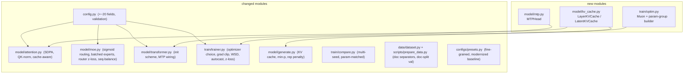

# Design Document

## Overview

This is an **incremental modernization** of the existing `qwenmoe` package,
not a new package. It touches ~8 existing modules plus 3 new small ones, and
adds ~20 config fields. The governing constraints:

1. **Default path unchanged.** Every new `ModelConfig`/`TrainConfig` field
   defaults so that a pre-spec config reproduces today's numbers (within a
   stated float tolerance). The three exceptions — AdamW constants, the LR
   decay floor, and fused SDPA on the non-trace path — are pure-win default
   changes, each journaled and each covered by a test showing the delta is
   negligible on the trainer integration sequence.
2. **Trace parity.** `forward_with_trace` keeps the explicit math. Where a
   fast path and the trace path could drift, a test pins them together
   within `1e-5`. Options the Manim scenes don't model yet raise a clear
   `NotImplementedError` from the trace path (the pattern MLA established).
3. **From scratch, no new deps.** Muon (Newton–Schulz iteration),
   the WSD schedule, QK-norm, MTP heads, the KV cache, and document masking
   are all a few dozen lines of `torch` each.



## Components and Interfaces

### `config.py` — new fields (Requirement 1–12)

```python
@dataclass
class ModelConfig:
    # ... all existing fields unchanged ...

    # -- routing (Req 4) --
    router_scoring: Literal["softmax", "sigmoid"] = "softmax"
    router_z_loss_weight: float = 0.0
    aux_loss_weight: float = 0.01
    seq_balance_loss_weight: float = 0.0     # loss-free complementary loss

    # -- attention (Req 7) --
    qk_norm: bool = False

    # -- MTP (Req 6) --
    mtp_depth: int = 0
    mtp_lambda: float = 0.3

    # -- init (Req 9) --
    init_std: float = 0.02

@dataclass
class TrainConfig:
    # ... all existing fields unchanged ...

    optimizer: Literal["adamw", "muon"] = "adamw"
    betas: tuple[float, float] = (0.9, 0.95)          # pure-win change
    adam_eps: float = 1e-8
    weight_decay: float = 0.1                          # pure-win change
    grad_clip_norm: float = 1.0
    muon_lr: float | None = None                       # defaults to lr if None
    muon_momentum: float = 0.95

    lr_schedule: Literal["cosine", "wsd"] = "cosine"
    min_lr_ratio: float = 0.1                          # pure-win change (was 0.0)
    decay_fraction: float = 0.2                        # wsd only

    precision: Literal["fp32", "bf16"] = "fp32"
    z_loss_weight: float = 0.0
    document_masking: bool = False

@dataclass
class DataConfig:
    # ... existing ...
    val_split_mode: Literal["tail", "documents"] = "tail"
```

`__post_init__` additions: `mtp_depth >= 0`; `0 <= min_lr_ratio <= 1`;
`0 < decay_fraction <= 1`; all `*_weight >= 0`; `betas` both in `(0, 1)`;
`grad_clip_norm > 0`; if `router_scoring == "sigmoid"` no extra constraint;
`qk_norm` requires `d_model % n_heads == 0` (already guaranteed).

### `train/optim.py` — Muon + param groups (Requirement 1)

```python
def split_param_groups(model) -> tuple[list[Parameter], list[Parameter]]:
    """(decay, no_decay). decay = params with p.ndim >= 2 that are not the
    (tied) embedding; no_decay = everything else."""

def build_optimizer(model, cfg: TrainConfig) -> Optimizer:
    """cfg.optimizer == 'adamw'  -> single AdamW with two param groups
       cfg.optimizer == 'muon'   -> a CombinedOptimizer wrapping
                                    Muon(2-D weights) + AdamW(the rest)."""

class Muon(torch.optim.Optimizer):
    """Momentum SGD whose update is orthogonalized by a fixed 5-step
    Newton-Schulz iteration (Jordan et al.; Bernstein). Per-parameter:
        buf = momentum * buf + grad
        update = zeropower_via_newtonschulz5(buf)          # ~orthogonal
        p -= lr * sqrt(max(1, rows/cols)) * update
    """

class CombinedOptimizer:
    """Holds >=2 sub-optimizers; .step()/.zero_grad()/.state_dict()/
    .load_state_dict() fan out. param_groups is the concatenation so the
    trainer's LR-schedule loop (`for g in opt.param_groups`) is unchanged."""
```

The trainer's existing `_set_lr` walks `optimizer.param_groups` and sets
`group["lr"]`; `CombinedOptimizer.param_groups` exposing every sub-group
keeps that working. Muon groups carry a `base_lr` of `muon_lr or lr`; the
multiplier from `lr_multiplier` applies to both.

Newton–Schulz `zeropower_via_newtonschulz5(G)`: cast to bfloat16, normalize
by `‖G‖_F`, run the fixed quintic iteration `X ← aX + b(XXᵀ)X + c(XXᵀ)²X`
with the standard `(a,b,c) = (3.4445, -4.7750, 2.0315)` five times, cast
back. Handles non-square by transposing so rows ≤ cols.

### `train/trainer.py` — step changes (Requirements 1, 2, 3)

- `Trainer.fit`: `optimizer = build_optimizer(model, config)`; on resume,
  `CombinedOptimizer.load_state_dict` restores every sub-optimizer.
- `lr_multiplier(step, config)` gains a `config` param (or a small
  `Schedule` object) so it can branch cosine vs wsd and read
  `min_lr_ratio`/`decay_fraction`. Kept pure; `test_trainer_integration.py`'s
  existing signature-based tests updated to pass a config.
- `_forward_backward_step`:
  - optional `with torch.autocast(device_type=dev, dtype=torch.bfloat16)`
    around `model(x)` when `precision == "bf16"`;
  - loss and `logsumexp` z-loss computed in `float32` (cast logits up);
  - `clip_grad_norm_` between `backward()` and `step()`, returning the norm;
  - returns `(lm_loss, aux_loss, z_loss, grad_norm)`; the step-log record
    gains `z_loss` and `grad_norm` keys (additive, no existing reader
    breaks).

### `model/attention.py` — SDPA, QK-norm, cache (Requirement 7, 8)

- `Attention.forward(x, positions, kv_cache=None, attn_mask=None)`:
  - build `q,k,v`; if `qk_norm`, apply `self.q_norm`/`self.k_norm`
    (`RMSNorm(head_dim)`) per head;
  - apply positional hook;
  - if `kv_cache` is not None, `k, v = kv_cache.append(k, v)`;
  - GQA expansion via SDPA's `enable_gqa=True` (drops `repeat_interleave`);
  - `out = F.scaled_dot_product_attention(q, k, v, attn_mask=mask,
    is_causal=(mask is None and kv_cache is None))`. ALiBi passes its bias as
    an additive float `attn_mask`; document masking passes a boolean mask;
    the two combine by addition when both present.
- `Attention.forward_with_trace` keeps the explicit path **plus** the
  `qk_norm` step; a test asserts `forward` and `forward_with_trace` agree
  within `1e-5` for both `qk_norm` values.
- `MLAAttention.forward` similarly switches its score/softmax/·V core to SDPA
  and accepts a `LatentKVCache`. Its `forward_with_trace` is unchanged
  (already documented as GQA-only for the scenes).
- `kv_cache_elements_per_token` stays as a static analysis helper;
  `model/kv_cache.py` provides the *runtime* object whose retained-byte size
  the new test measures.

### `model/kv_cache.py` (Requirement 8)

```python
class LayerKVCache:
    """Per-layer growing (k, v) buffers for GQA. append(k_new, v_new)
    concatenates along the sequence axis and returns the full (k, v).
    nbytes property for the measured-memory test."""

class LatentKVCache:
    """MLA equivalent: grows the compressed latent c_kv and the shared
    decoupled key k_rope only."""

def build_kv_cache(model) -> list:   # one entry per block, matching variant
```

`generate()` builds the cache once, feeds each block its entry, and passes
only the newest token's hidden state after the prefill step.

### `model/moe.py` — routing + batched experts (Requirements 4, 5)

- `Router` unchanged (still just the linear map to logits).
- New `score_and_select(router_logits, balancer, top_k, scoring)`:
  - `scoring == "softmax"`: today's path exactly.
  - `scoring == "sigmoid"`: `aff = router_logits.sigmoid()`; selection score
    = `aff + balancer.bias` (loss-free) or `aff` (aux); gate = selected
    `aff` renormalized.
- `AuxLossBalancer.__init__` takes `loss_weight` from config; gains an
  optional `router_z_loss` term returned added into `aux_loss`.
- `LossFreeBalancer` gains `sequence_balance_loss(router_probs_or_aff,
  topk_indices, seq_len)` returning the per-sequence balance penalty when
  `seq_balance_loss_weight > 0`, else `None`.
- **Batched dispatch** (`_dispatch_batched`): stack the routed experts'
  weights once at construction into `w_gate: (E, d_model, d_ff)` etc.
  (a `nn.Parameter` view is impractical across `nn.Linear`s, so hold the
  experts as `nn.ModuleList` for state-dict compatibility **and** register
  stacked buffers refreshed each forward via `torch.stack([...])` — cheap at
  this scale — or, cleaner, store expert weights directly as 3-D
  `nn.Parameter`s and keep a `.to_module_list()` shim for the trace path).
  Chosen approach: **3-D parameter tensors** for routed experts
  (`RoutedExperts` module), with `forward(x_flat, topk_indices,
  topk_weights)` doing an argsort-by-expert, a single batched
  `bmm`/`grouped` matmul, and a scatter-add back. Shared experts stay as
  small `nn.ModuleList` (always all-active, no dispatch).
  - migration note: this changes routed-expert state-dict keys
    (`routed_experts.3.w_gate.weight` → `routed_experts.w_gate[3]`). A
    `load_state_dict` pre-hook remaps old keys so parent-spec checkpoints
    still load. Covered by a test.
- `forward_with_trace` keeps the per-expert loop (Requirement 5.4).

### `model/mtp.py` + `model/transformer.py` (Requirement 6)

```python
class MTPHead(nn.Module):
    """One extra pre-norm TransformerBlock-lite + a projection reusing the
    (tied) output embedding. Input: trunk final hidden h (B,S,D). Predicts
    token[t + offset]. DeepSeek-V3 keeps the causal chain: depth d consumes
    depth d-1's hidden state."""
```

`QwenMoEModel.forward`:
- compute trunk as today → `h = final_norm(x)`, `logits = lm_head(h)`;
- if `mtp_depth > 0` and `self.training` and `targets is not None`
  (trainer passes them): run each `MTPHead`, accumulate
  `mtp_losses`; return `(logits, {"aux_loss":..., "mtp_loss": mean})`.
- Inference / no-targets: MTP heads are skipped entirely; return signature
  identical to today. `generate()` untouched.
- Trainer adds `mtp_lambda * extras["mtp_loss"]` when present.

### `model/transformer.py` — init (Requirement 9)

`_init_weights(module)` applied via `self.apply(...)` in `__init__` after
construction:
- `nn.Linear`: `trunc_normal_(weight, std=init_std)`; bias (none here) → 0.
- residual-path projections tagged with `module._is_residual_proj = True`
  at construction (`Attention.w_o`, expert down-projections) →
  `std = init_std / sqrt(2 * n_layers)`.
- `nn.Embedding`: `normal_(std=init_std)` (unchanged from today's 0.02).
- tied `lm_head`: shares the embedding tensor, so skip.
A test compares untrained-logit std to today's for `SMOKE_TEST` and asserts
it stays `O(1)`.

### `model/generate.py` (Requirements 8, 11)

- `filter_min_p(logits, min_p)` mirrors `filter_top_k`/`filter_top_p`.
- `apply_repetition_penalty(logits, generated_ids, penalty)`.
- `generate(...)` gains `min_p`, `repetition_penalty`, and
  `use_kv_cache=True` params; builds a cache via `build_kv_cache(model)` and
  runs prefill + incremental steps. `use_kv_cache=False` keeps the current
  full-re-encode path for the equivalence test.

### `data/dataset.py` + `scripts/prepare_data.py` (Requirement 10)

- BPE tokenizer reserves id 0 (or a dedicated `<eos>`); `prepare_data.py`
  joins documents with it and stores `eos_id` in `tokenizer.json`.
- `TokenDataset` optionally returns a third item, the doc-segment ids for
  the window, when constructed with `return_segments=True`.
- `build_document_mask(segment_ids)` → boolean `(S, S)` combined with the
  causal mask inside `Attention` when `document_masking` is on.
- `train_val_split(tokens, mode, eos_id)` — `"documents"` mode splits on
  `eos_id` positions and assigns whole documents to val.

### `train/compare.py` + `scripts/run_ablation_study.py` (Requirement 12)

- `run_comparison(..., seeds: list[int] = (1337,))`: loops seeds inside each
  variant; `VariantResult` gains `val_loss_mean`, `val_loss_std`,
  `val_ppl_mean`, `val_ppl_std`, `seeds`, `per_seed: list[float]`.
- Summary: `f"{mean:.4f} ± {std:.4f}"`; a `within_noise` bool per variant
  (`abs(mean - baseline_mean) < hypot(std, baseline_std)`).
- `param_matched`: when set, solve `d_ff'` so `count_params(variant).total`
  ≈ baseline total (bisection on `d_ff`), before training.
- `VARIANTS` menu extended with `OPT_MUON`, `ROUTE_SIGMOID`, `ATT_QKNORM`,
  `SCHED_WSD`, `MTP_D1`, `MOE_FINEGRAINED` presets.
- `scaling.py`: `moe_budget_note(total_params, active_params) -> str`.

## Data Models

`VariantResult` (extended):

```python
@dataclass
class VariantResult:
    config: ModelConfig
    seeds: list[int]
    per_seed_val_loss: list[float]
    val_loss_mean: float
    val_loss_std: float
    val_perplexity_mean: float
    val_perplexity_std: float
    tokens_per_sec: float
    within_noise_of_baseline: bool | None   # None for the baseline itself
    log_paths: list[Path]
```

Checkpoint dict is unchanged in shape; it now may contain MTP-head weights
in `model_state_dict` and a `CombinedOptimizer` state in
`optimizer_state_dict` (a dict of sub-states).

Step-log JSON record gains: `z_loss`, `grad_norm`, and (when MTP active)
`mtp_loss`. All additive — `scripts/run_ablation_study.py::_read_log` and
`viz/scenes_training.py` ignore unknown keys already.

## Error Handling

- **Muon on a 1-D parameter** → `build_optimizer` routes it to AdamW; Muon
  itself asserts `p.ndim == 2` so a wiring bug fails loud, not silently.
- **bf16 requested on a backend that lacks it** → `torch.autocast` is a
  no-op-ish fallback for unsupported ops; if a hard error occurs mid-step the
  existing `_run_step` cpu-fallback path catches the `RuntimeError`. A
  startup log line states the effective precision.
- **Old checkpoint, new batched-expert keys** → `load_state_dict` pre-hook
  remaps; if remap fails, raise a message naming the offending key and
  pointing at the migration note, not a raw `KeyError`.
- **`document_masking=True` but the dataset yields no segment ids** →
  `Trainer.fit` raises eagerly with "construct TokenDataset with
  return_segments=True".
- **MTP with `tie_word_embeddings=False`** → allowed; the MTP head gets its
  own projection. Validated, not errored.
- **SDPA + ALiBi**: the additive bias mask is `(n_heads, S, S)`; asserted to
  broadcast against SDPA's expected `attn_mask` shape, with a fallback to the
  explicit path if a torch version rejects it.

## Testing Strategy

- **Invariant tests (the backbone of this spec):** for every flag, one test
  that constructs a model/trainer with the flag *off* and asserts output /
  loss is `allclose` to a saved reference (or to the pre-flag code path)
  within `1e-5`. These guarantee the 213 existing tests remain meaningful.
- **New-behavior tests:** Muon step actually orthogonalizes (singular values
  of the update ≈ 1); WSD multiplier is flat in the stable phase and hits
  `min_lr_ratio` at the end; sigmoid routing still selects `k` and sums to 1;
  batched experts match the loop within `1e-5` incl. a zero-token expert;
  MTP adds exactly `mtp_depth` loss terms and `mtp_depth==0` is a no-op;
  QK-norm changes output when on and not when off; KV-cached vs uncached
  generation produce identical tokens; MLA runtime cache nbytes < GQA;
  min-p never masks all tokens; multi-seed `run_comparison` returns
  `std > 0` for `len(seeds) > 1`.
- **Config tests:** each new field's validation, in `tests/test_config.py`.
- **Checkpoint migration test:** a parent-spec state-dict loads into the new
  `MoELayer` via the remap hook.
- **Integration:** `test_trainer_integration.py` extended with an
  `optimizer="muon"`, a `precision="bf16"`, and an `mtp_depth=1` run — each
  asserting finite, decreasing loss over ~50 steps.
- **Manual:** run the refreshed ablation study on the TinyStories tier with
  3 seeds; eyeball the `mean ± std` table; watch one Muon vs AdamW loss
  curve; confirm generated text quality with min-p.

## Key decisions

- **Muon from scratch, not `pip install muon`.** The parent spec's
  from-scratch rule (no `transformers`, no `datasets`) applies to optimizers
  too. Newton–Schulz is ~15 lines; a real dependency would break the
  project's whole premise.
- **Batched experts via 3-D parameter tensors, not just `torch.compile`.**
  `compile` on MPS is unreliable and the Python loop is a graph break
  regardless. A `bmm` over stacked weights is portable and is itself the
  teaching artifact ("this is what makes MoE fast"). Cost: a state-dict
  migration hook, deemed worth it.
- **Flags default OFF; pure wins default ON.** Only SDPA-on-non-trace-path,
  AdamW `(0.9, 0.95)`/`wd=0.1`, and the `min_lr_ratio=0.1` floor change the
  default. Each is individually justified in its journal entry and each has a
  "delta is negligible on the integration sequence" test. Everything else is
  opt-in and becomes a comparison axis.
- **MTP is training-only.** No inference-time speculative decoding in this
  spec (it needs the KV cache landed and stable first). The MTP head exists
  to densify the signal and to be visualized; self-speculative decoding is a
  noted follow-up.
- **KV cache does not change `MLAAttention.forward_with_trace`.** The Manim
  pipeline stays GQA+RoPE only (parent decision); the cache is exercised
  through `generate()` and its own tests.
- **The parent spec is not edited.** This spec's `tasks.md` is self-
  contained; `journey_of_a_model/` entries continue the same numbering
  sequence (017+).
