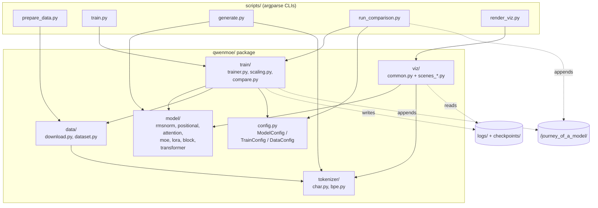

# Design Document

## Overview
A single local Python package (`qwenmoe/`) implements a Qwen-style
decoder-only MoE transformer in raw PyTorch, driven entirely by dataclass
configs so every architectural axis named in Requirement 12 (positional
scheme, activation, MoE balancing strategy, attention variant) is a config
value, not a code fork. Thin `argparse` CLI scripts wrap the package for data
prep, training, generation, ablation comparison, and Manim rendering. Every
module that computes something visualizable can optionally return a
`TraceBundle` of its real intermediate tensors from a real forward pass;
Manim scenes consume that bundle directly, so animations are never
illustrative fabrications (Requirement 7.1). Dependencies are kept deliberately
minimal (torch, manim, huggingface_hub, pytest) to keep the "from scratch"
feel — no `transformers`, no `datasets`, no YAML config framework.

## Architecture

### Module layout


### Forward-pass data flow (one transformer block)

```mermaid
flowchart LR
    IDS[token ids] --> EMB[Embedding lookup]
    EMB --> RN1[RMSNorm]
    RN1 --> POS["Positional scheme
    RoPE / NoPE / ALiBi"]
    POS --> ATT["Self-Attention
    GQA or MLA"]
    ATT --> RES1[+ residual]
    RES1 --> RN2[RMSNorm]
    RN2 --> MOE["MoE layer
    router top-k + shared/routed experts"]
    MOE --> RES2[+ residual]
    RES2 --> NEXT[next block / final norm]
    NEXT --> HEAD[LM head]
    HEAD --> LOGITS[logits -> softmax]
```

Each labeled step is exactly one Manim scene's subject (Requirement 7.2-7.6),
and each is captured via `forward_with_trace()` (below) on a small real
example rather than synthetic numbers.

### Packaging
`qwenmoe/` lives at the repo root next to `pyproject.toml` (matching the
existing flat `uv init` layout) and is declared as the build target
(`[tool.hatch.build.targets.wheel] packages = ["qwenmoe"]`) so `uv sync`
installs it editable and `scripts/*.py` can `import qwenmoe` directly. CLIs
use stdlib `argparse`, not a CLI framework — one fewer dependency, and this
project has few enough flags per script that it doesn't need one.

## Components and Interfaces

### `config.py`
- **Responsibility:** single source of truth for every tunable knob
  (Requirement 3.1, 12.1-12.5).
- **Interface:**
  ```python
  @dataclass
  class ModelConfig:
      vocab_size: int
      d_model: int = 256
      n_layers: int = 6
      n_heads: int = 8
      n_kv_heads: int = 4                # GQA; == n_heads means plain MHA
      d_ff: int = 512                    # per-expert SwiGLU intermediate size
      n_shared_experts: int = 1
      n_routed_experts: int = 8
      top_k: int = 2
      max_seq_len: int = 256
      positional_scheme: Literal["rope", "nope", "alibi"] = "rope"
      activation: Literal["swiglu", "geglu", "gelu"] = "swiglu"
      moe_balancing: Literal["aux_loss", "loss_free"] = "aux_loss"
      attention_variant: Literal["gqa", "mla"] = "gqa"
      mla_latent_dim: int | None = None  # required if attention_variant == "mla"
      lora_rank: int | None = None       # set only for LoRA fine-tuning runs
      tie_word_embeddings: bool = True
      rope_theta: float = 10000.0

      def __post_init__(self):
          # raises ValueError on invalid combinations, e.g. top_k > n_routed_experts,
          # n_heads % n_kv_heads != 0, mla_latent_dim missing when attention_variant == "mla"

  @dataclass
  class TrainConfig:
      batch_size: int
      seq_len: int
      total_tokens: int          # scaling-law-derived budget (Requirement 11.2)
      lr: float = 3e-4
      warmup_steps: int = 200
      checkpoint_interval_steps: int = 500
      eval_interval_steps: int = 100
      device: Literal["auto", "mps", "cpu"] = "auto"
      seed: int = 1337

  @dataclass
  class DataConfig:
      corpus: Literal["tiny_shakespeare", "tiny_stories"]
      tokenizer_type: Literal["char", "bpe"]
      bpe_vocab_size: int = 4096
      cache_dir: Path = Path(".cache/data")
      fixed_slice_tokens: int | None = None   # ablation mode: same slice for every variant
      fixed_slice_seed: int = 0
  ```
- Named presets live in `configs/presets.py` (`BASELINE`, `POS_NOPE`,
  `POS_ALIBI`, `MOE_LOSSFREE`, `ACT_GEGLU`, `ACT_GELU`, …) as plain
  `ModelConfig(...)` instances — config-as-code, no YAML/JSON schema layer.

### `tokenizer/` (Requirement 4.2-4.3)
- **Responsibility:** turn raw text into integer IDs and back, without a
  pretrained vocab.
- **Interface:** both implement a common `Tokenizer` protocol:
  `train(text: str) -> None`, `encode(text: str) -> list[int]`,
  `decode(ids: list[int]) -> str`, `save(path)`/`load(path)`,
  `vocab_size: int` property.
  - `CharTokenizer` — vocab = sorted unique characters in the corpus (used
    for the tiny-Shakespeare smoke test).
  - `ByteBPETokenizer` — byte-level BPE trained from scratch (merge-pair
    learning loop implemented here, no `tokenizers`/`tiktoken` dependency),
    used for the TinyStories comparison study.

### `data/` (Requirement 4.1, 4.4, 11.5)
- **Responsibility:** fetch, cache, tokenize, and window the corpus.
- **Interface:**
  - `download_corpus(name, cache_dir) -> Path` — tiny Shakespeare via a
    direct HTTPS text file; TinyStories via `huggingface_hub.hf_hub_download`
    (plain-text release file, not parquet, to avoid a `pyarrow`/`pandas`
    dependency).
  - `TokenDataset(Dataset)` — yields fixed-length `(x, y)` windows for
    next-token prediction; `train`/`val` split by a fixed fraction.
  - `make_fixed_slice(all_tokens, n_tokens, seed) -> Tensor` — shuffles
    document boundaries once with `seed`, then takes the first `n_tokens`;
    called with the **same seed and n_tokens** for every ablation variant so
    Requirement 12.6's "identical fixed slice" holds.

### `model/` (Requirements 1, 2, 12)
- **`RMSNorm(nn.Module)`** — `forward(x) -> x_normed` (Requirement 1.4).
- **`positional.py`**:
  - `RotaryEmbedding` — precomputes rotation angles from `rope_theta`;
    `apply_to_qk(q, k, positions) -> (q, k)` (Requirement 1.3).
  - `NoPositional` — identity `apply_to_qk()`, no parameters, no bias.
  - `AlibiBias` — `attention_bias(seq_len) -> Tensor` (a linear-slope bias
    added to attention scores, not a q/k rotation — architecturally
    different from RoPE/NoPE, so the shared interface exposes **both** an
    `apply_to_qk(q, k, positions)` hook (identity for ALiBi) **and** an
    `attention_bias(seq_len)` hook (`None` for RoPE/NoPE) that `Attention`
    always calls. (Named `apply_to_qk`, not `apply`, to avoid colliding
    with `nn.Module`'s own recursive `apply(fn)` method.)
- **`attention.py`**:
  - `Attention(nn.Module)` — standard scaled-dot-product self-attention
    with GQA (`n_kv_heads <= n_heads`, Requirement 1.5), causal mask
    (Requirement 1.6), calls the configured positional-scheme hooks.
  - `MLAAttention(nn.Module)` *(stretch, Requirement 12.4)* — compresses
    K/V into a shared low-rank latent `c_kv` (dim `mla_latent_dim`) plus a
    small decoupled-RoPE sub-dimension, per DeepSeek-V2/V3. Implements its
    **own** internal positional handling rather than the shared
    `positional_scheme` hooks, because MLA's RoPE application is coupled to
    which slice of the latent is compressed vs. rotated — documented here as
    a deliberate exception, not an oversight.
  - Both expose the same `forward(x, positions) -> Tensor` signature so
    `TransformerBlock` doesn't need to know which variant it holds.
- **`moe.py`**:
  - `Expert(nn.Module)` — one of `SwiGLUExpert` / `GEGLUExpert` / `GELUExpert`
    depending on `activation` (Requirement 2.1, 12.2).
  - `Router(nn.Module)` — linear layer producing per-expert logits.
  - `AuxLossBalancer` — computes the load-balancing auxiliary loss
    (Requirement 2.4) from routing probabilities and dispatch counts.
  - `LossFreeBalancer` *(Requirement 12.3)* — holds a non-trainable
    per-expert bias buffer (`register_buffer`, excluded from the optimizer).
    The bias is added to router logits **only for top-k selection**; the
    combination weights still use the un-biased softmax score, matching
    DeepSeek-V3 (Wang et al. 2024). After each training step, the bias for
    experts that received above-average load is nudged down by a fixed step
    `γ`, and below-average load nudged up — no gradient involved.
  - `MoELayer(nn.Module)` — `forward(x) -> (output, aux_loss_or_none)`;
    routes to top-`k` routed experts + all shared experts (Requirement
    2.2-2.3); if a routed expert gets zero tokens in a batch it's simply
    skipped (Requirement 2.5).
- **`lora.py`** *(stretch, Requirement 12.5)* — `LoRALinear(nn.Module)`
  wraps a frozen `nn.Linear` with trainable low-rank `A`/`B` matrices;
  `attach_lora(model, rank) -> model` swaps target linears in place.
- **`block.py` / `transformer.py`** — pre-norm residual wiring
  (Requirement 1) and:
  ```python
  class QwenMoEModel(nn.Module):
      def forward(self, input_ids) -> tuple[Tensor, dict]: ...       # logits, {"aux_loss": ...}
      def forward_with_trace(self, input_ids) -> tuple[Tensor, TraceBundle]: ...
  ```
  `forward_with_trace` is the one interface the whole visualization
  requirement (7) depends on — it runs a normal forward pass and additionally
  populates a `TraceBundle` (see Data Models) with every intermediate tensor
  a Manim scene might need, with no separate "visualization mode" math path
  to keep in sync.

### `train/` (Requirements 5, 11)
- **`trainer.py`**: `Trainer.fit(model, train_ds, val_ds, train_config)` —
  AdamW + warmup/cosine schedule (Requirement 5.1), periodic console logging
  of step/loss/aux-loss/elapsed (5.2), periodic val loss/perplexity (5.3),
  checkpointing + resume (5.4).
- **`scaling.py`**: `count_params(model) -> ParamBreakdown` (total + active,
  by component, Requirement 11.1); `chinchilla_budget(active_params) -> int`
  (Requirement 11.2); `calibrate_throughput(model, sample_batch, device,
  n_steps=20) -> tokens_per_sec` (Requirement 11.4); `epochs_for_budget(
  total_tokens, unique_tokens) -> float`, warns via `logging.warning` past 4
  (Requirement 11.3).
- **`compare.py`**: `run_comparison(base_config, variants: dict[str,
  dict], data_config, train_config) -> ComparisonReport` — trains each
  variant on the identical fixed slice (Requirement 12.6), writes per-variant
  logs, returns a report the CLI renders as a table (Requirement 12.7).

### `viz/`
- **`common.py`**: `capture_trace(checkpoint_path, prompt) -> TraceBundle`
  loads a checkpoint, tokenizes `prompt`, and calls
  `model.forward_with_trace()` under `torch.no_grad()` (Requirement 7.1).
- One `manim.Scene` subclass per architectural component (Requirement
  7.2-7.6), each taking a `TraceBundle` (or a path to one cached as
  `.pt`/`.npz`) and rendering the relevant sub-slice of it; each runnable
  independently via `manim -pql viz/scenes_attention.py AttentionScene`
  (Requirement 7.7) without needing the others.
- **`scenes_training.py`** reads the JSON/CSV logs `Trainer` writes (loss
  curve, expert-utilization counts) rather than a `TraceBundle`
  (Requirement 8.1-8.2); raises a clear `FileNotFoundError`-derived message
  if no log file exists yet (Requirement 8.3).

### Development Journal Convention (Requirement 13)
Not a code component — a process rule the executing agent follows during
Phase 4: each completed task, each idea considered, and each meaningful
decision gets a new file `journey_of_a_model/NNN-short-slug.md` (zero-padded
sequence number, e.g. `001-project-skeleton.md`), with a one-line date +
type header (`idea` / `decision` / `task` / `run`). Whenever an entry
introduces a technical concept, it's written as a beginner-friendly
explainer — every term defined before use, with a plain-English meaning,
the problem it solves, a real-world analogy, and a simple technical
explanation — plus at least one Mermaid diagram, a "Questions that might
come to mind" section, links to the concept's original paper/blog, and (for
concepts with an underlying formula) the full derivation of that formula
rather than just the result, with exact math clearly distinguished from any
empirically-fitted constants, plus a worked numeric example run by hand on
concrete dummy values (Requirement 13.6-13.9). Entries run longer than a
couple of paragraphs whenever there's real technical content to teach; a
pure process/decision entry with nothing new to explain can stay short.
`journey_of_a_model/README.md` is an append-only index (date, file link,
one-line summary) updated in the same edit that adds an entry.

## Data Models

```python
@dataclass
class TraceBundle:
    token_ids: list[int]
    embeddings: Tensor                       # (seq, d_model)
    layers: list["LayerTrace"]
    final_norm_output: Tensor
    logits: Tensor                           # (seq, vocab_size)
    probs: Tensor                            # softmax(logits[-1])

@dataclass
class LayerTrace:
    rope_angles_or_alibi_bias: Tensor | None
    q, k, v: Tensor                          # pre-attention projections
    attn_scores_pre_mask: Tensor
    attn_scores_post_softmax: Tensor
    attn_output: Tensor
    router_logits: Tensor
    router_probs: Tensor
    topk_indices: Tensor
    topk_weights: Tensor
    expert_outputs: dict[int, Tensor]        # only populated for dispatched experts
    moe_output: Tensor

@dataclass
class ParamBreakdown:
    embedding: int
    attention_total: int
    moe_total: int
    moe_active: int
    total: int
    active: int

@dataclass
class ComparisonReport:
    variants: dict[str, "VariantResult"]     # name -> result

@dataclass
class VariantResult:
    config: ModelConfig
    final_train_loss: float
    final_val_loss: float
    val_perplexity: float
    tokens_per_sec: float
    log_path: Path
```
Checkpoints are a plain `torch.save` dict: `{"model_state_dict",
"optimizer_state_dict", "model_config", "train_config", "step",
"tokenizer_meta"}`.

## Error Handling
- **MPS unavailable/errors during a step** → fall back to `cpu` with a
  logged warning, never a hard crash (Requirement 3.2).
- **Invalid `ModelConfig` combination** (e.g. `top_k > n_routed_experts`,
  `n_heads % n_kv_heads != 0`, missing `mla_latent_dim`) → raised eagerly in
  `__post_init__`, not discovered mid-training.
- **Zero tokens routed to an expert in a batch** → skipped, no error, no
  gradient for that expert that step (Requirement 2.5).
- **Corpus download failure** (network, HF rate limit) → clear message
  naming the file and a manual-download fallback path in the README, not a
  raw `requests`/`urllib` traceback.
- **Visualization requested with no checkpoint/logs yet** → fail fast with
  an actionable message ("run `train.py` first") instead of a stack trace
  (Requirement 8.3).
- **Manim system dependencies missing** (ffmpeg/cairo/pango) → surfaced via
  Manim's own import-time error; README documents the `brew install` steps
  so this isn't mysterious.
- **Tokenizer decode of an out-of-range id** → raises `ValueError` at the
  boundary rather than silently producing garbage.

## Testing Strategy
- **Unit tests (`pytest`, CPU, tiny dims — not the illustrative baseline
  size, so the suite runs in seconds):**
  - `RMSNorm` output shape + unit RMS within tolerance (Requirement 9.1).
  - RoPE preserves vector norm and rotates a known vector by the expected
    angle (9.2).
  - Causal mask: perturbing a later token leaves an earlier position's
    output bit-for-bit unchanged (9.3).
  - MoE router always selects exactly `k` experts and selected weights sum
    to 1, for both `AuxLossBalancer` and `LossFreeBalancer` (9.4, 12.3).
  - Zero-token expert doesn't error (2.5).
  - Full model forward shape correct for ≥2 batch/seq-len combinations
    (9.5), and for both `attention_variant` values once MLA exists (12.4).
  - Tokenizer round-trip is lossless for both `CharTokenizer` and
    `ByteBPETokenizer` (4.3).
  - `ModelConfig.__post_init__` raises on each known-bad combination.
- **Small integration test:** a few dozen training steps on a tiny synthetic
  repeating sequence, asserting loss is finite and strictly decreases —
  catches wiring bugs the isolated unit tests can't (optimizer not
  attached, aux loss not backpropagated, etc.).
- **Manual verification (can't be unit-tested):** actually watching each
  rendered Manim scene for visual correctness; reading generated sample text
  for qualitative coherence; eyeballing the ablation comparison table/chart.
