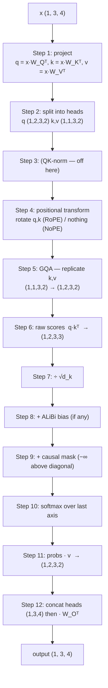
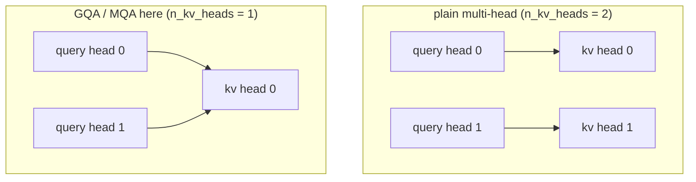

# 004 — Attention (GQA baseline): the full derivation, solved by hand

**Companion to:** [`journey_of_a_model/004-attention-gqa.md`](../../journey_of_a_model/004-attention-gqa.md)
· **Code:** [`qwenmoe/model/attention.py`](../../qwenmoe/model/attention.py)
· **Every number here is reproduced by:** [`verify_004_attention_gqa.py`](verify_004_attention_gqa.py)
(`uv run python docs/math/verify_004_attention_gqa.py`)

---

## How to read this

The journal entry tells you *what* attention and Grouped-Query Attention
(GQA) are and gives one worked example per formula. This document is the
opposite trade-off: **maximum detail, minimum summarising**. We

1. fix one tiny, fully-written-out input and one tiny set of weights,
2. push them through **every single line** of `Attention.forward_with_trace`
   (the explicit-math path in [`attention.py`](../../qwenmoe/model/attention.py#L183)),
3. and for every operation — a matrix multiply, a reshape, a softmax —
   first derive *why* it has the form it does, then **do the arithmetic on
   paper**, digit by digit, and check it against the real module.

Nothing is skipped. If a step turns a `(1, 3, 4)` array into a
`(1, 2, 3, 2)` array, we trace exactly which number went where.

You do **not** need to have read a linear-algebra course. Every term
(vector, dot product, matrix multiply, variance, softmax) is defined at
first use. You *should* skim
[`journey_of_a_model/003-norm-and-positional.md`](../../journey_of_a_model/003-norm-and-positional.md)
and [`004-attention-gqa.md`](../../journey_of_a_model/004-attention-gqa.md)
first for the plain-English picture.

---

## Part 0 — What are we even computing?

A decoder-only transformer reads a sequence of tokens (word-pieces) and,
at every position, must produce a vector that is a good summary of "what
matters here, given everything before it." **Self-attention** is the
operation that lets position $i$ pull information from positions
$0, 1, \dots, i$ — reweighting them by how relevant each one is to
position $i$.

The whole operation, for a single attention head, is this one line
(Vaswani et al. 2017):

$$\text{Attention}(Q, K, V) = \operatorname{softmax}\!\left(\frac{QK^{\top}}{\sqrt{d_k}} + M\right) V$$

- $Q, K, V$ are matrices with one row per token (the **queries**,
  **keys**, and **values**);
- $QK^{\top}$ is an all-pairs similarity score;
- $\sqrt{d_k}$ is a scaling constant we will *derive*, not assume;
- $M$ is the **causal mask** that forbids looking at future tokens;
- $\operatorname{softmax}$ turns each row of scores into weights that sum
  to $1$;
- multiplying by $V$ takes the weighted average.

**Grouped-Query Attention (GQA)** (Ainslie et al. 2023) is one small
modification: instead of every query head having its own $K$ and $V$, a
*group* of query heads shares one $K$/$V$ head. Everything else is
identical. We build up to GQA by first doing plain multi-head attention
and then collapsing the KV heads.

By the end of Part 2 you will have computed, by hand, the exact
`(1, 3, 4)` tensor the real module returns:

```
[[2.000000, 2.000000, 2.000000, 2.000000],
 [3.474192, 2.000000, 2.804430, 2.669762],
 [3.408561, 1.573375, 2.318140, 2.663796]]
```

---

## Part 1 — The running example

### 1.1 Definitions we need right now

- **Scalar:** a single number, e.g. $3$ or $-0.5$.
- **Vector:** an ordered list of numbers, written in brackets, e.g.
  $[1, 0, 1, 0]$. Its **length** or **dimension** is how many numbers it
  holds (here, $4$).
- **Dot product** of two equal-length vectors $a$ and $b$: multiply them
  element by element and add up the results.
  $[1,0,1,0]\cdot[2,1,0,1] = 1{\cdot}2 + 0{\cdot}1 + 1{\cdot}0 + 0{\cdot}1 = 2$.
  It is one number, and it is large when the two vectors "point the same
  way."
- **Matrix:** a rectangle of numbers, i.e. a list of equal-length row
  vectors. A matrix with $r$ rows and $c$ columns is called $r\times c$
  ("$r$ by $c$").
- **Transpose** $A^{\top}$: flip a matrix across its diagonal — row $i$
  becomes column $i$. A $r\times c$ matrix becomes $c\times r$.
- **Matrix multiply** $AB$: if $A$ is $m\times n$ and $B$ is $n\times p$,
  then $AB$ is $m\times p$, and its entry at row $i$, column $j$ is the
  dot product of **row $i$ of $A$** with **column $j$ of $B$**. The inner
  sizes ($n$) must match.
- **Tensor:** the same idea generalised to more than two axes — a
  "list of matrices" is a 3-axis tensor, a "list of lists of matrices" is
  a 4-axis tensor, and so on. PyTorch calls all of these `Tensor`. We
  write a tensor's **shape** as a tuple, e.g. `(1, 2, 3, 2)` is a 4-axis
  tensor: 1 of (2 of (3×2 matrices)).

### 1.2 The model configuration

We use the smallest configuration that still shows GQA doing something
non-trivial:

| Symbol | Meaning | Value |
|---|---|---|
| `batch` | independent sequences processed at once | $1$ |
| `seq_len`, $S$ | tokens in the sequence | $3$ |
| `d_model`, $d$ | width of a token's vector everywhere in the model | $4$ |
| `n_heads`, $H$ | number of **query** heads | $2$ |
| `head_dim`, $d_k$ | width of one head $= d/H$ | $2$ |
| `n_kv_heads`, $H_{kv}$ | number of **key/value** heads | $1$ |
| `n_rep`, $r$ | query heads per KV head $= H / H_{kv}$ | $2$ |
| `positional_scheme` | how position enters | `nope` (then `rope`, `alibi`) |
| `qk_norm` | per-head RMSNorm on q/k | `False` |

`ModelConfig.__post_init__` guarantees $d \bmod H = 0$ and
$H \bmod H_{kv} = 0$, so `Attention` never re-checks them
([`config.py:56-67`](../../qwenmoe/config.py#L56)).

> With only $H = 2$ query heads, the sole way to have *fewer* KV heads is
> $H_{kv} = 1$, which is technically the **multi-query attention (MQA)**
> extreme (Shazeer 2019). A "true" grouped setup such as $H = 4$,
> $H_{kv} = 2$ works identically — KV head $0$ serves query heads
> $\{0, 1\}$ and KV head $1$ serves $\{2, 3\}$ — just with twice the
> arithmetic on the page. Section 5 shows the $4/2$ replication explicitly;
> the full trace uses $2/1$ so every number stays visible.

### 1.3 The input

Three tokens, each already looked up in the embedding table into a
length-$d = 4$ vector. Call the matrix $X$ (shape `(batch, S, d)` =
`(1, 3, 4)`; we drop the batch axis while doing algebra and restore it for
shapes):

$$X = \begin{bmatrix} x_0 \\ x_1 \\ x_2 \end{bmatrix}
= \begin{bmatrix} 1 & 0 & 1 & 0 \\ 0 & 2 & 0 & 1 \\ 1 & 1 & 0 & 0 \end{bmatrix}$$

- $x_0 = [1, 0, 1, 0]$ — pretend this is the vector for `"the"`
- $x_1 = [0, 2, 0, 1]$ — `"cat"`
- $x_2 = [1, 1, 0, 0]$ — `"sat"`

The token at **position $i$** may attend to positions $0 \dots i$ only.

### 1.4 The weights

A real model *learns* these by gradient descent; for a hand derivation we
pick fixed, simple values. Four weight matrices, matching the four
`nn.Linear` layers in
[`Attention.__init__`](../../qwenmoe/model/attention.py#L101):

$$
W_Q = \begin{bmatrix} 1&1&0&0 \\ 0&1&1&0 \\ 0&0&1&1 \\ 1&0&0&1 \end{bmatrix}\!,\quad
W_K = \begin{bmatrix} 1&0&1&0 \\ 0&1&0&1 \end{bmatrix}\!,\quad
W_V = \begin{bmatrix} 1&1&0&0 \\ 0&0&1&1 \end{bmatrix}\!,\quad
W_O = \begin{bmatrix} 1&0&1&0 \\ 0&1&0&1 \\ 1&0&0&1 \\ 0&1&1&0 \end{bmatrix}
$$

Shapes (PyTorch stores a `Linear`'s weight as `(out_features, in_features)`):

| matrix | `nn.Linear` | shape `(out, in)` | role |
|---|---|---|---|
| $W_Q$ | `w_q` | $(H\,d_k,\ d) = (4, 4)$ | build the query vectors |
| $W_K$ | `w_k` | $(H_{kv}\,d_k,\ d) = (2, 4)$ | build the key vectors |
| $W_V$ | `w_v` | $(H_{kv}\,d_k,\ d) = (2, 4)$ | build the value vectors |
| $W_O$ | `w_o` | $(d,\ H\,d_k) = (4, 4)$ | mix the heads' outputs back to width $d$ |

All four have `bias=False` (Llama/Qwen convention — one fewer thing to
learn, and RMSNorm upstream already sets the scale).

### 1.5 What `nn.Linear` actually computes

`nn.Linear(in, out)` with weight $W$ (shape `(out, in)`) maps an input row
vector $x$ (length `in`) to an output row vector $y$ (length `out`) by

$$y = x W^{\top}, \qquad\text{i.e.}\qquad y_j = \sum_{p=1}^{\text{in}} x_p \, W_{j,p}.$$

In words: **output coordinate $j$ is the dot product of the input with row
$j$ of $W$.** That is the only fact about linear layers we need. When the
input is a whole matrix $X$ (one row per token), every row is transformed
the same way: $Y = X W^{\top}$.

---

## Part 2 — The forward pass, one operation at a time

The path a real training or inference call takes is
`Attention.forward` ([`attention.py:119`](../../qwenmoe/model/attention.py#L119)),
which calls the single fused kernel `F.scaled_dot_product_attention`. That
kernel computes *exactly* the maths below but fuses it into one GPU
operation, so no intermediate is materialised. To see the intermediates we
follow the numerically-equivalent explicit path,
`Attention.forward_with_trace` ([`attention.py:183`](../../qwenmoe/model/attention.py#L183));
Section 13 shows the two agree to $2.4\times10^{-7}$ on this example.



---

### Step 1 — Project `x` into queries, keys, values

Code ([`attention.py:198-200`](../../qwenmoe/model/attention.py#L198)):

```python
q = self.w_q(x)...      # x @ W_Q.T
k = self.w_k(x)...      # x @ W_K.T
v = self.w_v(x)...      # x @ W_V.T
```

**Why three different projections?** The same token vector needs to play
three different roles: as a *query* ("what am I looking for?"), as a *key*
("what do I offer to others looking?"), and as a *value* ("what do I
actually contribute once chosen?"). Three separate learned matrices let
the model shape each role independently from the one shared input $x$.

#### 1a. Queries: $q = X W_Q^{\top}$

By the rule from §1.5, $q_{i,j}$ = (token $i$) $\cdot$ (row $j$ of $W_Q$).
Rows of $W_Q$: $r_0=[1,1,0,0]$, $r_1=[0,1,1,0]$, $r_2=[0,0,1,1]$,
$r_3=[1,0,0,1]$.

**Token 0**, $x_0 = [1,0,1,0]$:

$$
\begin{aligned}
q_{0,0} &= [1,0,1,0]\cdot[1,1,0,0] = 1{+}0{+}0{+}0 = 1\\
q_{0,1} &= [1,0,1,0]\cdot[0,1,1,0] = 0{+}0{+}1{+}0 = 1\\
q_{0,2} &= [1,0,1,0]\cdot[0,0,1,1] = 0{+}0{+}1{+}0 = 1\\
q_{0,3} &= [1,0,1,0]\cdot[1,0,0,1] = 1{+}0{+}0{+}0 = 1
\end{aligned}
\quad\Rightarrow\quad q_0 = [1,1,1,1]
$$

**Token 1**, $x_1 = [0,2,0,1]$:

$$
\begin{aligned}
q_{1,0} &= [0,2,0,1]\cdot[1,1,0,0] = 0{+}2{+}0{+}0 = 2\\
q_{1,1} &= [0,2,0,1]\cdot[0,1,1,0] = 0{+}2{+}0{+}0 = 2\\
q_{1,2} &= [0,2,0,1]\cdot[0,0,1,1] = 0{+}0{+}0{+}1 = 1\\
q_{1,3} &= [0,2,0,1]\cdot[1,0,0,1] = 0{+}0{+}0{+}1 = 1
\end{aligned}
\quad\Rightarrow\quad q_1 = [2,2,1,1]
$$

**Token 2**, $x_2 = [1,1,0,0]$:

$$
\begin{aligned}
q_{2,0} &= [1,1,0,0]\cdot[1,1,0,0] = 1{+}1 = 2\\
q_{2,1} &= [1,1,0,0]\cdot[0,1,1,0] = 0{+}1 = 1\\
q_{2,2} &= [1,1,0,0]\cdot[0,0,1,1] = 0\\
q_{2,3} &= [1,1,0,0]\cdot[1,0,0,1] = 1
\end{aligned}
\quad\Rightarrow\quad q_2 = [2,1,0,1]
$$

$$q = \begin{bmatrix} 1&1&1&1 \\ 2&2&1&1 \\ 2&1&0&1 \end{bmatrix}\quad\text{shape }(1, 3, 4)$$

#### 1b. Keys: $k = X W_K^{\top}$

Rows of $W_K$: $r_0 = [1,0,1,0]$, $r_1 = [0,1,0,1]$.

$$
\begin{aligned}
k_0 &= \big[\,[1,0,1,0]\cdot[1,0,1,0],\ [1,0,1,0]\cdot[0,1,0,1]\,\big] = [\,2,\ 0\,]\\
k_1 &= \big[\,[0,2,0,1]\cdot[1,0,1,0],\ [0,2,0,1]\cdot[0,1,0,1]\,\big] = [\,0,\ 3\,]\\
k_2 &= \big[\,[1,1,0,0]\cdot[1,0,1,0],\ [1,1,0,0]\cdot[0,1,0,1]\,\big] = [\,1,\ 1\,]
\end{aligned}
$$

$$k = \begin{bmatrix} 2&0 \\ 0&3 \\ 1&1 \end{bmatrix}\quad\text{shape }(1, 3, 2)$$

Note $k$ is only **2** wide, not 4: there is $H_{kv} = 1$ key head of
width $d_k = 2$. This narrowness is the entire point of GQA — see Step 5.

#### 1c. Values: $v = X W_V^{\top}$

Rows of $W_V$: $r_0 = [1,1,0,0]$, $r_1 = [0,0,1,1]$.

$$
\begin{aligned}
v_0 &= \big[\,[1,0,1,0]\cdot[1,1,0,0],\ [1,0,1,0]\cdot[0,0,1,1]\,\big] = [\,1,\ 1\,]\\
v_1 &= \big[\,[0,2,0,1]\cdot[1,1,0,0],\ [0,2,0,1]\cdot[0,0,1,1]\,\big] = [\,2,\ 1\,]\\
v_2 &= \big[\,[1,1,0,0]\cdot[1,1,0,0],\ [1,1,0,0]\cdot[0,0,1,1]\,\big] = [\,2,\ 0\,]
\end{aligned}
$$

$$v = \begin{bmatrix} 1&1 \\ 2&1 \\ 2&0 \end{bmatrix}\quad\text{shape }(1, 3, 2)$$

---

### Step 2 — Split the projections into heads

Code ([`attention.py:198`](../../qwenmoe/model/attention.py#L198)):
`.view(batch, seq_len, n_heads, head_dim).transpose(1, 2)`.

**Why heads?** One dot-product similarity can only score tokens on *one*
notion of relatedness. Splitting the width into $H$ independent blocks and
running attention separately in each lets different heads specialise
(one on adjacent words, one on subject–verb agreement, …). It costs almost
nothing: $H$ heads of width $d_k = d/H$ do the same total work as one head
of width $d$.

#### 2a. `.view(1, 3, H, d_k)` — reinterpret, don't move

`view` changes the shape label without touching a single number in
memory. The length-4 row for each token is **cut into $H = 2$ contiguous
pieces of $d_k = 2$**: the first 2 numbers are head 0, the last 2 are
head 1.

$$
q_0 = [\underbrace{1, 1}_{\text{head }0}\ \underbrace{1, 1}_{\text{head }1}],\quad
q_1 = [\underbrace{2, 2}_{\text{head }0}\ \underbrace{1, 1}_{\text{head }1}],\quad
q_2 = [\underbrace{2, 1}_{\text{head }0}\ \underbrace{0, 1}_{\text{head }1}]
$$

So after `view`, indexing as `q[0, token, head, :]`:

| | head 0 | head 1 |
|---|---|---|
| token 0 | $[1, 1]$ | $[1, 1]$ |
| token 1 | $[2, 2]$ | $[1, 1]$ |
| token 2 | $[2, 1]$ | $[0, 1]$ |

#### 2b. `.transpose(1, 2)` — swap the token and head axes

Shape goes `(1, S, H, d_k)` → `(1, H, S, d_k)`. Now the tensor is
"per head, a stack of token rows," which is what a per-head matrix
multiply wants. `transpose` also only relabels axes (it changes strides,
not memory).

$$
q^{(h=0)} = \begin{bmatrix} 1&1 \\ 2&2 \\ 2&1 \end{bmatrix},\qquad
q^{(h=1)} = \begin{bmatrix} 1&1 \\ 1&1 \\ 0&1 \end{bmatrix}
\qquad\text{each shape }(1, 1, 3, 2)\ \text{inside}\ (1, 2, 3, 2)
$$

For $k$ and $v$ the same two calls give shape `(1, S, H_{kv}, d_k)` →
`(1, 1, 3, 2)` — a single KV head:

$$
k^{(h=0)} = \begin{bmatrix} 2&0 \\ 0&3 \\ 1&1 \end{bmatrix},\qquad
v^{(h=0)} = \begin{bmatrix} 1&1 \\ 2&1 \\ 2&0 \end{bmatrix}
$$

**Shape ledger after Step 2:** `q (1, 2, 3, 2)`, `k (1, 1, 3, 2)`,
`v (1, 1, 3, 2)`.

---

### Step 3 — (Optional) QK-norm

Code ([`attention.py:156-158`](../../qwenmoe/model/attention.py#L156)):
`if self.qk_norm: q = self.q_norm(q); k = self.k_norm(k)`.

Our config has `qk_norm=False`, and the submodules are then *not even
constructed* ([`attention.py:114-117`](../../qwenmoe/model/attention.py#L114)),
so this step is a literal no-op and the spine skips it. For completeness,
had it been on, each head vector would be replaced by its RMSNorm
(Zhang & Sennrich 2019):

$$\operatorname{RMSNorm}(z) = \frac{z}{\sqrt{\tfrac{1}{d_k}\sum_p z_p^2 + \varepsilon}}\odot w,\qquad w \text{ init all-ones},\ \varepsilon = 10^{-6}.$$

Worked on $q^{(0)}_1 = [2, 2]$: mean of squares $= (4+4)/2 = 4$,
$\sqrt{4 + 10^{-6}} \approx 2$, result $[2, 2]/2 = [1, 1]$. On
$q^{(0)}_2 = [2, 1]$: mean of squares $= (4+1)/2 = 2.5$,
$\sqrt{2.5} = 1.5811$, result $[1.2649,\ 0.6325]$.

**Why it exists:** without it, the attention logits $q\cdot k$ grow with
the *scale* of the residual stream (which itself grows with depth), and an
unbounded logit saturates the softmax. RMSNorm pins $\lVert q\rVert$,
$\lVert k\rVert$ to $\sqrt{d_k}$ before the dot product, capping the logit
scale regardless of input magnitude. Full Cauchy–Schwarz derivation and a
measured $47{,}000\times$ logit blow-up are in
[`journey_of_a_model/022-qk-norm.md`](../../journey_of_a_model/022-qk-norm.md).
Original idea: Henry et al. 2020 (they $\ell_2$-normalise and multiply by a
learned scalar; Llama/Qwen and this repo use the RMSNorm variant).

---

### Step 4 — Positional transform

Code ([`attention.py:160`](../../qwenmoe/model/attention.py#L160)):
`q, k = self.positional.apply_to_qk(q, k, positions)` with
`positions = [0, 1, 2]`.

Attention as written so far is **permutation-blind**: $q_i \cdot k_j$
doesn't depend on $i$ or $j$, only on the vectors' contents. Shuffle the
tokens and the scores just shuffle with them. Something must inject
"position $i$ vs. position $j$." The `positional_scheme` config picks
which of three answers is used.

#### 4·NoPE — the spine

`NoPositional.apply_to_qk` returns `q, k` **unchanged**
([`positional.py:70-73`](../../qwenmoe/model/positional.py#L70)). Position
information then enters *only* through the causal mask of Step 9 (a
causally-masked model can still infer position from "how many tokens can I
see"; Kazemnejad et al. 2023). Our main trace uses this so the arithmetic
stays clean. $q$, $k$ are exactly as in Step 2.

#### 4·RoPE — the real default (`positional_scheme="rope"`)

Rotary Position Embedding (Su et al. 2021) **rotates** each 2-D slice of a
head's vector by an angle proportional to the token's position. The full
"why a rotation gives *relative* position" derivation is in
[`journey_of_a_model/003-norm-and-positional.md`](../../journey_of_a_model/003-norm-and-positional.md#rope-rotary-position-embedding);
here we execute it on our numbers.

**Frequencies.** For `head_dim` $d_k = 2$ there is exactly *one* 2-D pair,
with inverse frequency
([`positional.py:31`](../../qwenmoe/model/positional.py#L31))

$$\text{inv\_freq}_0 = \theta^{-0/d_k} = 10000^{0} = 1.$$

So the rotation angle for a token at position $m$ is $m \cdot 1 = m$
**radians**:

| position $m$ | angle | $\cos m$ | $\sin m$ |
|---|---|---|---|
| 0 | 0 | 1 | 0 |
| 1 | 1 | 0.540302 | 0.841471 |
| 2 | 2 | −0.416147 | 0.909297 |

**The rotation.** `apply_to_qk` computes
`q_rot = q * cos + rotate_half(q) * sin`
([`positional.py:48`](../../qwenmoe/model/positional.py#L48)), where
`rotate_half([a, b]) = [-b, a]`. Plug in: for a length-2 vector
$z = [a, b]$ at angle $\phi$,

$$z_{\text{rot}} = [a, b]\odot[\cos\phi, \cos\phi] + [-b, a]\odot[\sin\phi, \sin\phi]
= [\,a\cos\phi - b\sin\phi,\ \ b\cos\phi + a\sin\phi\,].$$

That is precisely the 2-D rotation matrix
$R(\phi) = \left[\begin{smallmatrix}\cos\phi & -\sin\phi\\ \sin\phi & \cos\phi\end{smallmatrix}\right]$
applied to $[a, b]$.

Rotate **key** $k_1 = [0, 3]$ (position 1, angle 1):

$$k_1^{\text{rot}} = [\,0\cdot0.540302 - 3\cdot0.841471,\ \ 3\cdot0.540302 + 0\cdot0.841471\,]
= [\,-2.524413,\ \ 1.620907\,]$$

Rotate **query** $q^{(0)}_2 = [2, 1]$ (position 2, angle 2):

$$q^{(0)\,\text{rot}}_2 = [\,2(-0.416147) - 1(0.909297),\ \ 1(-0.416147) + 2(0.909297)\,]
= [\,-1.741591,\ \ 1.402448\,]$$

**Norm is preserved** (a rotation doesn't stretch):
$\lVert k_1^{\text{rot}}\rVert^2 = 2.524413^2 + 1.620907^2 = 6.3727 + 2.6273 = 9 = 0^2 + 3^2$. ✓

**The property that matters — relative position.** The rotated score
between positions $i$ and $j$ is

$$q_i^{\text{rot}}\cdot k_j^{\text{rot}}
= \big(R(i)\,q_i\big)^{\!\top}\big(R(j)\,k_j\big)
= q_i^{\top}\,R(i)^{\top}R(j)\,k_j
= q_i^{\top}\,R(j - i)\,k_j,$$

using $R(i)^{\top} = R(-i)$ and $R(-i)R(j) = R(j - i)$. **It depends on
$i$ and $j$ only through $j - i$.** Two checks on our numbers:

- **Diagonal ($j - i = 0$, so $R(0) = I$):** the rotated score
  $q_i^{\text{rot}}\cdot k_i^{\text{rot}}$ must equal the *un-rotated*
  $q_i\cdot k_i$. The real module confirms every diagonal entry is
  byte-identical between the `rope` and `nope` runs
  (asserted in the verify script). E.g. head 0, $i = j = 1$:
  rotated-and-scaled score is $4.242641$; un-rotated $q^{(0)}_1\cdot k_1 =
  [2,2]\cdot[0,3] = 6$, and $6/\sqrt2 = 4.242641$. ✓
- **Off-diagonal ($i = 2$, $j = 1$, so $j - i = -1$):** predict via
  $q^{(0)}_2\cdot\big(R(-1)\,k_1\big)$.
  $R(-1)\,k_1 = [\,0\cdot\cos1 + 3\cdot\sin1,\ \ -0\cdot\sin1 + 3\cdot\cos1\,]
  = [2.524413,\ 1.620907]$, then
  $[2, 1]\cdot[2.524413, 1.620907] = 5.048826 + 1.620907 = 6.669733$,
  scaled $6.669733/\sqrt2 = 4.716213$.
  The real module's `rope` score at head 0, row 2, col 1 is **4.716213**. ✓

So RoPE leaves this example's diagonal scores exactly as the NoPE spine
computes them, and changes the off-diagonal ones by a rotation that only
sees the gap $j - i$. The rest of the pipeline (Steps 5–13) is unchanged;
the verify script prints the full `rope` output.

#### 4·ALiBi (`positional_scheme="alibi"`)

`AlibiBias.apply_to_qk` also returns `q, k` **unchanged**
([`positional.py:96-99`](../../qwenmoe/model/positional.py#L96)); ALiBi
instead adds a bias to the *scores*, handled in Step 8.

---

### Step 5 — GQA: replicate K and V up to `n_heads`

Code ([`attention.py:215-217`](../../qwenmoe/model/attention.py#L215)):

```python
if self.n_rep > 1:
    k = k.repeat_interleave(self.n_rep, dim=1)
    v = v.repeat_interleave(self.n_rep, dim=1)
```

We have $H = 2$ query heads but $H_{kv} = 1$ KV head. To do a per-head dot
product we need one $K$/$V$ per query head, so we **duplicate** the KV
head $r = n\_rep = H/H_{kv} = 2$ times along the head axis.

**`repeat_interleave(r, dim=1)`** repeats each slice $r$ times
*consecutively* (not the whole tensor $r$ times). With one KV head "$A$":

$$[A] \xrightarrow{\ \text{repeat\_interleave}(2)\ } [A, A]$$

so both query heads $0$ and $1$ now read the identical key/value data $A$.
In general, KV head $g$ lands at output head positions
$[\,g\cdot r,\ (g{+}1)\cdot r\,)$, which is exactly the block of query
heads that is *supposed* to share it.

For a genuine grouped case, $H = 4$, $H_{kv} = 2$, $r = 2$, KV data
$[A, B]$:

$$[A, B] \xrightarrow{\ \text{repeat\_interleave}(2)\ } [A, A, B, B]$$

→ query heads $\{0,1\}$ share $A$, query heads $\{2,3\}$ share $B$.
(Verified against `torch.arange(...).repeat_interleave(2, dim=1)` in the
script.)

After this step, in our example:

$$
k^{(0)} = k^{(1)} = \begin{bmatrix} 2&0 \\ 0&3 \\ 1&1 \end{bmatrix},\qquad
v^{(0)} = v^{(1)} = \begin{bmatrix} 1&1 \\ 2&1 \\ 2&0 \end{bmatrix}
$$

**Shape ledger after Step 5:** `q (1, 2, 3, 2)`, `k (1, 2, 3, 2)`,
`v (1, 2, 3, 2)` — now all aligned on $H = 2$.

> **The fused path skips this copy.** `F.scaled_dot_product_attention(...,
> enable_gqa=True)` broadcasts each KV head across its query group
> internally ([`attention.py:169`](../../qwenmoe/model/attention.py#L169)),
> so no `[A, A]` tensor is ever built. Same maths, less memory. The
> explicit `repeat_interleave` here exists only so the trace tensors are
> inspectable.

---

### Step 6 — Raw attention scores $QK^{\top}$

Code ([`attention.py:219`](../../qwenmoe/model/attention.py#L219)):
`scores = (q @ k.transpose(-2, -1)) / math.sqrt(self.head_dim)`. This step
is just the matrix multiply; the $\div\sqrt{d_k}$ is Step 7.

For each head, `scores` $= q^{(h)}\,(k^{(h)})^{\top}$ is $S\times S$
($3\times3$): entry $(i, j)$ is $q_i \cdot k_j$ — "how much does the token
at position $i$, asking its question, match what the token at position $j$
advertises?"

#### Head 0

$q^{(0)} = \begin{bmatrix} 1&1\\ 2&2\\ 2&1 \end{bmatrix}$,
$k^{(0)} = \begin{bmatrix} 2&0\\ 0&3\\ 1&1 \end{bmatrix}$. Every entry:

$$
\begin{array}{c|ccc}
q_i \backslash k_j & k_0{=}[2,0] & k_1{=}[0,3] & k_2{=}[1,1] \\\hline
q_0{=}[1,1] & 1{\cdot}2{+}1{\cdot}0 = 2 & 1{\cdot}0{+}1{\cdot}3 = 3 & 1{\cdot}1{+}1{\cdot}1 = 2 \\
q_1{=}[2,2] & 2{\cdot}2{+}2{\cdot}0 = 4 & 2{\cdot}0{+}2{\cdot}3 = 6 & 2{\cdot}1{+}2{\cdot}1 = 4 \\
q_2{=}[2,1] & 2{\cdot}2{+}1{\cdot}0 = 4 & 2{\cdot}0{+}1{\cdot}3 = 3 & 2{\cdot}1{+}1{\cdot}1 = 3
\end{array}
$$

$$\text{scores}^{(0)}_{\text{raw}} = \begin{bmatrix} 2&3&2 \\ 4&6&4 \\ 4&3&3 \end{bmatrix}$$

#### Head 1

$q^{(1)} = \begin{bmatrix} 1&1\\ 1&1\\ 0&1 \end{bmatrix}$,
$k^{(1)} = \begin{bmatrix} 2&0\\ 0&3\\ 1&1 \end{bmatrix}$ (same $k$ as head 0 — that's GQA):

$$
\begin{array}{c|ccc}
 & k_0{=}[2,0] & k_1{=}[0,3] & k_2{=}[1,1] \\\hline
q_0{=}[1,1] & 2 & 3 & 2 \\
q_1{=}[1,1] & 2 & 3 & 2 \\
q_2{=}[0,1] & 0{\cdot}2{+}1{\cdot}0 = 0 & 0{\cdot}0{+}1{\cdot}3 = 3 & 0{\cdot}1{+}1{\cdot}1 = 1
\end{array}
$$

$$\text{scores}^{(1)}_{\text{raw}} = \begin{bmatrix} 2&3&2 \\ 2&3&2 \\ 0&3&1 \end{bmatrix}$$

**Shape ledger:** `scores (1, 2, 3, 3)`.

---

### Step 7 — Scale by $1/\sqrt{d_k}$

Same code line ([`attention.py:219`](../../qwenmoe/model/attention.py#L219)):
divide every score by $\sqrt{d_k} = \sqrt{2} \approx 1.414214$.

#### Why divide, and why by $\sqrt{d_k}$ specifically — full derivation

The dot product $q\cdot k = \sum_{p=1}^{d_k} q_p k_p$ adds up $d_k$ terms.
The more terms you add, the bigger the sum tends to be **just from having
more terms** — nothing to do with the tokens being more related. If we
feed such inflated scores to softmax, one score dominates, the softmax
output becomes nearly one-hot, and the gradient through it nearly
vanishes — training stalls. Scaling counteracts the inflation. To find
the right scale, quantify the inflation.

**Assumptions** (reasonable at initialisation): each $q_p$ and each $k_p$
is an independent random number with **mean $0$** and **variance $1$**
($E[q_p] = 0$, $E[q_p^2] = 1$, likewise $k_p$), and the $q$'s are
independent of the $k$'s.

**Step A — one term.** Let $t_p = q_p k_p$. Its mean:

$$E[t_p] = E[q_p k_p] = E[q_p]\,E[k_p] = 0\cdot 0 = 0 \quad(\text{independence}).$$

Its variance (using $\operatorname{Var}(t_p) = E[t_p^2] - E[t_p]^2 = E[t_p^2]$
since the mean is $0$):

$$\operatorname{Var}(t_p) = E[q_p^2 k_p^2] = E[q_p^2]\,E[k_p^2] = 1\cdot 1 = 1.$$

**Step B — the sum.** For **independent, zero-mean** terms, variance adds:

$$\operatorname{Var}\!\Big(\sum_{p=1}^{d_k} t_p\Big) = \sum_{p=1}^{d_k}\operatorname{Var}(t_p) = d_k.$$

So $q\cdot k$ has mean $0$ and variance $d_k$; its **standard deviation**
(typical magnitude) is $\sqrt{d_k}$.

**Step C — undo it.** Dividing by $\sqrt{d_k}$ rescales the standard
deviation back to $1$, for any head size:

$$\operatorname{Var}\!\left(\frac{q\cdot k}{\sqrt{d_k}}\right) = \frac{d_k}{d_k} = 1.$$

Dividing by $d_k$ (not its square root) would *over*-correct — the
std would shrink as $1/\sqrt{d_k}$; a fixed constant wouldn't adapt as
$d_k$ changes across configs. $\sqrt{d_k}$ is the unique choice that holds
the score std at $1$. This part is **exact** under the stated
assumptions; that real $q$, $k$ aren't perfectly random is why the paper
also verified the fix empirically.

#### Worked check of the derivation (exact, by enumeration)

Take each $q_p, k_p \in \{-1, +1\}$ with probability $\tfrac12$ each
(mean $0$, variance $1$ — satisfies the assumptions). Then each
$t_p = q_p k_p \in \{-1, +1\}$.

**$d_k = 2$:** $q\cdot k \in \{-2, 0, +2\}$. Enumerating the 4 equally
likely $(t_1, t_2)$ sign combos: $(-,-)\to-2$, $(-,+)\to0$, $(+,-)\to0$,
$(+,+)\to+2$. So $P(-2) = P(+2) = \tfrac14$, $P(0) = \tfrac12$.

$$E[q\cdot k] = 0,\qquad
E[(q\cdot k)^2] = (-2)^2\tfrac14 + 0 + (2)^2\tfrac14 = 1 + 1 = 2 = d_k.\ \checkmark$$

**$d_k = 4$:** number of $+1$ terms $\sim \text{Binomial}(4, \tfrac12)$;
$q\cdot k = 2(\#{+}1) - 4 \in \{-4,-2,0,2,4\}$ with probabilities
$\tfrac{1}{16}, \tfrac{4}{16}, \tfrac{6}{16}, \tfrac{4}{16}, \tfrac{1}{16}$.

$$E[(q\cdot k)^2] = 16\cdot\tfrac{1}{16} + 4\cdot\tfrac{4}{16} + 0 + 4\cdot\tfrac{4}{16} + 16\cdot\tfrac{1}{16}
= 1 + 1 + 0 + 1 + 1 = 4 = d_k.\ \checkmark$$

std $= \sqrt{d_k}$ exactly ($1.4142$ and $2$). The verify script does this
enumeration for $d_k \in \{2, 4, 8\}$.

#### Apply to our scores

$\text{scores} = \text{scores}_{\text{raw}} / \sqrt{2}$:

$$
\text{scores}^{(0)} = \frac{1}{\sqrt2}\begin{bmatrix} 2&3&2 \\ 4&6&4 \\ 4&3&3 \end{bmatrix}
= \begin{bmatrix} 1.414214 & 2.121320 & 1.414214 \\ 2.828427 & 4.242641 & 2.828427 \\ 2.828427 & 2.121320 & 2.121320 \end{bmatrix}
$$

$$
\text{scores}^{(1)} = \frac{1}{\sqrt2}\begin{bmatrix} 2&3&2 \\ 2&3&2 \\ 0&3&1 \end{bmatrix}
= \begin{bmatrix} 1.414214 & 2.121320 & 1.414214 \\ 1.414214 & 2.121320 & 1.414214 \\ 0 & 2.121320 & 0.707107 \end{bmatrix}
$$

(These match the real module's `attn_scores_pre_mask` for `nope` exactly.)

> `F.scaled_dot_product_attention` applies this same factor as its default
> `scale = 1/sqrt(E)` where `E` is the query's last dimension `head_dim`
> ([PyTorch SDPA docs](https://docs.pytorch.org/docs/stable/generated/torch.nn.functional.scaled_dot_product_attention.html)).

---

### Step 8 — Add the positional score bias (ALiBi only)

Code ([`attention.py:221-223`](../../qwenmoe/model/attention.py#L221)):

```python
bias = self.positional.attention_bias(seq_len)
if bias is not None:
    scores = scores + bias.to(scores.dtype)
```

For **NoPE and RoPE**, `attention_bias` returns `None`
([`positional.py:52-53`](../../qwenmoe/model/positional.py#L52)) — nothing
is added, and the spine skips this step. Only **ALiBi** (Press et al. 2021)
uses it.

**ALiBi's bias** at query $i$, key $j$ for head $h$ is
$b_{h}(i, j) = (j - i)\cdot m_h$ where $m_h > 0$ is a fixed per-head slope
([`positional.py:107-122`](../../qwenmoe/model/positional.py#L107)). For a
past key ($j < i$) the bias is negative and grows more negative the
further back $j$ is — "recent tokens matter more." No learned parameters,
so it extrapolates to unseen lengths.

**Slopes** for $H = 2$ heads
([`positional.py:134-136`](../../qwenmoe/model/positional.py#L134)):
$\text{start} = 2^{-8/H} = 2^{-4} = 0.0625$, then
$m_h = \text{start}^{\,h}$ for $h = 1, \dots, H$:

$$m_1 = 0.0625,\qquad m_2 = 0.0625^2 = 0.00390625.$$

(Head 1's decay is $16\times$ gentler than head 0's — heads get
complementary "reach.")

**Head 0 bias matrix**, $b_0(i, j) = (j - i)\cdot 0.0625$:

$$
b_0 = \begin{bmatrix}
(0{-}0) & (1{-}0) & (2{-}0) \\
(0{-}1) & (1{-}1) & (2{-}1) \\
(0{-}2) & (1{-}2) & (2{-}2)
\end{bmatrix}\!\cdot 0.0625
= \begin{bmatrix}
0 & 0.0625 & 0.125 \\
-0.0625 & 0 & 0.0625 \\
-0.125 & -0.0625 & 0
\end{bmatrix}
$$

Add to the scaled scores from Step 7 (which for `alibi` are the same
un-rotated scaled scores as `nope`, since ALiBi doesn't touch $q$, $k$):

$$
\text{scores}^{(0)} + b_0 =
\begin{bmatrix}
1.414214 & 2.183820 & 1.539214 \\
2.765927 & 4.242641 & 2.890927 \\
2.703427 & 2.058820 & 2.121320
\end{bmatrix}
$$

This is byte-for-byte the real module's `alibi` `attn_scores_pre_mask` for
head 0. The entries above the diagonal (positive bias) are about to be
erased by the causal mask anyway; what matters is that below the diagonal
the bias is $\le 0$ and decreasing with distance. Derivation of the slope
schedule and a monotonicity check are in
[`journey_of_a_model/003-norm-and-positional.md`](../../journey_of_a_model/003-norm-and-positional.md#alibi-attention-with-linear-biases).

---

### Step 9 — The causal mask

Code ([`attention.py:226-229`](../../qwenmoe/model/attention.py#L226)):

```python
causal_mask = torch.triu(
    torch.full((seq_len, seq_len), float("-inf")), diagonal=1
)
scores = scores + causal_mask
```

**Why:** the model is trained to predict token $i{+}1$ from tokens
$0\dots i$. If position $i$ could attend to position $j > i$, it would be
looking at (part of) the answer. The mask forbids it.

**`torch.triu(full(-inf), diagonal=1)`** is the matrix with $-\infty$
strictly above the main diagonal and $0$ on and below it (`diagonal=1`
means "start one above the main diagonal"):

$$M = \begin{bmatrix} 0 & -\infty & -\infty \\ 0 & 0 & -\infty \\ 0 & 0 & 0 \end{bmatrix}$$

Adding $M$ leaves the allowed entries ($j \le i$) unchanged and sends the
forbidden ones ($j > i$) to $-\infty$. (Adding $-\infty$ to any finite
number is $-\infty$.)

> The general helper `_causal_position_mask`
> ([`attention.py:26`](../../qwenmoe/model/attention.py#L26)) builds the
> same thing from explicit query/key positions — needed only when queries
> and keys don't line up $1{:}1$ (a KV-cache decode step) or when a
> document mask must be folded in. For our square,
> `positions == arange(3)` case it *is* exactly the `triu` above. The
> fused path passes `is_causal=True` and the kernel applies this mask
> internally.

Apply to the `nope` scaled scores:

$$
\text{scores}^{(0)}_{\text{masked}} = \begin{bmatrix}
1.414214 & -\infty & -\infty \\
2.828427 & 4.242641 & -\infty \\
2.828427 & 2.121320 & 2.121320
\end{bmatrix}
$$

$$
\text{scores}^{(1)}_{\text{masked}} = \begin{bmatrix}
1.414214 & -\infty & -\infty \\
1.414214 & 2.121320 & -\infty \\
0 & 2.121320 & 0.707107
\end{bmatrix}
$$

---

### Step 10 — Softmax

Code ([`attention.py:231`](../../qwenmoe/model/attention.py#L231)):
`probs = F.softmax(scores, dim=-1)` — applied **independently to each row**
(`dim=-1` is the key axis).

#### What softmax is and why this exact form

We have a row of real-valued scores $z = [z_1, \dots, z_S]$ and want to
turn it into **weights** $p = [p_1, \dots, p_S]$ such that

1. every $p_j \ge 0$ (a negative weight in an average is meaningless), and
2. $\sum_j p_j = 1$ (so $\sum_j p_j v_j$ is a genuine weighted average,
   staying in the same range as the $v_j$).

Softmax:

$$p_j = \operatorname{softmax}(z)_j = \frac{e^{z_j}}{\sum_{l=1}^{S} e^{z_l}}.$$

- **Exponentiate** ($e^{z_j}$): maps any real number to a *positive* one,
  giving property 1. It also makes the mapping monotonic (bigger score →
  bigger weight) and turns additive score gaps into multiplicative weight
  ratios: $p_a / p_b = e^{z_a - z_b}$.
- **Divide by the sum**: forces property 2.

#### Property: shift-invariance (and why "subtract the max" is safe)

For any constant $c$,

$$\operatorname{softmax}(z + c)_j = \frac{e^{z_j + c}}{\sum_l e^{z_l + c}}
= \frac{e^{c}e^{z_j}}{e^{c}\sum_l e^{z_l}}
= \frac{e^{z_j}}{\sum_l e^{z_l}} = \operatorname{softmax}(z)_j.$$

Adding the same number to every score changes nothing. Implementations
exploit this by subtracting $c = \max_l z_l$ before exponentiating, so the
largest exponent is $e^{0} = 1$ and nothing overflows (Milakov &
Gimelshein 2018). We do the same by hand below.

#### Property: a $-\infty$ score contributes exactly $0$

$e^{-\infty} = 0$ exactly. So a masked entry gets numerator $0$, weight
$0$, and drops out of the sum entirely — the causal mask of Step 9 works
*because* softmax has this property. (In floating point,
`-inf` → `exp` → `0.0` with no rounding.)

#### Do it by hand — head 0

**Row 0:** $[1.414214,\ -\infty,\ -\infty]$. Only one finite entry ⇒ it
takes all the weight.

$$p^{(0)}_0 = [\,1,\ 0,\ 0\,].$$

**Row 1:** $[2.828427,\ 4.242641,\ -\infty]$. Subtract the max
$4.242641$: $[-1.414214,\ 0,\ -\infty]$. Exponentiate:
$e^{-1.414214} = 0.243117$ (note $e^{-\sqrt2} = (e^{-0.707107})^2$),
$e^{0} = 1$, $e^{-\infty} = 0$. Sum $= 1.243117$.

$$p^{(0)}_1 = \left[\tfrac{0.243117}{1.243117},\ \tfrac{1}{1.243117},\ 0\right]
= [\,0.195570,\ 0.804430,\ 0\,].$$

**Row 2:** $[2.828427,\ 2.121320,\ 2.121320]$. Subtract max $2.828427$:
$[0,\ -0.707107,\ -0.707107]$. Exponentiate: $[1,\ 0.493069,\ 0.493069]$
(with $e^{-0.707107} = 0.493069$). Sum $= 1.986137$.

$$p^{(0)}_2 = \left[\tfrac{1}{1.986137},\ \tfrac{0.493069}{1.986137},\ \tfrac{0.493069}{1.986137}\right]
= [\,0.503490,\ 0.248255,\ 0.248255\,].$$

$$
\text{probs}^{(0)} = \begin{bmatrix}
1 & 0 & 0 \\
0.195570 & 0.804430 & 0 \\
0.503490 & 0.248255 & 0.248255
\end{bmatrix}
$$

#### Do it by hand — head 1

**Row 0:** $[1,\ 0,\ 0]$ (one finite entry).

**Row 1:** $[1.414214,\ 2.121320,\ -\infty]$. Minus max $2.121320$:
$[-0.707107,\ 0,\ -\infty]$ → $[0.493069,\ 1,\ 0]$, sum $1.493069$.

$$p^{(1)}_1 = [\,0.330238,\ 0.669762,\ 0\,].$$

**Row 2:** $[0,\ 2.121320,\ 0.707107]$. Minus max $2.121320$:
$[-2.121320,\ 0,\ -1.414214]$. Exponentiate:
$e^{-2.121320} = (e^{-0.707107})^3 = 0.119874$, then $1$, then
$e^{-1.414214} = 0.243117$. Sum $= 1.362991$.

$$p^{(1)}_2 = \left[\tfrac{0.119874}{1.362991},\ \tfrac{1}{1.362991},\ \tfrac{0.243117}{1.362991}\right]
= [\,0.087949,\ 0.733681,\ 0.178370\,].$$

$$
\text{probs}^{(1)} = \begin{bmatrix}
1 & 0 & 0 \\
0.330238 & 0.669762 & 0 \\
0.087949 & 0.733681 & 0.178370
\end{bmatrix}
$$

(Every row sums to $1$; all match the real module's
`attn_scores_post_softmax` for `nope` to floating-point precision.)

---

### Step 11 — Weighted sum with the values

Code ([`attention.py:233`](../../qwenmoe/model/attention.py#L233)):
`out = probs @ v` — for each head, $\text{out}^{(h)} = \text{probs}^{(h)}\,v^{(h)}$,
shape $(S \times S)(S \times d_k) = (S \times d_k) = (3 \times 2)$.

Row $i$ of the output is $\sum_j p_{i,j}\,v_j$ — the attention-weighted
average of the value vectors. $v^{(0)} = v^{(1)} =
\left[\begin{smallmatrix}1&1\\ 2&1\\ 2&0\end{smallmatrix}\right]$:
$v_0 = [1,1]$, $v_1 = [2,1]$, $v_2 = [2,0]$.

#### Head 0

**Row 0:** weights $[1, 0, 0]$ ⇒ $\text{out}^{(0)}_0 = 1\cdot v_0 = [1, 1]$.
Position 0 can only see itself, so it copies its own value verbatim — a
useful sanity anchor (this is exactly the invariant the causal-mask test
checks, [`test_attention.py:164`](../../tests/test_attention.py#L164)).

**Row 1:** weights $[0.195570,\ 0.804430,\ 0]$:

$$
\begin{aligned}
\text{out}^{(0)}_1 &= 0.195570\,[1,1] + 0.804430\,[2,1] + 0\,[2,0] \\
&= [0.195570,\ 0.195570] + [1.608860,\ 0.804430] \\
&= [\,1.804430,\ \ 1.000000\,].
\end{aligned}
$$

(The second coordinate is exactly $1$ because $v_0[1] = v_1[1] = 1$ and
the weights sum to $1$.)

**Row 2:** weights $[0.503490,\ 0.248255,\ 0.248255]$:

$$
\begin{aligned}
\text{out}^{(0)}_2 &= 0.503490\,[1,1] + 0.248255\,[2,1] + 0.248255\,[2,0] \\
\text{coord 0}:&\ \ 0.503490 + 0.496510 + 0.496510 = 1.496510 \\
\text{coord 1}:&\ \ 0.503490 + 0.248255 + 0 = 0.751745 \\
&= [\,1.496510,\ \ 0.751745\,].
\end{aligned}
$$

$$\text{out}^{(0)} = \begin{bmatrix} 1 & 1 \\ 1.804430 & 1.000000 \\ 1.496510 & 0.751745 \end{bmatrix}$$

#### Head 1

**Row 0:** $[1, 0, 0] \Rightarrow [1, 1]$.

**Row 1:** weights $[0.330238,\ 0.669762,\ 0]$:

$$
\text{out}^{(1)}_1 = 0.330238\,[1,1] + 0.669762\,[2,1]
= [\,0.330238{+}1.339524,\ \ 0.330238{+}0.669762\,]
= [\,1.669762,\ \ 1.000000\,].
$$

**Row 2:** weights $[0.087949,\ 0.733681,\ 0.178370]$:

$$
\begin{aligned}
\text{coord 0}:&\ \ 0.087949(1) + 0.733681(2) + 0.178370(2) = 0.087949 + 1.467362 + 0.356740 = 1.912051 \\
\text{coord 1}:&\ \ 0.087949(1) + 0.733681(1) + 0.178370(0) = 0.821630 \\
\text{out}^{(1)}_2 &= [\,1.912051,\ \ 0.821630\,].
\end{aligned}
$$

$$\text{out}^{(1)} = \begin{bmatrix} 1 & 1 \\ 1.669762 & 1.000000 \\ 1.912051 & 0.821630 \end{bmatrix}$$

**Shape ledger:** `out (1, 2, 3, 2)` — per head, per token, a length-$d_k$
vector.

---

### Step 12 — Concatenate the heads and project out

Code ([`attention.py:235-236`](../../qwenmoe/model/attention.py#L235)):

```python
out = out.transpose(1, 2).contiguous().view(batch, seq_len, self.n_heads * self.head_dim)
output = self.w_o(out)
```

#### 12a. `transpose(1, 2).contiguous().view(...)` = concatenate heads

`transpose(1, 2)` puts the axes back to `(1, S, H, d_k)` = `(1, 3, 2, 2)`;
`.contiguous()` physically reorders memory to match (needed because
`transpose` only changed strides); `.view(1, 3, 4)` then glues each
token's $H$ head-vectors into one length-$d$ row **in head order**:

$$
\text{concat}_i = \big[\ \text{out}^{(0)}_i\ \big\|\ \text{out}^{(1)}_i\ \big]
$$

| token $i$ | head 0 part | head 1 part | concatenated row (length 4) |
|---|---|---|---|
| 0 | $[1, 1]$ | $[1, 1]$ | $[1,\ 1,\ 1,\ 1]$ |
| 1 | $[1.804430, 1]$ | $[1.669762, 1]$ | $[1.804430,\ 1,\ 1.669762,\ 1]$ |
| 2 | $[1.496510, 0.751745]$ | $[1.912051, 0.821630]$ | $[1.496510,\ 0.751745,\ 1.912051,\ 0.821630]$ |

This is the exact inverse of the `view + transpose` from Step 2.

#### 12b. Output projection $W_O$

**Why:** so far the heads have never talked to each other — head 0's
output only depends on head 0's $q/k/v$. $W_O$ is a learned mix that lets
the final vector combine information across heads (and rescales it for the
residual stream).

$\text{output}_i = \text{concat}_i\,W_O^{\top}$, i.e. output coordinate $j$
= $\text{concat}_i$ $\cdot$ (row $j$ of $W_O$). Rows of $W_O$:
$r_0 = [1,0,1,0]$, $r_1 = [0,1,0,1]$, $r_2 = [1,0,0,1]$, $r_3 = [0,1,1,0]$.

**Token 0**, concat $= [1, 1, 1, 1]$: every row of $W_O$ has exactly two
$1$s, so every output coordinate is $2$:

$$\text{output}_0 = [\,2,\ 2,\ 2,\ 2\,].$$

**Token 1**, concat $= [1.804430,\ 1,\ 1.669762,\ 1]$:

$$
\begin{aligned}
\text{output}_{1,0} &= [1.804430,1,1.669762,1]\cdot[1,0,1,0] = 1.804430 + 1.669762 = 3.474192\\
\text{output}_{1,1} &= \cdot\,[0,1,0,1] = 1 + 1 = 2.000000\\
\text{output}_{1,2} &= \cdot\,[1,0,0,1] = 1.804430 + 1 = 2.804430\\
\text{output}_{1,3} &= \cdot\,[0,1,1,0] = 1 + 1.669762 = 2.669762
\end{aligned}
$$

$$\text{output}_1 = [\,3.474192,\ 2.000000,\ 2.804430,\ 2.669762\,].$$

**Token 2**, concat $= [1.496510,\ 0.751745,\ 1.912051,\ 0.821630]$:

$$
\begin{aligned}
\text{output}_{2,0} &= \cdot\,[1,0,1,0] = 1.496510 + 1.912051 = 3.408561\\
\text{output}_{2,1} &= \cdot\,[0,1,0,1] = 0.751745 + 0.821630 = 1.573375\\
\text{output}_{2,2} &= \cdot\,[1,0,0,1] = 1.496510 + 0.821630 = 2.318140\\
\text{output}_{2,3} &= \cdot\,[0,1,1,0] = 0.751745 + 1.912051 = 2.663796
\end{aligned}
$$

$$\text{output}_2 = [\,3.408561,\ 1.573375,\ 2.318140,\ 2.663796\,].$$

#### Final result

$$
\boxed{\ \text{output} = \begin{bmatrix}
2.000000 & 2.000000 & 2.000000 & 2.000000 \\
3.474192 & 2.000000 & 2.804430 & 2.669762 \\
3.408561 & 1.573375 & 2.318140 & 2.663796
\end{bmatrix}\quad\text{shape }(1, 3, 4)\ }
$$

The real module returns
`[[2, 2, 2, 2], [3.474191, 2, 2.804430, 2.669762], [3.408561, 1.573375, 2.318140, 2.663796]]`
— identical to our hand computation (the last-digit `3.474191` vs
`3.474192` is float32 rounding).

> **Not shown here:** the residual add. `Attention` returns just this
> tensor; `TransformerBlock` adds it back onto its input
> ($x \leftarrow x + \text{Attention}(\text{RMSNorm}(x))$). And $W_O$'s
> weights are additionally initialised smaller, by $1/\sqrt{2\,n_{\text{layers}}}$,
> to keep the residual stream from growing across depth — see
> [`journey_of_a_model/023-principled-initialization.md`](../../journey_of_a_model/023-principled-initialization.md).

---

### Step 13 — End-to-end recap, and the fused path

| Step | Operation | Shape in → out | Key formula |
|---|---|---|---|
| 1 | project | `(1,3,4)` → `q (1,3,4)`, `k/v (1,3,2)` | $XW^{\top}$ |
| 2 | split heads | → `q (1,2,3,2)`, `k/v (1,1,3,2)` | `view` + `transpose` |
| 3 | QK-norm | unchanged (off) | — |
| 4 | positional | unchanged (NoPE) / rotate (RoPE) | $R(m)$ per pair |
| 5 | GQA replicate | `k/v (1,1,3,2)` → `(1,2,3,2)` | `repeat_interleave(2)` |
| 6 | raw scores | `(1,2,3,2)` → `(1,2,3,3)` | $q\,k^{\top}$ |
| 7 | scale | unchanged | $\div\sqrt{d_k}$ |
| 8 | ALiBi bias | unchanged (NoPE/RoPE) | $+ (j-i)m_h$ |
| 9 | causal mask | unchanged | $+\,\operatorname{triu}(-\infty)$ |
| 10 | softmax | unchanged | $e^{z_j}/\sum e^{z_l}$ |
| 11 | weighted sum | `(1,2,3,3)·(1,2,3,2)` → `(1,2,3,2)` | $p\,v$ |
| 12 | concat + $W_O$ | → `(1,3,4)` → `(1,3,4)` | `view` then $\cdot W_O^{\top}$ |

**Fused path.** `Attention.forward` replaces Steps 5–11 with a single call

```python
F.scaled_dot_product_attention(q, k, v, is_causal=True, enable_gqa=True)
```

which computes the identical maths — `is_causal=True` supplies the Step 9
mask, `enable_gqa=True` does the Step 5 broadcast without materialising
`[A, A]` — but fuses it so the `(S, S)` score matrix never leaves fast
memory (the FlashAttention idea, Dao et al. 2022). On this example the
verify script measures

$$\max\big|\ \text{forward} - \text{forward\_with\_trace}\ \big| = 2.4\times10^{-7},$$

not bit-identical only because a fused kernel is free to sum in a
different order (documented in
[`attention.py:8-11`](../../qwenmoe/model/attention.py#L8) and
[`journey_of_a_model/021-fused-attention-sdpa.md`](../../journey_of_a_model/021-fused-attention-sdpa.md)).

---

## Part 3 — Why GQA, quantified on this example

### 3.1 What GQA actually saved us



| quantity | plain MHA ($H_{kv}=2$) | our GQA ($H_{kv}=1$) | saving |
|---|---|---|---|
| $W_K$ params | $2\,d_k\times d = 4\times4 = 16$ | $1\,d_k\times d = 2\times4 = 8$ | $\tfrac12$ |
| $W_V$ params | $16$ | $8$ | $\tfrac12$ |
| attn params total ($W_Q{+}W_K{+}W_V{+}W_O$) | $16+16+16+16 = 64$ | $16+8+8+16 = 48$ | $25\%$ |
| **KV cache** (per token, per layer): floats stored | $2\ \text{heads}\times d_k = 4$ | $1\times d_k = 2$ | $\tfrac12$ |

The **KV cache** row is the one GQA was invented for. During generation a
model re-reads *every past token's* $K$ and $V$ for *every* new token it
produces; that memory traffic, not the arithmetic, is the decode
bottleneck. Halving the number of KV heads halves it. Ainslie et al.
(2023) showed that going only partway (a handful of KV heads, not all the
way down to one as in Shazeer's MQA) recovers almost all the quality of
full MHA while keeping most of the cache saving. Real measured decode
speed-ups for this repo's KV cache are in
[`journey_of_a_model/029-kv-cache.md`](../../journey_of_a_model/029-kv-cache.md).

### 3.2 Does GQA change what the model can represent?

Yes, slightly — forcing query heads $0$ and $1$ to read the *same* keys
and values removes a degree of freedom they'd have under full MHA. In our
trace you can see the consequence: head 0 and head 1 produce *different*
outputs (their $q$ differ) but they were scored against an *identical* $k$
and averaged over an *identical* $v$. The GQA paper's own experiments
measure a small quality drop vs. full MHA and a large memory win; this
repo lets you run that trade-off yourself
([`journey_of_a_model/004-attention-gqa.md`](../../journey_of_a_model/004-attention-gqa.md)
§"Questions").

### 3.3 Why split into heads at all (recap with our numbers)

Head 0's queries ($[1,1], [2,2], [2,1]$) and head 1's ($[1,1], [1,1],
[0,1]$) came from different slices of $W_Q$ and produced different
attention patterns: at position 2, head 0's weights were
$[0.50, 0.25, 0.25]$ (fairly spread) while head 1's were
$[0.09, 0.73, 0.18]$ (focused on position 1). Two heads, two behaviours,
same total compute as one width-4 head — that is the entire argument for
multi-head.

---

## Questions that might come to mind

- **Why is `output[0]` all `2`s — did something break?** No. Token 0 can
  only attend to itself (causal mask), so $\text{out}^{(h)}_0 = v_0$ for
  both heads, concat $= [1,1,1,1]$, and $W_O[1,1,1,1]^{\top} = [2,2,2,2]$
  because each row of our chosen $W_O$ happens to have two ones. With
  trained weights it wouldn't be so tidy, but the *structure* (position 0
  copies its own value) always holds.

- **Why capture `trace["q"]` before RoPE but compute scores after it?**
  The trace dict stores the pre-positional $q$/$k$ (for the visualiser to
  animate the rotation step), while `attn_scores_pre_mask` reflects the
  post-rotation vectors actually dotted together
  ([`attention.py:210-219`](../../qwenmoe/model/attention.py#L210)). Our
  verify script prints both.

- **What if `n_kv_heads` doesn't divide `n_heads`?**
  `ModelConfig.__post_init__` rejects that config before an `Attention`
  can be built ([`config.py:64-67`](../../qwenmoe/config.py#L64)); the
  module trusts the invariant.

- **Does the $\sqrt{d_k}$ argument still hold after RoPE?** Yes — a
  rotation preserves vector norms (§4·RoPE), so it doesn't change the
  variance of $q\cdot k$; the same $1/\sqrt{d_k}$ is correct. QK-norm
  changes the story (it *sets* the norm), which is why with `qk_norm=True`
  some implementations use a learned scale instead — see journal 022.

- **Where does `positions` come from in a real run?**
  `torch.arange(seq_len)` computed once per forward pass and threaded to
  every layer ([`transformer.py`](../../qwenmoe/model/transformer.py)); a
  KV-cache decode step passes a `position_offset` instead
  (journal 029).

- **Is the `-inf` a problem for gradients?** The masked entries get
  softmax weight exactly `0` and, because `0 * anything` in the
  weighted sum is `0`, no gradient flows back through them. The finite
  entries are unaffected by the shift-invariance property (Step 10).

- **`repeat_interleave` vs `repeat` — does the order matter?** Yes.
  `repeat_interleave(2)` gives `[A, A, B, B]` (each element repeated in
  place); plain `repeat` would give `[A, B, A, B]`. Only the first lines
  KV head $g$ up with the contiguous query-head block $[gr, (g{+}1)r)$
  that the reshape in Step 2 created.

---

## Symbol reference

| symbol | meaning |
|---|---|
| $d$, `d_model` | model width (4 here) |
| $S$, `seq_len` | sequence length (3 here) |
| $H$, `n_heads` | query heads (2) |
| $H_{kv}$, `n_kv_heads` | key/value heads (1) |
| $d_k$, `head_dim` | width of one head, $d/H$ (2) |
| $r$, `n_rep` | query heads per KV head, $H/H_{kv}$ (2) |
| $X$ | input, one row per token, `(S, d)` |
| $q, k, v$ | projected queries/keys/values |
| $W_Q, W_K, W_V, W_O$ | the four learned projection matrices |
| $R(\phi)$ | 2-D rotation by angle $\phi$ (RoPE) |
| $m_h$ | ALiBi slope for head $h$ |
| $M$ | causal mask ($0$ on/below diagonal, $-\infty$ above) |
| $p$, `probs` | post-softmax attention weights |

---

## Citations

All links verified by search; the ones already used by the journal
entries are cross-referenced to those entries.

**Core attention**
- Vaswani et al., *Attention Is All You Need*, 2017 —
  [arXiv:1706.03762](https://arxiv.org/abs/1706.03762). The
  $\operatorname{softmax}(QK^{\top}/\sqrt{d_k})V$ formula and the
  $\sqrt{d_k}$ scaling argument (their footnote 4).

**Grouped-Query / Multi-Query Attention**
- Ainslie et al., *GQA: Training Generalized Multi-Query Transformer
  Models from Multi-Head Checkpoints*, 2023 —
  [arXiv:2305.13245](https://arxiv.org/abs/2305.13245).
- Shazeer, *Fast Transformer Decoding: One Write-Head is All You Need*
  (multi-query attention), 2019 —
  [arXiv:1911.02150](https://arxiv.org/abs/1911.02150).
- Raschka, *Grouped-Query Attention* —
  [sebastianraschka.com/…/gqa](https://sebastianraschka.com/llm-architecture-gallery/gqa).

**Positional schemes** (full derivations in
[journal 003](../../journey_of_a_model/003-norm-and-positional.md))
- Su et al., *RoFormer: Enhanced Transformer with Rotary Position
  Embedding*, 2021 — [arXiv:2104.09864](https://arxiv.org/abs/2104.09864).
- Press, Smith & Lewis, *Train Short, Test Long: Attention with Linear
  Biases* (ALiBi), 2021 —
  [arXiv:2108.12409](https://arxiv.org/abs/2108.12409).
- Kazemnejad et al., *The Impact of Positional Encoding on Length
  Generalization in Transformers* (NoPE), 2023 —
  [arXiv:2305.19466](https://arxiv.org/abs/2305.19466).

**Normalisation**
- Zhang & Sennrich, *Root Mean Square Layer Normalization*, 2019 —
  [arXiv:1910.07467](https://arxiv.org/abs/1910.07467).
- Henry et al., *Query-Key Normalization for Transformers*, 2020 —
  [arXiv:2010.04245](https://arxiv.org/abs/2010.04245). (This repo uses
  the RMSNorm variant; see
  [journal 022](../../journey_of_a_model/022-qk-norm.md).)

**Softmax / fused kernels**
- Milakov & Gimelshein, *Online normalizer calculation for softmax*, 2018
  — [arXiv:1805.02867](https://arxiv.org/abs/1805.02867). The
  subtract-the-max trick.
- Dao et al., *FlashAttention: Fast and Memory-Efficient Exact Attention
  with IO-Awareness*, 2022 —
  [arXiv:2205.14135](https://arxiv.org/abs/2205.14135). Why the fused
  `F.scaled_dot_product_attention` path exists; see
  [journal 021](../../journey_of_a_model/021-fused-attention-sdpa.md).
- PyTorch, `torch.nn.functional.scaled_dot_product_attention`
  [documentation](https://docs.pytorch.org/docs/stable/generated/torch.nn.functional.scaled_dot_product_attention.html).

---

*Every intermediate tensor in this document is reproduced and asserted by
[`verify_004_attention_gqa.py`](verify_004_attention_gqa.py). If you change
the running example, rerun it.*
