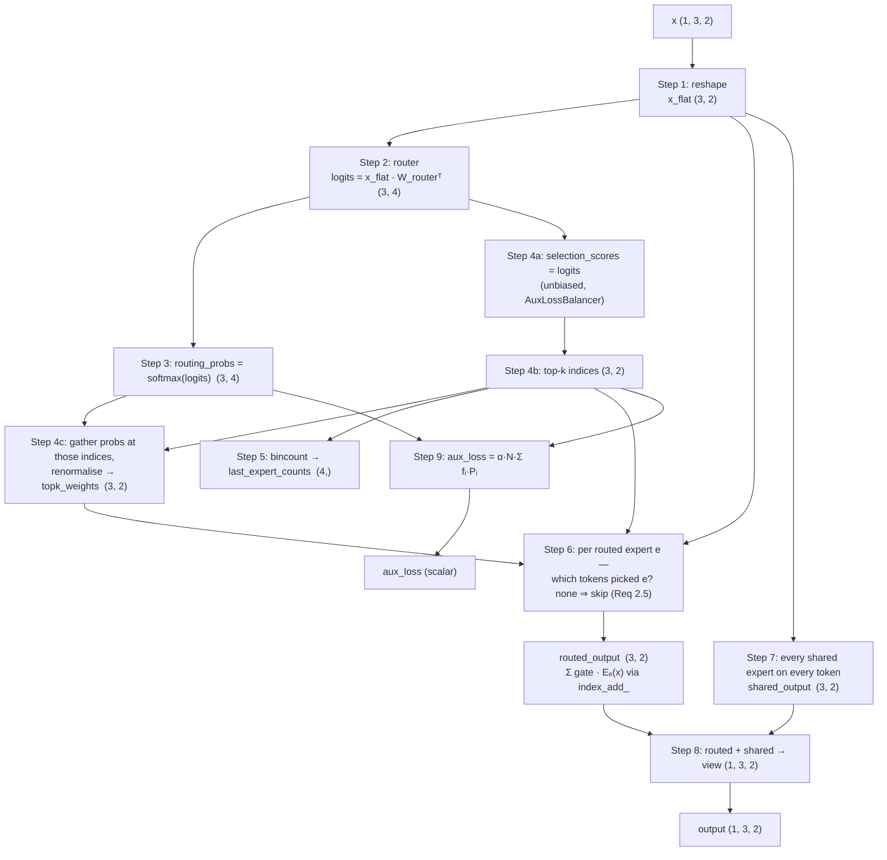
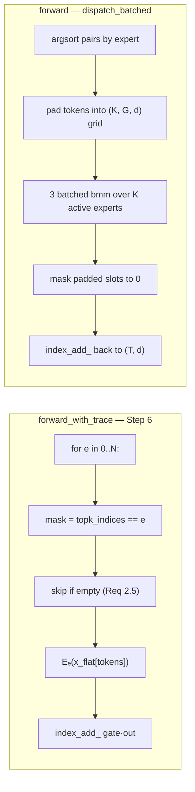
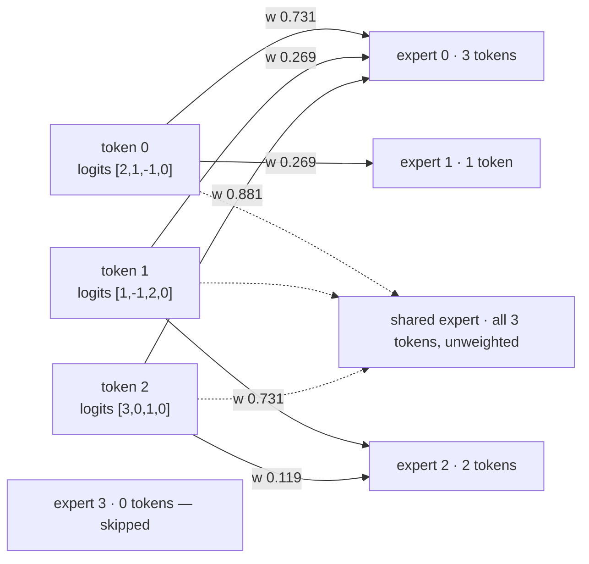

# 005 — Mixture-of-Experts feed-forward layer: the full derivation, solved by hand

**Companion to:** [`journey_of_a_model/005-moe-layer.md`](../../journey_of_a_model/005-moe-layer.md)
· **Code:** [`qwenmoe/model/moe.py`](../../qwenmoe/model/moe.py)
· **Every number here is reproduced by:** [`verify_005_moe_layer.py`](verify_005_moe_layer.py)
(`uv run python docs/math/verify_005_moe_layer.py`)

---

## How to read this

The journal entry tells you *what* a Mixture-of-Experts (MoE) feed-forward
layer is and *why* it exists, with one worked example per formula. This
document is the opposite trade-off: **maximum detail, minimum
summarising**. We

1. fix one tiny, fully-written-out input and one tiny set of weights,
2. push them through **every single line** of `MoELayer.forward_with_trace`
   (the explicit-loop path in [`moe.py`](../../qwenmoe/model/moe.py#L528)),
3. and for every operation — a reshape, a matrix multiply, a softmax, a
   `nonzero`, an `index_add_` — first derive *why* it has the form it does,
   then **do the arithmetic on paper**, digit by digit, and check it
   against the real module.

Nothing is skipped. If a step turns a `(1, 3, 2)` array into a `(3, 2)`
array, we say which number went where.

You do **not** need to have taken a linear-algebra course. Every term
(vector, dot product, matrix multiply, sigmoid, softmax, one-hot) is
defined at first use. You *should* skim
[`journey_of_a_model/005-moe-layer.md`](../../journey_of_a_model/005-moe-layer.md)
first for the plain-English picture, and
[`docs/math/004-attention-gqa.md`](004-attention-gqa.md) if you want the
softmax derivation in even more detail than we repeat here.

> **Scope.** This mirrors journal entry 005: the **baseline** MoE layer —
> `swiglu` experts, `aux_loss` balancing, `softmax` routing. The later
> opt-in variants (sigmoid routing and the router z-loss →
> [journal 025](../../journey_of_a_model/025-moe-routing-sigmoid-and-router-z-loss.md);
> the loss-free balancer and per-sequence loss →
> [journal 015](../../journey_of_a_model/015-research-comparison-framework.md) /
> [026](../../journey_of_a_model/026-per-sequence-balance-loss.md)) are
> noted where the code branches, then set aside — exactly as the attention
> derivation keeps NoPE as its spine and treats RoPE/ALiBi as asides.

---

## Part 0 — What are we even computing?

A transformer alternates two kinds of sublayer: **attention** (covered in
[004](004-attention-gqa.md)), which lets each token mix in information from
other tokens, and a **feed-forward network (FFN)**, which transforms each
token's vector on its own — same function applied independently at every
position. The FFN is where most of a dense transformer's parameters live.

A **Mixture-of-Experts** layer replaces that one FFN with many parallel
FFNs (the **experts**) plus a small **router**. Per token, the router picks
a handful of experts, only those run, and their outputs are blended:

$$
\text{MoELayer}(x) \;=\; \underbrace{\sum_{i \in \text{top-}k(x)} w_i(x)\, E_i(x)}_{\text{routed: a few, gated}}
\;+\; \underbrace{\sum_{j=1}^{n_{\text{shared}}} E^{\text{shared}}_j(x)}_{\text{shared: all, unweighted}}
$$

- $E_i$ is expert $i$ — a small FFN with its own weights;
- $\text{top-}k(x)$ is the set of the $k$ experts the router scored
  highest for this token;
- $w_i(x)$ are **combination weights** that sum to $1$ over the selected
  experts (derived in Step 4);
- the **shared experts** $E^{\text{shared}}_j$ run for *every* token with
  no routing and no weight (Dai et al. 2024).

Training also needs a scalar **auxiliary loss** that punishes the router
for over-using a few experts (Step 9).

**Why do this?** It decouples *capacity* (how much the model can store —
roughly the total parameter count) from *per-token cost* (roughly the
count of parameters that actually run for one token). Add more experts and
capacity grows; each token still only visits $k$ of them, so its cost
barely moves. Part 3 quantifies this on our example.

By the end of Part 2 you will have computed, by hand, the exact `(1, 3, 2)`
tensor the real module returns:

```
[[1.666941, 0.866989],
 [1.484440, 2.018887],
 [4.808671, 3.346554]]
```

---

## Part 1 — The running example

### 1.1 Definitions we need right now

- **Scalar:** a single number, e.g. $3$ or $-0.27$.
- **Vector:** an ordered list of numbers, in brackets, e.g. $[1, 0]$. Its
  **length** / **dimension** is how many numbers it holds.
- **Dot product** of two equal-length vectors $a$ and $b$: multiply them
  element by element and add the results.
  $[1, 2]\cdot[3, 4] = 1{\cdot}3 + 2{\cdot}4 = 11$. It is one number.
- **Matrix:** a rectangle of numbers — a list of equal-length row vectors.
  A matrix with $r$ rows and $c$ columns is $r\times c$ ("$r$ by $c$").
- **Transpose** $A^{\top}$: flip a matrix across its diagonal, so row $i$
  becomes column $i$; an $r\times c$ matrix becomes $c\times r$.
- **Matrix multiply** $AB$: if $A$ is $m\times n$ and $B$ is $n\times p$,
  then $AB$ is $m\times p$ and its entry at row $i$, column $j$ is the dot
  product of row $i$ of $A$ with column $j$ of $B$. Inner sizes must match.
- **Elementwise (Hadamard) product** $a \odot b$ of two equal-shape
  arrays: multiply matching positions, keeping the shape.
  $[2, 3]\odot[4, 5] = [8, 15]$. (Different from the dot product, which
  then *adds* the results into one number.)
- **Tensor:** the same idea with more than two axes — a "list of matrices"
  is a 3-axis tensor. PyTorch calls all of these `Tensor`. A tensor's
  **shape** is the tuple of its axis lengths, e.g. `(1, 3, 2)`.
- **Probability distribution** over $N$ options: a length-$N$ vector of
  numbers that are each $\ge 0$ and together sum to $1$.
- **Logit:** a raw, unbounded real-valued score, *before* it is turned
  into a probability. "The router logit for expert 3" = the number the
  router emits for expert 3 prior to any softmax.

### 1.2 The model configuration

The smallest config that still exercises every behaviour of `MoELayer`:
routing with $k < N$, weight renormalisation, an expert that runs on
several tokens, an expert that runs on one, an expert that gets **zero**
tokens (and must be skipped), a shared expert, and a non-trivial
load-balancing loss.

| Symbol | `ModelConfig` field | Meaning | Value |
|---|---|---|---|
| `batch` | — | independent sequences at once | $1$ |
| $T$ | `seq_len` (from input) | tokens in the sequence | $3$ |
| $d$ | `d_model` | width of a token vector | $2$ |
| $d_{\text{ff}}$ | `d_ff` | width inside one expert | $3$ |
| $N$ | `n_routed_experts` | number of routed experts | $4$ |
| $k$ | `top_k` | routed experts used per token | $2$ |
| $n_{\text{shared}}$ | `n_shared_experts` | always-on experts | $1$ |
| — | `activation` | expert FFN variant | `swiglu` |
| — | `moe_balancing` | load-balancing strategy | `aux_loss` |
| — | `router_scoring` | routing score function | `softmax` |
| $\alpha$ | `aux_loss_weight` | auxiliary-loss coefficient | $0.01$ |

`ModelConfig.__post_init__` guarantees $1 \le k \le N$ and
$n_{\text{shared}} \ge 0$, so `MoELayer` never re-checks them
([`config.py:68-76`](../../qwenmoe/config.py#L68)).

### 1.3 The input

Three tokens, each already an embedding vector of length $d = 2$. Call the
tensor $X$ (shape `(batch, T, d)` = `(1, 3, 2)`; we drop the batch axis for
the algebra and restore it for shapes):

$$X = \begin{bmatrix} x_0 \\ x_1 \\ x_2 \end{bmatrix}
= \begin{bmatrix} 1 & 0 \\ 0 & 1 \\ 1 & 1 \end{bmatrix}$$

- $x_0 = [1, 0]$
- $x_1 = [0, 1]$
- $x_2 = [1, 1]$

### 1.4 The weights

A real model *learns* all of these by gradient descent; for a hand
derivation we pick fixed, simple integer values.

**Router.** One `nn.Linear(d, N)` with no bias
([`moe.py:79-84`](../../qwenmoe/model/moe.py#L79)). PyTorch stores its
weight as `(out_features, in_features)` = $(N, d) = (4, 2)$; row $e$ is
expert $e$'s scoring vector:

$$W_{\text{router}} = \begin{bmatrix}
2 & 1 \\ 1 & -1 \\ -1 & 2 \\ 0 & 0
\end{bmatrix}
\qquad\text{(rows: expert 0, 1, 2, 3)}$$

**Experts.** Every expert here is a `SwiGLUExpert`
([`moe.py:18-29`](../../qwenmoe/model/moe.py#L18)) — three `nn.Linear`
layers, no bias:

| layer | shape `(out, in)` | role |
|---|---|---|
| `w_gate` | $(d_{\text{ff}}, d) = (3, 2)$ | the gate projection |
| `w_up` | $(d_{\text{ff}}, d) = (3, 2)$ | the value projection |
| `w_down` | $(d, d_{\text{ff}}) = (2, 3)$ | project back to width $d$ |

The four **routed** experts:

$$
\begin{aligned}
&\textbf{Expert 0}\quad
W^{0}_{\text{gate}}=\begin{bmatrix}1&0\\0&1\\1&1\end{bmatrix}\ \
W^{0}_{\text{up}}=\begin{bmatrix}1&1\\1&0\\0&1\end{bmatrix}\ \
W^{0}_{\text{down}}=\begin{bmatrix}1&0&1\\0&1&1\end{bmatrix}\\[4pt]
&\textbf{Expert 1}\quad
W^{1}_{\text{gate}}=\begin{bmatrix}-1&0\\2&0\\1&1\end{bmatrix}\ \
W^{1}_{\text{up}}=\begin{bmatrix}1&0\\1&1\\2&0\end{bmatrix}\ \
W^{1}_{\text{down}}=\begin{bmatrix}1&1&0\\0&1&1\end{bmatrix}\\[4pt]
&\textbf{Expert 2}\quad
W^{2}_{\text{gate}}=\begin{bmatrix}0&2\\1&-1\\0&1\end{bmatrix}\ \
W^{2}_{\text{up}}=\begin{bmatrix}1&1\\0&1\\1&0\end{bmatrix}\ \
W^{2}_{\text{down}}=\begin{bmatrix}1&0&1\\1&1&0\end{bmatrix}\\[4pt]
&\textbf{Expert 3}\quad\text{all weights } = 9 \text{ (see below)}
\end{aligned}
$$

Expert 3 will receive **zero tokens** this batch, so its weights never
enter any computation. We deliberately set them to a loud constant $9$;
the verify script then re-runs the layer with expert 3 perturbed even
further and asserts the output does not move (Requirement 2.5).

The one **shared** expert:

$$
\textbf{Shared}\quad
W^{s}_{\text{gate}}=\begin{bmatrix}1&0\\0&1\\-1&1\end{bmatrix}\ \
W^{s}_{\text{up}}=\begin{bmatrix}1&1\\1&0\\0&1\end{bmatrix}\ \
W^{s}_{\text{down}}=\begin{bmatrix}1&0&0\\0&1&1\end{bmatrix}
$$

### 1.5 What `nn.Linear` actually computes

`nn.Linear(in, out)` with weight $W$ (shape `(out, in)`) and no bias maps
an input row vector $u$ (length `in`) to an output row vector $y$
(length `out`) by

$$y = u W^{\top}, \qquad\text{i.e.}\qquad y_j = \sum_{p=1}^{\text{in}} u_p\, W_{j,p}.$$

In words: **output coordinate $j$ is the dot product of the input with row
$j$ of $W$.** That is the only fact about linear layers we need. Applied to
a whole matrix $U$ (one row per token), every row is transformed the same
way: $Y = U W^{\top}$.

---

## Part 2 — The forward pass, one operation at a time

`MoELayer` has two code paths that compute the **same maths**:

- `forward` ([`moe.py:447`](../../qwenmoe/model/moe.py#L447)) — the
  production path. It runs all routed experts as a few batched matrix
  multiplies via `dispatch_batched`
  ([`moe.py:322`](../../qwenmoe/model/moe.py#L322)), which is faster but
  materialises no per-expert intermediates.
- `forward_with_trace` ([`moe.py:528`](../../qwenmoe/model/moe.py#L528)) —
  an explicit Python loop over experts, keeping every intermediate for the
  visualiser (Requirement 7.1 / journal 012).

We walk `forward_with_trace`. Section "Step 11" shows the two paths agree.



**Shape ledger — start:** `x (1, 3, 2)`.

---

### Step 1 — Flatten the batch and sequence axes

Code ([`moe.py:535-536`](../../qwenmoe/model/moe.py#L535)):

```python
batch, seq_len, d_model = x.shape          # 1, 3, 2
x_flat = x.reshape(-1, d_model)            # (3, 2)
```

**Why:** the FFN, the router, and the whole MoE computation treat every
token independently — position in the sequence is irrelevant here (that
was attention's job). Collapsing `(batch, seq_len)` into one "token" axis
means every later step is a plain 2-D matrix operation. `-1` tells
`reshape` to infer that axis: $1 \times 3 = 3$.

`reshape` does not move or change any number — it only relabels the axes.
The three rows of $x\_\text{flat}$ are exactly $x_0, x_1, x_2$:

$$x\_\text{flat} = \begin{bmatrix} 1 & 0 \\ 0 & 1 \\ 1 & 1 \end{bmatrix}\qquad\text{shape }(3, 2)$$

**Shape ledger:** `x (1,3,2)` → `x_flat (3, 2)`.

---

### Step 2 — Router logits

Code ([`moe.py:538`](../../qwenmoe/model/moe.py#L538) →
[`moe.py:83-84`](../../qwenmoe/model/moe.py#L83)):

```python
router_logits = self.router(x_flat)       # self.gate(x_flat) = x_flat @ W_router.T
```

**Why a learned linear layer?** The router's job is to score, per token,
"how well would each expert handle this token?" The cheapest learnable
scorer is one linear layer: $N$ numbers out, one per expert. It has $N\,d$
parameters ($4 \times 2 = 8$ here) — negligible next to the experts
themselves — and it is trained jointly with everything else, so it learns
to send tokens where they get handled best (Shazeer et al. 2017).

By §1.5, $\text{logit}_{t,e}$ = (token $t$) $\cdot$ (row $e$ of
$W_{\text{router}}$). Rows: $r_0=[2,1]$, $r_1=[1,-1]$, $r_2=[-1,2]$,
$r_3=[0,0]$.

**Token 0**, $x_0 = [1, 0]$:

$$
\begin{aligned}
\text{logit}_{0,0} &= [1,0]\cdot[2,1] = 2 + 0 = 2 \\
\text{logit}_{0,1} &= [1,0]\cdot[1,-1] = 1 + 0 = 1 \\
\text{logit}_{0,2} &= [1,0]\cdot[-1,2] = -1 + 0 = -1 \\
\text{logit}_{0,3} &= [1,0]\cdot[0,0] = 0
\end{aligned}
\;\Rightarrow\; \text{logit}_0 = [\,2,\ 1,\ -1,\ 0\,]
$$

**Token 1**, $x_1 = [0, 1]$:

$$
\begin{aligned}
\text{logit}_{1,0} &= [0,1]\cdot[2,1] = 1 \\
\text{logit}_{1,1} &= [0,1]\cdot[1,-1] = -1 \\
\text{logit}_{1,2} &= [0,1]\cdot[-1,2] = 2 \\
\text{logit}_{1,3} &= 0
\end{aligned}
\;\Rightarrow\; \text{logit}_1 = [\,1,\ -1,\ 2,\ 0\,]
$$

**Token 2**, $x_2 = [1, 1]$:

$$
\begin{aligned}
\text{logit}_{2,0} &= [1,1]\cdot[2,1] = 3 \\
\text{logit}_{2,1} &= [1,1]\cdot[1,-1] = 0 \\
\text{logit}_{2,2} &= [1,1]\cdot[-1,2] = 1 \\
\text{logit}_{2,3} &= 0
\end{aligned}
\;\Rightarrow\; \text{logit}_2 = [\,3,\ 0,\ 1,\ 0\,]
$$

$$\text{router\_logits} = \begin{bmatrix} 2 & 1 & -1 & 0 \\ 1 & -1 & 2 & 0 \\ 3 & 0 & 1 & 0 \end{bmatrix}\qquad\text{shape }(3, 4)$$

**Shape ledger:** `x_flat (3, 2)` → `router_logits (3, 4)`.

---

### Step 3 — Routing probabilities: softmax over experts

Code ([`moe.py:539-541`](../../qwenmoe/model/moe.py#L539) →
`score_and_select`, softmax branch
[`moe.py:110-111`](../../qwenmoe/model/moe.py#L110)):

```python
routing_probs = F.softmax(router_logits, dim=-1)   # per row, over the 4 experts
```

#### Why softmax, and why this exact form

We have a row of real-valued logits $z = [z_1, \dots, z_N]$ and want a
**probability distribution** $p = [p_1, \dots, p_N]$: **(1)** each
$p_e \ge 0$, and **(2)** $\sum_e p_e = 1$. The softmax function is

$$p_e = \operatorname{softmax}(z)_e = \frac{e^{z_e}}{\sum_{l=1}^{N} e^{z_l}}.$$

- **Exponentiate** ($e^{z_e}$): sends any real number to a positive one
  (gives property 1), monotonically (bigger logit → bigger probability),
  and turns additive logit gaps into multiplicative probability ratios:
  $p_a/p_b = e^{z_a - z_b}$.
- **Divide by the sum:** forces property 2.

Softmax is **shift-invariant**: adding the same constant $c$ to every logit
leaves $p$ unchanged (the $e^{c}$ factors cancel top and bottom). Real
implementations subtract $c = \max_l z_l$ before exponentiating so the
largest exponent is $e^0 = 1$ and nothing overflows (Milakov &
Gimelshein 2018). The full derivation of both facts is in
[004 §Step 10](004-attention-gqa.md); here we just compute.

#### Do it by hand

Constants (to 6 decimals): $e^{1} = 2.718282$, $e^{2} = 7.389056$,
$e^{3} = 20.085537$, $e^{-1} = 0.367879$, $e^{0} = 1$.

**Token 0**, $z = [2, 1, -1, 0]$. Numerators
$[7.389056,\ 2.718282,\ 0.367879,\ 1]$, sum
$Z_0 = 11.475217$.

$$
p_0 = \left[\tfrac{7.389056}{11.475217},\ \tfrac{2.718282}{11.475217},\ \tfrac{0.367879}{11.475217},\ \tfrac{1}{11.475217}\right]
= [\,0.643914,\ 0.236883,\ 0.032059,\ 0.087144\,]
$$

**Token 1**, $z = [1, -1, 2, 0]$ — the same four numerators reordered, so
$Z_1 = 11.475217$ too:

$$p_1 = [\,0.236883,\ 0.032059,\ 0.643914,\ 0.087144\,]$$

**Token 2**, $z = [3, 0, 1, 0]$. Numerators
$[20.085537,\ 1,\ 2.718282,\ 1]$, sum $Z_2 = 24.803819$.

$$
p_2 = \left[\tfrac{20.085537}{24.803819},\ \tfrac{1}{24.803819},\ \tfrac{2.718282}{24.803819},\ \tfrac{1}{24.803819}\right]
= [\,0.809776,\ 0.040316,\ 0.109591,\ 0.040316\,]
$$

$$\text{routing\_probs} = \begin{bmatrix}
0.643914 & 0.236883 & 0.032059 & 0.087144 \\
0.236883 & 0.032059 & 0.643914 & 0.087144 \\
0.809776 & 0.040316 & 0.109591 & 0.040316
\end{bmatrix}$$

Each row sums to $1$ (property 2). These are the real module's
`trace["router_probs"]` to floating-point precision.

**Shape ledger:** `router_logits (3, 4)` → `routing_probs (3, 4)`
(unchanged shape).

---

### Step 4 — Selection scores, top-$k$, and renormalised weights

Code path: `score_and_select`
([`moe.py:120-122`](../../qwenmoe/model/moe.py#L120)) calls
`balancer.selection_scores` then `select_top_k`
([`moe.py:125-143`](../../qwenmoe/model/moe.py#L125)):

```python
selection_scores = balancer.selection_scores(router_logits, scoring="softmax")
topk_indices, topk_weights = select_top_k(selection_scores, routing_probs, top_k)
# inside select_top_k:
_, topk_indices = selection_scores.topk(top_k, dim=-1)
topk_weights = router_probs.gather(-1, topk_indices)
topk_weights = topk_weights / topk_weights.sum(dim=-1, keepdim=True)
```

#### 4a. Selection scores — for `aux_loss`, just the logits

`AuxLossBalancer.selection_scores` returns `router_logits` **unchanged**
([`moe.py:162-173`](../../qwenmoe/model/moe.py#L162)).

**Why that is exactly right, not a shortcut.** We rank experts to pick the
top $k$. Softmax is **order-preserving**: for two experts $i, j$ scored on
the same token,

$$z_i > z_j \iff e^{z_i} > e^{z_j} \iff \frac{e^{z_i}}{Z} > \frac{e^{z_j}}{Z}$$

for the same positive normaliser $Z$. So "the top $k$ experts by logit" and
"the top $k$ by softmax probability" are always the *same set* — computing
softmax first would be wasted work for selection. This is **exact
algebra**. (It breaks once a per-expert bias is added to the score, which
is precisely what the loss-free balancer does — see
[journal 015](../../journey_of_a_model/015-research-comparison-framework.md).
That is why the interface is standardised on a `selection_scores` method
rather than hard-coding "use the logits".)

So $\text{selection\_scores} = \text{router\_logits}$.

#### 4b. `topk` — pick the $k$ highest, with their positions

`selection_scores.topk(2, dim=-1)` returns, per row, the $2$ largest values
and **their column indices**, in descending order of value. We only keep
the indices.

- **Token 0**, scores $[2, 1, -1, 0]$: largest is $2$ (expert 0), then $1$
  (expert 1). $\Rightarrow$ indices $[0, 1]$.
- **Token 1**, scores $[1, -1, 2, 0]$: largest $2$ (expert 2), then $1$
  (expert 0). $\Rightarrow$ indices $[2, 0]$.
- **Token 2**, scores $[3, 0, 1, 0]$: largest $3$ (expert 0), then $1$
  (expert 2). $\Rightarrow$ indices $[0, 2]$.

$$\text{topk\_indices} = \begin{bmatrix} 0 & 1 \\ 2 & 0 \\ 0 & 2 \end{bmatrix}\qquad\text{shape }(3, 2)$$

`topk` selects **without replacement**, so the two entries in a row are
always distinct experts. Expert 3 appears in no row — it is about to be
skipped.

#### 4c. `gather` + renormalise — the combination weights

`routing_probs.gather(-1, topk_indices)` reads, per row, the softmax
probabilities *at the selected columns*:

- Token 0: $p_0$ at columns $[0, 1] = [0.643914,\ 0.236883]$.
- Token 1: $p_1$ at columns $[2, 0] = [0.643914,\ 0.236883]$.
- Token 2: $p_2$ at columns $[0, 2] = [0.809776,\ 0.109591]$.

**Why renormalise — full derivation.** The $N$ softmax probabilities sum to
$1$. The $k$ *selected* ones sum to some
$s = \sum_{e \in S} p_e < 1$ (the missing mass belongs to the $N-k$
unpicked experts). If we combined expert outputs with these raw $p_e$, the
routed output would be systematically shrunk toward zero by whatever mass
happened to land on experts we didn't call. Setting $w_e = p_e / s$ fixes
that exactly:

$$\sum_{e \in S} w_e = \frac{1}{s}\sum_{e \in S} p_e = \frac{s}{s} = 1.$$

Now $\sum_{e\in S} w_e\,E_e(x)$ is a genuine **weighted average** (a convex
combination) of the selected experts — its scale matches the experts', not
some fraction of it. **Exact algebra.**

- **Token 0:** $s = 0.643914 + 0.236883 = 0.880797$.
  $w = [\,0.643914/0.880797,\ 0.236883/0.880797\,] = [\,0.731059,\ 0.268941\,]$
  (for experts $0$ and $1$).
- **Token 1:** $s = 0.880797$ (same two numbers).
  $w = [\,0.731059,\ 0.268941\,]$ (for experts $2$ and $0$).
- **Token 2:** $s = 0.809776 + 0.109591 = 0.919367$.
  $w = [\,0.809776/0.919367,\ 0.109591/0.919367\,] = [\,0.880797,\ 0.119203\,]$
  (for experts $0$ and $2$).

$$\text{topk\_weights} = \begin{bmatrix}
0.731059 & 0.268941 \\
0.731059 & 0.268941 \\
0.880797 & 0.119203
\end{bmatrix}\qquad\text{shape }(3, 2)$$

> **A clean identity (exact).** Because `routing_probs` here *is*
> $\operatorname{softmax}(z)$, renormalising its top-$k$ entries is
> identical to taking a softmax over just the selected logits:
> $w_e = \dfrac{e^{z_e}/Z}{\sum_{j\in S} e^{z_j}/Z} = \dfrac{e^{z_e}}{\sum_{j\in S} e^{z_j}}$.
> Token 0's selected logits are $[2, 1]$, gap $1$, so
> $w = \big[\tfrac{1}{1+e^{-1}},\ \tfrac{e^{-1}}{1+e^{-1}}\big] = [0.731059, 0.268941]$.
> Token 2's are $[3, 1]$, gap $2$:
> $w = \big[\tfrac{1}{1+e^{-2}},\ \tfrac{e^{-2}}{1+e^{-2}}\big] = [0.880797, 0.119203]$.
> This identity does **not** hold for sigmoid routing (journal 025), which
> is why the code keeps `routing_probs` and the selection score separate.

**Shape ledger:** `routing_probs (3, 4)` → `topk_indices (3, 2)`,
`topk_weights (3, 2)`.

---

### Step 5 — Expert dispatch counts

Code ([`moe.py:542-544`](../../qwenmoe/model/moe.py#L542)):

```python
self.last_expert_counts = torch.bincount(
    topk_indices.detach().flatten(), minlength=self.n_routed_experts
)
```

`flatten()` lays `topk_indices` out as one list:
$[0, 1,\ 2, 0,\ 0, 2]$. `bincount` counts occurrences of each value;
`minlength=4` pads so every expert has an entry even at count $0$:

$$\text{last\_expert\_counts} = [\,\underbrace{3}_{e=0},\ \underbrace{1}_{e=1},\ \underbrace{2}_{e=2},\ \underbrace{0}_{e=3}\,]$$

- Expert 0 was picked by tokens $0, 1, 2$ — **3** dispatches.
- Expert 1 by token $0$ — **1**.
- Expert 2 by tokens $1, 2$ — **2**.
- Expert 3 by nobody — **0**.

`.detach()` cuts this off from the gradient graph — it is a bookkeeping
statistic (the `Trainer` logs it for expert-utilisation plots, and the
loss-free balancer would consume it), never something to backpropagate
through. It sums to $T \cdot k = 3 \cdot 2 = 6$, the total number of
`(token, expert)` dispatch pairs.

**Shape ledger:** adds `last_expert_counts (4,)`.

---

### Step 6 — The per-expert dispatch loop

Code ([`moe.py:546-555`](../../qwenmoe/model/moe.py#L546)):

```python
routed_output = torch.zeros_like(x_flat)                       # (3, 2), all zeros
expert_outputs = {}
for expert_id, expert in enumerate(self.routed_experts):
    token_idx, slot_idx = (topk_indices == expert_id).nonzero(as_tuple=True)
    if token_idx.numel() == 0:
        continue                                                # Requirement 2.5
    expert_out = expert(x_flat[token_idx])
    expert_outputs[expert_id] = expert_out
    gate = topk_weights[token_idx, slot_idx].unsqueeze(-1)
    routed_output.index_add_(0, token_idx, gate * expert_out)
```

`routed_output` starts as a fresh `(3, 2)` block of zeros. Each iteration
adds one expert's weighted contribution into just the rows it serves.

#### 6a. Finding an expert's tokens — `(topk_indices == e).nonzero`

`topk_indices == expert_id` is a `(3, 2)` grid of True/False. `.nonzero(
as_tuple=True)` returns two 1-D tensors: the **row** (token) and **column**
(slot, i.e. "was this the token's 1st- or 2nd-choice expert") of every
True.

$$\text{topk\_indices} = \begin{bmatrix} 0 & 1 \\ 2 & 0 \\ 0 & 2 \end{bmatrix}$$

| `expert_id` | `topk_indices == e` (True cells) | `token_idx` | `slot_idx` |
|---|---|---|---|
| 0 | $(0,0),\ (1,1),\ (2,0)$ | $[0, 1, 2]$ | $[0, 1, 0]$ |
| 1 | $(0,1)$ | $[0]$ | $[1]$ |
| 2 | $(1,0),\ (2,1)$ | $[1, 2]$ | $[0, 1]$ |
| 3 | *(none)* | $[\,]$ | $[\,]$ |

#### 6b. The `continue` for expert 3 (Requirement 2.5)

For `expert_id = 3`, `token_idx.numel() == 0`, so `continue` fires: expert
3's `forward` is never called, its weights never enter the computation
graph, and — after `.backward()` — its parameters receive **no gradient
at all** this step. Running it on an empty `(0, 2)` tensor would also be
shape-valid, but the explicit skip is what *guarantees* the no-gradient
property. No entry is written to `expert_outputs` either. (The verify
script confirms this by perturbing $W^3$ and getting a byte-identical
output.)

#### 6c. What one SwiGLU expert computes — deriving the formula

`SwiGLUExpert.forward` ([`moe.py:28-29`](../../qwenmoe/model/moe.py#L28)):

```python
def forward(self, x):
    return self.w_down(F.silu(self.w_gate(x)) * self.w_up(x))
```

i.e. $E(x) = \big(\operatorname{silu}(x\,W_{\text{gate}}^{\top}) \odot (x\,W_{\text{up}}^{\top})\big) W_{\text{down}}^{\top}$.

**Building it up from a plain FFN.** The classic transformer FFN is
$x \mapsto \operatorname{act}(x W_1^{\top})\,W_2^{\top}$: project up to a
wider hidden space, apply one pointwise nonlinearity, project back. A
**Gated Linear Unit** (GLU) adds a second, parallel up-projection — a
**gate** — that is squashed by a nonlinearity and then **multiplied
elementwise** into the first. The network can now learn, per hidden unit
and per input, a data-dependent multiplicative mask: "let this much of the
value signal through." That multiplicative interaction is something a
single pointwise nonlinearity cannot express. Shazeer (2020) tried several
squashing functions for the gate and found gated FFNs consistently beat
plain ones on transformer quality — an **empirical** result (his paper's
closing line offers "no explanation … other than divine benevolence").

**The gate nonlinearity here is SiLU** (a.k.a. Swish; Elfwing, Uchibe &
Doya 2017; Ramachandran, Zoph & Le 2017):

$$\operatorname{silu}(z) = z \cdot \sigma(z), \qquad \sigma(z) = \frac{1}{1 + e^{-z}}$$

where $\sigma$ is the **logistic sigmoid** — a smooth, increasing
"squashing" function taking any real number into $(0, 1)$, with
$\sigma(0) = \tfrac12$, $\sigma(z) \to 1$ as $z\to+\infty$,
$\sigma(z)\to 0$ as $z\to-\infty$. So SiLU:

- for large positive $z$, $\sigma(z)\approx 1$ and
  $\operatorname{silu}(z)\approx z$ — nearly linear, like ReLU's positive
  arm;
- for large negative $z$, $\sigma(z)\to 0$ faster than $z\to-\infty$, so
  $\operatorname{silu}(z)\to 0$ — but *smoothly*, and it dips slightly
  negative first (minimum $\approx -0.278$ near $z \approx -1.278$),
  unlike ReLU which is exactly $0$ for all $z<0$;
- it is differentiable everywhere (ReLU has a kink at $0$).

The choice of SiLU for the gate (over GELU → `GEGLUExpert`, or plain
sigmoid) is **empirical** (Requirement 12.2 makes it a config axis to
ablate). The *gating structure* is a design choice, not a derivation.

**SiLU values we will need** (from
$\operatorname{silu}(z) = z/(1+e^{-z})$):

| $z$ | $1 + e^{-z}$ | $\operatorname{silu}(z) = z/(1+e^{-z})$ |
|---|---|---|
| $-1$ | $1 + e = 3.718282$ | $-1/3.718282 = -0.268941$ |
| $0$ | $2$ | $0$ |
| $1$ | $1 + e^{-1} = 1.367879$ | $1/1.367879 = 0.731059$ |
| $2$ | $1 + e^{-2} = 1.135335$ | $2/1.135335 = 1.761594$ |

*(Exact once you accept $e$; these are the real `F.silu` outputs.)*

#### 6d. Expert 0, on its three tokens

`x_flat[token_idx]` with `token_idx = [0, 1, 2]` is all three rows, shape
`(3, 2)`. The expert runs on the batch at once; we do it token by token.
Recall $W^{0}_{\text{gate}}$ rows $[1,0],[0,1],[1,1]$;
$W^{0}_{\text{up}}$ rows $[1,1],[1,0],[0,1]$;
$W^{0}_{\text{down}}$ rows $[1,0,1],[0,1,1]$.

**Token 0**, $x_0 = [1, 0]$:

$$
\begin{aligned}
g &= x_0 W^{0\top}_{\text{gate}} = \big[[1,0]{\cdot}[1,0],\ [1,0]{\cdot}[0,1],\ [1,0]{\cdot}[1,1]\big] = [1,\ 0,\ 1] \\
\operatorname{silu}(g) &= [0.731059,\ 0,\ 0.731059] \\
u &= x_0 W^{0\top}_{\text{up}} = \big[[1,0]{\cdot}[1,1],\ [1,0]{\cdot}[1,0],\ [1,0]{\cdot}[0,1]\big] = [1,\ 1,\ 0] \\
h &= \operatorname{silu}(g)\odot u = [0.731059{\cdot}1,\ 0{\cdot}1,\ 0.731059{\cdot}0] = [0.731059,\ 0,\ 0] \\
E_0(x_0) &= h\,W^{0\top}_{\text{down}} = \big[h{\cdot}[1,0,1],\ h{\cdot}[0,1,1]\big] = [\,0.731059,\ 0\,]
\end{aligned}
$$

**Token 1**, $x_1 = [0, 1]$:

$$
\begin{aligned}
g &= \big[[0,1]{\cdot}[1,0],\ [0,1]{\cdot}[0,1],\ [0,1]{\cdot}[1,1]\big] = [0,\ 1,\ 1] \\
\operatorname{silu}(g) &= [0,\ 0.731059,\ 0.731059] \\
u &= \big[[0,1]{\cdot}[1,1],\ [0,1]{\cdot}[1,0],\ [0,1]{\cdot}[0,1]\big] = [1,\ 0,\ 1] \\
h &= [0{\cdot}1,\ 0.731059{\cdot}0,\ 0.731059{\cdot}1] = [0,\ 0,\ 0.731059] \\
E_0(x_1) &= \big[h{\cdot}[1,0,1],\ h{\cdot}[0,1,1]\big] = [\,0.731059,\ 0.731059\,]
\end{aligned}
$$

**Token 2**, $x_2 = [1, 1]$:

$$
\begin{aligned}
g &= \big[[1,1]{\cdot}[1,0],\ [1,1]{\cdot}[0,1],\ [1,1]{\cdot}[1,1]\big] = [1,\ 1,\ 2] \\
\operatorname{silu}(g) &= [0.731059,\ 0.731059,\ 1.761594] \\
u &= \big[[1,1]{\cdot}[1,1],\ [1,1]{\cdot}[1,0],\ [1,1]{\cdot}[0,1]\big] = [2,\ 1,\ 1] \\
h &= [0.731059{\cdot}2,\ 0.731059{\cdot}1,\ 1.761594{\cdot}1] = [1.462117,\ 0.731059,\ 1.761594] \\
E_0(x_2) &= \big[\,1{\cdot}1.462117 + 0 + 1{\cdot}1.761594,\ \ 0 + 1{\cdot}0.731059 + 1{\cdot}1.761594\,\big] = [\,3.223711,\ 2.492653\,]
\end{aligned}
$$

$$\text{expert\_outputs}[0] = \begin{bmatrix} 0.731059 & 0 \\ 0.731059 & 0.731059 \\ 3.223711 & 2.492653 \end{bmatrix}\qquad\text{shape }(3, 2)$$

#### 6e. Expert 1, on token 0 only

`token_idx = [0]`, so `x_flat[[0]]` is `[[1, 0]]`, shape `(1, 2)`.
$W^{1}_{\text{gate}}$ rows $[-1,0],[2,0],[1,1]$; $W^{1}_{\text{up}}$ rows
$[1,0],[1,1],[2,0]$; $W^{1}_{\text{down}}$ rows $[1,1,0],[0,1,1]$.

$$
\begin{aligned}
g &= \big[[1,0]{\cdot}[-1,0],\ [1,0]{\cdot}[2,0],\ [1,0]{\cdot}[1,1]\big] = [-1,\ 2,\ 1] \\
\operatorname{silu}(g) &= [\,-0.268941,\ 1.761594,\ 0.731059\,] \quad\text{(the negative gate value — SiLU lets a little through)}\\
u &= \big[[1,0]{\cdot}[1,0],\ [1,0]{\cdot}[1,1],\ [1,0]{\cdot}[2,0]\big] = [1,\ 1,\ 2] \\
h &= [-0.268941{\cdot}1,\ 1.761594{\cdot}1,\ 0.731059{\cdot}2] = [-0.268941,\ 1.761594,\ 1.462117] \\
E_1(x_0) &= \big[\,1({-}0.268941) + 1(1.761594) + 0,\ \ 0 + 1(1.761594) + 1(1.462117)\,\big] = [\,1.492653,\ 3.223711\,]
\end{aligned}
$$

$$\text{expert\_outputs}[1] = \begin{bmatrix} 1.492653 & 3.223711 \end{bmatrix}\qquad\text{shape }(1, 2)$$

#### 6f. Expert 2, on tokens 1 and 2

`token_idx = [1, 2]`, `x_flat[[1, 2]] = [[0,1],[1,1]]`, shape `(2, 2)`.
$W^{2}_{\text{gate}}$ rows $[0,2],[1,-1],[0,1]$; $W^{2}_{\text{up}}$ rows
$[1,1],[0,1],[1,0]$; $W^{2}_{\text{down}}$ rows $[1,0,1],[1,1,0]$.

**Token 1**, $x_1 = [0, 1]$:

$$
\begin{aligned}
g &= \big[[0,1]{\cdot}[0,2],\ [0,1]{\cdot}[1,-1],\ [0,1]{\cdot}[0,1]\big] = [2,\ -1,\ 1] \\
\operatorname{silu}(g) &= [1.761594,\ -0.268941,\ 0.731059] \\
u &= \big[[0,1]{\cdot}[1,1],\ [0,1]{\cdot}[0,1],\ [0,1]{\cdot}[1,0]\big] = [1,\ 1,\ 0] \\
h &= [1.761594{\cdot}1,\ -0.268941{\cdot}1,\ 0.731059{\cdot}0] = [1.761594,\ -0.268941,\ 0] \\
E_2(x_1) &= \big[\,1(1.761594) + 0 + 1(0),\ \ 1(1.761594) + 1({-}0.268941) + 0\,\big] = [\,1.761594,\ 1.492653\,]
\end{aligned}
$$

**Token 2**, $x_2 = [1, 1]$:

$$
\begin{aligned}
g &= \big[[1,1]{\cdot}[0,2],\ [1,1]{\cdot}[1,-1],\ [1,1]{\cdot}[0,1]\big] = [2,\ 0,\ 1] \\
\operatorname{silu}(g) &= [1.761594,\ 0,\ 0.731059] \\
u &= \big[[1,1]{\cdot}[1,1],\ [1,1]{\cdot}[0,1],\ [1,1]{\cdot}[1,0]\big] = [2,\ 1,\ 1] \\
h &= [1.761594{\cdot}2,\ 0{\cdot}1,\ 0.731059{\cdot}1] = [3.523188,\ 0,\ 0.731059] \\
E_2(x_2) &= \big[\,1(3.523188) + 0 + 1(0.731059),\ \ 1(3.523188) + 1(0) + 0\,\big] = [\,4.254247,\ 3.523188\,]
\end{aligned}
$$

$$\text{expert\_outputs}[2] = \begin{bmatrix} 1.761594 & 1.492653 \\ 4.254247 & 3.523188 \end{bmatrix}\qquad\text{shape }(2, 2)$$

#### 6g. Gate weights and the scatter-add

For each active expert, `gate = topk_weights[token_idx, slot_idx]` reads
the combination weights computed in Step 4c, at exactly the `(token, slot)`
cells that named this expert; `.unsqueeze(-1)` makes it a column so it
broadcasts across the $d = 2$ output coordinates.

| expert | `token_idx` | `slot_idx` | `topk_weights[token_idx, slot_idx]` |
|---|---|---|---|
| 0 | $[0,1,2]$ | $[0,1,0]$ | $[\,0.731059,\ 0.268941,\ 0.880797\,]$ |
| 1 | $[0]$ | $[1]$ | $[\,0.268941\,]$ |
| 2 | $[1,2]$ | $[0,1]$ | $[\,0.731059,\ 0.119203\,]$ |

`routed_output.index_add_(0, token_idx, gate * expert_out)` adds row $r$ of
`gate * expert_out` onto `routed_output[token_idx[r]]`. It **accumulates**,
so a token that picked two experts gets both contributions summed in. Going
expert by expert into the initially-zero `routed_output`:

**Expert 0** ($\text{gate} = [0.731059, 0.268941, 0.880797]^{\top}$):

$$
\begin{aligned}
\text{row }0 &\mathrel{+}= 0.731059 \cdot [0.731059,\ 0] = [\,0.534447,\ 0\,] \\
\text{row }1 &\mathrel{+}= 0.268941 \cdot [0.731059,\ 0.731059] = [\,0.196611,\ 0.196611\,] \\
\text{row }2 &\mathrel{+}= 0.880797 \cdot [3.223711,\ 2.492653] = [\,2.839435,\ 2.195521\,]
\end{aligned}
$$

**Expert 1** ($\text{gate} = [0.268941]$):

$$\text{row }0 \mathrel{+}= 0.268941 \cdot [1.492653,\ 3.223711] = [\,0.401436,\ 0.866989\,]$$

**Expert 2** ($\text{gate} = [0.731059, 0.119203]$):

$$
\begin{aligned}
\text{row }1 &\mathrel{+}= 0.731059 \cdot [1.761594,\ 1.492653] = [\,1.287827,\ 1.091217\,] \\
\text{row }2 &\mathrel{+}= 0.119203 \cdot [4.254247,\ 3.523188] = [\,0.507119,\ 0.419975\,]
\end{aligned}
$$

Summing the pieces per row:

$$\text{routed\_output} = \begin{bmatrix}
0.534447 + 0.401436 & 0 + 0.866989 \\
0.196611 + 1.287827 & 0.196611 + 1.091217 \\
2.839435 + 0.507119 & 2.195521 + 0.419975
\end{bmatrix}
= \begin{bmatrix}
0.935883 & 0.866989 \\
1.484438 & 1.287828 \\
3.346554 & 2.615496
\end{bmatrix}$$

The real module (`verify_005_moe_layer.py` prints `routed_output`) gives

$$\begin{bmatrix}
0.935883 & 0.866989 \\ 1.484440 & 1.287828 \\ 3.346554 & 2.615495
\end{bmatrix}$$

— row 1 col 0 differs in the 6th place ($1.484438$ vs `1.484440`), the
float32-accumulation gap the attention doc also notes (`3.474191` vs
`3.474192`).

**Shape ledger:** adds `routed_output (3, 2)` and
`expert_outputs {0: (3,2), 1: (1,2), 2: (2,2)}`.

---

### Step 7 — The shared expert, on every token

Code ([`moe.py:557-559`](../../qwenmoe/model/moe.py#L557)):

```python
shared_output = torch.zeros_like(x_flat)                # (3, 2)
for expert in self.shared_experts:
    shared_output = shared_output + expert(x_flat)      # every token, no gate
```

**Why unweighted, and why always on.** DeepSeekMoE (Dai et al. 2024)
observed that routed experts waste capacity independently re-learning
general-purpose "common knowledge" — each must cope with whatever the
router sends it. Dedicating one or two experts to run *unconditionally*
lets them absorb that shared load, freeing the routed experts to
specialise. There is no routing decision for a shared expert, so there is
nothing to weight — its output is added at full strength.
`n_shared_experts = 0` is valid too (empty loop, contributes exactly
zero).

Our one shared expert is also a SwiGLU expert.
$W^{s}_{\text{gate}}$ rows $[1,0],[0,1],[-1,1]$; $W^{s}_{\text{up}}$ rows
$[1,1],[1,0],[0,1]$; $W^{s}_{\text{down}}$ rows $[1,0,0],[0,1,1]$.

**Token 0**, $x_0 = [1, 0]$:

$$
\begin{aligned}
g &= \big[[1,0]{\cdot}[1,0],\ [1,0]{\cdot}[0,1],\ [1,0]{\cdot}[-1,1]\big] = [1,\ 0,\ -1] \\
\operatorname{silu}(g) &= [0.731059,\ 0,\ -0.268941] \\
u &= \big[[1,0]{\cdot}[1,1],\ [1,0]{\cdot}[1,0],\ [1,0]{\cdot}[0,1]\big] = [1,\ 1,\ 0] \\
h &= [0.731059{\cdot}1,\ 0{\cdot}1,\ -0.268941{\cdot}0] = [0.731059,\ 0,\ 0] \\
E_s(x_0) &= \big[\,1(0.731059),\ \ 1(0) + 1(0)\,\big] = [\,0.731059,\ 0\,]
\end{aligned}
$$

**Token 1**, $x_1 = [0, 1]$:

$$
\begin{aligned}
g &= \big[[0,1]{\cdot}[1,0],\ [0,1]{\cdot}[0,1],\ [0,1]{\cdot}[-1,1]\big] = [0,\ 1,\ 1] \\
\operatorname{silu}(g) &= [0,\ 0.731059,\ 0.731059] \\
u &= \big[[0,1]{\cdot}[1,1],\ [0,1]{\cdot}[1,0],\ [0,1]{\cdot}[0,1]\big] = [1,\ 0,\ 1] \\
h &= [0{\cdot}1,\ 0.731059{\cdot}0,\ 0.731059{\cdot}1] = [0,\ 0,\ 0.731059] \\
E_s(x_1) &= \big[\,1(0),\ \ 1(0) + 1(0.731059)\,\big] = [\,0,\ 0.731059\,]
\end{aligned}
$$

**Token 2**, $x_2 = [1, 1]$:

$$
\begin{aligned}
g &= \big[[1,1]{\cdot}[1,0],\ [1,1]{\cdot}[0,1],\ [1,1]{\cdot}[-1,1]\big] = [1,\ 1,\ 0] \\
\operatorname{silu}(g) &= [0.731059,\ 0.731059,\ 0] \\
u &= \big[[1,1]{\cdot}[1,1],\ [1,1]{\cdot}[1,0],\ [1,1]{\cdot}[0,1]\big] = [2,\ 1,\ 1] \\
h &= [0.731059{\cdot}2,\ 0.731059{\cdot}1,\ 0{\cdot}1] = [1.462117,\ 0.731059,\ 0] \\
E_s(x_2) &= \big[\,1(1.462117),\ \ 1(0.731059) + 1(0)\,\big] = [\,1.462117,\ 0.731059\,]
\end{aligned}
$$

$$\text{shared\_output} = \begin{bmatrix}
0.731059 & 0 \\ 0 & 0.731059 \\ 1.462117 & 0.731059
\end{bmatrix}\qquad\text{shape }(3, 2)$$

**Shape ledger:** adds `shared_output (3, 2)`.

---

### Step 8 — Combine and restore the shape

Code ([`moe.py:561`](../../qwenmoe/model/moe.py#L561)):

```python
output = (routed_output + shared_output).view(batch, seq_len, d_model)
```

Plain elementwise addition, then `view` undoes Step 1's flatten
($3 \to 1\times 3$), moving no numbers:

$$
\text{routed} + \text{shared} =
\begin{bmatrix}
0.935883 & 0.866989 \\ 1.484440 & 1.287828 \\ 3.346554 & 2.615495
\end{bmatrix}
+
\begin{bmatrix}
0.731059 & 0 \\ 0 & 0.731059 \\ 1.462117 & 0.731059
\end{bmatrix}
=
\begin{bmatrix}
1.666942 & 0.866989 \\ 1.484440 & 2.018887 \\ 4.808671 & 3.346554
\end{bmatrix}
$$

$$
\boxed{\ \text{output} = \begin{bmatrix}
1.666941 & 0.866989 \\
1.484440 & 2.018887 \\
4.808671 & 3.346554
\end{bmatrix}\quad\text{shape }(1, 3, 2)\ }
$$

The boxed numbers are the real module's (`verify_005_moe_layer.py`); the
line above is the hand sum with the `routed_output` from Step 6g, agreeing
to $\sim 10^{-6}$ (float32 rounding in the accumulation — only row 0's
`1.666942` vs `1.666941` is visible at 6 places).

> **Not shown here:** the residual add. `MoELayer` returns just this
> tensor; `TransformerBlock` adds it back onto its pre-norm input
> ($x \leftarrow x + \text{MoELayer}(\text{RMSNorm}(x))$ — journal 006).
> $W_{\text{down}}$ (and the shared expert's) is additionally initialised
> smaller, by $1/\sqrt{2\,n_{\text{layers}}}$, to keep the residual stream
> from growing with depth — journal 023.

**Shape ledger:** `routed_output (3, 2)` + `shared_output (3, 2)` →
`output (1, 3, 2)`.

---

### Step 9 — The load-balancing auxiliary loss

Code ([`moe.py:562`](../../qwenmoe/model/moe.py#L562) → `AuxLossBalancer.
aux_loss` [`moe.py:175-186`](../../qwenmoe/model/moe.py#L175)):

```python
dispatched = F.one_hot(topk_indices, num_classes=n_experts).sum(dim=1)  # (T, N)
fraction_dispatched = dispatched.float().mean(dim=0)                     # f_i, (N,)
mean_router_prob = router_probs.mean(dim=0)                              # P_i, (N,)
return self.loss_weight * n_experts * torch.sum(fraction_dispatched * mean_router_prob)
```

#### Why an auxiliary loss exists

With no counter-pressure, routers collapse: an expert that gets more tokens
gets more gradient, becomes more capable, and the router (trained to prefer
capable experts) sends it *even more*. Left alone, a handful of experts do
everything and the rest are dead weight. The auxiliary loss is a term added
to the main training loss that is **minimised by uniform routing**, so
gradient descent is pushed toward using every expert (Switch Transformer;
Fedus, Zoph & Shazeer 2021).

#### The formula, derived

$$\mathcal{L}_{\text{aux}} = \alpha \cdot N \cdot \sum_{e=1}^{N} f_e \cdot P_e$$

- $f_e$ = **fraction of tokens that routed to expert $e$** (here:
  "…had $e$ among their top-$k$"). This is a *hard count* — it comes from
  the `topk` selection, a discrete operation with **no gradient**.
- $P_e$ = **average router probability on expert $e$** across the batch —
  a mean of softmax outputs, fully **differentiable**.

*Why the product $f_e \cdot P_e$, not either alone.* We want to penalise an
overloaded expert, but $f_e$ carries no gradient, so a loss built only from
$f$ could not train anything. Multiplying by $P_e$ attaches a gradient: to
shrink a large $f_e P_e$ term, training lowers $P_e$ for that expert; since
softmax probabilities are constrained to sum to $1$ per token, that mass
must move to experts with smaller $f$. The dead-weight factor $f_e$ acts as
a per-expert *coefficient* on the trainable $P_e$; big for overloaded
experts, zero for unused ones — so the push is proportional to how
overloaded each expert actually is. **The mechanism is exact; that it
suffices in practice is empirical.**

*Why multiply by $N$ (exact).* Under perfectly uniform routing
$f_e = P_e = 1/N$, so $\sum_e f_e P_e = N \cdot (1/N)^2 = 1/N$ — which
*shrinks as $N$ grows*. Without the $N$ factor, a fixed $\alpha$ would mean
something different for every expert count. Multiplying by $N$ gives
$N \cdot \tfrac1N = 1$: at perfect balance $\mathcal{L}_{\text{aux}} =
\alpha$ regardless of $N$, so $\alpha$ is a portable hyperparameter.

*Why $\alpha = 0.01$ (empirical).* Switch Transformer swept
$10^{-1}\dots10^{-5}$ and found $10^{-2}$ balanced quickly without hurting
the main loss. An **empirically-fitted constant**, used unchanged as the
`aux_loss_weight` default.

#### Do it by hand

**`dispatched` — `one_hot(topk_indices).sum(dim=1)`.** `one_hot` turns each
expert id into a length-$N$ indicator row (a $1$ at that id, $0$ elsewhere);
`.sum(dim=1)` adds the $k$ rows of a token into one "which experts did this
token pick" vector:

$$
\text{topk\_indices} = \begin{bmatrix} 0&1 \\ 2&0 \\ 0&2 \end{bmatrix}
\;\xrightarrow{\text{one-hot, sum over the 2 slots}}\;
\text{dispatched} = \begin{bmatrix}
1&1&0&0 \\ 1&0&1&0 \\ 1&0&1&0
\end{bmatrix}
$$

**$f_e$ — `.mean(dim=0)`** (average down the token axis, $T = 3$):

$$
f = \left[\tfrac{1+1+1}{3},\ \tfrac{1+0+0}{3},\ \tfrac{0+1+1}{3},\ \tfrac{0+0+0}{3}\right]
= [\,1.0,\ 0.333333,\ 0.666667,\ 0.0\,]
$$

Check: $\sum_e f_e = 2 = k$ (each token contributes exactly $k$ ones).

**$P_e$ — `router_probs.mean(dim=0)`** (column means of Step 3's matrix):

$$
\begin{aligned}
P_0 &= (0.643914 + 0.236883 + 0.809776)/3 = 0.563524 \\
P_1 &= (0.236883 + 0.032059 + 0.040316)/3 = 0.103086 \\
P_2 &= (0.032059 + 0.643914 + 0.109591)/3 = 0.261855 \\
P_3 &= (0.087144 + 0.087144 + 0.040316)/3 = 0.071535
\end{aligned}
$$

Check: $\sum_e P_e = 1.0$ (mean of rows that each sum to $1$).

**The sum:**

$$
\sum_e f_e P_e = (1.0)(0.563524) + (0.333333)(0.103086) + (0.666667)(0.261855) + (0)(0.071535)
$$
$$
= 0.563524 + 0.034362 + 0.174570 + 0 = 0.772456
$$

**The loss:**

$$
\mathcal{L}_{\text{aux}} = \alpha \cdot N \cdot 0.772456 = 0.01 \times 4 \times 0.772456 = \boxed{0.030898}
$$

The real module returns `0.03089825`. **Compare to the perfect-balance
floor:** with $f = P = [0.25, 0.25, 0.25, 0.25]$,
$\mathcal{L}_{\text{aux}} = 0.01 \times 4 \times (4 \times 0.0625) = 0.01 = \alpha$.
Our $0.0309 > 0.01$ — the imbalance (expert 0 got every token, expert 3 got
none) sits well above the floor, which is exactly the pressure the term
puts on the router.

**Shape ledger:** adds `aux_loss ()` (a scalar).

---

### Step 10 — The optional extra loss terms (off here)

Code ([`moe.py:563-564`](../../qwenmoe/model/moe.py#L563)):

```python
aux_loss = self._add_router_z_loss(aux_loss, router_logits)
aux_loss = self._add_seq_balance_loss(aux_loss, routing_probs, topk_indices, seq_len)
```

Both are guarded by a config weight that defaults to `0`
([`moe.py:521`](../../qwenmoe/model/moe.py#L521),
[`moe.py:500`](../../qwenmoe/model/moe.py#L500)), so on the baseline path
each returns `aux_loss` **untouched** and this example's total stays
exactly $0.030898$:

- **Router z-loss** — `router_z_loss_weight · mean(logsumexp(logits)²)`,
  the ST-MoE penalty that keeps router logits from drifting large.
  Derivation + worked example:
  [journal 025](../../journey_of_a_model/025-moe-routing-sigmoid-and-router-z-loss.md).
- **Per-sequence balance loss** — DeepSeek-V3's complementary
  $\sum_e f_e P_e$ computed *within each sequence* (loss-free balancer
  only). Derivation + worked example:
  [journal 026](../../journey_of_a_model/026-per-sequence-balance-loss.md).

`forward_with_trace` then returns `(output, aux_loss, trace)`, where
`trace` is a dict of `router_logits`, `router_probs`, `topk_indices`,
`topk_weights`, and `expert_outputs`
([`moe.py:566-573`](../../qwenmoe/model/moe.py#L566)).

---

### Step 11 — End-to-end recap, and the batched path

| Step | Operation | Shape in → out | Key formula |
|---|---|---|---|
| 1 | flatten | `(1,3,2)` → `(3,2)` | `reshape(-1, d)` |
| 2 | router | `(3,2)` → `(3,4)` | $x\,W_{\text{router}}^{\top}$ |
| 3 | softmax | `(3,4)` → `(3,4)` | $e^{z_e}/\sum e^{z_l}$ |
| 4 | select top-$k$ | `(3,4)` → idx `(3,2)`, wts `(3,2)` | `topk` on logits; $w_e = p_e/\sum_{S}p$ |
| 5 | dispatch counts | idx `(3,2)` → `(4,)` | `bincount` |
| 6 | routed experts | `(3,2)` + idx/wts → `(3,2)` | $\sum_{e} w_e\,E_e(x)$ via `index_add_` |
| 7 | shared experts | `(3,2)` → `(3,2)` | $\sum_j E^{\text{shared}}_j(x)$ |
| 8 | combine | `(3,2)` + `(3,2)` → `(1,3,2)` | add, `view` |
| 9 | aux loss | probs `(3,4)` + idx `(3,2)` → `()` | $\alpha N \sum_e f_e P_e$ |

**The production path.** `MoELayer.forward`
([`moe.py:447`](../../qwenmoe/model/moe.py#L447)) replaces the Step 6 Python
loop with one call to `dispatch_batched`
([`moe.py:472-474`](../../qwenmoe/model/moe.py#L472)): it sorts the $6$
`(token, expert)` pairs by expert, lays each active expert's tokens into a
padded grid, runs the experts as three batched matrix multiplies (`bmm`),
masks the padding to exactly $0$, and scatter-adds back. Same maths, cost
that tracks the *token* count instead of the *expert* count (journal 027).
On this example the verify script measures

$$\max\big|\ \text{forward} - \text{forward\_with\_trace}\ \big| = 0.0$$

— bit-identical here (the tensors are tiny enough that the summation order
doesn't diverge; journal 027 measures $\sim 6\times10^{-8}$ on a larger
case, always within the $10^{-5}$ tolerance of Requirement 5.2).



---

## Part 3 — Why MoE, quantified on this example

### 3.1 Parameters: total vs. active

| component | parameter count | runs for one token? |
|---|---|---|
| router | $N d = 4\times2 = 8$ | yes |
| routed expert (each) | $3\,d_{\text{ff}}d = 3\times3\times2 = 18$ | only if in top-$k$ |
| 4 routed experts | $72$ | — |
| shared expert | $18$ | yes |
| **total** | $8 + 72 + 18 = \mathbf{98}$ | |
| **active per token** | $8 + \underbrace{2\times18}_{k\text{ routed}} + 18 = \mathbf{62}$ | |

So $62/98 \approx 63\%$ of the layer's parameters touch any given token.

**Now grow the layer.** Bump `n_routed_experts` $4 \to 16$, keep
$k = 2$, keep everything else:

| | $N = 4$ | $N = 16$ | ratio |
|---|---|---|---|
| total params | $98$ | $\underbrace{32}_{16\cdot d} + \underbrace{288}_{16\cdot 18} + 18 = 338$ | $3.4\times$ |
| active params / token | $62$ | $32 + \underbrace{36}_{2\cdot 18} + 18 = 86$ | $1.4\times$ |
| **routed FFN evaluations / token** | $2$ | $2$ | $1\times$ |

Capacity ($=$ total params, roughly "how much the model can store")
tripled; the per-token cost grew only by the router's extra $24$
parameters, and the actual expensive part — running expert FFNs — did not
move at all. That gap is the entire reason MoE exists.

### 3.2 Compute on this forward pass

Counting multiply-adds (a matmul of $(m, n) \times (n, p)$ costs $mnp$):

- router: $T \cdot N d = 3 \times 8 = 24$
- routed experts: $6$ dispatch pairs $\times\ 3 d_{\text{ff}} d = 6 \times 18 = 108$
- shared expert: $T \times 3 d_{\text{ff}} d = 3 \times 18 = 54$
- softmax + renorm + aux loss: a few dozen scalar ops on the $(3, 4)$
  matrices — negligible

Total $\approx 186$ multiply-adds. A **dense** FFN with all $98$
parameters active would cost $\approx T \times (\text{active params}) =
3 \times 98 = 294$ per this batch and *rise linearly* with any added
capacity; the MoE's routed cost rises only with tokens.

### 3.3 What routing cost us on this example

Token 2's router logits were $[3, 0, 1, 0]$ — it "wanted" expert 0 a lot
($p = 0.81$) and expert 2 a little ($p = 0.11$), and got exactly those two
at renormalised weights $[0.881, 0.119]$. Expert 3, which every token
scored at logit $0$, ran **zero** times and got **zero** gradient. Expert
0 ran for all three tokens and will get three tokens' worth of gradient
this step — which, unchecked, is the "rich get richer" collapse the Step 9
loss ($0.0309$, above its $0.01$ floor) is there to fight.



---

## Questions that might come to mind

- **Why rank experts by the raw logits instead of the softmax
  probabilities?** Softmax is order-preserving (Step 4a), so the top-$k$
  *set* is identical either way — ranking on logits just skips a pointless
  exponentiation. It stops being equivalent once a per-expert bias enters
  the score (the loss-free balancer), which is why `selection_scores` is a
  method, not a hard-coded `.topk` on the probs.

- **Why renormalise the top-$k$ gate weights?** Without it, the routed
  output is scaled by $s = \sum_{e\in S} p_e < 1$ — systematically shrunk
  by whatever probability mass landed on experts we didn't run. Dividing by
  $s$ makes the combination a true weighted average whose scale matches the
  experts' own outputs (Step 4c).

- **Expert 3 got zero tokens — is that an error?** No. The `continue`
  ([`moe.py:551`](../../qwenmoe/model/moe.py#L551)) skips it cleanly: it
  never runs, never enters the graph, gets no gradient this step. The
  verify script proves this by perturbing $W^3$ and getting a
  byte-identical output.

- **Could a token pick the same expert in both of its $k$ slots?** No —
  `torch.topk` selects distinct indices, so `topk_indices == e` has at
  most one True per row, and `(token_idx, slot_idx)` never double-counts.

- **Why is the shared expert added at full strength while routed experts
  are gated?** A gate weight expresses "how much do we trust the router's
  choice of this expert." The shared expert wasn't chosen by a router —
  it always runs — so there is no such quantity to apply (Step 7).

- **The softmax is over all 4 experts but only 2 are used — isn't
  computing the other 2 wasteful?** The cost is trivial (four `exp`s per
  token), and the *full* distribution is needed anyway: $P_e$ in the aux
  loss (Step 9) is a mean over **every** expert's probability, including
  the unpicked ones — that is how gradient reaches an underused expert.

- **What if `top_k == n_routed_experts`?** Then $S$ is all experts, $s = 1$,
  renormalisation is a no-op, and every expert runs for every token — the
  layer is dense, with no sparsity benefit. The config validator allows it
  but there is no reason to use it.

- **Where does `aux_loss` go?** The `Trainer` adds it to the main
  next-token cross-entropy loss before `.backward()`. It is already scaled
  by $\alpha$, so it enters the total as-is (journal 010).

- **Is the batched `forward` path bit-identical to the loop?** On this
  tiny example, yes (max difference $0.0$). In general a batched `bmm` may
  sum in a different order, giving $\sim 10^{-8}$ differences — still four
  orders of magnitude inside the $10^{-5}$ equivalence tolerance
  (journal 027).

- **Why `d_ff = 3` when `d_model = 2`?** `d_ff` is an independent knob
  (Requirement 12.2). A real config makes it several times `d_model`; here
  it is just big enough that `w_gate`/`w_up` (expansion, $2\to3$) and
  `w_down` (contraction, $3\to2$) are visibly non-square.

---

## Symbol reference

| symbol | meaning |
|---|---|
| $d$, `d_model` | width of a token vector ($2$ here) |
| $d_{\text{ff}}$, `d_ff` | width inside one expert ($3$) |
| $T$, `seq_len` | tokens in the sequence ($3$) |
| $N$, `n_routed_experts` | number of routed experts ($4$) |
| $k$, `top_k` | routed experts used per token ($2$) |
| $n_{\text{shared}}$ | always-on shared experts ($1$) |
| $x$, $x\_\text{flat}$ | input token vectors, `(1,3,2)` and flattened `(3,2)` |
| $W_{\text{router}}$ | router weight, `(N, d)` |
| $z$, `router_logits` | raw per-expert scores, `(T, N)` |
| $p$, `routing_probs` / $P_e$ | softmax over experts; $P_e$ its batch mean |
| $S$, `topk_indices` | the $k$ selected experts per token |
| $s$ | sum of the selected softmax probs (renorm. denominator) |
| $w$, `topk_weights` | renormalised combination weights, $\sum_{S} w = 1$ |
| $E_e$, $E^{\text{shared}}_j$ | routed expert $e$ / shared expert $j$ (each a SwiGLU FFN) |
| $W_{\text{gate}}, W_{\text{up}}, W_{\text{down}}$ | one expert's three `nn.Linear` weights |
| $\sigma(z)$ | logistic sigmoid $1/(1+e^{-z})$ |
| $\operatorname{silu}(z)$ | $z\,\sigma(z)$ — the gate nonlinearity |
| $\odot$ | elementwise (Hadamard) product |
| $f_e$ | fraction of tokens with expert $e$ in their top-$k$ |
| $\alpha$, `aux_loss_weight` | auxiliary-loss coefficient ($0.01$) |
| $\mathcal{L}_{\text{aux}}$ | $\alpha N \sum_e f_e P_e$ — the load-balancing loss |

---

## Citations

All links verified by web search on 2026-09-09; those already used by
journal entry 005 are the same sources.

**Mixture of Experts**
- Shazeer, Mirhoseini, Maziarz, Davis, Le, Hinton & Dean, *Outrageously
  Large Neural Networks: The Sparsely-Gated Mixture-of-Experts Layer*,
  2017 — [arXiv:1701.06538](https://arxiv.org/abs/1701.06538). The learned
  gating network selecting a sparse combination of experts per example.
- Sanseviero, Cuenca, Bekman, Bossan et al., *Mixture of Experts
  Explained*, Hugging Face blog, 2023 —
  [huggingface.co/blog/moe](https://huggingface.co/blog/moe).

**Gated FFNs and the SiLU gate**
- Shazeer, *GLU Variants Improve Transformer*, 2020 —
  [arXiv:2002.05202](https://arxiv.org/abs/2002.05202). SwiGLU/GEGLU; the
  gated FFN structure `MoELayer`'s experts use.
- Elfwing, Uchibe & Doya, *Sigmoid-Weighted Linear Units for Neural
  Network Function Approximation in Reinforcement Learning*, 2017 —
  [arXiv:1702.03118](https://arxiv.org/abs/1702.03118). SiLU $= z\,\sigma(z)$.
- Ramachandran, Zoph & Le, *Searching for Activation Functions*, 2017 —
  [arXiv:1710.05941](https://arxiv.org/abs/1710.05941). The same function,
  independently found by search and named Swish.

**Shared experts**
- Dai, Deng, Zhao, Xu, Gao, Chen, Li, Zeng, Yu, Wu, Xie, Li, Huang, Luo,
  Ruan, Sui & Liang, *DeepSeekMoE: Towards Ultimate Expert Specialization
  in Mixture-of-Experts Language Models*, 2024 —
  [arXiv:2401.06066](https://arxiv.org/abs/2401.06066). Always-on shared
  experts to absorb common knowledge.

**Load-balancing auxiliary loss**
- Fedus, Zoph & Shazeer, *Switch Transformers: Scaling to Trillion
  Parameter Models with Simple and Efficient Sparsity*, 2021 —
  [arXiv:2101.03961](https://arxiv.org/abs/2101.03961). The
  $\alpha \cdot N \cdot \sum_e f_e P_e$ term (their §2.2), generalised here
  from top-1 to top-$k$.

**Softmax numerics**
- Milakov & Gimelshein, *Online normalizer calculation for softmax*, 2018
  — [arXiv:1805.02867](https://arxiv.org/abs/1805.02867). The
  subtract-the-max trick used in Step 3.

---

*Every intermediate tensor in this document is reproduced and asserted by
[`verify_005_moe_layer.py`](verify_005_moe_layer.py). If you change the
running example, rerun it.*
