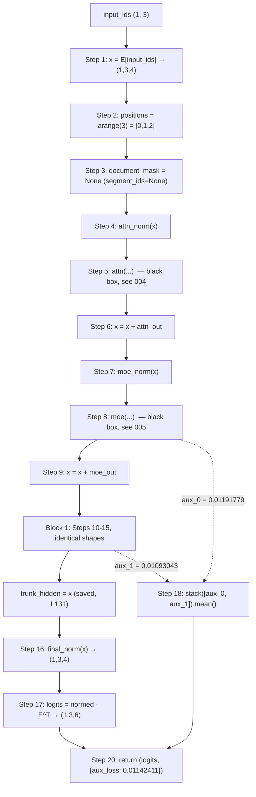
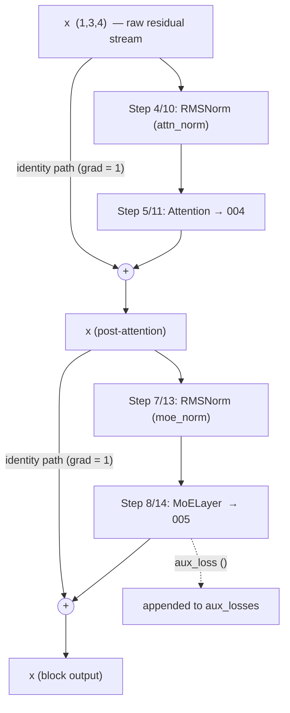
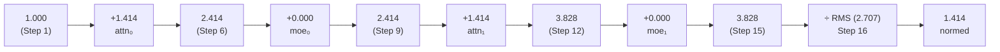
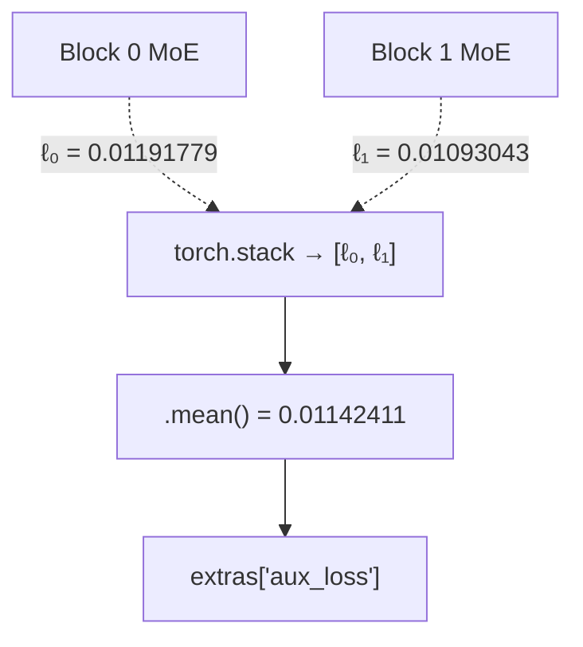

# 006 — Full model assembly: the forward pass, solved by hand

**Companion to:** [`journey_of_a_model/006-full-model-assembly.md`](../../journey_of_a_model/006-full-model-assembly.md)
· **Code:** [`qwenmoe/model/transformer.py`](../../qwenmoe/model/transformer.py),
[`qwenmoe/model/block.py`](../../qwenmoe/model/block.py),
[`qwenmoe/model/rmsnorm.py`](../../qwenmoe/model/rmsnorm.py)
· **Every number here is reproduced by:**
[`verify_006_full_model_assembly.py`](verify_006_full_model_assembly.py)
(`uv run python docs/math/verify_006_full_model_assembly.py`)

---

## How to read this

Entries [004](004-attention-gqa.md) and [005](005-moe-layer.md) derived
the two heavy sub-layers — attention and the Mixture-of-Experts
feed-forward — line by line. **This entry derives the wrapper that turns
those sub-layers into a language model:** the embedding lookup, the
pre-norm residual wiring inside one decoder block, the stack of blocks,
the final norm, the (weight-tied) output head, and the way the per-block
auxiliary losses are combined into one number.

We

1. fix one tiny, fully-written-out input (three token ids) and one tiny
   set of weights,
2. push them through **every line** of
   [`QwenMoEModel.forward`](../../qwenmoe/model/transformer.py#L91) and
   [`TransformerBlock.forward`](../../qwenmoe/model/block.py#L31),
3. and for every operation — an index lookup, a normalization, an
   addition, a matrix multiply — first derive *why* it has the form it
   does, then **do the arithmetic on paper**, digit by digit, and check
   it against the real module.

**The two sub-layers are treated as black boxes here**, on purpose:
`self.attn(...)` and `self.moe(...)` are single function calls in this
code path, each with its own full derivation
([004](004-attention-gqa.md), [005](005-moe-layer.md)). We trace their
input shape, their output shape, and — so no number is invented — their
actual output on our pinned weights as printed by the verify script,
which pins the same weights into the *real* `Attention` and `MoELayer`.
When a sub-layer's internal number helps (an attention probability row, a
router distribution), we quote it from the trace and point at the entry
that derives it.

You do **not** need a linear-algebra background. Every term is defined at
first use. Skim
[`journey_of_a_model/006-full-model-assembly.md`](../../journey_of_a_model/006-full-model-assembly.md)
first for the plain-English picture of residual connections, pre-norm, and
weight tying.

---

## Part 0 — What are we computing?

A **language model** reads a sequence of **tokens** (word-pieces, each
identified by an integer id) and, at every position, produces a score for
every word in its vocabulary saying "how likely is *this* word to come
next, given everything up to here." Those scores are called **logits**
(an unnormalized score that a softmax would turn into a probability).

The whole model is one function:

$$\texttt{input\_ids} \;\longmapsto\; (\texttt{logits},\ \{\texttt{"aux\_loss"}: \ell\})$$

- `input_ids` — shape `(batch, seq_len)`, integers in $[0, V)$ where $V$
  is the vocabulary size;
- `logits` — shape `(batch, seq_len, V)`, a real number per
  (position, vocabulary-word);
- `aux_loss` — a single number, the **load-balancing auxiliary loss**
  averaged over every block's MoE layer (derived in [005](005-moe-layer.md);
  combined here).

Assembled from the inside out, the model is:

$$
\begin{aligned}
x &= E[\texttt{input\_ids}] &&\text{(embedding lookup)}\\
x &\mathrel{+}= \operatorname{Attn}_\ell(\operatorname{RMSNorm}(x)) &&\text{for each block } \ell=0,1,\dots\\
x &\mathrel{+}= \operatorname{MoE}_\ell(\operatorname{RMSNorm}(x)) &&\text{"}\\
\texttt{logits} &= \operatorname{RMSNorm}_{\text{final}}(x)\, E^{\top} &&\text{(tied output head)}
\end{aligned}
$$

Each `+=` is a **residual connection**: the sub-layer's output is *added
onto* its input rather than replacing it. Each `RMSNorm` sits *before* its
sub-layer (**pre-norm**). Both choices are derived in Part 3. By the end
of Part 2 you will have computed, by hand, the exact `(1, 3, 6)` logits
tensor the real model returns:

```
[[ 1.414213,  0.000000,  1.414213,  1.414213,  2.828427, -2.828427],
 [-0.039239,  0.622172, -0.530086,  1.682475,  1.643236, -3.855798],
 [ 1.185529,  0.009417,  0.999658,  1.577581,  2.763110, -3.341033]]
```

---

## Part 1 — The running example

### 1.1 Definitions we need right now

- **Scalar:** a single number, e.g. $3$ or $-0.5$.
- **Vector:** an ordered list of numbers, e.g. $[0, 1, 0, 1]$. Its
  **length** / **dimension** is how many numbers it holds.
- **Matrix:** a rectangle of numbers — a list of equal-length rows. A
  matrix with $r$ rows and $c$ columns is $r\times c$.
- **Transpose** $A^{\top}$: flip a matrix so row $i$ becomes column $i$;
  an $r\times c$ matrix becomes $c\times r$.
- **Dot product** of two equal-length vectors: multiply element by
  element, then add the results — one number.
  $[1,0,-1,0]\cdot[0,1,0,1] = 0+0+0+0 = 0$.
- **Matrix multiply** $AB$: if $A$ is $m\times n$ and $B$ is $n\times p$,
  the result is $m\times p$ and its entry at row $i$, column $j$ is the
  dot product of row $i$ of $A$ with column $j$ of $B$.
- **Tensor:** the same idea with more than two axes. PyTorch writes a
  tensor's **shape** as a tuple; `(1, 3, 4)` is "1 of (3×4 matrix)". An
  **axis** (or **dimension**) is one slot in that tuple; `dim=-1` means
  the last one.
- **One-hot vector** of length $V$ for an integer $j$: all zeros except a
  single $1$ at position $j$. $\text{onehot}_6(4) = [0,0,0,0,1,0]$.
- **Index / lookup:** picking row $j$ out of a matrix by its integer
  position, written $E[j]$.
- **Parameter** (a.k.a. **weight**): a number the model *learns* by
  gradient descent. For a hand derivation we instead pin fixed, simple
  values.

Further terms (mean of squares, reciprocal square root, residual
connection, logit) are defined at the step that first needs them.

### 1.2 The model configuration

The smallest configuration that still exercises every assembly behaviour —
an embedding lookup with a repeated token, **two** stacked blocks (so
"combine the blocks' aux losses" is a real operation on two numbers), both
residual paths, the final norm, the tied head:

| Symbol | `ModelConfig` field | Meaning | Value |
|---|---|---|---|
| $V$ | `vocab_size` | vocabulary size | $6$ |
| $d$ | `d_model` | width of a token vector everywhere in the model | $4$ |
| $L$ | `n_layers` | stacked decoder blocks | $2$ |
| $H$ | `n_heads` | attention query heads | $2$ |
| $H_{kv}$ | `n_kv_heads` | attention key/value heads (GQA) | $1$ |
| | `head_dim` | $d/H$ | $2$ |
| | `positional_scheme` | how position enters attention | `"nope"` |
| | `d_ff` | per-expert hidden width | $3$ |
| $N$ | `n_routed_experts` | routed experts per MoE layer | $2$ |
| $K$ | `top_k` | experts each token is routed to | $1$ |
| | `n_shared_experts` | always-on experts | $0$ |
| | `activation` | expert type | `"swiglu"` |
| | `moe_balancing` | load-balancing strategy | `"aux_loss"` |
| $\alpha$ | `aux_loss_weight` | auxiliary-loss coefficient | $0.01$ |
| | `tie_word_embeddings` | share embedding & output matrix | `True` |
| | `mtp_depth` | extra multi-token-prediction heads | $0$ |

We pick `positional_scheme="nope"` (No Positional Encoding — attention
relies only on the causal mask) so the `positions` vector is visible as
*plumbing* without re-deriving RoPE, which is an attention-interior detail
fully covered in [entry 004](004-attention-gqa.md). Switching to `"rope"`
changes only what happens *inside* `self.attn(...)`; every assembly step
in this document is unaffected.

### 1.3 The input

One sequence (`batch = 1`), three tokens:

$$\texttt{input\_ids} = \begin{bmatrix} 4 & 1 & 4 \end{bmatrix}, \qquad \text{shape } (1, 3).$$

Token id $4$ appears at **positions 0 and 2** — deliberately, so we can
watch the model turn one repeated input into two *different* outputs.

### 1.4 The weights

A real model learns all of these. We pin fixed values (the verify script
copies them into the real modules).

**Embedding matrix $E$** — shape $(V, d) = (6, 4)$. Row $E_j$ is token
$j$'s vector.

$$
E = \begin{bmatrix}
1 & 1 & 0 & 0 \\
1 & 0 & -1 & 0 \\
0 & 0 & 1 & 1 \\
-1 & 0 & 0 & 1 \\
0 & 1 & 0 & 1 \\
1 & -1 & 1 & -1
\end{bmatrix}
\begin{matrix}
\leftarrow \text{token }0\\ \leftarrow \text{token }1\\ \leftarrow \text{token }2\\ \leftarrow \text{token }3\\ \leftarrow \text{token }4\\ \leftarrow \text{token }5
\end{matrix}
$$

Because `tie_word_embeddings=True`, **the output head uses this same
matrix** (Part 3). Only rows $1$ and $4$ are ever *looked up* on the input
side; all six rows are used on the output side.

**Attention weights** (per block — $W_Q$ is $(H\,d_k, d) = (4,4)$; $W_K,
W_V$ are $(H_{kv}\,d_k, d) = (2,4)$; $W_O$ is $(d, H\,d_k) = (4,4)$). We
pin the same values into both blocks purely to keep this table short —
nothing in the code shares them (`nn.ModuleList` gives every block its own
parameter objects; the verify script asserts
`blocks[0].attn.w_q.weight is not blocks[1].attn.w_q.weight`):

$$
W_Q = I_4,\quad
W_K = \begin{bmatrix}1&0&0&0\\0&1&0&0\end{bmatrix},\quad
W_V = \begin{bmatrix}0&0&1&0\\0&0&0&1\end{bmatrix},\quad
W_O = I_4
$$

($I_4$ is the $4\times4$ **identity matrix** — $1$s on the diagonal, $0$s
elsewhere; multiplying by it changes nothing.)

**MoE weights** (per block). Router matrix $W_{\text{router}}$ is
$(N, d) = (2, 4)$; each SwiGLU expert has $W_{\text{gate}}, W_{\text{up}}$
of shape $(d_{ff}, d) = (3,4)$ and $W_{\text{down}}$ of shape
$(d, d_{ff}) = (4,3)$:

$$
W_{\text{router}} = \begin{bmatrix}1&0&0&0\\0&0&1&0\end{bmatrix}
\qquad\text{(expert 0's logit = coordinate 0 of the normed token; expert 1's = coordinate 2)}
$$

$$
\text{expert 0: }
W_{\text{gate}} = \begin{bmatrix}1&0&0&0\\0&1&0&0\\0&0&1&0\end{bmatrix},\ 
W_{\text{up}} = \begin{bmatrix}0&0&0&1\\1&0&0&0\\0&1&0&0\end{bmatrix},\ 
W_{\text{down}} = \begin{bmatrix}1&0&0\\0&1&0\\0&0&1\\1&1&1\end{bmatrix}
$$

$$
\text{expert 1: }
W_{\text{gate}} = \begin{bmatrix}0&1&0&0\\0&0&0&1\\1&0&0&0\end{bmatrix},\ 
W_{\text{up}} = \begin{bmatrix}1&0&0&0\\0&0&1&0\\0&1&0&0\end{bmatrix},\ 
W_{\text{down}} = \begin{bmatrix}1&0&1\\0&1&0\\1&0&0\\0&0&1\end{bmatrix}
$$

**RMSNorm gains.** Every `RMSNorm` (`attn_norm` and `moe_norm` in each
block, plus `final_norm`) has a learnable **gain vector** of length $d$,
initialized to all-ones ([`rmsnorm.py:12`](../../qwenmoe/model/rmsnorm.py#L12)).
We leave them at all-ones, so the gain multiply is by $1$ everywhere here;
Step 4 flags where a trained gain $\neq 1$ would change things.

### 1.5 What `nn.Embedding`, `nn.Linear`, and `RMSNorm` compute

- **`nn.Embedding(V, d)`** holds a matrix $E$ of shape $(V, d)$.
  `embedding(ids)[b, s] = E[ids[b, s]]` — it *indexes* rows, no
  arithmetic. Equivalently it is $\text{onehot}_V(\text{id})\, E$: a
  one-hot row vector times $E$ selects exactly one row. The gradient view
  matters later (Part 3), the value view is just "look up the row."
- **`nn.Linear(in, out)`** with weight $W$ of shape $(\text{out},
  \text{in})$ and `bias=False` maps a row vector $x$ to $y = x W^{\top}$,
  i.e. $y_j = x \cdot W_j$ (dot product of the input with row $j$ of $W$).
- **`RMSNorm`** — derived in full at Step 4.

---

## Part 2 — The forward pass, one operation at a time

The path a real call takes is
[`QwenMoEModel.forward`](../../qwenmoe/model/transformer.py#L91). We follow
it line by line. Where a line calls a sub-layer whose *interior* is
another entry's job, we note the shape change and quote the sub-layer's
output from the verify script (which runs the real module). The verify
script also runs
[`forward_with_trace`](../../qwenmoe/model/transformer.py#L187) — the
inspectable twin that uses the explicit attention and per-expert MoE paths
— and confirms the two agree to $3.0\times10^{-7}$ on this example.



**Shape ledger** (filled in as we go):

| Step | operation | shape before → after |
|---|---|---|
| 1 | `x = self.embedding(input_ids)` | `(1,3)` int → `(1,3,4)` |
| 2 | `positions = torch.arange(...)` | — → `(3,)` |
| 3 | `document_mask` | — → `None` |
| 4 | `attn_norm(x)` (block 0) | `(1,3,4)` → `(1,3,4)` |
| 5 | `attn(...)` (block 0) | `(1,3,4)` → `(1,3,4)` |
| 6 | `x = x + attn_out` | `(1,3,4)`,`(1,3,4)` → `(1,3,4)` |
| 7 | `moe_norm(x)` (block 0) | `(1,3,4)` → `(1,3,4)` |
| 8 | `moe(...)` (block 0) | `(1,3,4)` → `(1,3,4)`, `aux ()` |
| 9 | `x = x + moe_out` | → `(1,3,4)` |
| 10–15 | block 1 (same shapes) | `(1,3,4)` → `(1,3,4)`, `aux ()` |
| 16 | `normed = self.final_norm(x)` | `(1,3,4)` → `(1,3,4)` |
| 17 | `logits = self.lm_head(normed)` | `(1,3,4)` → `(1,3,6)` |
| 18 | `torch.stack(aux_losses).mean()` | two `()` → `()` |
| 19 | MTP heads | skipped (`mtp_depth=0`) |
| 20 | `return logits, extras` | — |

---

### Step 1 — Embedding lookup

**Code** ([`transformer.py:119`](../../qwenmoe/model/transformer.py#L119)):
`x = self.embedding(input_ids)`.

**Derive.** A token id is a bare integer — it carries no notion of
"similar to" or "opposite of." The first thing the model must do is
replace each id with a *vector* it can do arithmetic on. The embedding
matrix $E$ *is* that dictionary: row $E_j$ is the length-$d$ vector
assigned to token $j$, and the whole operation is "for each id in the
input, copy out its row." No multiply-add happens; it is a pure gather.
(The one-hot view — $\text{onehot}_V(j)\,E = E_j$ — matters only for the
gradient, Part 3.4.)

**Compute.** `input_ids = [[4, 1, 4]]`, so we copy rows $4, 1, 4$ of $E$:

$$
x = \begin{bmatrix} E_4 \\ E_1 \\ E_4 \end{bmatrix}
= \begin{bmatrix} 0 & 1 & 0 & 1 \\ 1 & 0 & -1 & 0 \\ 0 & 1 & 0 & 1 \end{bmatrix}
$$

**Trace.** `(1, 3)` integers → `(1, 3, 4)` floats. Rows $0$ and $2$ are
*byte-identical* right now — both are $E_4 = [0,1,0,1]$. Everything that
makes them diverge happens downstream.

Ledger: `x : (1, 3, 4)`.

---

### Step 2 — Positions

**Code** ([`transformer.py:114-116`](../../qwenmoe/model/transformer.py#L114)):

```python
positions = torch.arange(position_offset, position_offset + seq_len, device=...)
```

**Derive.** `torch.arange(a, b)` is the vector $[a, a{+}1, \dots, b{-}1]$.
With `position_offset = 0` (its default; a KV-cache decode step passes a
nonzero offset — journal 029) and `seq_len = 3`, this is $[0, 1, 2]$: the
absolute index of each token in the sequence.

Two design points, both from the journal entry:

- **Computed once here, threaded to every block.** The loop passes the
  *same* `positions` object into `block(x, positions, ...)` for every $\ell$
  ([`transformer.py:122`](../../qwenmoe/model/transformer.py#L122)).
  Building it once guarantees every layer labels token positions
  identically — essential for any position-dependent attention (RoPE,
  ALiBi) to be consistent across depth.
- **With `positional_scheme="nope"` it has no numeric effect.**
  `NoPositional.apply_to_qk(q, k, positions)` returns `q, k` unchanged
  ([`positional.py:70-73`](../../qwenmoe/model/positional.py#L70)) and
  `attention_bias_positions(...)` returns `None`. The vector is still
  built and passed — it is *plumbing that a different `positional_scheme`
  would use*. Under `"rope"`, positions $0,1,2$ would rotate each token's
  q/k by $0,1,2$ radians (one frequency, since `head_dim=2`); see
  [entry 004 §RoPE](004-attention-gqa.md).

**Trace.** produces `positions : (3,)`, values $[0,1,2]$.

---

### Step 3 — Document mask

**Code** ([`transformer.py:117`](../../qwenmoe/model/transformer.py#L117)):

```python
document_mask = build_document_mask(segment_ids) if segment_ids is not None else None
```

**Derive.** `segment_ids` is only passed when the trainer packs several
short documents into one sequence and wants to stop attention crossing a
document boundary (Llama-3 intra-document masking; journal entry on
document masking). Our call passes no `segment_ids`, so
`document_mask = None` and every downstream `+ document_mask` is skipped.
Recording it here means the "no masking" and "masking" paths share one
code path (Requirement 10.3).

**Trace.** `document_mask = None`. No shape.

---

### Step 4 — Block 0: `attn_norm(x)` (RMSNorm, pre-norm position)

**Code** ([`block.py:34-35`](../../qwenmoe/model/block.py#L34)):
`self.attn(self.attn_norm(x), positions, ...)` — `attn_norm` runs on `x`
*before* `x` enters attention.

**Derive — what RMSNorm does and why.**
[`RMSNorm.forward`](../../qwenmoe/model/rmsnorm.py#L14) is three lines:

```python
variance   = x.pow(2).mean(dim=-1, keepdim=True)   # mean of squares, per row
x_normed   = x * torch.rsqrt(variance + self.eps)  # divide by the RMS
return x_normed * self.weight                      # per-coordinate gain
```

Term by term:

- **Mean of squares** of a vector $v = [v_1,\dots,v_d]$:
  $\frac1d\sum_{i} v_i^2$. It measures the *typical squared size* of the
  vector's entries. (It is the ordinary statistical **variance** only if
  the mean of the entries is $0$; RMSNorm deliberately does **not**
  subtract the mean first — that is the "RMS" in the name and the one
  thing that distinguishes it from LayerNorm. Zhang & Sennrich (2019)
  argued the mean-subtraction (re-centering) is dispensable and showed a
  network trains just as well without it, for less compute.)
- **Root mean square (RMS):** $\sqrt{\frac1d\sum_i v_i^2}$ — the square
  root of the mean of squares. It is a single positive number: the
  "length" of the vector, rescaled so that a vector of all-$1$s has
  $\text{RMS}=1$ regardless of $d$.
- **Reciprocal square root**, `rsqrt(z)` $= 1/\sqrt z$. Computed as one
  operation for speed, but it is exactly "one over the square root."
- **`eps`** $= 10^{-6}$
  ([`rmsnorm.py:9`](../../qwenmoe/model/rmsnorm.py#L9)): added inside the
  square root so that a token whose vector is all zeros divides by
  $\sqrt{10^{-6}}$ instead of $0$. An **empirically chosen** small
  constant, not derived.
- **Gain `self.weight`** — a length-$d$ learnable vector, multiplied
  coordinate-wise *after* normalization, letting the model scale each
  coordinate back up or down. All-ones here (§1.4), so this multiply
  is the identity.

So, with an all-ones gain,
$\operatorname{RMSNorm}(v) = v \big/ \sqrt{\frac1d\sum_i v_i^2 + \varepsilon}$
— **divide every row by its own RMS.** *Why here:* the sub-layers
(attention, MoE) are calibrated to expect inputs at a consistent scale.
The residual stream `x`, being a running sum (Step 6), grows in magnitude
with depth; normalizing *the copy that feeds the sub-layer* — while
leaving the copy that continues down the residual path untouched — keeps
each sub-layer's input well-scaled without disturbing the stream. This is
the **pre-norm** arrangement (Part 3.1).

The operation is applied **independently to each of the 3 rows** (`dim=-1`
= the width-$4$ axis; `keepdim=True` keeps `variance` shape `(1,3,1)` so
it broadcasts back against `(1,3,4)`).

**Compute.** $x$ from Step 1:

Row 0, $x_0 = [0, 1, 0, 1]$:
$$\text{mean of squares} = \tfrac{0^2 + 1^2 + 0^2 + 1^2}{4} = \tfrac{2}{4} = 0.5$$
$$\text{rsqrt}(0.5 + 10^{-6}) = \frac{1}{\sqrt{0.500001}} = \frac{1}{0.7071075} = 1.4142121$$
$$x_{\text{normed},0} = [0,\,1,\,0,\,1]\times 1.4142121 = [0,\ 1.414212,\ 0,\ 1.414212]$$

Row 1, $x_1 = [1, 0, -1, 0]$: mean of squares $= \frac{1+0+1+0}{4} = 0.5$,
same factor $1.4142121$:
$$x_{\text{normed},1} = [1.414212,\ 0,\ -1.414212,\ 0]$$

Row 2, $x_2 = [0,1,0,1]$ — identical to row 0:
$x_{\text{normed},2} = [0,\ 1.414212,\ 0,\ 1.414212]$.

$$
\operatorname{RMSNorm}(x) = \begin{bmatrix}
0 & 1.414212 & 0 & 1.414212 \\
1.414212 & 0 & -1.414212 & 0 \\
0 & 1.414212 & 0 & 1.414212
\end{bmatrix}
$$

Verify script (`[block0.attn_norm]`): `mean(x^2)` = `[0.5, 0.5, 0.5]`,
`rsqrt` = `[1.4142121, 1.4142121, 1.4142121]`, matching.

**Trace.** `(1,3,4)` → `(1,3,4)`; every row now has $\text{RMS}=1$
(check row 0: $\sqrt{(0+1.414212^2+0+1.414212^2)/4}=\sqrt{4/4}=1$ ✓). The
`variance` intermediate was `(1,3,1)` and broadcast back.

Ledger: `x` unchanged at `(1,3,4)`; `normed_attn : (1,3,4)`.

---

### Step 5 — Block 0: `attn(...)` (black box → entry 004)

**Code** ([`block.py:34`](../../qwenmoe/model/block.py#L34)):
`self.attn(self.attn_norm(x), positions, kv_cache=None, document_mask=None)`.

**Derive.** `self.attn` is an
[`Attention`](../../qwenmoe/model/attention.py#L85) module. Its `forward`
([`attention.py:119`](../../qwenmoe/model/attention.py#L119)) does:
project the normalized input into per-head queries/keys/values
($q = xW_Q^{\top}$ etc., then reshape to heads and transpose), apply the
positional transform (nothing, for `"nope"`), let the single KV head serve
both query heads (`enable_gqa=True`), score every query against every
allowed key ($qk^{\top}/\sqrt{d_k}$), apply the causal mask (a query at
position $i$ may attend to keys $0..i$ only), softmax each row to weights
summing to $1$, take the weighted average of the value vectors, concat the
heads, and project back with $W_O$. **Every one of those lines is derived
digit-by-digit in [entry 004](004-attention-gqa.md), on this exact
`(d=4, H=2, H_kv=1, S=3)` shape.** The line `bias is None and
document_mask is None and kv_len == seq_len` is `True` here, so the fused
kernel `F.scaled_dot_product_attention(q, k, v, is_causal=True,
enable_gqa=True)` runs
([`attention.py:169`](../../qwenmoe/model/attention.py#L169)).

For the assembly, one fact matters: **attention maps `(1,3,4) → (1,3,4)`**
— same shape in and out, so its output can be added straight back onto the
residual stream in Step 6.

**Compute (quoted from the verify script's real `Attention`).** With our
pinned weights $W_Q = I$, $W_K$ = "first two coordinates", $W_V$ = "last
two coordinates", $W_O = I$, the post-softmax attention weight rows are

```
head 0:                       head 1:
[1.000000 0.000000 0.000000]  [1.000000 0.000000 0.000000]
[0.195571 0.804429 0.000000]  [0.804429 0.195571 0.000000]
[0.445808 0.108384 0.445808]  [0.445808 0.108384 0.445808]
```

(The two heads' rows are mirror images at position 1 because GQA gives
them the *same* keys but $W_Q=I$ hands them *opposite-signed* query slices
— a nice illustration of what a shared KV head does and does not
constrain; see [004 §3.2](004-attention-gqa.md).) The resulting output is

$$
\texttt{attn\_out} = \begin{bmatrix}
0 & 1.414212 & 0 & 1.414212 \\
-1.137634 & 0.276579 & -0.276579 & 1.137634 \\
-0.153278 & 1.260935 & -0.153278 & 1.260935
\end{bmatrix}
$$

Sanity check on row 0 by hand: position 0 can attend only to itself
(causal mask), so its attention weight row is $[1,0,0]$ for both heads and
its output is exactly its own value vector $v_0$. With $W_V$ = "last two
coordinates," $v_0 = [\,0,\ 1.414212\,]$ per head; concat the two heads →
$[0, 1.414212, 0, 1.414212]$; $W_O = I$ leaves it. ✓ matches row 0.

**Trace.** `normed_attn (1,3,4)` → `attn_out (1,3,4)`. Interior shapes
(`(1,2,3,2)` q, `(1,1,3,2)` k/v, `(1,2,3,3)` scores, …) live in
[entry 004](004-attention-gqa.md).

Ledger: `attn_out : (1,3,4)`.

---

### Step 6 — Block 0: residual add around attention

**Code** ([`block.py:34`](../../qwenmoe/model/block.py#L34)):
`x = x + self.attn(...)`.

**Derive — residual (skip) connection.** The alternative,
$x \leftarrow \operatorname{Attn}(\operatorname{Norm}(x))$, would force the
sub-layer to *reconstruct* everything about `x` worth keeping, plus its
own contribution, every single layer. He et al. (2015) found that plain
stacked layers get *harder* to optimize as depth grows, even though a deep
net can always represent a shallow one (the extra layers could learn the
identity). Making addition the wiring — $x \leftarrow x + F(\dots)$ —
means "do nothing" is the *free default*: the sub-layer $F$ only has to
learn the **adjustment** on top of what is already in the stream, starting
from near-zero. The unchanged `x` also gives the gradient a direct path
back to every earlier layer (Part 3.1).

The add is **element-wise**: shapes `(1,3,4)` and `(1,3,4)`, entry
$[b,s,i]$ of the result is the sum of the two entries at $[b,s,i]$. The
left operand is the **raw, un-normalized `x`** from Step 1 — *not* the
normalized copy that went into attention. That is the whole point of
pre-norm: normalization feeds the sub-layer, the residual stream itself
stays un-normalized.

**Compute.** $x$ (Step 1) $+$ `attn_out` (Step 5):

$$
\begin{array}{lclcl}
\text{row 0} &:& [0,1,0,1] &+& [0, 1.414212, 0, 1.414212] \\
 && &=& [0,\ 2.414212,\ 0,\ 2.414212] \\[4pt]
\text{row 1} &:& [1,0,-1,0] &+& [-1.137634, 0.276579, -0.276579, 1.137634] \\
 && &=& [-0.137634,\ 0.276579,\ -1.276579,\ 1.137634] \\[4pt]
\text{row 2} &:& [0,1,0,1] &+& [-0.153278, 1.260935, -0.153278, 1.260935] \\
 && &=& [-0.153278,\ 2.260935,\ -0.153278,\ 2.260935]
\end{array}
$$

Verify (`x <- x + attn_out`): matches to 6 decimals. Note rows 0 and 2
have now **diverged** ($2.414212$ vs $2.260935$ in coordinate 1): position
2 attended to positions 0 and 1 as well as itself, position 0 could only
copy itself.

**Trace.** `(1,3,4) + (1,3,4)` → `x : (1,3,4)`.

Ledger: `x : (1,3,4)` (post-attention).

---

### Step 7 — Block 0: `moe_norm(x)` (RMSNorm again, before the MoE)

**Code** ([`block.py:37`](../../qwenmoe/model/block.py#L37)):
`self.moe(self.moe_norm(x))`.

**Derive.** Identical operation to Step 4 (a fresh `RMSNorm` module with
its own all-ones gain), now normalizing the *post-attention* residual
stream before it enters the MoE. Same formula: divide each row by its RMS.

**Compute.** $x$ from Step 6. (We work from the 6-decimal values printed
in Step 6; the module keeps full `float32` precision, so from here on the
last printed digit occasionally differs — the verify script computes both
and asserts they agree.)

Row 0, $[0, 2.414212, 0, 2.414212]$:
$$\text{mean of squares} = \frac{0 + 5.828419 + 0 + 5.828419}{4} = \frac{11.656838}{4} = 2.914210$$
$$\text{rsqrt}(2.914210 + 10^{-6}) = \frac{1}{\sqrt{2.914211}} = \frac{1}{1.707107} = 0.585787$$
$$x_{\text{normed},0} = [0, 2.414212, 0, 2.414212]\times 0.585787 = [0,\ 1.414213,\ 0,\ 1.414213]$$

Row 1, $[-0.137634, 0.276579, -1.276579, 1.137634]$:
$$\text{sum of squares} = 0.018943 + 0.076496 + 1.629654 + 1.294211 = 3.019304$$
$$\text{mean} \approx 0.754825, \qquad \text{rsqrt}(0.754825 + 10^{-6}) = \frac{1}{0.868807} = 1.151003$$
$$x_{\text{normed},1} = [-0.158417,\ 0.318343,\ -1.469346,\ 1.309420]$$

Row 2, $[-0.153278, 2.260935, -0.153278, 2.260935]$: mean of squares
$= \frac{0.023494 + 5.111827 + 0.023494 + 5.111827}{4} = 2.567660$,
$\text{rsqrt}(2.567661) = 0.624067$,
$x_{\text{normed},2} = [-0.095655,\ 1.410975,\ -0.095655,\ 1.410975]$.

Verify (`[block0.moe_norm]`): `mean(x^2)` =
`[2.914210, 0.754825, 2.567660]`, `rsqrt` =
`[0.585787, 1.151003, 0.624067]`, matching.

**Trace.** `(1,3,4)` → `normed_moe : (1,3,4)`.

Ledger: `normed_moe : (1,3,4)`; `x` still `(1,3,4)` post-attention.

---

### Step 8 — Block 0: `moe(...)` (black box → entry 005)

**Code** ([`block.py:37`](../../qwenmoe/model/block.py#L37)):
`moe_out, aux_loss = self.moe(self.moe_norm(x))`.

**Derive.** `self.moe` is a
[`MoELayer`](../../qwenmoe/model/moe.py#L409). Its `forward`
([`moe.py:447`](../../qwenmoe/model/moe.py#L447)) flattens the input to
`(n_tokens, d)` $= (3, 4)$, runs a linear **router** to get one logit per
expert per token, softmaxes those into **routing probabilities**, selects
the **top-$K$** experts per token (here $K=1$) and renormalizes their
weights to sum to $1$, runs each *selected* expert's SwiGLU feed-forward
on its tokens, recombines with the gate weights, adds the shared experts
(none here), reshapes back to `(1,3,4)`, and returns that plus a scalar
**auxiliary loss**. **Every line is derived in
[entry 005](005-moe-layer.md).** With default `router_z_loss_weight=0` and
`seq_balance_loss_weight=0`, the two extra loss terms
([`moe.py:482-483`](../../qwenmoe/model/moe.py#L482)) are no-ops. In
`eval()` (how the verify script runs), `balancer.update()` is not called;
it is a no-op for `aux_loss` balancing anyway.

For the assembly: **MoE maps `(1,3,4) → (1,3,4)`** (addable in Step 9) and
**additionally returns `aux_loss`, a scalar `()`** that Step 18 will
combine across blocks.

**Compute (quoted from the verify script's real `MoELayer`).**
The router matrix picks coordinates $0$ and $2$ of the normalized input as
the two experts' logits:

```
router_logits          router_probs (softmax per row)   top-1 pick
[ 0.000000  0.000000]   [0.500000  0.500000]             expert 0
[-0.158417 -1.469346]   [0.787669  0.212331]             expert 0
[-0.095655 -0.095655]   [0.500000  0.500000]             expert 0
```

All three tokens route to **expert 0**; **expert 1 receives zero tokens
and is skipped entirely** (no compute, no gradient — [005 §"zero-token
expert"](005-moe-layer.md)). `topk_weights` renormalize to `[1, 1, 1]`
(one expert, weight $1$). Expert 0's SwiGLU output (before the gate weight,
which is $1$) is

```
token 0:  [ 0.000000  0.000000  0.000000  0.000000]
token 1:  [-0.095519 -0.029195 -0.087490 -0.212204]
token 2:  [-0.064259 -0.108503 -0.064259 -0.237020]
```

so
$$
\texttt{moe\_out} = \begin{bmatrix}
0 & 0 & 0 & 0 \\
-0.095519 & -0.029195 & -0.087490 & -0.212204 \\
-0.064259 & -0.108503 & -0.064259 & -0.237020
\end{bmatrix}
$$

Token 0's zero row is not a bug: on input $[0, 1.414213, 0, 1.414213]$,
expert 0's gate branch selects coordinates $[0,1,2] = [0, 1.414213, 0]$
and its up branch selects $[3,0,1] = [1.414213, 0, 1.414213]$; the
element-wise product $[\,0\cdot1.414213,\ \text{silu}(1.414213)\cdot0,\
0\cdot1.414213\,] = [0,0,0]$, and $W_{\text{down}}\,[0,0,0]^{\top} =
[0,0,0,0]$. A gated feed-forward *can* output exactly zero when its two
branches never overlap on a nonzero coordinate.

**The auxiliary loss** (derivation: [entry 005](005-moe-layer.md); the
Switch-Transformer load-balancing loss, Fedus et al. 2021, generalized to
top-$K$):
$$\ell_\ell = \alpha \, N \sum_{i=0}^{N-1} f_i \, P_i$$
- $N = 2$ experts, $\alpha = 0.01$;
- $f_i$ = fraction of tokens that routed to expert $i$ = $[3/3,\ 0/3] =
  [1,\ 0]$ (sums to $K=1$);
- $P_i$ = mean routing probability of expert $i$ over the 3 tokens =
  $\big[\frac{0.5 + 0.787669 + 0.5}{3},\ \frac{0.5 + 0.212331 + 0.5}{3}\big]
  = [0.595890,\ 0.404110]$ (sums to $1$).

$$\ell_0 = 0.01 \times 2 \times (1 \times 0.595890 + 0 \times 0.404110)
= 0.02 \times 0.595890 = 0.01191779$$

Verify (`aux_loss (block 0)`): `0.01191779` ✓. It sits *above* the
perfect-balance floor of $\alpha = 0.01$ (reached only when every expert
gets an equal share) — our routing is maximally *im*balanced (all tokens
to one of two experts), which is exactly what this loss exists to
penalize.

**Trace.** `normed_moe (1,3,4)` → `moe_out (1,3,4)`, `aux_loss ()`.
Interior: `x_flat (3,4)`, `router_logits (3,2)`, etc. — [entry 005](005-moe-layer.md).

Ledger: `moe_out : (1,3,4)`; `aux_0 = 0.01191779`.

---

### Step 9 — Block 0: residual add around the MoE

**Code** ([`block.py:38`](../../qwenmoe/model/block.py#L38)):
`x = x + moe_out`.

**Derive.** Same element-wise residual add as Step 6, now around the MoE
sub-layer. Left operand is the post-attention `x` from Step 6 (the raw
residual stream), *not* the `moe_norm`'d copy from Step 7.

**Compute.** $x$ (Step 6) $+$ `moe_out` (Step 8):

$$
\begin{array}{lcl}
\text{row 0} &:& [0, 2.414212, 0, 2.414212] + [0,0,0,0] = [0,\ 2.414212,\ 0,\ 2.414212] \\[3pt]
\text{row 1} &:& [-0.137634, 0.276579, -1.276579, 1.137634] \\
 && {}+ [-0.095519, -0.029195, -0.087490, -0.212204] \\
 && {}= [-0.233152,\ 0.247383,\ -1.364069,\ 0.925429] \\[3pt]
\text{row 2} &:& [-0.153278, 2.260935, -0.153278, 2.260935] \\
 && {}+ [-0.064259, -0.108503, -0.064259, -0.237020] \\
 && {}= [-0.217536,\ 2.152432,\ -0.217536,\ 2.023915]
\end{array}
$$

Verify (`x <- x + moe_out`): matches. **This is `block(x, positions)`'s
first return value** — the block output. `TransformerBlock.forward`
returns `(x, aux_loss)`
([`block.py:39`](../../qwenmoe/model/block.py#L39)); back in
`QwenMoEModel.forward`, `aux_loss` is appended to `aux_losses`
([`transformer.py:128-129`](../../qwenmoe/model/transformer.py#L128)).

**Trace.** `(1,3,4) + (1,3,4)` → `x : (1,3,4)`.

Ledger: `x : (1,3,4)` (block-0 output); `aux_losses = [0.01191779]`.

---

### Steps 10–15 — Block 1

**Code:** the loop's second iteration
([`transformer.py:121`](../../qwenmoe/model/transformer.py#L121)),
`i = 1`, `block = self.blocks[1]`. Identical structure, its **own**
parameters (pinned to the same values here — see §1.4). The input is
block 0's output from Step 9.

The shapes are identical to Steps 4–9. The numbers (all reproduced and
asserted by the verify script) are:

| | coordinate values |
|---|---|
| **Step 10** `attn_norm(x)` — `mean(x²)` per row | `[2.914210, 0.708165, 2.205959]` |
| &nbsp;&nbsp;→ `normed_attn` row 1 | `[-0.277059, 0.293970, -1.620946, 1.099704]` |
| **Step 11** `attn(...)` → `attn_out` row 1 | `[-0.738296, 1.270963, -0.591712, 1.299404]` |
| **Step 12** `x = x + attn_out` row 1 | `[-0.971448, 1.518346, -1.955781, 2.224834]` |
| **Step 13** `moe_norm(x)` — `mean(x²)` per row | `[7.328421, 3.006012, 6.033234]` |
| **Step 14** `moe(...)` → `moe_out` row 1 | `[-0.261338, -0.346391, -0.241557, -0.849286]` |
| &nbsp;&nbsp;→ `aux_loss` (block 1) | `0.01093043` |
| **Step 15** `x = x + moe_out` → block-1 output | see below |

One row in full, Step 10, to show it is the same operation. Block-0 output
row 0 (Step 9) is $[0, 2.414212, 0, 2.414212]$:
mean of squares $= (0 + 5.828419 + 0 + 5.828419)/4 = 2.914210$,
$\text{rsqrt}(2.914211) = 0.585787$,
row $\times 0.585787 = [0, 1.414213, 0, 1.414213]$ — matches
`[block1.attn_norm]`.

Step 14's auxiliary loss, by the same formula as Step 8:
- $f = [1, 0]$ again (all 3 tokens → expert 0);
- $P = \big[\frac{0.5 + 0.638241 + 0.501324}{3},\
  \frac{0.5 + 0.361759 + 0.498676}{3}\big] = [0.546522,\ 0.453478]$;
- $\ell_1 = 0.02 \times 0.546522 = 0.01093043$ ✓.

**Step 15** — block-1 output `x`
(`x <- x + moe_out`, verify):

$$
x = \begin{bmatrix}
0 & 3.828425 & 0 & 3.828425 \\
-1.232787 & 1.171955 & -2.197337 & 1.375547 \\
-0.631357 & 3.264548 & -0.652273 & 2.872625
\end{bmatrix}
$$

Row 0 is *still* proportional to $[0,1,0,1]$: with our weights, position
0's every sub-layer output is a multiple of that direction, and $0 + $
(multiples of that direction) stays on it. That is a coincidence of the
pinned weights, but it makes position 0 the clean thread to follow.

After the loop, `aux_losses = [0.01191779, 0.01093043]` and
([`transformer.py:131`](../../qwenmoe/model/transformer.py#L131))
`trunk_hidden = x` is saved (it is MTP depth-1's input — inert here,
`mtp_depth=0`).

Ledger: `x : (1,3,4)` (block-1 output, = `trunk_hidden`).

---

### Step 16 — `final_norm(x)`

**Code** ([`transformer.py:132`](../../qwenmoe/model/transformer.py#L132)):
`normed = self.final_norm(x)`.

**Derive.** Same `RMSNorm` operation once more. **Why a model-level norm
at all:** in a pre-norm architecture every `RMSNorm` so far normalized a
sub-layer's *input*; nothing ever normalized the residual stream itself.
After the last block, `x` is a raw sum of an embedding plus $2L$
sub-layer contributions, and its scale grows with depth. `lm_head` expects
a consistently-scaled input, so pre-norm models add exactly one final norm
here — the one normalization applied to the fully-accumulated stream.
(Post-norm models don't need it: their last sub-layer already ended with a
norm.)

**Compute.** $x$ from Step 15.

Row 0, $[0, 3.828425, 0, 3.828425]$:
$$\text{mean of squares} = \frac{2 \times 3.828425^2}{4} = \frac{2 \times 14.65684}{4} \approx 7.328421$$
$$\text{rsqrt}(7.328421 + 10^{-6}) = \frac{1}{2.707106} = 0.369398$$
$$\texttt{normed}_0 = [0, 3.828425, 0, 3.828425] \times 0.369398 = [0,\ 1.414213,\ 0,\ 1.414213]$$

Row 1, $[-1.232787, 1.171955, -2.197337, 1.375547]$:
sum of squares $= 1.519764 + 1.373479 + 4.828290 + 1.892129 = 9.613662$,
mean $= 2.403416$, $\text{rsqrt}(2.403417) = 0.645038$, so
$\texttt{normed}_1 = [-1.232787,\dots]\times 0.645038
= [-0.795195,\ 0.755956,\ -1.417367,\ 0.887281]$ (verify).

Row 2, $[-0.631357, 3.264548, -0.652273, 2.872625]$:
mean of squares $= 4.933330$, $\text{rsqrt} = 0.450225$,
$\texttt{normed}_2 = [-0.284253,\ 1.469782,\ -0.293670,\ 1.293329]$ (verify).

Verify (`[final_norm]`): `mean(x^2)` = `[7.328421, 2.403416, 4.933330]`,
`rsqrt` = `[0.369398, 0.645038, 0.450225]`, matching.

**Trace.** `(1,3,4)` → `normed : (1,3,4)`. `x` / `trunk_hidden` untouched.

Ledger: `normed : (1,3,4)`.

---

### Step 17 — `lm_head(normed)`: the tied output head

**Code** ([`transformer.py:133`](../../qwenmoe/model/transformer.py#L133)):
`logits = self.lm_head(normed)`.

**Derive — what the head computes.** `self.lm_head` is
`nn.Linear(d, V, bias=False)`
([`transformer.py:57`](../../qwenmoe/model/transformer.py#L57)) with weight
$W$ of shape $(V, d)$, computing $\texttt{logits} = \texttt{normed}\,
W^{\top}$, i.e. $\texttt{logits}_{s,j} = \texttt{normed}_s \cdot W_j$ — the
dot product of position $s$'s normalized hidden vector with row $j$ of $W$.

**Weight tying** ([`transformer.py:58-59`](../../qwenmoe/model/transformer.py#L58)):
because `tie_word_embeddings=True`, the line
`self.lm_head.weight = self.embedding.weight` makes $W$ *be* the embedding
matrix $E$ — the same tensor object (Part 3.3). So

$$\texttt{logits}_{s,j} = \texttt{normed}_s \cdot E_j$$

which reads as: **"how aligned is position $s$'s hidden state with token
$j$'s own embedding vector?"** One shared vector space for reading tokens
in and scoring them out (Press & Wolf 2017). $E_j$ has $d = 4$ entries and
$\texttt{normed}_s$ has $4$ entries, so no reshaping or transposing is
needed — $E$ and $W$ have the identical shape $(6, 4)$.

The multiply is a $(3, 4) \times (4, 6) = (3, 6)$ matrix multiply
(`normed` is $(1,3,4)$; batch axis rides along):
$\texttt{logits}_{s,j} = \sum_{i=0}^{3} \texttt{normed}_{s,i}\, E_{j,i}$.

**Compute — position 0 in full.** $\texttt{normed}_0 = [0, 1.414213, 0,
1.414213]$. Since coordinates $0$ and $2$ are zero,
$\texttt{logits}_{0,j} = 1.414213\,(E_{j,1} + E_{j,3})$:

| $j$ | $E_j$ | $E_{j,1} + E_{j,3}$ | $\texttt{logits}_{0,j}$ |
|---|---|---|---|
| 0 | $[1,1,0,0]$ | $1 + 0 = 1$ | $1.414213$ |
| 1 | $[1,0,-1,0]$ | $0 + 0 = 0$ | $0.000000$ |
| 2 | $[0,0,1,1]$ | $0 + 1 = 1$ | $1.414213$ |
| 3 | $[-1,0,0,1]$ | $0 + 1 = 1$ | $1.414213$ |
| 4 | $[0,1,0,1]$ | $1 + 1 = 2$ | $2.828427$ |
| 5 | $[1,-1,1,-1]$ | $-1 - 1 = -2$ | $-2.828427$ |

Row 0 of `logits` $= [1.414213,\ 0,\ 1.414213,\ 1.414213,\ 2.828427,\
-2.828427]$. The largest entry is $j = 4$ — the model's top prediction
for "what follows position 0" is token $4$, and indeed
$\texttt{normed}_0$ points exactly along $E_4 = [0,1,0,1]$ (it *is* $E_4$
rescaled), so the dot product with $E_4$ is maximal. Weight tying makes
"the hidden state looks like token 4's embedding" and "token 4 scores
highest" the same statement.

**Compute — position 1, three of six entries.** $\texttt{normed}_1 =
[-0.795195, 0.755956, -1.417367, 0.887281]$:
- $j=0$, $E_0 = [1,1,0,0]$: $-0.795195 + 0.755956 = -0.039239$
- $j=4$, $E_4 = [0,1,0,1]$: $0.755956 + 0.887281 = 1.643237$
- $j=5$, $E_5 = [1,-1,1,-1]$: $-0.795195 - 0.755956 - 1.417367 - 0.887281 = -3.855799$

matching row 1 entries $-0.039239$, $1.643236$, $-3.855798$ (last digit is
float rounding).

**Full result** (verify, fused `forward()`):

$$
\texttt{logits} = \begin{bmatrix}
1.414213 & 0.000000 & 1.414213 & 1.414213 & 2.828427 & -2.828427 \\
-0.039239 & 0.622172 & -0.530086 & 1.682475 & 1.643236 & -3.855798 \\
1.185529 & 0.009417 & 0.999658 & 1.577581 & 2.763110 & -3.341033
\end{bmatrix}
$$

(The explicit `forward_with_trace` path prints $0.999659$ and $2.763111$
for row 2 — a last-digit float difference of $3\times10^{-7}$ from the
fused kernels reordering their sums; the verify script asserts both
against the by-hand values.)

**Positions 0 and 2 — same input token 4, different logits.** Row 0 puts
all its mass on token 4; row 2 spreads across tokens 4, 3, 0, 2. The model
is not a lookup table: position 2's prediction was shaped by attending to
"token 4, token 1" before it, which position 0 never saw.

**Trace.** `normed (1,3,4)` → `logits (1,3,6)`. Weight $W$ read here is the
*same object* as $E$ from Step 1.

Ledger: `logits : (1,3,6)`.

---

### Step 18 — Combine the per-block auxiliary losses (mean, not sum)

**Code** ([`transformer.py:134`](../../qwenmoe/model/transformer.py#L134)):

```python
combined_aux_loss = torch.stack(aux_losses).mean() if aux_losses else None
```

**Derive.** Each block's MoE returned one scalar aux loss; the model's
output contract has room for exactly one (`extras["aux_loss"]`).
`torch.stack([a, b])` builds the length-2 vector $[a, b]$; `.mean()`
averages it: $(a + b)/2$.

**Why the mean and not the sum.** A sum would scale with $L$: a 20-layer
model's combined aux loss would be $\sim 10\times$ a 2-layer model's for
the *same* per-layer imbalance. The trainer multiplies this by a fixed
coefficient before adding it to the main loss, so with a sum you'd have to
retune that coefficient every time you changed depth. Averaging makes "aux
loss $= 0.011$" mean the same degree of per-layer imbalance regardless of
$L$ — the design decision recorded in the journal entry. (Each block's
own loss already has the $\alpha = 0.01$ floor baked in, so the *average*
also has a $0.01$ floor: a perfectly balanced model of any depth reports
exactly $\alpha$.)

**Compute.**
$$\text{combined} = \frac{\ell_0 + \ell_1}{2}
= \frac{0.01191779 + 0.01093043}{2}
= \frac{0.02284822}{2} = 0.01142411$$

Verify: `extras['aux_loss']` = `0.01142410933971405`, and the script
asserts it is *not* close to the sum `0.02284822`.

**Trace.** two scalars `()` → one scalar `()`.

Ledger: `aux_loss : ()` = `0.01142411`.

---

### Step 19 — Multi-Token-Prediction heads (skipped)

**Code** ([`transformer.py:137`](../../qwenmoe/model/transformer.py#L137)):
`if self.mtp_heads and self.training and targets is not None:`.

**Derive.** `mtp_depth = 0` ⇒ `self.mtp_heads` is an empty `nn.ModuleList`
([`transformer.py:62`](../../qwenmoe/model/transformer.py#L62)) ⇒ the
condition is `False` on the first term. No extra heads, no `mtp_loss`
key. `extras` stays exactly `{"aux_loss": ...}`. (MTP is a training-only
auxiliary objective with its own derivation; out of scope here.)

**Trace.** nothing.

---

### Step 20 — Return

**Code** ([`transformer.py:143`](../../qwenmoe/model/transformer.py#L143)):
`return logits, extras`.

$$
\texttt{logits} : (1, 3, 6), \qquad
\texttt{extras} = \{\texttt{"aux\_loss"}: 0.01142411\}
$$

Verify: `extras keys (mtp_depth=0 -> just aux_loss): ['aux_loss']`. Done.

---

## Part 3 — Why this assembly, quantified on this example

### 3.1 Pre-norm: the exact identity term

Unrolling the pre-norm recursion across both blocks is exact algebra:

$$x_{\text{out}} = x_{\text{emb}} + \sum_{\ell=0}^{1}\Big[ \operatorname{Attn}_\ell(\operatorname{Norm}(x)) + \operatorname{MoE}_\ell(\operatorname{Norm}(x)) \Big]$$

In our trace, `trunk_hidden` (Step 15) *is* this sum: start from
$x_{\text{emb}}$ (Step 1), add the four sub-layer outputs (Steps 5, 8, 11,
14). Differentiating the output w.r.t. the embedding gives
$\frac{\partial x_{\text{out}}}{\partial x_{\text{emb}}} = I + (\text{sub-layer
Jacobians})$ — the $I$ (identity) term is *always present*, a direct
gradient path from the loss back to the embedding regardless of what the
sub-layers do. Post-norm ($x \leftarrow \operatorname{Norm}(x + F(x))$)
has no such bare $I$: every step's gradient is filtered through a further
normalization's Jacobian, and Xiong et al. (2020) show this compounds
geometrically with depth (their bound shrinks like $(2/3)^{(L-\ell)/2}$
for early layers — *a derived asymptotic under a random-init assumption*,
not exact algebra). The journal entry has the full worked comparison.

Our `TransformerBlock.forward` is literally the pre-norm recursion:
`attn_norm`/`moe_norm` always normalize the copy that *enters* the
sub-layer, while the raw `x` is what the `+` accumulates (Steps 6, 9).

### 3.2 Why `final_norm` is not redundant

Track coordinate 1 of position 0 down the residual stream: $1$ (Step 1) →
$2.414212$ (Step 6) → $2.414212$ (Step 9, block-0 output) → $3.828425$
(Step 12) → $3.828425$ (Step 15, block-1 output). It grew $3.8\times$ over
two blocks with fixed weights; a real 20-block model's stream grows much
more. `lm_head`'s logits are dot products with $E$'s rows — their
*magnitude* tracks the stream's magnitude directly. `final_norm` (Step 16)
divides row 0 by its RMS ($2.707$) to bring every position back to
$\text{RMS} = 1$ before the head, so the logit scale is set by the *learned
gain and $E$*, not by an accident of depth. Without it, the softmax over
those logits (in the loss, and in `generate()`) would get sharper purely
because the model is deep.

### 3.3 Weight tying: identity, not a copy

`self.lm_head.weight = self.embedding.weight`
([`transformer.py:59`](../../qwenmoe/model/transformer.py#L59)) is an
object-identity assignment: `nn.Module.__setattr__` re-registers
`lm_head`'s parameter to be *the exact same* `nn.Parameter` object the
embedding owns. Not a value copy — a copy could drift during training as
the two matrices receive different gradients. The verify script checks
this the only way that actually proves it:

```python
assert model.lm_head.weight is model.embedding.weight   # `is`, not torch.equal
```

`_init_weights` explicitly skips re-initializing a tied head
([`transformer.py:83-84`](../../qwenmoe/model/transformer.py#L83)) so it
keeps exactly the embedding's initialization.

**On this example's numbers:** the embedding/head matrix is $6 \times 4 =
24$ parameters. The whole model is **300** parameters (verify:
`parameter count (tied) : 300`). An untied model would carry a *second*
$24$-parameter matrix → **324** (verify: `parameter count (untied): 324`),
a $7.4\%$ increase for zero capacity gain (Press & Wolf found tying
*improves* perplexity). At this project's real defaults
(`vocab_size=4096`, `d_model=256`) the saved matrix is $4096 \times 256 =
1{,}048{,}576$ parameters.

### 3.4 The embedding gradient (why the one-hot view matters)

`E[input_ids]` is a gather with no arithmetic, but its backward pass is
where tying pays off. A gather's gradient scatters the upstream gradient
back to *only the rows that were looked up* — here rows $1$ and $4$. The
tied `lm_head`, meanwhile, uses *all six rows* every forward pass and
sends gradient to all six. So a tied $E$ gets a learning signal for token
$5$ (say) on a step where token $5$ never appeared in the input — from the
output side — whereas an untied input embedding for token $5$ would sit
idle. That is part of why tying helps, not just a parameter count trick.

### 3.5 Cost breakdown on this example

Per forward pass, the dominant multiply-add counts (per token):

| component | multiply-adds per token | on our numbers |
|---|---|---|
| embedding lookup | $0$ (pure gather) | $0$ |
| attention (per block) | $q,k,v,o$ projections $d(Hd_k + 2H_{kv}d_k + Hd_k)$ + scores/values $2HSd_k$ | $(16{+}8{+}8{+}16) + (12{+}12) = 72$ |
| MoE router (per block) | $d N$ | $4 \times 2 = 8$ |
| MoE experts (per block) | $K \times 3\, d\, d_{ff}$ (top-$K$ SwiGLU) | $1 \times 3(4)(3) = 36$ |
| `final_norm` | $\approx 2d$ | $\approx 8$ |
| `lm_head` | $d V$ | $4 \times 6 = 24$ |

Two things generalize. **(1) The head cost is $dV$**, and $V$ is often the
single largest axis in a small model — tying removes the *parameters* but
not this compute. **(2) The MoE is sparse:** $K\,d\,d_{ff}$, not
$N\,d\,d_{ff}$. Here $K=1$ of $N=2$, so half the expert compute; at the
real config ($K=2$ of $N=8$) it is a quarter. The router's $dN$ is
negligible. This is the entire economic argument for MoE — see
[entry 005](005-moe-layer.md).

---

## Diagrams

### One `TransformerBlock` — pre-norm residual wiring (our Step numbers)



### The residual stream's growth (coordinate 1 of position 0)



### Auxiliary-loss combination



---

## The verify script's output

`uv run python docs/math/verify_006_full_model_assembly.py` — a faithful
excerpt (whole lines elided with `...`, `grad_fn=` suffixes trimmed;
numbers verbatim):

```
================ running example: QwenMoEModel ================
input_ids (batch, seq_len): [[4, 1, 4]]

Step 1  x = E[input_ids]   (1, 3, 4):
 tensor([[ 0.,  1.,  0.,  1.],
        [ 1.,  0., -1.,  0.],
        [ 0.,  1.,  0.,  1.]])

Step 2  positions = arange(seq_len): [0, 1, 2]

---------------- Block 0 ----------------
  [block0.attn_norm]  mean(x^2) per row : [0.5, 0.5, 0.5]
  [block0.attn_norm]  rsqrt(var+eps)    : [1.4142121076583862, 1.4142121076583862, 1.4142121076583862]
  ...
  attn_out  (1, 3, 4):
tensor([[ 0.000000,  1.414212,  0.000000,  1.414212],
        [-1.137634,  0.276579, -0.276579,  1.137634],
        [-0.153278,  1.260935, -0.153278,  1.260935]])
  x <- x + attn_out:
tensor([[ 0.000000,  2.414212,  0.000000,  2.414212],
        [-0.137634,  0.276579, -1.276579,  1.137634],
        [-0.153278,  2.260935, -0.153278,  2.260935]])
  [block0.moe_norm]  mean(x^2) per row : [2.914210319519043, 0.7548253536224365, 2.567659616470337]
  ...
  router_probs :
tensor([[0.500000, 0.500000],
        [0.787669, 0.212331],
        [0.500000, 0.500000]])
  topk_indices : [0, 0, 0]   topk_weights: [1.0, 1.0, 1.0]
  expert dispatch counts: [3, 0]
  ...
  moe_out  (1, 3, 4):
tensor([[ 0.000000,  0.000000,  0.000000,  0.000000],
        [-0.095519, -0.029195, -0.087490, -0.212204],
        [-0.064259, -0.108503, -0.064259, -0.237020]])
  aux_loss (block 0): 0.01191779
  ...
---------------- Block 1 ----------------
  ...
  aux_loss (block 1): 0.01093043
  x <- x + moe_out:
tensor([[ 0.000000,  3.828425,  0.000000,  3.828425],
        [-1.232787,  1.171955, -2.197337,  1.375547],
        [-0.631357,  3.264548, -0.652273,  2.872625]])

---------------- Head ----------------
  [final_norm]  mean(x^2) per row : [7.328420639038086, 2.4034159183502197, 4.9333295822143555]
  [final_norm]  rsqrt(var+eps)    : [0.36939817667007446, 0.6450382471084595, 0.4502253234386444]
  ...
Step 17  logits = final_norm(x) @ E^T   (1, 3, 6):
 tensor([[ 1.414213,  0.000000,  1.414213,  1.414213,  2.828427, -2.828427],
        [-0.039239,  0.622172, -0.530086,  1.682475,  1.643236, -3.855798],
        [ 1.185529,  0.009417,  0.999659,  1.577581,  2.763111, -3.341033]])

Step 18  aux per block = [0.01191779, 0.01093043]
         combined aux_loss = mean = 0.01142411   (sum would be 0.02284822)

================ fused forward() ================
logits (1, 3, 6):
 tensor([[ 1.414213,  0.000000,  1.414213,  1.414213,  2.828427, -2.828427],
        [-0.039239,  0.622172, -0.530086,  1.682475,  1.643236, -3.855798],
        [ 1.185529,  0.009417,  0.999658,  1.577581,  2.763110, -3.341033]])
extras['aux_loss']: 0.01142410933971405
extras keys (mtp_depth=0 -> just aux_loss): ['aux_loss']
max |fused - trace|  logits : 2.980232238769531e-07
max |fused - by_hand| logits : 2.980232238769531e-07

parameter count (tied)  : 300
parameter count (untied): 324 (+24)

All assertions passed -- every number in 006-full-model-assembly.md is real.
```

The two model paths — fused
[`forward`](../../qwenmoe/model/transformer.py#L91) (SDPA + batched MoE
dispatch) and explicit
[`forward_with_trace`](../../qwenmoe/model/transformer.py#L187) — agree to
$3.0\times10^{-7}$ (last-digit float reordering inside the fused kernels),
and both match the by-hand logits.

---

## Questions that might come to mind

- **Why do positions 0 and 2 give different logits when they're the same
  token?** Because the model is causal and position-aware *through
  attention*: position 2 attended to positions 0 and 1 (Step 11's weight
  row `[0.42, 0.14, 0.44]`), position 0 could only copy itself. The
  embedding lookup is the same for both; everything after Step 6 diverges.
  This is the whole reason a transformer beats a bag-of-words lookup
  table.

- **Why is `moe_out` row 0 exactly zero in both blocks?** A coincidence of
  the pinned weights: expert 0's gate branch and up branch never both hit
  a nonzero coordinate of position 0's normalized input, so their
  element-wise product is $0$ and $W_{\text{down}}\,0 = 0$. With trained
  weights it wouldn't be zero. It does make position 0 a clean thread —
  its residual stream stays proportional to $[0,1,0,1]$ end to end.

- **Why compute `positions` if `"nope"` ignores it?** So the code path is
  identical for every `positional_scheme`. Under `"rope"` or `"alibi"`
  the same vector drives the rotation / bias. It also documents the
  contract that every block sees the *same* position labels — see the
  journal entry.

- **Does weight tying constrain `d_model` vs `vocab_size`?** No. Tying
  only needs the two matrices to have the same shape, and both are built
  as $(V, d)$ from the same `config` — automatic. $V$ and $d$ are
  independent.

- **Why is the combined aux loss (`0.0114`) between the two block losses
  and not their sum?** It's the mean: $(0.01192 + 0.01093)/2$. Summing
  would make the number grow with `n_layers` and force the trainer's aux
  coefficient to be retuned per depth (Step 18).

- **`torch.stack(aux_losses).mean()` — what if a block returned `None`?**
  `QwenMoEModel.forward` only appends non-`None` losses
  ([`transformer.py:128`](../../qwenmoe/model/transformer.py#L128)); if
  *every* block's balancer returns `None` (the loss-free balancer with
  every extra term off), `aux_losses` is empty and `combined_aux_loss` is
  `None`. Our `aux_loss` balancer always returns a number, so we always
  get one.

- **Where does the `(batch, ...)` axis go during the `lm_head` matmul?**
  `nn.Linear` applies to the last axis and broadcasts over all leading
  axes, so `(1, 3, 4) → (1, 3, 6)` with the `1` and `3` carried through
  untouched. Every step in this doc treats `batch=1` as a silent
  passenger.

- **Is `trunk_hidden` (Step 15) ever used?** Only when `mtp_depth > 0` —
  it's the input to Multi-Token-Prediction depth 1. With `mtp_depth = 0`
  it's saved and discarded.

---

## Symbol reference

| symbol | meaning | value here |
|---|---|---|
| $V$, `vocab_size` | vocabulary size | $6$ |
| $d$, `d_model` | model width | $4$ |
| $L$, `n_layers` | stacked decoder blocks | $2$ |
| $H$, `n_heads` | attention query heads | $2$ |
| $H_{kv}$, `n_kv_heads` | attention key/value heads | $1$ |
| $d_k$, `head_dim` | width of one attention head | $2$ |
| $S$, `seq_len` | tokens in the sequence | $3$ |
| $d_{ff}$ | per-expert hidden width | $3$ |
| $N$, `n_routed_experts` | routed experts per MoE layer | $2$ |
| $K$, `top_k` | experts each token routes to | $1$ |
| $\alpha$, `aux_loss_weight` | auxiliary-loss coefficient | $0.01$ |
| $E$ | embedding matrix, also the tied output head, shape $(V, d)$ | — |
| $x$ | the residual stream, shape $(1, S, d)$ | — |
| $W_Q, W_K, W_V, W_O$ | one block's attention projections | see §1.4 |
| $W_{\text{router}}, W_{\text{gate}}, W_{\text{up}}, W_{\text{down}}$ | one block's MoE matrices | see §1.4 |
| $\operatorname{RMSNorm}(v)$ | $v \big/ \sqrt{\frac1d\sum_i v_i^2 + \varepsilon}$, then $\times$ gain | gain $= 1$ |
| $\varepsilon$, `eps` | RMSNorm numerical floor (empirical) | $10^{-6}$ |
| $\ell_\ell$ | block $\ell$'s MoE auxiliary loss | $0.01192,\ 0.01093$ |
| `logits` | output scores, shape $(1, S, V)$ | — |

---

## Citations

All links verified by web search on 2026-09-09; the ones shared with the
journal entry are cross-referenced there.

**Residual connections**
- He, Zhang, Ren & Sun, *Deep Residual Learning for Image Recognition*,
  2015 — [arXiv:1512.03385](https://arxiv.org/abs/1512.03385). Identity
  shortcuts; "learning the residual is easier than learning the whole
  map."

**Pre-norm vs. post-norm**
- Xiong et al., *On Layer Normalization in the Transformer Architecture*,
  2020 — [arXiv:2002.04745](https://arxiv.org/abs/2002.04745). The
  gradient-scale argument for pre-norm; why post-norm needs warmup.
- Vaswani et al., *Attention Is All You Need*, 2017 —
  [arXiv:1706.03762](https://arxiv.org/abs/1706.03762). The original
  (post-norm) Transformer.
- Raschka, *About LayerNorm Variants in the Original Transformer Paper* —
  [magazine.sebastianraschka.com](https://magazine.sebastianraschka.com/p/why-the-original-transformer-figure).

**Normalization**
- Zhang & Sennrich, *Root Mean Square Layer Normalization*, 2019 —
  [arXiv:1910.07467](https://arxiv.org/abs/1910.07467). RMSNorm: drop the
  mean-subtraction, keep only the RMS rescaling.

**Weight tying**
- Press & Wolf, *Using the Output Embedding to Improve Language Models*,
  2017 — [arXiv:1608.05859](https://arxiv.org/abs/1608.05859). Tie input
  and output embeddings; perplexity improves and a $V\times d$ matrix
  disappears.
- Inan, Khosravi & Socher, *Tying Word Vectors and Word Classifiers: A
  Loss Framework for Language Modeling*, 2016 —
  [arXiv:1611.01462](https://arxiv.org/abs/1611.01462). Independent,
  concurrent argument from an information-theoretic framing.

**Sub-layers (derived in their own entries)**
- Attention / GQA: [`docs/math/004-attention-gqa.md`](004-attention-gqa.md).
- Mixture-of-Experts, router, SwiGLU experts, the Switch-Transformer
  auxiliary loss (Fedus, Zoph & Shazeer, 2021 —
  [arXiv:2101.03961](https://arxiv.org/abs/2101.03961)):
  [`docs/math/005-moe-layer.md`](005-moe-layer.md).

---

*Every intermediate tensor in this document is reproduced and asserted by
[`verify_006_full_model_assembly.py`](verify_006_full_model_assembly.py).
If you change the running example, rerun it.*
