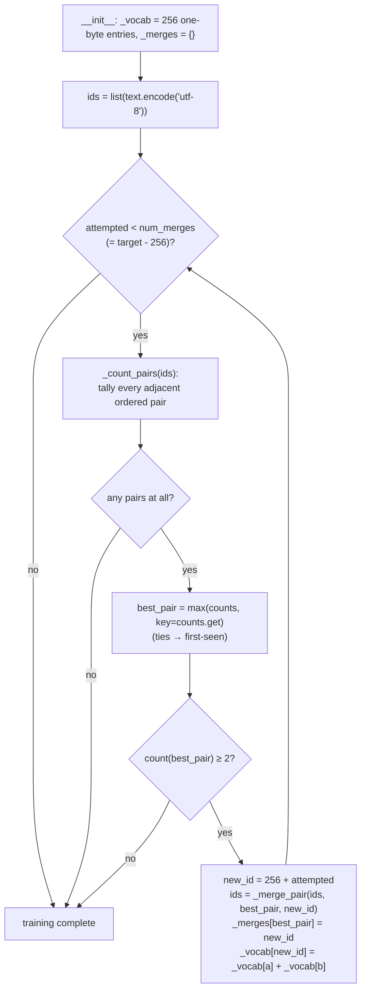
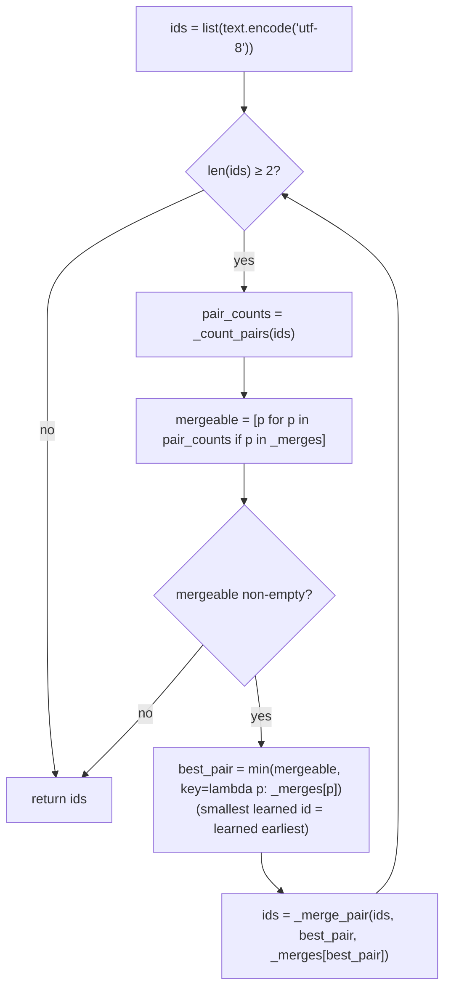
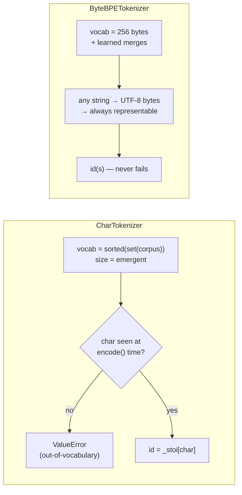
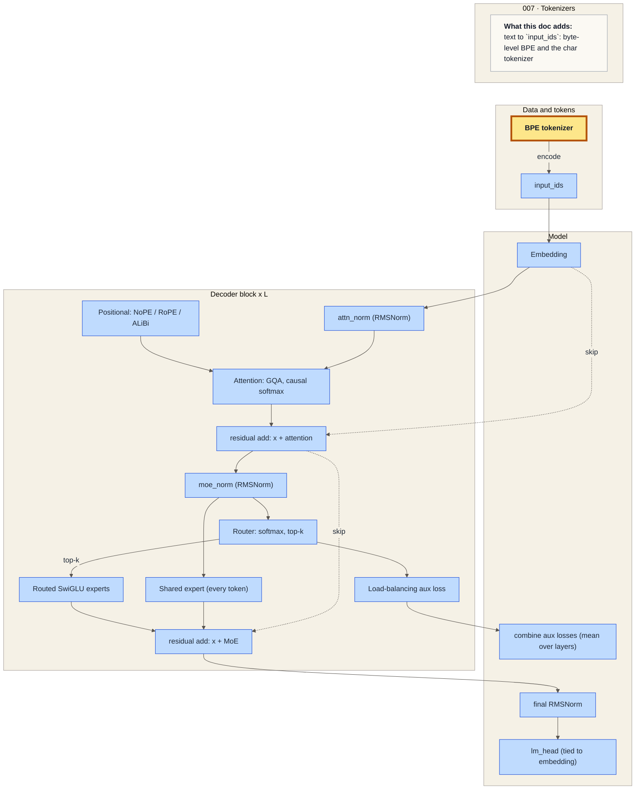

# 007 — Tokenizers: the full derivation, solved by hand

**Companion to:** [`journey_of_a_model/007-tokenizers.md`](../../journey_of_a_model/007-tokenizers.md)
· **Code:** [`qwenmoe/tokenizer/bpe.py`](../../qwenmoe/tokenizer/bpe.py)
(spine), [`qwenmoe/tokenizer/char.py`](../../qwenmoe/tokenizer/char.py)
and [`qwenmoe/tokenizer/base.py`](../../qwenmoe/tokenizer/base.py)
(contrast + factory)
· **Every number here is reproduced by:** [`verify_007_tokenizers.py`](verify_007_tokenizers.py)
(`uv run python docs/math/verify_007_tokenizers.py`)

---

## How to read this

The journal entry tells you *what* a tokenizer is and *why* the project
has two of them, with one worked example per idea. This document is the
opposite trade-off: **maximum detail, minimum summarising**. We

1. fix one tiny training corpus and one tiny configuration,
2. push them through **every single line** of `ByteBPETokenizer.train`,
   `.encode`, `.decode`, `.save`, `.load` and the two module-level helpers
   `_count_pairs` / `_merge_pair` ([`bpe.py`](../../qwenmoe/tokenizer/bpe.py)),
   citing `bpe.py:line` at each step,
3. and for every operation — a `zip`, a `max`, a byte concatenation, a
   list rebuild — first derive *why* it has the form it does, then **do
   the arithmetic on paper**, digit by digit, and check it against the
   real module.

Nothing is skipped. When a step turns a length-12 list into a length-10
list, we say which number went where and keep a running **length ledger**.

You do **not** need any background. Every term (byte, character, UTF-8,
pair, frequency, `argmax`, dictionary) is defined at first use. You
*should* skim [`journey_of_a_model/007-tokenizers.md`](../../journey_of_a_model/007-tokenizers.md)
first for the plain-English picture.

> **Scope.** The spine is `ByteBPETokenizer` — the one with an actual
> algorithm to derive. `CharTokenizer` is simpler (a sorted set and two
> dictionaries) and gets a full contrast in [Part 5](#part-5--chartokenizer-for-contrast).
> The `Tokenizer` protocol and the `build_tokenizer` factory are
> [Part 4.5](#45-the-tokenizer-protocol-and-the-build_tokenizer-factory).
>
> **There is no fused / optimised code path here.** The attention and MoE
> derivations each had to reconcile an explicit trace path against a fused
> kernel. The tokenizer has exactly one implementation — the readable one
> — so there is nothing to reconcile and no "max difference" to report.

---

## Part 0 — What are we even computing?

A neural network only ever operates on numbers. Text is not numbers. A
**tokenizer** is the adapter on both ends of the model:

$$\texttt{encode} : \text{string} \longrightarrow [\,\text{integer}, \text{integer}, \dots\,]
\qquad
\texttt{decode} : [\,\text{integer}, \dots\,] \longrightarrow \text{string}$$

- A **string** is a finite sequence of **characters** (letters, digits,
  spaces, punctuation, emoji …).
- An **integer** here is a whole number $\ge 0$ used as a label. Each
  distinct label is a **token id**.
- The complete, fixed set of ids a given tokenizer can emit is its
  **vocabulary**; its size is `vocab_size`.

**Why the model needs this.** `QwenMoEModel` (task 6) begins with an
`nn.Embedding` layer, which is a lookup table: it stores one vector (a
list of numbers) per row, and row $i$ is "the vector for token $i$."
Something must decide, once, (a) what the full list of row indices is and
(b) how to turn any input string into a list of those indices. That is
the tokenizer's whole job. `ModelConfig.vocab_size` must equal the
`vocab_size` of whichever tokenizer a run uses, or the lookup indexes off
the end of the table.

**The two designs.**

| | `CharTokenizer` | `ByteBPETokenizer` (spine) |
|---|---|---|
| unit | one Unicode character | one **byte** (0–255), then learned multi-byte merges |
| vocabulary | every distinct character in the training corpus | 256 bytes + up to `target_vocab_size − 256` learned merges |
| size | emergent (whatever the corpus contains) | configured target (an upper bound) |
| unseen input | raises `ValueError` (no id for it) | always encodable (every string is *some* byte sequence) |

By the end of [Part 2](#part-2--train-learning-the-merges-one-line-at-a-time)
you will have run, by hand, the exact merge-learning loop the real module
runs, and produced its four learned rules:

```
(97, 97)  -> 256   "aa"
(256, 97) -> 257   "aaa"
(257, 99) -> 258   "aaac"
(97, 98)  -> 259   "ab"
```

and by the end of [Part 3](#part-3--encode-replaying-the-merges-in-priority-order)
the exact token list the real module returns for the training corpus:

```
[258, 258, 259, 259]
```

---

## Part 1 — The running example

### 1.1 Definitions we need right now

- **Bit:** a single 0-or-1. **Byte:** a group of 8 bits, so it has
  $2^8 = 256$ possible values, the whole numbers $0$ through $255$. This
  "$256$" is **exact** — it is just $2^8$ — and it is the *only* reason
  the byte-level base vocabulary is exactly 256 entries.
- **Character** vs. **code point:** a character is an abstract symbol
  (`a`, `é`, `☕`). Unicode assigns each one a number called its **code
  point**, written `U+` then hexadecimal: `a` is `U+0061` (= 97 in
  ordinary decimal), `é` is `U+00E9` (= 233), `☕` is `U+2615` (= 9749).
- **UTF-8:** the rule for writing a code point as a sequence of bytes
  ([RFC 3629](https://www.rfc-editor.org/rfc/rfc3629.html)). It is
  **exact** (a fixed international standard), not a choice this project
  made:

  | code point range | bytes | pattern (`x` = a data bit) |
  |---|---|---|
  | `U+0000`–`U+007F` (ASCII) | 1 | `0xxxxxxx` |
  | `U+0080`–`U+07FF` | 2 | `110xxxxx 10xxxxxx` |
  | `U+0800`–`U+FFFF` | 3 | `1110xxxx 10xxxxxx 10xxxxxx` |
  | `U+10000`–`U+10FFFF` | 4 | `11110xxx 10xxxxxx 10xxxxxx 10xxxxxx` |

  Plain ASCII (English letters, digits, common punctuation) is 1 byte and
  the byte value *equals* the code point. So `"a"` → the single byte
  `97`. Non-ASCII takes 2–4 bytes: `"é"` → `195 169`, `"☕"` →
  `226 152 149` (we use these in [Part 4.4](#44-byte-level-coverage-any-string-zero-unknowns)).

- **List / sequence:** an ordered run of items, written `[97, 97, 98]`.
  Its **length** is how many items it holds.
- **Pair:** two items that sit next to each other in a list, kept **in
  order** — so the pair $(a, b)$ is different from $(b, a)$. A list of
  length $L$ has exactly $L - 1$ adjacent pairs.
- **Frequency / count** of a pair: how many times it occurs as you scan
  the list once, left to right.
- **Dictionary (`dict`):** a table of key → value entries. Python
  dictionaries remember **insertion order** (guaranteed since Python 3.7):
  iterating the dict visits keys in the order they were first added.
- **`argmax`:** "the argument that maximises." If `counts` maps each pair
  to its frequency, `max(counts, key=counts.get)` returns *which pair*
  has the largest frequency — not the frequency itself.

### 1.2 The configuration

The smallest setup that still exercises every branch of the code:

| Symbol | Meaning | Value |
|---|---|---|
| `target_vocab_size` | requested upper bound on `vocab_size` | $262$ |
| `_BASE_VOCAB_SIZE` | byte-level base, fixed in the module | $256$ ([`bpe.py:21`](../../qwenmoe/tokenizer/bpe.py#L21)) |
| `num_merges` | merge rounds the loop will *attempt* $= 262 - 256$ | $6$ |
| `eos_token` | reserve a document-separator id? | `False` |

`target_vocab_size` is deliberately set a little **higher** than the
corpus can support, so we get to watch the loop **stop early**
([Part 2, Round 5](#round-5--the-early-stop-i--4)). The final `vocab_size` will
be $260$, not $262$.

### 1.3 The input — one tiny corpus

```
"aaacaaacabab"
```

Twelve characters, all ASCII, so twelve bytes. Character → byte value:

$$\texttt{a} = 97, \qquad \texttt{b} = 98, \qquad \texttt{c} = 99$$

This corpus is engineered to hit every path:

- **Round 1** has one clear winner (a pair with count 4), and it involves
  the run `aaa`, so the *non-overlapping* merge logic visibly matters.
- **Rounds 2 and 3** each have a **tie** for the most-frequent pair,
  decided purely by scan order.
- **Round 4**'s winning merge (`"ab"`) shares its first byte with an
  earlier merge (`"aa"`) — an **overlap** that makes merge *priority*
  matter during `encode`.
- **Round 5** finds every remaining pair occurring only once → **early
  stop**.

### 1.4 There are no weights

The attention and MoE derivations opened by writing out weight matrices.
A tokenizer has **none**. Its entire learned state is two dictionaries,
both trivial at construction:

- `self._merges : dict[(int, int) -> int]` — the learned rules. Starts
  **empty**.
- `self._vocab : dict[int -> bytes]` — id → the byte string it stands
  for. Starts as the 256 one-byte entries
  `{0: b"\x00", 1: b"\x01", …, 255: b"\xff"}`
  ([`bpe.py:68`](../../qwenmoe/tokenizer/bpe.py#L68)).

`train` *fills* these from the corpus. Everything the tokenizer "knows"
is derived from text frequencies — nothing is initialised randomly and
nothing is trained by gradient descent.

**Length ledger (starting state)**

| after | object | value | length |
|---|---|---|---|
| — | corpus string | `"aaacaaacabab"` | 12 chars |

---

## Part 2 — `train()`: learning the merges, one line at a time



Source: [`ByteBPETokenizer.train`, `bpe.py:80–96`](../../qwenmoe/tokenizer/bpe.py#L80).

### Step 0 — construction (`__init__`)

Source: [`bpe.py:52–68`](../../qwenmoe/tokenizer/bpe.py#L52).

```python
if target_vocab_size < _BASE_VOCAB_SIZE:
    raise ValueError(...)          # 262 >= 256, so no error
self._target_vocab_size = target_vocab_size          # 262
self._eos_token = eos_token                          # False
self._merges = {}
self._vocab = {i: bytes([i]) for i in range(_BASE_VOCAB_SIZE)}   # 256 entries
```

**Why a base vocabulary of every byte, populated *before* `train`?**
Because it makes the "unknown token" problem structurally impossible: any
string, in any language, is *some* sequence of bytes $0$–$255$, and every
one of those already has an id. `train` only ever **adds** longer entries
on top; it never needs a fallback. (Contrast `CharTokenizer`, whose vocab
is empty until `train` and which therefore *can* be handed a character it
has no id for — [Part 5](#part-5--chartokenizer-for-contrast).)

`vocab_size` ([`bpe.py:70–72`](../../qwenmoe/tokenizer/bpe.py#L70)) reads
`len(self._vocab) + (1 if self._eos_token else 0)` = $256 + 0 = 256$ right
now. It always reports what is *actually* in the vocabulary, not the
target.

### Step 1 — `ids = list(text.encode("utf-8"))`

Source: [`bpe.py:81`](../../qwenmoe/tokenizer/bpe.py#L81).

`text.encode("utf-8")` applies the UTF-8 table from §1.1 to every
character and concatenates the results into one `bytes` object;
`list(...)` turns that into a list of plain integers.

Our corpus is all ASCII, so this is a straight character → byte-value
map, one for one:

$$
\underbrace{\texttt{a}}_{97}\
\underbrace{\texttt{a}}_{97}\
\underbrace{\texttt{a}}_{97}\
\underbrace{\texttt{c}}_{99}\
\underbrace{\texttt{a}}_{97}\
\underbrace{\texttt{a}}_{97}\
\underbrace{\texttt{a}}_{97}\
\underbrace{\texttt{c}}_{99}\
\underbrace{\texttt{a}}_{97}\
\underbrace{\texttt{b}}_{98}\
\underbrace{\texttt{a}}_{97}\
\underbrace{\texttt{b}}_{98}
$$

$$\texttt{ids} = [97,\ 97,\ 97,\ 99,\ 97,\ 97,\ 97,\ 99,\ 97,\ 98,\ 97,\ 98]$$

**Ledger:** string (12 chars) → `ids` (length **12**). Verified — the
script asserts this exact list.

Then `train` resets `_merges` and `_vocab` to their base state again
([`bpe.py:82–83`](../../qwenmoe/tokenizer/bpe.py#L82)) so re-training is
idempotent, and computes

```python
num_merges = self._target_vocab_size - _BASE_VOCAB_SIZE     # 262 - 256 = 6
for i in range(num_merges):        # i = 0, 1, 2, 3, 4, 5
```

So the loop will **attempt** at most 6 rounds. It will actually complete
4.

### The two helpers, derived once

**`_count_pairs(ids)` ([`bpe.py:24–28`](../../qwenmoe/tokenizer/bpe.py#L24))**

```python
def _count_pairs(ids):
    counts = {}
    for pair in zip(ids, ids[1:]):
        counts[pair] = counts.get(pair, 0) + 1
    return counts
```

`ids[1:]` is `ids` with the first element dropped. `zip(ids, ids[1:])`
walks the two lists in lockstep and yields `(ids[0], ids[1])`,
`(ids[1], ids[2])`, … — i.e. **every adjacent ordered pair**, left to
right, exactly $L - 1$ of them. `counts.get(pair, 0) + 1` is "look up the
running tally for this pair (0 if unseen), add one." Because a key is
inserted the *first* time its pair is seen, the dict's iteration order is
**the order pairs first appear scanning left to right** — a fact Step 2b
relies on.

**`_merge_pair(ids, pair, new_id)` ([`bpe.py:31–41`](../../qwenmoe/tokenizer/bpe.py#L31))**

```python
def _merge_pair(ids, pair, new_id):
    merged = []
    i = 0
    while i < len(ids):
        if i < len(ids) - 1 and (ids[i], ids[i + 1]) == pair:
            merged.append(new_id); i += 2
        else:
            merged.append(ids[i]); i += 1
    return merged
```

It builds a **new** list. Walking left to right: if the pair starting at
position `i` is the target pair, emit `new_id` once and **jump forward by
2** (both bytes consumed); otherwise emit `ids[i]` and advance by 1.

The jump-by-2 is what makes occurrences **non-overlapping**. In a run
`a a a`, the pair at positions $(0,1)$ matches → emit the merge, jump to
position $2$; position $(1,2)$ is *never examined* because position 1 was
already consumed. So `[97, 97, 97]` merging $(97,97)$ becomes
`[256, 97]` — **not** `[256, 256]` (which would reuse the middle `a`) and
**not** `[97, 256]`. Left-to-right + non-overlapping is a **design
choice**, but it is the natural one and every BPE implementation makes it;
the result is fully deterministic.

### Round 1 (`i = 0`)

#### 2a. `pair_counts = _count_pairs(ids)`

Source: [`bpe.py:87`](../../qwenmoe/tokenizer/bpe.py#L87).

`ids = [97, 97, 97, 99, 97, 97, 97, 99, 97, 98, 97, 98]` (length 12) →
11 adjacent pairs. Scanning:

| position | pair | chars | running tally |
|---|---|---|---|
| 0–1 | $(97, 97)$ | `a a` | `(97,97)`: 1 |
| 1–2 | $(97, 97)$ | `a a` | `(97,97)`: 2 |
| 2–3 | $(97, 99)$ | `a c` | `(97,99)`: 1 |
| 3–4 | $(99, 97)$ | `c a` | `(99,97)`: 1 |
| 4–5 | $(97, 97)$ | `a a` | `(97,97)`: 3 |
| 5–6 | $(97, 97)$ | `a a` | `(97,97)`: 4 |
| 6–7 | $(97, 99)$ | `a c` | `(97,99)`: 2 |
| 7–8 | $(99, 97)$ | `c a` | `(99,97)`: 2 |
| 8–9 | $(97, 98)$ | `a b` | `(97,98)`: 1 |
| 9–10 | $(98, 97)$ | `b a` | `(98,97)`: 1 |
| 10–11 | $(97, 98)$ | `a b` | `(97,98)`: 2 |

Final dict, **in insertion order**:

$$\texttt{pair\_counts} = \{\,(97,97){:}\,4,\ (97,99){:}\,2,\ (99,97){:}\,2,\ (97,98){:}\,2,\ (98,97){:}\,1\,\}$$

#### 2b. `best_pair = max(pair_counts, key=pair_counts.get)`

Source: [`bpe.py:90`](../../qwenmoe/tokenizer/bpe.py#L90).

**What `max(..., key=...)` does:** it scans the keys in iteration order
(= insertion order), holds a running "best so far," and replaces it
**only when a strictly larger** key value is found — never on a tie. So
the result is *the first key that attains the maximum*.

Here the maximum count is $4$ and only $(97, 97)$ has it. No tie this
round.

$$\texttt{best\_pair} = (97, 97), \qquad \texttt{pair\_counts}[(97,97)] = 4$$

#### 2c. the frequency gate — `if pair_counts[best_pair] < 2: break`

Source: [`bpe.py:91–92`](../../qwenmoe/tokenizer/bpe.py#L91).

$4 \ge 2$, so we continue. **Why the gate exists:** merging a pair that
occurs only *once* would spend a permanent vocabulary slot on a byte
sequence that appears exactly once in the entire corpus — there is
nothing else for the model to generalise the new token to. And there is a
free stopping criterion hidden here: once the *most frequent* pair has
count 1, **every** pair has count 1 (it was the max), so no later round
could do any better — halting loses nothing. The specific threshold "2"
is a **design choice**; "if the max is 1, all are 1" is **exact**.

#### 2d. `new_id = _BASE_VOCAB_SIZE + i` = `256 + 0` = **256**

Source: [`bpe.py:93`](../../qwenmoe/tokenizer/bpe.py#L93).

Ids are handed out densely starting at 256, in the order merges are
learned. (This density is what lets `save` store just the list of pairs —
[Part 4.5](#45-the-tokenizer-protocol-and-the-build_tokenizer-factory).)

#### 2e. `ids = _merge_pair(ids, (97, 97), 256)`

Source: [`bpe.py:94`](../../qwenmoe/tokenizer/bpe.py#L94).

Walk `[97, 97, 97, 99, 97, 97, 97, 99, 97, 98, 97, 98]`:

| `i` | window | action | `merged` so far |
|---|---|---|---|
| 0 | $(97,97)$ ✓ | emit `256`, `i → 2` | `[256]` |
| 2 | $(97,99)$ ✗ | emit `97`, `i → 3` | `[256, 97]` |
| 3 | $(99,97)$ ✗ | emit `99`, `i → 4` | `[256, 97, 99]` |
| 4 | $(97,97)$ ✓ | emit `256`, `i → 6` | `[256, 97, 99, 256]` |
| 6 | $(97,99)$ ✗ | emit `97`, `i → 7` | `[256, 97, 99, 256, 97]` |
| 7 | $(99,97)$ ✗ | emit `99`, `i → 8` | `[256, 97, 99, 256, 97, 99]` |
| 8 | $(97,98)$ ✗ | emit `97`, `i → 9` | `… 97` |
| 9 | $(98,97)$ ✗ | emit `98`, `i → 10` | `… 97, 98` |
| 10 | $(97,98)$ ✗ | emit `97`, `i → 11` | `… 97, 98, 97` |
| 11 | last element | emit `98`, `i → 12` | `… 97, 98, 97, 98` |

$$\texttt{ids} = [256,\ 97,\ 99,\ 256,\ 97,\ 99,\ 97,\ 98,\ 97,\ 98]$$

Notice each run `aaa` collapsed to `256 97` (`"aa"` + a leftover `"a"`),
**not** `256 256` — the non-overlap rule in action.

#### 2f–2g. record the rule and build the vocab entry

Source: [`bpe.py:95–96`](../../qwenmoe/tokenizer/bpe.py#L95).

```python
self._merges[(97, 97)] = 256
self._vocab[256] = self._vocab[97] + self._vocab[97]
```

`self._vocab[97]` is `b"a"` (the one-byte entry). `+` on `bytes` is
**concatenation**: `b"a" + b"a" = b"aa"`. So token 256 *literally is* the
two bytes it merges, in order. This is the whole reason `decode` is just
"look each id up and glue the byte strings together."

$$\texttt{\_merges} = \{(97,97){:}\,256\}, \qquad \texttt{\_vocab}[256] = \texttt{b"aa"}$$

**Ledger:** `ids` 12 → **10**.

### Round 2 (`i = 1`)

#### Count pairs of `[256, 97, 99, 256, 97, 99, 97, 98, 97, 98]` (length 10 → 9 pairs)

| position | pair | chars | tally |
|---|---|---|---|
| 0–1 | $(256, 97)$ | `aa a` | `(256,97)`: 1 |
| 1–2 | $(97, 99)$ | `a c` | `(97,99)`: 1 |
| 2–3 | $(99, 256)$ | `c aa` | `(99,256)`: 1 |
| 3–4 | $(256, 97)$ | `aa a` | `(256,97)`: 2 |
| 4–5 | $(97, 99)$ | `a c` | `(97,99)`: 2 |
| 5–6 | $(99, 97)$ | `c a` | `(99,97)`: 1 |
| 6–7 | $(97, 98)$ | `a b` | `(97,98)`: 1 |
| 7–8 | $(98, 97)$ | `b a` | `(98,97)`: 1 |
| 8–9 | $(97, 98)$ | `a b` | `(97,98)`: 2 |

$$\texttt{pair\_counts} = \{\,(256,97){:}\,2,\ (97,99){:}\,2,\ (99,256){:}\,1,\ (99,97){:}\,1,\ (97,98){:}\,2,\ (98,97){:}\,1\,\}$$

#### `max` — the first tie

Three pairs are tied at the maximum count $2$: $(256,97)$, $(97,99)$,
$(97,98)$. `max` returns **the first one in iteration order**. Iteration
order is insertion order; $(256, 97)$ was inserted first (its first
occurrence, positions 0–1, is leftmost). So

$$\texttt{best\_pair} = (256, 97), \qquad \text{count } 2.$$

This is a **deterministic but arbitrary** tie-break — "whichever
maximal pair we happened to see first," not a semantic ranking. It is
still perfectly reproducible (the same corpus always trains to the same
tokenizer), which is all that `save`/`load` and the tests need.

#### Merge, record, build

$2 \ge 2$ ✓. `new_id = 256 + 1 = 257`.

`_merge_pair([256, 97, 99, 256, 97, 99, 97, 98, 97, 98], (256, 97), 257)`:

| `i` | window | action |
|---|---|---|
| 0 | $(256,97)$ ✓ | emit `257`, `i → 2` |
| 2 | $(99,256)$ ✗ | emit `99`, `i → 3` |
| 3 | $(256,97)$ ✓ | emit `257`, `i → 5` |
| 5 | $(99,97)$ ✗ | emit `99`, `i → 6` |
| 6 | $(97,98)$ ✗ | emit `97` |
| 7 | $(98,97)$ ✗ | emit `98` |
| 8 | $(97,98)$ ✗ | emit `97` |
| 9 | last | emit `98` |

$$\texttt{ids} = [257,\ 99,\ 257,\ 99,\ 97,\ 98,\ 97,\ 98]$$

```python
self._merges[(256, 97)] = 257
self._vocab[257] = self._vocab[256] + self._vocab[97] = b"aa" + b"a" = b"aaa"
```

**Ledger:** `ids` 10 → **8**.

### Round 3 (`i = 2`)

#### Count pairs of `[257, 99, 257, 99, 97, 98, 97, 98]` (length 8 → 7 pairs)

| position | pair | chars | tally |
|---|---|---|---|
| 0–1 | $(257, 99)$ | `aaa c` | `(257,99)`: 1 |
| 1–2 | $(99, 257)$ | `c aaa` | `(99,257)`: 1 |
| 2–3 | $(257, 99)$ | `aaa c` | `(257,99)`: 2 |
| 3–4 | $(99, 97)$ | `c a` | `(99,97)`: 1 |
| 4–5 | $(97, 98)$ | `a b` | `(97,98)`: 1 |
| 5–6 | $(98, 97)$ | `b a` | `(98,97)`: 1 |
| 6–7 | $(97, 98)$ | `a b` | `(97,98)`: 2 |

$$\texttt{pair\_counts} = \{\,(257,99){:}\,2,\ (99,257){:}\,1,\ (99,97){:}\,1,\ (97,98){:}\,2,\ (98,97){:}\,1\,\}$$

#### `max` — the second tie

$(257, 99)$ and $(97, 98)$ are tied at $2$. $(257, 99)$ was inserted
first → it wins.

$$\texttt{best\_pair} = (257, 99), \qquad \text{count } 2.$$

(The pair $(97, 98)$ has now been "runner-up in a tie" **twice**. It
finally wins in Round 4.)

#### Merge, record, build

`new_id = 258`.
`_merge_pair([257, 99, 257, 99, 97, 98, 97, 98], (257, 99), 258)`:

| `i` | window | action |
|---|---|---|
| 0 | $(257,99)$ ✓ | emit `258`, `i → 2` |
| 2 | $(257,99)$ ✓ | emit `258`, `i → 4` |
| 4 | $(97,98)$ ✗ | emit `97` |
| 5 | $(98,97)$ ✗ | emit `98` |
| 6 | $(97,98)$ ✗ | emit `97` |
| 7 | last | emit `98` |

$$\texttt{ids} = [258,\ 258,\ 97,\ 98,\ 97,\ 98]$$

```python
self._merges[(257, 99)] = 258
self._vocab[258] = self._vocab[257] + self._vocab[99] = b"aaa" + b"c" = b"aaac"
```

**Ledger:** `ids` 8 → **6**.

### Round 4 (`i = 3`)

#### Count pairs of `[258, 258, 97, 98, 97, 98]` (length 6 → 5 pairs)

| position | pair | chars | tally |
|---|---|---|---|
| 0–1 | $(258, 258)$ | `aaac aaac` | `(258,258)`: 1 |
| 1–2 | $(258, 97)$ | `aaac a` | `(258,97)`: 1 |
| 2–3 | $(97, 98)$ | `a b` | `(97,98)`: 1 |
| 3–4 | $(98, 97)$ | `b a` | `(98,97)`: 1 |
| 4–5 | $(97, 98)$ | `a b` | `(97,98)`: 2 |

$$\texttt{pair\_counts} = \{\,(258,258){:}\,1,\ (258,97){:}\,1,\ (97,98){:}\,2,\ (98,97){:}\,1\,\}$$

#### `max`

$(97, 98)$ alone has the max count $2$. **No tie this round** — it wins
outright at last.

$$\texttt{best\_pair} = (97, 98), \qquad \text{count } 2.$$

#### Merge, record, build

`new_id = 259`.
`_merge_pair([258, 258, 97, 98, 97, 98], (97, 98), 259)`:

| `i` | window | action |
|---|---|---|
| 0 | $(258,258)$ ✗ | emit `258`, `i → 1` |
| 1 | $(258,97)$ ✗ | emit `258`, `i → 2` |
| 2 | $(97,98)$ ✓ | emit `259`, `i → 4` |
| 4 | $(97,98)$ ✓ | emit `259`, `i → 6` (loop ends) |

$$\texttt{ids} = [258,\ 258,\ 259,\ 259]$$

```python
self._merges[(97, 98)] = 259
self._vocab[259] = self._vocab[97] + self._vocab[98] = b"a" + b"b" = b"ab"
```

Token 259 = `"ab"` **begins with byte 97**, exactly like token 256 =
`"aa"`. Keep that in mind — it is what makes `encode`'s priority rule
have teeth ([Part 3.3](#33-why-min-priority-actually-changes-the-answer)).

**Ledger:** `ids` 6 → **4**.

### Round 5 — the early stop (`i = 4`)

#### Count pairs of `[258, 258, 259, 259]` (length 4 → 3 pairs)

| position | pair | chars | tally |
|---|---|---|---|
| 0–1 | $(258, 258)$ | `aaac aaac` | 1 |
| 1–2 | $(258, 259)$ | `aaac ab` | 1 |
| 2–3 | $(259, 259)$ | `ab ab` | 1 |

$$\texttt{pair\_counts} = \{\,(258,258){:}\,1,\ (258,259){:}\,1,\ (259,259){:}\,1\,\}$$

`max` returns the first key, $(258, 258)$, with count **1**. The gate
`if pair_counts[best_pair] < 2` fires: **`break`**
([`bpe.py:91–92`](../../qwenmoe/tokenizer/bpe.py#L91)). The loop's 5th and
6th iterations (`i = 4, 5`) never finish — `break` leaves the `for`
entirely.

**The loop did 4 of an attempted 6 merges.** `vocab_size` is now
$256 + 4 = 260$, which is **less than** `target_vocab_size = 262`. This is
not a bug — the corpus simply has no repeated pair left to spend the last
two slots on. (A real corpus with more internal repetition would reach
the target; the `test_train_reaches_configured_target_vocab_size` test
uses a 40×-repeated sentence for exactly this reason.)

### Result of `train`

$$
\boxed{
\begin{aligned}
\texttt{\_merges} &= \{\,(97,97){:}\,256,\ (256,97){:}\,257,\ (257,99){:}\,258,\ (97,98){:}\,259\,\} \\[2pt]
\texttt{\_vocab}[256{:}260] &= \{\,256{:}\,\texttt{b"aa"},\ 257{:}\,\texttt{b"aaa"},\ 258{:}\,\texttt{b"aaac"},\ 259{:}\,\texttt{b"ab"}\,\} \\[2pt]
\texttt{vocab\_size} &= 260
\end{aligned}}
$$

Quoting `verify_007_tokenizers.py` directly:

```
learned merges (pair -> new id):
  (97, 97) -> 256   ('aa')
  (256, 97) -> 257   ('aaa')
  (257, 99) -> 258   ('aaac')
  (97, 98) -> 259   ('ab')
vocab_size = 260   (target was 262: 260 < 262 -> early stop)
```

**Full length ledger for `train`**

| after round | winning merge | `ids` length | change |
|---|---|---|---|
| — (bytes) | — | 12 | — |
| 1 | $(97,97) \to 256$ | 10 | −2 |
| 2 | $(256,97) \to 257$ | 8 | −2 |
| 3 | $(257,99) \to 258$ | 6 | −2 |
| 4 | $(97,98) \to 259$ | 4 | −2 |
| 5 | *(early stop)* | 4 | 0 |

---

## Part 3 — `encode()`: replaying the merges in priority order



Source: [`ByteBPETokenizer.encode`, `bpe.py:98–107`](../../qwenmoe/tokenizer/bpe.py#L98).

### Step 1 — `ids = list(text.encode("utf-8"))`

Source: [`bpe.py:99`](../../qwenmoe/tokenizer/bpe.py#L99).

We encode **the same corpus** we trained on, `"aaacaaacabab"`. Same UTF-8
map as Part 2, Step 1:

$$\texttt{ids} = [97,\ 97,\ 97,\ 99,\ 97,\ 97,\ 97,\ 99,\ 97,\ 98,\ 97,\ 98] \qquad \text{length } 12$$

### Step 2 — the `while len(ids) >= 2` loop

Source: [`bpe.py:100–106`](../../qwenmoe/tokenizer/bpe.py#L100).

Each pass:

1. `pair_counts = _count_pairs(ids)` — same helper as training. During
   `encode` we only need the *set of pairs present*, not the counts, but
   the code reuses the function.
2. `mergeable = [p for p in pair_counts if p in self._merges]` — keep only
   the pairs that are **learned merge rules**.
3. `if not mergeable: break`.
4. `best_pair = min(mergeable, key=lambda p: self._merges[p])` — of the
   applicable rules, take the one with the **smallest learned id**, i.e.
   the one learned **earliest**.
5. `ids = _merge_pair(ids, best_pair, self._merges[best_pair])`.

**Why "earliest learned first" is the only correct order.** Two separate
reasons:

- **Applicability gating.** Rule $(256, 97) \to 257$ cannot match anything
  until rule $(97, 97) \to 256$ has produced a `256`. So at any moment
  only *some* learned rules are applicable; you apply one, which may
  unlock others. Training built the rules in an order where each rule's
  inputs were produced by earlier rules — `encode` must respect that same
  order or it produces byte sequences training never saw.
- **Genuine priority.** When *two* rules are applicable at once (our
  `mergeable` list has length 2 in passes 1–3 below), `min` by id picks
  the earlier. On **overlapping** pairs this changes the output — shown
  in [§3.3](#33-why-min-priority-actually-changes-the-answer).

This is **exact**: given `_merges`, the output is determined.

#### Pass 1

`ids = [97, 97, 97, 99, 97, 97, 97, 99, 97, 98, 97, 98]`.
Distinct pairs present: $(97,97), (97,99), (99,97), (97,98), (98,97)$.
Of these, in `_merges`: $(97,97) \to 256$ and $(97,98) \to 259$.

$$\texttt{mergeable} = [(97,97),\ (97,98)] \qquad
\min\big(256,\ 259\big) \Rightarrow (97, 97)$$

`_merge_pair(ids, (97,97), 256)` is byte-for-byte the same walk as Round 1
Step 2e:

$$\texttt{ids} = [256,\ 97,\ 99,\ 256,\ 97,\ 99,\ 97,\ 98,\ 97,\ 98] \qquad \text{length } 10$$

#### Pass 2

Distinct pairs: $(256,97), (97,99), (99,256), (99,97), (97,98), (98,97)$.
In `_merges`: $(256,97) \to 257$ and $(97,98) \to 259$.

$$\texttt{mergeable} = [(256,97),\ (97,98)] \qquad \min(257,\ 259) \Rightarrow (256, 97)$$

$$\texttt{ids} = [257,\ 99,\ 257,\ 99,\ 97,\ 98,\ 97,\ 98] \qquad \text{length } 8$$

#### Pass 3

Distinct pairs: $(257,99), (99,257), (99,97), (97,98), (98,97)$.
In `_merges`: $(257,99) \to 258$ and $(97,98) \to 259$.

$$\texttt{mergeable} = [(257,99),\ (97,98)] \qquad \min(258,\ 259) \Rightarrow (257, 99)$$

$$\texttt{ids} = [258,\ 258,\ 97,\ 98,\ 97,\ 98] \qquad \text{length } 6$$

#### Pass 4

Distinct pairs: $(258,258), (258,97), (97,98), (98,97)$.
In `_merges`: only $(97,98) \to 259$.

$$\texttt{mergeable} = [(97,98)] \Rightarrow (97, 98)$$

$$\texttt{ids} = [258,\ 258,\ 259,\ 259] \qquad \text{length } 4$$

#### Pass 5

Distinct pairs: $(258,258), (258,259), (259,259)$. **None** is in
`_merges`. `mergeable` is empty → `break`.

$$\boxed{\ \texttt{encode("aaacaaacabab")} = [258,\ 258,\ 259,\ 259]\ }$$

Quoting the script:

```
  pass 1: mergeable pairs present = [(97, 97), (97, 98)]
          min by learned id -> (97, 97) = id 256
          after pass 1: [256, 97, 99, 256, 97, 99, 97, 98, 97, 98]   (length 10)
  pass 2: mergeable pairs present = [(256, 97), (97, 98)]
          min by learned id -> (256, 97) = id 257
          after pass 2: [257, 99, 257, 99, 97, 98, 97, 98]   (length 8)
  pass 3: mergeable pairs present = [(257, 99), (97, 98)]
          min by learned id -> (257, 99) = id 258
          after pass 3: [258, 258, 97, 98, 97, 98]   (length 6)
  pass 4: mergeable pairs present = [(97, 98)]
          min by learned id -> (97, 98) = id 259
          after pass 4: [258, 258, 259, 259]   (length 4)
  pass 5: no adjacent pair is a learned merge -> stop
```

**Length ledger for `encode`:** 12 → 10 → 8 → 6 → **4**. Twelve bytes
became four tokens — a 3× reduction on this (very repetitive) corpus.

### 3.1 The round trip

`decode([258, 258, 259, 259])` looks each id up and concatenates
([Part 4.1](#41-decode-lookup-join-utf-8)):

$$\texttt{b"aaac"} + \texttt{b"aaac"} + \texttt{b"ab"} + \texttt{b"ab"}
= \texttt{b"aaacaaacabab"} \xrightarrow{\text{UTF-8}} \texttt{"aaacaaacabab"}$$

— byte-for-byte the original. The script asserts
`decode(encode(CORPUS)) == CORPUS`.

### 3.2 Token 256 is a real token, not just scaffolding

`"aa"` (256) and `"aaa"` (257) were both consumed on the way to `"aaac"`
(258) in the trace above, so you might think they only exist as stepping
stones. They don't — they are ordinary vocabulary entries and `encode`
uses them directly on other input:

```
encode('aa')  = [256]          (token 256 on its own)
encode('aad') = [256, 100]     ('aa', 'd')     -- 100 is byte 'd', unmerged
```

### 3.3 Why `min` priority actually changes the answer

Take the three-byte string `"aab"` = `[97, 97, 98]`.

- Pairs present: $(97, 97)$ and $(97, 98)$. **Both are learned rules**
  (256 and 259), and they **overlap** — they share the middle `a`.
- `min` picks id $256$, so $(97, 97)$ merges first:
  `[97, 97, 98]` → `[256, 98]` = `"aa" + "b"`. Pass 2 finds nothing
  (`(256, 98)` is not a rule). Result **`[256, 98]`**.
- Had `encode` taken $(97, 98)$ first instead:
  `[97, 97, 98]` → `[97, 259]` = `"a" + "ab"` — a **different** two-token
  encoding.

```
encode('aab')          = [256, 98]    ('aa','b')
if (97,98) went first  = [97, 259]    ('a','ab')  <- different
```

`min` resolves it to `[256, 98]`, matching the order training learned the
rules (256 before 259). Deterministic, and consistent with training —
which is the entire point.

### 3.4 `encode` is greedy, and greedy is not always shortest

`encode("aaaac")` = `[97, 97, 97, 97, 99]`:

- Pass 1: only $(97, 97)$ is a rule; it fires at positions $(0,1)$ and
  $(2,3)$ → `[256, 256, 99]`.
- Pass 2: `(256, 256)` and `(256, 99)` are not rules; and there is no
  lone `97` left for `(256, 97) \to 257` to grab. Stop.

$$\texttt{encode("aaaac")} = [256,\ 256,\ 99] \qquad \text{3 tokens}$$

But `[97, 258]` = `"a" + "aaac"` also decodes to `"aaaac"` and is **2
tokens** — the script asserts `decode([97, 258]) == "aaaac"`. Greedy
`encode` can't reach it, because the leftmost `(97, 97)` merge consumed
the `a`s that `258 = "aaac"` needed. This is a **known property** of
greedy BPE encoding, not a defect — production tokenizers accept it (or
add a training-time regulariser like BPE-dropout). Correctness
(round-trip losslessness) is unaffected: `decode([256, 256, 99])` is
still exactly `"aaaac"`.

---

## Part 4 — `decode()`, and the rest of the surface

### 4.1 `decode`: lookup, join, UTF-8

Source: [`bpe.py:109–117`](../../qwenmoe/tokenizer/bpe.py#L109).

```python
def decode(self, ids):
    eos_id = self.eos_id                                  # None here
    try:
        byte_seq = b"".join(self._vocab[i] for i in ids if i != eos_id)
    except KeyError as e:
        raise ValueError(f"token id {e.args[0]} out of range ...") from e
    return byte_seq.decode("utf-8", errors="replace")
```

Three operations:

1. **Lookup + filter.** For each id, fetch `self._vocab[i]` (a `bytes`
   object), *unless* it equals `eos_id` (skip it — [§4.5](#45-the-tokenizer-protocol-and-the-build_tokenizer-factory)).
   With `eos_token=False`, `eos_id` is `None` and `i != None` is always
   true, so nothing is skipped.
2. **Join.** `b"".join(...)` concatenates all those byte strings, in
   order, with no separator.
3. **UTF-8 decode.** `byte_seq.decode("utf-8", errors="replace")` applies
   the UTF-8 table in reverse.

Traced on `[258, 258, 259, 259]`:

$$
\underbrace{\texttt{b"aaac"}}_{258}\
\underbrace{\texttt{b"aaac"}}_{258}\
\underbrace{\texttt{b"ab"}}_{259}\
\underbrace{\texttt{b"ab"}}_{259}
\;\to\; \texttt{b"aaacaaacabab"} \;\to\; \texttt{"aaacaaacabab"} \ ✓
$$

**Why `errors="replace"` and not strict.** For any ids that actually came
out of this tokenizer's `encode`, `byte_seq` is *guaranteed* valid UTF-8:
`encode` starts from `text.encode("utf-8")` (valid by construction) and
only ever glues whole existing entries together — it never splits a
byte or a character. So for real round trips, `decode` is **exact and
lossless**; `errors="replace"` never triggers.

It only matters for ids that did **not** come from `encode` — e.g. a
half-trained model (task 11) sampling ids at random. Byte `128` (`0x80`)
is a UTF-8 *continuation* byte; standing alone with no lead byte it is not
a valid character, so it becomes `U+FFFD` (`�`, the "replacement
character"):

```
decode([256, 128]) = 'aa�'      (b"aa" + b"\x80"; 0x80 alone is not valid UTF-8)
```

Strict decoding would raise mid-generation instead; `replace` matches the
GPT-2 / tiktoken convention of degrading gracefully. **Design choice.**

**Out-of-range id → `ValueError`.** `self._vocab[260]` when the vocab only
has keys `0…259` raises `KeyError`, which the `except` turns into a
`ValueError` naming the id and `vocab_size`:

```
decode([260]) -> ValueError: token id 260 out of range for vocab_size=260
```

Re-raising as `ValueError` (not leaking `KeyError`) is a deliberate API
contract — the same one `CharTokenizer` uses.

### 4.2 The length ledger, both directions

| operation | in | out | ratio |
|---|---|---|---|
| `encode("aaacaaacabab")` | 12 bytes | 4 tokens | 3.0× shorter |
| `decode([258, 258, 259, 259])` | 4 tokens | 12 bytes | 3.0× longer |

### 4.3 `vocab_size` and the reserved `<eos>` id

`vocab_size` ([`bpe.py:70–72`](../../qwenmoe/tokenizer/bpe.py#L70)):

```python
return len(self._vocab) + (1 if self._eos_token else 0)
```

- `eos_token=False` (our spine): `260 + 0 = 260`.
- `eos_token=True`: `260 + 1 = 261`, and `eos_id`
  ([`bpe.py:74–78`](../../qwenmoe/tokenizer/bpe.py#L74)) returns
  `len(self._vocab) = 260` — the **first integer past** the byte+merge
  vocabulary.

The reserved id (moe-modernization Requirement 10.1) is a document
separator. Key invariants, all asserted by the script:

- **`encode` never emits it.** `encode` only ever produces byte ids
  ($< 256$) and merge ids ($256 \dots 259$), all below $260$.
- **`decode` drops it.** The `if i != eos_id` filter in
  [§4.1](#41-decode-lookup-join-utf-8).

```
eos: encode('aa') + [eos_id] + encode('bb')
   = [256] + [260] + [98, 98]
   = [256, 260, 98, 98]
decode([256, 260, 98, 98]) = 'aabb'      (the 260 vanished)
```

It is off by default so a tokenizer built before this spec is
byte-identical (same `vocab_size`, same ids).

### 4.4 Byte-level coverage: any string, zero unknowns

`encode("café ☕")` — a string with two characters (`é`, `☕`) that never
appeared in training:

| char | code point | UTF-8 bytes |
|---|---|---|
| `c` | `U+0063` | `99` |
| `a` | `U+0061` | `97` |
| `f` | `U+0066` | `102` |
| `é` | `U+00E9` | `195 169` |
| (space) | `U+0020` | `32` |
| `☕` | `U+2615` | `226 152 149` |

```
encode('café ☕') = [99, 97, 102, 195, 169, 32, 226, 152, 149]
                  == the raw UTF-8 bytes   (no learned merge applies)
decode(...)       == 'café ☕'             (round-trips exactly)
```

No merge rule matches any adjacent pair here, so `encode` returns the raw
byte list unchanged — and `decode` reassembles it perfectly. This is
**structurally impossible for `CharTokenizer`** ([Part 5](#part-5--chartokenizer-for-contrast)):
it would raise `ValueError` on `é` immediately. The 256-byte floor buys
**guaranteed** coverage of every string in every language, for the price
of a fixed 256-entry base vocabulary.

### 4.5 The `Tokenizer` protocol and the `build_tokenizer` factory

`save` ([`bpe.py:119–126`](../../qwenmoe/tokenizer/bpe.py#L119)) writes
JSON:

```json
{"target_vocab_size": 262, "merges": [[97, 97], [256, 97], [257, 99], [97, 98]], "eos_token": false}
```

Note what is **not** stored: `_vocab`. The merge list *is* the whole
tokenizer — `_vocab` is a pure function of it. `save` writes the pairs
**ordered by new id** (`sorted(..., key=lambda item: item[1])`), so a
pair's **position in the list implies its id**: index 0 → 256, index 1 →
257, and so on. This works precisely because `train` hands out ids
densely from 256 with no gaps.

`load` ([`bpe.py:128–137`](../../qwenmoe/tokenizer/bpe.py#L128)) replays
that list through the *same* reconstruction `train` uses:

```python
for i, (a, b) in enumerate(data["merges"]):
    new_id = _BASE_VOCAB_SIZE + i               # 256, 257, 258, 259
    self._merges[(a, b)] = new_id
    self._vocab[new_id] = self._vocab[a] + self._vocab[b]
```

Loading our JSON into a **fresh** `ByteBPETokenizer()` (default target
4096) reproduces `_merges` exactly, `vocab_size == 260`, and
`encode(CORPUS) == [258, 258, 259, 259]` — all asserted.

**The factory.** `build_tokenizer(config)`
([`base.py:32–45`](../../qwenmoe/tokenizer/base.py#L32)) turns a
`DataConfig` into a live tokenizer:

```python
if config.tokenizer_type == "char":
    return CharTokenizer()
if config.tokenizer_type == "bpe":
    return ByteBPETokenizer(config.bpe_vocab_size, eos_token=eos_token)
raise ValueError(f"Unknown tokenizer_type: {config.tokenizer_type!r}")
```

So `DataConfig(tokenizer_type="bpe", bpe_vocab_size=262)` produces exactly
the `ByteBPETokenizer(262)` this document traces. Both classes structurally
satisfy the `Tokenizer` `Protocol`
([`base.py:17–29`](../../qwenmoe/tokenizer/base.py#L17)) —
`train`/`encode`/`decode`/`save`/`load`/`vocab_size` — which is what lets
the data pipeline (task 8) treat them interchangeably.

---

## Part 5 — `CharTokenizer`, for contrast

[`char.py`](../../qwenmoe/tokenizer/char.py) in full is under 50 lines. No
bytes, no pairs, no merges, no target size.

### `train(text)`

Source: [`char.py:21–24`](../../qwenmoe/tokenizer/char.py#L21).

```python
chars = sorted(set(text))
self._stoi = {ch: i for i, ch in enumerate(chars)}
self._itos = dict(enumerate(chars))
```

- **`set(text)`** — the distinct characters, order discarded.
- **`sorted(...)`** — put them in Unicode code-point order, so id
  assignment is deterministic (doesn't depend on where a character first
  appeared).
- **`_stoi`** ("string to int") maps char → id; **`_itos`** maps id →
  char.

On our corpus `"aaacaaacabab"`:

$$\texttt{set} = \{\texttt{'a'}, \texttt{'b'}, \texttt{'c'}\}
\xrightarrow{\text{sorted}} [\texttt{'a'}, \texttt{'b'}, \texttt{'c'}]
\xrightarrow{\text{enumerate}}
\texttt{'a'}{\to}0,\ \texttt{'b'}{\to}1,\ \texttt{'c'}{\to}2$$

$$\texttt{vocab\_size} = 3$$

— **emergent**. There is no knob to request a different character-vocab
size; you get exactly the alphabet the corpus contains.

### `encode` / `decode`

Source: [`char.py:26–38`](../../qwenmoe/tokenizer/char.py#L26).

Pure per-character dictionary lookups:

```
encode("cab") = [2, 0, 1]
decode([2, 0, 1]) = "cab"
```

### The out-of-vocabulary wall

```python
try:
    return [self._stoi[ch] for ch in text]
except KeyError as e:
    raise ValueError(f"character {e.args[0]!r} is not in the trained vocabulary") from e
```

```
CharTokenizer.encode('d') -> ValueError: character 'd' is not in the trained vocabulary
```

`'d'` never appeared in `"aaacaaacabab"`, so it has no id, and there is no
byte-level escape hatch to fall back to. This is the **structural**
difference from `ByteBPETokenizer`, and the reason the project uses
`CharTokenizer` only for the fixed-alphabet tiny-Shakespeare smoke test.



---

## Part 6 — Cost, and why it is built this way

Using this example's own numbers.

### What the 4 learned merges bought

| id | bytes | how "earned" |
|---|---|---|
| 256 | `aa` | most frequent raw pair (count 4) |
| 257 | `aaa` | `aa` + `a`, count 2 |
| 258 | `aaac` | `aaa` + `c`, count 2 |
| 259 | `ab` | `a` + `b`, count 2 |

Every slot went to a byte sequence that occurs **at least twice** in the
corpus — the frequency gate guarantees it. Spend the budget on what is
actually common *in this corpus*: that is the entire idea BPE inherits
from its origin as a **compression** algorithm
([Gage 1994](https://jacobfilipp.com/DrDobbs/articles/CUJ/1994/9402/gage/gage.htm)).

### Compression, honestly

`encode` turned 12 bytes into 4 tokens here — 3×. **Do not read anything
into that number.** `"aaacaaacabab"` is a pathologically repetitive toy.
Real byte-level BPE on English averages roughly 4 bytes/token
([GPT-2](https://cdn.openai.com/better-language-models/language_models_are_unsupervised_multitask_learners.pdf)),
and the ratio depends entirely on how much the corpus repeats and how
large `target_vocab_size` is.

### The 256-byte floor is the whole point

`vocab_size` is always $256 + (\text{merges completed}) \in [256,\ \texttt{target\_vocab\_size}]$.
The base 256 is fixed and non-negotiable — and it is exactly what
guarantees **zero** unknown-token cases for any input
([§4.4](#44-byte-level-coverage-any-string-zero-unknowns)). A
character-level vocabulary that wanted the same guarantee would need an
entry for every one of Unicode's ~150,000 assigned code points, most
never seen in any single corpus. Byte-level trades that away for a fixed,
tiny base.

### Compute

- `_count_pairs` is **O(L)** in the current list length $L$.
- `train` runs at most `num_merges` rounds, each **O(L)** → **O(num_merges · L)**.
- `_merge_pair` allocates a fresh list each call (not in place).
- `encode`'s `while` loop runs at most **O(L)** times (the length
  strictly decreases every pass), each pass **O(L)** → **O(L²)** worst
  case for one `encode` call. Fine for offline data prep at this
  project's scale; a production tokenizer keeps a priority queue of merge
  candidates and runs in **O(L log L)**. This O(L²) is a property of
  *this* implementation, chosen for readability (it mirrors Karpathy's
  [`minbpe`](https://github.com/karpathy/minbpe)).

### What is deliberately left out

No regex pre-tokenization. Real GPT-2-style byte-level BPE first splits
text on a regex so a merge can never span a word/whitespace boundary;
this implementation runs the merge loop over the **entire** raw byte
stream. That costs some vocabulary efficiency (slots spent on
boundary-crossing sequences) but changes nothing about round-trip
correctness. Full discussion in the
[journal entry](../../journey_of_a_model/007-tokenizers.md#design-decisions-worth-calling-out).

### `CharTokenizer` vs. `ByteBPETokenizer`, side by side

| | `CharTokenizer` | `ByteBPETokenizer` |
|---|---|---|
| learned state | `_stoi`, `_itos` (one entry per distinct char) | `_merges`, `_vocab` (256 + merges) |
| `vocab_size` | emergent, uncontrollable | configured upper bound |
| unseen char at `encode` | `ValueError` | always encodable |
| sequence length | 1 token per character | fewer (merges compress runs) |
| used for | tiny-Shakespeare smoke test | TinyStories comparison study |

---

## Questions that might come to mind

- **Why re-count every pair from scratch on every `encode` pass instead
  of tracking incrementally?** Simplicity. O(L²) is negligible at this
  project's scale, and `minbpe` — the reference this file mirrors — makes
  the same choice. A production tokenizer would use a priority queue.

- **Could `vocab_size` ever exceed `target_vocab_size`?** No. The loop
  runs at most `target_vocab_size − 256` rounds and each adds exactly one
  id. It can end up **below** the target (our case: 260 < 262) if the
  corpus runs out of repeated pairs, never above.

- **Does the merge *order* matter for `encode`, or only which merges
  exist?** Order. `encode` must apply the earliest-learned applicable
  rule first — a later rule's left token (e.g. the `256` in
  $(256, 97) \to 257$) may not exist in the sequence until an earlier
  rule has produced it. And on overlapping pairs the order changes the
  output ([§3.3](#33-why-min-priority-actually-changes-the-answer)).

- **Why does `save` store `merges` but not `_vocab`?** `_vocab` is a pure
  function of `merges` (replay them, concatenating bytes). Storing only
  the merges makes the file minimal *and* forces `load` to rebuild the
  vocab the exact same way `train` does — no chance of a saved vocab
  drifting out of sync with the rules.

- **The JSON `merges` list has no ids in it — how does `load` know which
  id each pair gets?** Position. `train` assigns ids densely from 256 in
  learn order, and `save` writes the pairs in that same order, so list
  index $k$ ⇒ id $256 + k$.

- **What if the corpus is shorter than 2 bytes?** `_count_pairs` returns
  an empty dict, `if not pair_counts: break` fires
  ([`bpe.py:88–89`](../../qwenmoe/tokenizer/bpe.py#L88)), training stops
  with `vocab_size == 256`. `encode`'s `while len(ids) >= 2` never enters.

- **Is `errors="replace"` ever lossy for real text?** Never for text this
  tokenizer produced — those bytes are always valid UTF-8. It only
  affects hand-constructed or model-sampled id lists that don't land on a
  character boundary.

- **Why UTF-8 and not UTF-16/UTF-32?** UTF-8 is a strict superset of
  ASCII (a pure-ASCII corpus's byte stream *is* its ASCII), it is
  self-synchronising, and it is the web's default encoding. The base
  vocabulary is 256 either way.

- **`CharTokenizer` on multilingual text?** Every distinct character
  needs its own slot, and any character absent from the training corpus
  is a hard `ValueError` at `encode` time. That is exactly the
  open-vocabulary problem byte-level BPE was built to sidestep.

---

## Symbol / notation reference

| symbol | meaning |
|---|---|
| byte | an integer $0$–$255$ ($2^8$ values) |
| code point | Unicode's number for a character, e.g. `U+0061` for `a` |
| UTF-8 | fixed standard mapping code point → 1–4 bytes ([RFC 3629](https://www.rfc-editor.org/rfc/rfc3629.html)) |
| `ids` | the working list of token ids inside `train` / `encode` |
| $L$ | current length of `ids` |
| pair $(a, b)$ | two adjacent ids, order-sensitive |
| `_count_pairs` | id-list → `{pair: frequency}`, in first-seen order |
| `_merge_pair` | replace every non-overlapping left-to-right occurrence of a pair with one new id |
| `argmax` (`max(d, key=d.get)`) | which key has the largest value; ties → first-seen |
| `_merges` | learned `{(a, b): new_id}` rules; empty until `train` |
| `_vocab` | `{id: bytes}`; 256 one-byte entries + one per merge |
| `target_vocab_size` | requested upper bound on `vocab_size` (262 here) |
| `num_merges` | `target_vocab_size − 256`; rounds the loop *attempts* (6 here) |
| `vocab_size` | `len(_vocab) (+1 if eos_token)`; what is *actually* there (260 here) |
| `eos_id` | reserved separator id `= len(_vocab)`, only if `eos_token=True` |
| `_stoi` / `_itos` | `CharTokenizer`'s char↔id dictionaries |
| `U+FFFD` (`�`) | Unicode "replacement character" — stands in for undecodable bytes |

---

## Citations

All links verified by web search on 2026-09-09; the ones already used by
the journal entry are noted.

**Byte-Pair Encoding**
- Gage, *A New Algorithm for Data Compression*, The C Users Journal,
  February 1994 —
  [Dr. Dobb's archive](https://jacobfilipp.com/DrDobbs/articles/CUJ/1994/9402/gage/gage.htm).
  The original compression algorithm: repeatedly replace the most common
  adjacent byte pair with an unused byte.
- Sennrich, Haddow & Birch, *Neural Machine Translation of Rare Words
  with Subword Units*, 2015 —
  [arXiv:1508.07909](https://arxiv.org/abs/1508.07909). Brought BPE to
  NLP as a subword segmentation. *(journal entry cites this)*
- Radford, Wu, Child, Luan, Amodei & Sutskever, *Language Models are
  Unsupervised Multitask Learners* (GPT-2), 2019 —
  [PDF](https://cdn.openai.com/better-language-models/language_models_are_unsupervised_multitask_learners.pdf).
  The byte-level extension: base vocabulary = the 256 bytes, so every
  string is representable. *(journal entry cites this)*

**UTF-8**
- Yergeau, *UTF-8, a transformation format of ISO 10646*, RFC 3629, 2003
  — [rfc-editor.org/rfc/rfc3629](https://www.rfc-editor.org/rfc/rfc3629.html).
  The exact code point → byte encoding used by `str.encode("utf-8")`.

**Reference implementations / background**
- Karpathy, *minbpe* —
  [github.com/karpathy/minbpe](https://github.com/karpathy/minbpe). The
  design touchstone for this from-scratch version (its `BasicTokenizer`
  makes the same "no regex pre-tokenization" simplification). *(journal
  entry cites this)*
- Hugging Face LLM Course, *Byte-Pair Encoding tokenization* —
  [huggingface.co/learn/llm-course/en/chapter6/5](https://huggingface.co/learn/llm-course/en/chapter6/5).
  Step-by-step walkthrough of the merge algorithm. *(journal entry cites
  this)*
- Mielke et al., *Between Words and Characters: A Brief History of
  Open-Vocabulary Modeling and Tokenization in NLP*, 2021 —
  [arXiv:2112.10508](https://arxiv.org/abs/2112.10508). Survey placing
  BPE / byte-level / character approaches in context.

---

*Every intermediate value in this document is produced and asserted by
[`verify_007_tokenizers.py`](verify_007_tokenizers.py). If you change the
running example, rerun it.*

<!-- arch-evolution:start (generated by build_architecture_footer.py; do not edit by hand) -->

---

## Where this fits in the architecture (the growing view)

← previous: [006 Full model](006-full-model-assembly.md) · next: [008 Data pipeline](008-data-pipeline.md) →

**This doc adds to the architecture:** text to `input_ids`: byte-level BPE and the char tokenizer. (Code: `qwenmoe/tokenizer/`.)

**Components introduced here (highlighted in the diagram), with where each one lives:**

| component | math doc (section) | journal | code |
|---|---|---|---|
| BPE tokenizer | [007 · Part 2 — train(): learning the merges, one line a...](007-tokenizers.md#part-2--train-learning-the-merges-one-line-at-a-time) | [journal 007](../../journey_of_a_model/007-tokenizers.md) | [`qwenmoe/tokenizer/bpe.py:104`](../../qwenmoe/tokenizer/bpe.py#L104) |

**Verified by:** [`verify_007_tokenizers.py`](verify_007_tokenizers.py) (`uv run python docs/math/verify_007_tokenizers.py`); latest results in [verify-status.md](verify-status.md).

**Example continuity:** Standalone corpus. Produces the ids that 006's model consumes, but 006's six-token vocabulary is hand-picked, not this tokenizer's output. See the [example-family map](README.md#which-example-does-each-doc-use).

The diagram is cumulative: every box derived by this doc or an earlier one is shown, and components from later docs are not drawn yet, so reading the docs in order replays how the architecture grew. The top box is this doc's title and what it adds. The [full final architecture](architecture-evolution.md) has everything.

**Colour key:** 🟨 **introduced by this doc** · 🟦 Foundation (004-011) · 🟩 Modernization (016-031) · 🟪 Evaluation and scale (032-038). Dotted lines are optional or alternative paths.



**How we got here (every doc up to and including this one):**

| | math doc | journal | what it added |
|---|---|---|---|
|  | [004 Attention (GQA)](004-attention-gqa.md) | [journal](../../journey_of_a_model/004-attention-gqa.md) | scaled dot-product attention with grouped K/V heads, the positional transform and the causal mask |
|  | [005 MoE layer](005-moe-layer.md) | [journal](../../journey_of_a_model/005-moe-layer.md) | the router, top-k selection, routed SwiGLU experts, the shared expert and the load-balancing aux loss |
|  | [006 Full model](006-full-model-assembly.md) | [journal](../../journey_of_a_model/006-full-model-assembly.md) | token embedding, pre-norm residual wiring, the final norm, the tied head and the cross-layer aux-loss combine; attention and MoE appear here as black boxes |
| **▶** | [007 Tokenizers](007-tokenizers.md) | [journal](../../journey_of_a_model/007-tokenizers.md) | text to `input_ids`: byte-level BPE and the char tokenizer |

<!-- arch-evolution:end -->
