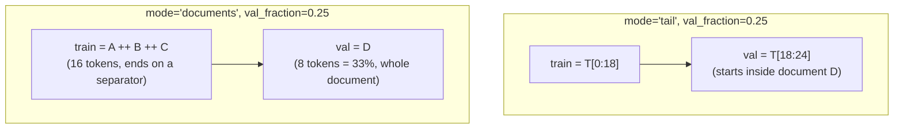
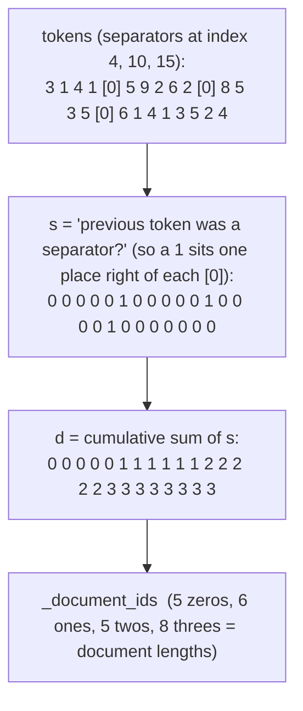
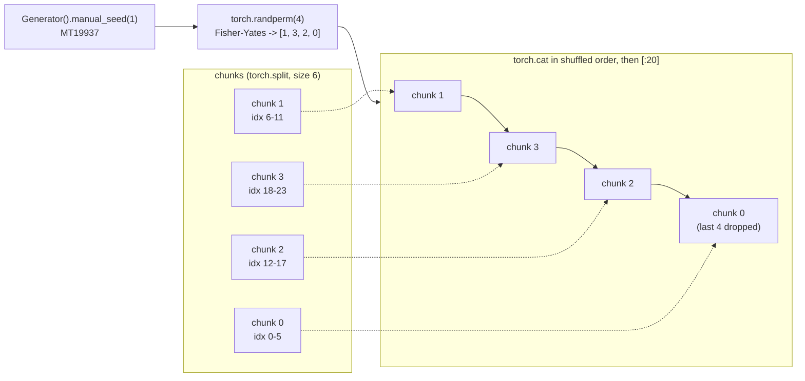
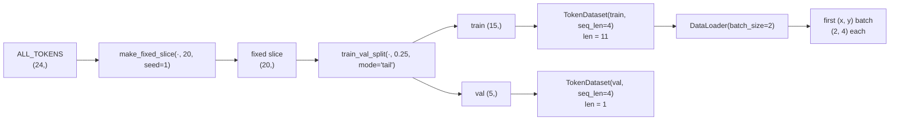
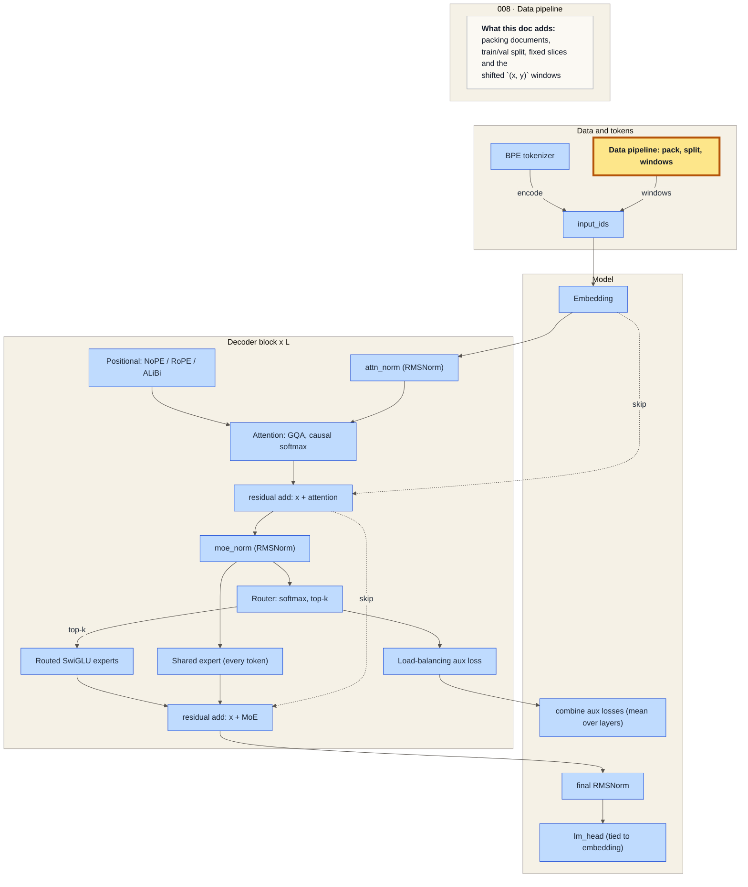

# 008 — The data pipeline: the full derivation, solved by hand

**Companion to:** [`journey_of_a_model/008-data-pipeline.md`](../../journey_of_a_model/008-data-pipeline.md)
(and, for the document-boundary parts, [`journey_of_a_model/031-document-boundaries.md`](../../journey_of_a_model/031-document-boundaries.md))
· **Code:** [`qwenmoe/data/dataset.py`](../../qwenmoe/data/dataset.py)
(spine), [`qwenmoe/data/download.py`](../../qwenmoe/data/download.py)
(the network edge)
· **Every number here is reproduced by:** [`verify_008_data_pipeline.py`](verify_008_data_pipeline.py)
(`uv run python docs/math/verify_008_data_pipeline.py`)

---

## How to read this

The journal entry tells you *what* the data pipeline is and *why* it has
the shape it does, with one worked example per idea. This document is the
opposite trade-off: **maximum detail, minimum summarising**. We

1. fix **one** tiny corpus — four toy "documents" packed into a single
   flat stream of 24 token ids — and one small configuration,
2. push it through **every single line** of `qwenmoe/data/dataset.py`:
   `_as_token_tensor`, `_document_ids`, `TokenDataset.__init__` /
   `__len__` / `__getitem__`, `_split_into_documents`, `train_val_split`
   (both modes), and `make_fixed_slice`, citing `dataset.py:line` at each
   step,
3. and for every operation — a slice, a floor, a cumulative sum, a
   shuffle, a concatenation — first derive *why* it has that form, then
   **do the arithmetic on paper**, and check it against the real module.

Nothing is skipped. When a step turns a length-24 tensor into a length-20
tensor, we say which numbers went where and keep a running **shape
ledger**.

You do **not** need any background. Every term (token, tensor, shape,
slice, floor, prefix sum, permutation, seed) is defined at first use. You
*should* skim [`journey_of_a_model/008-data-pipeline.md`](../../journey_of_a_model/008-data-pipeline.md)
first for the plain-English picture.

> **Scope.** The spine is `qwenmoe/data/dataset.py` — the file with actual
> arithmetic to derive. [`download.py`](../../qwenmoe/data/download.py) has
> **no arithmetic** (it fetches a file and caches it); it gets a short
> [Part 2](#part-2--download_corpus-the-network-edge). The document-boundary
> path (`return_segments`, `mode="documents"`, `_document_ids`,
> `_split_into_documents`) was added in task 15 and has its own journal
> entry ([031](../../journey_of_a_model/031-document-boundaries.md)); since
> it lives in the same file, it is traced here too, on the same example.
> The attention-side mask it feeds (`build_document_mask` in
> `model/attention.py`) is out of scope — that is entry 013/031 territory.
>
> **There is no fused / optimised code path here.** The attention and MoE
> derivations each had to reconcile an explicit trace against a fused
> kernel. The data pipeline has exactly one implementation. The only
> "two methods agree" check is in [Part 6](#part-6--_document_ids-a-prefix-sum):
> the vectorised `torch.cumsum` against the scalar definition of a running
> total.

---

## Part 0 — What are we even computing?

A neural network is trained on **batches**: fixed-shape blocks of numbers.
`QwenMoEModel.forward(input_ids)` (entry 006) wants a grid of token ids of
shape `(batch, seq_len)` — `batch` rows, each row `seq_len` integers long —
together with the *next* token for every position, so it can be scored on
"given everything up to here, what comes next?"

- A **token id** is a whole number $\ge 0$ that stands for a chunk of text
  (entry 007 covers how text becomes ids). A **corpus** is one long pile
  of text; tokenised, it is one long **flat** (one-dimensional) run of
  ids — the **token stream**.
- The data pipeline is the fixed sequence of steps between "a `.txt` file
  on disk" and "`(x, y)` batches", done **once**, in one tested place:

$$
\text{download} \to \text{tokenise} \to
\underbrace{[\text{fixed slice}]}_{\text{ablation only}} \to
\text{train/val split} \to \text{window} \to \text{batch}
$$

Entry 007 already owns the *tokenise* box. This entry owns everything to
its right, all of it in `qwenmoe/data/dataset.py`:

| function | one-line job |
|---|---|
| `make_fixed_slice` | pick a fixed, reproducible sub-stream so every ablation variant trains on identical data |
| `train_val_split` | cut the stream into a part to train on and a disjoint part to measure generalisation on |
| `TokenDataset` | turn one flat stream into many fixed-length `(x, y)` next-token windows |
| `_document_ids` / `_split_into_documents` | recover "which document is each token in?" from an `<eos>`-separated stream |

By the end you will have produced, by hand, the exact first training
batch the real code yields for our example:

```
x = [[9, 2, 6, 2],          y = [[2, 6, 2, 0],
     [2, 6, 2, 0]]               [6, 2, 0, 8]]
```

---

## Part 1 — The running example

### 1.1 Definitions we need right now

- **Sequence / list:** an ordered run of items, written `[3, 1, 4, 1]`.
  Its **length** is how many items it holds. **Index** $i$ picks out the
  item in position $i$, counting from $0$: `[3, 1, 4, 1][2] == 4`.
- **Slice** `a[p:q]`: the sub-list from index $p$ up to *but not
  including* index $q$; it has $q - p$ items (clamped at the ends).
  `[3,1,4,1,5][1:3] == [1, 4]`. `a[p:]` runs to the end; `a[:q]` starts
  at the beginning; `a[:-1]` is "everything but the last item".
- **Tensor:** PyTorch's name for a rectangular grid of numbers. A
  **1-D tensor** is just a list of numbers; a **2-D tensor** is a
  table (rows × columns). Its **shape** is the tuple of side-lengths:
  `(24,)` is a length-24 list, `(2, 4)` is 2 rows of 4.
- **dtype:** the kind of number stored. `torch.long` (a.k.a. `int64`) is
  a 64-bit whole number — the dtype every token id must have, because the
  model's embedding table (entry 006) is indexed by it.
- **Document:** one self-contained span of text (one story, one article).
  A **separator** / **`<eos>`** ("end of sequence") token is a single
  reserved id inserted *between* documents in the packed stream so the
  boundary is still visible after tokenising (entry 007 §4.3; entry 031).
- **Window:** a length-`seq_len` slice of the stream used as one training
  example.
- **Batch:** several windows stacked into one 2-D tensor so the model
  processes them together.

### 1.2 The configuration

The smallest setup that still exercises every branch:

| Symbol | Meaning | Value |
|---|---|---|
| `eos_id` | the document-separator token id | $0$ |
| `seq_len` | window length ($L$ below) | $4$ |
| `val_fraction` | share of tokens held out for validation | $0.25$ (also $0.1$, to show flooring) |
| `n_tokens` | length of the fixed slice for the ablation path | $20$ |
| `seed` | seed for `make_fixed_slice`'s shuffle | $1$ |
| batch size | windows per batch | $2$ |

> **Why `eos_id = 0`?** In the real `ByteBPETokenizer` the separator id is
> `vocab_size` — a large number (entry 007 §4.3). The data-pipeline code
> only ever compares tokens *for equality* against `eos_id`; the specific
> value is irrelevant. Pinning it to `0` keeps the example legible, and
> **no content token in our corpus is `0`**, so there is no ambiguity.

### 1.3 The input — four toy documents, packed

The tokeniser (entry 007) and `scripts/prepare_data.py --split-documents`
have already run. Four short documents were each encoded independently and
joined by `eos_id`, with the **last document left unterminated** (its real
counterpart is simply the tail of the file):

| document | content ids | + separator | tokens |
|---|---|---|---|
| A | `3, 1, 4, 1` | `0` | `[3, 1, 4, 1, 0]` |
| B | `5, 9, 2, 6, 2` | `0` | `[5, 9, 2, 6, 2, 0]` |
| C | `8, 5, 3, 5` | `0` | `[8, 5, 3, 5, 0]` |
| D | `6, 1, 4, 1, 3, 5, 2, 4` | *(none)* | `[6, 1, 4, 1, 3, 5, 2, 4]` |

Concatenated, this is the one object we carry to the last line of the
document:

$$
\texttt{ALL\_TOKENS} = [\,\underbrace{3, 1, 4, 1, 0}_{\text{A}},\ \underbrace{5, 9, 2, 6, 2, 0}_{\text{B}},\ \underbrace{8, 5, 3, 5, 0}_{\text{C}},\ \underbrace{6, 1, 4, 1, 3, 5, 2, 4}_{\text{D}}\,]
$$

with **position indices**

$$
\begin{array}{c|cccccccccccccccccccccccc}
\text{index} & 0&1&2&3&4&5&6&7&8&9&10&11&12&13&14&15&16&17&18&19&20&21&22&23\\\hline
\text{token} & 3&1&4&1&0&5&9&2&6&2&0&8&5&3&5&0&6&1&4&1&3&5&2&4
\end{array}
$$

So $N = 24$ tokens; the separators sit at indices $4$, $10$, $15$.

### 1.4 There are no weights

Like the tokeniser (entry 007), the data pipeline has **no learned
parameters**. Every number it produces is a deterministic function of
`ALL_TOKENS` and the configuration above — plus, in exactly one place
(`make_fixed_slice`), a pseudo-random number generator seeded by an
integer, which is still fully reproducible.

**Shape ledger (starting state)**

| after | object | shape | dtype |
|---|---|---|---|
| — | `ALL_TOKENS` (Python list) | length 24 | Python `int` |

---

## Part 2 — `download_corpus`: the network edge

Source: [`download.py:35–59`](../../qwenmoe/data/download.py#L35). **No
arithmetic lives here** — it is included for completeness because the
journal entry covers it and it is the pipeline's leftmost box.

```python
def download_corpus(name, cache_dir) -> Path:
    cache_dir = Path(cache_dir)
    cache_dir.mkdir(parents=True, exist_ok=True)
    if name == "tiny_shakespeare":
        dest = cache_dir / "tiny_shakespeare.txt"
        if not dest.exists():                       # <-- the whole caching policy
            with urllib.request.urlopen(_TINY_SHAKESPEARE_URL, timeout=30) as response:
                dest.write_bytes(response.read())
        return dest
    if name == "tiny_stories":
        path = hf_hub_download(repo_id=_TINY_STORIES_REPO_ID,
                               filename=_TINY_STORIES_FILENAME,
                               repo_type="dataset", cache_dir=cache_dir)
        return Path(path)
    raise ValueError(f"Unknown corpus: {name!r}")
```

Three things to note, all verified offline by the script (Part 2 there):

1. **The cache check is a plain `dest.exists()`** ([`download.py:43`](../../qwenmoe/data/download.py#L43)).
   If `cache_dir/tiny_shakespeare.txt` is already on disk, the function
   returns it **without any network call**. The verify script proves this
   by replacing `urllib.request.urlopen` with a function that raises, then
   calling `download_corpus("tiny_shakespeare", cache)` against a
   pre-populated cache — it returns the path and never touches the
   network. (A half-downloaded file would be trusted too — see the
   journal's "Questions that might come to mind".)
2. **Two different fetch mechanisms.** `tiny_shakespeare` is one direct
   HTTPS `.txt` ([`download.py:27–29`](../../qwenmoe/data/download.py#L27)); `tiny_stories`
   delegates to `huggingface_hub.hf_hub_download`, which does its own
   integrity-checked caching under the same `cache_dir`.
3. **An unknown name is a `ValueError`** ([`download.py:59`](../../qwenmoe/data/download.py#L59)),
   not a silent `None`.

The journal's Outcome section records the real byte counts from a live
run (1,115,394 bytes for tiny Shakespeare; 22,502,601 for TinyStories);
the verify script does **not** re-download (no test in this project hits
the network — the "manually verify, don't mock" convention).

From here on, assume the raw text has been downloaded and tokenised into
`ALL_TOKENS`.

---

## Part 3 — `_as_token_tensor`: the dtype gate

Source: [`dataset.py:19–27`](../../qwenmoe/data/dataset.py#L19).

```python
def _as_token_tensor(tokens: list[int] | Tensor) -> Tensor:
    if isinstance(tokens, Tensor):
        return tokens
    return torch.tensor(tokens, dtype=torch.long)
```

**Why it exists.** Every downstream function accepts *either* a Python
list *or* an existing tensor, and must not care which.

> **Changed in journal 040.** This was `_as_token_tensor`, and it forced
> *every* input to `torch.long`. That was correct when a corpus was 1MB
> and wrong at a billion tokens: `scripts/prepare_data.py` writes `int32`,
> and upcasting the whole stream here would double a 4GB tensor to 8GB
> for no benefit. Token ids do still have to be `int64` when they reach
> `nn.Embedding` — but only the `seq_len` positions actually being looked
> up, which is why `TokenDataset.__getitem__` now casts per window
> instead. An incoming tensor therefore keeps its dtype; a Python list
> has none to keep, so it still becomes `int64`.

- **`isinstance(tokens, Tensor)`** — "is this already a tensor?" If so,
  hand it back untouched.
- **`torch.tensor(tokens, dtype=torch.long)`** — build a fresh 1-D tensor
  from the list, as 64-bit int.

**Computed.** `_as_token_tensor(ALL_TOKENS)` takes the list branch:

$$
[3,1,4,1,0,\dots,4] \;\longrightarrow\; \texttt{tensor}([3,1,4,1,0,\dots,4],\ \texttt{dtype=int64})
$$

Shape `(24,)`, dtype `torch.long`. Feeding it an `int32` tensor instead
takes the first branch and comes back **still `int32`**. Both checked.

**Ledger:** list (len 24) → tensor `(24,)`, `int64`. Call this tensor
$T$.

---

## Part 4 — `train_val_split`, `mode="tail"`

Source: [`dataset.py:105–131`](../../qwenmoe/data/dataset.py#L105) (the
`"tail"` branch).

```python
def train_val_split(tokens, val_fraction=0.1, *, mode="tail", eos_id=None):
    if not 0.0 < val_fraction < 1.0:
        raise ValueError(...)
    tokens = _as_token_tensor(tokens)
    if mode == "tail":
        n_val = int(tokens.numel() * val_fraction)
        n_train = tokens.numel() - n_val
        return tokens[:n_train], tokens[n_train:]
```

### 4.1 Why a split at all, and why *contiguous*

- **Train / validation split:** dividing the tokens into two disjoint
  parts — one the model's weights are actually adjusted on ("train"), one
  used *only* to measure performance on text the model provably never
  trained on ("validation" / "val"). A model's training loss keeps
  falling even once it is merely memorising; the only way to see that is
  to check a held-out part.
- **Why the *last* `val_fraction`, taken as one contiguous block**, and
  not a random per-token assignment? `TokenDataset`'s windows **overlap**
  — window $i$ and window $i{+}1$ share $L-1$ tokens (Part 7). If tokens
  were thrown into train/val individually at random, a "validation"
  window would overlap tokens that a *training* window — one the
  optimiser directly minimised on — also contains. The val loss would
  then be measured partly on already-seen tokens: **leakage**, making
  generalisation look better than it is. A single contiguous cut puts
  only a handful of windows (those straddling the one boundary) in that
  ambiguous position. This reasoning is **exact**; "take the *tail*
  rather than the *head*" is an arbitrary but fixed **convention**.

### 4.2 Deriving `n_val`

- **`tokens.numel()`** ("number of elements") is $N = 24$.
- **`val_fraction`** $\in (0, 1)$ — the guard
  ([`dataset.py:124–125`](../../qwenmoe/data/dataset.py#L124)) rejects
  $0$, $1$, and anything outside. Default $0.1$ is a **convention** (10%
  held out is a standard choice); nothing here derives it.
- **`int(...)` on a non-negative float truncates toward zero** — it is
  the **floor** $\lfloor x \rfloor$, "the largest whole number $\le x$".
  So

$$
n_{\text{val}} = \big\lfloor N \cdot \texttt{val\_fraction} \big\rfloor,
\qquad
n_{\text{train}} = N - n_{\text{val}}.
$$

Flooring (rather than rounding) means val is *never* larger than the
requested fraction — at most one token short. **Exact** given the formula.

### 4.3 Computed

**`val_fraction = 0.25`:**

$$
N \cdot 0.25 = 24 \times 0.25 = 6.0,
\qquad n_{\text{val}} = \lfloor 6.0 \rfloor = 6,
\qquad n_{\text{train}} = 24 - 6 = 18.
$$

$$
\texttt{train} = T[0:18] = [3,1,4,1,0,5,9,2,6,2,0,8,5,3,5,0,6,1]
$$
$$
\texttt{val} = T[18:24] = [4,1,3,5,2,4]
$$

Notice `val` starts at index 18, which is **inside document D** (D spans
indices 16–23). The contiguous tail cut does **not** respect document
boundaries — that is exactly what `mode="documents"` (Part 5) fixes.

**`val_fraction = 0.1`:** in floating point $24 \times 0.1 =
2.4000000000000004$ (0.1 is not exactly representable in binary), and
$\lfloor 2.4000000000000004 \rfloor = 2$. So `val = T[22:24] = [2, 4]`.
The tiny floating-point error is far below the next integer, so the floor
is unaffected — worth *knowing* about, not worth worrying about here.

### 4.4 Reconstruction check

`train` is `T[:n_train]` and `val` is `T[n_train:]` — the same cut point,
no gap, no overlap. So `torch.cat([train, val])` **is** $T$ again,
element for element. The script asserts this for both fractions.

**Ledger:** $T$ `(24,)` → `train` `(18,)` + `val` `(6,)` (for
`val_fraction = 0.25`).

---

## Part 5 — `_split_into_documents` and `train_val_split`, `mode="documents"`

Added in task 15 (journal [031](../../journey_of_a_model/031-document-boundaries.md)).
Holds out **whole documents**, so validation perplexity is never measured
on a document whose beginning was cut off.

### 5.1 `_split_into_documents`

Source: [`dataset.py:90–102`](../../qwenmoe/data/dataset.py#L90).

```python
def _split_into_documents(tokens, eos_id):
    sep_positions = (tokens == eos_id).nonzero(as_tuple=True)[0].tolist()
    documents, start = [], 0
    for pos in sep_positions:
        documents.append(tokens[start : pos + 1])   # include the separator
        start = pos + 1
    if start < tokens.numel():
        documents.append(tokens[start:])            # trailing, unterminated
    return documents
```

**Derive each piece:**

- **`tokens == eos_id`** compares every element to `eos_id`, giving a
  boolean tensor (`True` / `False`) of the same length.
- **`.nonzero(...)`** returns the indices where that is `True`;
  `[0]` unwraps the single-axis result, `.tolist()` makes it a Python
  list. So `sep_positions` is "where are the separators?".
- The loop cuts `tokens[start : pos+1]` for each separator — `pos + 1`
  because the slice end is *exclusive*, so `+1` **keeps the separator as
  the last token of the document it ends**. Then `start` jumps past it.
- After the loop, if `start` hasn't reached the end, the leftover tail is
  a document **with no separator** — kept as-is.

**Computed.** `T == 0` is `True` at indices $4, 10, 15$ ⇒
`sep_positions = [4, 10, 15]`.

| step | slice | document |
|---|---|---|
| `pos = 4` | `T[0:5]` | `[3, 1, 4, 1, 0]` (A) — `start → 5` |
| `pos = 10` | `T[5:11]` | `[5, 9, 2, 6, 2, 0]` (B) — `start → 11` |
| `pos = 15` | `T[11:16]` | `[8, 5, 3, 5, 0]` (C) — `start → 16` |
| tail | `16 < 24` ⇒ `T[16:24]` | `[6, 1, 4, 1, 3, 5, 2, 4]` (D) |

Four documents, lengths $\mathbf{[5, 6, 5, 8]}$, summing to $24$. ✓

### 5.2 `train_val_split(mode="documents")`

Source: [`dataset.py:133–157`](../../qwenmoe/data/dataset.py#L133).

```python
documents = _split_into_documents(tokens, eos_id)
if len(documents) < 2:
    raise ValueError(...)                 # need a boundary to split on
target_val_tokens = tokens.numel() * val_fraction
val_documents, accumulated = [], 0
for document in reversed(documents):
    if accumulated >= target_val_tokens:
        break
    val_documents.append(document)
    accumulated += document.numel()
val_documents.reverse()
n_train_documents = len(documents) - len(val_documents)
if n_train_documents < 1:
    raise ValueError(...)
train_documents = documents[:n_train_documents]
return torch.cat(train_documents), torch.cat(val_documents)
```

**Derive the loop.** Walk documents **from the end** (`reversed`),
pulling each one wholesale into validation, and *stop as soon as* the
running token count `accumulated` reaches `target_val_tokens`. The check
is at the **top** of the loop, so it always adds one more document than
strictly needed to cross the line — i.e. val ends up $\ge$ the target,
never below, and never splits a document. `val_documents.reverse()` puts
them back in reading order; `train_documents` is the untouched prefix.

**Computed.** `target_val_tokens` $= 24 \times 0.25 = 6.0$.

`reversed(documents)` yields D (8), C (5), B (6), A (5):

| iter | `accumulated` at top | $\ge 6.0$? | action |
|---|---|---|---|
| D | $0$ | no | append D, `accumulated = 8` |
| C | $8$ | **yes** | `break` |

`val_documents = [D]`; reversed → still `[D]`. `n_train_documents =
4 - 1 = 3`.

$$
\texttt{train} = \texttt{cat}(A, B, C) = [3,1,4,1,0,5,9,2,6,2,0,8,5,3,5,0]
\quad (16\ \text{tokens})
$$
$$
\texttt{val} = \texttt{cat}(D) = [6,1,4,1,3,5,2,4] \quad (8\ \text{tokens})
$$

Val is **8 tokens = 33.3%**, not 25% — the "one document past the line"
overshoot. And `train` ends on `0`, a real separator: **no document was
cut**. Contrast Part 4.3, where the tail cut landed mid-D.

Three guards, all checked: `mode="documents"` without `eos_id` →
`ValueError` ([`dataset.py:134–135`](../../qwenmoe/data/dataset.py#L134));
a stream with `< 2` documents → `ValueError`
([`dataset.py:137–141`](../../qwenmoe/data/dataset.py#L137)); an unknown
`mode` → `ValueError` ([`dataset.py:159`](../../qwenmoe/data/dataset.py#L159)).



**Ledger:** $T$ `(24,)` → (`tail`) `train` `(18,)` + `val` `(6,)`; or
(`documents`) `train` `(16,)` + `val` `(8,)`.

---

## Part 6 — `_document_ids`: a prefix sum

Source: [`dataset.py:25–33`](../../qwenmoe/data/dataset.py#L25).

```python
def _document_ids(tokens: Tensor, eos_id: int) -> Tensor:
    starts = torch.zeros_like(tokens)
    starts[1:] = (tokens[:-1] == eos_id).to(tokens.dtype)
    return torch.cumsum(starts, dim=0)
```

This turns the flat stream into a same-length tensor answering, for every
position, **"how many documents began at or before me?"** — i.e. a
per-token document index. `TokenDataset(return_segments=True)` (Part 7.3)
needs it to build the attention mask that stops one document from
attending to another.

### 6.1 Derive it from first principles

Define a document to **start** at position $i$ when the token *before* it
was a separator (and position $0$ always starts document $0$). Write this
indicator:

$$
s_i =
\begin{cases}
0 & i = 0\\[2pt]
1 & i \ge 1 \text{ and } t_{i-1} = \texttt{eos\_id}\\[2pt]
0 & \text{otherwise}
\end{cases}
$$

Then the document index of position $i$ is **how many starts have
happened up to and including $i$**:

$$
d_i = s_0 + s_1 + \dots + s_i = \sum_{k=0}^{i} s_k.
$$

- A **cumulative sum** (a.k.a. **prefix sum**) of a list is the list of
  its running totals: `cumsum([0,0,1,0,1]) == [0,0,1,1,2]`. Entry $i$ of
  the output is the sum of entries $0..i$ of the input. It satisfies the
  one-step identity $d_i = d_{i-1} + s_i$ — which is exactly a loop, but
  `torch.cumsum` does it as one vectorised call.
- The code builds $s$ as `starts`: `torch.zeros_like(tokens)` is "a tensor
  of zeros, same length/shape as `tokens`" (so `starts[0]` stays $0$);
  `(tokens[:-1] == eos_id)` is the boolean "was element $k$ a separator?"
  for $k = 0..N-2$, and assigning it into `starts[1:]` shifts it right by
  one, so `starts[i] = 1` iff `tokens[i-1]` was a separator. `.to(...)`
  turns `True/False` into `1/0`.
- `dim=0` just means "cumulate along the (only) axis".

**Why the separator belongs to the document it *ends*, not the next
one.** `s_i` fires at $i-1+1 = i$, i.e. the position *after* the
separator. So the separator token itself still has the *lower* document
index. This is the **Llama-3 packing convention** (journal 031) — a
**design choice**, marked as such.

### 6.2 Compute it on `ALL_TOKENS`

Separators are at indices $4, 10, 15$, so $t_{i-1} = 0$ exactly when
$i - 1 \in \{4, 10, 15\}$, i.e. $i \in \{5, 11, 16\}$:

$$
s = [\,\underbrace{0}_{0},0,0,0,0,\underbrace{1}_{5},0,0,0,0,0,\underbrace{1}_{11},0,0,0,0,\underbrace{1}_{16},0,0,0,0,0,0,0\,]
$$

Running total, one position at a time (each is *previous total* $+\ s_i$):

| index $i$ | 0 | 1 | 2 | 3 | 4 | 5 | 6 | 7 | 8 | 9 | 10 | 11 | 12 | 13 | 14 | 15 | 16 | 17 | 18 | 19 | 20 | 21 | 22 | 23 |
|---|---|---|---|---|---|---|---|---|---|---|---|---|---|---|---|---|---|---|---|---|---|---|---|---|
| $s_i$ | 0 | 0 | 0 | 0 | 0 | 1 | 0 | 0 | 0 | 0 | 0 | 1 | 0 | 0 | 0 | 0 | 1 | 0 | 0 | 0 | 0 | 0 | 0 | 0 |
| $d_i$ | 0 | 0 | 0 | 0 | 0 | 1 | 1 | 1 | 1 | 1 | 1 | 2 | 2 | 2 | 2 | 2 | 3 | 3 | 3 | 3 | 3 | 3 | 3 | 3 |

$$
\texttt{\_document\_ids} = [0,0,0,0,0,\ 1,1,1,1,1,1,\ 2,2,2,2,2,\ 3,3,3,3,3,3,3,3]
$$

The five 0s, six 1s, five 2s, eight 3s match the document lengths
$[5, 6, 5, 8]$ from Part 5.1 exactly. The separator at index $4$ has
$d_4 = 0$ (belongs to A); index $10$ has $d_{10} = 1$ (belongs to B).

### 6.3 The "two methods agree" check

The verify script computes $d$ a second way — a plain Python loop
accumulating `running += s` — and asserts it equals `torch.cumsum`'s
output element for element. This is the analogue of the attention/MoE
verifiers' fused-vs-explicit check: the vectorised primitive must match
the scalar definition it stands for.



**Ledger:** $T$ `(24,)` → `_document_ids` `(24,)` (same shape, values in
$\{0,1,2,3\}$).

---

## Part 7 — `TokenDataset`

Source: [`dataset.py:36–87`](../../qwenmoe/data/dataset.py#L36). A
`TokenDataset` is a PyTorch `Dataset`: an object that answers two
questions — `len(ds)` ("how many training examples?") and `ds[i]` ("give
me example $i$") — which a `DataLoader` then calls to assemble batches.

### 7.1 `__init__` — the guards

Source: [`dataset.py:50–75`](../../qwenmoe/data/dataset.py#L50).

```python
if seq_len < 1:
    raise ValueError(...)                                  # (a)
if return_segments and eos_id is None:
    raise ValueError(...)                                  # (b)
tokens = _as_token_tensor(tokens)
if tokens.numel() < seq_len + 1:
    raise ValueError(...)                                  # (c)
self._tokens = tokens
self._seq_len = seq_len
self._doc_ids = _document_ids(tokens, eos_id) if return_segments else None
```

- **(a)** a window must have $\ge 1$ token.
- **(b)** `return_segments=True` needs `eos_id` — there is no way to
  compute document ids without knowing the separator.
- **(c) — derived in 7.2 below:** we need at least `seq_len + 1` tokens
  or there is not even one complete `(x, y)` pair.

For our example: `TokenDataset(ALL_TOKENS, seq_len=4)` — all guards pass
($4 \ge 1$; $24 \ge 5$).

### 7.2 `__len__` — why `N - seq_len`

Source: [`dataset.py:77–78`](../../qwenmoe/data/dataset.py#L77):
`return self._tokens.numel() - self._seq_len`.

**Derive it.** Window $i$ (Part 7.3) reads
$x = T[i:i+L]$ and $y = T[i+1:i+L+1]$, where $L = \texttt{seq\_len}$. The
$y$ slice reaches index $i + L$, so it needs $i + L \le N - 1$, i.e.

$$
i \le N - L - 1.
$$

Valid starts are $i = 0, 1, \dots, N - L - 1$ — that is $N - L$ of them.
Hence `len(ds) = N - L`, and it is $\ge 1$ exactly when $N \ge L + 1$
(guard (c)). This is a pure **counting argument** — **exact**.

**Compute.** $N - L = 24 - 4 = \mathbf{20}$ windows. The verify script
also enumerates `[i for i in range(N) if i + L + 1 <= N]` and confirms it
has 20 elements.

### 7.3 `__getitem__` — the shift-by-one

Source: [`dataset.py:80–87`](../../qwenmoe/data/dataset.py#L80).

```python
def __getitem__(self, idx):
    x = self._tokens[idx : idx + self._seq_len]
    y = self._tokens[idx + 1 : idx + self._seq_len + 1]
    if not self._return_segments:
        return x, y
    window = self._doc_ids[idx : idx + self._seq_len]
    segments = window - window[0]
    return x, y, segments
```

**Derive.** The model is **autoregressive**: at each position it predicts
the *next* token. So the label for the token at position $j$ is the token
at position $j + 1$. Stacking that over a length-$L$ window: if
$x = (t_i, t_{i+1}, \dots, t_{i+L-1})$ then the correct next-token targets
are $y = (t_{i+1}, t_{i+2}, \dots, t_{i+L})$ — the **same span shifted
right by one**. Concretely $y_j = x_{j+1}$ for $j < L - 1$, and
$y_{L-1} = t_{i+L}$ is the one genuinely new token. That single-token
overlap between consecutive windows is why the split had to be contiguous
(Part 4.1).

**Compute — window 0** ($i = 0$, $L = 4$):

$$
x = T[0:4] = [3, 1, 4, 1], \qquad y = T[1:5] = [1, 4, 1, 0]
$$

Read it as four supervised questions: after `3` comes `1`; after `3,1`
comes `4`; after `3,1,4` comes `1`; after `3,1,4,1` comes `0`.

**window 3** ($i = 3$): $x = T[3:7] = [1, 0, 5, 9]$,
$y = T[4:8] = [0, 5, 9, 2]$. This window straddles the A|B boundary — its
local position 1 is A's separator `0`, and local positions 2–3 (`5, 9`)
are the start of B. (The document mask, built from `segments` below, is
what stops B's tokens from attending back across that `0` into A.)

Both `x` and `y` come out `torch.long` (they are slices of $T$).

### 7.4 `return_segments=True` — rebased document ids

Source: [`dataset.py:85–87`](../../qwenmoe/data/dataset.py#L85).

```python
window = self._doc_ids[idx : idx + self._seq_len]
segments = window - window[0]
```

**Derive.** `self._doc_ids` is the whole-stream `_document_ids` from
Part 6 (values $0..3$). Slicing it to `window` gives this window's raw
document indices — but a window that starts inside document 2 would carry
`[2, 2, 3, ...]`, and the attention mask only cares about *which
positions share a document*, not the absolute number. Subtracting
`window[0]` **rebases** so the window's first token is always document
`0`. (`window - window[0]` subtracts that scalar from every element —
"broadcasting".)

**Compute** (`_document_ids` from Part 6.2):

| window $i$ | `x` | raw `_doc_ids[i:i+4]` | `− window[0]` | `segments` |
|---|---|---|---|---|
| 0 | `[3,1,4,1]` | `[0,0,0,0]` | $-0$ | `[0,0,0,0]` |
| 3 | `[1,0,5,9]` | `[0,0,1,1]` | $-0$ | `[0,0,1,1]` |
| 8 | `[6,2,0,8]` | `[1,1,1,2]` | $-1$ | `[0,0,0,1]` |

Window 0 sits wholly inside document A → all zeros. Window 3 crosses
A→B. Window 8 (`T[8:12] = [6,2,0,8]`) starts inside B, contains B's
separator `0` at local position 2, then C's first token `8` at local
position 3; the raw `[1,1,1,2]` is rebased by `−1` to `[0,0,0,1]`. The
2-tuple/3-tuple switch is checked: `len(ds[0])` is `2` normally, `3` with
`return_segments=True`.

**Ledger:** $T$ `(24,)` → per call, `x` `(4,)`, `y` `(4,)`, and
optionally `segments` `(4,)`.

### 7.5 The `DataLoader` — stacking windows into a batch

A `DataLoader(ds, batch_size=2, shuffle=False)` calls `ds[0]`, `ds[1]`,
… and **stacks** every `batch_size` consecutive results: two `x` vectors
of shape `(4,)` become one `(2, 4)` tensor (row 0 = window 0's `x`, row 1
= window 1's `x`), likewise for `y`. `shuffle=False` keeps window order
so the doc is deterministic; real training sets `shuffle=True`.

**Compute — first batch** (windows 0 and 1 of the *training* dataset from
Part 9, not the full stream):

- window 0: $x = [9,2,6,2]$, $y = [2,6,2,0]$
- window 1: $x = [2,6,2,0]$, $y = [6,2,0,8]$

$$
x_{\text{batch}} =
\begin{bmatrix} 9 & 2 & 6 & 2 \\ 2 & 6 & 2 & 0 \end{bmatrix},
\qquad
y_{\text{batch}} =
\begin{bmatrix} 2 & 6 & 2 & 0 \\ 6 & 2 & 0 & 8 \end{bmatrix}
$$

both shape `(2, 4)`, dtype `torch.long`. **This is what
`QwenMoEModel.forward` receives.**

---

## Part 8 — `make_fixed_slice`

Source: [`dataset.py:162–185`](../../qwenmoe/data/dataset.py#L162).

```python
def make_fixed_slice(all_tokens, n_tokens, seed) -> Tensor:
    if n_tokens < 1:
        raise ValueError(...)
    all_tokens = _as_token_tensor(all_tokens)
    if n_tokens > all_tokens.numel():
        raise ValueError(...)
    chunk_size = max(1, min(_DEFAULT_CHUNK_SIZE, all_tokens.numel() // 4))
    chunks = list(torch.split(all_tokens, chunk_size))
    generator = torch.Generator().manual_seed(seed)
    order = torch.randperm(len(chunks), generator=generator)
    shuffled = torch.cat([chunks[i] for i in order.tolist()])
    return shuffled[:n_tokens]
```

### 8.1 Why this function exists

When later work compares architecture variants (RoPE vs. NoPE vs. ALiBi,
…), each variant must train on the **exact same tokens in the exact same
order** — otherwise a difference in final val loss could just be a
difference in which data each got. `make_fixed_slice` is called **once**
per comparison study; its output tensor is handed to every variant.
"Same inputs ⇒ same output, always" is the whole contract.

It also **shuffles coarse chunks, not individual tokens**: reordering
big spans keeps local word order intact *inside* each span, while
randomising which span follows which. A per-token shuffle would destroy
every token's neighbourhood and leave nothing learnable.

### 8.2 Deriving `chunk_size`

$$
\texttt{chunk\_size} = \max\!\big(1,\ \min(1024,\ \lfloor N / 4 \rfloor)\big)
$$

- **`N // 4`** (integer division = floor of $N/4$) aims for **~4
  chunks**. Why not a fixed constant like 1024? Because for any stream
  shorter than the constant you would get a *single* chunk — and shuffling
  one chunk is a no-op for **every** seed, which would make the
  determinism/seed-divergence tests vacuous. Scaling with $N$ guarantees
  several chunks whenever $N$ is at all large.
- **`min(1024, ...)`** caps the chunk size at 1024 tokens for real
  multi-million-token corpora (so you get *many* chunks, more shuffling
  entropy), where `N // 4` would be enormous.
- **`max(1, ...)`** stops `chunk_size` from being $0$ when $N < 4$
  (then `torch.split` would error). At $N < 4$ you fall back to a
  per-token shuffle — acceptable only because such a stream is a
  degenerate test fixture anyway.

The `1024` and the `4` are **empirical / design choices**. The
*consequence* — "`chunk_size` $\ge 1$ always, and $\ge 2$ once $N \ge 8$"
— is **exact** arithmetic.

**Compute.** $N = 24$: $\lfloor 24/4 \rfloor = 6$;
$\min(1024, 6) = 6$; $\max(1, 6) = \mathbf{6}$.

### 8.3 `torch.split` — cutting into chunks

**`torch.split(t, 6)`** cuts `t` into consecutive pieces of **6 elements
each** (the last piece is whatever is left, possibly shorter — here $24 =
4 \times 6$ exactly, so four full chunks):

| chunk | indices | tokens |
|---|---|---|
| 0 | 0–5 | `[3, 1, 4, 1, 0, 5]` |
| 1 | 6–11 | `[9, 2, 6, 2, 0, 8]` |
| 2 | 12–17 | `[5, 3, 5, 0, 6, 1]` |
| 3 | 18–23 | `[4, 1, 3, 5, 2, 4]` |

Every chunk **straddles document boundaries** — chunk 0 holds A's
separator (index 4) and the first token of B; chunk 1 holds B's separator
(index 10). This is the journal's point that these "documents" are just
fixed-size slices, not real stories.

### 8.4 The seeded shuffle — `torch.Generator` + `torch.randperm`

This is the one place the pipeline uses randomness. Two layers:

#### (i) `torch.Generator().manual_seed(1)` — a reproducible number stream

A **pseudo-random number generator (PRNG)** is a deterministic function
whose output *looks* random. Given the same starting **seed** it emits
the exact same sequence forever. PyTorch's CPU generator is
**MT19937**, the "Mersenne Twister" ([Matsumoto & Nishimura, 1998](https://dl.acm.org/doi/10.1145/272991.272995)):
a large internal state (624 32-bit words) advanced by a fixed linear
recurrence, with period $2^{19937} - 1$. Its output for a given seed is
**not something you compute by hand** — so the specific numbers it emits
are marked **empirical** (reproduced by the verify script, not derived
here).

#### (ii) `torch.randperm(4, generator=g)` — a random permutation

A **permutation** of $\{0, 1, \dots, n-1\}$ is a reordering of those $n$
numbers, each appearing once. `torch.randperm` produces one, uniformly at
random, by the **Fisher–Yates shuffle** ([Fisher & Yates, 1938](https://en.wikipedia.org/wiki/Fisher%E2%80%93Yates_shuffle);
in-place form [Durstenfeld, 1964](https://dl.acm.org/doi/10.1145/364520.364540);
Knuth's "Algorithm P"). PyTorch's CPU code
([`aten/.../TensorFactories.cpp`](https://github.com/pytorch/pytorch/blob/main/aten/src/ATen/native/TensorFactories.cpp)) is:

```
a = [0, 1, ..., n-1]
for i in 0 .. n-2:
    z = generator.random() % (n - i)     # uniform in 0 .. n-1-i
    swap(a[i], a[i + z])
```

**Why this is uniform (exact).** At step $i$, positions $0..i-1$ are
already fixed; the element that lands in position $i$ is chosen uniformly
from the $n - i$ not-yet-placed elements. Multiplying the choice counts,
every one of the $n \cdot (n-1) \cdots 1 = n!$ orderings is hit by exactly
one sequence of draws — a bijection between draw-tuples and permutations.
So each permutation has probability $1/n!$. This argument is **exact**;
only the *draws* $z$ are empirical.

**Compute — $n = 4$, `seed = 1`.** The verify script runs the real
`torch.randperm` and gets

$$
\texttt{order} = [1,\ 3,\ 2,\ 0].
$$

Because Fisher–Yates is a bijection, exactly **one** draw-tuple
$(z_0, z_1, z_2)$ produces this output. Back-solving (each $a[i]$ is
frozen once step $i$ passes, so we can read the draws off the target):

| step | need final `a[i] = ` | array before | so `z` = | swap | array after |
|---|---|---|---|---|---|
| $i=0$ | `1` | `[0,1,2,3]` | `1` (element `1` is at index 1) | `a[0]↔a[1]` | `[1,0,2,3]` |
| $i=1$ | `3` | `[1,0,2,3]` | `2` (element `3` is at index 3 = 1+2) | `a[1]↔a[3]` | `[1,3,2,0]` |
| $i=2$ | `2` | `[1,3,2,0]` | `0` (already in place) | `a[2]↔a[2]` | `[1,3,2,0]` |

So the generator's first three draws satisfy `random() % 4 == 1`,
`random() % 3 == 2`, `random() % 2 == 0`. The verify script replays these
three swaps by hand and asserts the result equals the real
`torch.randperm(4, seed=1)`.

**Seeds are not all distinct in effect.** The script also prints
`randperm(4)` for seeds 0–3: seed 0 and seed 2 **both** give
$[0, 1, 3, 2]$ — with only $4! = 24$ possible orderings, distinct seeds
*can* collide. `make_fixed_slice` only promises *determinism* (same seed
→ same slice), not that every seed pair differs. This is exactly the
journal's "Could two different seeds produce the same slice?" — yes.

### 8.5 Concatenate in the shuffled order, then truncate

```python
shuffled = torch.cat([chunks[i] for i in order.tolist()])   # order = [1,3,2,0]
return shuffled[:n_tokens]
```

- **`order.tolist()`** = `[1, 3, 2, 0]` (tensor → Python list, so we can
  index `chunks`).
- **`torch.cat([...])`** glues 1-D tensors end to end into one 1-D
  tensor. We take chunk 1, then chunk 3, then chunk 2, then chunk 0:

$$
\underbrace{[9,2,6,2,0,8]}_{\text{chunk 1}}\
\underbrace{[4,1,3,5,2,4]}_{\text{chunk 3}}\
\underbrace{[5,3,5,0,6,1]}_{\text{chunk 2}}\
\underbrace{[3,1,4,1,0,5]}_{\text{chunk 0}}
$$
$$
\texttt{shuffled} = [9,2,6,2,0,8,\ 4,1,3,5,2,4,\ 5,3,5,0,6,1,\ 3,1,4,1,0,5] \quad (24)
$$

- **`shuffled[:n_tokens]`** with `n_tokens = 20` keeps the first 20,
  dropping the last 4 — `[4, 1, 0, 5]`, the tail of chunk 0 (original
  indices 2–5). Truncation to exactly `n_tokens` is what makes the slice
  length a fixed, configured budget. **Exact.**

$$
\boxed{\ \texttt{make\_fixed\_slice(ALL\_TOKENS, 20, seed=1)} = [9,2,6,2,0,8,4,1,3,5,2,4,5,3,5,0,6,1,3,1]\ }
$$

**Within-chunk order survived.** The verify script re-splits the
*untruncated* shuffle into 6-blocks and confirms they are exactly the
original four chunks in order `[1, 3, 2, 0]` — ascending token positions
inside each block are intact; only block order changed.

Guards checked: `n_tokens < 1` → `ValueError`
([`dataset.py:172–173`](../../qwenmoe/data/dataset.py#L172)); `n_tokens >
N` → `ValueError` ([`dataset.py:175–178`](../../qwenmoe/data/dataset.py#L175))
(over-budget is a *separate* concern — the trainer's epoch-repetition
logic, not this function).



**Ledger:** `ALL_TOKENS` `(24,)` → 4 chunks of `(6,)` → `shuffled`
`(24,)` → fixed slice `(20,)`.

---

## Part 9 — The whole pipeline, end to end

Now chain it, exactly as `scripts/train.py` would when
`DataConfig.fixed_slice_tokens` is set:



**Step 1 — fixed slice.** From Part 8.5:
$$
\texttt{sliced} = [9,2,6,2,0,8,4,1,3,5,2,4,5,3,5,0,6,1,3,1] \quad (20)
$$

**Step 2 — split** (`mode="tail"`, `val_fraction = 0.25`).
$n_{\text{val}} = \lfloor 20 \times 0.25 \rfloor = 5$,
$n_{\text{train}} = 15$:
$$
\texttt{train} = \texttt{sliced}[0:15] = [9,2,6,2,0,8,4,1,3,5,2,4,5,3,5]
$$
$$
\texttt{val} = \texttt{sliced}[15:20] = [0,6,1,3,1]
$$

**Step 3 — datasets.** `TokenDataset(train, seq_len=4)`:
$\texttt{len} = 15 - 4 = 11$ windows. `TokenDataset(val, seq_len=4)`:
$\texttt{len} = 5 - 4 = 1$ window. (A `seq_len` of 5 on `val` would raise
— $5 < 5 + 1$ — the script checks this.)

**Step 4 — first training batch** (`batch_size = 2`, no shuffle):

| window | `x = train[i:i+4]` | `y = train[i+1:i+5]` |
|---|---|---|
| 0 | `[9, 2, 6, 2]` | `[2, 6, 2, 0]` |
| 1 | `[2, 6, 2, 0]` | `[6, 2, 0, 8]` |

$$
x_{\text{batch}} = \begin{bmatrix} 9&2&6&2\\ 2&6&2&0 \end{bmatrix}
\qquad
y_{\text{batch}} = \begin{bmatrix} 2&6&2&0\\ 6&2&0&8 \end{bmatrix}
$$

The single validation window is `x = [0, 6, 1, 3]`, `y = [6, 1, 3, 1]`.
**Every one of these numbers is asserted by the verify script.**

### Verify script output (quoted verbatim)

```
================ Part 9 -- end to end ================
  fixed slice (20)      = [9, 2, 6, 2, 0, 8, 4, 1, 3, 5, 2, 4, 5, 3, 5, 0, 6, 1, 3, 1]
  train (15)            = [9, 2, 6, 2, 0, 8, 4, 1, 3, 5, 2, 4, 5, 3, 5]
  val   (5)             = [0, 6, 1, 3, 1]
  len(train_ds)         = 11   (15 - 4)
  len(val_ds)           = 1   (5 - 4)
  first batch x         = [[9, 2, 6, 2], [2, 6, 2, 0]]   shape (2, 4)
  first batch y         = [[2, 6, 2, 0], [6, 2, 0, 8]]   shape (2, 4)
  val window 0          = x [0, 6, 1, 3]  y [6, 1, 3, 1]

...

All assertions passed -- every number in 008-data-pipeline.md is real.
```

### Full shape ledger

| after | object | shape | notes |
|---|---|---|---|
| input | `ALL_TOKENS` | `(24,)` list | 4 documents, `eos_id = 0` at idx 4/10/15 |
| `_as_token_tensor` | $T$ | `(24,)` `int64` | |
| `make_fixed_slice(·, 20, seed=1)` | `sliced` | `(20,)` | 4 chunks of 6, order `[1,3,2,0]`, first 20 kept |
| `train_val_split(·, 0.25)` | `train`, `val` | `(15,)`, `(5,)` | contiguous tail cut |
| `TokenDataset(train, 4)` | dataset | len `11` | `N − seq_len` |
| `TokenDataset(val, 4)` | dataset | len `1` | |
| `DataLoader(bs=2)` first batch | `x`, `y` | `(2,4)`, `(2,4)` | → `QwenMoEModel.forward` |
| `_document_ids(T, 0)` | doc ids | `(24,)` | values `[0×5, 1×6, 2×5, 3×8]` |
| `_split_into_documents(T, 0)` | 4 tensors | `(5,)(6,)(5,)(8,)` | each keeps its separator; D unterminated |

---

## Part 10 — Cost, and why it is built this way

Using this example's own numbers.

### What each function costs

| function | work on our example | asymptotic |
|---|---|---|
| `_as_token_tensor` | copy/cast 24 ints | $O(N)$ |
| `train_val_split` (tail) | one multiply, one subtract, two slices (views) | $O(1)$ + $O(N)$ to materialise |
| `train_val_split` (documents) | one scan for separators + one reverse walk | $O(N + D)$, $D$ = #documents |
| `_document_ids` | one shift + one cumsum | $O(N)$ |
| `_split_into_documents` | one `nonzero` + $D$ slices | $O(N)$ |
| `TokenDataset.__getitem__` | two slices (+ one subtract) | $O(L)$ per call |
| `make_fixed_slice` | `torch.split` + `randperm(#chunks)` + `torch.cat` | $O(N)$ |

The whole pipeline is **linear in the number of tokens**, done once,
offline. There is no cleverness to trade for — this is data plumbing, not
a hot loop. The one non-obvious cost is `make_fixed_slice` allocating a
fresh `shuffled` tensor of the full length before truncating (it does not
stream); at this project's corpus sizes (≤ ~10M tokens for the
comparison tier) that is a few tens of MB, fine.

### Why windows overlap by `L − 1` and we accept it

Our 15-token `train` stream yields **11** windows, each 4 long — $11
\times 4 = 44$ scored positions of training signal from 15 tokens, a
~3× reuse. Token at position $0$ is only ever context (never a target);
positions $1$–$14$ are each a next-token target in between $1$ and $L = 4$
windows, and additional context in others. Dense supervision for almost
free — the cost is the leakage risk that forced a contiguous train/val
cut (Part 4.1).

### Why chunk-shuffle instead of token-shuffle or no shuffle

- **No shuffle:** an ablation study's variants would all see documents in
  corpus order — fine for fairness, but a single unlucky ordering (all
  the hard documents last) is baked in for every variant. Shuffling once,
  with a fixed seed, de-risks that while staying reproducible.
- **Token shuffle:** would turn `[9,2,6,2,...]` into noise — every
  token's neighbours random, nothing for a next-token predictor to learn.
- **Chunk shuffle (chosen):** on our example (full 24-token shuffle),
  order within each 6-token chunk is 100% preserved; of the 23 adjacent
  pairs, only the 3 chunk-to-chunk joins are new — the other 20 are
  exactly as in the original stream. Local structure survives; global
  order is randomised. The `//4` / `1024` knobs trade off "#chunks" (more
  = more thorough shuffle) against "chunk length" (longer = more local
  structure kept).

---

## Questions that might come to mind

- **`train_val_split` returns tensor *views*, not copies — does mutating
  one affect the source?** `tokens[:n_train]` is a view onto the same
  storage. Nothing in the pipeline mutates token tensors in place
  (`TokenDataset` only slices), so it never matters here; if you *did*
  write into a split, `.clone()` first.

- **Why does `make_fixed_slice` shuffle before it truncates, not after?**
  So that *which* tokens survive the truncation is itself a function of
  the seed. Truncating first would always keep the same prefix regardless
  of seed, and the "different seed ⇒ different data" property (the whole
  point) would be much weaker.

- **`_document_ids` uses `torch.zeros_like(tokens)`, so `starts` has the
  token dtype (`int64`). Does `cumsum` overflow?** Not remotely — the
  running total maxes out at the number of documents. Even a billion-token
  corpus of one-token documents fits in `int64` a billion times over.

- **What if `eos_id` also appears as a genuine content token?** Then
  `_document_ids` would see a spurious boundary there. The real
  `ByteBPETokenizer` prevents this structurally: its `eos_id` is one past
  the largest id `encode` can ever emit (entry 007 §4.3), so a content
  token can never equal it. Our toy sidesteps it by construction (no
  content token is `0`).

- **`TokenDataset(seq_len=L)` needs `L + 1` tokens for one window — but
  `train_val_split` could hand it fewer.** It can, and then `__init__`
  raises immediately with a clear message (guard (c)). Wiring configs so
  that can't happen is `scripts/train.py`'s job, not `TokenDataset`'s.

- **Does `mode="documents"` guarantee *exactly* `val_fraction`?** No —
  it guarantees **at least** `val_fraction` (rounded up to a whole
  document). Our example overshot 25% → 33%. With many small documents
  the overshoot is negligible; with few large ones it can be big, and the
  `n_train_documents < 1` guard catches the pathological case.

- **Why is `torch.randperm` seeded with a *fresh* `torch.Generator`
  rather than the global RNG?** So `make_fixed_slice` is hermetic:
  calling it does not consume or perturb the global random state that the
  trainer's weight init and data shuffling rely on, and its result
  depends *only* on its `seed` argument.

- **Is the Fisher–Yates draw-trace in Part 8.4 "the real draws"?** The
  swap *indices* $(1, 2, 0)$ are the unique ones consistent with the
  observed permutation `[1,3,2,0]` (Fisher–Yates is a bijection). The
  raw uint32s MT19937 emitted before the `% (n-i)` are not shown — they
  are the "empirical" part. The script confirms both ends: the swap
  replay lands on `[1,3,2,0]`, and so does the real `torch.randperm`.

---

## Symbol / notation reference

| symbol | meaning |
|---|---|
| $N$ | number of tokens in the stream (`tokens.numel()`); $24$ here |
| $L$ | `seq_len`, the window length; $4$ here |
| `ALL_TOKENS` / $T$ | the running-example flat token stream (list / `int64` tensor) |
| `eos_id` | the reserved document-separator token id; $0$ here |
| token id | whole number $\ge 0$ standing for a chunk of text |
| tensor | rectangular grid of numbers; **shape** = tuple of side-lengths |
| `torch.long` / `int64` | 64-bit signed integer dtype — required for token ids |
| slice `a[p:q]` | items $p \le i < q$; length $q - p$ |
| floor $\lfloor x \rfloor$ | largest whole number $\le x$; what `int(x)` does for $x \ge 0$ |
| `val_fraction` | share of tokens held out for validation; default $0.1$ |
| $n_{\text{val}}, n_{\text{train}}$ | $\lfloor N\cdot\texttt{val\_fraction}\rfloor$ and $N - n_{\text{val}}$ |
| window $i$ | $x = T[i{:}i{+}L]$, $y = T[i{+}1{:}i{+}L{+}1]$ |
| $x, y$ | a window's input tokens and its next-token targets ($y_j = x_{j+1}$ for $j<L{-}1$) |
| batch | several windows stacked to shape `(batch_size, L)` |
| prefix / cumulative sum | list of running totals; `cumsum([0,1,0,1]) = [0,1,1,2]` |
| $s_i$ | indicator "a document starts at position $i$" ($t_{i-1} = \texttt{eos\_id}$) |
| $d_i$ | document index of position $i$ $= \sum_{k\le i} s_k$ (`_document_ids`) |
| `segments` | a window's $d_i$ values rebased so the first is $0$ |
| chunk | a `chunk_size`-long consecutive slice of the stream (`torch.split`) |
| `chunk_size` | $\max(1, \min(1024, \lfloor N/4\rfloor))$; $6$ here |
| permutation | a reordering of $\{0,\dots,n-1\}$, each value once |
| seed | integer that fixes a PRNG's entire output sequence |
| PRNG / MT19937 | deterministic "looks-random" generator; PyTorch CPU uses Mersenne Twister |
| Fisher–Yates | shuffle building a uniform permutation via one swap per position |
| $D$ | number of documents in the stream; $4$ here |

---

## Citations

All links verified by web search on 2026-09-09; the ones already used by
the journal entry (008 or 031) are noted.

**Next-token / windowed language modelling**
- Bengio, Ducharme, Vincent & Jauvin, *A Neural Probabilistic Language
  Model*, JMLR 2003 —
  [PDF](https://www.jmlr.org/papers/volume3/bengio03a/bengio03a.pdf). The
  original "predict the next token from a fixed preceding window with a
  neural net". *(journal 008 cites this)*
- Radford, Narasimhan, Salimans & Sutskever, *Improving Language
  Understanding by Generative Pre-Training* (GPT-1), 2018 —
  [PDF](https://cdn.openai.com/research-covers/language-unsupervised/language_understanding_paper.pdf).
  The "one flat token stream chopped into fixed-length training windows"
  convention `TokenDataset` follows. *(journal 008 cites this)*

**Train/validation methodology**
- scikit-learn, *Cross-validation: evaluating estimator performance* —
  [scikit-learn.org](https://scikit-learn.org/stable/modules/cross_validation.html).
  Modern reference for the held-out-set idea `train_val_split`
  specialises for sequential, overlapping-window data. *(journal 008
  cites this)*

**Compute-matched ablation (the fixed-slice trick)**
- Hoffmann et al., *Training Compute-Optimal Large Language Models*
  ("Chinchilla"), 2022 — [arXiv:2203.15556](https://arxiv.org/abs/2203.15556).
  Token-budget matching is meaningful because the budget itself is
  scaling-law-derived. *(journal 008 cites this)*
- Clark et al., *Unified Scaling Laws for Routed Language Models*, 2022 —
  [arXiv:2202.01169](https://arxiv.org/abs/2202.01169). How that
  reasoning shifts for Mixture-of-Experts models. *(journal 008 cites
  this)*

**Document packing / boundaries**
- Grattafiori et al. (Meta), *The Llama 3 Herd of Models*, 2024 —
  [arXiv:2407.21783](https://arxiv.org/abs/2407.21783). The packing
  convention `_document_ids` implements (the separator ends the document
  it terminates; a new one starts after it). *(journal 031 cites this)*

**Corpora**
- Eldan & Li, *TinyStories: How Small Can Language Models Be and Still
  Speak Coherent English?*, 2023 —
  [arXiv:2305.07759](https://arxiv.org/abs/2305.07759). The comparison-tier
  corpus `download_corpus` fetches (`TinyStoriesV2-GPT4-valid.txt`).
  *(journal 008 / `download.py` cite this)*

**Shuffling and pseudo-randomness**
- Fisher & Yates, *Statistical Tables for Biological, Agricultural and
  Medical Research*, 1938 — the original pencil-and-paper shuffle;
  summary at
  [Wikipedia: Fisher–Yates shuffle](https://en.wikipedia.org/wiki/Fisher%E2%80%93Yates_shuffle).
- Durstenfeld, *Algorithm 235: Random permutation*, Communications of the
  ACM 7(7), 1964 —
  [dl.acm.org/doi/10.1145/364520.364540](https://dl.acm.org/doi/10.1145/364520.364540).
  The modern in-place $O(n)$ form (Knuth's "Algorithm P", TAOCP vol. 2).
- Matsumoto & Nishimura, *Mersenne Twister: A 623-dimensionally
  equidistributed uniform pseudo-random number generator*, ACM TOMACS
  8(1), 1998 —
  [dl.acm.org/doi/10.1145/272991.272995](https://dl.acm.org/doi/10.1145/272991.272995).
  The PRNG behind PyTorch's CPU `torch.Generator`.
- PyTorch, `torch.randperm` —
  [docs](https://docs.pytorch.org/docs/stable/generated/torch.randperm.html)
  and CPU source
  ([`aten/src/ATen/native/TensorFactories.cpp`](https://github.com/pytorch/pytorch/blob/main/aten/src/ATen/native/TensorFactories.cpp)),
  the Fisher–Yates loop quoted in Part 8.4.

---

*Every intermediate value in this document is produced and asserted by
[`verify_008_data_pipeline.py`](verify_008_data_pipeline.py). If you change
the running example, rerun it.*

<!-- arch-evolution:start (generated by build_architecture_footer.py; do not edit by hand) -->

---

## Where this fits in the architecture (the growing view)

← previous: [007 Tokenizers](007-tokenizers.md) · next: [009 Scaling utilities](009-scaling-law-utilities.md) →

**This doc adds to the architecture:** packing documents, train/val split, fixed slices and the shifted `(x, y)` windows. (Code: `qwenmoe/data/`.)

**Components introduced here (highlighted in the diagram), with where each one lives:**

| component | math doc (section) | journal | code |
|---|---|---|---|
| Data pipeline: pack, split, windows | [008 · Part 7 — TokenDataset](008-data-pipeline.md#part-7--tokendataset) | [journal 008](../../journey_of_a_model/008-data-pipeline.md) | [`qwenmoe/data/dataset.py:41`](../../qwenmoe/data/dataset.py#L41) |

**Verified by:** [`verify_008_data_pipeline.py`](verify_008_data_pipeline.py) (`uv run python docs/math/verify_008_data_pipeline.py`); latest results in [verify-status.md](verify-status.md).

**Example continuity:** Standalone toy corpus; its windows are the `(x, y)` pairs that doc 010's trainer then consumes. See the [example-family map](README.md#which-example-does-each-doc-use).

The diagram is cumulative: every box derived by this doc or an earlier one is shown, and components from later docs are not drawn yet, so reading the docs in order replays how the architecture grew. The top box is this doc's title and what it adds. The [full final architecture](architecture-evolution.md) has everything.

**Colour key:** 🟨 **introduced by this doc** · 🟦 Foundation (004-011) · 🟩 Modernization (016-031) · 🟪 Evaluation and scale (032-038) · 🟧 Real data and hardware (039-044). Dotted lines are optional or alternative paths.



**How we got here (every doc up to and including this one):**

| | math doc | journal | what it added |
|---|---|---|---|
|  | [004 Attention (GQA)](004-attention-gqa.md) | [journal](../../journey_of_a_model/004-attention-gqa.md) | scaled dot-product attention with grouped K/V heads, the positional transform and the causal mask |
|  | [005 MoE layer](005-moe-layer.md) | [journal](../../journey_of_a_model/005-moe-layer.md) | the router, top-k selection, routed SwiGLU experts, the shared expert and the load-balancing aux loss |
|  | [006 Full model](006-full-model-assembly.md) | [journal](../../journey_of_a_model/006-full-model-assembly.md) | token embedding, pre-norm residual wiring, the final norm, the tied head and the cross-layer aux-loss combine; attention and MoE appear here as black boxes |
|  | [007 Tokenizers](007-tokenizers.md) | [journal](../../journey_of_a_model/007-tokenizers.md) | text to `input_ids`: byte-level BPE and the char tokenizer |
| **▶** | [008 Data pipeline](008-data-pipeline.md) | [journal](../../journey_of_a_model/008-data-pipeline.md) | packing documents, train/val split, fixed slices and the shifted `(x, y)` windows |

<!-- arch-evolution:end -->
