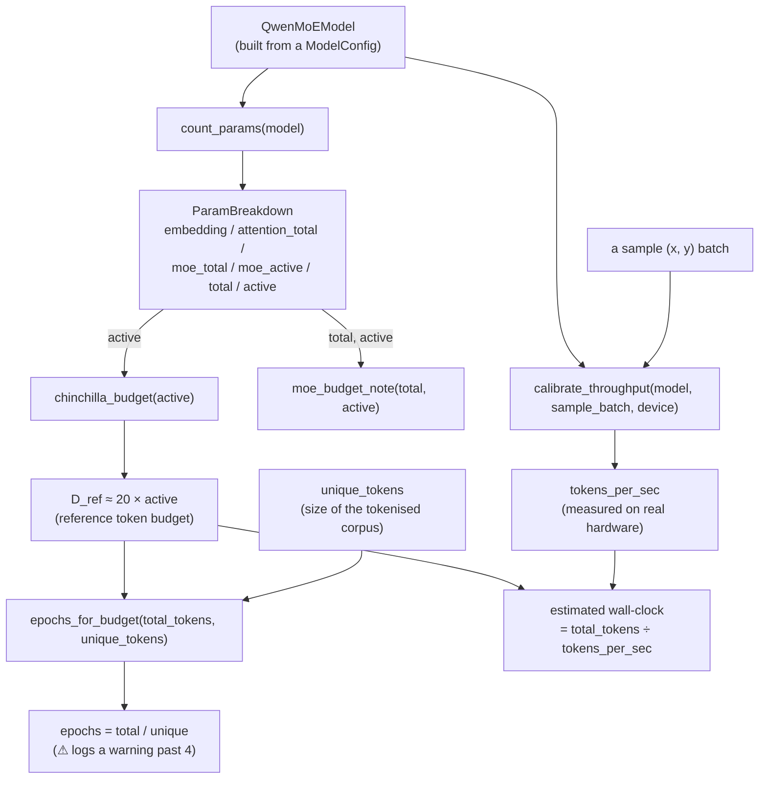
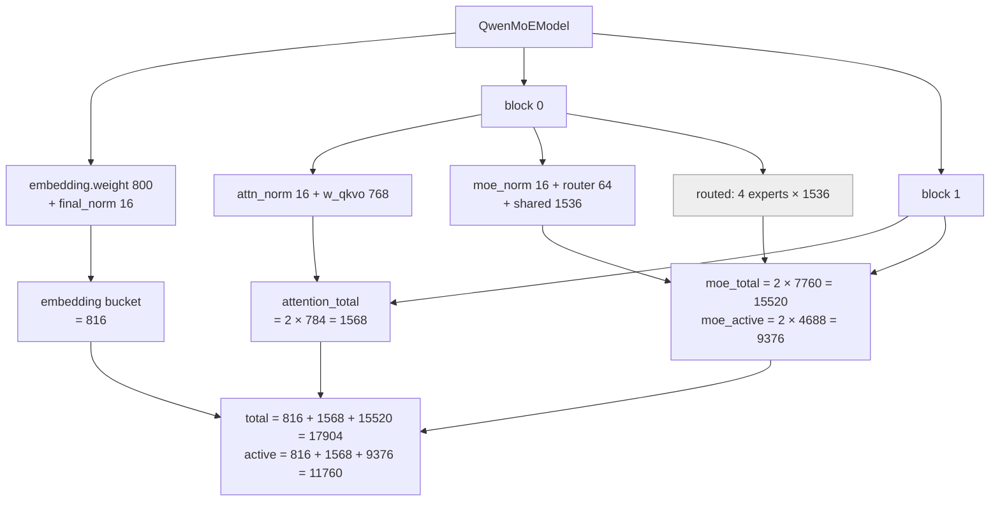
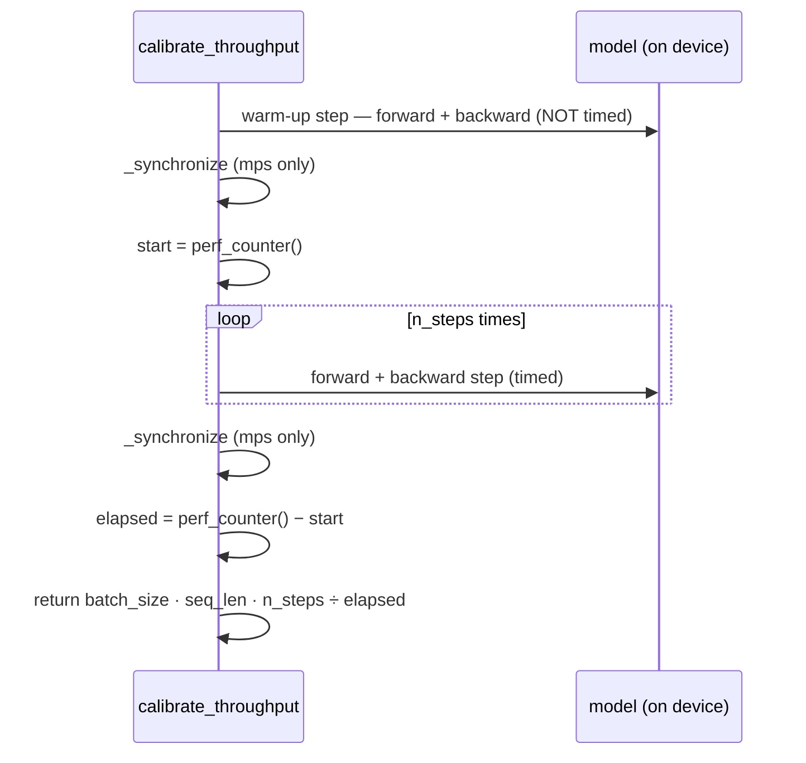
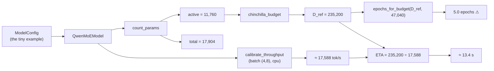

# 009 — The scaling-law utilities: the full derivation, solved by hand

**Companion to:** [`journey_of_a_model/009-scaling-law-utilities.md`](../../journey_of_a_model/009-scaling-law-utilities.md)
(and, for the compute-optimal calculus it reuses, [`journey_of_a_model/001-spec-approved.md`](../../journey_of_a_model/001-spec-approved.md))
· **Code:** [`qwenmoe/train/scaling.py`](../../qwenmoe/train/scaling.py)
· **Every number here is reproduced by:** [`verify_009_scaling_law_utilities.py`](verify_009_scaling_law_utilities.py)
(`uv run python docs/math/verify_009_scaling_law_utilities.py`)

---

## How to read this

The journal entry tells you *what* the four scaling-law helpers are for and
*why* a training run should be planned from them rather than from guesses.
This document is the opposite trade-off: **maximum detail, minimum
summarising**. We

1. fix **one** tiny model — the exact 46-tensor toy from
   `tests/test_scaling.py` — and write out every weight it holds,
2. push it through **every line** of `qwenmoe/train/scaling.py`:
   `_numel`, `count_params`, `chinchilla_budget`, `moe_budget_note`,
   `epochs_for_budget`, and `calibrate_throughput`, citing
   `scaling.py:line` at each step,
3. and for every operation — a `.numel()`, a bucket add, a floor-division,
   a multiply by 20, a division by elapsed seconds — first derive *why* it
   has that form, then **do the arithmetic digit by digit**, and check it
   against the real module.

Nothing is skipped. Where a step turns "a stack of weight matrices" into
"a single integer", we say which numbers were added and keep a running
**count ledger**.

You do **not** need any background. Every term (parameter, tensor, weight
matrix, dot product, embedding table, variance, epoch, throughput,
gradient) is defined at first use. You *should* skim
[`journey_of_a_model/009-scaling-law-utilities.md`](../../journey_of_a_model/009-scaling-law-utilities.md)
first for the plain-English picture.

> **Scope.** `scaling.py` has four public helpers. This document derives
> all four, plus the private `_numel` / `_training_step` / `_synchronize`
> they lean on, plus `moe_budget_note` (added later, in task 17 / journal
> [033](../../journey_of_a_model/033-ablation-menu-and-moe-budget-note.md),
> but living in the same file and building directly on
> `chinchilla_budget` — it gets a short [Part 7](#part-7--moe_budget_note-the-sparse-model-caveat)).
>
> **The compute-optimal calculus is not re-derived from zero here.** Entry
> [001](../../journey_of_a_model/001-spec-approved.md) already did the full
> $L(N,D)$ minimisation, the fitted-vs-exact split, and an extended toy
> example, *before* any of this code existed.
> [Part 6](#part-6--chinchilla_budget-20--active-parameters) reproduces the
> argument compactly and marks exact vs. empirical, then points back there
> for the long version.
>
> **There is one "two methods agree" check** — [Part 5](#part-5--the-totalactive-identity-and-an-independent-cross-check):
> `count_params`' bucketed sum against a raw, deduplicated sum of every
> tensor in `model.parameters()`. There is no fused kernel to reconcile;
> `count_params` walks the module tree and the rest is scalar arithmetic.

---

## Part 0 — What are we even computing?

Before a training run starts, three questions have a right-ish answer that
is *derivable*, not a matter of taste:

| question | helper | this example's answer |
|---|---|---|
| how big is this model, really? | `count_params` | 17,904 total / 11,760 active |
| how many tokens *should* I train it on? | `chinchilla_budget` | ≈ 235,200 |
| how many passes over my corpus is that, and is that too many? | `epochs_for_budget` | 5.0 → ⚠ past 4 |
| how long will the run actually take on this machine? | `calibrate_throughput` | measured, ≈ 17,600 tok/s on this laptop's CPU |

The helpers chain: `count_params` feeds `chinchilla_budget`, whose output
feeds `epochs_for_budget`; `calibrate_throughput` turns a token budget
into a wall-clock estimate.



Two definitions to carry from here:

- A **parameter** is one learnable number inside the model — a single
  entry of some weight matrix, or one slot of a normalisation layer's gain
  vector. "Learnable" means gradient descent is allowed to change it
  during training. Fixed constants (an epsilon, a base frequency) are
  *not* parameters.
- A **tensor** is a rectangular grid of numbers. Its **shape** is the
  tuple of side-lengths: `(50, 16)` is 50 rows of 16, holding
  $50\times16 = 800$ numbers; `(16,)` is a flat list of 16. PyTorch's
  `.numel()` ("number of elements") returns that product — $800$ and
  $16$ here.

"Total" vs. "active" is the whole reason `count_params` is not a
one-liner, and Part 1 sets up the example that makes the difference
visible.

---

## Part 1 — The running example

### 1.1 The model config

The smallest configuration that still exercises every branch of
`count_params` — it is `tests/test_scaling.py::_tiny_config()` verbatim:

| Symbol | `ModelConfig` field | Meaning | Value |
|---|---|---|---|
| $V$ | `vocab_size` | number of distinct token ids the model knows | $50$ |
| $d$ | `d_model` | width of the vector carried between layers (the "residual stream") | $16$ |
| $L$ | `n_layers` | number of stacked `TransformerBlock`s | $2$ |
| $H$ | `n_heads` | number of query "heads" in attention | $4$ |
| $H_{kv}$ | `n_kv_heads` | number of key/value heads (GQA: $H_{kv} < H$) | $2$ |
| $d_h$ | `head_dim` $= d / H$ | width of one attention head | $4$ |
| $d_{ff}$ | `d_ff` | inner width of one expert's feed-forward network | $32$ |
| $E$ | `n_routed_experts` | experts the router chooses *between* | $4$ |
| $S$ | `n_shared_experts` | experts that run for **every** token | $1$ |
| $k$ | `top_k` | how many routed experts each token actually uses | $2$ |
| — | `tie_word_embeddings` | reuse the embedding table as the output head? | `True` |
| — | `activation` | expert feed-forward variant | `"swiglu"` |
| — | `positional_scheme` | how position is encoded | `"rope"` |

Why these exercise everything:

- $H_{kv}=2 < H=4$ ⇒ the key/value projections are **smaller** than the
  query projection (Grouped-Query Attention). A config with $H_{kv}=H$
  would hide that asymmetry.
- $k=2 < E=4$ ⇒ a token uses **half** the routed experts, so `total` and
  `active` genuinely differ.
- $S=1$ ⇒ there is an always-on expert to *not* discount.
- `tie_word_embeddings=True` ⇒ the output head is the same tensor as the
  input table, and must be counted **once**, not twice.
- $L=2$ ⇒ per-layer counts get summed, not just reported once.

### 1.2 Every weight the model holds

`QwenMoEModel(_tiny_config())` builds exactly **46** learnable tensors.
Here they are, grouped, with shape and `.numel()`. (These are *the* input
to this whole document — the equivalent of "write out every weight
matrix" for a component whose arithmetic is counting.)

**Once-per-model pieces**

| tensor | shape | numbers | what it is |
|---|---|---|---|
| `embedding.weight` | `(50, 16)` | 800 | the **embedding table**: one 16-number row per vocab id |
| `final_norm.weight` | `(16,)` | 16 | the last `RMSNorm`'s gain vector |
| *(`lm_head.weight`)* | *(tied)* | — | **is** `embedding.weight` — same tensor, not a new one |

**Per `TransformerBlock`** (×2 — shown for one block)

| tensor | shape | numbers | what it is |
|---|---|---|---|
| `attn_norm.weight` | `(16,)` | 16 | `RMSNorm` gain, before attention |
| `attn.w_q.weight` | `(16, 16)` | 256 | query projection ($d \to H\,d_h = 16$) |
| `attn.w_k.weight` | `(8, 16)` | 128 | key projection ($d \to H_{kv}\,d_h = 8$) |
| `attn.w_v.weight` | `(8, 16)` | 128 | value projection ($d \to H_{kv}\,d_h = 8$) |
| `attn.w_o.weight` | `(16, 16)` | 256 | output projection ($H\,d_h \to d$) |
| `moe_norm.weight` | `(16,)` | 16 | `RMSNorm` gain, before the MoE |
| `moe.router.gate.weight` | `(4, 16)` | 64 | router: $d \to E$ routing logits |
| `moe.routed_experts.{0..3}.w_gate` | `(32, 16)` | 512 each | expert SwiGLU gate projection |
| `moe.routed_experts.{0..3}.w_up` | `(32, 16)` | 512 each | expert SwiGLU up projection |
| `moe.routed_experts.{0..3}.w_down` | `(16, 32)` | 512 each | expert SwiGLU down projection |
| `moe.shared_experts.0.w_gate/up/down` | `(32,16)(32,16)(16,32)` | 512 each | the always-on expert |

Verify-script dump (verbatim, first block plus the frame):

```
46 parameter tensors (name, shape, numel):
  embedding.weight                             (50, 16)     800
  blocks.0.attn_norm.weight                    (16,)         16
  blocks.0.attn.w_q.weight                     (16, 16)     256
  blocks.0.attn.w_k.weight                     (8, 16)      128
  blocks.0.attn.w_v.weight                     (8, 16)      128
  blocks.0.attn.w_o.weight                     (16, 16)     256
  blocks.0.moe_norm.weight                     (16,)         16
  blocks.0.moe.router.gate.weight              (4, 16)       64
  blocks.0.moe.routed_experts.0.w_gate.weight  (32, 16)     512
  ...
  blocks.0.moe.shared_experts.0.w_down.weight  (16, 32)     512
  ...
  final_norm.weight                            (16,)         16

sum of every tensor in named_parameters() = 17904
```

### 1.3 `scaling.py` itself has no learned numbers

Every helper in this file is a **deterministic function of the model's
shape** (and, for `calibrate_throughput`, of a wall clock). It stores
nothing, trains nothing. The only module-level constant is

```python
_EPOCH_WARNING_THRESHOLD = 4          # scaling.py:20
```

which is an **empirical** choice (Part 8 explains where the 4 comes from),
not a learnable parameter.

**Count ledger (starting state)**

| after | `embedding` | `attention_total` | `moe_total` | `moe_active` |
|---|---|---|---|---|
| — | 0 | 0 | 0 | 0 |

---

## Part 2 — `_numel`: counting one module's numbers

Source: [`scaling.py:43–44`](../../qwenmoe/train/scaling.py#L43).

```python
def _numel(module: nn.Module) -> int:
    return sum(p.numel() for p in module.parameters())
```

**Derive it.** `module.parameters()` is PyTorch's iterator over every
learnable tensor *inside* `module` (recursively — a block's `.parameters()`
yields its norm's gain, its attention's four matrices, its MoE's router
and every expert, and so on). `p.numel()` is that tensor's element count.
Summing gives "how many learnable numbers live in this subtree".

Two properties matter later:

- **Recursive.** `_numel(model.blocks[0])` already includes the attention
  *and* the MoE. `count_params` never calls `_numel` on a whole block —
  it calls it on the *parts* (`block.attn_norm`, `block.attn`,
  `block.moe.router`, …) so it can put each in the right bucket.
- **Deduplicating by iteration, not by identity.** `module.parameters()`
  yields the tied `embedding.weight` only once even though `lm_head`
  points at it, *because PyTorch's parameter iterator skips a tensor it
  has already seen*. This is why `_numel(model.embedding)` is a safe
  `800`, not `1600`. (Part 5's cross-check leans on the same fact.)

**Compute it** on the pieces we will need — each is just "multiply the
shape out":

| module | its tensors | `_numel` |
|---|---|---|
| `model.embedding` | `(50,16)` | $50\times16 = 800$ |
| `model.final_norm` | `(16,)` | $16$ |
| `block.attn_norm` | `(16,)` | $16$ |
| `block.attn` | `(16,16)+(8,16)+(8,16)+(16,16)` | $256+128+128+256 = 768$ |
| `block.moe_norm` | `(16,)` | $16$ |
| `block.moe.router` | `(4,16)` | $64$ |
| `block.moe.shared_experts` | three `(32,16)/(32,16)/(16,32)` | $512+512+512 = 1536$ |
| `block.moe.routed_experts` | 4 experts × 1536 | $4\times1536 = 6144$ |

> **Why doesn't `block.attn` include anything for RoPE?**
> `positional_scheme="rope"` builds a `RotaryEmbedding`, which stores its
> frequency table with `register_buffer(..., persistent=False)`
> ([`positional.py:32`](../../qwenmoe/model/positional.py#L32)). A
> **buffer** is a tensor the module carries but that is *not* a parameter
> — gradient descent never touches it — so `module.parameters()` skips it
> and `_numel` returns `0` for it. Same story for `AuxLossBalancer` (no
> tensors at all) and, on other configs, `LossFreeBalancer`'s bias
> (a buffer). Marked **exact**: it is a fact about what `.parameters()`
> yields.

---

## Part 3 — Why each weight has the shape it has

`count_params` takes the shapes as given. But "no fabricated numbers"
means we should be able to *derive* every `.numel()` in Part 1.2 from the
config, not just read it off. Four rules do it.

### 3.1 A bias-free linear layer: `out × in` numbers

- A **vector** is an ordered list of numbers; its **length** is how many.
- A **linear layer** `nn.Linear(in, out, bias=False)` turns an input
  vector $x$ of length `in` into an output vector $y$ of length `out` by
  the rule
  $$y_j = \sum_{i=1}^{\text{in}} W_{j,i}\,x_i \qquad (j = 1,\dots,\text{out}).$$
  The sum $\sum_i W_{j,i}x_i$ is a **dot product** — pair up the entries
  of row $j$ of $W$ with the entries of $x$, multiply each pair,
  add the products. So computing all of $y$ is `out` dot products, one
  per output slot.
- $W$ therefore needs **one number per (output slot, input slot) pair**:
  `out` rows of `in` numbers, i.e. shape `(out, in)` and
  $\text{out}\times\text{in}$ parameters. `bias=False` (every linear in
  this model) means there is *no* extra length-`out` vector added on —
  so the count is exactly $\text{out}\times\text{in}$, nothing more.

**Provable** — it is the definition of the layer.

Verify-script check (verbatim):

```
w_q: nn.Linear(16, 16) -> weight (16, 16) = 16 x 16 = 256 numbers, bias=None
```

### 3.2 The embedding table: `V × d` numbers

- An **embedding table** is a lookup table: row $t$ is the $d$-number
  vector the model uses to represent token id $t$. "Look up token 7" means
  "take row 7"; no arithmetic, just indexing.
- One row per vocab id, $d$ numbers per row ⇒ shape `(V, d)`,
  $V\times d$ parameters. Here $50\times16 = 800$. **Provable.**
- **Tied output head.** The model also needs to turn a final $d$-vector
  back into $V$ scores ("logits"), one per vocab id — that is an
  `nn.Linear(d, V)`, another $V\times d$ matrix. With
  `tie_word_embeddings=True` ([`transformer.py:58–59`](../../qwenmoe/model/transformer.py#L58))
  the model **reuses the embedding table's transpose** for this instead of
  learning a second matrix. So the tied model pays $V\times d$ *once*.
  Note this makes the embedding table genuinely *active* for every token
  even though a single token only reads one row on the way *in*: on the
  way *out*, the full table multiplies against the final vector to score
  every candidate next token.

### 3.3 `RMSNorm`: `d` numbers

Source: [`rmsnorm.py:8–17`](../../qwenmoe/model/rmsnorm.py#L8).

- **Normalisation** rescales a vector to a controlled size so that
  numbers flowing between layers do not blow up or vanish.
- **RMS** = "root mean square". For a vector $x$ of length $d$:
  square every entry, take the **mean** (add them, divide by $d$) — that
  mean is the **variance-like quantity** `x.pow(2).mean(...)` in the code
  — then the RMS is $\sqrt{\text{that}}$. Dividing $x$ by its RMS
  (plus a tiny fixed `eps = 1e-6` for safety) makes the result have
  RMS ≈ 1.
- After rescaling, RMSNorm multiplies **element-wise** by a learned
  **gain vector** `weight` of length $d$ (one multiplier per feature), so
  the model can re-stretch individual features if it needs to. That gain
  vector is the *only* learnable thing in an RMSNorm ⇒ $d$ parameters. The
  `eps` is a constant, not a parameter.
- It is initialised to all-ones (`torch.ones(dim)`,
  [`rmsnorm.py:12`](../../qwenmoe/model/rmsnorm.py#L12)) — so at step 0 the
  gain is a no-op. **Provable** count; the all-ones init is a
  **convention**.

Here every RMSNorm has $d = 16$ parameters: `attn_norm`, `moe_norm` (×2
blocks), and `final_norm`.

### 3.4 Grouped-Query Attention: why `w_k`, `w_v` are smaller

- Attention splits the width-$d$ vector into $H$ **heads**, each of width
  $d_h = d/H$, and lets each head do its own "which earlier tokens should
  I look at?" computation with its own **query**, **key** and **value**
  vectors.
- Standard attention gives every one of the $H$ query heads its own key
  and value head. **Grouped-Query Attention** (GQA) instead uses only
  $H_{kv} < H$ key/value heads and *shares* each across $H/H_{kv}$ query
  heads — far less key/value data to store during generation, for a small
  quality cost.
- So the projections map:
  - `w_q`: $d \to H\,d_h$   (one query head per head) $= 4\times4 = 16$
  - `w_k`: $d \to H_{kv}\,d_h$ $= 2\times4 = 8$
  - `w_v`: $d \to H_{kv}\,d_h$ $= 8$
  - `w_o`: $H\,d_h \to d$   (recombine heads) $= 16\to16$
- By rule 3.1 the parameter counts are $16\times16=256$, $8\times16=128$,
  $8\times16=128$, $16\times16=256$. The ratio
  $\dfrac{\lvert w_k\rvert}{\lvert w_q\rvert} = \dfrac{128}{256} = \dfrac12
  = \dfrac{H_{kv}}{H}$ — **exactly** the head ratio. **Provable.**

Verify-script check (verbatim):

```
w_q=256  w_k=128  w_v=128  w_o=256   w_k/w_q = 128/256 = 0.5 = n_kv_heads/n_heads = 2/4
one SwiGLU expert = w_gate 512 + w_up 512 + w_down 512 = 1536
```

### 3.5 One SwiGLU expert: `3 · d_ff · d`

Source: [`moe.py:18–29`](../../qwenmoe/model/moe.py#L18). A **SwiGLU**
expert is a small feed-forward network: widen $d \to d_{ff}$, apply a
gated nonlinearity, narrow $d_{ff} \to d$ —
$\text{out} = W_{\text{down}}\big(\,\text{SiLU}(W_{\text{gate}}\,x)\;\odot\;(W_{\text{up}}\,x)\,\big)$
where $\odot$ is element-wise product (multiply matching entries) and SiLU
is an **activation function** — a fixed per-number reshaping applied
between the linear layers, without which two stacked linear layers would
collapse into one. What matters here is only the *count* of matrices:
three, all bias-free.

- `w_gate`: $d \to d_{ff}$ $= 16\to32$, $32\times16 = 512$
- `w_up`: $d \to d_{ff}$, $512$
- `w_down`: $d_{ff} \to d$ $= 32\to16$, $16\times32 = 512$

Total $P_{\text{expert}} = 3\,d_{ff}\,d = 3\times32\times16 = 1536$.
**Provable.** (The other activation variants — GEGLU, plain GELU — have
different matrix *counts*; `count_params` never assumes 3, it divides the
measured routed total by the expert count. See Part 4.4.)

### 3.6 The router: `E × d`

Source: [`moe.py:72–84`](../../qwenmoe/model/moe.py#L72). The router is one
`nn.Linear(d, E, bias=False)` producing $E$ routing logits per token
(softmax and top-$k$ happen elsewhere). By rule 3.1: $E\times d
= 4\times16 = 64$ parameters. **Provable.**

**Every `.numel()` in Part 1.2 is now derived, not observed.**

---

## Part 4 — `count_params`: the walk

Source: [`scaling.py:47–88`](../../qwenmoe/train/scaling.py#L47).

```python
def count_params(model: QwenMoEModel) -> ParamBreakdown:
    config = model.config

    attention_total = 0
    moe_total = 0
    moe_active = 0
    for block in model.blocks:
        attention_total += _numel(block.attn_norm) + _numel(block.attn)

        moe = block.moe
        moe_norm_params = _numel(block.moe_norm)
        router_params = _numel(moe.router)
        shared_params = _numel(moe.shared_experts)
        routed_total = _numel(moe.routed_experts)
        routed_per_expert = routed_total // len(moe.routed_experts)

        moe_total += moe_norm_params + router_params + shared_params + routed_total
        moe_active += (
            moe_norm_params + router_params + shared_params + config.top_k * routed_per_expert
        )

    embedding = _numel(model.embedding) + _numel(model.final_norm)
    if not config.tie_word_embeddings:
        embedding += _numel(model.lm_head)

    total = embedding + attention_total + moe_total
    active = embedding + attention_total + moe_active
    return ParamBreakdown(embedding, attention_total, moe_total, moe_active, total, active)
```

(`ParamBreakdown` is constructed with keyword arguments in the real code;
shortened here.)

### 4.1 What "active" means, and why it is a separate number

- **Total parameters:** every learnable number that exists anywhere in the
  model.
- **Active parameters:** only the numbers a *single token's* forward pass
  actually multiplies against.
- For a normal ("dense") network these are **equal** — every weight is
  used for every token. A **Mixture-of-Experts** layer breaks the equality
  on purpose: it installs $E$ experts but routes each token to only $k$ of
  them. So the model can be "large" (much stored capacity, `total`) and
  "cheap per token" (small compute, `active`) at once. Reporting one
  number hides half the trade-off.
- **Rule for each bucket:**
  - `embedding` (table + final norm + untied head): fully active — the
    table scores every vocab id on the way out (3.2), the final norm runs
    once per token.
  - `attention_total` (norm + q/k/v/o): fully active — attention is dense,
    every weight multiplies for every token. That is why `ParamBreakdown`
    has **no** `attention_active` field: it would always equal
    `attention_total`.
  - MoE norm + router + shared experts: fully active — the norm runs, the
    router produces *all* $E$ logits (100% of its matrix is used even
    though only $k$ of the outputs matter downstream), the $S$ shared
    experts run for every token.
  - **routed experts:** only $k$ of $E$ run for a given token
    ([`moe.py:472`](../../qwenmoe/model/moe.py#L472) dispatches each token
    to `top_k` experts; the other $E-k$ never execute). So the active
    contribution is $k\cdot P_{\text{expert}}$ per layer, not
    $E\cdot P_{\text{expert}}$.

### 4.2 The `ParamBreakdown` dataclass

Source: [`scaling.py:23–40`](../../qwenmoe/train/scaling.py#L23).

```python
@dataclass
class ParamBreakdown:
    embedding: int
    attention_total: int
    moe_total: int
    moe_active: int
    total: int
    active: int
```

Six integers. `total` and `active` are derived from the other four (plus
attention, which has only one figure).

### 4.3 The per-block loop — attention bucket

`scaling.py:60–61`:

```python
for block in model.blocks:
    attention_total += _numel(block.attn_norm) + _numel(block.attn)
```

**Derive.** A pre-norm block computes `x = x + Attn(RMSNorm(x))`
([`block.py:34`](../../qwenmoe/model/block.py#L34)) — the `attn_norm`
structurally *belongs to* the attention sublayer it feeds. So it folds
into `attention_total`. `_numel(block.attn)` is the four projection
matrices (RoPE contributes 0, Part 2).

**Compute — block 0:**

$$\underbrace{16}_{\texttt{attn\_norm}} + \underbrace{(256+128+128+256)}_{\texttt{w\_q,w\_k,w\_v,w\_o}} = 16 + 768 = 784.$$

**Block 1** is identical: another $784$.
$\texttt{attention\_total} = 784 + 784 = \mathbf{1568}$.

| after | `embedding` | `attention_total` | `moe_total` | `moe_active` |
|---|---|---|---|---|
| block 0 attention | 0 | 784 | 0 | 0 |
| block 1 attention | 0 | **1568** | 0 | 0 |

### 4.4 The per-block loop — MoE buckets

`scaling.py:63–73`:

```python
moe = block.moe
moe_norm_params = _numel(block.moe_norm)          # 16
router_params   = _numel(moe.router)              # 64
shared_params   = _numel(moe.shared_experts)      # 1536
routed_total    = _numel(moe.routed_experts)      # 6144
routed_per_expert = routed_total // len(moe.routed_experts)   # 6144 // 4 = 1536

moe_total  += moe_norm_params + router_params + shared_params + routed_total
moe_active += moe_norm_params + router_params + shared_params + config.top_k * routed_per_expert
```

**Derive `routed_per_expert`.** `//` is **floor division**: divide, then
round down to a whole number. `routed_total` is the sum over *all* $E$
experts; `len(moe.routed_experts)` is $E$; so `routed_total // E` recovers
**one expert's** parameter count — *provided every expert is the same
size*, which `build_expert` guarantees (it constructs all $E$ from the one
config). Deriving it this way rather than hard-coding $3\,d_{ff}\,d$ means
`count_params` stays correct if the activation variant changes the matrix
count (Part 3.5's aside). Here $6144 // 4 = 1536$ exactly — no remainder,
because the experts really are identical.

**Derive the `top_k` multiply.** "Active" counts $k$ *whole* experts, not
a fraction $k/E$ of the routed weight. Same arithmetic here
($k\cdot P_{\text{expert}} = \tfrac{k}{E}\cdot E\,P_{\text{expert}}$ when
experts are equal-sized) but a truer story: $k$ entire experts run and
$E-k$ do not run *at all* for a given token.

**Compute — block 0:**

$$\texttt{moe\_total} \mathrel{+}= 16 + 64 + 1536 + 6144 = 7760$$
$$\texttt{moe\_active} \mathrel{+}= 16 + 64 + 1536 + \underbrace{2\times1536}_{k\cdot P_{\text{expert}}} = 16 + 64 + 1536 + 3072 = 4688$$

**Block 1** identical.

$$\texttt{moe\_total} = 7760 + 7760 = \mathbf{15520}, \qquad
\texttt{moe\_active} = 4688 + 4688 = \mathbf{9376}.$$

| after | `embedding` | `attention_total` | `moe_total` | `moe_active` |
|---|---|---|---|---|
| block 0 MoE | 0 | 1568 | 7760 | 4688 |
| block 1 MoE | 0 | 1568 | **15520** | **9376** |

> **The balancer is never counted — is that a bug?** `count_params` walks
> `moe.router`, `moe.shared_experts`, `moe.routed_experts` but not
> `moe.balancer`. Correct *only* because `AuxLossBalancer` holds no
> `nn.Parameter` (and `LossFreeBalancer`'s bias is a buffer, invisible to
> the optimizer too). Part 5's cross-check would catch it if that ever
> changed.

### 4.5 The embedding bucket

`scaling.py:75–77`:

```python
embedding = _numel(model.embedding) + _numel(model.final_norm)
if not config.tie_word_embeddings:
    embedding += _numel(model.lm_head)
```

**Derive.** `final_norm` is the one norm with no sublayer after it to
attach to (it is applied once, after the last block, before the head), so
it is bundled with the other once-per-model input/output machinery: the
token table and — *only if untied* — the separate output head. With
`tie_word_embeddings=True` the `if` is skipped, so the shared
$V\times d$ tensor is counted **once**.

**Compute:** $\underbrace{800}_{\texttt{embedding.weight}} +
\underbrace{16}_{\texttt{final\_norm.weight}} = \mathbf{816}$.

| after | `embedding` | `attention_total` | `moe_total` | `moe_active` |
|---|---|---|---|---|
| embedding bucket | **816** | 1568 | 15520 | 9376 |

### 4.6 `total` and `active`

`scaling.py:79–88`:

```python
total  = embedding + attention_total + moe_total
active = embedding + attention_total + moe_active
return ParamBreakdown(embedding, attention_total, moe_total, moe_active, total, active)
```

$$\texttt{total} = 816 + 1568 + 15520 = \mathbf{17904}$$
$$\texttt{active} = 816 + 1568 + 9376 = \mathbf{11760}$$

Verify-script output (verbatim):

```
================ Part 2 -- count_params ================
  embedding table  50 x 16              = 800
  final_norm (RMSNorm(16))              = 16
  embedding bucket                      = 816
  block 0: attn_norm 16 + attn 768 = 784 | moe_norm 16 + router 64 + shared 1536 + routed 6144 (=1536/expert)
  block 1: attn_norm 16 + attn 768 = 784 | moe_norm 16 + router 64 + shared 1536 + routed 6144 (=1536/expert)
  attention_total = 1568
  moe_total       = 15520
  moe_active      = 9376
  total  = 816 + 1568 + 15520 = 17904
  active = 816 + 1568 + 9376 = 11760

  count_params(model) = ParamBreakdown(embedding=816, attention_total=1568, moe_total=15520, moe_active=9376, total=17904, active=11760)
```



---

## Part 5 — The total/active identity, and an independent cross-check

### 5.1 `total − active` is exactly the never-touched routed weight

From Part 4, `total` and `active` differ only in the routed-expert term:
$E\,P_{\text{expert}}$ vs. $k\,P_{\text{expert}}$ per layer. Subtracting:

$$\texttt{total} - \texttt{active} = \sum_{\ell=1}^{L}(E-k)\,P_{\text{expert}}
= L\,(E-k)\,P_{\text{expert}}.$$

This is **provable algebra** — the two sums are identical except for that
one coefficient. **Compute:** $2\times(4-2)\times1536 = 2\times2\times1536
= 6144$. And directly: $17904 - 11760 = 6144$. ✓

That $6144$ is exactly the weight of the $L(E-k) = 2\times2 = 4$ whole
routed experts that exist but that *no single token's forward pass ever
multiplies against* — the entire reason the split is reported.

### 5.2 Bucketed sum vs. raw deduplicated sum

`test_count_params_total_matches_real_model_parameter_count` (and this
doc's verify script) computes `total` a **second, independent way**: walk
*every* tensor in `model.parameters()`, skip any whose `id()` was already
seen (the tied `embedding`/`lm_head` tensor), sum `.numel()`.

- This path knows nothing about buckets, norms-fold-into-sublayers, or
  active-vs-total. It is just "add up every distinct learnable tensor".
- If `count_params`' partition ever dropped a parameter (a future
  top-level learnable component with no bucket) or double-counted one,
  `breakdown.total` would stop equalling this raw sum.

Verify-script output (verbatim):

```
================ Part 3 -- independent cross-check ================
  dedup'd sum of model.parameters()     = 17904
  count_params(...).total               = 17904
```

$17904 = 17904$ — the bucketed walk and the flat sum agree, so the
partition `total == embedding + attention_total + moe_total` has **zero
leftover**. This is the analogue of the attention/MoE derivations'
fused-vs-explicit check.

### 5.3 The untied variant

Flip `tie_word_embeddings=False` and the `if` at `scaling.py:76` fires:
`embedding += _numel(model.lm_head)` adds another $V\times d = 800$.

```
untied: embedding 1616 (= 816 + 800), total 18704
```

$816 + 800 = 1616$; $17904 + 800 = 18704$. The raw dedup'd sum agrees
(now `lm_head.weight` is a genuinely separate tensor, so it is counted).

**Count ledger (final, tied)**

| bucket | value | = |
|---|---|---|
| `embedding` | 816 | $800 + 16$ |
| `attention_total` | 1568 | $2\times784$ |
| `moe_total` | 15520 | $2\times7760$ |
| `moe_active` | 9376 | $2\times4688$ |
| `total` | 17904 | $816 + 1568 + 15520$ |
| `active` | 11760 | $816 + 1568 + 9376$ |

---

## Part 6 — `chinchilla_budget`: 20 × active parameters

Source: [`scaling.py:91–100`](../../qwenmoe/train/scaling.py#L91).

```python
def chinchilla_budget(active_params: int) -> int:
    if active_params < 1:
        raise ValueError(f"active_params must be >= 1, got {active_params}")
    return 20 * active_params
```

### 6.1 What it is

- A **token** is one chunk of text the model reads or predicts. A
  training run's **token budget** $D$ is how many next-token predictions
  it will be scored on in total.
- `chinchilla_budget` returns a **reference** budget: the token count that
  Hoffmann et al. (2022) found roughly *balances* a model of a given size
  — enough data that the model is neither starved nor wastefully
  over-trained. It is a **planning heuristic**, not a target the trainer
  enforces.

### 6.2 Why the answer is (a constant) × (parameter count)

This is the part that is **provable given one empirical input**. The full
version with an extended toy example is in
[entry 001](../../journey_of_a_model/001-spec-approved.md#scaling-law-chinchilla);
here is the spine.

Hoffmann et al. fit real training runs to a loss surface

$$L(N, D) = E + \frac{A}{N^{\alpha}} + \frac{B}{D^{\beta}}$$

where $N$ = parameters, $D$ = training tokens, and $E, A, B, \alpha,
\beta$ are **fitted constants** ($E$ is the loss you could never beat even
with infinite everything). Training compute is approximately
$C \approx 6ND$ **FLOPs** (a FLOP is one floating-point arithmetic
operation; "$6ND$" is a standard rule of thumb — ~2 per parameter per
token for the forward pass, ~4 for the backward pass — not re-derived
here).

Fix the compute budget $C$ and ask: what split of it between "bigger
model" and "more data" gives the lowest loss? Substitute $D = C/(6N)$:

$$L(N) = E + A\,N^{-\alpha} + B\left(\frac{6N}{C}\right)^{\beta}.$$

Set the derivative to zero (the derivative is the slope; the minimum is
where the slope flips sign):

$$-\alpha A\,N^{-\alpha-1} + \beta B\,6^{\beta}C^{-\beta}\,N^{\beta-1} = 0
\;\Longrightarrow\; N^{\alpha+\beta} \propto C^{\beta}
\;\Longrightarrow\; N^{*} \propto C^{\beta/(\alpha+\beta)}.$$

Then $D^{*} = C/(6N^{*}) \propto C^{\alpha/(\alpha+\beta)}$. Hoffmann et
al.'s fit came out with $\alpha \approx \beta$, which makes **both**
exponents $\approx \tfrac12$: $N^{*}\propto\sqrt{C}$ and
$D^{*}\propto\sqrt{C}$. Their ratio

$$\frac{D^{*}}{N^{*}} = \text{constant, independent of the compute budget}.$$

- **Exact:** *that a single fixed ratio exists at all* — that is the
  algebra + calculus above, given $\alpha = \beta$.
- **Empirical:** *the value of the ratio* $\approx 20$. It is whatever
  $A, B, \alpha, \beta, E$ came out to when fitted to real experiments —
  not derivable from theory. (Kaplan et al., 2020 first established the
  power-law form but, with a different fit, implied you should grow $N$
  *faster* than $D$; Chinchilla's corrected fit is the ~1:1, ratio-≈20
  result this project uses.)

`scaling.py` hard-codes the empirical `20`. The guard rejects
`active_params < 1` (a zero or negative "size" is meaningless, and would
make the budget zero or negative).

### 6.3 Computed, on the example

$$\texttt{chinchilla\_budget}(11760) = 20 \times 11760 = 235{,}200.$$

Digit by digit: $11760\times20 = 11760\times2\times10 = 23520\times10 =
235200$.

Verify-script output (verbatim):

```
================ Part 5 -- chinchilla_budget ================
  chinchilla_budget(11760) = 20 * 11760 = 235200
```

Note it multiplies **active**, not total: the routed experts that a token
skips do not add to that token's compute, so they should not inflate the
data budget derived from compute. (Part 7 is the caveat to *that*.)

---

## Part 7 — `moe_budget_note`: the sparse-model caveat

Source: [`scaling.py:103–141`](../../qwenmoe/train/scaling.py#L103).
Added in task 17 (journal [033](../../journey_of_a_model/033-ablation-menu-and-moe-budget-note.md)),
not task 9 — but it is a one-paragraph rider on `chinchilla_budget`, so it
belongs here. This is the short version; for the full derivation of *why*
the compute-optimal budget must lie strictly between the two bounds (not
just that it does), the near-dense threshold, the guards, and a real
`BASELINE`-scale reproduction, see
[`033-ablation-menu-and-moe-budget-note.md`](033-ablation-menu-and-moe-budget-note.md).

**The problem it flags.** Chinchilla's `20×` was fitted on **dense**
models, where every parameter is active for every token, so
`total == active` and there is only one number to multiply. A sparse MoE
has `total > active`. Which one gets the `20×`?

- $20\times\texttt{active}$ **under**-counts: the $E-k$ skipped experts
  still have to be *trained* — they see gradients on the tokens that *do*
  route to them — so the model as a whole needs more than its per-token
  compute implies.
- $20\times\texttt{total}$ **over**-counts: no token ever pays for all $E$
  experts at once.

Clark et al. (2022), *Unified Scaling Laws for Routed Language Models*,
show the compute-optimal budget for a routed model sits **between** these
two. So `moe_budget_note` prints both bounds and says "treat
$20\times\texttt{active}$ as a floor, not the target".

**Derive the sparsity ratio.** `sparsity = total / active` — how many
times more capacity is installed than any token uses.

$$\texttt{sparsity} = \frac{17904}{11760} = 1.5224\ldots \approx 1.5\times.$$

Since $1.52 \ge 1.05$ the function takes its MoE branch (below $1.05$ it
would say "≈ dense, Chinchilla applies directly"). The two bounds:

- floor $= 20\times11760 = 235{,}200$
- ceiling $= 20\times17904 = 358{,}080$   ($17904\times20 = 358080$)

Verify-script output (verbatim):

```
================ Part 6 -- moe_budget_note ================
  sparsity = 17904 / 11760 = 1.5224x
  note: MoE sparsity: 11,760 active of 17,904 total params (1.5x). Chinchilla's 20x tokens/param is a DENSE-model constant (total == active); for a sparse MoE the compute-optimal budget lies between 20 x active = 235,200 and 20 x total = 358,080 tokens (Clark et al. 2022). Use 20 x active as a floor, not the target.
```

The guards (`scaling.py:119–126`) reject non-positive inputs and
`total < active` (a model cannot use more than it has).

---

## Part 8 — `epochs_for_budget`: passes over the corpus, and the warning

Source: [`scaling.py:195–217`](../../qwenmoe/train/scaling.py#L195).

```python
def epochs_for_budget(total_tokens: int, unique_tokens: int) -> float:
    if total_tokens < 1:
        raise ValueError(...)
    if unique_tokens < 1:
        raise ValueError(...)
    epochs = total_tokens / unique_tokens
    if epochs > _EPOCH_WARNING_THRESHOLD:          # 4
        logger.warning("training budget of %d tokens over %d unique tokens is %.2f epochs "
                       "(> %d) -- repeated-data returns diminish sharply past this point "
                       "(Muennighoff et al., 2023)", total_tokens, unique_tokens, epochs, 4)
    return epochs
```

### 8.1 The formula is a definition

- An **epoch** is one full pass through the training corpus.
- If the corpus holds $U$ **unique** tokens and the run is budgeted for
  $D$ **total** tokens, then the number of passes is
  $$\text{epochs} = \frac{D}{U}.$$
  This is **exact** — it is what "how many times did we go through the
  data" *means*. $D < U$ gives a fraction (you stop partway through the
  first pass); $D > U$ means you loop back and reuse tokens.

### 8.2 The threshold 4 is empirical

Muennighoff et al. (2023), *Scaling Data-Constrained Language Models*, ran
this experiment directly: for a fixed compute budget, **training on up to
~4 epochs of repeated data costs almost nothing** versus the same amount
of *fresh* data; past that, each extra repetition is worth steadily less,
approaching zero by ~16 epochs. `scaling.py` warns above 4 — an
**empirical** cut, straight from that paper, not an algebraic result. It
is a `logging.warning` (a non-fatal message), not an exception: past-4 is
sometimes a deliberate choice.

### 8.3 Computed, on the example

Take the reference budget from Part 6, $D = 235{,}200$, and three corpus
sizes:

| $U$ (unique tokens) | $\text{epochs} = D/U$ | digit-by-digit | warns? |
|---|---|---|---|
| $47{,}040$ | $5.0$ | $47040\times5 = 235200$ | **yes** ($5 > 4$) |
| $58{,}800$ | $4.0$ | $58800\times4 = 235200$ | no ($4 \not> 4$ — strict `>`) |
| $117{,}600$ | $2.0$ | $117600\times2 = 235200$ | no |

The boundary case matters: the check is `epochs > 4`, strictly, so
*exactly* 4.0 does **not** warn.

Verify-script output (verbatim), with a real logging handler attached:

```
================ Part 7 -- epochs_for_budget ================
  epochs_for_budget(235_200, 47_040) = 235200/47040 = 5.0  -> warnings: 1
  epochs_for_budget(235_200, 58_800) = 235200/58800 = 4.0  -> warnings: 0
  epochs_for_budget(235_200, 117_600) = 2.0  -> warnings: 0
```

The guards reject `total_tokens < 1` and `unique_tokens < 1` (a zero
denominator would be a division error; a zero budget is not a run).

---

## Part 9 — `calibrate_throughput`: measuring, not estimating

Source: [`scaling.py:144–192`](../../qwenmoe/train/scaling.py#L144).

```python
def _training_step(model, x, y) -> None:                       # scaling.py:144
    model.zero_grad(set_to_none=True)
    logits, extras = model(x)
    loss = F.cross_entropy(logits.reshape(-1, logits.size(-1)), y.reshape(-1))
    aux_loss = extras.get("aux_loss")
    if aux_loss is not None:
        loss = loss + aux_loss
    loss.backward()

def _synchronize(device) -> None:                             # scaling.py:154
    if device == "mps":
        torch.mps.synchronize()

def calibrate_throughput(model, sample_batch, device, n_steps=20) -> float:
    if n_steps < 1:
        raise ValueError(f"n_steps must be >= 1, got {n_steps}")
    x, y = sample_batch
    model = model.to(device); x = x.to(device); y = y.to(device)
    model.train()
    tokens_per_step = x.shape[0] * x.shape[1]

    _training_step(model, x, y)          # untimed warm-up
    _synchronize(device)

    start = time.perf_counter()
    for _ in range(n_steps):
        _training_step(model, x, y)
    _synchronize(device)
    elapsed = time.perf_counter() - start

    return tokens_per_step * n_steps / elapsed
```

### 9.1 What it is, and why it isn't a formula

- **Throughput** here is tokens processed per second of wall-clock time.
- A **theoretical** estimate would divide a FLOP count by the hardware's
  advertised peak FLOP/s. Real workloads never hit peak — memory
  movement, kernel-launch overhead, and (on Apple's MPS backend)
  still-maturing kernels all eat into it by amounts only knowable by
  *measuring*. So this function runs the real model on the real device and
  times it.
- A **training step** here is a forward pass **and** a backward pass. The
  **forward pass** computes the loss; the **backward pass**
  (`loss.backward()`) computes the **gradient** — the vector of "which way
  to nudge each parameter to reduce the loss". A real training step pays
  for both, so timing only the forward would underestimate cost.
- No optimizer's `.step()` is ever called and no optimizer is even in
  scope — so **the weights never change**. Calibrating a fresh model you
  are about to train, or a checkpoint, does not corrupt it.

### 9.2 The tokens/sec formula

- The batch `x` has shape `(batch_size, seq_len)` — `batch_size` sequences
  of `seq_len` token ids each. Every position produces one next-token
  prediction, so one step processes
  $$\texttt{tokens\_per\_step} = \texttt{batch\_size} \times \texttt{seq\_len}.$$
- Over `n_steps` timed iterations on the same batch, total tokens
  processed is `tokens_per_step * n_steps`, and
  $$\text{tokens/sec} = \frac{\texttt{batch\_size}\times\texttt{seq\_len}\times n_{\text{steps}}}{\texttt{elapsed\_seconds}}.$$
  The numerator is **exact** (a count); `elapsed_seconds` is **measured**,
  and will differ from run to run and machine to machine.

### 9.3 The warm-up step and the sync

- **Warm-up** (`_training_step` once before `start`, not timed): the first
  call into a backend often pays a one-time cost — on MPS, compiling the
  Metal shaders. With a small `n_steps` that fixed cost would smear across
  few iterations and bias the estimate low. Discarding one step removes
  it.
- **`_synchronize`** (MPS only): MPS dispatches work asynchronously —
  `time.perf_counter()` would otherwise mostly measure how fast commands
  get *queued*, not how long the GPU took to finish. `torch.mps.
  synchronize()` before `start` and before reading `elapsed` forces the
  clock to bracket real completion. On `cpu` it is a no-op (work is
  already synchronous).

### 9.4 Computed — an exact check with a fake clock

`elapsed` is real time, so we cannot assert it. But we *can* pin it: the
verify script monkeypatches `scaling.time.perf_counter` to a fake clock
that returns `100.0` then `102.5`, forcing `elapsed = 2.5` seconds
exactly. With `batch_size=4`, `seq_len=8` (so `tokens_per_step = 32`) and
`n_steps=10`:

$$\text{tokens/sec} = \frac{4\times8\times10}{2.5} = \frac{320}{2.5} = 128.0 \text{ exactly.}$$

Verify-script output (verbatim):

```
================ Part 8 -- calibrate_throughput ================
  sample batch shape (4, 8) -> tokens_per_step = 4 * 8 = 32
  fake clock (elapsed forced to 2.5 s): 32 * 10 / 2.5 = 128.0
  real cpu: 17588.0 tokens/sec  (elapsed ~= 0.0364 s)
  real mps: 4448.7 tokens/sec
```

- `128.0` is asserted **exactly** — the formula is verified.
- `17588.0` (cpu) and `4448.7` (mps) are **real measurements from one run
  on this laptop**, printed, not asserted — they will differ on your
  machine and between runs. Note cpu beats mps *here*: for a model this
  tiny, the fixed cost of dispatching each op to the GPU dominates the
  actual arithmetic. (For the real `BASELINE` model, journal 009 measured
  the opposite — mps ahead — exactly the kind of size-dependent fact
  Requirement 11.4 says can only be known by measuring.)

The verify script also confirms the "weights unchanged" property
(`torch.equal(before, after)` on `w_q` around a 20-step calibration) and
the `n_steps >= 1` guard.



---

## Part 10 — The whole planning chain, end to end

Chain all four, as a `Trainer` would before a run:



Verify-script output (verbatim):

```
================ Part 9 -- end to end ================
  count_params(model).active           = 11760
  chinchilla_budget(active)            = 235200
  epochs_for_budget(235200, 47040) = 5.0
  calibrate_throughput(...) [cpu]      = 17588.0 tokens/sec
  estimated wall-clock = 235200 / 17588.0 = 13.4 s

ParamBreakdown (quotable):
  ParamBreakdown(embedding=816, attention_total=1568, moe_total=15520, moe_active=9376, total=17904, active=11760)

All assertions passed -- every number in 009-scaling-law-utilities.md is real.
```

The read on this toy run: 235,200 reference tokens over a 47,040-token
corpus is **5 epochs — past the safe repetition line**. That is not a bug;
it is the calculation telling you a corpus that small was never sized to
absorb this model's Chinchilla budget. The real project hits the same
signal at the smoke-test tier (journal 009: 169 epochs on tiny
Shakespeare) and answers it with a bigger corpus (TinyStories), not a
smaller model.

---

## Part 11 — Cost, and why it is built this way

Using this example's own numbers.

### What each helper costs

| helper | work on our example | asymptotic |
|---|---|---|
| `count_params` | one walk of 46 tensors, ~10 `_numel` calls, a handful of adds | $O(P)$ in tensor count, $O(1)$ arithmetic |
| `chinchilla_budget` | one multiply | $O(1)$ |
| `moe_budget_note` | one divide, two multiplies, string format | $O(1)$ |
| `epochs_for_budget` | one divide, one compare | $O(1)$ |
| `calibrate_throughput` | $1 + n_{\text{steps}}$ real forward+backward passes | dominated by the model, not the helper |

The first four are effectively free — they run once, before training, and
touch no data. `calibrate_throughput` deliberately costs one model's
worth of compute per step (that is the point).

### Why `count_params` walks the model instead of the config

Every number in Parts 3–4 is derivable from the `ModelConfig` alone. But
reading the *real submodules* means `count_params` can never silently
drift from how the model is actually built — add a bias somewhere, swap an
activation's matrix count, and the walk picks it up automatically while a
config-only formula would need a matching manual edit. Part 5's cross-check
is the backstop that makes this safe.

### Why "active" is `k` whole experts, not a `k/E` fraction

Same number here ($k\,P_{\text{expert}} = \frac{k}{E}E\,P_{\text{expert}}$
when experts are equal-sized), but the mechanism it describes is the true
one: $k$ *entire* experts execute, $E-k$ *do not execute at all*. If a
future config ever allowed experts of different sizes, `routed_total // E`
× `k` would still be a defensible estimate of "k experts' worth" while
`routed_total * k / E` would be a meaningless blend.

### Why measure throughput instead of computing it

$C \approx 6ND$ gives a FLOP count, but turning FLOPs into seconds needs
an *achieved* FLOP/s, and on this project's hardware (Apple M-series, MPS
backend) there is no trustworthy peak number to divide by. PaLM
(Chowdhery et al., 2022) formalises the gap as *Model FLOPs Utilization* —
achieved ÷ theoretical peak — and reports 46.2% for a 540B model
*precisely because* peak is unreachable in practice. This project needs
only the "achieved" half, and gets it by holding a stopwatch.

---

## Questions that might come to mind

- **Why does `count_params` need the built model, not just the config?**
  So it can never disagree with the real module tree — see Part 11. The
  config has every dimension needed in principle.

- **The tied `lm_head` — is it really counted once?** Yes.
  `model.parameters()` yields the shared tensor once (PyTorch's iterator
  skips a tensor it has already emitted), so `_numel(model.embedding)` is
  `800` and the `if not tie_word_embeddings` branch that would add
  `lm_head` is skipped. Part 5.2's raw dedup'd-by-`id()` sum confirms it
  independently.

- **Does `calibrate_throughput` change the model's weights?** No. It calls
  `.backward()` (so gradients populate, matching a real step's cost) but
  never an optimizer's `.step()`, and there is no optimizer in scope. The
  verify script asserts `w_q` is byte-identical before and after.

- **Why is `n_steps` a parameter, not a constant?** A tiny model on a fast
  device can finish 20 steps in well under a second, where timer
  resolution and scheduling noise matter proportionally more; a big model
  averages noise out on its own. `n_steps` lets a caller trade
  calibration accuracy against how long they wait before training starts.

- **What if `unique_tokens > total_tokens` in `epochs_for_budget`?**
  `epochs` comes out below 1 (e.g. 0.5) — a perfectly ordinary case
  (training stops partway through the first pass). The warning is a strict
  `> 4`, so it stays quiet.

- **Could the "norm folds into its neighbour" rule miss a parameter after
  a future change?** In principle, if a new *top-level* (not per-block)
  learnable component were added with no bucket. Part 5.2's
  `total == embedding + attention_total + moe_total` cross-check would
  then fail loudly rather than under-count silently — which is exactly why
  it is written as an independent ground-truth comparison.

- **`chinchilla_budget` multiplies `active` — but Part 7 says a sparse MoE
  wants more than that. Contradiction?** No: `chinchilla_budget` returns
  the dense-model *floor*, and `moe_budget_note` is the rider that says
  "for this MoE, plan somewhere between this and `20 × total`". They are
  meant to be printed together.

- **Is `20` ever going to be wrong for my run?** Possibly — it is a fitted
  constant from one paper's setup (model family, data, context length).
  It is a *reference point for deciding how ambitious a run to attempt*,
  not a law. That is why nothing enforces it.

---

## Symbol / notation reference

| symbol | meaning |
|---|---|
| parameter | one learnable number; gradient descent may change it |
| buffer | a tensor a module carries that is **not** a parameter (e.g. RoPE frequencies) — invisible to `.parameters()` |
| tensor / shape / `.numel()` | grid of numbers / tuple of side-lengths / product of the shape |
| $V$ | `vocab_size`; $50$ here |
| $d$ | `d_model`, residual-stream width; $16$ |
| $L$ | `n_layers`; $2$ |
| $H,\ H_{kv},\ d_h$ | query heads / key-value heads / head width $=d/H$; $4,\ 2,\ 4$ |
| $d_{ff}$ | one expert's inner width; $32$ |
| $E,\ S,\ k$ | routed experts / shared experts / `top_k`; $4,\ 1,\ 2$ |
| $P_{\text{expert}}$ | parameters in one routed expert; $3\,d_{ff}\,d = 1536$ |
| dot product | $\sum_i a_i b_i$ — pair up, multiply, add |
| linear layer `Linear(in,out,bias=False)` | $y_j=\sum_i W_{j,i}x_i$; weight shape `(out,in)`, `out×in` params |
| embedding table | `(V,d)` lookup table, one row per token id |
| RMS / RMSNorm | $\sqrt{\text{mean of squares}}$ / normalise by RMS then scale by a learned length-$d$ gain |
| GQA | Grouped-Query Attention: $H_{kv}<H$ key/value heads shared across query heads |
| total / active parameters | every learnable number / only those one token's forward pass multiplies |
| `ParamBreakdown` | `(embedding, attention_total, moe_total, moe_active, total, active)` |
| sparsity | `total / active`; $1.52\times$ here |
| token / token budget $D$ | one text chunk / total next-token predictions a run is scored on |
| FLOP / $C\approx 6ND$ | one float operation / training-compute rule of thumb |
| $L(N,D)=E+A/N^{\alpha}+B/D^{\beta}$ | Chinchilla's fitted loss surface |
| $D_{\text{ref}}$ | `chinchilla_budget(active) = 20 × active`; $235{,}200$ here |
| epoch | one full pass over the training corpus; `epochs = total_tokens / unique_tokens` |
| gradient / backward pass | "which way to nudge each parameter"; `loss.backward()` computes it |
| throughput / wall-clock | tokens processed per real second / elapsed real time |
| `tokens_per_step` | `batch_size × seq_len` |

---

## Citations

All links verified by web search on 2026-09-09. Entries marked *(journal)*
are reused from `journey_of_a_model/009-scaling-law-utilities.md` or
`001-spec-approved.md`, where they were already confirmed.

**Scaling laws and compute-optimal budgets**
- Hoffmann et al., *Training Compute-Optimal Large Language Models*
  ("Chinchilla"), 2022 — [arXiv:2203.15556](https://arxiv.org/abs/2203.15556).
  The $\approx 20$ tokens/parameter reference ratio and the $L(N,D)$ fit.
  *(journal)*
- Kaplan et al., *Scaling Laws for Neural Language Models*, 2020 —
  [arXiv:2001.08361](https://arxiv.org/abs/2001.08361). First established
  the power-law form; a different fit, later corrected by Chinchilla.
- Clark et al., *Unified Scaling Laws for Routed Language Models*, 2022 —
  [arXiv:2202.01169](https://arxiv.org/abs/2202.01169). Why a sparse MoE's
  compute-optimal budget lies between $20\times\text{active}$ and
  $20\times\text{total}$ — the basis of `moe_budget_note`. *(journal)*
- Muennighoff et al., *Scaling Data-Constrained Language Models*, 2023 —
  [arXiv:2305.16264](https://arxiv.org/abs/2305.16264). ~4 epochs of
  repeated data cost almost nothing; sharp fall-off after — the
  `epochs_for_budget` warning threshold. *(journal)*

**Mixture-of-Experts (the total ≠ active split)**
- Jiang et al., *Mixtral of Experts*, 2024 —
  [arXiv:2401.04088](https://arxiv.org/abs/2401.04088). Reports a shipped
  model as "47B total … 13B active per token" — the reporting convention
  `count_params` reproduces. *(journal)*
- Shazeer et al., *Outrageously Large Neural Networks: The Sparsely-Gated
  Mixture-of-Experts Layer*, 2017 —
  [arXiv:1701.06538](https://arxiv.org/abs/1701.06538). Origin of routed
  sparsity. *(journal)*

**Throughput / hardware utilisation**
- Chowdhery et al., *PaLM: Scaling Language Modeling with Pathways*, 2022 —
  [arXiv:2204.02311](https://arxiv.org/abs/2204.02311). Model FLOPs
  Utilization: achieved ÷ theoretical peak, 46.2% for their 540B model —
  why `calibrate_throughput` measures instead of computing. *(journal)*

**Architecture pieces the parameter shapes come from**
- Ainslie et al., *GQA: Training Generalized Multi-Query Transformer
  Models from Multi-Head Checkpoints*, 2023 —
  [arXiv:2305.13245](https://arxiv.org/abs/2305.13245). The $H_{kv}<H$
  key/value split that makes `w_k`, `w_v` smaller than `w_q`.
- Shazeer, *GLU Variants Improve Transformer*, 2020 —
  [arXiv:2002.05202](https://arxiv.org/abs/2002.05202). The SwiGLU expert
  (three matrices, $3\,d_{ff}\,d$ parameters).
- Zhang & Sennrich, *Root Mean Square Layer Normalization*, 2019 —
  [arXiv:1910.07467](https://arxiv.org/abs/1910.07467). RMSNorm: one
  learned length-$d$ gain vector, no bias.

---

*Every intermediate value in this document is produced and asserted by
[`verify_009_scaling_law_utilities.py`](verify_009_scaling_law_utilities.py).
If you change the running example, rerun it.*
