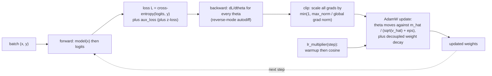
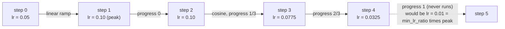
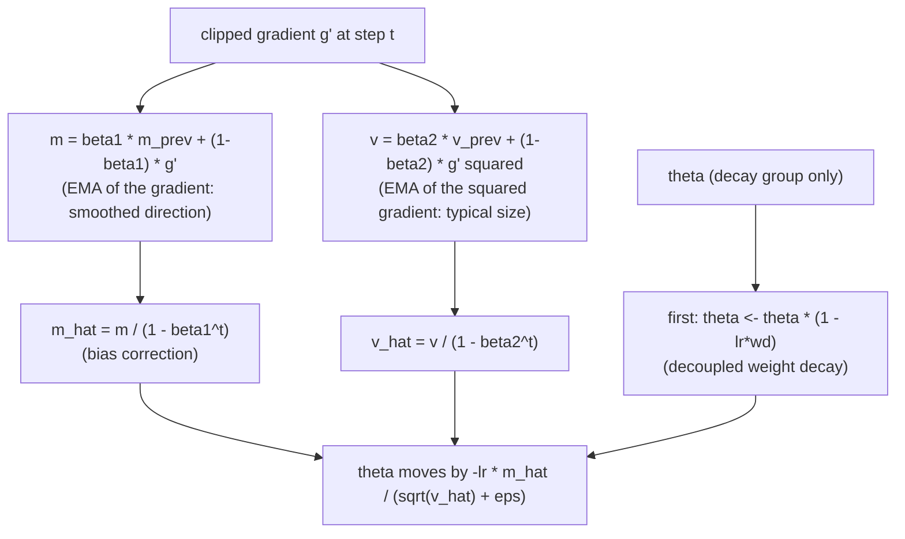
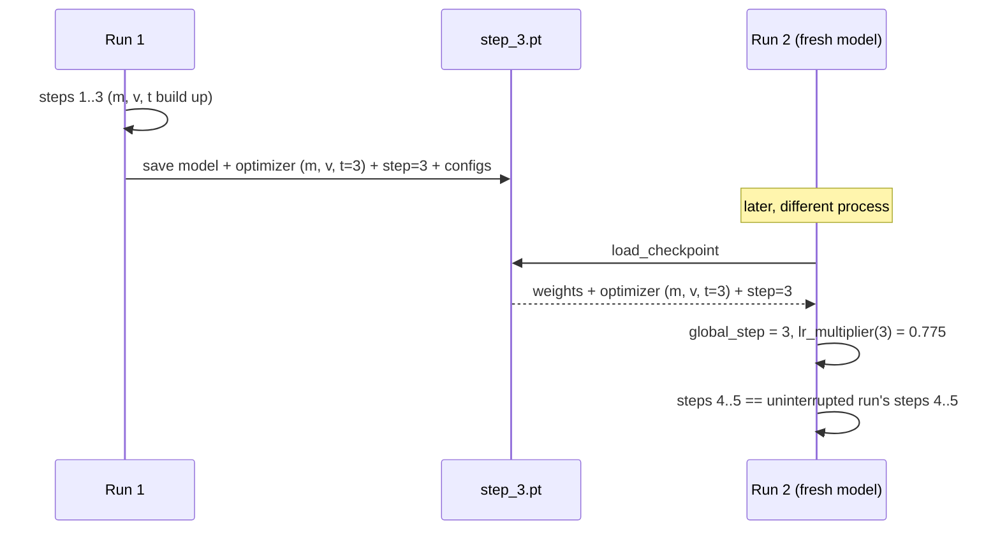
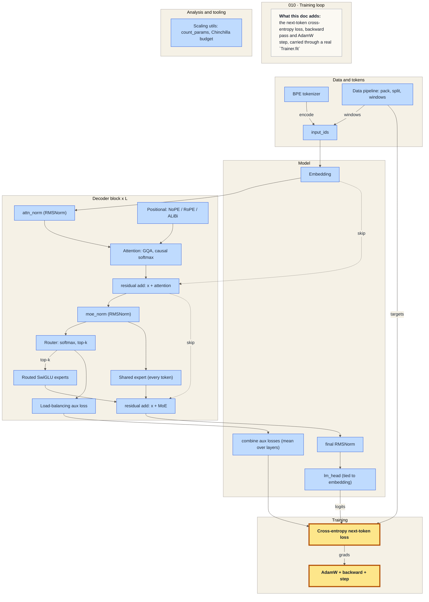

# 010 — The training loop: the full derivation, solved by hand

**Companion to:** [`journey_of_a_model/010-training-loop.md`](../../journey_of_a_model/010-training-loop.md)
(and, for the model forward pass it reuses without re-deriving, [`journey_of_a_model/006-full-model-assembly.md`](../../journey_of_a_model/006-full-model-assembly.md))
· **Code:** [`qwenmoe/train/trainer.py`](../../qwenmoe/train/trainer.py),
[`qwenmoe/train/optim.py`](../../qwenmoe/train/optim.py)
· **Every number here is reproduced by:** [`verify_010_training_loop.py`](verify_010_training_loop.py)
(`uv run python docs/math/verify_010_training_loop.py`)

---

## How to read this

The journal entry tells you *what* `Trainer.fit` does — AdamW, a warmup +
cosine learning-rate schedule, gradient clipping, checkpointing — and *why*
each piece earns its place. It also records the single most important bug
the task turned up (an unscaled embedding init that made the starting loss
15× too large) and derives *that* fully.

This document is the other trade-off: **maximum detail, minimum
summarising**. We

1. fix **one** tiny model — the exact 2-layer `QwenMoEModel` from the
   [006 companion](006-full-model-assembly.md), with the same hand-picked
   weights — and **one** training window,
2. push it through **every line** of one optimizer step:
   `Trainer.fit` → `_run_step` → `_set_lr` / `lr_multiplier` →
   `_forward_backward_core` → `torch.nn.utils.clip_grad_norm_` →
   `optimizer.step()` (AdamW), citing `trainer.py:line` at each step,
3. then keep going for four more steps so the optimizer's *memory*
   (momentum) becomes visible,
4. and for every operation — a softmax, a log, a dot product, an
   exponential moving average, a bias correction, a floor-division — first
   derive *why* it has that form, then **do the arithmetic digit by
   digit**, and check it against the real module.

Nothing is skipped. We keep a running **shape ledger** and a running
**optimizer-state ledger**.

You do **not** need any background. Every term — scalar, vector, matrix,
dot product, derivative, gradient, chain rule, variance, norm, softmax,
cross-entropy, exponential moving average — is defined at first use. You
*should* skim
[`journey_of_a_model/010-training-loop.md`](../../journey_of_a_model/010-training-loop.md)
first for the plain-English picture, and keep the
[006 companion](006-full-model-assembly.md) open: this document treats the
model's forward pass (embedding → 2 blocks → final norm → tied head →
logits) as a **solved black box** and starts its real work at the loss.

> **Scope.**
> - **The model forward pass is not re-derived.** [006](006-full-model-assembly.md)
>   already carried the identical model and weights from `input_ids` to
>   `logits` digit by digit. [Part 4](#part-4--the-forward-half-logits--loss)
>   reproduces its final `logits` and the residual stream `u` entering the
>   final norm, cites it, and moves on.
> - **Back-propagation through the two transformer blocks is not
>   hand-walked.** That is 006's forward pass run in reverse — ~60 KB of
>   chain rule. Instead [Part 5](#part-5--the-backward-half-solved-by-hand-where-the-chain-is-short)
>   derives the chain rule *in general*, applies it **fully** for the short
>   path (loss → logits → tied head → final norm's gain vector), and shows
>   the verify script confirming that hand-derived gradient against
>   `loss.backward()` exactly. Every *other* parameter's gradient is what
>   reverse-mode autodiff computes by the same rule; the script checks the
>   whole picture.
> - **AdamW's internal update is derived from zero and computed by hand**
>   — that *is* this document's centre of gravity, since it is the one
>   piece of new arithmetic task 10 introduced.
> - **Muon** (`TrainConfig.optimizer="muon"`, an alternative to AdamW) gets
>   a [pointer](#part-14--questions-that-might-come-to-mind), not a full
>   derivation — its Newton–Schulz orthogonalisation is derived in
>   [`optim.py`](../../qwenmoe/train/optim.py)'s own docstring.
>
> **Two "paths agree" checks** replace the fused-vs-explicit kernel
> reconciliation of the attention/MoE entries:
> [Part 8](#part-8--gradient-accumulation-and-_average_metrics) shows
> gradient accumulation over one window twice is *byte-identical* to a
> single un-accumulated step, and accumulation over two distinct windows
> reproduces a true batch-of-two's loss (measured max difference:
> `1.2e-07`).

---

## Part 0 — What is a training step?

**Training** a neural network means repeatedly nudging its numbers so that
its outputs get less wrong. One **step** is one nudge. It has five acts:

| act | what happens | code |
|---|---|---|
| 1. **set the learning rate** | decide *how big* this step's nudge is allowed to be | `_set_lr` → `lr_multiplier` |
| 2. **forward** | run the model on a batch of text, get a single number — the **loss** — measuring how wrong it was | `_forward_backward_core`, first half |
| 3. **backward** | compute the **gradient**: for every parameter, the number saying "increase this parameter and the loss goes up at *this* rate" | `.backward()` |
| 4. **clip** | if the gradient is collectively too large, scale it down uniformly | `clip_grad_norm_` |
| 5. **update** | move every parameter a little bit *against* its gradient, scaled by the learning rate and by AdamW's per-parameter memory | `optimizer.step()` |

A few definitions to carry from here:

- A **scalar** is a single number. A **vector** is an ordered list of
  numbers (a length-$d$ vector has $d$ **components** or **entries**). A
  **matrix** is a rectangular grid of numbers; shape `(r, c)` means $r$
  rows and $c$ columns.
- A **parameter** (or **weight**) is one learnable scalar inside the model.
  "Learnable" means training is allowed to change it. Our tiny model has
  300 of them (006's count).
- The **loss** $L$ is a single scalar computed from the model's outputs and
  the correct answers. Lower is better. Training's whole job is to make $L$
  small.
- The **derivative** of $L$ with respect to a parameter $\theta$, written
  $\dfrac{\partial L}{\partial \theta}$ (say "partial $L$ partial theta"),
  is the **slope**: if you increase $\theta$ by a tiny amount
  $\varepsilon$, then $L$ changes by approximately
  $\dfrac{\partial L}{\partial \theta}\cdot\varepsilon$. Positive slope ⇒
  increasing $\theta$ *raises* the loss ⇒ we should *decrease* $\theta$.
- The **gradient** $\nabla L$ ("del L") is the vector of $\partial L /
  \partial\theta$ for *every* parameter at once. Moving all parameters a
  small step in the direction $-\nabla L$ is the fastest local way to
  reduce $L$ — that is **gradient descent**, and every optimizer here is a
  refinement of it.



---

<!-- notation:start (generated by build_architecture_footer.py) -->
> **Notation note.** The series uses one symbol set ([canonical notation](README.md#canonical-notation)). In this doc, $E$ stands for $N$ (`n_routed_experts`); not doc 006's embedding matrix; $S$ stands for $n_{\text{shared}}$ (`n_shared_experts`); **not** the sequence length $S$ of docs 004 and 006; $L_\text{blk}$ stands for $L$ (`n_layers`). Nothing below is changed; this only states the correspondence.
<!-- notation:end -->

## Part 1 — The running example

### 1.1 The model

Identical to the [006 companion](006-full-model-assembly.md), Part 1 — go
there for why each field is the smallest that still exercises the model.
Here it is only the backdrop:

| Symbol | `ModelConfig` field | value |
|---|---|---|
| $V$ | `vocab_size` | 6 |
| $d$ | `d_model` (the width of the vector passed between layers) | 4 |
| $L_\text{blk}$ | `n_layers` | 2 |
| — | `n_heads` / `n_kv_heads` | 2 / 1 |
| $d_{ff}$ | `d_ff` (one expert's inner width) | 3 |
| $E$ / $k$ / $S$ | `n_routed_experts` / `top_k` / `n_shared_experts` | 2 / 1 / 0 |
| — | `positional_scheme` | `"nope"` (no positional encoding — keeps 006's arithmetic clean) |
| — | `activation` | `"swiglu"` |
| — | `moe_balancing` | `"aux_loss"` |
| — | `tie_word_embeddings` | `True` — the LM head *is* the embedding table |

The **embedding / tied-head matrix** $E$ (shape `(V, d) = (6, 4)`; row $t$
is the vector for token id $t$), and the two blocks' attention + MoE
weights, are pinned to 006's exact hand-picked values. The verify script
pins them with `.copy_(...)`; 006 writes each one out. Every RMSNorm gain
vector is all-ones (its default).

```
E =  [[ 1,  1,  0,  0],   # token 0
      [ 1,  0, -1,  0],   # token 1
      [ 0,  0,  1,  1],   # token 2
      [-1,  0,  0,  1],   # token 3
      [ 0,  1,  0,  1],   # token 4
      [ 1, -1,  1, -1]]   # token 5
```

### 1.2 The data: one window, reused every step

The whole training corpus is the 4-token stream `[4, 1, 4, 1]`. A
**next-token-prediction window** of length `seq_len = 3` takes the first 3
tokens as the input `x` and the *same span shifted one position right* as
the target `y` (each position's job is to predict the next token). With
only 4 tokens there is exactly **one** window
([`dataset.py:77`](../../qwenmoe/data/dataset.py#L77): `len = n_tokens −
seq_len = 4 − 3 = 1`):

$$x = [4,\ 1,\ 4], \qquad y = [1,\ 4,\ 1].$$

`Trainer` wraps this in a `DataLoader` and an `_infinite_batches`
generator ([`trainer.py:158`](../../qwenmoe/train/trainer.py#L158)) that
re-yields it forever, so **every one of the 5 steps sees the identical
batch**. That is deliberate for this document: the only things that change
between steps are the parameters and the optimizer's memory, so their
effect is isolated.

The validation set is the same one window.

### 1.3 The training config

`TrainConfig`, with every field that matters here made explicit:

| field | value | why this value |
|---|---|---|
| `batch_size` | 1 | one window |
| `seq_len` | 3 | |
| `total_tokens` | 15 | sets the step count — see Part 2.4 |
| `lr` | 0.1 | the **peak** learning rate. Large, so weight moves are visible digit-by-digit |
| `warmup_steps` | 2 | steps 0–1 ramp up, steps 2+ decay — exercises both schedule phases |
| `betas` | (0.9, 0.95) | AdamW's two memory-decay rates (Part 6) — the modernised default, not PyTorch's (0.9, 0.999) |
| `adam_eps` | 1e-8 | AdamW's divide-by-zero guard |
| `weight_decay` | 0.1 | pulls decay-group weights toward zero each step |
| `grad_clip_norm` | 1.0 | the gradient-size ceiling (Part 5.3) |
| `lr_schedule` | `"cosine"` | vs `"wsd"` — Part 3.4 |
| `min_lr_ratio` | 0.1 | the schedule decays to `0.1 × lr`, not to 0 |
| `precision` | `"fp32"` | full 32-bit floats; `"bf16"` autocast is Part 4.1's aside |
| `z_loss_weight` | 0.0 | off in the main run; Part 9 turns it on |
| `grad_accum_steps` | 1 | no accumulation in the main run; Part 8 sets it to 2 |
| `device` | `"cpu"` | |
| `seed` | 1337 | |

### 1.4 Ledgers (starting state)

**Shape ledger** — the tensors we will track:

| name | shape | meaning |
|---|---|---|
| `x`, `y` | `(1, 3)` | the batch: 1 sequence, 3 token ids |
| `logits` | `(1, 3, 6)` | one length-6 score vector per position |
| `u` | `(3, 4)` | residual stream entering `final_norm` (from 006) |
| `final_norm.weight` ($w$) | `(4,)` | the gain vector we track by hand end-to-end |

**Optimizer-state ledger** for `final_norm.weight` — all zero before step 1
($w$ is the parameter's value; $m$, $v$ are AdamW's memory of its
*gradient*):

| after step | $t$ | $m$ (momentum) | $v$ (2nd moment) | value $w$ |
|---|---|---|---|---|
| — | 0 | `[0,0,0,0]` | `[0,0,0,0]` | `[1,1,1,1]` |

---

## Part 2 — `Trainer.fit`: setup, before the loop

Source: [`trainer.py:523–599`](../../qwenmoe/train/trainer.py#L523).

### 2.1 The guards

```python
if len(train_dataset) < config.batch_size: raise ValueError(...)   # trainer.py:531
if len(val_dataset)   < config.batch_size: raise ValueError(...)   # trainer.py:536
if config.document_masking and len(train_dataset[0]) != 3: raise ValueError(...)
```

**Derive.** A `DataLoader` with `drop_last=True` (which `fit` uses,
[`trainer.py:585`](../../qwenmoe/train/trainer.py#L585)) throws away any
final partial batch. If the dataset has fewer windows than `batch_size`,
*every* batch is partial, so the loader yields **nothing** and the loop
below would spin forever producing no steps. The guard turns that into an
immediate error. Here $\texttt{len(train\_dataset)} = 1 \ge
\texttt{batch\_size} = 1$ ✓. `document_masking` is off, so the third guard
is skipped.

### 2.2 `select_device`

Source: [`trainer.py:57–69`](../../qwenmoe/train/trainer.py#L57).

```python
def select_device(requested):
    if requested == "cpu": return "cpu"
    if torch.backends.mps.is_available(): return "mps"
    if requested == "mps": logger.warning("... falling back to cpu")
    return "cpu"
```

- **`"cpu"`** — the CPU (central processing unit) is the general-purpose
  processor every computer has. Always available, so `requested="cpu"`
  returns immediately.
- **`"mps"`** — Metal Performance Shaders, Apple's GPU (graphics
  processing unit) compute backend. A GPU does many multiplications in
  parallel, so it trains larger models far faster — but it is not present
  on every machine.
- The logic: honour an explicit `"cpu"`; otherwise use the GPU **if it
  exists**; if the caller *asked* for `"mps"` and it is missing, **warn but
  do not crash** — a training run should degrade to slow, not to dead.

We pass `device="cpu"`, so this returns `"cpu"`. **Provable** — it is a
three-branch lookup, no arithmetic. (The verify script also confirms
`select_device("auto")` returns `"mps"` *or* `"cpu"` depending on the
machine it runs on.)

There is a *second* device fallback, inside the loop:
[`_run_step`](../../qwenmoe/train/trainer.py#L414) wraps the
forward/backward in `try: ... except RuntimeError:` and, if an error hits
mid-step on `"mps"`, moves the model and the optimizer's state tensors to
`"cpu"` and retries the *whole* accumulation window. On `"cpu"` (our case)
that path is dead code.

### 2.3 The seed, then the optimizer

```python
torch.manual_seed(config.seed)             # trainer.py:549
model = model.to(device)                    # trainer.py:565  (cpu -> no-op)
optimizer = build_optimizer(model, config)  # trainer.py:566
```

**`torch.manual_seed(1337)`** fixes the random-number generator so the run
is reproducible. Our model's weights were *pinned* before `fit` was
called, and there is no dropout, so the seed only affects `DataLoader`
shuffling — and with one window there is nothing to shuffle. The run is
fully deterministic.

**`build_optimizer`** ([`optim.py:265`](../../qwenmoe/train/optim.py#L265))
does one non-trivial thing: it splits the model's 28 parameter *tensors*
(300 scalars total) into **two groups** with different weight-decay
treatment.

#### `split_param_groups` — the decay / no-decay split

Source: [`optim.py:43–71`](../../qwenmoe/train/optim.py#L43).

**Derive.** **Weight decay** (Part 6.3) shrinks a parameter toward zero a
little every step, to discourage the model from relying on any one large
weight. That is helpful for the big rectangular weight matrices that do the
model's "mixing" work — but *actively harmful* for two kinds of parameter:

- an **RMSNorm gain vector** — it is initialised to all-ones and its job is
  to *rescale* features; pulling it toward zero fights its purpose;
- an **embedding row** — it is the learned identity of a token; there is no
  reason a token's vector should be small.

So `split_param_groups` walks every submodule and puts a parameter in
**`no_decay`** if its module is an `RMSNorm` or an `nn.Embedding`, *or* if
the parameter has fewer than 2 dimensions (any bias or 1-D vector);
everything else — the attention projections `w_q/w_k/w_v/w_o`, the expert
matrices `w_gate/w_up/w_down`, the router — goes in **`decay`**.
Classification is by **module type**, not just shape, because a router
weight matrix is also 2-D and *should* decay.

**Compute — our model.** The verify script prints the split:

```
decay group   (22 tensors) : attention/expert/router weight matrices
no-decay group (6 tensors): ['blocks.0.attn_norm.weight', 'blocks.0.moe_norm.weight',
                             'blocks.1.attn_norm.weight', 'blocks.1.moe_norm.weight',
                             'embedding.weight', 'final_norm.weight']
```

The tied `lm_head.weight` **is** `embedding.weight` (same tensor); the walk
deduplicates by `id()` and, because `embedding` is registered before
`lm_head` in `QwenMoEModel.__init__`, the shared tensor lands in
`no_decay`. Our tracked parameter, `final_norm.weight`, is **no-decay** —
so its AdamW update in Part 6 has no decay term, which is why it is the
clean one to follow.

`build_optimizer` then constructs `torch.optim.AdamW` over two param groups
— `{decay, weight_decay: 0.1}` and `{no_decay, weight_decay: 0.0}` — each
stamped with `base_lr = config.lr = 0.1` (Part 3.2 uses that).

### 2.4 `total_steps` — turning a token budget into a step count

```python
effective_batch_size = config.batch_size * config.grad_accum_steps        # trainer.py:581
total_steps = max(1, config.total_tokens // (effective_batch_size * config.seq_len))
```

**Derive.** Task 9's scaling-law helpers produce a **token budget** — how
many next-token predictions the run should make in total (see
[009's companion](009-scaling-law-utilities.md)). The loop, though, counts
**optimizer steps**. One step consumes `effective_batch_size` sequences of
`seq_len` tokens each, i.e. $\texttt{effective\_batch\_size}\times
\texttt{seq\_len}$ tokens. So

$$\texttt{total\_steps} = \left\lfloor \frac{\texttt{total\_tokens}}{\texttt{effective\_batch\_size}\times\texttt{seq\_len}} \right\rfloor.$$

The bars $\lfloor\ \rfloor$ are **floor** — divide and round *down* to a
whole number, because you cannot run a fractional step. `//` is Python's
floor-division. `max(1, ...)` guarantees at least one step even for a
budget smaller than one batch.

`effective_batch_size = batch_size × grad_accum_steps` because gradient
accumulation (Part 8) forward/backwards `grad_accum_steps` micro-batches
before each `optimizer.step()`, so the batch that actually sets the step
count is the *combined* one. With `grad_accum_steps = 1` this is just
`batch_size`.

**Compute.** $\texttt{total\_steps} = \left\lfloor \dfrac{15}{(1\times1)\times3} \right\rfloor = \lfloor 5.0 \rfloor = \mathbf{5}$. **Provable** given the config.

```
total_steps = total_tokens // (batch*grad_accum*seq_len) = 15 // (1*1*3) = 5
```

### 2.5 Resume (skipped here)

`resume_from` is `None`, so `global_step = 0`
([`trainer.py:568`](../../qwenmoe/train/trainer.py#L568)). Part 11 exercises
the resume path.

**Shape ledger** unchanged. **Loop about to start:** `global_step = 0`,
`total_steps = 5`.

---

## Part 3 — The learning-rate schedule

Source: [`trainer.py:72–148`](../../qwenmoe/train/trainer.py#L72)
(`lr_multiplier`, `_set_lr`).

The **learning rate** $\gamma$ (Greek "gamma") is the scalar that
multiplies the update before it is subtracted from a parameter — act 1 of
every step. Rather than one fixed $\gamma$, `Trainer` uses a **schedule**:
$\gamma$ starts small, ramps up, then eases back down.

`_set_lr` is called first thing in `_run_step`
([`trainer.py:389`](../../qwenmoe/train/trainer.py#L389)):

```python
def _set_lr(optimizer, base_lr, step, total_steps, config):
    multiplier = lr_multiplier(step, config.warmup_steps, total_steps,
                               schedule=config.lr_schedule,
                               min_lr_ratio=config.min_lr_ratio,
                               decay_fraction=config.decay_fraction)
    for group in optimizer.param_groups:
        group["lr"] = group.get("base_lr", base_lr) * multiplier
    return base_lr * multiplier
```

So every group's live `lr` is `base_lr (0.1) × multiplier(step)`. All the
maths is in `lr_multiplier`, a **pure function of the integer `step`** — no
stored scheduler state, so a run resumed at step $s$ gets exactly the rate
an uninterrupted run would have at step $s$ (Part 11 depends on this).

### 3.1 Phase 1: linear warmup

```python
if warmup_steps > 0 and step < warmup_steps:
    return (step + 1) / warmup_steps
```

**Derive.** At the very start, the model is essentially random and the
first few gradients are unreliable; AdamW's running averages (Part 6) also
need a few steps of data before they mean anything. Taking a full-size step
on that is asking for a blow-up. **Warmup** ramps the multiplier linearly
from a small value to 1 over the first `warmup_steps` steps.

Why `(step + 1) / warmup_steps` specifically? `step` is 0-indexed (it is
the step *about to run*). We want the **last** warmup step ($step =
W - 1$, where $W = \texttt{warmup\_steps}$) to reach exactly 1, and the
steps before it to be evenly spaced fractions. Setting $step = W-1$ gives
$(W-1+1)/W = W/W = 1$ ✓. Setting $step = 0$ gives $1/W$ — the smallest
nonzero fraction. So the ramp is $\tfrac1W, \tfrac2W, \dots, \tfrac{W}{W}$.
**Provable** — it is linear interpolation with the endpoints pinned.

**Compute** ($W = 2$):
- step 0: $(0+1)/2 = \mathbf{0.5}$
- step 1: $(1+1)/2 = \mathbf{1.0}$

### 3.2 Phase 2: cosine decay

```python
if total_steps <= warmup_steps: return 1.0          # degenerate: no decay span
progress = min((step - warmup_steps) / (total_steps - warmup_steps), 1.0)
cosine = 0.5 * (1.0 + math.cos(math.pi * progress))
return min_lr_ratio + (1.0 - min_lr_ratio) * cosine
```

**Derive, piece by piece.**

**`progress`** measures how far through the *post-warmup* span we are: 0 at
the first decay step ($step = W$), 1 at the last ($step = \texttt{total\_steps}$).
$$\texttt{progress} = \frac{step - W}{\texttt{total\_steps} - W}.$$
The `min(..., 1.0)` clamps it in case `step` somehow exceeds
`total_steps`. **Exact** — a ratio of step counts.

**The cosine term.** We want a curve that (a) starts at 1 when
`progress = 0`, (b) ends at 0 when `progress = 1`, (c) is *flat* at both
ends — leave the peak rate gently, and approach the floor gently, rather
than with a corner. The **cosine function** $\cos$ does exactly this on the
interval we need:

- $\cos$ takes an angle (in **radians** — a full circle is $2\pi \approx
  6.283$ radians) and returns a number in $[-1, 1]$. $\cos(0) = 1$,
  $\cos(\pi) = -1$, and it is flat (zero slope) at both.
- Feed it $\pi \times \texttt{progress}$: as `progress` goes $0 \to 1$, the
  angle goes $0 \to \pi$, and $\cos$ goes $1 \to -1$.
- Rescale from $[-1, 1]$ to $[0, 1]$: add 1 (→ $[0, 2]$), halve (→
  $[0, 1]$). That is $\tfrac12(1 + \cos(\pi\,\texttt{progress}))$.

So this term is **1 at progress 0**, **0 at progress 1**, smooth
throughout. **Provable** — it is $\cos$ rescaled, nothing fitted. *That a
cosine is a good shape* is an **empirical** finding (SGDR, Loshchilov &
Hutter 2017); *the algebra of rescaling it* is exact.

**The `min_lr_ratio` blend.** Decaying all the way to $\gamma = 0$ means
the last steps do nothing. `min_lr_ratio` $= r$ (here $0.1$) sets a floor:
we want the multiplier to run from **1** (at progress 0) down to **$r$** (at
progress 1), not down to 0. Linear-blend the cosine term $c \in [0,1]$
between $r$ and $1$:
$$\text{multiplier} = r + (1 - r)\,c.$$
At $c = 1$: $r + (1-r) = 1$ ✓. At $c = 0$: $r$ ✓. **Exact.** The *value*
$r = 0.1$ is an **empirical** choice (the modernised default — journal
[024]).

**Continuity at the seam.** Does warmup's end meet cosine's start without a
jump? Warmup's value at $step = W - 1$ is $1.0$. Cosine's value at $step =
W$ has `progress` $= 0$, so $c = \tfrac12(1 + \cos 0) = \tfrac12(1+1) = 1$,
so multiplier $= r + (1-r)\cdot 1 = 1.0$. **They match — no discontinuity.**
**Provable.**

**Compute** ($W = 2$, `total_steps` $= 5$, $r = 0.1$):

| step | `progress` | angle $\pi p$ | $\cos(\pi p)$ | $c = \tfrac12(1+\cos)$ | multiplier $= 0.1 + 0.9c$ |
|---|---|---|---|---|---|
| 2 | $(2-2)/3 = 0$ | $0$ | $1$ | $1.0$ | $0.1 + 0.9 = \mathbf{1.0}$ |
| 3 | $(3-2)/3 = \tfrac13$ | $\pi/3 = 60°$ | $0.5$ | $0.75$ | $0.1 + 0.675 = \mathbf{0.775}$ |
| 4 | $(4-2)/3 = \tfrac23$ | $2\pi/3 = 120°$ | $-0.5$ | $0.25$ | $0.1 + 0.225 = \mathbf{0.325}$ |
| 5 | $(5-2)/3 = 1$ | $\pi = 180°$ | $-1$ | $0.0$ | $0.1 + 0 = \mathbf{0.1}$ |

$\cos(60°) = \tfrac12$ and $\cos(120°) = -\tfrac12$ are **exact** textbook
values — the choice `total_steps − warmup = 3` was made precisely so
`progress` lands on the clean thirds. Step 5 never actually runs (the loop
stops at `global_step == total_steps`), so the smallest multiplier the run
*applies* is $0.325$ at step 4.

### 3.3 The full applied-rate table

`base_lr = 0.1`, so applied $\gamma$ = `0.1 × multiplier`:

| step index | 0 | 1 | 2 | 3 | 4 |
|---|---|---|---|---|---|
| multiplier | 0.5 | 1.0 | 1.0 | 0.775 | 0.325 |
| applied $\gamma$ | **0.05** | **0.10** | **0.10** | **0.0775** | **0.0325** |
| phase | warmup | warmup | cosine | cosine | cosine |

Verify-script output (verbatim):

```
  step 0: multiplier = 0.500000   lr = 0.050000   (warmup)
  step 1: multiplier = 1.000000   lr = 0.100000   (warmup)
  step 2: multiplier = 1.000000   lr = 0.100000   (cosine)
  step 3: multiplier = 0.775000   lr = 0.077500   (cosine)
  step 4: multiplier = 0.325000   lr = 0.032500   (cosine)
  step 5: multiplier = 0.100000   lr = 0.010000   (cosine)
```



### 3.4 The WSD alternative (`lr_schedule="wsd"`)

```python
if schedule == "wsd":
    decay_steps  = max(1, round(decay_fraction * total_steps))
    decay_start  = max(warmup_steps, total_steps - decay_steps)
    if step < decay_start: return 1.0                       # "stable" plateau
    progress = min((step - decay_start) / (total_steps - decay_start), 1.0)
    return 1.0 - (1.0 - min_lr_ratio) * progress            # LINEAR decay
```

**Warmup–Stable–Decay** (Hu et al. 2024) replaces the smooth cosine with
three flat-then-linear phases: ramp up (same warmup), then hold the
multiplier at **exactly 1** for most of the run (the "stable" plateau),
then decay **linearly** to the floor over just the final
`decay_fraction` of steps. Why: a checkpoint saved anywhere in the plateau
is a valid starting point for a fresh, shorter decay ("cooldown"), which a
schedule that starts decaying immediately after warmup cannot offer.

`decay_start` is the first decaying step. `progress` here runs 0→1 across
*only* the decay tail, and `1 − (1 − r)·progress` is the straight line from
1 (progress 0) to $r$ (progress 1). **Exact.**

**Compute** (`warmup_steps=2`, `total_steps=10`, `decay_fraction=0.3`,
$r=0.1$): `decay_steps = round(0.3·10) = 3`, `decay_start = max(2, 10−3) = 7`.

```
step 0: 0.50   step 1: 1.00        (warmup)
steps 2..6: 1.00                    (stable plateau, step < decay_start)
step 7: progress 0/3     -> 1.00    (first decay step)
step 8: 1 - 0.9·(1/3)    = 0.70
step 9: 1 - 0.9·(2/3)    = 0.40
step 10: 1 - 0.9·1       = 0.10     (= min_lr_ratio)
```

The verify script asserts this whole table.

---

## Part 4 — The forward half: logits → loss

Source: [`trainer.py:176–268`](../../qwenmoe/train/trainer.py#L176) (`_forward_backward_core`).
`_run_step` calls it once per micro-batch
([`trainer.py:400`](../../qwenmoe/train/trainer.py#L400)); with
`grad_accum_steps = 1` that is one call, `loss_scale = 1.0`.

### 4.1 The autocast context

```python
autocast_ctx = (torch.autocast(device_type=device, dtype=torch.bfloat16)
                if precision == "bf16" else contextlib.nullcontext())   # trainer.py:226
with autocast_ctx:
    logits, extras = model(x, targets=y, segment_ids=segment_ids)       # trainer.py:232
```

**Derive.** A **floating-point number** stores a value as (sign) ×
(fraction) × 2^(exponent). **fp32** ("single precision") uses 32 bits;
**bf16** ("brain float 16") uses 16 — half the memory and roughly double
the matmul throughput, at the cost of a coarser fraction (fewer
significant digits). `torch.autocast` runs matmuls in bf16 while keeping
the numerically-delicate ops (softmax, normalisation, the loss) in fp32
automatically. bf16 keeps fp32's *exponent* range, so no gradient-scaling
tricks are needed.

We use `precision="fp32"`, so `autocast_ctx` is `nullcontext()` — a
do-nothing `with` block. The forward is plain fp32.
[`trainer.py:234`](../../qwenmoe/train/trainer.py#L234) then does
`logits = logits.float()`, which on an already-fp32 tensor is a no-op, so
the loss subgraph is fp32 regardless. **Our path is byte-identical to
having no autocast code at all.**

### 4.2 `model(x)` → logits — cited, not re-derived

`model(x, targets=y, segment_ids=None)` runs: embedding lookup → block 0
(pre-norm attention + pre-norm MoE, each with a residual add) → block 1 →
`final_norm` (RMSNorm) → tied LM head → `logits`. Every step of that, with
*these exact weights*, is [006](006-full-model-assembly.md). `targets=y` is
ignored (`mtp_depth = 0`, no multi-token-prediction heads). We take two
things from 006's output:

**The residual stream entering `final_norm`** — call it $u$, shape
`(3, 4)`, one row per position (006's Step 15):

```
u = [[ 0.000000,  3.828425,  0.000000,  3.828425],     # position 0
     [-1.232787,  1.171955, -2.197338,  1.375547],     # position 1
     [-0.631357,  3.264548, -0.652273,  2.872624]]      # position 2
```

**The logits** `(1, 3, 6)` (006's Step 17 `EXPECTED_LOGITS`):

```
logits = [[ 1.414213,  0.000000,  1.414213,  1.414213,  2.828427, -2.828427],   # pos 0
          [-0.039239,  0.622172, -0.530086,  1.682475,  1.643236, -3.855798],   # pos 1
          [ 1.185529,  0.009417,  0.999658,  1.577581,  2.763110, -3.341033]]    # pos 2
```

and **`extras["aux_loss"]` = 0.011424** — the mean of the two blocks'
Mixture-of-Experts load-balancing losses (derived in
[005](005-moe-layer.md)). We treat it as a given scalar.

> **Shape ledger:** `x (1,3)` →[embed+2 blocks]→ `u (3,4)` →[final_norm +
> tied head]→ `logits (1,3,6)`.

### 4.3 `F.cross_entropy` — derived from scratch

```python
logits = logits.float()
loss = F.cross_entropy(logits.reshape(-1, logits.size(-1)), y.reshape(-1))   # trainer.py:235
```

**The reshapes first.** `logits` is `(1, 3, 6)` — batch 1, 3 positions, 6
vocab scores. `F.cross_entropy` wants a 2-D `(rows, classes)` tensor of
scores and a 1-D `(rows,)` tensor of correct class ids.
`logits.reshape(-1, 6)` flattens the batch and position axes together:
`(1, 3, 6) → (3, 6)` — 3 rows, one per (batch, position) pair, in order.
`y.reshape(-1)`: `(1, 3) → (3,)`. The `-1` means "whatever length makes the
total element count work out" ($1\times3\times6 = 18 = 3\times6$ ✓).

> **Shape ledger:** `logits (1,3,6)` → `(3,6)`; `y (1,3)` → `(3,)`.

**Now derive cross-entropy.** For one position with score vector $z$
(length $V = 6$) and correct token $c$:

**Step A — softmax turns scores into probabilities.** We need a
probability for each token: non-negative, summing to 1. The
**softmax** function does this:
$$\operatorname{softmax}(z)_j = \frac{e^{z_j}}{\sum_{v=1}^{V} e^{z_v}}.$$
- $e^{z_j}$ — the **exponential function** $e^x$ (with $e \approx 2.71828$)
  turns any real number into a positive one, and preserves order (bigger
  score ⇒ bigger $e^{z_j}$). $e^0 = 1$, $e^1 \approx 2.718$, $e^{-2}
  \approx 0.135$.
- Dividing each by the **sum** $Z = \sum_v e^{z_v}$ (the **normaliser**, or
  **partition function**) makes them sum to 1.

**Step B — the loss is the negative log of the correct token's
probability.**
$$\ell = -\ln\big(\operatorname{softmax}(z)_c\big).$$
- $\ln$ is the **natural logarithm** — the inverse of $e^x$: $\ln(e^x) = x$,
  $\ln 1 = 0$, $\ln$ of a number between 0 and 1 is negative.
- If the model is certain and right ($\operatorname{softmax}(z)_c = 1$),
  $\ell = -\ln 1 = 0$. If it gives the right token probability $0.03$,
  $\ell = -\ln 0.03 \approx 3.5$. Confidently wrong ⇒ large $\ell$. This is
  the **cross-entropy** between the true distribution (all mass on $c$) and
  the model's — "how many extra nats of surprise did the model's guess
  cost". A **nat** is the unit of information when logs are natural.

**A cleaner form.** Substitute Step A into Step B:
$$\ell = -\ln\frac{e^{z_c}}{Z} = -(z_c - \ln Z) = \underbrace{\ln\!\sum_v e^{z_v}}_{\text{logsumexp}(z)} - z_c.$$
So cross-entropy at a position is **`logsumexp(z) − (the correct token's
raw score)`**. `logsumexp` is "log of the sum of exponentials"; it comes
back in Part 9 (z-loss).

**Step C — `F.cross_entropy` averages over all rows** (its default
`reduction="mean"`):
$$L_\text{lm} = \frac{1}{N}\sum_{p=1}^{N} \ell_p, \qquad N = 3.$$

**Compute — position 0.** $z = [1.414213,\ 0,\ 1.414213,\ 1.414213,\
2.828427,\ -2.828427]$, correct token $c = y_0 = 1$.

Exponentials ($e^{1.414213}$: since $1.414213 \approx \sqrt2$ and
$e^{1.414213} \approx 4.1133$; $e^{2.828427} = (e^{1.414213})^2 \approx
16.919$; $e^{-2.828427} = 1/16.919 \approx 0.05911$):

| $j$ | $z_j$ | $e^{z_j}$ |
|---|---|---|
| 0 | 1.414213 | 4.1133 |
| 1 | 0.000000 | 1.0000 |
| 2 | 1.414213 | 4.1133 |
| 3 | 1.414213 | 4.1133 |
| 4 | 2.828427 | 16.9188 |
| 5 | −2.828427 | 0.0591 |

$Z = 4.1133 + 1 + 4.1133 + 4.1133 + 16.9188 + 0.0591 = 30.3177$.

$\operatorname{softmax}(z)_1 = 1 / 30.3177 = 0.032984$.

$\ell_0 = -\ln(0.032984) = 3.41173$. Cross-check via logsumexp: $\ln(30.3177) - z_1 = 3.41173 - 0 = 3.41173$ ✓.

**Positions 1 and 2**, same procedure (the verify script prints every
softmax row):

| $p$ | correct $c$ | $z_c$ | $\operatorname{logsumexp}(z)$ | $\ell_p = \operatorname{logsumexp} - z_c$ |
|---|---|---|---|---|
| 0 | 1 | 0.000000 | 3.411731 | **3.411731** |
| 1 | 4 | 1.643236 | 2.637981 | **0.994744** |
| 2 | 1 | 0.009417 | 3.322404 | **3.312987** |

$$L_\text{lm} = \frac{3.411731 + 0.994744 + 3.312987}{3} = \frac{7.719462}{3} = \mathbf{2.573154}.$$

```
per-position cross-entropy : [3.411731, 0.994744, 3.312987]
logsumexp per position     : [3.411731, 2.637981, 3.322404]
lm_loss  (mean)            : 2.573154
```

**Reading it.** A model guessing uniformly among 6 tokens would score
$\ln 6 = 1.792$ per position (Part 10). Our pinned model scores $2.573$ —
*worse* than uniform. That is fine: the 006 weights were hand-picked to
make the forward arithmetic clean, not to be any good. Training's job
starts now.

### 4.4 Adding the auxiliary loss

```python
aux_loss = extras.get("aux_loss")
total_loss = loss if aux_loss is None else loss + aux_loss                # trainer.py:237
```

**Derive.** The MoE router could collapse into always picking the same
expert. The **auxiliary (load-balancing) loss** — derived in
[005](005-moe-layer.md) — is a small extra penalty that is minimised when
the router spreads tokens evenly. It is added directly to the loss so that
`.backward()` produces gradients that push the *router* toward balance
alongside everything else.

**Compute.** $L = L_\text{lm} + \texttt{aux\_loss} = 2.573154 + 0.011424 = \mathbf{2.584578}$.

```
aux_loss (mean of 2 blocks): 0.011424
total_loss = lm + aux      : 2.584578
```

The z-loss term (`trainer.py:239–251`) and the MTP term
(`trainer.py:253–259`) are both inactive here (`z_loss_weight = 0`,
`mtp_depth = 0`). Part 9 turns z-loss on.

### 4.5 `.backward()`

```python
(total_loss * loss_scale).backward()          # trainer.py:261
```

`loss_scale = 1.0` (no accumulation), so this is `total_loss.backward()`.
What it computes is Part 5.

**Optimizer-state ledger:** unchanged — `.backward()` fills `.grad`, it
does not touch the optimizer.

---

## Part 5 — The backward half, solved by hand where the chain is short

`total_loss.backward()` runs **reverse-mode automatic differentiation**
("autodiff", "autograd", "back-propagation"). Here is what that means and
why it is correct.

### 5.1 The chain rule, and what `.backward()` does

**The chain rule.** If $L$ depends on $b$, and $b$ depends on $a$, then the
slope of $L$ with respect to $a$ is the product of the two slopes:
$$\frac{\partial L}{\partial a} = \frac{\partial L}{\partial b}\cdot\frac{\partial b}{\partial a}.$$
Intuitively: wiggle $a$ a little, $b$ moves $\partial b/\partial a$ times
as much, and $L$ moves $\partial L/\partial b$ times *that*. When $b$ is a
whole vector, you sum over its components:
$\partial L/\partial a = \sum_i (\partial L/\partial b_i)(\partial b_i/\partial a)$.

**Reverse mode.** The model is a long chain
$\text{params} \to \dots \to u \to \text{logits} \to L$. Autodiff computes
$\partial L/\partial(\text{everything})$ by starting at the end with
$\partial L/\partial L = 1$ and walking **backwards**, multiplying by each
operation's local slope, caching the running product ("the gradient
flowing back") at every node. One backward pass gets *every* parameter's
gradient — far cheaper than wiggling each parameter separately. It is
**exact** (up to floating-point rounding): the chain rule is a theorem.

We will now do this by hand for the **short** path
$L \leftarrow \text{logits} \leftarrow \text{tied head} \leftarrow
\text{final\_norm gain } g$, and take autodiff's word (checked by the
script) for the long path back through the two blocks.

### 5.2 $\partial L / \partial \text{logits}$: the softmax + cross-entropy gradient

**Derive.** Fix position $p$, write $z = \text{logits}_p$, $s =
\operatorname{softmax}(z)$, correct token $c$. From Part 4.3,
$\ell_p = \operatorname{logsumexp}(z) - z_c$. Differentiate with respect to
one score $z_j$:

- $\dfrac{\partial}{\partial z_j}\operatorname{logsumexp}(z) =
  \dfrac{\partial}{\partial z_j}\ln\!\sum_v e^{z_v} =
  \dfrac{e^{z_j}}{\sum_v e^{z_v}} = s_j.$
  (Slope of $\ln f$ is $f'/f$; the sum's slope in $z_j$ is just $e^{z_j}$.)
- $\dfrac{\partial}{\partial z_j}(-z_c) = -[\,j = c\,]$ — this is $-1$ if
  $j$ is the correct token, else $0$. The bracket $[\,\cdot\,]$ is 1 when
  true, 0 when false (an **indicator**); the vector of these is the
  **one-hot** vector for $c$.

So $\dfrac{\partial \ell_p}{\partial z_j} = s_j - [\,j = c\,]$, i.e.
$$\frac{\partial \ell_p}{\partial \text{logits}_p} = \operatorname{softmax}(\text{logits}_p) - \operatorname{onehot}(y_p).$$
A clean, famous result: **the gradient of the score vector is "what you
predicted minus what was correct"**. Then $L = \frac1N\sum_p \ell_p$ tacks
on a $\frac1N$:
$$\frac{\partial L}{\partial \text{logits}_p} = \frac{1}{N}\Big(\operatorname{softmax}(\text{logits}_p) - \operatorname{onehot}(y_p)\Big).$$
(The `aux_loss` term does not depend on `logits`, so it contributes 0
here.) **Provable** — pure calculus.

**Compute** ($N = 3$). Position 0, $s = [0.135672,\ 0.032984,\ 0.135672,\
0.135672,\ 0.558051,\ 0.001950]$, one-hot at index 1:

$$\frac{1}{3}\big(s - \operatorname{onehot}(1)\big) = \frac{1}{3}[\,0.135672,\ 0.032984 - 1,\ 0.135672,\ 0.135672,\ 0.558051,\ 0.001950\,]$$
$$= [\,0.045224,\ -0.322339,\ 0.045224,\ 0.045224,\ 0.186017,\ 0.000650\,].$$

All three rows (verify script, matches `logits.grad` from autograd to
`3e-8`):

```
dL/dlogits by hand (3,6):
 [[ 0.045224, -0.322339,  0.045224,  0.045224,  0.186017,  0.000650],
  [ 0.022918,  0.044404,  0.014028,  0.128206, -0.210061,  0.000504],
  [ 0.039341, -0.321198,  0.032668,  0.058225,  0.190538,  0.000426]]
max |hand - autograd|: 2.98e-08
```

Each row sums to ≈ 0 (the $s$ part sums to 1, the one-hot sums to 1). The
correct token always gets a **negative** gradient (push its score up); the
model's current favourite (index 4 at positions 0 and 2) gets the largest
**positive** one (push it down).

> **Shape ledger:** `dL/dlogits` has the shape of `logits` (post-reshape):
> `(3, 6)`.

### 5.3 $\partial L / \partial w$: through the tied head and RMSNorm

Now propagate one more layer back, to the gain vector $w =
\texttt{final\_norm.weight}$ (length $d = 4$). ($w$ is lowercase — the
length-4 RMSNorm gain; capital $W_q$ etc. are 006's attention weight
*matrices*. Gradients keep the letter $g$.)

**The forward operations** (from [`rmsnorm.py:14–17`](../../qwenmoe/model/rmsnorm.py#L14)
and the tied head, [`transformer.py:133`](../../qwenmoe/model/transformer.py#L133)),
per position $p$:

1. **variance** $\mathrm{var}_p = \dfrac{1}{d}\sum_{i=1}^{d} u_{p,i}^2$ —
   the mean of the squared entries. (Since $u$ has mean ≈ 0 here, this is
   the ordinary statistical **variance**: average squared distance from 0.)
2. **inverse RMS** $r_p = \dfrac{1}{\sqrt{\mathrm{var}_p + \epsilon}}$,
   $\epsilon = 10^{-6}$. "RMS" = root-mean-square = $\sqrt{\mathrm{var}}$.
3. **normalise** $\tilde u_{p,i} = u_{p,i}\cdot r_p$ — now each row has
   RMS ≈ 1.
4. **gain** $o_{p,i} = \tilde u_{p,i}\cdot w_i$ — element-wise multiply by
   the learned gain vector.
5. **tied head** $\text{logits}_{p,j} = \sum_{i=1}^{d} o_{p,i}\,E_{j,i}$ —
   a **dot product** of the length-$d$ output vector $o_p$ with each row of
   $E$. (The LM head is `nn.Linear(d, V)` with weight $E$;
   $\text{logits} = o\,E^\top$.)

**Derive the gradient.** We want $\partial L/\partial w_i$. Chain rule
through steps 5 and 4 only ($w$ enters at step 4; $u$, and hence
$\mathrm{var}$, $r$, $\tilde u$, do *not* depend on $w$):

- **Step 5 back:** $\dfrac{\partial L}{\partial o_{p,i}} =
  \sum_{j=1}^{V}\dfrac{\partial L}{\partial \text{logits}_{p,j}}\cdot
  \dfrac{\partial \text{logits}_{p,j}}{\partial o_{p,i}} =
  \sum_j \dfrac{\partial L}{\partial \text{logits}_{p,j}}\,E_{j,i}.$
  In matrix form, $\dfrac{\partial L}{\partial o_p} =
  \dfrac{\partial L}{\partial \text{logits}_p}\,E$ (a `(1,6)` row times a
  `(6,4)` matrix → a `(1,4)` row).
- **Step 4 back:** $o_{p,i} = \tilde u_{p,i}\,w_i$, so
  $\dfrac{\partial o_{p,i}}{\partial w_i} = \tilde u_{p,i}$, giving
  $\dfrac{\partial L}{\partial w_i} = \sum_{p=1}^{N}
  \dfrac{\partial L}{\partial o_{p,i}}\cdot \tilde u_{p,i}$
  — sum over positions, because $w_i$ is **shared** across all of them
  (wiggling $w_i$ changes every position's output, and the effects add).

**Provable** — chain rule. Putting it together:
$$\boxed{\ \frac{\partial L}{\partial w_i} = \sum_{p=1}^{N}\Big(\big[\tfrac{1}{N}(\operatorname{softmax}(\text{logits}_p) - \operatorname{onehot}(y_p))\big]\,E\Big)_i \cdot \big(u_{p,i}\,r_p\big)\ }$$

**Compute.**

*Inverse RMS per position* — variance of each row of $u$, then
$1/\sqrt{\cdot + 10^{-6}}$:

| $p$ | $\frac1d\sum u_{p,i}^2$ | $r_p$ |
|---|---|---|
| 0 | $\frac{0 + 3.828425^2 + 0 + 3.828425^2}{4} = \frac{29.3138}{4} = 7.32844$ | $1/\sqrt{7.32844} = 0.369398$ |
| 1 | $\frac{1.51976 + 1.37348 + 4.82830 + 1.89190}{4} = 2.40336$ | $0.645038$ |
| 2 | $\frac{0.39861 + 10.6573 + 0.42546 + 8.25197}{4} = 4.93334$ | $0.450225$ |

*Normalised $\tilde u = u \cdot r_p$* (verify script prints it):

```
u_tilde = [[ 0.000000,  1.414213,  0.000000,  1.414213],
           [-0.795195,  0.755956, -1.417367,  0.887280],
           [-0.284253,  1.469782, -0.293670,  1.293328]]
```

*Gradient into the output vectors*, $\dfrac{\partial L}{\partial o_p} =
\dfrac{\partial L}{\partial \text{logits}_p}\,E$. Position 0, component 0:
row $\dfrac{\partial L}{\partial\text{logits}_0} = [0.045224, -0.322339,
0.045224, 0.045224, 0.186017, 0.000650]$ dotted with column 0 of $E$,
$E_{:,0} = [1, 1, 0, -1, 0, 1]$:
$$0.045224(1) + (-0.322339)(1) + 0.045224(0) + 0.045224(-1) + 0.186017(0) + 0.000650(1) = -0.321689.$$
All of it (verify script):

```
dL/d o_p = [[-0.321689,  0.230591,  0.368212,  0.275815],
            [-0.060379, -0.187647, -0.029872, -0.068331],
            [-0.339656,  0.229453,  0.354291,  0.281005]]
```

*Finally*, $\dfrac{\partial L}{\partial w_i} = \sum_p (\partial L/\partial o_p)_i\,\tilde u_{p,i}$ — element-wise multiply the two `(3,4)` tables and sum each column:

- $i = 0$: $(-0.321689)(0) + (-0.060379)(-0.795195) + (-0.339656)(-0.284253) = 0 + 0.048013 + 0.096550 = 0.144563$
- $i = 1$: $(0.230591)(1.414213) + (-0.187647)(0.755956) + (0.229453)(1.469782) = 0.326097 - 0.141855 + 0.337247 = 0.521489$
- $i = 2$: $(0.368212)(0) + (-0.029872)(-1.417367) + (0.354291)(-0.293670) = 0 + 0.042336 - 0.104039 = -0.061703$
- $i = 3$: $(0.275815)(1.414213) + (-0.068331)(0.887280) + (0.281005)(1.293328) = 0.390060 - 0.060628 + 0.363433 = 0.692865$

$$\frac{\partial L}{\partial w} = [\,0.144562,\ 0.521498,\ -0.061706,\ 0.692865\,].$$

Verify script — hand vs. `loss.backward()`:

```
dL/d final_norm.weight hand : [0.144562, 0.521498, -0.061706, 0.692865]
dL/d final_norm.weight auto : [0.144562, 0.521498, -0.061706, 0.692865]
max |hand - autograd|      : 2.98e-08
```

**Exact match** (to floating-point noise). The short-path chain rule is
confirmed against the real autograd engine.

> **Every other parameter's gradient** — the two blocks' weights and the
> embedding table — is produced by the same reverse-mode chain
> rule, continued back through 006's forward pass. We do not hand-walk it
> (that is 006 in reverse). The verify script prints the global picture and
> the next section uses the real `.grad` values.

### 5.4 Gradient clipping

```python
grad_norm = torch.nn.utils.clip_grad_norm_(model.parameters(), config.grad_clip_norm)  # trainer.py:432
```

**Derive.** Occasionally a batch produces a freak gradient — one enormous
spike that would fling the weights somewhere terrible. **Gradient
clipping** caps the *overall size* of the gradient without changing its
*direction*.

"Overall size" is the **global 2-norm** (Euclidean norm): stack every
parameter's gradient into one giant vector $\mathbf g$ and take
$$\|\mathbf g\|_2 = \sqrt{\sum_{\text{all entries } k} g_k^2}$$
— the straight-line length of that vector (Pythagoras in many dimensions).
If $\|\mathbf g\|_2$ exceeds the ceiling $\tau = \texttt{grad\_clip\_norm}$,
multiply *every* gradient entry by
$$\text{coef} = \frac{\tau}{\|\mathbf g\|_2} \quad (< 1),$$
which scales the length down to exactly $\tau$ and leaves every ratio
between entries — the direction — untouched. If $\|\mathbf g\|_2 \le \tau$,
do nothing (`coef = 1`). `clip_grad_norm_` returns the **pre-clip** norm,
which `Trainer` logs as a health signal (a rising norm often precedes a
loss spike). **Provable** — it is scaling a vector to a target length.

**Compute.** The verify script sums $g_k^2$ over all 300-plus gradient
entries:

```
global grad 2-norm         : 3.222362
grad_clip_norm             : 1.0
clip coefficient = 1/norm  : 0.310331   (norm > 1 -> clips)
```

$3.222362 > 1.0$, so **clipping fires**: every gradient — including our
$\partial L/\partial w$ — is multiplied by $\text{coef} = 1/3.222362 =
0.310331$ before the optimizer sees it:

$$g'_{\text{final\_norm}} = 0.310331 \times [0.144562, 0.521498, -0.061706, 0.692865] = [\,0.044862,\ 0.161837,\ -0.019149,\ 0.215018\,].$$

```
final_norm.weight.grad clipped: [0.044862, 0.161837, -0.019149, 0.215018]
```

We write $g'$ for the **clipped** gradient from here on. (Across the 5-step
run, clipping fires on steps 1–3 — norms 3.22, 1.97, 1.16 — and is idle on
steps 4–5, norms 0.38, 0.50. Both branches get exercised.)

Then [`trainer.py:433`](../../qwenmoe/train/trainer.py#L433):
`optimizer.step()` — Part 6.

---

## Part 6 — AdamW: the update, derived from zero

Source: PyTorch's `torch.optim.AdamW`, constructed in
[`optim.py:279`](../../qwenmoe/train/optim.py#L279). The journal notes this
is the one component whose internals the project uses off-the-shelf; here
we derive them anyway, because it is the new arithmetic.

### 6.1 Why not plain gradient descent?

Plain gradient descent is $\theta \leftarrow \theta - \gamma\,g$ with one
$\gamma$ for all parameters. Two problems:

1. **One step size does not fit all.** In a transformer, some parameters
   want big steps and some want tiny ones; a shared $\gamma$ serves neither.
2. **Noisy gradients.** Each batch's $g$ is a noisy estimate of the "true"
   direction. Reacting fully to each one zig-zags.

**Adam** (Kingma & Ba, 2015 — the name is from "adaptive moment
estimation") fixes both by keeping two **exponential moving averages** per
parameter.

**Exponential moving average (EMA).** To track a running summary of a
stream of numbers $x_1, x_2, \dots$ that leans on recent values, keep
$$a_t = \beta\,a_{t-1} + (1 - \beta)\,x_t, \qquad a_0 = 0,$$
with a decay rate $\beta \in [0, 1)$. Each update keeps a fraction $\beta$
of the old summary and mixes in $(1-\beta)$ of the new value. Larger
$\beta$ = longer memory, smoother.

### 6.2 Adam's two moments

Per parameter $\theta$, with gradient $g_t$ at step $t$:

$$m_t = \beta_1\, m_{t-1} + (1 - \beta_1)\,g_t$$
$$v_t = \beta_2\, v_{t-1} + (1 - \beta_2)\,g_t^{\,2}$$

with $m_0 = v_0 = 0$. Here $\beta_1 = 0.9$, $\beta_2 = 0.95$
(`config.betas`), and $g_t^2$ is element-wise squaring. $m_t$ is the
**first moment** — an EMA of the gradient itself ("momentum"). $v_t$ is the
**second moment** — an EMA of the *squared* gradient.

- $m_t$ **smooths** the direction — noise averages out, a consistent slope
  builds up speed (hence "momentum").
- $v_t$ **estimates each parameter's typical squared gradient**. A
  parameter whose gradient is usually large has large $v_t$.

**The bias-correction problem.** Because $m_0 = v_0 = 0$, early $m_t$ and
$v_t$ are biased *toward zero* — at $t = 1$, $m_1 = (1 - \beta_1)g_1$,
which is only $0.1\,g_1$, ten times too small. Fix: divide by
$(1 - \beta^t)$, which is small early (undoing the shrink) and → 1 later:
$$\hat m_t = \frac{m_t}{1 - \beta_1^{\,t}}, \qquad \hat v_t = \frac{v_t}{1 - \beta_2^{\,t}}.$$
*Why $1 - \beta^t$?* Unrolling the EMA of a hypothetical constant gradient
$g$: $m_t = (1-\beta)\sum_{i=1}^{t}\beta^{t-i} g = (1 - \beta^t)\,g$ (finite
geometric series). So $m_t$ is exactly $(1 - \beta^t)$ times the value it
is *trying* to estimate; dividing by $(1 - \beta^t)$ removes the bias
exactly. **Provable.**

**The update.** Adam's step is
$$\theta \leftarrow \theta - \gamma\,\frac{\hat m_t}{\sqrt{\hat v_t} + \epsilon}.$$
Dividing the smoothed gradient $\hat m_t$ by $\sqrt{\hat v_t}$ (its typical
magnitude) makes the effective step size roughly **1 per parameter**,
regardless of that parameter's gradient scale — that is the "adaptive"
part. $\epsilon = 10^{-8}$ (`adam_eps`) stops a division by zero when a
parameter has had no gradient.

### 6.3 The "W": decoupled weight decay

**Weight decay** shrinks weights toward 0 each step. The old way (plain
Adam + "L2 regularisation") folds it into the gradient, $g_t \leftarrow g_t
+ \lambda\theta$ — but then it gets divided by $\sqrt{\hat v_t}$ too, so
parameters with big gradients get *less* decay. That is backwards.
**AdamW** (Loshchilov & Hutter, 2019) **decouples** it: apply the decay
straight to the weight, outside the adaptive machinery:
$$\theta \leftarrow \theta\,(1 - \gamma\lambda), \qquad\text{then}\qquad \theta \leftarrow \theta - \gamma\,\frac{\hat m_t}{\sqrt{\hat v_t} + \epsilon}.$$
$\lambda = \texttt{weight\_decay} = 0.1$ for the **decay** group and $0$
for the **no-decay** group (Part 2.3). So for `final_norm.weight`
(no-decay) the first line is a no-op.

*That decoupling is the right fix* is **empirical** (the AdamW paper's
experiments); the algebra of both forms is exact.



### 6.4 Step 1, digit by digit — `final_norm.weight` (no-decay)

$t = 1$. $\gamma = 0.05$ (step-0 multiplier $0.5 \times 0.1$). The clipped
gradient from Part 5.4: $g'_1 = [0.044862,\ 0.161837,\ -0.019149,\
0.215018]$. Starting from $m_0 = v_0 = 0$:

**Moments.**
$$m_1 = 0.9(0) + 0.1\,g'_1 = 0.1\,g'_1 = [0.0044862,\ 0.0161837,\ -0.0019149,\ 0.0215018]$$
$$v_1 = 0.95(0) + 0.05\,g'^2_1 = 0.05\,g'^2_1 = [0.00010063,\ 0.00130956,\ 0.00001833,\ 0.00231163]$$

(Component 0: $0.05 \times 0.044862^2 = 0.05 \times 0.00201260 = 0.00010063$.)

**Bias correction** at $t = 1$: $1 - \beta_1^1 = 1 - 0.9 = 0.1$; $1 -
\beta_2^1 = 1 - 0.95 = 0.05$.
$$\hat m_1 = \frac{m_1}{0.1} = g'_1, \qquad \hat v_1 = \frac{v_1}{0.05} = g'^2_1.$$
The corrections *exactly cancel* the $(1-\beta)$ factors from the moment
formulas — at $t = 1$, $\hat m_1$ **is** the raw gradient and $\hat v_1$
**is** its square.

**The ratio.**
$$\frac{\hat m_1}{\sqrt{\hat v_1} + \epsilon} = \frac{g'_1}{\sqrt{g'^2_1} + \epsilon} = \frac{g'_1}{|g'_1| + 10^{-8}} \approx \operatorname{sign}(g'_1).$$
**At the first step, the update direction for every parameter is exactly
$\pm 1$** — the sign of its gradient — because $\hat m_1 / \sqrt{\hat v_1} =
g / |g|$. The gradient's *magnitude* has completely dropped out. (Component
0: $0.044862 / (0.044862 + 10^{-8}) = 0.99999976$.)

**Update.** No decay term (no-decay group), and $w_0 = [1,1,1,1]$:
$$w_1 = w_0 - \gamma\,\operatorname{sign}(g'_1) = 1 - 0.05\,\operatorname{sign}(g'_1).$$
- $g'_{1,0} = +0.044862 > 0$: $\;1 - 0.05 = \mathbf{0.95}$
- $g'_{1,1} = +0.161837 > 0$: $\;1 - 0.05 = \mathbf{0.95}$
- $g'_{1,2} = -0.019149 < 0$: $\;1 + 0.05 = \mathbf{1.05}$
- $g'_{1,3} = +0.215018 > 0$: $\;1 - 0.05 = \mathbf{0.95}$

$$w_{\text{after step 1}} = [\,0.95,\ 0.95,\ 1.05,\ 0.95\,].$$

Verify script — hand vs. the real `optimizer.step()`:

```
  clipped g' (final_norm.w)  : [0.044862, 0.161837, -0.019149, 0.215018]
  m_hat / (sqrt(v_hat)+eps)  : [0.99999976, 0.99999988, -0.99999952, 0.99999994]   (== sign(g'))
  final_norm.weight by hand  : [0.95, 0.95, 1.05, 0.95]
  final_norm.weight real     : [0.95, 0.95, 1.05, 0.95]
```

Note the clip **did not visibly matter** here — it rescaled $g'$ but the
sign is all step 1 uses. It logs `grad_norm = 3.22` and it matters from
step 2 on (when momentum carries the magnitude).

### 6.5 Step 1 — a decay-group weight, `blocks.0.attn.w_q.weight`

This matrix $W_q$ is pinned to the 4×4 identity, so entry $W_{q,[0,0]} = 1$
and $W_{q,[0,1]} = 0$. It is in the **decay** group ($\lambda = 0.1$). Its
gradient comes from autodiff through both blocks — the script reports the
raw $\partial L/\partial W_{q,[0,0]} = 0.120422 > 0$ (clipped: $0.037371$,
still $> 0$).

**Update** — decay first, then the Adam step (same $t=1$ sign logic):
$$W_{q,[0,0]} \leftarrow \underbrace{1\cdot(1 - \gamma\lambda)}_{1\cdot(1 - 0.05\cdot0.1) = 0.995} \; - \; \gamma\,\operatorname{sign}(g') = 0.995 - 0.05\cdot(+1) = \mathbf{0.945}.$$

For entry $W_{q,[0,1]} = 0$: decay does *nothing to a zero weight*
($0\cdot0.995 = 0$), then $0 - 0.05\cdot\operatorname{sign}(g') =
0 - 0.05\cdot(+1) = \mathbf{-0.05}$.

```
  w_q[0,0] by hand : 0.945000  = 1*(1-0.05*0.1) - 0.05*sign(g)
  w_q[0,0] real    : 0.945000
  w_q[0,1] by hand : -0.050000  (0*(...) - lr*sign(g))
  w_q[0,1] real    : -0.050000
```

The decay term is proportional to the weight: it shaves 0.005 off a weight
of 1, and 0 off a weight of 0.

**Optimizer-state ledger** after step 1 (last column = value of $w$):

| after step | $t$ | $m$ | $v$ | $w$ |
|---|---|---|---|---|
| — | 0 | `[0,0,0,0]` | `[0,0,0,0]` | `[1,1,1,1]` |
| **1** | 1 | `[0.004486, 0.016184, -0.001915, 0.021502]` | `[0.0001006, 0.0013096, 0.0000183, 0.0023116]` | `[0.95, 0.95, 1.05, 0.95]` |

---

## Part 7 — Steps 2–5: momentum becomes visible

The batch never changes, but the *weights* do, so each step's gradient is
new. Now $m$ and $v$ are non-zero, so the update is no longer a clean
$\pm 1$.

### 7.1 Step 2 for `final_norm.weight`, component 0

$t = 2$. $\gamma = 0.10$ (step-1 multiplier $1.0$). The clipped gradient
this step, component 0, is $g'_{2,0} = 0.043354$ (**measured** — it depends
on the step-1 weight update; the verify script recovers it from the
optimizer-state deltas and also recomputes it from a fresh
forward/backward).

**Moments** (carry $m_1, v_1$ from the ledger):
$$m_{2,0} = 0.9\,(0.0044862) + 0.1\,(0.043354) = 0.0040376 + 0.0043354 = 0.0083730$$
$$v_{2,0} = 0.95\,(0.00010063) + 0.05\,(0.043354^2) = 0.00009560 + 0.05\,(0.00187957) = 0.00009560 + 0.00009398 = 0.00018958$$

**Bias correction** at $t = 2$: $1 - 0.9^2 = 1 - 0.81 = 0.19$; $1 - 0.95^2
= 1 - 0.9025 = 0.0975$.
$$\hat m_{2,0} = \frac{0.0083730}{0.19} = 0.044069, \qquad \hat v_{2,0} = \frac{0.00018958}{0.0975} = 0.0019444.$$

**Ratio.** $\sqrt{\hat v_{2,0}} = \sqrt{0.0019444} = 0.044095$.
$$\frac{\hat m_{2,0}}{\sqrt{\hat v_{2,0}} + \epsilon} = \frac{0.044069}{0.044095 + 10^{-8}} = 0.999392.$$
Not exactly 1 any more — momentum from step 1 pulls it slightly off the raw
sign.

**Update** (no-decay): $w_{2,0} = w_{1,0} - 0.10\,(0.999392) = 0.95 -
0.0999392 = \mathbf{0.850061}.$

```
step 2: reconstructed final_norm.weight = [0.850061, 0.850021, 1.133399, 0.850582]
        real          final_norm.weight = [0.850061, 0.850021, 1.133399, 0.850582]
```

### 7.2 The whole 5-step run

The verify script recomputes `final_norm.weight` after **every** step from
the AdamW recurrence — feeding in only each step's clipped gradient
(recovered from the real optimizer state) — and matches the real module to
$10^{-5}$:

```
  step 1: lr=0.05000  grad_norm(pre-clip)=3.22236 [clip]     loss=2.57315
          final_norm.weight = [0.95,     0.95,     1.05,     0.95    ]
  step 2: lr=0.10000  grad_norm(pre-clip)=1.96594 [clip]     loss=2.04605
          final_norm.weight = [0.850061, 0.850021, 1.133399, 0.850582]
  step 3: lr=0.10000  grad_norm(pre-clip)=1.16345 [clip]     loss=1.20781
          final_norm.weight = [0.769358, 0.749978, 1.214220, 0.757383]
  step 4: lr=0.07750  grad_norm(pre-clip)=0.38400 [no-clip]  loss=0.85267
          final_norm.weight = [0.704961, 0.687594, 1.277259, 0.700326]
  step 5: lr=0.03250  grad_norm(pre-clip)=0.50435 [no-clip]  loss=0.80457
          final_norm.weight = [0.676847, 0.668079, 1.295327, 0.681091]
```

The loss falls $2.573 \to 2.046 \to 1.208 \to 0.853 \to 0.805$ — the model
is memorising its one window. Components 0, 1, 3 of the gain are being
pushed **down** (their gradients stayed positive), component 2 **up** — and
the step sizes shrink over steps 4–5 as the cosine schedule winds down and
the gradients get small enough that clipping stops firing.

**Optimizer-state ledger** (component 0 of `final_norm.weight`):

| after step | $t$ | $\gamma$ | $g'$ (clipped, comp. 0) | $m_0$ | $v_0$ | value |
|---|---|---|---|---|---|---|
| 1 | 1 | 0.0500 | 0.044862 | 0.004486 | 0.0001006 | 0.950000 |
| 2 | 2 | 0.1000 | 0.043354 | 0.008373 | 0.0001896 | 0.850061 |
| 3 | 3 | 0.1000 | 0.002423 | 0.007778 | 0.0001804 | 0.769358 |
| 4 | 4 | 0.0775 | 0.023703 | 0.009371 | 0.0001995 | 0.704961 |
| 5 | 5 | 0.0325 | 0.029004 | 0.011334 | 0.0002316 | 0.676847 |

($g'$ at steps 3–5 is **measured** — it depends on that step's updated
weights; the verify script recovers it from the $m$/$v$ deltas and also by
a fresh forward/backward. Steps 3's tiny 0.0024 shows the loss's slope in
this gain component nearly flattening once the model has fit the window.)

---

## Part 8 — Gradient accumulation, and `_average_metrics`

Source: [`_run_step`](../../qwenmoe/train/trainer.py#L352),
[`_average_metrics`](../../qwenmoe/train/trainer.py#L302),
[`_sum_expert_counts`](../../qwenmoe/train/trainer.py#L336).

### 8.1 The idea, derived

A bigger **batch** gives a less noisy gradient, but costs proportionally
more memory (every sequence's activations must be held for the backward
pass). **Gradient accumulation** simulates a batch of $B\cdot G$ at the
memory cost of $B$: run $G$ **micro-batches** of size $B$ through
forward+backward *without* clearing the gradients between them (PyTorch
*adds* each `.backward()`'s result into `.grad`), then clip and
`optimizer.step()` once.

**The `loss_scale`.** After $G$ micro-batches, `.grad` holds the **sum** of
the $G$ micro-gradients. We want the **mean** (so the effective batch's
gradient matches what one real batch of $B\cdot G$ would give). So each
micro-batch's loss is scaled by $\text{loss\_scale} = 1/G$ before its
`.backward()` ([`trainer.py:390`](../../qwenmoe/train/trainer.py#L390),
`_forward_backward_core`'s last argument): $\sum_{j=1}^{G}\frac1G g_j =
\frac1G\sum_j g_j = \text{mean}$. **Provable** — differentiation is linear,
so scaling a loss scales its gradient by the same factor.

`_forward_backward_core` returns the **unscaled** per-token losses for
logging; averaging those across micro-batches is `_average_metrics`'s job
(mean of each field, skipping `None`).

### 8.2 Check A: $G = 2$ over the same window twice ≡ $G = 1$

If both micro-batches are our one window, then $g_1 = g_2 = g$, and the
accumulated gradient is $\frac12 g + \frac12 g = g$ — **identical** to a
single un-scaled backward. `_average_metrics([m, m])` returns `m`. So a
$G = 2$ run over the doubled window must reproduce the $G = 1$ run
bit-for-bit. The verify script runs both for 5 steps
(`total_tokens` doubled to 30 so `total_steps` stays 5):

```
  G=2 (same window x2) vs G=1 : max |Δ final_norm.weight| = 0.00e+00
  G=2 summed expert counts    : [[6, 0], [6, 0]]   (G=1: [[3, 0], [3, 0]])
```

**Byte-identical.** `_sum_expert_counts` adds the two micro-batches'
per-expert dispatch counts, so the logged counts double (`[[3,0],[3,0]]` →
`[[6,0],[6,0]]`) — the log reflects the *effective* batch, not the last
micro-batch.

### 8.3 Check B: $G = 2$ over two distinct windows ≡ a true batch of 2

Take the 5-token stream `[4, 1, 4, 1, 4]` → two windows,
window A `= ([4,1,4], [1,4,1])` and window B `= ([1,4,1], [4,1,4])`.
Accumulate them with `loss_scale = 0.5`; separately, run a real batch of 2
stacking both. The per-token loss should match:

```
  micro-batch lm_losses       : [2.573154, 2.091475]
  _average_metrics -> lm_loss : 2.332314        (= (2.573154 + 2.091475)/2)
  true batch-of-2 lm_loss     : 2.332314
  max |avg - true batch-2|    : 1.19e-07
```

The $1.2\times10^{-7}$ is floating-point summation order, nothing more.
This is the "two paths agree" check: **accumulation is arithmetically a
real bigger batch.**

---

## Part 9 — The output z-loss (`z_loss_weight > 0`)

Source: [`trainer.py:239–251`](../../qwenmoe/train/trainer.py#L239). Off in
the main run; here is the same example with the one knob turned on.

**Derive.** Recall (Part 4.3) that cross-entropy only depends on logit
*differences* — adding the same constant to every logit leaves
$\operatorname{softmax}$, and the loss, unchanged. So nothing pins down the
logits' absolute scale, and over training it can drift upward; in bf16 the
large $e^{z_v}$ then round badly. The **z-loss** (PaLM §5; ST-MoE) adds a
gentle spring pulling the log-normaliser toward 0:
$$L_z = \alpha_z\cdot\operatorname{mean}_p\big[(\log Z_p)^2\big], \qquad \log Z_p = \operatorname{logsumexp}(\text{logits}_p),$$
where $Z_p = \sum_v e^{z_{p,v}}$ is the softmax denominator from Part 4.3.
Penalising $(\log Z)^2$ pushes $Z \to 1$ (so $\log Z \to 0$) without
touching any logit *difference*, so the probabilities — and $L_\text{lm}$
— are barely affected. $\alpha_z$ (`z_loss_weight`) is **empirical**,
typically $\sim 10^{-4}$.

```python
log_z = torch.logsumexp(logits.reshape(-1, V), dim=-1)     # trainer.py:248
z_loss_term = z_loss_weight * log_z.pow(2).mean()
total_loss = total_loss + z_loss_term
```

**Compute.** The `logsumexp` values are exactly the Part 4.3 table (they
*are* $\log Z_p$): $[3.411731,\ 2.637981,\ 3.322404]$. Also — reusing
Part 4.3's identity $\ell_p = \log Z_p - z_c$ — note $\log Z_p =
\ell_p + z_{p,c}$, e.g. $3.411731 = 3.411731 + 0$, $2.637981 = 0.994744 +
1.643236$. The verify script asserts this.

$$\operatorname{mean}[(\log Z)^2] = \frac{3.411731^2 + 2.637981^2 + 3.322404^2}{3} = \frac{11.6399 + 6.9589 + 11.0384}{3} = \frac{29.6372}{3} = 9.879073.$$

| $\alpha_z$ | $L_z = \alpha_z\cdot 9.879073$ |
|---|---|
| $10^{-4}$ (realistic) | $0.00098791$ — a whisper next to $L_\text{lm} = 2.57$ |
| $0.1$ (exaggerated) | $0.98790735$ — would swamp the real loss; **do not use** |

```
z_loss_weight=0.0001: 0.0001 * mean(logsumexp^2) = 0.0001 * 9.879073 = 0.00098791
z_loss_weight=0.1   : 0.1 * mean(logsumexp^2) = 0.1 * 9.879073 = 0.98790735
```

When active, `z_loss_term` is added to `total_loss` *before* `.backward()`,
so it contributes an extra term to $\partial L/\partial\text{logits}$:
$\dfrac{\partial L_z}{\partial z_{p,j}} = \dfrac{2\alpha_z}{N}\,(\log Z_p)\,s_{p,j}$
(chain rule: $\frac{d}{dz}(\log Z)^2 = 2\log Z\cdot\frac{\partial \log
Z}{\partial z_j} = 2\log Z\cdot s_j$).

---

## Part 10 — `_evaluate` → validation loss → perplexity

Source: [`trainer.py:439–466`](../../qwenmoe/train/trainer.py#L439) (`_evaluate`).

```python
model.eval()
with torch.no_grad():
    for batch in itertools.islice(val_loader, max_eval_batches):
        logits, _ = model(x.to(device), segment_ids=segment_ids)
        loss = F.cross_entropy(logits.reshape(-1, V), y.reshape(-1))
        total_loss += loss.item(); n_batches += 1
mean_loss = total_loss / n_batches
return mean_loss, math.exp(mean_loss)
```

**Derive, line by line.**

- **`model.eval()`** — switches modules to inference behaviour (no dropout,
  etc.). `model.train()` is restored after
  ([`trainer.py:464`](../../qwenmoe/train/trainer.py#L464)).
- **`with torch.no_grad()`** — tells autograd not to build the backward
  graph. Evaluation never calls `.backward()`, so tracking gradients would
  just waste memory.
- **`itertools.islice(val_loader, max_eval_batches)`** — take *at most*
  `max_eval_batches` (here 10) batches. A real validation split can be
  huge; an uncapped pass every `eval_interval_steps` was the journal's
  "unbounded validation cost" bug. Our val set has 1 batch, so the cap
  never bites.
- **No `targets=`, no `aux_loss`** — evaluation measures only the raw
  language-modelling cross-entropy, the quantity we actually care about.
- **`mean_loss`** — average cross-entropy per batch.

**Perplexity.** `math.exp(mean_loss)` returns
$$\mathrm{PP} = e^{L}.$$
**Derive why.** $L$ (nats) is log-scale and additive — a drop from 4.0 to
3.9 does not *feel* like a fixed amount of progress. Exponentiating undoes
the log and gives a "number of equally-likely options" reading:

- **Special case (exact).** A model with no knowledge predicts every token
  with probability $1/V$. Then every $\ell_p = -\ln(1/V) = \ln V$, so $L =
  \ln V$ and $\mathrm{PP} = e^{\ln V} = V$ **exactly**. An untrained
  model's perplexity equals its vocabulary size — "as confused as a fair
  $V$-sided die". Here $V = 6$: $\ln 6 = 1.791759$, $e^{1.791759} = 6.000$.

```
untrained-uniform special case: loss = ln(V) = ln 6 = 1.791759
                                PP  = exp(ln 6) = 6.000000  == V = 6
```

**Compute — the real run.** `Trainer.fit`'s final `_evaluate` (on the same
window it trained on) reports:

```
TrainResult(final_step=5, final_train_loss=0.804566,
            final_val_loss=0.789436, val_perplexity=2.202154, ...)
```

$e^{0.789436} = 2.202154$ ✓ — after 5 steps the model is "about as unsure
as picking between ~2.2 tokens", down from the pinned model's
$e^{2.573154} = 13.1$. (13.1 > 6 confirms Part 4.3: the hand-picked
weights started *worse* than a coin-flip-blind model; five steps of
memorising one window fixed that and then some.) The verify script checks
`exp(final_val_loss) == val_perplexity` and the whole per-step trajectory.

---

## Part 11 — Checkpoint and resume

Source: [`trainer.py:474–507`](../../qwenmoe/train/trainer.py#L474)
(`save_checkpoint` / `load_checkpoint`);
[`trainer.py:151`](../../qwenmoe/train/trainer.py#L151)
(`_move_optimizer_state_to_device`).

**Derive.** A run can be interrupted. To resume *exactly* — as if it never
stopped — you must restore three things, not one:

1. **the model weights** (`model_state_dict`) — obviously;
2. **the optimizer state** (`optimizer_state_dict`) — every parameter's
   $m$, $v$, and step count $t$. Skip this and step $t{+}1$ restarts from
   $m = v = 0$, losing all momentum *and* re-triggering the $t = 1$
   bias-correction (Part 6.4) — the update would misbehave for several
   steps;
3. **the step number** (`step`) — so the LR schedule (Part 3) and the loop
   bound resume at the right place. Because `lr_multiplier` is a pure
   function of `step`, *nothing else* about the schedule needs saving.

`save_checkpoint` writes one dict: `model_state_dict`,
`optimizer_state_dict`, `model_config`, `train_config`, `step`,
`tokenizer_meta`. On resume, `fit` loads all of it and
`_move_optimizer_state_to_device` walks the optimizer's saved tensors onto
the resumed run's device (they are saved on CPU).

**Verify — 3 + 2 must equal 5.** Run 3 steps, checkpoint, build a *fresh*
model, resume for 2 more; compare to an uninterrupted 5-step run:

```
  checkpoint keys : ['model_config', 'model_state_dict', 'optimizer_state_dict',
                     'step', 'tokenizer_meta', 'train_config']
  saved step      : 3
  resume(3+2) vs uninterrupted(5): max |Δ final_norm.weight| = 0.00e+00
```

**Byte-identical.** The resumed run's step-4 and step-5 updates used the
restored $m$, $v$, $t = 3$, and step index 3 → $\gamma = 0.0775$ — exactly
what the uninterrupted run used.



---

## Part 12 — Structured (JSON-lines) logging

Source: [`trainer.py:469–471`](../../qwenmoe/train/trainer.py#L469)
(`_write_log_line`); the loop's logging blocks,
[`trainer.py:635–687`](../../qwenmoe/train/trainer.py#L635).

Every `log_interval_steps` (and always on the last step), `Trainer` writes
**one JSON object per line** to `<output_dir>/logs/train.jsonl`, then
flushes — so a killed run still leaves a complete, parseable log
(a half-written single JSON array would be corrupt). Two record shapes
share the file, tagged by `"type"`:

```
{"type": "step", "step": 1, "train_loss": 2.5731542, "aux_loss": 0.0114241,
 "z_loss": null, "mtp_loss": null, "mtp_losses": null, "lr": 0.05,
 "grad_norm": 3.2223620, "elapsed_s": 0.0018, "expert_token_counts": [[3, 0], [3, 0]]}
{"type": "eval", "step": 1, "val_loss": 2.0460548, "val_perplexity": 7.7373159}
```

- `train_loss` is `metrics["lm_loss"]` — the raw LM cross-entropy
  ($L_\text{lm}$), *not* `total_loss` (aux/z-loss are logged separately).
- `grad_norm` is the **pre-clip** global 2-norm from Part 5.4.
- `expert_token_counts` is `[per-layer [per-expert dispatched-token
  count]]`, from `_collect_expert_counts` reading each MoE layer's
  `last_expert_counts` cache — `[[3, 0], [3, 0]]` means all 3 tokens went
  to expert 0 in both layers this step (the aux loss is trying to fix
  that). Summed across the accumulation window (Part 8.2).
- `null` (JSON for Python `None`) marks an inactive term.

These are consumed later by the training-observability visualisations
(task 14).

---

## Part 13 — Cost, and why it is built this way

Using this example's own numbers.

### What one step costs

| act | work on our example | scales with |
|---|---|---|
| `_set_lr` / `lr_multiplier` | one `cos`, a few multiplies | $O(1)$ |
| forward | one `model(x)` — embed + 2 blocks + head on a `(1,3)` batch | model size × tokens |
| `F.cross_entropy` + aux | softmax over 6, 3 logs, a mean | $O(N\cdot V)$ |
| backward | one reverse pass — ~2× the forward's arithmetic | model size × tokens |
| `clip_grad_norm_` | sum of squares over ~300 numbers, one `sqrt`, ~300 multiplies | $O(\#\text{params})$ |
| `optimizer.step()` (AdamW) | per parameter: 2 EMA updates, 2 divides, 1 `sqrt`, 2 adds | $O(\#\text{params})$ |

The optimizer keeps **two extra numbers per parameter** ($m$ and $v$) — 3×
the model's parameter memory total. That is AdamW's price; Muon and plain
SGD are cheaper in state, worse in other ways.

### Why the schedule is a pure function of `step`

A stateful scheduler object would be one more thing to serialise into every
checkpoint and keep in sync on resume. Making `lr_multiplier(step, ...)`
pure means the checkpoint stores a single integer and Part 11 works with
zero extra code. The cost — recomputing a `cos` every step — is nothing.

### Why clip *before* the optimizer, and log the *pre*-clip norm

Clipping after the moment updates ($m$, $v$) would let a spike poison the
EMAs for many future steps. Clipping the raw gradient first keeps the
poison out. Logging the *pre*-clip norm (3.22 on step 1 here) preserves the
health signal that clipping would otherwise hide — you can see the run was
straining even though the applied step was tame.

### Why `min_lr_ratio = 0.1`, not 0

Our step 4 ran at $\gamma = 0.0325$ and step 5 *would* have run at
$\gamma = 0.01$ (= $0.1 \times 0.1$). A cosine decaying to exactly 0 makes
the final ~10% of steps pure no-ops — wasted compute. Holding a small floor
keeps them doing a little useful work.

### Why weight decay skips norms and embeddings

`final_norm.weight` reached $[0.68, 0.67, 1.30, 0.68]$ after 5 steps — the
model deliberately learned an *asymmetric* gain (component 2 up, the rest
down). A decay term would have been fighting that the whole way, for no
benefit: a norm gain near 1.3 is not "overfitting", it is the model doing
its job. Same logic for a token's embedding row.

---

## Part 14 — Questions that might come to mind

- **Why is the first step's direction just the sign of the gradient?**
  At $t = 1$, bias correction makes $\hat m_1 = g'_1$ and $\hat v_1 =
  g'^2_1$ exactly, so $\hat m_1 / \sqrt{\hat v_1} = g'_1/|g'_1| =
  \operatorname{sign}(g'_1)$. The gradient's magnitude cancels. This is
  specific to $t = 1$ from a zero start; by step 2 the momentum term
  carries magnitude information and the ratio drifts off $\pm 1$
  (0.999392 in Part 7.1).

- **The gradient was clipped by 0.31 on step 1 but the weights moved by
  exactly `lr`. Did clipping do anything?** Not to *this* step's no-decay
  update (sign only). But it changed $g'_1$, hence $m_1$ and $v_1$, hence
  every later step; and it is what the logged `grad_norm = 3.22` records.
  Steps 4–5, with norms below 1, are not clipped at all.

- **Why does the loss on the same batch keep changing?** Because the
  weights change every step. With one fixed window and no regularisation
  pressure, the model is free to drive its training loss toward 0 by
  memorising — which is exactly what a 5-step toy run shows ($2.57 \to
  0.80$). A real run sees a fresh batch every step, so its loss curve
  reflects *generalisation*, not memorisation.

- **`total_steps = 5`, but the loop logs "step 1/5" … "step 5/5" — off by
  one?** `global_step` is incremented to 1 *after* the first step's update
  ([`trainer.py:629`](../../qwenmoe/train/trainer.py#L629)), and the step
  *index* passed to `lr_multiplier` is the pre-increment value (0 for the
  first step). So "step 1/5" in the log used LR-schedule step index 0. Both
  conventions are internally consistent.

- **Does `_evaluate` see the aux loss?** No — it calls `model(x)` with no
  `targets` and computes only `F.cross_entropy`. Validation perplexity
  measures the language model, not the load balancer.

- **What if `grad_accum_steps` doesn't divide the token budget evenly?**
  `total_steps` floor-divides (Part 2.4), so a remainder just means a few
  budgeted tokens go unused — at most one optimizer step's worth.

- **Muon instead of AdamW?** `TrainConfig.optimizer="muon"` routes every
  2-D hidden weight matrix to a from-scratch `Muon` optimizer (momentum +
  Newton–Schulz orthogonalisation of the update), keeping embeddings, the
  LM head, norms and biases on AdamW. The same `lr_multiplier` schedule
  drives both. Its update rule and the Newton–Schulz derivation are in
  [`optim.py`](../../qwenmoe/train/optim.py)'s docstrings
  (`zeropower_via_newtonschulz5`, `Muon`); this document does not carry the
  running example through it.

- **Why `betas = (0.9, 0.95)` and not PyTorch's `(0.9, 0.999)`?**
  $\beta_2 = 0.999$ gives $v$ a ~1000-step memory, which is sluggish to
  react when the gradient scale genuinely shifts (common in LLM
  pre-training). $0.95$ (~20-step memory) is the modern LLM default
  (GPT-3, PaLM, Llama). It is an **empirical** choice.

- **Is the `eps` inside or outside the `sqrt`?** Outside:
  $\hat m/(\sqrt{\hat v} + \epsilon)$. PyTorch's AdamW default. (Some
  implementations put it inside, $\sqrt{\hat v + \epsilon}$ — a slightly
  different guard. The project uses PyTorch's as-is.)

---

## Part 15 — Symbol / notation reference

| symbol | meaning |
|---|---|
| scalar / vector / matrix | one number / ordered list / rectangular grid |
| $\theta$ | a generic parameter being updated |
| $w$ | the `final_norm.weight` RMSNorm gain vector, length $d = 4$ (the parameter tracked end-to-end); capital $W_q$ etc. are attention weight *matrices* |
| $\partial L/\partial\theta$ | derivative (slope) of the loss in $\theta$ |
| $g$, $g'$ | a parameter's gradient; $g'$ = after global-norm clipping |
| $\nabla L$, $\mathbf g$ | gradient — the vector of all $\partial L/\partial\theta$ |
| chain rule | $\partial L/\partial a = (\partial L/\partial b)(\partial b/\partial a)$ |
| reverse-mode autodiff | `.backward()` — one backward pass gets every parameter's gradient via the chain rule |
| $\gamma$ | learning rate (`lr`); applied $\gamma$ = `base_lr × lr_multiplier(step)` |
| $W$, `total_steps` | `warmup_steps` (2); total optimizer steps (5) |
| `lr_multiplier` | `(step+1)/W` in warmup, then $r + (1-r)\cdot\tfrac12(1+\cos\pi p)$ |
| $p$ (`progress`) | $(step - W)/(\texttt{total\_steps} - W)$, clamped to $[0,1]$ |
| $r$ | `min_lr_ratio` (0.1) — the schedule's floor |
| $e^x$, $\ln x$ | exponential ($e \approx 2.718$); natural logarithm (its inverse) |
| $\operatorname{softmax}(z)_j$ | $e^{z_j}/\sum_v e^{z_v}$ — scores → probabilities |
| $Z$, $\log Z$ | softmax normaliser $\sum_v e^{z_v}$; $\log Z = \operatorname{logsumexp}(z)$ |
| cross-entropy $\ell_p$ | $-\ln\operatorname{softmax}(z_p)_{y_p} = \operatorname{logsumexp}(z_p) - z_{p,y_p}$ |
| $L_\text{lm}$, $L$ | mean cross-entropy (2.573154); + `aux_loss` = `total_loss` (2.584578) |
| $L_z$, $\alpha_z$ | output z-loss $\alpha_z\cdot\operatorname{mean}_p[(\log Z_p)^2]$; `z_loss_weight` (0 in the main run) |
| one-hot$(c)$ | vector that is 1 at index $c$, 0 elsewhere |
| RMS / variance | $\sqrt{\text{mean of squares}}$ / mean squared distance from the mean |
| $u$, $r_p$, $\tilde u$ | pre-final-norm residual `(3,4)`; $1/\sqrt{\mathrm{var}_p+\epsilon}$; normalised $u\,r_p$ |
| $\|\mathbf g\|_2$ | global 2-norm $\sqrt{\sum_k g_k^2}$ — the straight-line length of the stacked gradient |
| clip coef | $\min(1,\ \tau/\|\mathbf g\|_2)$, $\tau =$ `grad_clip_norm` (1.0); here 0.310331 |
| EMA | exponential moving average $a_t = \beta a_{t-1} + (1-\beta)x_t$ |
| $m_t$, $v_t$ | AdamW first moment (EMA of $g'$) / second moment (EMA of $g'^2$) |
| $\beta_1$, $\beta_2$ | 0.9, 0.95 — the two EMA decay rates (`betas`) |
| $\hat m_t$, $\hat v_t$ | bias-corrected: $m_t/(1-\beta_1^t)$, $v_t/(1-\beta_2^t)$ |
| $\epsilon$ | `adam_eps` = $10^{-8}$ |
| $\lambda$ | `weight_decay` = 0.1 (decay group), 0 (no-decay group) |
| AdamW step | $\theta \leftarrow \theta(1-\gamma\lambda) - \gamma\,\hat m_t/(\sqrt{\hat v_t}+\epsilon)$ |
| $G$, `loss_scale` | `grad_accum_steps`; $1/G$ — scales each micro-batch's loss so accumulated grads average |
| $\mathrm{PP}$ | perplexity $e^{L}$; $= V$ exactly for a uniform (untrained) model |
| $t$ | AdamW's per-parameter step counter (1-indexed) |

---

## Part 16 — Citations

All links verified by web search on 2026-09-09. Entries marked *(journal)*
already appear in `journey_of_a_model/010-training-loop.md` (or, for the
architecture pieces, in the 005/006/009 journal entries), where they were
confirmed.

**Optimizers**
- Kingma & Ba, *Adam: A Method for Stochastic Optimization*, 2015 —
  [arXiv:1412.6980](https://arxiv.org/abs/1412.6980). The two moments, the
  bias correction $1/(1-\beta^t)$, the $\hat m/(\sqrt{\hat v}+\epsilon)$
  update. *(journal)*
- Loshchilov & Hutter, *Decoupled Weight Decay Regularization* ("AdamW"),
  2019 — [arXiv:1711.05101](https://arxiv.org/abs/1711.05101). Why weight
  decay must be applied to the weight, not folded into the gradient.
  *(journal)*
- Jordan et al., *Muon: An optimizer for hidden layers in neural networks*,
  2024 — [https://kellerjordan.github.io/posts/muon/](https://kellerjordan.github.io/posts/muon/).
  The orthogonalised-momentum update `optim.py` implements as the AdamW
  alternative.
- Bernstein & Newhouse, *Old Optimizer, New Norm: An Anthology*, 2024 —
  [arXiv:2409.20325](https://arxiv.org/abs/2409.20325). The steepest-
  descent-under-the-spectral-norm framing behind Muon.

**Learning-rate schedules**
- Loshchilov & Hutter, *SGDR: Stochastic Gradient Descent with Warm
  Restarts*, 2017 — [arXiv:1608.03983](https://arxiv.org/abs/1608.03983).
  The cosine decay curve (this project uses one non-restarting cycle).
  *(journal)*
- Goyal et al., *Accurate, Large Minibatch SGD*, 2017 —
  [arXiv:1706.02677](https://arxiv.org/abs/1706.02677). Linear learning-
  rate warmup. *(journal)*
- Hu et al., *MiniCPM: Unveiling the Potential of Small Language Models
  with Scalable Training Strategies*, 2024 —
  [arXiv:2404.06395](https://arxiv.org/abs/2404.06395). The
  Warmup-Stable-Decay (WSD) schedule and its cooldown-branch property.
- Brown et al., *Language Models are Few-Shot Learners* (GPT-3), 2020 —
  [arXiv:2005.14165](https://arxiv.org/abs/2005.14165). The "warmup then
  cosine decay, $\beta_2 = 0.95$, gradient clipping at 1.0" recipe as
  standard LLM-pretraining practice. *(journal — referenced)*

**Stability**
- Chowdhery et al., *PaLM: Scaling Language Modeling with Pathways*, 2022 —
  [arXiv:2204.02311](https://arxiv.org/abs/2204.02311). §5: the output
  z-loss $\alpha_z\,(\log Z)^2$ penalty.
- Zoph et al., *ST-MoE: Designing Stable and Transferable Sparse Expert
  Models*, 2022 — [arXiv:2202.08906](https://arxiv.org/abs/2202.08906).
  Router and output z-losses for MoE training stability.
- Pascanu et al., *On the difficulty of training Recurrent Neural
  Networks*, 2013 — [arXiv:1211.5063](https://arxiv.org/abs/1211.5063). The
  global-norm gradient-clipping rule
  $\mathbf g \leftarrow \mathbf g\cdot\min(1, \tau/\|\mathbf g\|)$.

**Evaluation metric**
- *Perplexity* — [Wikipedia](https://en.wikipedia.org/wiki/Perplexity).
  $\mathrm{PP} = e^{L}$ and the "$V$-sided die has perplexity $V$"
  identity; originates in speech recognition (Jelinek et al., 1977).
  *(journal)*

**Architecture pieces reused (their weights/forward are 006's)**
- Zhang & Sennrich, *Root Mean Square Layer Normalization*, 2019 —
  [arXiv:1910.07467](https://arxiv.org/abs/1910.07467). The RMSNorm whose
  gain vector's gradient Part 5.3 derives by hand.
- Shazeer, *GLU Variants Improve Transformer*, 2020 —
  [arXiv:2002.05202](https://arxiv.org/abs/2002.05202). SwiGLU experts.

---

*Every intermediate value in this document is produced and asserted by
[`verify_010_training_loop.py`](verify_010_training_loop.py). If you change
the running example, rerun it.*

<!-- arch-evolution:start (generated by build_architecture_footer.py; do not edit by hand) -->

---

## Where this fits in the architecture (the growing view)

← previous: [009 Scaling utilities](009-scaling-law-utilities.md) · next: [011 Inference and generation](011-inference-generation.md) →

**This doc adds to the architecture:** the next-token cross-entropy loss, backward pass and AdamW step, carried through a real `Trainer.fit`. (Code: `qwenmoe/train/trainer.py`.)

**Components introduced here (highlighted in the diagram), with where each one lives:**

| component | math doc (section) | journal | code |
|---|---|---|---|
| Cross-entropy next-token loss | [010 · 4.3 F.cross_entropy — derived from scratch](010-training-loop.md#43-fcross_entropy--derived-from-scratch) | [journal 010](../../journey_of_a_model/010-training-loop.md) | [`qwenmoe/train/trainer.py:273`](../../qwenmoe/train/trainer.py#L273) |
| AdamW + backward + step | [010 · Part 6 — AdamW: the update, derived from zero](010-training-loop.md#part-6--adamw-the-update-derived-from-zero) | [journal 010](../../journey_of_a_model/010-training-loop.md) | [`qwenmoe/train/optim.py:291`](../../qwenmoe/train/optim.py#L291) |

**Verified by:** [`verify_010_training_loop.py`](verify_010_training_loop.py) (`uv run python docs/math/verify_010_training_loop.py`); latest results in [verify-status.md](verify-status.md).

**Example continuity:** **Reuses family D unchanged** (006's model, window `x=[4,1,4]`, `y=[1,4,1]`). First training step on the spine. See the [example-family map](README.md#which-example-does-each-doc-use).

The diagram is cumulative: every box derived by this doc or an earlier one is shown, and components from later docs are not drawn yet, so reading the docs in order replays how the architecture grew. The top box is this doc's title and what it adds. The [full final architecture](architecture-evolution.md) has everything.

**Colour key:** 🟨 **introduced by this doc** · 🟦 Foundation (004-011) · 🟩 Modernization (016-031) · 🟪 Evaluation and scale (032-038) · 🟧 Real data and hardware (039-044). Dotted lines are optional or alternative paths.



**How we got here (every doc up to and including this one):**

| | math doc | journal | what it added |
|---|---|---|---|
|  | [004 Attention (GQA)](004-attention-gqa.md) | [journal](../../journey_of_a_model/004-attention-gqa.md) | scaled dot-product attention with grouped K/V heads, the positional transform and the causal mask |
|  | [005 MoE layer](005-moe-layer.md) | [journal](../../journey_of_a_model/005-moe-layer.md) | the router, top-k selection, routed SwiGLU experts, the shared expert and the load-balancing aux loss |
|  | [006 Full model](006-full-model-assembly.md) | [journal](../../journey_of_a_model/006-full-model-assembly.md) | token embedding, pre-norm residual wiring, the final norm, the tied head and the cross-layer aux-loss combine; attention and MoE appear here as black boxes |
|  | [007 Tokenizers](007-tokenizers.md) | [journal](../../journey_of_a_model/007-tokenizers.md) | text to `input_ids`: byte-level BPE and the char tokenizer |
|  | [008 Data pipeline](008-data-pipeline.md) | [journal](../../journey_of_a_model/008-data-pipeline.md) | packing documents, train/val split, fixed slices and the shifted `(x, y)` windows |
|  | [009 Scaling utilities](009-scaling-law-utilities.md) | [journal](../../journey_of_a_model/009-scaling-law-utilities.md) | parameter counting (total vs active), the compute-optimal budget and throughput calibration |
| **▶** | [010 Training loop](010-training-loop.md) | [journal](../../journey_of_a_model/010-training-loop.md) | the next-token cross-entropy loss, backward pass and AdamW step, carried through a real `Trainer.fit` |

<!-- arch-evolution:end -->
