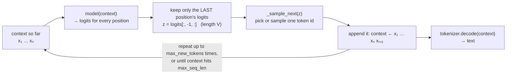
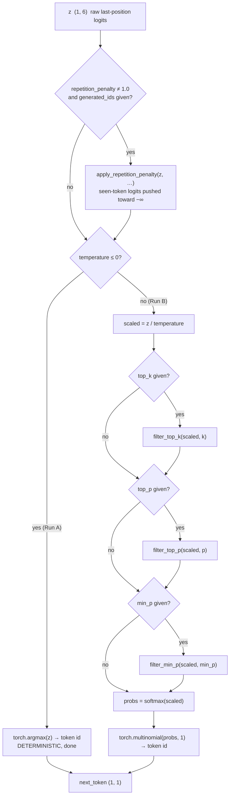
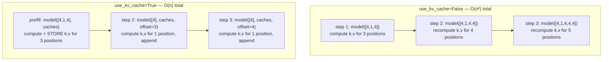

# 011 — Inference / generation: the full derivation, solved by hand

**Companion to:** [`journey_of_a_model/011-inference-generation.md`](../../journey_of_a_model/011-inference-generation.md)
(and, for the model forward pass it reuses without re-deriving,
[`journey_of_a_model/006-full-model-assembly.md`](../../journey_of_a_model/006-full-model-assembly.md);
for the KV cache, [`029-kv-cache.md`](../../journey_of_a_model/029-kv-cache.md);
for min-p and the repetition penalty,
[`030-min-p-and-repetition-penalty.md`](../../journey_of_a_model/030-min-p-and-repetition-penalty.md))
· **Code:** [`qwenmoe/model/generate.py`](../../qwenmoe/model/generate.py)
· **Every number here is reproduced by:** [`verify_011_inference_generation.py`](verify_011_inference_generation.py)
(`uv run python docs/math/verify_011_inference_generation.py`)

---

## How to read this

The journal entry tells you *what* generation is — an autoregressive decode
loop that calls the trained model once per new token — and *why* each
sampling knob (temperature, top-k, top-p, min-p, a repetition penalty)
earns its place, with one worked mini-example per knob.

This document is the other trade-off: **maximum detail, minimum
summarising.** We

1. fix **one** tiny model — the exact 2-layer `QwenMoEModel` from the
   [006 companion](006-full-model-assembly.md), same hand-picked weights —
   **one** character tokenizer, and **one** 3-character prompt,
2. push them through **every line** of
   [`generate.py`](../../qwenmoe/model/generate.py): argument validation →
   `tokenizer.encode` → the decode loop → `model(sequence)` →
   `logits[:, -1, :]` → `_sample_next` (repetition penalty → temperature →
   `filter_top_k` → `filter_top_p` → `filter_min_p` → softmax →
   `torch.multinomial`) → `torch.cat` → `tokenizer.decode`, citing
   `generate.py:line` at each step,
3. for every operation first derive *why* it has that form, then **do the
   arithmetic digit by digit**,
4. run it two ways — **Run A** greedy (`temperature = 0`) and **Run B** the
   full sampling stack — from the *same* starting point, and also down the
   optimised **KV-cache** path, and check all of it against the real module.

We do **not** re-derive the model's forward pass: `model(sequence)` is one
line of `generate.py`, and [the 006 companion](006-full-model-assembly.md)
already computed its `(1, 3, 6)` output by hand and asserted it. We *start*
from that result and never look inside the model again.

You need no background. Every term — scalar, vector, logit, probability
distribution, softmax, argmax, sampling, CDF — is defined at first use. We
keep a running **shape ledger**.

---

## Part 0 — What are we even computing?

A trained language model is a function that answers exactly one question:

> given a run of tokens $x_1, x_2, \dots, x_n$, what is the probability of
> each possible **next** token $x_{n+1}$?

It was trained to answer that question and nothing else (see
[journal 006](../../journey_of_a_model/006-full-model-assembly.md) and
[journal 010](../../journey_of_a_model/010-training-loop.md)). It was never
trained to emit a whole passage in one call.

- **Token:** one unit of text the model reads/writes. Here (a *character*
  tokenizer) one token = one character.
- **Vocabulary**, $V$: the fixed set of tokens the model knows. Ours has
  $V = 6$ tokens.
- **Logit:** a raw, unnormalised score the model outputs for one candidate
  next token — any real number, positive or negative. Bigger = "more
  likely," but the numbers aren't probabilities yet.
- **Probability distribution over the vocabulary:** a list of $V$
  non-negative numbers that sum to $1$; entry $i$ is the model's believed
  probability that the next token is token $i$.

**Generation** turns the one-question model into a passage generator by
asking that one question over and over:



That is the whole of `generate`. Everything below is the detail of one
trip around that loop, then the loop closing.

**Paper.** The idea of a neural network directly modelling
$P(\text{next token}\mid\text{previous tokens})$ and generating by feeding
its own output back in predates Transformers by 14 years —
[Bengio, Ducharme, Vincent & Jauvin, *A Neural Probabilistic Language Model*, 2003](https://www.jmlr.org/papers/v3/bengio03a.html).
Our decode loop is that idea with a Transformer computing the
distribution.

---

## Part 1 — The running example

### 1.1 Definitions we need right now

- **Scalar:** a single number, e.g. $3$ or $-0.5$.
- **Vector:** an ordered list of numbers, e.g. $[1.19,\ 0.01,\ 1.00]$. Its
  **length** is how many numbers it holds.
- **Tensor:** the same idea with more axes; PyTorch calls them all
  `Tensor`. We write a **shape** as a tuple: `(1, 3)` is "1 row of 3",
  `(1, 3, 6)` is "1 of (3 rows of 6)".
- **`argmax`** of a vector: the *index* of its largest entry.
  $\operatorname{argmax}[0.2,\ 0.9,\ 0.1] = 1$.
- **Softmax** of a vector $z = [z_1,\dots,z_V]$: the vector
  $$\operatorname{softmax}(z)_i = \frac{e^{z_i}}{\sum_{j=1}^{V} e^{z_j}},$$
  where $e^{x}$ ("exponential") is the number $2.71828\ldots$ raised to
  the power $x$. Exponentiating makes every entry positive; dividing by
  the sum makes them add to $1$. So softmax turns any vector of logits
  into a probability distribution. (Full derivation of *why this exact
  form* is in [the 004 companion](004-attention-gqa.md#step-10--softmax);
  we reuse it here.)
- **Sampling** from a probability distribution $p$: randomly drawing an
  index, where index $i$ comes up with probability $p_i$. "Rolling a
  weighted $V$-sided die."
- **Autoregressive:** each output becomes part of the next step's input.

### 1.2 The model — reused verbatim from the 006 companion

We do not pick new weights. We use the exact tiny `QwenMoEModel` that
[`006-full-model-assembly.md`](006-full-model-assembly.md) built and
hand-verified:

| Symbol | Meaning | Value |
|---|---|---|
| `vocab_size`, $V$ | tokens the model knows | $6$ |
| `d_model`, $d$ | width of a token vector | $4$ |
| `n_layers` | transformer blocks | $2$ |
| `n_heads` / `n_kv_heads` | attention query / KV heads | $2$ / $1$ |
| `d_ff` | expert hidden width | $3$ |
| `n_routed_experts` / `top_k` | MoE experts / active per token | $2$ / $1$ |
| `positional_scheme` | how position enters | `nope` |
| `tie_word_embeddings` | LM head shares the embedding matrix | `True` |
| `max_seq_len` | context length cap | **$6$** (006 used $8$; smaller here so Run A hits the cap) |

The weights (embedding table $E$, both blocks' attention and MoE matrices,
all RMSNorm gains) are copied bit-for-bit from
[`verify_006_full_model_assembly.py`](verify_006_full_model_assembly.py) —
[`verify_011_inference_generation.py`](verify_011_inference_generation.py)
imports the same tensors. The one thing we need from 006 is its final
result: for input ids `[[4, 1, 4]]` the model's logits are

$$
\text{logits} = \begin{bmatrix}
1.414213 & 0.000000 & 1.414213 & 1.414213 & 2.828427 & -2.828427 \\
-0.039239 & 0.622172 & -0.530086 & 1.682475 & 1.643236 & -3.855798 \\
1.185529 & 0.009417 & 0.999658 & 1.577581 & 2.763110 & -3.341033
\end{bmatrix}
\quad (1, 3, 6)
$$

one row per input position, one column per vocabulary token. **Row 2 (the
last position) is where this document begins.**

### 1.3 The tokenizer

`CharTokenizer` ([`char.py`](../../qwenmoe/tokenizer/char.py)) assigns an
id to every distinct character it sees during `train`, **in sorted
order**. We train it on the 15-character string `"DAD BED ACE CAB"`, whose
distinct characters are `space, A, B, C, D, E` (6 of them — matching
$V = 6$). Sorted by their character code (space $= 32$, then the letters):

| id | 0 | 1 | 2 | 3 | 4 | 5 |
|---|---|---|---|---|---|---|
| char | `·` (space) | `A` | `B` | `C` | `D` | `E` |

`tokenizer.encode` maps each character to its id, `decode` maps back. This
is a lossless round-trip (no merges, no unknowns), which one of the
edge-case checks below relies on.

### 1.4 The prompt and the two runs

- **Prompt:** `"DAD"`. `encode("DAD")` = `[D, A, D]` = **`[4, 1, 4]`** —
  exactly the input 006 solved.
- **Run A — greedy:** `generate(model, tok, "DAD", max_new_tokens=10,
  temperature=0.0)`. `temperature = 0` is a deterministic mode (argmax
  every step); `max_new_tokens=10` but `max_seq_len=6`, so it will stop
  early.
- **Run B — the full sampling stack:** `generate(model, tok, "DAD",
  max_new_tokens=10, temperature=0.8, top_k=4, top_p=0.9, min_p=0.05,
  repetition_penalty=1.3)` after `torch.manual_seed(0)`.

Both runs share the identical step-1 logit vector (§1.2, row 2). They are
the same example under two settings, not two examples.

---

## Part 2 — `generate`, one line at a time

**Shape ledger** (filled in as we go):

| name | shape | born at |
|---|---|---|
| `token_ids` | list of 3 | Step 2 |
| `sequence` | `(1, 3)` → `(1, 4)` → `(1, 5)` → `(1, 6)` | Step 4 (grows at Step 17) |
| `logits` | `(1, 3, 6)` (then `(1, 4, 6)`, …) | Step 7 |
| `z` = `logits[:, -1, :]` | `(1, 6)` | Step 8 |
| `next_token` | `(1, 1)` | Step 10 (greedy) or Step 16 (sampled) |

### Step 1 — Validate the arguments

Code ([`generate.py:173-184`](../../qwenmoe/model/generate.py#L173)):

```python
if max_new_tokens < 0:                       raise ValueError(...)
if temperature < 0:                          raise ValueError(...)
if top_k is not None and top_k < 1:          raise ValueError(...)
if top_p is not None and not (0.0 < top_p <= 1.0):   raise ValueError(...)
if min_p is not None and not (0.0 < min_p <= 1.0):   raise ValueError(...)
if repetition_penalty <= 0:                  raise ValueError(...)
```

**Why up front, before any work:** every one of these would otherwise
cause a confusing failure *deep* inside the loop (a negative `top_p`
silently keeps nothing; `repetition_penalty = 0` divides logits by zero).
Failing immediately with a named reason is the
[`select_top_k`](../../qwenmoe/model/moe.py) / task-5 convention applied to
generation. For Run A and Run B every argument is in range, so nothing is
raised. The verify script confirms all seven `ValueError`s fire on bad
input — these six, plus the empty-prompt check of Step 2.

### Step 2 — Encode the prompt

Code ([`generate.py:186-188`](../../qwenmoe/model/generate.py#L186)):

```python
token_ids = tokenizer.encode(prompt)
if len(token_ids) == 0:
    raise ValueError("prompt must encode to at least one token")
```

`encode("DAD")` walks the 3 characters and looks each up in the id table
(§1.3): `D → 4`, `A → 1`, `D → 4`. Result: `token_ids = [4, 1, 4]` (a
Python list of 3 ints).

The emptiness check matters because the model cannot predict a "next"
token from nothing — attention needs at least one position to attend to.
An empty prompt raises here.

### Step 3 — Move the model to the device, switch to eval mode

Code ([`generate.py:190-191`](../../qwenmoe/model/generate.py#L190)):

```python
model = model.to(device)
model.eval()
```

`device` is `"cpu"` for us — a no-op move. `model.eval()` flips every
submodule out of "training" behaviour. In *this* model nothing is
stochastic at inference anyway (no dropout), but calling `.eval()` is
unconditionally correct and matches `Trainer.fit`'s own discipline. The
whole function body is additionally wrapped in `@torch.no_grad()`
([`generate.py:134`](../../qwenmoe/model/generate.py#L134)) — no gradients
are tracked, so the forward passes are cheaper and the model's
`aux_loss` (which only matters for a training gradient) is inert.

### Step 4 — Build the `sequence` tensor

Code ([`generate.py:193`](../../qwenmoe/model/generate.py#L193)):

```python
sequence = torch.tensor([token_ids], dtype=torch.long, device=device)
```

`[token_ids]` wraps the length-3 list in one more list, giving a
**`(1, 3)`** tensor — batch of 1, sequence length 3:

$$\text{sequence} = \begin{bmatrix} 4 & 1 & 4 \end{bmatrix} \quad (1, 3)$$

`dtype=torch.long` (64-bit integers) because these are *indices* into the
embedding table, not numbers to do arithmetic on.

**Shape ledger:** `sequence (1, 3)`.

### Step 5 — Read the context cap, maybe build caches

Code ([`generate.py:194-195`](../../qwenmoe/model/generate.py#L194)):

```python
max_seq_len = model.config.max_seq_len          # = 6
caches = build_kv_cache(model) if use_kv_cache else None
```

Run A and Run B pass `use_kv_cache=False` (the default) so `caches` is
`None`. The KV-cache path is Part 5.

### Step 6 — The decode loop and its two stop conditions

Code ([`generate.py:197-199`](../../qwenmoe/model/generate.py#L197)):

```python
for _ in range(max_new_tokens):              # at most 10 iterations
    if sequence.size(1) >= max_seq_len:      # stop at the context cap
        break
    ...
```

Two independent limits (Requirement 6.3):

- **`max_new_tokens`** — the `for` runs at most 10 times.
- **`max_seq_len`** — if the sequence has already reached 6 tokens, stop
  *regardless* of how many more were requested. The model was built with
  positional capacity for only `max_seq_len` positions; asking for a 7th
  is undefined.

Starting length is 3. The loop appends one token per iteration:

| iteration | `sequence.size(1)` on entry | `≥ 6`? | action |
|---|---|---|---|
| 1 | 3 | no | forward, sample, append → length 4 |
| 2 | 4 | no | → length 5 |
| 3 | 5 | no | → length 6 |
| 4 | 6 | **yes** | `break` |

So **exactly 3 new tokens are produced**, even though `max_new_tokens=10`.
This is exact, not a heuristic — it falls straight out of the two integer
comparisons.

### Step 7 — The forward pass

Code ([`generate.py:201-202`](../../qwenmoe/model/generate.py#L201)):

```python
if caches is None:
    logits, _ = model(sequence)
```

**This is the only place the model is called.** It recomputes logits for
*every* position of the whole sequence-so-far — there is no KV cache on
this path (see the journal's "Design decisions" and Part 5 here). We pass
`sequence` of shape `(1, 3)`; we get back `logits` of shape **`(1, 3, 6)`**
and an `extras` dict we discard (`, _`).

We do **not** derive this `(1, 3, 6)` tensor — [the 006
companion](006-full-model-assembly.md) already did, digit by digit, and
[`verify_011_inference_generation.py`](verify_011_inference_generation.py)
asserts our value equals 006's to $2\times10^{-6}$:

$$
\text{logits}[0] = \begin{bmatrix}
1.414213 & 0.000000 & 1.414213 & 1.414213 & 2.828427 & -2.828427 \\
-0.039239 & 0.622172 & -0.530086 & 1.682475 & 1.643236 & -3.855798 \\
\mathbf{1.185529} & \mathbf{0.009417} & \mathbf{0.999658} & \mathbf{1.577581} & \mathbf{2.763110} & \mathbf{-3.341033}
\end{bmatrix}
$$

**Shape ledger:** `logits (1, 3, 6)`.

### Step 8 — Keep only the last position

Code ([`generate.py:211`](../../qwenmoe/model/generate.py#L211), the first
argument to `_sample_next`):

```python
logits[:, -1, :]
```

- `:` on axis 0 — keep the (size-1) batch.
- `-1` on axis 1 — keep **only the last position**, dropping that axis.
- `:` on axis 2 — keep all 6 vocab logits.

`(1, 3, 6)` → **`(1, 6)`**.

**Why only the last position?** The model produced a next-token
distribution at *all three* positions. But positions 0 and 1 are
predicting tokens we already have (the prompt's own `A` and `D`) — useless
for generation. Only position 2's output predicts a token we don't have
yet: the one that comes *after* `"DAD"`. Everything else is discarded.

Our starting vector, the last row above (drop the batch axis for the
algebra, restore `(1, 6)` for shapes):

$$
z = [\,\underbrace{1.185529}_{\text{id }0\ =\ \text{`·`}},\ \underbrace{0.009417}_{1\ =\ \text{`A`}},\ \underbrace{0.999658}_{2\ =\ \text{`B`}},\ \underbrace{1.577581}_{3\ =\ \text{`C`}},\ \underbrace{2.763110}_{4\ =\ \text{`D`}},\ \underbrace{-3.341033}_{5\ =\ \text{`E`}}\,]
$$

**Shape ledger:** `z (1, 6)`.

---

## Part 3 — `_sample_next`: from a logit vector to one token id

`_sample_next` ([`generate.py:99-131`](../../qwenmoe/model/generate.py#L99))
is a fixed pipeline. Its order is deliberate (Requirement 11.4):



Each filter replaces some logits with $-\infty$; softmax later maps
$-\infty \to 0$ exactly (see [004](004-attention-gqa.md#step-10--softmax)),
so a filtered token can never be sampled. Every filter is built so it
**always keeps at least the single best token**, so the surviving set is
never empty.

We now walk each stage. The repetition penalty and temperature branch are
shown on both runs; the four sampling stages are Run B.

### Step 9 — The repetition penalty

Code ([`generate.py:119-120`](../../qwenmoe/model/generate.py#L119), then
[`73-96`](../../qwenmoe/model/generate.py#L73)):

```python
if repetition_penalty != 1.0 and generated_ids is not None:
    next_logits = apply_repetition_penalty(next_logits, generated_ids, repetition_penalty)
```

```python
seen = torch.unique(generated_ids)
current = logits[..., seen]
logits[..., seen] = torch.where(current > 0, current / penalty, current * penalty)
```

**Run A:** `repetition_penalty` defaults to `1.0`, and
`apply_repetition_penalty` returns immediately
([`generate.py:90-91`](../../qwenmoe/model/generate.py#L90)) — a genuine
no-op. Run A's logits are untouched `z`.

**Run B** (`penalty = 1.3`). `generated_ids` is `sequence` = `[[4, 1, 4]]`,
so `torch.unique` gives the **seen set** $\{1, 4\}$ (sorted, de-duplicated:
`A` and `D` each appeared).

**Why sign-aware — the derivation.** The goal is: *lower the probability of
every already-seen token.* Probability is monotonic in the logit
(softmax), so "lower the probability" = "lower the logit." With
$\text{penalty} > 1$:

- If the logit is **positive**, *dividing* by $1.3$ moves it toward $0$ —
  smaller. ✓
- If the logit is **negative**, *dividing* by $1.3$ also moves it toward
  $0$ — but that makes it **larger** (less negative), *raising* the
  probability. ✗ So for a negative logit we **multiply** by $1.3$
  instead, making it more negative — smaller. ✓

A single "always divide" rule (the literal wording of Requirement 11.2)
gets the negative case backwards; the `torch.where(current > 0, …/…, …*…)`
split is what actually lowers the probability *in every case*. This
matches [CTRL](https://arxiv.org/abs/1909.05858) as implemented in
[Hugging Face's `RepetitionPenaltyLogitsProcessor`](https://github.com/huggingface/transformers/blob/main/src/transformers/generation/logits_process.py)
(`torch.where(score < 0, score * penalty, score / penalty)`).

**Compute (Run B, on $z$).** Seen ids $\{1, 4\}$; both have positive
logits, so both are divided:

$$
\begin{aligned}
z_1 &= 0.009417 > 0 &&\Rightarrow\ 0.009417 / 1.3 = 0.007244 \\
z_4 &= 2.763110 > 0 &&\Rightarrow\ 2.763110 / 1.3 = 2.125470
\end{aligned}
$$

Every unseen logit ($z_0, z_2, z_3, z_5$) is copied through untouched:

$$
z^{\text{pen}} = [\,1.185529,\ \mathbf{0.007244},\ 0.999658,\ 1.577581,\ \mathbf{2.125470},\ -3.341033\,]
$$

**The negative branch, shown on the same vector.** Token 5's logit is
$z_5 = -3.341033 < 0$. It is *not* in our seen set, but if it were, the
code would take the other side of the `where`:
$-3.341033 \times 1.3 = -4.343343$ (more negative — lower probability).
The verify script asserts this by calling
`apply_repetition_penalty(z, [[5]], 1.3)`.

**Shape:** `(1, 6)` → `(1, 6)` (a `.clone()` is made first so the caller's
tensor isn't mutated).

### Step 10 — The greedy branch (Run A): `temperature ≤ 0`

Code ([`generate.py:121-122`](../../qwenmoe/model/generate.py#L121)):

```python
if temperature <= 0:
    return torch.argmax(next_logits, dim=-1, keepdim=True)
```

**Why a special case and not "divide by a tiny number."** Sampling with
temperature $T$ means `softmax(z / T)`. As $T \to 0^+$ this *approaches*
greedy, but computing `z / 0.0001` on real hardware risks `inf` and then
`NaN`. Since the limit is provably *exactly* argmax, the code computes the
limit directly.

**The limit, derived in full.** Let $m = \operatorname{argmax}(z)$ (the
index of the largest logit). For any other index $i \ne m$, look at the
ratio of the two softmax probabilities:

$$
\frac{\operatorname{softmax}(z/T)_i}{\operatorname{softmax}(z/T)_m}
= \frac{e^{z_i/T} / S}{e^{z_m/T} / S}
= e^{(z_i - z_m)/T}
$$

(the normaliser $S = \sum_j e^{z_j/T}$ cancels). The exponent
$(z_i - z_m)/T$ has a **fixed negative numerator** ($z_i < z_m$ by
definition of $m$) divided by a **shrinking positive** $T$, so it goes to
$-\infty$, and $e^{-\infty} = 0$. Every non-max probability vanishes
relative to the max's, so the distribution collapses onto a single spike
at $m$ — i.e. "pick the largest logit." **Exact.**

Watch it happen numerically on our $z$ (verify script,
`torch.softmax(z / T)`):

| $T$ | $P(\text{id }0)$ | $P(1)$ | $P(2)$ | $P(3)$ | $P(4)$ | $P(5)$ |
|---|---|---|---|---|---|---|
| $1.0$ | 0.118023 | 0.036407 | 0.098004 | 0.174676 | **0.571613** | 0.001277 |
| $0.1$ | 0.000000 | 0.000000 | 0.000000 | 0.000007 | **0.999993** | 0.000000 |
| $0.01$ | 0.000000 | 0.000000 | 0.000000 | 0.000000 | **1.000000** | 0.000000 |
| $10^{6}$ | 0.166667 | 0.166667 | 0.166667 | 0.166667 | 0.166667 | 0.166666 |

The bottom row is the *other* exact limit, $T \to \infty$: every
$z_i/T \to 0$, every $e^{0} = 1$, so $P(i) \to 1/V = 1/6 = 0.166667$ — a
uniform die that ignores the model completely. (Full temperature / Boltzmann
derivation:
[journal 011](../../journey_of_a_model/011-inference-generation.md#temperature-scaling-of-a-probability-distribution),
citing [Ackley, Hinton & Sejnowski, 1985](https://www.semanticscholar.org/paper/A-Learning-Algorithm-for-Boltzmann-Machines-Ackley-Hinton/a0d16f0e99f7ce5e6fb70b1a68c685e9ad610657).)

**Compute (Run A).**
$z = [1.185529,\ 0.009417,\ 0.999658,\ 1.577581,\ 2.763110,\ -3.341033]$.
The largest entry is $2.763110$, at index $4$.

$$\operatorname{argmax}(z) = 4 \quad\Rightarrow\quad \text{token id } 4 = \text{`D`}$$

`keepdim=True` keeps the axis, so the result is shape `(1, 1)`:
`[[4]]`. Run A is done for this step — no randomness, no seed dependence.

**Shape:** `(1, 6)` → `(1, 1)`.

### Step 11 — Temperature scaling (Run B): `scaled = z / temperature`

Code ([`generate.py:123`](../../qwenmoe/model/generate.py#L123)):

```python
scaled_logits = next_logits / temperature
```

Run B uses $T = 0.8$. This divides **every** logit by $0.8$, equivalently
multiplies by $1.25$. Shown here on the raw $z$ (the standalone
demonstrations in Steps 12–14 use this vector; the composed pipeline in
Step 15 applies the repetition penalty first):

$$
\begin{aligned}
1.185529 / 0.8 &= 1.481912 & 0.009417 / 0.8 &= 0.011771 \\
0.999658 / 0.8 &= 1.249573 & 1.577581 / 0.8 &= 1.971976 \\
2.763110 / 0.8 &= 3.453888 & -3.341033 / 0.8 &= -4.176292
\end{aligned}
$$

$$
z_{\text{scaled}} = [\,1.481912,\ 0.011771,\ 1.249573,\ 1.971976,\ 3.453888,\ -4.176292\,]
$$

$T < 1$ **spreads the logits apart** (every gap $\times 1.25$), which after
softmax makes the distribution *sharper* — more weight on the top tokens.
$T > 1$ would squeeze them together, flattening it. The division is exact;
the *choice* of $T = 0.8$ is an empirical taste knob, not a derived
constant.

**Shape:** `(1, 6)` → `(1, 6)`.

### Step 12 — `filter_top_k`, $k = 4$

Code ([`generate.py:124-125`](../../qwenmoe/model/generate.py#L124), then
[`19-30`](../../qwenmoe/model/generate.py#L19)):

```python
k = min(k, logits.size(-1))
threshold = torch.topk(logits, k, dim=-1).values[..., -1, None]
return torch.where(logits < threshold, full_like(logits, -inf), logits)
```

**Derivation.** Top-k sampling
([Fan, Lewis & Dauphin, 2018](https://arxiv.org/abs/1805.04833)) keeps
only the $k$ highest-scoring tokens and discards the rest of the tail. To
do that with a `where`, we need a **threshold**: the value of the
$k$-th-highest logit. Any logit **strictly below** it is not in the top
$k$, so it is set to $-\infty$. (Ties *at* the threshold all survive —
`< threshold` is strict — so occasionally more than $k$ tokens remain;
harmless.) `min(k, V)` guards against asking for more tokens than exist.

**Compute.** `torch.topk(z_scaled, 4)` returns the 4 largest values and
their indices, largest first:

$$
\text{values} = [\,3.453888,\ 1.971976,\ 1.481912,\ 1.249573\,],\qquad
\text{indices} = [\,4,\ 3,\ 0,\ 2\,]
$$

`.values[..., -1, None]` takes the **last** of those 4 values — the 4th
largest — as the threshold: $\boxed{1.249573}$ (that is $z_{\text{scaled}}$
at id 2). Now `torch.where(z_scaled < 1.249573, -inf, z_scaled)`,
coordinate by coordinate:

| id | $z_{\text{scaled}}$ | $< 1.249573$? | result |
|---|---|---|---|
| 0 (`·`) | $1.481912$ | no | $1.481912$ |
| 1 (`A`) | $0.011771$ | **yes** | $-\infty$ |
| 2 (`B`) | $1.249573$ | no (equal) | $1.249573$ |
| 3 (`C`) | $1.971976$ | no | $1.971976$ |
| 4 (`D`) | $3.453888$ | no | $3.453888$ |
| 5 (`E`) | $-4.176292$ | **yes** | $-\infty$ |

$$
\text{after top-}k = [\,1.481912,\ -\infty,\ 1.249573,\ 1.971976,\ 3.453888,\ -\infty\,]
$$

Survivors: $\{\,\text{`·'},\ \text{`B'},\ \text{`C'},\ \text{`D'}\,\}$
(ids 0, 2, 3, 4). Ids 1 and 5 — the two least likely — are cut.

**Shape:** `(1, 6)` → `(1, 6)` (values change, shape doesn't).

### Step 13 — `filter_top_p`, $p = 0.9$

Code ([`generate.py:126-127`](../../qwenmoe/model/generate.py#L126), then
[`33-50`](../../qwenmoe/model/generate.py#L33)):

```python
sorted_logits, sorted_indices = torch.sort(logits, descending=True, dim=-1)
sorted_probs = F.softmax(sorted_logits, dim=-1)
mass_before = torch.cumsum(sorted_probs, dim=-1) - sorted_probs
sorted_logits = torch.where(mass_before >= top_p, -inf, sorted_logits)
filtered = torch.full_like(logits, -inf)
filtered.scatter_(-1, sorted_indices, sorted_logits)
return filtered
```

**Derivation.** Nucleus sampling
([Holtzman et al., 2019](https://arxiv.org/abs/1904.09751)) keeps the
*smallest* set of highest-probability tokens whose probabilities sum to at
least $p$. Sort the probabilities descending: $p_1 \ge p_2 \ge \dots$
Define, for the token at sorted position $i$,

$$
\text{mass\_before}(i) = \sum_{j < i} p_j
$$

— the probability mass of everything *strictly more likely* than it. Token
$i$ belongs in the smallest sufficient prefix **iff that prefix was not
already complete before we reached $i$**, i.e. iff
$\text{mass\_before}(i) < p$. Equivalently, token $i$ is **excluded** iff
$\text{mass\_before}(i) \ge p$. Because $\text{mass\_before}(0) = 0$ always
and $p > 0$, the single most likely token is never excluded. This is an
*exact restatement* of the paper's definition. (Same derivation, more
words:
[journal 011](../../journey_of_a_model/011-inference-generation.md#nucleus-top-p-sampling).)

- **`torch.sort(descending=True)`** returns both the sorted values and
  `sorted_indices` — a **permutation**: `sorted_indices[i]` is the
  *original* id now sitting at sorted position $i$. We need it to undo the
  sort later.
- **`cumsum`** ("cumulative sum"): `cumsum(a)[i]` $= a_0 + a_1 + \dots +
  a_i$. So `cumsum(sorted_probs) - sorted_probs` = "sum up to and
  including $i$, minus $i$ itself" = "sum strictly before $i$" =
  `mass_before`. Exact.
- **`scatter_(-1, sorted_indices, sorted_logits)`** is the inverse
  permutation: it writes `sorted_logits[i]` into `filtered[sorted_indices[i]]`,
  putting every (possibly now $-\infty$) logit back at its original id.

**Compute** on $z_{\text{scaled}} = [1.481912, 0.011771, 1.249573,
1.971976, 3.453888, -4.176292]$.

1. **Sort descending:**
   $$
   \text{sorted\_logits} = [\,3.453888,\ 1.971976,\ 1.481912,\ 1.249573,\ 0.011771,\ -4.176292\,]
   $$
   $$
   \text{sorted\_indices} = [\,4,\ 3,\ 0,\ 2,\ 1,\ 5\,]
   $$
2. **Softmax of the sorted logits.** Subtract the max ($3.453888$):
   $[0,\ -1.481912,\ -1.971976,\ -2.204315,\ -3.442117,\ -7.630180]$.
   Exponentiate and normalise (verify script):
   $$
   \text{sorted\_probs} = [\,0.662606,\ 0.150546,\ 0.092222,\ 0.073103,\ 0.021201,\ 0.000322\,]
   $$
   (sums to $1.000000$ ✓).
3. **`cumsum`:**
   $[0.662606,\ 0.813152,\ 0.905374,\ 0.978477,\ 0.999678,\ 1.000000]$.
4. **`mass_before` = cumsum − sorted\_probs:**
   $$
   \text{mass\_before} = [\,0,\ 0.662606,\ 0.813152,\ 0.905374,\ 0.978477,\ 0.999678\,]
   $$
5. **Exclude where `mass_before ≥ 0.9`:**

   | sorted pos $i$ | orig id | `mass_before` | $\ge 0.9$? | kept? |
   |---|---|---|---|---|
   | 0 | 4 (`D`) | $0$ | no | ✓ |
   | 1 | 3 (`C`) | $0.662606$ | no | ✓ |
   | 2 | 0 (`·`) | $0.813152$ | no | ✓ — **this token crosses $0.9$** (its cumsum is $0.905$) but its `mass_before` is still $< 0.9$, so it is the last one kept |
   | 3 | 2 (`B`) | $0.905374$ | **yes** | ✗ |
   | 4 | 1 (`A`) | $0.978477$ | **yes** | ✗ |
   | 5 | 5 (`E`) | $0.999678$ | **yes** | ✗ |

   $\text{sorted\_logits} \to [3.453888,\ 1.971976,\ 1.481912,\ -\infty,\ -\infty,\ -\infty]$.
6. **Scatter back** through `sorted_indices = [4, 3, 0, 2, 1, 5]`:
   value at sorted pos 0 → id 4; pos 1 → id 3; pos 2 → id 0; pos 3
   ($-\infty$) → id 2; pos 4 ($-\infty$) → id 1; pos 5 ($-\infty$) → id 5.
   $$
   \text{after top-}p = [\,1.481912,\ -\infty,\ -\infty,\ 1.971976,\ 3.453888,\ -\infty\,]
   $$

Survivors: $\{\,\text{`·'},\ \text{`C'},\ \text{`D'}\,\}$ (ids 0, 3, 4) —
**stricter than top-$k$ was** (3 tokens vs 4): top-$k$'s fixed count kept
`B` too, but the probability mass was concentrated enough that nucleus
stopped one token sooner.

**Shape:** `(1, 6)` → `(1, 6)`.

### Step 14 — `filter_min_p`, $\text{min\_p} = 0.05$

Code ([`generate.py:128-129`](../../qwenmoe/model/generate.py#L128), then
[`53-70`](../../qwenmoe/model/generate.py#L53)):

```python
probs = F.softmax(logits, dim=-1)
threshold = min_p * probs.max(dim=-1, keepdim=True).values
return torch.where(probs < threshold, -inf, logits)
```

**Derivation.** min-p sampling
([Nguyen et al., *Turning Up the Heat: Min-p Sampling for Creative and
Coherent LLM Outputs*, 2024](https://arxiv.org/abs/2407.01082), ICLR 2025)
sets the cutoff *relative to the top token*: keep token $i$ iff

$$
P(i) \ \ge\ \text{min\_p} \times P_{\max}, \qquad P_{\max} = \max_j P(j).
$$

This is **adaptive** where top-$p$'s cutoff is fixed. When the model is
confident, $P_{\max}$ is large, the threshold $\text{min\_p}\cdot P_{\max}$
is high, and few tokens clear it. When the model is unsure, $P_{\max}$ is
small, the threshold is low, and many survive. Since $\text{min\_p} \le 1$,
the top token clears its *own* threshold
($P_{\max} \ge \text{min\_p}\cdot P_{\max}$), so the result is never empty.

**Compute** on $z_{\text{scaled}}$. First
$\text{probs} = \operatorname{softmax}(z_{\text{scaled}})$ (verify script):

$$
\text{probs} = [\,0.092222,\ 0.021201,\ 0.073103,\ 0.150546,\ \mathbf{0.662606},\ 0.000322\,]
$$

$P_{\max} = 0.662606$ (id 4). Threshold
$= 0.05 \times 0.662606 = 0.033130$. Now `where(probs < 0.033130, -inf, z_scaled)`:

| id | prob | $< 0.033130$? | result |
|---|---|---|---|
| 0 (`·`) | $0.092222$ | no | keep |
| 1 (`A`) | $0.021201$ | **yes** | $-\infty$ |
| 2 (`B`) | $0.073103$ | no | keep |
| 3 (`C`) | $0.150546$ | no | keep |
| 4 (`D`) | $0.662606$ | no | keep |
| 5 (`E`) | $0.000322$ | **yes** | $-\infty$ |

Survivors: ids $\{0, 2, 3, 4\}$ — here identical to top-$k$'s result. Note
`filter_min_p` **masks the original `logits`**, not `probs` (it only uses
`probs` to decide *which* to mask).

**Shape:** `(1, 6)` → `(1, 6)`.

### Step 15 — The composed Run B pipeline, then softmax

The three filters above were shown standalone. `_sample_next` applies them
**in sequence**, each on the previous survivors, and — crucially — after
the repetition penalty. Run B, step 1, exactly as
[`generate.py:119-130`](../../qwenmoe/model/generate.py#L119) runs it:

| stage | vector (id 0 … id 5) | survivors |
|---|---|---|
| raw $z$ | $[1.185529,\ 0.009417,\ 0.999658,\ 1.577581,\ 2.763110,\ -3.341033]$ | all 6 |
| rep-penalty ($1.3$, seen $\{1,4\}$) | $[1.185529,\ 0.007244,\ 0.999658,\ 1.577581,\ \mathbf{2.125470},\ -3.341033]$ | all 6 |
| $\div\,0.8$ | $[1.481912,\ 0.009055,\ 1.249573,\ 1.971976,\ \mathbf{2.656837},\ -4.176292]$ | all 6 |
| top-$k$ ($k=4$) | $[1.481912,\ -\infty,\ 1.249573,\ 1.971976,\ 2.656837,\ -\infty]$ | $\{0,2,3,4\}$ |
| top-$p$ ($0.9$) | $[1.481912,\ -\infty,\ 1.249573,\ 1.971976,\ 2.656837,\ -\infty]$ | $\{0,2,3,4\}$ |
| min-$p$ ($0.05$) | $[1.481912,\ -\infty,\ 1.249573,\ 1.971976,\ 2.656837,\ -\infty]$ | $\{0,2,3,4\}$ |

**Why top-$p$ keeps `B` here but dropped it in Step 13.** In Step 13 the
top logit was `D` at $3.453888$, giving it softmax mass $0.663$, so the
$0.9$ threshold was reached after only 3 tokens and `B` (sorted position
3, `mass_before` $= 0.905$) was excluded. In the composed pipeline the
repetition penalty first pulled `D` down to $2.656837$; its mass is now
only $\approx 0.486$, so the running total reaches `B`'s sorted position
with `mass_before` $\approx 0.881 < 0.9$ — `B` survives. **A filter's
output genuinely depends on what ran before it.** (min-$p$ then finds all
4 survivors above its $0.05\cdot P_{\max}$ line, so it removes nothing.)

**Softmax over the survivors**
([`generate.py:130`](../../qwenmoe/model/generate.py#L130)):
`probs = F.softmax(scaled_logits, dim=-1)` on
$[1.481912,\ -\infty,\ 1.249573,\ 1.971976,\ 2.656837,\ -\infty]$.
Subtract the max ($2.656837$):
$[-1.174925,\ -\infty,\ -1.407264,\ -0.684861,\ 0,\ -\infty]$.
Exponentiate ($e^{-\infty}=0$) and normalise (verify script):

$$
\boxed{\ \text{probs} = [\,0.150083,\ 0,\ 0.118967,\ 0.244998,\ 0.485952,\ 0\,]\ }
$$

Sums to $1.000000$ ✓. Two tokens have probability *exactly* $0$ — they
cannot be sampled.

**Shape:** `(1, 6)` → `(1, 6)`.

### Step 16 — `torch.multinomial(probs, num_samples=1)`

Code ([`generate.py:131`](../../qwenmoe/model/generate.py#L131)):

```python
return torch.multinomial(probs, num_samples=1)
```

**What it does.** Draws one index, with index $i$ appearing with
probability $\text{probs}_i$. One standard way to implement this (inverse-CDF
sampling): form the **cumulative distribution function** (CDF)
$C_i = \sum_{j \le i} \text{probs}_j$, draw a uniform random
$u \in [0, 1)$, and return the smallest $i$ with $C_i > u$. Our CDF:

$$
C = [\,0.150083,\ 0.150083,\ 0.269050,\ 0.514048,\ 1.000000,\ 1.000000\,]
$$

which partitions $[0, 1)$ into intervals — id 0: $[0,\ 0.1501)$; id 2:
$[0.1501,\ 0.2690)$; id 3: $[0.2690,\ 0.5140)$; id 4: $[0.5140,\ 1)$; ids 1
and 5: empty. Token `D` owns the largest slice ($48.6\%$).

**Exact vs. random.** That $P(\text{draw} = i) = \text{probs}_i$ is exact
(provable for inverse-CDF sampling, and guaranteed by `torch.multinomial`
whatever its internal method). *Which* index a particular call returns
depends on the RNG state — `generate` does not seed internally, so the
caller seeds. With `torch.manual_seed(0)` the draw lands in id 4's
interval:

$$
\text{next\_token} = [[4]] \quad \Rightarrow \quad \text{`D`}
$$

The verify script confirms the *distribution* directly: 100 000 seeded
draws from `probs` give empirical frequencies

$$
[\,0.1493,\ 0,\ 0.1207,\ 0.2440,\ 0.4859,\ 0\,]
$$

matching `probs` to $< 0.005$. It also checks `_sample_next` itself
returns the same id 4 under seed 0.

**Shape:** `(1, 6)` → `(1, 1)`.

### Step 17 — Append

Code ([`generate.py:214`](../../qwenmoe/model/generate.py#L214)):

```python
sequence = torch.cat([sequence, next_token], dim=1)
```

`torch.cat(..., dim=1)` glues the new `(1, 1)` token onto the end of the
`(1, 3)` sequence along axis 1:

$$
\begin{bmatrix} 4 & 1 & 4 \end{bmatrix} \ \Vert\ \begin{bmatrix} 4 \end{bmatrix}
\ =\ \begin{bmatrix} 4 & 1 & 4 & 4 \end{bmatrix} \quad (1, 4)
$$

(Run A appended `D` at Step 10; Run B appended `D` at Step 16 — same token
this step, by coincidence of the numbers.) Back to the top of the loop.

**Shape ledger:** `sequence (1, 3)` → `(1, 4)`.

---

## Part 4 — The loop closes (Run A, end to end)

Run A is greedy, so each step is just "forward, take last position,
argmax, append." The verify script prints every step's last-position
logit vector:

| step | `sequence` in | last-position logits $z$ | `argmax` | append |
|---|---|---|---|---|
| 1 | `[4,1,4]` | $[1.185529,\ 0.009417,\ 0.999658,\ 1.577581,\ \mathbf{2.763110},\ -3.341033]$ | 4 | `D` |
| 2 | `[4,1,4,4]` | $[1.255807,\ 0.004345,\ 1.128992,\ 1.539925,\ \mathbf{2.795732},\ -3.206664]$ | 4 | `D` |
| 3 | `[4,1,4,4,4]` | $[1.291241,\ 0.002503,\ 1.194116,\ 1.517090,\ \mathbf{2.808332},\ -3.131306]$ | 4 | `D` |

After step 3 the sequence is `[4, 1, 4, 4, 4, 4]` — length 6. The loop
checks `6 >= max_seq_len` (6): **true**, `break`. Iterations 4–10 of the
`for` never run.

### Step 18 — Decode

Code ([`generate.py:216`](../../qwenmoe/model/generate.py#L216)):

```python
return tokenizer.decode(sequence[0].tolist())
```

`sequence[0]` drops the batch axis → `[4, 1, 4, 4, 4, 4]`; `.tolist()`
makes it a Python list; `decode` maps each id back through the table
(§1.3): `4→D, 1→A, 4→D, 4→D, 4→D, 4→D`.

$$
\boxed{\ \texttt{generate(..., temperature=0.0)} \ \longrightarrow\ \texttt{"DADDDD"}\ }
$$

**This is "neural text degeneration," live and unstaged.** Greedy decoding
locked onto `D` and could not escape: once `D` repeats, "the text so far
is all `D`s" becomes evidence that the next token is `D` too, and the
argmax has no mechanism to break out — look at the table: `D`'s logit
*rises* every step ($2.763 \to 2.796 \to 2.808$).
[Holtzman et al., 2019](https://arxiv.org/abs/1904.09751) — the nucleus
paper — is precisely about this failure. Our model is a 300-parameter toy,
but the mechanism is identical to the "the the the the" the journal hit
with the real Shakespeare checkpoint.

**Run B, same prompt, does not lock up.** With
`torch.manual_seed(0)` the full sampling stack gives (verify script,
per-step draws): step 1 → `D`, step 2 → space (id 0), step 3 → `D`:

$$
\texttt{generate(..., temperature=0.8, top\_k=4, top\_p=0.9, min\_p=0.05, repetition\_penalty=1.3)} \ \longrightarrow\ \texttt{"DADD D"}
$$

(the 5th character is a literal space — token id 0). The space at step 2
breaks the run — a lower-probability token that greedy would never have
taken. Same seed twice → byte-identical output (Run B is
deterministic *given* the seed); the verify script checks that too.

---

## Part 5 — The KV-cache path (the optimised path), and that it agrees

`generate(use_kv_cache=True)`
([`generate.py:195`, `203-208`](../../qwenmoe/model/generate.py#L203)) is
the optimised sibling of the plain loop. Full derivation of *what* a KV
cache is and *why* it changes the asymptotics:
[journal 029](../../journey_of_a_model/029-kv-cache.md). Here we only need:
the two paths must compute the **same** greedy sequence (Requirement 8.2),
and we measure how close the logits are.

### What the plain path recomputes, and the cache avoids

Each attention layer, for each token, builds a **key** vector $k$ and a
**value** vector $v$. On the plain path, step $t$ re-runs the whole model
on all $n = 3 + t$ tokens, recomputing *every* token's $k$ and $v$ from
scratch — even the prompt's, which never change. That is
$O(n)$ work per new token, $O(n^2)$ across a whole generation.

The cache stores each layer's already-computed $k, v$
([`kv_cache.py::LayerKVCache`](../../qwenmoe/model/kv_cache.py)) so a new
token computes only its *own* $k, v$ and attends against the stored rest:



### The trace

```python
if caches[0].length == 0:
    logits, _ = model(sequence, kv_caches=caches)          # prefill: whole prompt
else:
    logits, _ = model(sequence[:, -1:], kv_caches=caches,
                      position_offset=sequence.size(1) - 1) # one token
```

- **Prefill** (`caches[0].length == 0`): feed the whole `(1, 3)` prompt
  once, `kv_caches=caches`. Each layer appends its 3 keys/values to its
  cache. The last-position logits here are **identical** to the plain
  path's step-1 logits — same tokens, same positions, same math.
- **Incremental step** (`sequence[:, -1:]`, shape `(1, 1)`): feed only the
  newest token, with `position_offset = n - 1` so its *absolute* position
  is right. Inside attention, the query count (1) no longer matches the
  key count ($n$), so the fast `is_causal=True` SDPA branch is replaced by
  an explicit mask
  ([`attention.py:168-178`](../../qwenmoe/model/attention.py#L168)) —
  `_causal_position_mask([n-1], n)`, which is **all zeros** (the single
  query at position $n-1$ is allowed to see every key at positions
  $0 \dots n-1$). So the incremental step attends over the identical
  prefix at the identical positions; the arithmetic is the same.

### Measured agreement

The verify script runs both loops for 3 greedy steps and compares the
last-position logits at every step:

```
cached ids  : [4, 1, 4, 4, 4, 4]
uncached ids: [4, 1, 4, 4, 4, 4]
max |cached - uncached| last-position logit = 2.38e-07
generate(use_kv_cache=True): 'DADDDD'
```

**Byte-identical greedy output.** The $2.4\times10^{-7}$ logit difference
is float32 reassociation — `F.scaled_dot_product_attention` sums in a
different order on the two paths (same reason the fused vs. explicit
attention paths differ by $\sim10^{-7}$ in
[the 004 companion](004-attention-gqa.md#step-13--end-to-end-recap-and-the-fused-path)
and [journal 021](../../journey_of_a_model/021-fused-attention-sdpa.md)).
It is $10^{6}\times$ smaller than the gap between `D`'s logit and the
runner-up, so `argmax` is unaffected — greedy decoding is provably
seed- *and* path-independent for this example.

---

## Part 6 — Cost, and why it is built this way, on our numbers

### The quadratic that the journal accepts

Run A did 3 forward passes, on sequences of length 3, 4, 5. Total
positions processed: $3 + 4 + 5 = 12$. A KV-cache run would have done
$3 + 1 + 1 = 5$. For $N$ new tokens from a length-$n_0$ prompt the plain
path processes $\sum_{t=0}^{N-1}(n_0 + t) = N n_0 + \binom{N}{2}$
positions — quadratic in $N$. The cache makes it $n_0 + N$ — linear.

At this project's scale the constant is tiny (the journal generated 300
tokens from the real checkpoint in about a second), so `generate` defaults
to the simple $O(n^2)$ loop and offers `use_kv_cache=True` for when it
matters. Part 5 shows the two agree.

### Why `temperature <= 0` is a branch, not `z / 1e-9`

Our $z$ has $z_4 - z_5 = 2.763110 - (-3.341033) = 6.104$. Dividing by
$T = 10^{-9}$ gives an exponent of $6.104 / 10^{-9} \approx 6\times10^{9}$;
$e^{6\times10^{9}}$ overflows `float32` to `inf`, and `inf / inf = NaN`
in the softmax. Since $\lim_{T\to0^+}$ is *exactly* `argmax` (Step 10),
the code returns that — exact and overflow-proof. Bonus: it gives the test
suite a zero-randomness decoding mode (Run A's determinism checks).

### Why the filters are standalone functions

`filter_top_k`, `filter_top_p`, `filter_min_p`,
`apply_repetition_penalty` are module-level and independently testable
with hand-built vectors — this whole Part 3 tested each on a 6-vector
without constructing a model or a prompt. `_sample_next` then reads as the
short pipeline `penalty → temperature → top_k → top_p → min_p → softmax →
multinomial`, shared verbatim by the cached and uncached loops so they
cannot drift.

### Summary table (this example)

| stage | code | shape | Run A result | Run B result |
|---|---|---|---|---|
| encode | `tokenizer.encode` | → list 3 | `[4,1,4]` | `[4,1,4]` |
| forward | `model(sequence)` | `(1,3)`→`(1,3,6)` | 006's logits | 006's logits |
| last position | `logits[:, -1, :]` | →`(1,6)` | $z$ | $z$ |
| rep-penalty | `apply_repetition_penalty` | `(1,6)` | no-op ($1.0$) | ids $\{1,4\}$ ÷ $1.3$ |
| temperature | `/ temperature` **or** argmax | `(1,6)`→`(1,1)` / `(1,6)` | `argmax` = 4 | $\div\,0.8$ |
| top-$k$ | `filter_top_k` | `(1,6)` | — | keep $\{0,2,3,4\}$ |
| top-$p$ | `filter_top_p` | `(1,6)` | — | keep $\{0,2,3,4\}$ |
| min-$p$ | `filter_min_p` | `(1,6)` | — | keep $\{0,2,3,4\}$ |
| softmax | `F.softmax` | `(1,6)` | — | $[.150,0,.119,.245,.486,0]$ |
| sample | `torch.multinomial` | →`(1,1)` | — | seed 0 → 4 |
| append | `torch.cat` | `(1,n)`→`(1,n+1)` | `D` | `D` |
| … ×3, then | `max_seq_len` break | — | stop at len 6 | stop at len 6 |
| decode | `tokenizer.decode` | → str | `"DADDDD"` | `"DADD D"` (5th char = space) |

---

## Questions that might come to mind

- **Why does Run A repeat `D` forever — is the model broken?** No. It's a
  toy trained for zero steps on nothing (006 pinned arbitrary weights), so
  its favourite token happens to be `D`, and greedy has no way to ever
  pick anything else. The *mechanism* (repetition self-reinforces under
  argmax) is exactly the real failure mode Holtzman et al. documented.

- **Run A and Run B both appended `D` at step 1 — so what did sampling buy
  us?** At step 1, nothing (the seed happened to land in `D`'s 48.6%
  interval). At step 2 Run B drew the space and broke the loop. Sampling
  is a *distribution* over outcomes; the value shows over a whole
  generation, not one token.

- **Why is `min_p` applied to `probs` but it masks `logits`?** It uses
  `probs` only to *decide* which tokens fall below $\text{min\_p}\cdot
  P_{\max}$; it then sets those tokens' **logits** to $-\infty$ so the
  final `softmax` (Step 15) re-normalises over the survivors. Masking
  `probs` directly would leave them un-normalised.

- **Do `top_k` / `top_p` / `min_p` have to be used together?** No — each
  is `None` by default. Any subset works; they simply compose, each
  further restricting the last one's survivors (Requirement 11.4). Using
  none of them reduces Run B to plain temperature sampling.

- **The order is `top_k` then `top_p` then `min_p` — does it matter?** It
  can. `filter_top_p` and `filter_min_p` each re-run `softmax` over
  *whatever logits reach them*, so a token another filter already sent to
  $-\infty$ changes the probabilities the next filter thresholds against
  (Step 15's `top_p` softmaxes over 4 tokens, not 6, because `top_k` ran
  first). The fixed order matches Hugging Face's default warper ordering —
  `top_k` narrows to a fixed count first, then the adaptive filters trim
  that. (For *this* example the composed survivor set happens to equal
  `top_k`'s alone; the later two removed nothing extra.)

- **`model(sequence)` also returns an `aux_loss` — does generation use
  it?** No. `logits, _ = model(sequence)` throws it away. It only matters
  for a training gradient, and `@torch.no_grad()` means no gradients exist
  here anyway.

- **What if `max_new_tokens = 0`?** `for _ in range(0)` never runs,
  `sequence` never changes, and the function returns
  `decode(encode("DAD"))` — which is exactly `"DAD"` because
  `CharTokenizer` round-trips losslessly (§1.3). The verify script asserts
  this.

- **Why re-encode the whole prompt into a `(1, 3)` batch instead of
  `(3,)`?** The model's `forward` expects `(batch, seq_len)`. Batch 1 is
  the degenerate case, but the axis has to be there.

---

## Symbol reference

| symbol | meaning |
|---|---|
| $V$, `vocab_size` | number of tokens the model knows ($6$) |
| $d$, `d_model` | width of a token vector ($4$) |
| `max_seq_len` | context-length cap ($6$ here) |
| `max_new_tokens` | requested number of new tokens ($10$) |
| $z$ | the last-position logit vector, `logits[:, -1, :]`, length $V$ |
| $z^{\text{pen}}$ | $z$ after the repetition penalty |
| $z_{\text{scaled}}$ | $z / T$ (temperature-scaled logits) |
| $T$, `temperature` | temperature ($0$ = greedy; $0.8$ in Run B) |
| $k$, `top_k` | keep this many highest logits ($4$) |
| $p$, `top_p` | nucleus cumulative-probability threshold ($0.9$) |
| `min_p` | keep tokens with $P \ge \text{min\_p}\cdot P_{\max}$ ($0.05$) |
| `repetition_penalty` | seen-token logit penalty factor ($1.3$; $1.0$ = off) |
| $P_{\max}$ | the largest softmax probability in a distribution |
| `mass_before`$(i)$ | $\sum_{j<i}$ (sorted probs) — mass strictly above token $i$ |
| CDF, $C_i$ | cumulative distribution: $\sum_{j\le i} \text{probs}_j$ |
| `argmax` | index of the largest entry of a vector |

---

## Citations

All links were confirmed by web search for this document; those already
used by [journal 011](../../journey_of_a_model/011-inference-generation.md),
[029](../../journey_of_a_model/029-kv-cache.md) and
[030](../../journey_of_a_model/030-min-p-and-repetition-penalty.md) are
cross-referenced to those entries.

**The decode loop**
- Bengio, Ducharme, Vincent & Jauvin, *A Neural Probabilistic Language
  Model*, 2003 —
  [JMLR v3](https://www.jmlr.org/papers/v3/bengio03a.html). A neural net
  directly modelling $P(\text{next}\mid\text{previous})$ and generating by
  feedback. *(journal 011)*
- Vaswani et al., *Attention Is All You Need*, 2017 —
  [arXiv:1706.03762](https://arxiv.org/abs/1706.03762). The Transformer
  that computes the distribution. *(journal / [004 companion](004-attention-gqa.md))*
- Karpathy, *nanoGPT* `generate` —
  [github.com/karpathy/nanoGPT](https://github.com/karpathy/nanoGPT/blob/master/model.py).
  The `logits < threshold → -inf` top-k pattern this repo mirrors.
  *(journal 011)*

**Temperature**
- Ackley, Hinton & Sejnowski, *A Learning Algorithm for Boltzmann
  Machines*, 1985 —
  [Semantic Scholar](https://www.semanticscholar.org/paper/A-Learning-Algorithm-for-Boltzmann-Machines-Ackley-Hinton/a0d16f0e99f7ce5e6fb70b1a68c685e9ad610657).
  The Boltzmann distribution $P(i)\propto e^{z_i/T}$ that temperature-scaled
  softmax *is*. *(journal 011)*

**Truncated sampling**
- Fan, Lewis & Dauphin, *Hierarchical Neural Story Generation*, 2018 —
  [arXiv:1805.04833](https://arxiv.org/abs/1805.04833). Introduced top-k
  decoding. *(journal 011)*
- Holtzman, Buys, Du, Forbes & Choi, *The Curious Case of Neural Text
  Degeneration*, 2019 — [arXiv:1904.09751](https://arxiv.org/abs/1904.09751),
  ICLR 2020. Nucleus (top-p) sampling, and the greedy-repetition failure
  Run A reproduces. *(journal 011 / 030)*
- Nguyen, Baker, Neo, Roush, Kirsch & Shwartz-Ziv, *Turning Up the Heat:
  Min-p Sampling for Creative and Coherent LLM Outputs*, 2024 —
  [arXiv:2407.01082](https://arxiv.org/abs/2407.01082), ICLR 2025. The
  $\text{min\_p}\cdot P_{\max}$ adaptive cutoff. *(journal 030)*

**Repetition penalty**
- Keskar, McCann, Varshney, Xiong & Socher, *CTRL: A Conditional
  Transformer Language Model for Controllable Generation*, 2019 —
  [arXiv:1909.05858](https://arxiv.org/abs/1909.05858). §4.1's penalised
  sampling — divide a repeated token's logit by $\theta \approx 1.2$.
  *(journal 030)*
- Hugging Face Transformers, `RepetitionPenaltyLogitsProcessor` —
  [logits_process.py](https://github.com/huggingface/transformers/blob/main/src/transformers/generation/logits_process.py).
  The sign-aware `torch.where(score < 0, score*penalty, score/penalty)`
  this repo matches. *(journal 030)*

**KV cache**
- Pope, Douglas, Chowdhery, Devlin, Bradbury, Levskaya, Heek, Xiao,
  Agrawal & Dean, *Efficiently Scaling Transformer Inference*, 2022 —
  [arXiv:2211.05102](https://arxiv.org/abs/2211.05102), MLSys 2023. The KV
  cache as *the* decode-time memory/latency lever.
- Ainslie et al., *GQA: Training Generalized Multi-Query Transformer
  Models from Multi-Head Checkpoints*, 2023 —
  [arXiv:2305.13245](https://arxiv.org/abs/2305.13245). Why fewer KV heads
  shrink the cache. *(journal 029 / [004 companion](004-attention-gqa.md))*

**Model pieces reused (their weights and forward pass are 006's)**
- See [`006-full-model-assembly.md`](006-full-model-assembly.md) for the
  embedding, RMSNorm, GQA attention, SwiGLU MoE and tied-LM-head citations
  — this document does not re-derive any of them.

---

*Every intermediate value in this document is produced and asserted by
[`verify_011_inference_generation.py`](verify_011_inference_generation.py).
If you change the running example, rerun it.*
