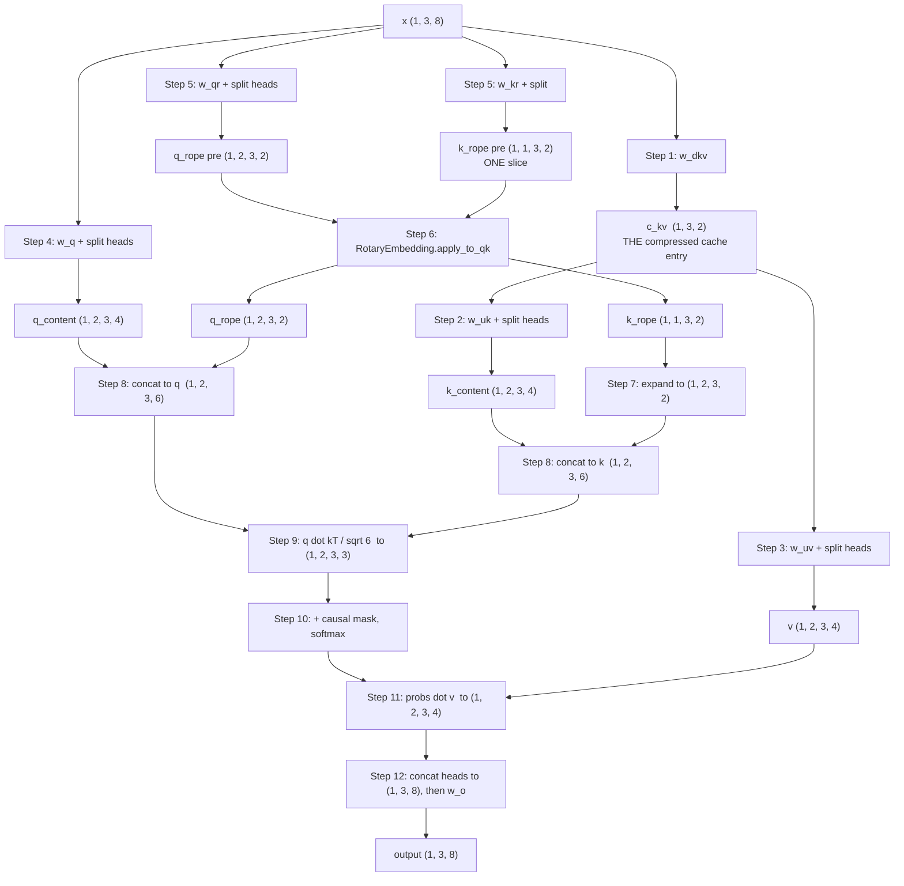
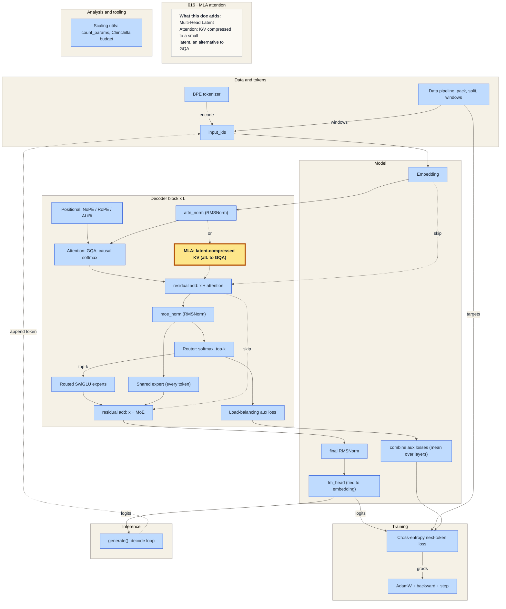

# 016 — Multi-Head Latent Attention (MLA): the full derivation, solved by hand

**Companion to:** [`journey_of_a_model/016-mla-attention.md`](../../journey_of_a_model/016-mla-attention.md)
· **Code:** [`qwenmoe/model/attention.py`](../../qwenmoe/model/attention.py)
(`MLAAttention`)
· **Every number here is reproduced by:** [`verify_016_mla_attention.py`](verify_016_mla_attention.py)
(`uv run python docs/math/verify_016_mla_attention.py`)

---

## How to read this

The journal entry tells you *what* Multi-Head Latent Attention is and
*why* it exists, with one worked example per formula. This document is the
opposite trade-off: **maximum detail, minimum summarising**. We

1. fix one tiny, fully-written-out input and one tiny set of weights,
2. push them through **every single line** of `MLAAttention.forward_with_trace`
   (the explicit-math path in [`attention.py:363`](../../qwenmoe/model/attention.py#L363)),
3. and for every operation — a projection, a reshape, a rotation, a
   softmax — first derive *why* it has the form it does, then **do the
   arithmetic on paper**, digit by digit, and check it against the real
   module.

Nothing is skipped. If a step turns a `(1, 3, 2)` array into a
`(1, 2, 3, 4)` array, we trace exactly which number went where.

You do **not** need a linear-algebra background. Every term (vector, dot
product, matrix multiply, rank, rotation, variance, softmax) is defined at
first use. You *should* first skim
[`journey_of_a_model/016-mla-attention.md`](../../journey_of_a_model/016-mla-attention.md)
for the plain-English picture, and
[`docs/math/004-attention-gqa.md`](004-attention-gqa.md) — MLA reuses the
whole scaled-dot-product-attention spine derived there, and this document
leans on it rather than repeating it.

---

## Part 0 — What are we even computing, and why the funny shape?

### 0.1 The problem MLA solves

A decoder-only transformer generates text one token at a time. To produce
token $t+1$ it runs attention, in which the new token's **query** vector
is compared against the **key** vector of *every* previous token, and the
result is used to take a weighted average of every previous token's
**value** vector (all three terms are defined in
[004 §1.1](004-attention-gqa.md); the full formula is derived there).

The keys and values of the past tokens don't change as generation
proceeds, so a real inference server stores them once and reuses them —
the **KV cache**. Its size is

$$\text{KV cache} = \underbrace{2}_{K\text{ and }V}\times\ n_{\text{layers}}\ \times\ n_{\text{kv heads}}\ \times\ d_h\ \ \text{floats per token,}$$

where $d_h$ (`head_dim`) is the width of one attention head. For a large
model this is gigabytes, and *reading* it back for every generated token —
not the arithmetic — is what makes decoding slow.

Grouped-Query Attention ([004 §Part 3](004-attention-gqa.md#part-3--why-gqa-quantified-on-this-example))
shrinks the cache by cutting $n_{\text{kv heads}}$: several query heads
share one key/value head. **MLA** (DeepSeek-V2, Liu et al. 2024) attacks
the same term from a different direction. It stores, per token, *one*
small shared vector $c^{KV}$ of dimension $d_c$ (`mla_latent_dim`), plus
*one* small shared positional key $k^R$ of dimension $d_h^R$
(`rope_head_dim`), and **reconstructs** every head's full-size key and
value from $c^{KV}$ on the fly:

$$\text{MLA KV cache} = n_{\text{layers}}\ \times\ (\,d_c + d_h^R\,)\ \ \text{floats per token.}$$

No factor of $2$, no $n_{\text{kv heads}}$, no $d_h$. In our worked example
that is $4$ floats where full multi-head attention needs $16$ — **25%**.

### 0.2 The two ideas, and the one complication

- **Low-rank compression.** Instead of storing a full key vector, store a
  much shorter vector and *expand* it back with a fixed matrix. "Low-rank"
  is defined in §1.1; the point is that a learned pair of matrices
  $W^{DKV}$ (down) and $W^{UK}, W^{UV}$ (up) can carry most of the useful
  information through a narrow $d_c$-wide bottleneck.

- **Decoupled RoPE.** Rotary Position Embedding
  ([003](../../journey_of_a_model/003-norm-and-positional.md),
  [004 §Step 4·RoPE](004-attention-gqa.md)) injects position by *rotating*
  each key and query by an angle proportional to the token's absolute
  position. Rotating the *reconstructed* key would entangle the
  position-dependent rotation with the up-projection matrix in a way that
  destroys the whole caching trick (full derivation in **Step 6** below).
  The fix: leave the content path unrotated, and bolt on a small *extra*
  slice whose only job is to carry the rotation.

By the end of Part 2 you will have computed, by hand, the exact
`(1, 3, 8)` tensor the real module returns:

```
[[1.000000, 1.000000, 0.000000, 0.000000, 1.000000, 0.000000, 0.000000, 1.000000],
 [0.355278, 0.355278, 0.644722, 0.644722, 0.172463, 0.827537, 0.827537, 0.172463],
 [0.693924, 0.693924, 0.898646, 0.898646, 0.687812, 0.813172, 0.813172, 0.687812]]
```

---

<!-- notation:start (generated by build_architecture_footer.py) -->
> **Notation note.** The series uses one symbol set ([canonical notation](README.md#canonical-notation)). In this doc, $d_h$ stands for $d_k$ (`head_dim`). Nothing below is changed; this only states the correspondence.
<!-- notation:end -->

## Part 1 — The running example

### 1.1 Definitions we need right now

- **Scalar:** a single number, e.g. $3$ or $-0.5$.
- **Vector:** an ordered list of numbers in brackets, e.g. $[1, 0, 1, 0]$.
  Its **length** / **dimension** is how many numbers it holds.
- **Basis vector** $e_i$: a vector that is $1$ in position $i$ and $0$
  everywhere else, e.g. $e_1 = [0, 1, 0, 0]$. Multiplying a matrix by
  $e_i$ picks out that matrix's $i$-th column — we exploit this below to
  keep the arithmetic trivial.
- **Dot product** of two equal-length vectors $a, b$: multiply element by
  element, then add.
  $[1,0,1,0]\cdot[2,1,0,1] = 1{\cdot}2 + 0 + 0 + 0 = 2$. One number; large
  when the vectors "point the same way".
- **Matrix:** a rectangle of numbers = a list of equal-length rows. $r$
  rows, $c$ columns ⇒ "$r\times c$".
- **Transpose** $A^{\top}$: flip across the diagonal, row $i$ ↔ column
  $i$; $r\times c$ becomes $c\times r$.
- **Matrix multiply** $AB$: if $A$ is $m\times n$ and $B$ is $n\times p$,
  the result is $m\times p$ and its $(i,j)$ entry is (row $i$ of $A$)
  $\cdot$ (column $j$ of $B$). Inner sizes must match.
- **Identity matrix** $I_n$: $n\times n$, $1$s on the diagonal, $0$s
  elsewhere; $I_n A = A$.
- **Tensor:** the same idea with more than two axes. PyTorch calls them
  all `Tensor`; the **shape** is the tuple of axis lengths, e.g.
  `(1, 2, 3, 4)`.
- **Rank of a matrix / low-rank:** the number of genuinely independent
  directions the matrix can produce in its output. An $8\times 2$ matrix
  has rank at most $2$: however many different length-$8$ outputs it
  produces, they all lie in a $2$-dimensional "sheet" inside the
  $8$-dimensional space. A **low-rank** factorisation replaces one big
  matrix by the product of a tall-thin and a short-wide one, forcing the
  information through a narrow waist — exactly what $W^{UK}W^{DKV}$ does
  here.
- **Latent vector:** the short vector living at that narrow waist
  ("latent" = hidden / compressed). Here $c^{KV}$, of dimension $d_c = 2$.
- **Radian:** the unit of angle for which a full turn is $2\pi \approx
  6.283$. An angle of $1$ radian is about $57.3°$.
- **Rotation of a 2-D vector by angle $\phi$:** the map
  $[a, b]\mapsto[\,a\cos\phi - b\sin\phi,\ \ b\cos\phi + a\sin\phi\,]$. It
  turns the arrow $[a,b]$ counter-clockwise by $\phi$ without changing its
  length.
- **Orthogonal transformation:** any length-preserving linear map — a
  rotation is one. Key fact used repeatedly below: applying the *same*
  orthogonal transformation to two vectors leaves their dot product
  unchanged.
- **Broadcast:** NumPy/PyTorch's rule for combining a smaller tensor with
  a bigger one by *virtually* repeating the smaller along any axis of
  length $1$, without copying memory.
- **Variance / standard deviation:** measures of how spread out a random
  quantity is; standard deviation is the square root of variance and has
  the same units as the quantity. Derived in full in
  [004 §Step 7](004-attention-gqa.md).
- **Softmax:** turns a row of real scores into non-negative weights that
  sum to $1$: $\operatorname{softmax}(z)_j = e^{z_j}/\sum_l e^{z_l}$.
  Derived in full in [004 §Step 10](004-attention-gqa.md).

### 1.2 The model configuration

The smallest `MLAAttention` config that still exercises **every**
behaviour of the component:

| Symbol | Meaning | Value | Why not smaller |
|---|---|---|---|
| `batch` | independent sequences at once | $1$ | — |
| `seq_len`, $S$ | tokens in the sequence | $3$ | need ≥2 for a causal mask; 3 gives a non-trivial 3-way softmax and a position-2 rotation |
| `d_model`, $d$ | width of a token vector | $8$ | $= n_{\text{heads}}\times d_h = 2\times 4$ |
| `n_heads`, $H$ | attention heads | $2$ | **must be ≥2** so the *one* shared latent really is up-projected *per head* and the *one* shared RoPE key really is *broadcast* to several heads |
| `head_dim`, $d_h$ | width of one head, $d/H$ | $4$ | smallest multiple of $4$ (see below) |
| `mla_latent_dim`, $d_c$ | the compressed latent width | $2$ | **must be $< d$** for the compression to be real; $2$ keeps $W^{UK}$ an easy $8\times 2$ |
| `rope_head_dim`, $d_h^R$ | decoupled-RoPE slice width, $d_h/2$ | $2$ | must be even for RoPE (it works in 2-D pairs); $2$ = exactly one pair |
| `rope_theta`, $\theta$ | RoPE base frequency | $10000$ | project default; with $d_h^R = 2$ it collapses to a single frequency of exactly $1$ |
| `positional_scheme` | — | `nope` | **ignored**: `MLAAttention` always runs its own decoupled RoPE (design.md's documented exception, [`attention.py:262`](../../qwenmoe/model/attention.py#L262)) |
| `n_kv_heads` | — | $2$ | `ModelConfig` requires a legal value, but `MLAAttention` never reads it — MLA has no GQA-style KV heads |

**Why `head_dim` must be divisible by 4** ([`attention.py:278-283`](../../qwenmoe/model/attention.py#L278)):
`rope_head_dim = head_dim // 2` ([`attention.py:285`](../../qwenmoe/model/attention.py#L285)),
and RoPE rotates *pairs* of dimensions, so `rope_head_dim` must itself be
even. `head_dim` divisible by $4$ is exactly the condition that makes
`head_dim // 2` even. This is **provable**, not a tuning choice.

### 1.3 The input

Three tokens, each already looked up in the embedding table into a
length-$d = 8$ vector. We pick each one to be a **basis vector**, so every
projection below just reads off a column:

$$X = \begin{bmatrix} x_0 \\ x_1 \\ x_2 \end{bmatrix}
= \begin{bmatrix}
1&0&0&0&0&0&0&0 \\
0&1&0&0&0&0&0&0 \\
0&0&1&0&0&0&0&0
\end{bmatrix}\qquad\text{shape }(1, 3, 8)$$

$x_0 = e_0$ (pretend `"the"`), $x_1 = e_1$ (`"cat"`), $x_2 = e_2$
(`"sat"`). Token at **position $i$** may attend to positions $0\dots i$
only. `positions = [0, 1, 2]`.

### 1.4 The weights

`MLAAttention.__init__` ([`attention.py:272-304`](../../qwenmoe/model/attention.py#L272))
builds **seven** `nn.Linear` layers. A real model learns them; we pick
fixed simple values.

| matrix | `nn.Linear` | shape `(out, in)` | role |
|---|---|---|---|
| $W^{DKV}$ | `w_dkv` | $(d_c,\ d) = (2, 8)$ | compress $x$ → latent $c^{KV}$ |
| $W^{UK}$ | `w_uk` | $(H d_h,\ d_c) = (8, 2)$ | expand $c^{KV}$ → key content, **all heads** |
| $W^{UV}$ | `w_uv` | $(H d_h,\ d_c) = (8, 2)$ | expand $c^{KV}$ → value, **all heads** |
| $W_Q$ | `w_q` | $(H d_h,\ d) = (8, 8)$ | query content, **all heads** |
| $W^{QR}$ | `w_qr` | $(H d_h^R,\ d) = (4, 8)$ | decoupled-RoPE query slice, **per head** |
| $W^{KR}$ | `w_kr` | $(d_h^R,\ d) = (2, 8)$ | decoupled-RoPE key slice, **ONE, shared** |
| $W_O$ | `w_o` | $(d,\ H d_h) = (8, 8)$ | mix heads back to width $d$ |

All `bias=False` (Llama/Qwen convention). Note the asymmetry that is the
whole point: `w_uk`/`w_uv` output $H d_h = 8$ (a full key/value for *every*
head) but take only $d_c = 2$ inputs; `w_kr` outputs only $d_h^R = 2$ (one
slice for *all* heads), while `w_qr` outputs $H d_h^R = 4$ (a slice *per*
head).

**What `nn.Linear` computes.** With weight $W$ of shape `(out, in)`, an
input row $x$ maps to $y = xW^{\top}$, i.e. $y_j = \sum_p x_p W_{j,p}$ =
(the input) $\cdot$ (row $j$ of $W$). When $x = e_i$ this is just
**column $i$ of $W$**. Every token here is a basis vector, so only columns
$0, 1, 2$ of each matrix are ever read; we show those columns and set the
rest to $0$.

$$
W^{DKV} = \begin{bmatrix}
1&0&1&\;0\;\cdots \\ 0&1&1&\;0\;\cdots
\end{bmatrix}\qquad
\text{columns: } W^{DKV}_{:,0}=[1,0],\ W^{DKV}_{:,1}=[0,1],\ W^{DKV}_{:,2}=[1,1]
$$

$$
W^{UK} = \begin{bmatrix}
1&0\\0&1\\1&0\\0&1\\[2pt] 0&1\\1&0\\0&1\\1&0
\end{bmatrix}\ \substack{\text{head 0}\\[18pt]\text{head 1}}\qquad
W^{UV} = \begin{bmatrix}
1&0\\1&0\\0&1\\0&1\\[2pt] 1&0\\0&1\\0&1\\1&0
\end{bmatrix}\ \substack{\text{head 0}\\[18pt]\text{head 1}}
$$

$$
W_Q = \begin{bmatrix}
1&0&1&\cdot\\ 0&1&1&\cdot\\ 1&0&0&\cdot\\ 0&1&0&\cdot\\[2pt]
0&1&0&\cdot\\ 1&0&0&\cdot\\ 0&1&1&\cdot\\ 1&0&1&\cdot
\end{bmatrix}\ \substack{\text{head 0}\\[24pt]\text{head 1}}\ (\text{cols }3\text{–}7 = 0)
$$

$$
W^{QR} = \begin{bmatrix}
1&1&1&\cdot\\ 0&0&1&\cdot\\[2pt] 0&0&1&\cdot\\ 1&1&0&\cdot
\end{bmatrix}\ \substack{\text{head 0}\\[10pt]\text{head 1}}\qquad
W^{KR} = \begin{bmatrix}
1&0&1&\cdot\\ 0&1&1&\cdot
\end{bmatrix}\qquad
W_O = I_8
$$

(All exactly as pinned in
[`verify_016_mla_attention.py`](verify_016_mla_attention.py). $W_O = I_8$
keeps the last step readable; a trained $W_O$ additionally *mixes* the
heads — see [004 §Step 12](004-attention-gqa.md).)

---

## Part 2 — The forward pass, one operation at a time

The path a real call takes is `MLAAttention.forward`
([`attention.py:314`](../../qwenmoe/model/attention.py#L314)), which ends
in one fused `F.scaled_dot_product_attention`. To see the intermediates we
follow the numerically-equivalent explicit path,
`MLAAttention.forward_with_trace`
([`attention.py:363`](../../qwenmoe/model/attention.py#L363)); §Step 13
shows the two agree to $6\times10^{-8}$ on this example.



**Shape ledger — start:** `x (1, 3, 8)`.

---

### Step 1 — Compress once: the latent $c^{KV}$

Code ([`attention.py:379`](../../qwenmoe/model/attention.py#L379)):

```python
c_kv = self.w_dkv(x)
```

**Why.** This is the entire memory trick. $W^{DKV}$ maps each length-$8$
token vector down to a length-$2$ **latent**. During real generation
*this* — two numbers per token per layer — is what gets cached; the full
per-head keys and values below are rebuilt from it every step and never
stored. The paper's Eq. 9, $c_t^{KV} = W^{DKV}h_t$ (DeepSeek-V2 §2.1.2).

**Compute.** $c_i^{KV} = X_i W^{DKV\top}$ = column $i$ of $W^{DKV}$ (since
$x_i = e_i$):

$$c_0^{KV} = [1, 0],\qquad c_1^{KV} = [0, 1],\qquad c_2^{KV} = [1, 1].$$

Notice $c_2^{KV} = c_0^{KV} + c_1^{KV}$ — a coincidence of our chosen
weights, but a handy one: it lets you *see* that token 2's reconstructed
key/value below is the sum of tokens 0's and 1's, all driven by two
numbers.

**Trace.** `x (1, 3, 8)` → `c_kv (1, 3, 2)`. Row $i$ of `c_kv` holds
token $i$'s latent.

$$\texttt{c\_kv} = \begin{bmatrix} 1 & 0 \\ 0 & 1 \\ 1 & 1 \end{bmatrix}$$

**Shape ledger:** `c_kv (1, 3, 2)`.

---

### Step 2 — Up-project the key content, per head, from that latent

Code ([`attention.py:380`](../../qwenmoe/model/attention.py#L380)):

```python
k_content = self.w_uk(c_kv).view(batch, seq_len, self.n_heads, self.head_dim).transpose(1, 2)
```

**Why the shape $(H d_h,\ d_c)$.** One matrix $W^{UK}$ takes the *single*
$d_c$-wide latent and produces $H d_h = 8$ numbers — a full $d_h = 4$-wide
key for **each** of the $H = 2$ heads. That is what "every head's K is
decompressed from ONE shared latent" means concretely: the heads differ
only by which rows of $W^{UK}$ built them. Paper Eq. 10,
$k_t^C = W^{UK}c_t^{KV}$.

Because $W^{UK}$ is $8\times 2$, its output — however it varies across the
three tokens — always lies in a **2-dimensional** sheet inside
$8$-dimensional space (its rank is $\le 2$). The keys are *genuinely*
low-rank; that is the compression, not an approximation bolted on top.

#### 2a. `self.w_uk(c_kv)` — the matrix multiply

For a latent $c = [\alpha, \beta]$, the output is
$\alpha\cdot(\text{col }0\text{ of }W^{UK}) + \beta\cdot(\text{col }1)$.
Columns: $W^{UK}_{:,0} = [1,0,1,0,\ 0,1,0,1]$,
$W^{UK}_{:,1} = [0,1,0,1,\ 1,0,1,0]$.

$$
\begin{aligned}
c_0^{KV} = [1,0] &\Rightarrow [1,0,1,0,\ 0,1,0,1] \\
c_1^{KV} = [0,1] &\Rightarrow [0,1,0,1,\ 1,0,1,0] \\
c_2^{KV} = [1,1] &\Rightarrow [1,1,1,1,\ 1,1,1,1]
\end{aligned}
$$

Shape so far: `(1, 3, 8)` — per token, a length-$8$ row.

#### 2b. `.view(1, 3, 2, 4)` — cut the row into heads

`view` relabels without moving memory: the length-$8$ row splits into
$H = 2$ contiguous pieces of $d_h = 4$. First 4 numbers = head 0, last 4 =
head 1.

| token | head 0 | head 1 |
|---|---|---|
| 0 | $[1,0,1,0]$ | $[0,1,0,1]$ |
| 1 | $[0,1,0,1]$ | $[1,0,1,0]$ |
| 2 | $[1,1,1,1]$ | $[1,1,1,1]$ |

#### 2c. `.transpose(1, 2)` — swap the token and head axes

Shape `(1, S, H, d_h)` → `(1, H, S, d_h)`, so the tensor becomes "per
head, a stack of token rows" — the layout a per-head matrix multiply
wants. `transpose` changes strides, not memory.

$$
k^{C,(0)} = \begin{bmatrix} 1&0&1&0 \\ 0&1&0&1 \\ 1&1&1&1 \end{bmatrix},\qquad
k^{C,(1)} = \begin{bmatrix} 0&1&0&1 \\ 1&0&1&0 \\ 1&1&1&1 \end{bmatrix}
$$

(Token 2's key is identical across heads here only because $c_2^{KV} =
[1,1]$ and each head-block of $W^{UK}$ has row-sums that happen to match;
tokens 0 and 1 show the heads genuinely differ.)

**Shape ledger:** `k_content (1, 2, 3, 4)`.

---

### Step 3 — Up-project the value, per head, from the same latent

Code ([`attention.py:381`](../../qwenmoe/model/attention.py#L381)):

```python
v = self.w_uv(c_kv).view(batch, seq_len, self.n_heads, self.head_dim).transpose(1, 2)
```

Identical mechanics to Step 2 with $W^{UV}$ (paper Eq. 11,
$v_t^C = W^{UV}c_t^{KV}$). Columns $W^{UV}_{:,0} = [1,1,0,0,\ 1,0,0,1]$,
$W^{UV}_{:,1} = [0,0,1,1,\ 0,1,1,0]$.

$$
\begin{aligned}
c_0^{KV} = [1,0] &\Rightarrow [1,1,0,0,\ 1,0,0,1] \\
c_1^{KV} = [0,1] &\Rightarrow [0,0,1,1,\ 0,1,1,0] \\
c_2^{KV} = [1,1] &\Rightarrow [1,1,1,1,\ 1,1,1,1]
\end{aligned}
$$

After `view`/`transpose`:

$$
v^{(0)} = \begin{bmatrix} 1&1&0&0 \\ 0&0&1&1 \\ 1&1&1&1 \end{bmatrix},\qquad
v^{(1)} = \begin{bmatrix} 1&0&0&1 \\ 0&1&1&0 \\ 1&1&1&1 \end{bmatrix}
$$

**Shape ledger:** `k_content (1, 2, 3, 4)`, `v (1, 2, 3, 4)`.

---

### Step 4 — Query content (no compression on the query side)

Code ([`attention.py:383`](../../qwenmoe/model/attention.py#L383)):

```python
q_content = self.w_q(x).view(batch, seq_len, self.n_heads, self.head_dim).transpose(1, 2)
```

**Why $x$, not a latent.** The full DeepSeek-V2 *does* also compress the
query ($c_t^Q = W^{DQ}h_t$, then $q_t^C = W^{UQ}c_t^Q$), but that only
shrinks *training* activation memory — the query is never cached, so it
does nothing for the inference KV cache this component is about. This
project projects the query straight from $x$ with one matrix $W_Q$,
matching Requirement 12.4's "simplified" wording
([`attention.py:294-295`](../../qwenmoe/model/attention.py#L294)).

**Compute.** $q^C_i$ = column $i$ of $W_Q$. Columns:
$W_{Q,:,0} = [1,0,1,0,\ 0,1,0,1]$, $W_{Q,:,1} = [0,1,0,1,\ 1,0,1,0]$,
$W_{Q,:,2} = [1,1,0,0,\ 0,0,1,1]$.

After `view`/`transpose`:

$$
q^{C,(0)} = \begin{bmatrix} 1&0&1&0 \\ 0&1&0&1 \\ 1&1&0&0 \end{bmatrix},\qquad
q^{C,(1)} = \begin{bmatrix} 0&1&0&1 \\ 1&0&1&0 \\ 0&0&1&1 \end{bmatrix}
$$

**Shape ledger:** `q_content (1, 2, 3, 4)`.

---

### Step 5 — The decoupled-RoPE slices, before rotation

Code ([`attention.py:385-386`](../../qwenmoe/model/attention.py#L385)):

```python
q_rope = self.w_qr(x).view(batch, seq_len, self.n_heads, self.rope_head_dim).transpose(1, 2)
k_rope = self.w_kr(x).view(batch, seq_len, 1, self.rope_head_dim).transpose(1, 2)
```

**Why two separate tiny projections.** Position is about to be injected by
*rotating* a vector by an angle that depends on the token's absolute
position. Step 6 derives why that rotation must not touch the content
path. So the model carves out a small **extra** slice — width $d_h^R = 2$
— whose sole purpose is to be rotated and carry position. `w_qr` makes one
such slice **per head** (output width $H d_h^R = 4$); `w_kr` makes
**exactly one** slice, shared by all heads (output width $d_h^R = 2$).
Paper Eq. 14–15: $q_t^R = \mathrm{RoPE}(W^{QR}\cdots)$,
$k_t^R = \mathrm{RoPE}(W^{KR}h_t)$.

**Why the key slice is shared but the query slice is per-head.** The key
only needs to *advertise* one positional stamp per token; every query head
reads that same stamp. But each query head separately decides *how
strongly* to weight positional agreement, so each needs its own slice.
Caching consequence: one $k^R$ per token, not $H$ of them — which is why
`kv_cache_elements_per_token` counts `mla_latent_dim + rope_head_dim`, not
`mla_latent_dim + n_heads * rope_head_dim`
([`attention.py:306-312`](../../qwenmoe/model/attention.py#L306)).

**Compute.** Columns of $W^{QR}$:
$W^{QR}_{:,0} = [1,0,\ 0,1]$, $W^{QR}_{:,1} = [1,0,\ 0,1]$,
$W^{QR}_{:,2} = [1,1,\ 1,0]$ (first pair = head 0, second = head 1).
Columns of $W^{KR}$: $[1,0]$, $[0,1]$, $[1,1]$.

After `view`/`transpose`:

$$
q^{R,\text{pre},(0)} = \begin{bmatrix} 1&0 \\ 1&0 \\ 1&1 \end{bmatrix},\quad
q^{R,\text{pre},(1)} = \begin{bmatrix} 0&1 \\ 0&1 \\ 1&0 \end{bmatrix},\quad
k^{R,\text{pre}} = \begin{bmatrix} 1&0 \\ 0&1 \\ 1&1 \end{bmatrix}\ \text{(shape }(1,1,3,2)\text{)}
$$

**Shape ledger:** `q_rope (1, 2, 3, 2)`, `k_rope (1, 1, 3, 2)` — note the
`1` where `k_rope`'s head axis is: one slice, not $H$.

---

### Step 6 — Rotate the slices (and *why* decoupling is necessary)

Code ([`attention.py:387`](../../qwenmoe/model/attention.py#L387)):

```python
q_rope, k_rope = self.rope.apply_to_qk(q_rope, k_rope, positions)
```

This calls the **exact same** `RotaryEmbedding` class task 3 already built
and tested ([`positional.py:23-64`](../../qwenmoe/model/positional.py#L23)),
just constructed with `head_dim = rope_head_dim = 2` instead of the full
head width ([`attention.py:302`](../../qwenmoe/model/attention.py#L302)).

#### 6a. Why the content key must *not* be rotated — full derivation

Write the attention score between query position $i$ and key position $j$,
for one head, as a dot product. Ordinary RoPE would rotate query and key
each by a rotation matrix $R(\cdot)$ whose angle is the token's absolute
position:

$$q_i^{\text{rot}} = R(i)\,q_i,\qquad k_j^{\text{rot}} = R(j)\,k_j.$$

The score is (using $(Ma)\cdot(Nb) = a^{\top}M^{\top}Nb$ and
$R(i)^{\top}R(j) = R(j-i)$, both **provable**):

$$q_i^{\text{rot}}\cdot k_j^{\text{rot}}
= q_i^{\top}\,R(i)^{\top}R(j)\,k_j
= q_i^{\top}\,R(j-i)\,k_j.$$

That last form is the celebrated property: the score depends on $i, j$
only through the **gap** $j - i$ — relative position, for free.

Now bring in the compression. In MLA the cached thing is $c_j^{KV}$, and
the key is $k_j^C = W^{UK}c_j^{KV}$. Substitute:

$$q_i^{C\top}\,R(j-i)\,W^{UK}\,c_j^{KV}.$$

Here is the problem. During generation you want to precompute, once,
something that folds $W^{UK}$ into the query so you can score directly
against the tiny cached $c_j^{KV}$ and **never build $k_j^C$**. Without
RoPE you can: $q_i^{C\top}W^{UK} = \big((W^{UK})^{\top}q_i^C\big)^{\top}$
is a fixed length-$d_c$ vector $\tilde q_i$, and the score is just
$\tilde q_i\cdot c_j^{KV}$ (this is the paper's "matrix absorption";
out of scope here but it is *why* the structure matters). **With** the
rotation, $R(j-i)$ sits *between* $q_i^C$ and $W^{UK}$, and it changes
with the query position $i$ at every step — so $W^{UK}$ can no longer be
absorbed into a position-free $\tilde q_i$, and you are forced to
re-expand every past key on every step. The cache saving is gone.

**Decoupled RoPE** sidesteps this entirely. Split each head's query and
key into a **content** part and a small **rope** part, and let the score
be the sum of two independent dot products:

$$q_i\cdot k_j
= \underbrace{q_i^{C}\cdot k_j^{C}}_{\text{no rotation — fully absorbable}}
\;+\;
\underbrace{q_i^{R}\cdot k_j^{R}}_{\text{rotated, tiny, carries position}}.$$

The content term never sees $R(\cdot)$, so $W^{UK}$ stays absorbable. The
rope term is only $d_h^R = 2$ wide and its key half is shared across
heads, so rotating and caching it is cheap. The concatenation in Step 8
(`q = cat([q_content, q_rope])`) is *literally* this sum: the dot product
of two concatenated vectors equals the sum of the dot products of their
halves.

#### 6b. The rotation, computed

`RotaryEmbedding.__init__` ([`positional.py:31`](../../qwenmoe/model/positional.py#L31)):

$$\text{inv\_freq} = \theta^{-\,\text{arange}(0, d_h^R, 2)/d_h^R} = 10000^{-0/2} = [\,1\,].$$

With $d_h^R = 2$ there is exactly **one** frequency, and it is $1$
**exactly** (not approximately — $\theta^0 = 1$ for any $\theta$; task 13
noted `inv_freq[0] == 1.0` always). So the rotation angle for a token at
position $m$ is $m\times 1 = m$ **radians**
([`positional.py:34-39`](../../qwenmoe/model/positional.py#L34)):

| position $m$ | angle (rad) | $\cos m$ | $\sin m$ |
|---|---|---|---|
| 0 | 0 | $1$ | $0$ |
| 1 | 1 | $0.54030231$ | $0.84147098$ |
| 2 | 2 | $-0.41614684$ | $0.90929743$ |

`apply_to_qk` computes `q_rot = q * cos + rotate_half(q) * sin`
([`positional.py:48`](../../qwenmoe/model/positional.py#L48)), with
`rotate_half([a, b]) = [-b, a]`
([`positional.py:18-20`](../../qwenmoe/model/positional.py#L18)). For a
2-D vector $[a,b]$ at angle $\phi$:

$$[a,b]\odot[\cos\phi,\cos\phi] + [-b,a]\odot[\sin\phi,\sin\phi]
= [\,a\cos\phi - b\sin\phi,\ \ b\cos\phi + a\sin\phi\,],$$

which is exactly the rotation from §1.1. ($\odot$ = elementwise multiply;
`cos`/`sin` are length-2 here because `_angles` concatenates the single
frequency with itself, [`positional.py:39`](../../qwenmoe/model/positional.py#L39).)

**Position 0** (angle 0, $\cos = 1$, $\sin = 0$): the rotation is the
identity. $q^{R,(0)}_0 = [1,0]$, $q^{R,(1)}_0 = [0,1]$, $k^R_0 = [1,0]$
unchanged.

**Position 1** (angle 1):

$$
\begin{aligned}
q^{R,(0)}_1 = \text{rot}([1,0]) &= [\,1(0.54030231) - 0,\ \ 0 + 1(0.84147098)\,] = [\,0.54030234,\ 0.84147096\,] \\
q^{R,(1)}_1 = \text{rot}([0,1]) &= [\,0 - 1(0.84147098),\ \ 1(0.54030231) + 0\,] = [\,-0.84147096,\ 0.54030234\,] \\
k^R_1 = \text{rot}([0,1]) &= [\,-0.84147096,\ 0.54030234\,]
\end{aligned}
$$

**Position 2** (angle 2):

$$
\begin{aligned}
q^{R,(0)}_2 = \text{rot}([1,1]) &= [\,\cos 2 - \sin 2,\ \ \cos 2 + \sin 2\,] = [\,-1.32544422,\ 0.49315056\,] \\
q^{R,(1)}_2 = \text{rot}([1,0]) &= [\,\cos 2,\ \sin 2\,] = [\,-0.41614684,\ 0.90929741\,] \\
k^R_2 = \text{rot}([1,1]) &= [\,-1.32544422,\ 0.49315056\,]
\end{aligned}
$$

(Last digits are float32 rounding; the verify script asserts these against
the real `RotaryEmbedding` to $10^{-6}$.)

#### 6c. Check: same-position dot products are preserved *exactly*

A rotation is an orthogonal transformation, so rotating **both** vectors
of a dot product by the **same** angle leaves the dot product unchanged.
The verify script confirms, for the same-position pairs:

| head, position $i$ | rotated $q^R_i\cdot k^R_i$ | pre-rotation $q^{R,\text{pre}}_i\cdot k^{R,\text{pre}}_i$ |
|---|---|---|
| 0, position 1 | $+0.0000000$ | $[1,0]\cdot[0,1] = 0$ |
| 1, position 1 | $+1.0000000$ | $[0,1]\cdot[0,1] = 1$ |
| 0, position 2 | $+1.9999999$ | $[1,1]\cdot[1,1] = 2$ |
| 1, position 2 | $+0.9999999$ | $[1,0]\cdot[1,1] = 1$ |

(The tiny shortfalls like $1.9999999$ are float32 rounding in the
$\cos/\sin$; algebraically the two columns are equal.)

And for an off-diagonal pair ($i = 2$, $j = 1$, gap $-1$), head 0:
direct $q^{R,(0)}_2\cdot k^R_1 = +1.3817732$, which the script also
reproduces as $q^{R,\text{pre},(0)}_2\cdot R(-1)\,k^{R,\text{pre}}_1$ —
confirming the score's rope part depends only on the gap. **This is the
relative-position property, exact.**

**Shape ledger:** unchanged — `q_rope (1, 2, 3, 2)`, `k_rope (1, 1, 3, 2)`.

---

### Step 7 — Broadcast the one shared key slice to every head

Code ([`attention.py:389`](../../qwenmoe/model/attention.py#L389)):

```python
k_rope = k_rope.expand(-1, self.n_heads, -1, -1)
```

`k_rope` is `(1, 1, 3, 2)`. `expand` **virtually** repeats it along the
head axis to `(1, 2, 3, 2)` — no memory is copied; both head slices are
views of the same 6 numbers. After this, head 0 and head 1 hold an
identical rope key (the verify script asserts
`k_rope[0,0] == k_rope[0,1]`):

$$
k^{R,(0)} = k^{R,(1)} = \begin{bmatrix}
1 & 0 \\ -0.84147096 & 0.54030234 \\ -1.32544422 & 0.49315056
\end{bmatrix}
$$

**Shape ledger:** `k_rope (1, 1, 3, 2)` → `(1, 2, 3, 2)`.

> **The fused path does this differently but equivalently.**
> `MLAAttention.forward` expands `k_rope` the same way
> ([`attention.py:339`](../../qwenmoe/model/attention.py#L339)) — MLA does
> not use SDPA's `enable_gqa`, because after concatenation every head has
> its *own* full key; only the rope sub-slice was shared, and that sharing
> is already resolved by the time SDPA sees `k`.

---

### Step 8 — Concatenate content + rope, per head

Code ([`attention.py:391-392`](../../qwenmoe/model/attention.py#L391)):

```python
q = torch.cat([q_content, q_rope], dim=-1)
k = torch.cat([k_content, k_rope], dim=-1)
```

Each head's query becomes $q_i = [\,q_i^C\ ;\ q_i^R\,]$ of width
$d_h + d_h^R = 4 + 2 = 6$; likewise $k_j = [\,k_j^C\ ;\ k_j^R\,]$ (paper
Eq. 16–17). As derived in Step 6a, the dot product of these length-6
vectors is exactly the sum of the content dot product and the rope dot
product — the whole reason concatenation is the right operation.

**Head 0**, rows are $[q^C \mid q^R]$:

$$
q^{(0)} = \begin{bmatrix}
1&0&1&0 & \mid & 1&0 \\
0&1&0&1 & \mid & 0.54030234 & 0.84147096 \\
1&1&0&0 & \mid & -1.32544422 & 0.49315056
\end{bmatrix},\quad
k^{(0)} = \begin{bmatrix}
1&0&1&0 & \mid & 1&0 \\
0&1&0&1 & \mid & -0.84147096 & 0.54030234 \\
1&1&1&1 & \mid & -1.32544422 & 0.49315056
\end{bmatrix}
$$

**Head 1:**

$$
q^{(1)} = \begin{bmatrix}
0&1&0&1 & \mid & 0&1 \\
1&0&1&0 & \mid & -0.84147096 & 0.54030234 \\
0&0&1&1 & \mid & -0.41614684 & 0.90929741
\end{bmatrix},\quad
k^{(1)} = \begin{bmatrix}
0&1&0&1 & \mid & 1&0 \\
1&0&1&0 & \mid & -0.84147096 & 0.54030234 \\
1&1&1&1 & \mid & -1.32544422 & 0.49315056
\end{bmatrix}
$$

**Shape ledger:** `q (1, 2, 3, 6)`, `k (1, 2, 3, 6)`.

---

### Step 9 — Attention scores, scaled

Code ([`attention.py:395`](../../qwenmoe/model/attention.py#L395)):

```python
scores = (q @ k.transpose(-2, -1)) / math.sqrt(self.head_dim + self.rope_head_dim)
```

#### 9a. The matrix multiply

For each head, `scores` $= q^{(h)}\,(k^{(h)})^{\top}$ is $S\times S =
3\times 3$; entry $(i, j)$ is $q_i\cdot k_j$, which by Step 8 is
$q_i^C\cdot k_j^C + q_i^R\cdot k_j^R$. We only need $j\le i$ (the rest is
about to be masked), so six entries per head.

**Head 0.** Content dot products $q^{C,(0)}_i\cdot k^{C,(0)}_j$:

$$
\begin{array}{c|ccc}
 & k^C_0{=}[1,0,1,0] & k^C_1{=}[0,1,0,1] & k^C_2{=}[1,1,1,1] \\\hline
q^C_0{=}[1,0,1,0] & 2 & 0 & 2 \\
q^C_1{=}[0,1,0,1] & 0 & 2 & 2 \\
q^C_2{=}[1,1,0,0] & 1 & 1 & 2
\end{array}
$$

Rope dot products $q^{R,(0)}_i\cdot k^R_j$ (only $j\le i$):

$$
\begin{aligned}
(0,0):&\ [1,0]\cdot[1,0] = 1 \\
(1,0):&\ [0.54030234, 0.84147096]\cdot[1,0] = 0.54030234 \\
(1,1):&\ [0.54030234, 0.84147096]\cdot[-0.84147096, 0.54030234] \\
      &\quad = -0.45464871 + 0.45464871 = 0 \ \ (\text{same-angle: } = [1,0]\cdot[0,1] = 0)\\
(2,0):&\ [-1.32544422, 0.49315056]\cdot[1,0] = -1.32544422 \\
(2,1):&\ [-1.32544422, 0.49315056]\cdot[-0.84147096, 0.54030234] \\
      &\quad = 1.11532289 + 0.26645040 = 1.38177329 \\
(2,2):&\ [-1.32544422, 0.49315056]\cdot[-1.32544422, 0.49315056] \\
      &\quad = 1.75680... + 0.24319... = 2 \ \ (\text{same-angle: } = [1,1]\cdot[1,1] = 2)
\end{aligned}
$$

Sum (content + rope), then divide by $\sqrt{d_h + d_h^R} = \sqrt{6} =
2.44948975$:

$$
\begin{array}{c|ccc}
\text{head 0 raw} & j=0 & j=1 & j=2 \\\hline
i=0 & 2+1 = 3 & & \\
i=1 & 0+0.54030234 & 2+0 = 2 & \\
i=2 & 1-1.32544422 & 1+1.38177329 & 2+2 = 4
\end{array}
$$

$$
\text{scores}^{(0)}_{\text{lower}} = \frac{1}{\sqrt6}\begin{bmatrix}
3 & & \\
0.54030234 & 2 & \\
-0.32544422 & 2.38177329 & 4
\end{bmatrix}
= \begin{bmatrix}
1.22474480 & & \\
0.22057749 & 0.81649655 & \\
-0.13286205 & 0.97235483 & 1.63299298
\end{bmatrix}
$$

**Head 1.** Content dot products $q^{C,(1)}_i\cdot k^{C,(1)}_j$:

$$
\begin{array}{c|ccc}
 & k^C_0{=}[0,1,0,1] & k^C_1{=}[1,0,1,0] & k^C_2{=}[1,1,1,1] \\\hline
q^C_0{=}[0,1,0,1] & 2 & 0 & 2 \\
q^C_1{=}[1,0,1,0] & 0 & 2 & 2 \\
q^C_2{=}[0,0,1,1] & 1 & 1 & 2
\end{array}
$$

Rope dot products $q^{R,(1)}_i\cdot k^R_j$ ($j\le i$; $k^R$ is the *same*
shared slice as head 0):

$$
\begin{aligned}
(0,0):&\ [0,1]\cdot[1,0] = 0 \\
(1,0):&\ [-0.84147096, 0.54030234]\cdot[1,0] = -0.84147096 \\
(1,1):&\ [-0.84147096, 0.54030234]\cdot[-0.84147096, 0.54030234] = 1 \ (= [0,1]\cdot[0,1])\\
(2,0):&\ [-0.41614684, 0.90929741]\cdot[1,0] = -0.41614684 \\
(2,1):&\ [-0.41614684, 0.90929741]\cdot[-0.84147096, 0.54030234] = 0.35017549 + 0.49129550 = 0.84147098 \\
(2,2):&\ [-0.41614684, 0.90929741]\cdot[-1.32544422, 0.49315056] = 1 \ (= [1,0]\cdot[1,1])
\end{aligned}
$$

$$
\text{scores}^{(1)}_{\text{lower}} = \frac{1}{\sqrt6}\begin{bmatrix}
2 & & \\
-0.84147096 & 3 & \\
0.58385316 & 1.84147098 & 3
\end{bmatrix}
= \begin{bmatrix}
0.81649655 & & \\
-0.34352908 & 1.22474480 & \\
0.23835704 & 0.75177735 & 1.22474480
\end{bmatrix}
$$

All twelve entries match the real module's `attn_scores_pre_mask`
(verify-script Step 9).

#### 9b. Why divide by $\sqrt{d_h + d_h^R}$ specifically

The dot product $q_i\cdot k_j$ sums $d_h + d_h^R = 6$ products. Model each
factor as an independent random number with **mean 0** and **variance 1**
at initialisation (the same assumption derived in full in
[004 §Step 7](004-attention-gqa.md)). Each product then has mean $0$ and
variance $1$; the sum of $n$ such independent zero-mean terms has variance
$n$, hence **standard deviation $\sqrt{n}$**. Dividing by $\sqrt{n}$
rescales the typical score magnitude back to $1$, keeping the softmax out
of its saturated, gradient-starved regime. Here $n = d_h + d_h^R$ because
$q$ is exactly that wide.

- The variance argument is **exact** algebra under the stated iid
  assumption. Real $q, k$ are not perfectly iid — the paper verified the
  fix empirically too.
- That the divisor counts *both* the content dims and the two decoupled
  dims is an **implementation fact**: `F.scaled_dot_product_attention`
  defaults its scale to $1/\sqrt{(\text{last dim of }q)}$, and MLA builds
  $q$ exactly $d_h + d_h^R$ wide, so the default already equals
  $1/\sqrt{d_h + d_h^R}$ with nothing to override
  ([`attention.py:344-348`](../../qwenmoe/model/attention.py#L344)). The
  decoupled dims are not strictly unit-variance (they are rotations of a
  projection), so this is a pragmatic choice, not a theorem.

**Shape ledger:** `q (1,2,3,6) @ k^T (1,2,6,3)` → `scores (1, 2, 3, 3)`.

---

### Step 10 — Causal mask, then softmax

Code ([`attention.py:397-403`](../../qwenmoe/model/attention.py#L397)):

```python
causal_mask = torch.triu(torch.full((seq_len, seq_len), float("-inf")), diagonal=1)
scores = scores + causal_mask
probs = F.softmax(scores, dim=-1)
```

**The mask** is $0$ on and below the diagonal, $-\infty$ strictly above
([004 §Step 9](004-attention-gqa.md) has the derivation). Adding it sends
every "looking at a future token" entry to $-\infty$.

**Softmax** ([004 §Step 10](004-attention-gqa.md) derives the exact form,
the subtract-the-max trick, and why $e^{-\infty} = 0$ makes the mask
work). Applied to each row.

**Head 0.**

*Row 0* — $[1.22474480, -\infty, -\infty]$: one finite entry ⇒
$p^{(0)}_0 = [1, 0, 0]$.

*Row 1* — $[0.22057749, 0.81649655, -\infty]$. Subtract the max
$0.81649655$: $[-0.59591907,\ 0,\ -\infty]$. Exponentiate:
$e^{-0.59591907} = 0.55105585$, $e^0 = 1$, $e^{-\infty} = 0$. Sum
$= 1.55105591$.

$$p^{(0)}_1 = \left[\tfrac{0.55105585}{1.55105591},\ \tfrac{1}{1.55105591},\ 0\right]
= [\,0.35527790,\ 0.64472210,\ 0\,].$$

*Row 2* — $[-0.13286205, 0.97235483, 1.63299298]$. Subtract max
$1.63299298$: $[-1.76585507,\ -0.66063815,\ 0]$. Exponentiate:
$e^{-1.76585507} = 0.17104048$, $e^{-0.66063815} = 0.51652163$, $1$. Sum
$= 1.68756211$.

$$p^{(0)}_2 = \left[\tfrac{0.17104048}{1.68756211},\ \tfrac{0.51652163}{1.68756211},\ \tfrac{1}{1.68756211}\right]
= [\,0.10135359,\ 0.30607563,\ 0.59257078\,].$$

**Head 1.**

*Row 0* — $p^{(1)}_0 = [1, 0, 0]$.

*Row 1* — $[-0.34352908, 1.22474480, -\infty]$. Minus max: $[-1.56827390,\ 0,\ -\infty]$.
$e^{-1.56827390} = 0.20840460$. Sum $= 1.20840454$.

$$p^{(1)}_1 = [\,0.17246261,\ 0.82753742,\ 0\,].$$

*Row 2* — $[0.23835704, 0.75177735, 1.22474480]$. Minus max
$1.22474480$: $[-0.98638773,\ -0.47296745,\ 0]$.
$e^{-0.98638773} = 0.37292135$, $e^{-0.47296745} = 0.62315035$, $1$. Sum
$= 1.99607170$.

$$p^{(1)}_2 = [\,0.18682763,\ 0.31218836,\ 0.50098401\,].$$

Every row sums to $1$; all six match the real `attn_scores_post_softmax`.

**Shape ledger:** `probs (1, 2, 3, 3)`.

---

### Step 11 — Weighted sum with the values (content only)

Code ([`attention.py:405`](../../qwenmoe/model/attention.py#L405)):
`out = probs @ v`. Per head, row $i$ of the output is
$\sum_j p_{i,j}\,v_j$ — the attention-weighted average of the value
vectors. **The rope slice never appears here**: $v$ is the pure
$d_h = 4$-wide content value from Step 3. The decoupled dimensions exist
only to shape the *weights* $p$, not the things being averaged.

**Head 0**, $v^{(0)}$: $v_0 = [1,1,0,0]$, $v_1 = [0,0,1,1]$,
$v_2 = [1,1,1,1]$.

*Row 0*: weights $[1,0,0]$ ⇒ $\text{out}^{(0)}_0 = v_0 = [1,1,0,0]$.
(Position 0 sees only itself — the causal-mask invariant checked by
[`test_mla.py:48`](../../tests/test_mla.py#L48).)

*Row 1*: $0.35527790\,[1,1,0,0] + 0.64472210\,[0,0,1,1] = [\,0.35527790,\ 0.35527790,\ 0.64472210,\ 0.64472210\,]$.

*Row 2*: $0.10135359\,[1,1,0,0] + 0.30607563\,[0,0,1,1] + 0.59257078\,[1,1,1,1]$:

$$
\begin{aligned}
\text{coord }0, 1:&\ \ 0.10135359 + 0.59257078 = 0.69392437 \\
\text{coord }2, 3:&\ \ 0.30607563 + 0.59257078 = 0.89864641
\end{aligned}
\ \Rightarrow\ [\,0.69392437,\ 0.69392437,\ 0.89864641,\ 0.89864641\,].
$$

$$\text{out}^{(0)} = \begin{bmatrix}
1 & 1 & 0 & 0 \\
0.35527790 & 0.35527790 & 0.64472210 & 0.64472210 \\
0.69392437 & 0.69392437 & 0.89864641 & 0.89864641
\end{bmatrix}$$

**Head 1**, $v^{(1)}$: $v_0 = [1,0,0,1]$, $v_1 = [0,1,1,0]$,
$v_2 = [1,1,1,1]$.

*Row 0*: $[1,0,0,1]$.

*Row 1*: $0.17246261\,[1,0,0,1] + 0.82753742\,[0,1,1,0] = [\,0.17246261,\ 0.82753742,\ 0.82753742,\ 0.17246261\,]$.

*Row 2*: $0.18682763\,[1,0,0,1] + 0.31218836\,[0,1,1,0] + 0.50098401\,[1,1,1,1]$:

$$
\begin{aligned}
\text{coord }0, 3:&\ \ 0.18682763 + 0.50098401 = 0.68781164 \\
\text{coord }1, 2:&\ \ 0.31218836 + 0.50098401 = 0.81317237
\end{aligned}
\ \Rightarrow\ [\,0.68781161,\ 0.81317234,\ 0.81317234,\ 0.68781161\,].
$$

$$\text{out}^{(1)} = \begin{bmatrix}
1 & 0 & 0 & 1 \\
0.17246261 & 0.82753742 & 0.82753742 & 0.17246261 \\
0.68781161 & 0.81317234 & 0.81317234 & 0.68781161
\end{bmatrix}$$

**Shape ledger:** `probs (1,2,3,3) @ v (1,2,3,4)` → `out (1, 2, 3, 4)`.

---

### Step 12 — Concatenate the heads and project out

Code ([`attention.py:407-408`](../../qwenmoe/model/attention.py#L407)):

```python
out = out.transpose(1, 2).contiguous().view(batch, seq_len, self.n_heads * self.head_dim)
output = self.w_o(out)
```

#### 12a. `transpose(1, 2).contiguous().view(1, 3, 8)` — glue heads back

`transpose(1, 2)` restores `(1, S, H, d_h) = (1, 3, 2, 4)`;
`.contiguous()` physically reorders memory to match the new strides;
`.view(1, 3, 8)` concatenates each token's two head-vectors into one
length-8 row **in head order** — the exact inverse of the `view`/`transpose`
in Steps 2–4.

| token $i$ | head 0 part | head 1 part | concatenated row |
|---|---|---|---|
| 0 | $[1,1,0,0]$ | $[1,0,0,1]$ | $[1,1,0,0,\ 1,0,0,1]$ |
| 1 | $[0.35527790, 0.35527790, 0.64472210, 0.64472210]$ | $[0.17246261, 0.82753742, 0.82753742, 0.17246261]$ | 8 numbers |
| 2 | $[0.69392437, 0.69392437, 0.89864641, 0.89864641]$ | $[0.68781161, 0.81317234, 0.81317234, 0.68781161]$ | 8 numbers |

#### 12b. Output projection $W_O = I_8$

$\text{output}_i = \text{concat}_i\,W_O^{\top} = \text{concat}_i$
(identity). A *trained* $W_O$ would additionally mix the two heads' outputs
(so far head 0's output depends only on head 0's q/k/v) and rescale for
the residual stream — see [004 §Step 12](004-attention-gqa.md). Here it is
a pass-through so the final numbers are legible.

#### Final result

$$
\boxed{\ \text{output} = \begin{bmatrix}
1 & 1 & 0 & 0 & 1 & 0 & 0 & 1 \\
0.355278 & 0.355278 & 0.644722 & 0.644722 & 0.172463 & 0.827537 & 0.827537 & 0.172463 \\
0.693924 & 0.693924 & 0.898646 & 0.898646 & 0.687812 & 0.813172 & 0.813172 & 0.687812
\end{bmatrix}\ }
$$

shape $(1, 3, 8)$. The real module returns this to full float precision
(verify script: `torch.testing.assert_close(out_trace, EXPECTED,
atol=1e-5)`).

> **Not shown here:** the residual add. `MLAAttention` returns just this
> tensor; `TransformerBlock` adds it back onto its input
> ($x \leftarrow x + \text{MLA}(\text{RMSNorm}(x))$).

---

### Step 13 — End-to-end recap, and the fused path

| Step | Operation | Shape in → out | Key formula |
|---|---|---|---|
| 1 | compress | `(1,3,8)` → `c_kv (1,3,2)` | $c^{KV} = xW^{DKV\top}$ |
| 2 | up-project K + split heads | `(1,3,2)` → `k_content (1,2,3,4)` | $k^C = c^{KV}W^{UK\top}$ |
| 3 | up-project V + split heads | `(1,3,2)` → `v (1,2,3,4)` | $v = c^{KV}W^{UV\top}$ |
| 4 | query content + split heads | `(1,3,8)` → `q_content (1,2,3,4)` | $q^C = xW_Q^{\top}$ |
| 5 | rope slices + split | `(1,3,8)` → `q_rope (1,2,3,2)`, `k_rope (1,1,3,2)` | $xW^{QR\top}$, $xW^{KR\top}$ |
| 6 | rotate | unchanged | $[a,b]\mapsto[a\cos\phi{-}b\sin\phi,\ b\cos\phi{+}a\sin\phi]$ |
| 7 | broadcast shared key | `k_rope (1,1,3,2)` → `(1,2,3,2)` | `expand` |
| 8 | concat content + rope | → `q (1,2,3,6)`, `k (1,2,3,6)` | $[q^C;q^R]$, $[k^C;k^R]$ |
| 9 | scores + scale | `(1,2,3,6)` → `(1,2,3,3)` | $q\,k^{\top}/\sqrt{d_h + d_h^R}$ |
| 10 | causal mask + softmax | unchanged | $e^{z_j}/\sum e^{z_l}$ |
| 11 | weighted sum with V | `(1,2,3,3)·(1,2,3,4)` → `(1,2,3,4)` | $p\,v$ |
| 12 | concat heads + $W_O$ | → `(1,3,8)` → `(1,3,8)` | `view` then $\cdot W_O^{\top}$ |

**Fused path.** `MLAAttention.forward` replaces Steps 9–11 with one call
([`attention.py:353`](../../qwenmoe/model/attention.py#L353)):

```python
F.scaled_dot_product_attention(q, k, v, is_causal=True)
```

`is_causal=True` supplies the Step 10 mask; SDPA's default scale is
$1/\sqrt{6}$ because `q` is 6 wide (Step 9b). No `enable_gqa` — after
Step 7 every head already has a full key. On this example the verify
script measures

$$\max\big|\ \text{forward} - \text{forward\_with\_trace}\ \big| = 5.96\times10^{-8},$$

not bit-identical only because a fused kernel is free to sum in a
different order ([`attention.py:8-11`](../../qwenmoe/model/attention.py#L8),
[journal 021](../../journey_of_a_model/021-fused-attention-sdpa.md)).

---

## Part 3 — Why MLA, quantified on this example

### 3.1 The KV cache, in numbers

`MLAAttention.kv_cache_elements_per_token`
([`attention.py:306-312`](../../qwenmoe/model/attention.py#L306)) returns
what a real inference server would store **per token, per layer**:

$$d_c + d_h^R = 2 + 2 = 4\ \text{floats.}$$

The alternatives, for the *same* $d = 8$, $H = 2$, $d_h = 4$:

| variant | cache/token/layer | vs. MLA |
|---|---|---|
| **MLA** (this component) | $d_c + d_h^R = 4$ | — |
| full multi-head attention | $2\cdot H\cdot d_h = 2\cdot 2\cdot 4 = 16$ | $4\times$ bigger |
| GQA with $n_{\text{kv}} = 2$ (= MHA here) | $2\cdot n_{\text{kv}}\cdot d_h = 16$ | $4\times$ bigger |

MLA stores **25%** of what full MHA would. And the gap *widens* with
scale: the MHA/GQA term carries a factor of $H$ (or $n_{\text{kv}}$) and
$d_h$, while MLA's $d_c + d_h^R$ does not grow with the number of heads at
all. The journal entry's measured table (`SMOKE_TEST`: 37.5% of GQA;
`BASELINE` with 4 kv-heads: 18.8%) is the same effect on the project's
real presets.

### 3.2 Parameters — *not* the point, and not fixed either way

The verify script counts every projection:

| projection | shape | params |
|---|---|---|
| `w_dkv` | $(2, 8)$ | 16 |
| `w_uk` | $(8, 2)$ | 16 |
| `w_uv` | $(8, 2)$ | 16 |
| `w_q` | $(8, 8)$ | 64 |
| `w_qr` | $(4, 8)$ | 32 |
| `w_kr` | $(2, 8)$ | 16 |
| `w_o` | $(8, 8)$ | 64 |
| **MLA total** | | **224** |
| GQA total ($W_Q{+}W_K{+}W_V{+}W_O$ at $n_{\text{kv}}{=}2$) | | **256** |

Here MLA has *fewer* parameters, but flip `mla_latent_dim` up and that
reverses. Parameter count was never the design goal — cache size is.

### 3.3 Does MLA cost more compute per forward pass?

Slightly: the up-projections `w_uk`/`w_uv` are extra matmuls that plain
attention doesn't have, and every head reconstructs a full key/value from
the latent on every step. `generate(use_kv_cache=True)` caches only the
$d_c + d_h^R$-wide latent + shared rope key per token — the class
`LatentKVCache` ([`kv_cache.py:63`](../../qwenmoe/model/kv_cache.py#L63)),
distinct from GQA's `LayerKVCache` which stores the full post-RoPE `k`/`v`
— and still re-derives the per-head K/V from that latent each step
([`attention.py:331-338`](../../qwenmoe/model/attention.py#L331)). MLA
trades a little arithmetic for a large *memory-bandwidth* saving. On a
CPU-only toy this is invisible; on a real decode server it is the whole
game.

---

## Questions that might come to mind

- **Why is `output[0]` just $x_0$'s two values stuck together?** Token 0
  is causally masked to see only itself, so $\text{out}^{(h)}_0 = v^{(h)}_0$
  for both heads, and $W_O = I$ passes the concatenation through. With
  trained weights it would not be so tidy, but "position 0 copies its own
  value" always holds.

- **Both heads' key for token 2 came out identical ($[1,1,1,1]$). Bug?**
  No — a coincidence of the hand-picked $W^{UK}$ (each head-block's rows
  sum the same way) combined with $c_2^{KV} = [1,1]$. Tokens 0 and 1 show
  the heads' keys genuinely differ. The shared thing is the *latent*, not
  the reconstructed key.

- **Where did $n_{\text{kv heads}}$ go?** MLA has no GQA-style KV heads.
  Every query head reconstructs its own full key/value from the one shared
  latent. `ModelConfig` still requires a legal `n_kv_heads` (its
  validation runs regardless), but `MLAAttention.__init__` never reads it.

- **Why does the score divisor count the rope dims when they aren't
  unit-variance?** Because SDPA's default scale is
  $1/\sqrt{(\text{q's last dim})}$ and MLA makes `q` exactly $d_h + d_h^R$
  wide, so the default is used as-is with nothing to override
  ([`attention.py:344-348`](../../qwenmoe/model/attention.py#L344)). It is
  a pragmatic implementation choice, marked as such in Step 9b — not a
  theorem like the pure-content $1/\sqrt{d_h}$ case.

- **Does `positional_scheme="alibi"` (or `"nope"`) do anything here?** No.
  `MLAAttention` builds its *own* `RotaryEmbedding` in `__init__` and
  always applies it ([`attention.py:262-264`](../../qwenmoe/model/attention.py#L262)),
  a deliberate documented exception. `test_mla.py::test_mla_ignores_positional_scheme_and_always_uses_decoupled_rope`
  pins this.

- **Could this be run through the Manim visualiser like GQA?** Not without
  changes — `LayerTrace.k`/`v` are typed for GQA's `n_kv_heads`, and no
  Manim scene loads an MLA checkpoint. `MLAAttention.forward_with_trace`
  exists (we just walked it) but nothing in `viz/` calls it. Scope limit,
  not oversight — see the journal entry.

- **What about the "matrix absorption" trick the derivation mentions?**
  Out of scope for this project (DeepSeek-V2 §2.1.3). It folds $W^{UK}$
  into $W_Q$ and $W^{UV}$ into $W_O$ so the full per-head K/V are *never*
  materialised at decode time. This project's `LatentKVCache` caches the
  small latent but still up-projects to full per-head K/V every step
  (Step 2–3) — the derivation of *why absorption is possible* (Step 6a) is
  exactly what motivates keeping the content path rotation-free, even
  though this codebase doesn't take the last step.

---

## Symbol reference

| symbol | code name | meaning | value here |
|---|---|---|---|
| $d$ | `d_model` | model width | 8 |
| $S$ | `seq_len` | sequence length | 3 |
| $H$ | `n_heads` | attention heads | 2 |
| $d_h$ | `head_dim` | width of one head, $d/H$ | 4 |
| $d_c$ | `mla_latent_dim` | compressed latent width | 2 |
| $d_h^R$ | `rope_head_dim` | decoupled-RoPE slice width, $d_h/2$ | 2 |
| $\theta$ | `rope_theta` | RoPE base frequency | 10000 |
| $x_i$ | `x` | token $i$'s input vector | $e_i$ |
| $c_i^{KV}$ | `c_kv` | token $i$'s latent (the cache entry) | — |
| $W^{DKV}$ | `w_dkv` | down-projection $x\to c^{KV}$ | — |
| $W^{UK}, W^{UV}$ | `w_uk`, `w_uv` | up-projections $c^{KV}\to$ per-head K, V | — |
| $W_Q$ | `w_q` | query content projection | — |
| $W^{QR}$ | `w_qr` | decoupled query slice, per head | — |
| $W^{KR}$ | `w_kr` | decoupled key slice, one shared | — |
| $W_O$ | `w_o` | output projection $Hd_h\to d$ | $I_8$ |
| $q_i^C, k_j^C$ | — | content halves | — |
| $q_i^R, k_j^R$ | — | rope halves (rotated) | — |
| $R(\phi)$ | — | 2-D rotation by angle $\phi$ | — |
| $p$ | `probs` | post-softmax attention weights | — |

---

## Citations

All links verified by web search on 2026-09-09; links shared with the
journal entry are cross-referenced to it.

**Multi-Head Latent Attention**
- Liu et al. (DeepSeek-AI), *DeepSeek-V2: A Strong, Economical, and
  Efficient Mixture-of-Experts Language Model*, 2024 —
  [arXiv:2405.04434](https://arxiv.org/abs/2405.04434). §2.1.2 low-rank
  KV joint compression (Eq. 9–11: $c_t^{KV} = W^{DKV}h_t$,
  $k_t^C = W^{UK}c_t^{KV}$, $v_t^C = W^{UV}c_t^{KV}$); §2.1.3 decoupled
  RoPE (Eq. 14–17: separate rotated slices $q_t^R$, $k_t^R$, with
  $d_h^R = d_h/2$). Reports a 93.3% KV-cache reduction vs. its dense
  predecessor.
- DeepSeek-AI, *DeepSeek-V3 Technical Report*, 2024 —
  [arXiv:2412.19437](https://arxiv.org/abs/2412.19437). Reuses MLA
  unchanged ("thoroughly validated in DeepSeek-V2"), matching design.md's
  "per DeepSeek-V2/V3" phrasing.
- planetbanatt, *On MLA* —
  [planetbanatt.net/articles/mla.html](https://planetbanatt.net/articles/mla.html).
  Walks the low-rank factorisation, the decoupled-RoPE compatibility
  problem, and the KV-cache bottleneck, with ablations against MHA/MQA.

**Rotary Position Embedding** (full derivation in
[journal 003](../../journey_of_a_model/003-norm-and-positional.md),
[math 004 §Step 4](004-attention-gqa.md))
- Su et al., *RoFormer: Enhanced Transformer with Rotary Position
  Embedding*, 2021 — [arXiv:2104.09864](https://arxiv.org/abs/2104.09864).
  The rotation-encodes-absolute-position, dot-product-sees-relative-position
  property used in Step 6.

**Core attention / softmax / fused kernels** (all derived in
[math 004](004-attention-gqa.md), citations reused from there)
- Vaswani et al., *Attention Is All You Need*, 2017 —
  [arXiv:1706.03762](https://arxiv.org/abs/1706.03762). The
  $\operatorname{softmax}(QK^{\top}/\sqrt{d_k})V$ formula and the
  $\sqrt{d_k}$ scaling argument.
- Ainslie et al., *GQA: Training Generalized Multi-Query Transformer
  Models from Multi-Head Checkpoints*, 2023 —
  [arXiv:2305.13245](https://arxiv.org/abs/2305.13245). The GQA baseline
  MLA is compared against.
- Milakov & Gimelshein, *Online normalizer calculation for softmax*, 2018
  — [arXiv:1805.02867](https://arxiv.org/abs/1805.02867). The
  subtract-the-max trick used in Step 10.
- Dao et al., *FlashAttention: Fast and Memory-Efficient Exact Attention
  with IO-Awareness*, 2022 —
  [arXiv:2205.14135](https://arxiv.org/abs/2205.14135). Why the fused
  `F.scaled_dot_product_attention` path exists;
  [journal 021](../../journey_of_a_model/021-fused-attention-sdpa.md).
- PyTorch, `torch.nn.functional.scaled_dot_product_attention`
  [documentation](https://docs.pytorch.org/docs/stable/generated/torch.nn.functional.scaled_dot_product_attention.html).
  Default `scale = 1/sqrt(E)` where `E` is the query's last dimension.

---

*Every intermediate tensor in this document is reproduced and asserted by
[`verify_016_mla_attention.py`](verify_016_mla_attention.py). If you change
the running example, rerun it.*

<!-- arch-evolution:start (generated by build_architecture_footer.py; do not edit by hand) -->

---

## Where this fits in the architecture (the growing view)

← previous: [011 Inference and generation](011-inference-generation.md) · next: [018 Optimizer hardening](018-optimizer-hardening.md) →

**This doc adds to the architecture:** Multi-Head Latent Attention: K/V compressed to a small latent, an alternative to GQA. (Code: `qwenmoe/model/attention.py`.)

**Components introduced here (highlighted in the diagram), with where each one lives:**

| component | math doc (section) | journal | code |
|---|---|---|---|
| MLA: latent-compressed KV (alt. to GQA) | [016 · Step 1 — Compress once: the latent c^{KV}](016-mla-attention.md#step-1--compress-once-the-latent-ckv) | [journal 016](../../journey_of_a_model/016-mla-attention.md) | [`qwenmoe/model/attention.py:251`](../../qwenmoe/model/attention.py#L251) |

**Verified by:** [`verify_016_mla_attention.py`](verify_016_mla_attention.py) (`uv run python docs/math/verify_016_mla_attention.py`); latest results in [verify-status.md](verify-status.md).

**Example continuity:** Own example (`d_c`, decoupled RoPE slice), standalone from A. Compared against 004's GQA but on its own tensors. See the [example-family map](README.md#which-example-does-each-doc-use).

The diagram is cumulative: every box derived by this doc or an earlier one is shown, and components from later docs are not drawn yet, so reading the docs in order replays how the architecture grew. The top box is this doc's title and what it adds. The [full final architecture](architecture-evolution.md) has everything.

**Colour key:** 🟨 **introduced by this doc** · 🟦 Foundation (004-011) · 🟩 Modernization (016-031) · 🟪 Evaluation and scale (032-038). Dotted lines are optional or alternative paths.



**How we got here (every doc up to and including this one):**

| | math doc | journal | what it added |
|---|---|---|---|
|  | [004 Attention (GQA)](004-attention-gqa.md) | [journal](../../journey_of_a_model/004-attention-gqa.md) | scaled dot-product attention with grouped K/V heads, the positional transform and the causal mask |
|  | [005 MoE layer](005-moe-layer.md) | [journal](../../journey_of_a_model/005-moe-layer.md) | the router, top-k selection, routed SwiGLU experts, the shared expert and the load-balancing aux loss |
|  | [006 Full model](006-full-model-assembly.md) | [journal](../../journey_of_a_model/006-full-model-assembly.md) | token embedding, pre-norm residual wiring, the final norm, the tied head and the cross-layer aux-loss combine; attention and MoE appear here as black boxes |
|  | [007 Tokenizers](007-tokenizers.md) | [journal](../../journey_of_a_model/007-tokenizers.md) | text to `input_ids`: byte-level BPE and the char tokenizer |
|  | [008 Data pipeline](008-data-pipeline.md) | [journal](../../journey_of_a_model/008-data-pipeline.md) | packing documents, train/val split, fixed slices and the shifted `(x, y)` windows |
|  | [009 Scaling utilities](009-scaling-law-utilities.md) | [journal](../../journey_of_a_model/009-scaling-law-utilities.md) | parameter counting (total vs active), the compute-optimal budget and throughput calibration |
|  | [010 Training loop](010-training-loop.md) | [journal](../../journey_of_a_model/010-training-loop.md) | the next-token cross-entropy loss, backward pass and AdamW step, carried through a real `Trainer.fit` |
|  | [011 Inference and generation](011-inference-generation.md) | [journal](../../journey_of_a_model/011-inference-generation.md) | the autoregressive decode loop (greedy, temperature, top-k, top-p) |
| **▶** | [016 MLA attention](016-mla-attention.md) | [journal](../../journey_of_a_model/016-mla-attention.md) | Multi-Head Latent Attention: K/V compressed to a small latent, an alternative to GQA |

<!-- arch-evolution:end -->
