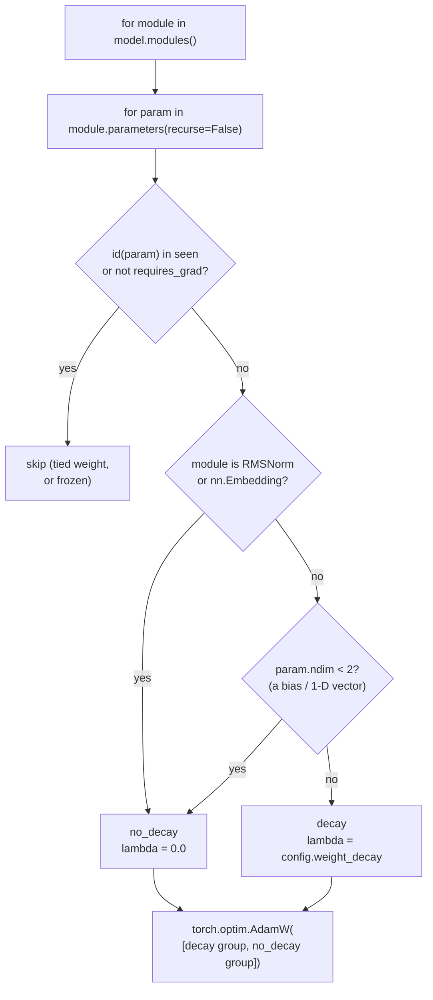
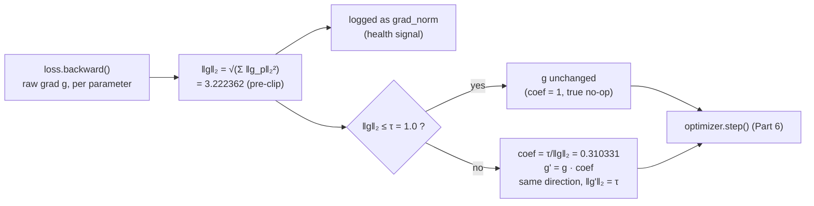
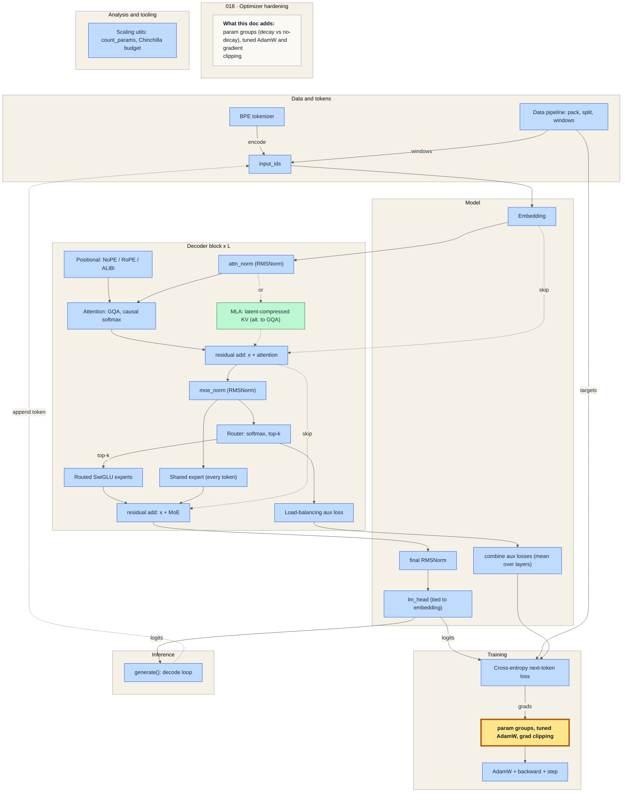

# 018 — Optimizer hardening (param groups, tuned AdamW, gradient clipping): the full derivation, solved by hand

**Companion to:** [`journey_of_a_model/018-optimizer-hardening.md`](../../journey_of_a_model/018-optimizer-hardening.md)
(and, for the forward pass, the loss, the backward pass and the generic
AdamW recurrence it builds on, [`journey_of_a_model/010-training-loop.md`](../../journey_of_a_model/010-training-loop.md)
/ [its companion](010-training-loop.md))
· **Code:** [`qwenmoe/train/optim.py`](../../qwenmoe/train/optim.py),
[`qwenmoe/train/trainer.py`](../../qwenmoe/train/trainer.py),
[`qwenmoe/config.py`](../../qwenmoe/config.py)
· **Every number here is reproduced by:** [`verify_018_optimizer_hardening.py`](verify_018_optimizer_hardening.py)
(`uv run python docs/math/verify_018_optimizer_hardening.py`)

---

## How to read this

The journal entry tells you *what* Task 2 changed — parameters are split
into a weight-decay group and a no-decay group; AdamW's `betas` went from
`(0.9, 0.999)` to `(0.9, 0.95)` and `weight_decay` from `0.01` to `0.1`;
the global gradient norm is clipped at `1.0` and logged — and *why* each
change earns its place.

This document is the other trade-off: **maximum detail, minimum
summarising**. We

1. fix **one** tiny model — the exact 2-layer `QwenMoEModel` from the
   [010 companion](010-training-loop.md), same hand-picked weights — and
   **one** training window,
2. walk **every line** of `split_param_groups` and `build_optimizer`
   ([`optim.py`](../../qwenmoe/train/optim.py)), then the
   `clip_grad_norm_` → `optimizer.step()` pair in
   [`trainer.py`](../../qwenmoe/train/trainer.py), citing `file.py:line`
   at each step,
3. and for every operation — a module walk, an `id()` comparison, a
   quadrature sum, an exponential moving average, a geometric series, a
   Taylor expansion — first derive *why* it has that form, then **do the
   arithmetic digit by digit**, and check it against the real code.

Nothing is skipped. We keep a running **shape ledger** (the group
membership of every parameter) and a running **optimizer-state ledger**.

You do **not** need any background. Every term — scalar, vector, matrix,
tensor, dimension, parameter, gradient, norm, exponential moving
average, geometric series, weight decay — is defined at first use. Skim
[`journey_of_a_model/018-optimizer-hardening.md`](../../journey_of_a_model/018-optimizer-hardening.md)
first for the plain-English picture.

> **Scope — what this document does *not* re-derive.**
> - **The forward pass, the loss, and the backward pass.**
>   [010](010-training-loop.md) already carried the identical model and
>   weights from `input_ids` to `logits` to `loss` to every parameter's
>   `.grad`, digit by digit. [Part 4](#part-4--one-steps-gradient-the-global-2-norm)
>   reproduces the per-parameter gradient *norms* it needs, cites 010, and
>   moves on to the clipping.
> - **The generic AdamW recurrence** (two moments, bias correction, the
>   `m̂ / (√v̂ + ε)` update). [010 Part 6](010-training-loop.md#part-6--adamw-the-update-derived-from-zero)
>   derives it from zero. [Part 6](#part-6--adamw-the-update-with-the-new-constants) here
>   recaps it in three lines and spends its effort on the **one piece 010
>   did not isolate**: the decoupled weight-decay term `θ(1 − γλ)` that the
>   *decay* group gets and the *no-decay* group does not.
> - **Muon** (`TrainConfig.optimizer="muon"`) is Task 4, its own journal
>   entry (`020`). `optim.py` contains its code (`Muon`,
>   `zeropower_via_newtonschulz5`, `CombinedOptimizer`,
>   `split_muon_adamw_params`); this document uses only the `"adamw"`
>   branch of `build_optimizer`.
>
> **The new arithmetic this document owns:** the parameter-group walk and
> its counts; the global gradient 2-norm as a quadrature sum; the exact
> clipping algebra; the decoupled-decay term; and the two "why the
> constants changed" derivations — the **effective averaging window** of
> `β₂` and the **compounding pull** of `weight_decay`.

---

## Part 0 — What "hardening" means

**Training** a neural network means repeatedly nudging its numbers
(**parameters**, a.k.a. **weights** — the individual learnable scalars
inside the model) so its outputs get less wrong. One **step** is one
nudge. [010 Part 0](010-training-loop.md#part-0--what-is-a-training-step)
lays out its five acts: set the learning rate, forward, backward, **clip**,
**update**.

"Hardening" the optimizer means making acts 4 and 5 more robust *without*
changing the model. Three independent changes:

| # | change | acts on | this document |
|---|---|---|---|
| **A** | split parameters into a **weight-decay** group and a **no-decay** group | the *update* (act 5) — a per-parameter `λ` | [Part 2](#part-2--split_param_groups-the-decaynodecay-split-line-by-line), [Part 3](#part-3--build_optimizer-one-adamw-over-two-param-groups) |
| **B** | `β₂`: `0.999 → 0.95`; `weight_decay`: `0.01 → 0.1` | the *update* — the constants inside AdamW | [Part 6](#part-6--adamw-the-update-with-the-new-constants), [Part 7](#part-7--why-β₂--095-the-effective-averaging-window), [Part 8](#part-8--why-weight_decay--01-not-001) |
| **C** | clip the **global gradient norm** at `1.0`, and log the pre-clip value | the *clip* (act 4) | [Part 4](#part-4--one-steps-gradient-the-global-2-norm), [Part 5](#part-5--gradient-clipping) |

A few definitions to carry from here (the rest arrive where they are
used):

- A **scalar** is a single number; a **vector** is an ordered list of
  numbers; a **matrix** is a rectangular grid; a **tensor** is the same
  idea with any number of axes. A tensor's **shape** is the tuple of its
  axis lengths — `(6, 4)` is 6 rows of 4. Its **number of dimensions**
  (`ndim`) is how many axes it has: a vector has `ndim = 1`, a matrix
  `ndim = 2`.
- The **gradient** of the loss `L` with respect to a parameter `θ`,
  written `∂L/∂θ`, is the **slope**: increase `θ` by a tiny `ε` and `L`
  changes by about `(∂L/∂θ)·ε`. The gradient `∇L` is the vector of
  `∂L/∂θ` for *every* parameter at once. `.backward()` computes it.
- **Weight decay** is a small constant pull on a parameter *toward zero*,
  applied every step regardless of the gradient. Its strength is a number
  `λ` (`config.weight_decay`).

---

## Part 1 — The running example

Identical to the [010 companion](010-training-loop.md#part-1--the-running-example),
so the forward/backward it defers to are already solved there. Summarised:

### 1.1 The model

| symbol | meaning | value |
|---|---|---|
| `vocab_size`, `V` | distinct tokens | 6 |
| `d_model`, `d` | width of a token's vector | 4 |
| `n_layers` | transformer blocks | 2 |
| `n_heads` / `n_kv_heads` | attention query / key-value heads | 2 / 1 |
| `d_ff` | per-expert hidden width (SwiGLU) | 3 |
| `n_routed_experts` / `top_k` | MoE experts / picked per token | 2 / 1 |
| `n_shared_experts` | always-on experts | 0 |
| `tie_word_embeddings` | LM head shares the embedding matrix | `True` |

The 28 (tied) weight tensors — one `(6, 4)` embedding, per block an
attention `w_q/w_k/w_v/w_o` and an MoE `router.gate` + two SwiGLU experts'
`w_gate/w_up/w_down`, plus two `RMSNorm` gains per block and one final
`RMSNorm` gain — are pinned to the exact hand-picked values listed in
[010 Part 1.1](010-training-loop.md#11-the-model) and
[`verify_018_optimizer_hardening.py`](verify_018_optimizer_hardening.py).
`RMSNorm` is **root-mean-square normalisation**: it rescales a vector to
unit root-mean-square and then multiplies it, entry by entry, by a learned
**gain** vector initialised to all-ones (derived in
[006's companion](006-full-model-assembly.md)). `SwiGLU` is the gated
feed-forward each expert runs (derived in
[005's companion](005-moe-layer.md)).

### 1.2 The data

One next-token-prediction **window**: input `x = [4, 1, 4]`, target
`y = [1, 4, 1]` (the token stream `[4, 1, 4, 1]` shifted by one). Reused
every step. `batch = 1`, `seq_len = 3`.

### 1.3 The training config

The Task-2 knobs, from `TrainConfig`
([`config.py:103–147`](../../qwenmoe/config.py#L103)):

| field | value | was (PyTorch default) | role |
|---|---|---|---|
| `optimizer` | `"adamw"` | — | which optimizer `build_optimizer` builds |
| `betas` | `(0.9, 0.95)` | `(0.9, 0.999)` | AdamW's two EMA decay rates ([Part 6](#part-6--adamw-the-update-with-the-new-constants), [Part 7](#part-7--why-β₂--095-the-effective-averaging-window)) |
| `adam_eps` | `1e-8` | `1e-8` | AdamW's divide-by-zero guard (unchanged) |
| `weight_decay` | `0.1` | `0.01` | the decay group's `λ` ([Part 8](#part-8--why-weight_decay--01-not-001)) |
| `grad_clip_norm` | `1.0` | — (no clip) | the gradient-norm ceiling `τ` ([Part 5](#part-5--gradient-clipping)) |

Plus, for the concrete step traced in Parts 4–6: `lr = 0.1`,
`warmup_steps = 2`, `total_steps = 5`, `lr_schedule = "cosine"`,
`min_lr_ratio = 0.1` (so the step-1 learning rate is
`γ = 0.1 × 0.5 = 0.05` — the warmup multiplier at step index 0; derived in
[010 Part 3](010-training-loop.md#part-3--the-learning-rate-schedule)).

`config.py`'s `__post_init__` validates every knob
([`config.py:149–189`](../../qwenmoe/config.py#L149)): `betas` both in
`(0, 1)`, `adam_eps > 0`, `weight_decay ≥ 0`, `grad_clip_norm > 0`.

```
TrainConfig (optimizer knobs): optimizer='adamw' betas=(0.9, 0.95)
                               adam_eps=1e-08 weight_decay=0.1 grad_clip_norm=1.0
```

---

## Part 2 — `split_param_groups`: the decay/no-decay split, line by line

Source: [`optim.py:43–71`](../../qwenmoe/train/optim.py#L43), plus the
module-type tuple at [`optim.py:35`](../../qwenmoe/train/optim.py#L35).

### 2.1 Derive — why weight decay, and why *not* on every parameter

**Weight decay** shrinks a parameter toward zero a little every step. Its
purpose: discourage the model from leaning too hard on any one large
weight, which tends to improve **generalisation** — performance on text
the model was *not* trained on, as opposed to memorising quirks of the
training set. (The exact update it adds is derived in
[Part 6.3](#63-the-decay-group-the-decoupled-λθ-term); here we only need
"it pulls θ toward 0".)

That pull is *harmless and mildly helpful* on a big rectangular **weight
matrix** — say an attention projection. Such a matrix has many redundant
paths from input to output; shrinking any single entry a hair barely
changes what the layer computes, so decay's regularising pressure lands
softly.

It is *actively harmful* on two kinds of parameter:

- An **`RMSNorm` gain vector.** It starts at exactly `1.0` (properly
  scaled already) and its whole job is to *rescale* a normalised
  activation. Pulling it toward `0` fights that job directly — it undoes
  the `variance → 1` rescaling the norm exists to perform.
- A **token-embedding row.** Row `t` of the `(V, d)` embedding matrix *is*
  the model's entire learned meaning of token `t`. There is no redundancy
  to regularise; decaying it toward zero just erodes the token's
  representation.

So the split is by **which module a parameter belongs to**, not by its
shape alone — because the embedding matrix is `(V, d) = (6, 4)`, a 2-D
tensor *indistinguishable by shape* from an attention weight matrix.

**Exact vs. empirical.** *Which* parameters to exclude is an
**empirical/convention** choice — it traces to GPT-3 (Brown et al. 2020,
Appendix B), Llama (Touvron et al. 2023), OLMo (Groeneveld et al. 2024),
and Karpathy's nanoGPT `configure_optimizers`, not to one theorem. (nanoGPT
splits purely by `p.dim() ≥ 2` and *does* decay the embedding; this project
additionally excludes the embedding table by module type, the GPT-2/GPT-3
era choice.) Everything downstream of the choice — the walk, the counts —
is exact.

### 2.2 Derive — the classification rule

[`optim.py:35`](../../qwenmoe/train/optim.py#L35):

```python
_NO_DECAY_MODULE_TYPES = (RMSNorm, nn.Embedding)
```

[`optim.py:66`](../../qwenmoe/train/optim.py#L66), for each parameter:

```python
if is_no_decay_module or param.ndim < 2:
    no_decay.append(param)
else:
    decay.append(param)
```

Read the condition as an **OR** of two independent tests:

1. **`is_no_decay_module`** — is the parameter's *owning module* an
   `RMSNorm` or an `nn.Embedding`? (`isinstance(module, _NO_DECAY_MODULE_TYPES)`,
   [`optim.py:61`](../../qwenmoe/train/optim.py#L61).) Catches the embedding
   table (2-D but no-decay) and every norm gain.
2. **`param.ndim < 2`** — does the parameter have fewer than two axes? A
   **bias** vector, or any 1-D tensor. In *this* bias-free model every 1-D
   tensor is already an `RMSNorm` gain, so test 2 fires only where test 1
   already did — it is a safety net for models built with `bias=True`
   somewhere (demonstrated on a throwaway `nn.Linear(4, 4, bias=True)` in
   Part 2.7).

Everything else — `ndim ≥ 2` **and** not a special module — is a weight
matrix, and goes in **`decay`**.

### 2.3 Compute — the `model.modules()` walk

[`optim.py:60–69`](../../qwenmoe/train/optim.py#L60):

```python
for module in model.modules():                       # every sub-module, in registration order
    is_no_decay_module = isinstance(module, _NO_DECAY_MODULE_TYPES)
    for param in module.parameters(recurse=False):   # only THIS module's own parameters
        if not param.requires_grad or id(param) in seen:
            continue
        seen.add(id(param))
        ...
```

Two subtleties before the arithmetic:

- **`model.modules()`** yields the model itself, then every sub-module,
  **depth-first in registration order** — the order the sub-modules were
  assigned in `__init__`. For `QwenMoEModel` that is: `embedding`, then
  `blocks[0]` and everything inside it, then `blocks[1]`, then
  `final_norm`, then `lm_head` (constructed last — this matters in
  Part 2.5).
- **`parameters(recurse=False)`** fetches only a module's *own* directly
  registered parameters, not its children's. Combined with the outer loop
  over *all* modules, every parameter is reached **exactly once via its
  true owning module** — so the `RMSNorm`/`Embedding` type check applies to
  the right module. `seen` (a set of `id()` values — Python's identity of
  an object, i.e. its memory address) guards against a parameter shared by
  two modules being processed twice.

The full walk (`verify` reproduces this table exactly):

| # | parameter | owning module | shape | `n` scalars | group | why |
|---:|---|---|---|---:|---|---|
| 0 | `embedding.weight` | `Embedding` | `(6, 4)` | 24 | **no_decay** | module is `Embedding` (test 1) |
| 1 | `blocks.0.attn_norm.weight` | `RMSNorm` | `(4,)` | 4 | **no_decay** | module is `RMSNorm` |
| 2 | `blocks.0.attn.w_q.weight` | `Linear` | `(4, 4)` | 16 | decay | `ndim 2`, plain module |
| 3 | `blocks.0.attn.w_k.weight` | `Linear` | `(2, 4)` | 8 | decay | `ndim 2`, plain module |
| 4 | `blocks.0.attn.w_v.weight` | `Linear` | `(2, 4)` | 8 | decay | `ndim 2`, plain module |
| 5 | `blocks.0.attn.w_o.weight` | `Linear` | `(4, 4)` | 16 | decay | `ndim 2`, plain module |
| 6 | `blocks.0.moe_norm.weight` | `RMSNorm` | `(4,)` | 4 | **no_decay** | module is `RMSNorm` |
| 7 | `blocks.0.moe.router.gate.weight` | `Linear` | `(2, 4)` | 8 | decay | `ndim 2`, plain module |
| 8 | `blocks.0.moe.routed_experts.0.w_gate.weight` | `Linear` | `(3, 4)` | 12 | decay | `ndim 2`, plain module |
| 9 | `blocks.0.moe.routed_experts.0.w_up.weight` | `Linear` | `(3, 4)` | 12 | decay | `ndim 2`, plain module |
| 10 | `blocks.0.moe.routed_experts.0.w_down.weight` | `Linear` | `(4, 3)` | 12 | decay | `ndim 2`, plain module |
| 11–13 | `blocks.0.moe.routed_experts.1.{w_gate,w_up,w_down}.weight` | `Linear` | `(3,4)`,`(3,4)`,`(4,3)` | 12+12+12 | decay | `ndim 2`, plain module |
| 14 | `blocks.1.attn_norm.weight` | `RMSNorm` | `(4,)` | 4 | **no_decay** | module is `RMSNorm` |
| 15–18 | `blocks.1.attn.{w_q,w_k,w_v,w_o}.weight` | `Linear` | `(4,4)`,`(2,4)`,`(2,4)`,`(4,4)` | 16+8+8+16 | decay | `ndim 2`, plain module |
| 19 | `blocks.1.moe_norm.weight` | `RMSNorm` | `(4,)` | 4 | **no_decay** | module is `RMSNorm` |
| 20 | `blocks.1.moe.router.gate.weight` | `Linear` | `(2, 4)` | 8 | decay | `ndim 2`, plain module |
| 21–26 | `blocks.1.moe.routed_experts.{0,1}.{w_gate,w_up,w_down}.weight` | `Linear` | … | 6 × 12 | decay | `ndim 2`, plain module |
| 27 | `final_norm.weight` | `RMSNorm` | `(4,)` | 4 | **no_decay** | module is `RMSNorm` |
| 28 | `lm_head.weight` | `Linear` | `(6, 4)` | 24 | **SKIP** | `id()` already in `seen` (Part 2.5) |

(Rows 11–13, 15–18, 21–26 collapsed for width; `verify` prints all 29
lines. The `#` column is the visit order, not a stable index.)

### 2.4 Compute — the counts

```
decay    : 22 tensors, 256 scalars
no_decay :  6 tensors,  44 scalars
total    : 28 tensors, 300 scalars   (256 + 44 == 300)
no_decay names: ['blocks.0.attn_norm.weight', 'blocks.0.moe_norm.weight',
                 'blocks.1.attn_norm.weight', 'blocks.1.moe_norm.weight',
                 'embedding.weight', 'final_norm.weight']
```

Check the scalar arithmetic by hand:

- **no_decay** = one `(6, 4)` embedding + five `(4,)` `RMSNorm` gains
  (two per block + the final one) `= 24 + 5 × 4 = 24 + 20 = 44`. ✓
- **decay** = `300 − 44 = 256` (using 006's total parameter count of 300).
  Or directly: per block `w_q 16 + w_k 8 + w_v 8 + w_o 16 + router 8 +
  2 experts × (12 + 12 + 12) = 56 + 72 = 128`; two blocks `= 256`. ✓
- **28 tensors** = 22 + 6; but `model.parameters()` also yields 300
  scalars total including the tied `lm_head.weight`, because that *is* the
  same object as `embedding.weight` — counted once, in `no_decay`.

**Shape ledger** (group membership — the thing this document tracks):

| group | `λ` (Part 3) | tensors | scalars | contents |
|---|---:|---:|---:|---|
| `decay` | 0.1 | 22 | 256 | every attention / expert / router weight matrix |
| `no_decay` | 0.0 | 6 | 44 | the embedding table + five `RMSNorm` gains |

### 2.5 Compute — the tied `lm_head`, and why it lands in `no_decay`

`tie_word_embeddings=True` (the default) makes
[`QwenMoEModel.__init__`](../../qwenmoe/model/transformer.py#L54) do:

```python
self.embedding = nn.Embedding(config.vocab_size, config.d_model)   # constructed 1st
...
self.lm_head = nn.Linear(config.d_model, config.vocab_size, bias=False)   # constructed later
if config.tie_word_embeddings:
    self.lm_head.weight = self.embedding.weight       # lm_head now POINTS AT the embedding tensor
```

After that line, `lm_head.weight` and `embedding.weight` are **one and the
same `Parameter` object** — same `id()`, same memory. The walk reaches
`embedding` first (registered first), classifies that shared object as
`no_decay`, and adds its `id()` to `seen`. When the walk later reaches
`lm_head` — an `nn.Linear`, which is *not* in `_NO_DECAY_MODULE_TYPES` —
the `id(param) in seen` test at
[`optim.py:63`](../../qwenmoe/train/optim.py#L63) is `True`, so it is
**skipped, not re-classified**. The tie is therefore broken *by
registration order*, deterministically, in favour of `no_decay`:

```
tied lm_head.weight is embedding.weight : True
that shared tensor appears in the groups exactly 1 time (-> no_decay)
```

> **Why identity, not module type, decides the tie.** If the tie were
> resolved by "which module has priority", you would need a rule. It is
> resolved instead by "who got there first", and `__init__` puts
> `embedding` first. Flip the constructor order and a tied weight would
> land in `decay` — so the ordering in `transformer.py` is load-bearing,
> and [`tests/test_optim.py::test_split_param_groups_tied_embedding_counted_once`](../../tests/test_optim.py#L74)
> pins it.

### 2.6 Compute — the untied case

With `tie_word_embeddings=False`, `lm_head.weight` is its **own** `(6, 4)`
tensor, owned by an `nn.Linear` (plain module), `ndim = 2` → **decay**:

```
--- untied variant: tie_word_embeddings=False ---
lm_head.weight is embedding.weight : False
decay    : 23 tensors, 280 scalars      (+1 tensor, +24 scalars vs tied)
no_decay :  6 tensors,  44 scalars      (unchanged)
lm_head.weight   -> decay      (its own 2-D Linear weight)
embedding.weight -> no_decay   (still an nn.Embedding)
```

`256 + 24 = 280` ✓. The embedding table stays in `no_decay` either way —
only the *output projection* moves.

### 2.7 The `ndim < 2` clause, demonstrated

This model is bias-free, so to show the second half of the OR firing on
its own, `verify` hands `split_param_groups` a throwaway
`nn.Sequential(nn.Linear(4, 4, bias=True))`:

```
(probe) nn.Linear(4,4,bias=True): weight -> decay, bias (ndim 1) -> no_decay  [ndim<2 clause]
```

The `(4, 4)` weight is `decay`; the `(4,)` bias has `ndim = 1 < 2` →
`no_decay`, even though `nn.Linear` is not a special module type.



---

## Part 3 — `build_optimizer`: one AdamW over two param groups

Source: [`optim.py:265–279`](../../qwenmoe/train/optim.py#L265) (the
`"adamw"` branch).

```python
decay, no_decay = split_param_groups(model)                        # optim.py:271

if config.optimizer == "adamw":
    groups = [
        {"params": decay,    "weight_decay": config.weight_decay, "base_lr": config.lr},
        {"params": no_decay, "weight_decay": 0.0,                 "base_lr": config.lr},
    ]
    groups = [g for g in groups if g["params"]]                    # optim.py:278
    return torch.optim.AdamW(groups, lr=config.lr,
                             betas=config.betas, eps=config.adam_eps)
```

**Derive.** A PyTorch optimizer accepts either a flat list of parameters
*or* a list of **parameter groups** — dicts, each with its own `params`
and its own hyper-parameter overrides. Anything a group does not override
falls back to the optimizer-level value. So:

- both groups inherit `lr = config.lr = 0.1`, `betas = (0.9, 0.95)`,
  `eps = 1e-8` — read from `TrainConfig`, **not** PyTorch's
  `betas=(0.9, 0.999)` / `weight_decay=0.01` defaults;
- the `decay` group overrides `weight_decay = 0.1`; the `no_decay` group
  overrides `weight_decay = 0.0`.
- `"base_lr"` is stamped on each group so the trainer's LR schedule can
  scale from a fixed peak (see
  [`_set_lr`, trainer.py:118](../../qwenmoe/train/trainer.py#L118) and
  [010 Part 3](010-training-loop.md#part-3--the-learning-rate-schedule)).
- **`groups = [g for g in groups if g["params"]]`** — `torch.optim.AdamW`
  raises `ValueError: optimizer got an empty parameter list` if handed a
  group with no parameters. A model that somehow had *no* `RMSNorm` and no
  embedding would produce an empty `no_decay`; the filter drops it. Here
  both groups are non-empty, so the filter is a no-op.

**Compute.**

```
optimizer type : AdamW
 group 0: 22 tensors  weight_decay=0.1  betas=(0.9, 0.95)  eps=1e-08  lr=0.1  base_lr=0.1
 group 1:  6 tensors  weight_decay=0.0  betas=(0.9, 0.95)  eps=1e-08  lr=0.1  base_lr=0.1
every model parameter is covered by exactly one group; wd in {0.1, 0.0}
```

The set of parameter `id()`s across both groups equals the set of the
model's `requires_grad` parameters exactly — no parameter missed, none
double-counted ([`tests/test_optim.py::test_build_optimizer_covers_every_model_parameter`](../../tests/test_optim.py#L112)).

---

## Part 4 — One step's gradient: the global 2-norm

### 4.1 The backward pass — cited, not re-derived

We run the real forward + backward on the one window
([`_forward_backward_core`, trainer.py:176](../../qwenmoe/train/trainer.py#L176)):
`model(x)` → `logits` → `loss = F.cross_entropy(...) + aux_loss` →
`loss.backward()`.

```
lm_loss 2.573154   aux_loss 0.011424   total 2.584578   (== 010's step-1 loss)
```

[010 Parts 4–5](010-training-loop.md#part-4--the-forward-half-logits--loss)
derive `logits`, the loss, `∂L/∂logits = (softmax − onehot)/N`, and a full
by-hand `∂L/∂ final_norm.weight` checked against autograd. We take the
`.grad` tensors as given and go straight to what clipping needs: their
**norms**.

- **Norm** (here always the **L2 norm**, a.k.a. Euclidean norm) of a
  vector `a` with entries `a₁ … aₙ`:
  `‖a‖₂ = √(a₁² + a₂² + … + aₙ²)` — its straight-line length (Pythagoras
  generalised to `n` axes). For a matrix or higher tensor, flatten it to
  one long vector first: `‖A‖₂ = √(sum of every entry squared)`. **Exact**
  — it is a definition.

### 4.2 Six expert matrices receive no gradient this step

`top_k = 1` and the pinned router send **all three tokens to routed
expert 0** in both layers (the journal's
`expert_token_counts = [[3, 0], [3, 0]]`). Expert 1 processes zero tokens,
so — by the zero-token skip derived in
[005's companion](005-moe-layer.md) — its `w_gate/w_up/w_down` are never
touched in the forward pass and get **`.grad = None`**:

```
blocks.0.moe.routed_experts.1.w_gate.weight   -- (no gradient this step)
blocks.0.moe.routed_experts.1.w_up.weight     -- (no gradient this step)
blocks.0.moe.routed_experts.1.w_down.weight   -- (no gradient this step)
blocks.1.moe.routed_experts.1.w_gate.weight   -- (no gradient this step)
blocks.1.moe.routed_experts.1.w_up.weight     -- (no gradient this step)
blocks.1.moe.routed_experts.1.w_down.weight   -- (no gradient this step)

tensors with a gradient this step : 22   without : 6
```

`clip_grad_norm_` **skips `None` grads** (they contribute 0 to the norm),
and `optimizer.step()` skips them too (no moment update). This is not an
edge case — it is *routine* for an MoE, and it is one reason LM gradient
statistics are non-stationary from step to step ([Part 7.6](#76-the-consequence--an-overconfident-step)).

### 4.3 The global 2-norm as a quadrature sum

**Derive.** Gradient-norm clipping needs the size of the **whole**
gradient — every parameter's `.grad`, conceptually stacked into one giant
vector `g` of length 300 (here, 228 after the 72 missing expert scalars).
Its L2 norm is `√(Σ gₖ²)` over all entries `k`. Grouping the sum by
parameter tensor `p`:

```
‖g‖₂ = √( Σ_k gₖ² ) = √( Σ_p (Σ_{k ∈ p} gₖ²) ) = √( Σ_p ‖g_p‖₂² )
```

— the sum of squares is **additive across tensors**, so the global norm is
the square root of the sum of each tensor's *squared* norm. This is
exactly what
[`torch.nn.utils.clip_grad_norm_`](../../qwenmoe/train/trainer.py#L297)
computes internally (it calls `.norm()` per tensor, stacks the results,
and takes *their* norm — same thing). **Exact** — Pythagoras.

**Compute.** The 22 tensors that have a gradient (`verify` prints all 22):

| parameter | `‖g_p‖₂` | `‖g_p‖₂²` |
|---|---:|---:|
| `embedding.weight` | 2.005920 | 4.023716 |
| `blocks.0.attn_norm.weight` | 0.373149 | 0.139240 |
| `blocks.0.attn.w_q.weight` | 0.324385 | 0.105226 |
| `blocks.0.attn.w_k.weight` | 0.167090 | 0.027919 |
| `blocks.0.attn.w_v.weight` | 0.618002 | 0.381926 |
| `blocks.0.attn.w_o.weight` | 1.610869 | 2.594899 |
| `blocks.0.moe_norm.weight` | 0.049409 | 0.002441 |
| `blocks.0.moe.router.gate.weight` | 0.005789 | 0.000034 |
| `blocks.0.moe.routed_experts.0.w_gate.weight` | 0.831037 | 0.690623 |
| `blocks.0.moe.routed_experts.0.w_up.weight` | 0.121006 | 0.014642 |
| `blocks.0.moe.routed_experts.0.w_down.weight` | 0.052772 | 0.002785 |
| `blocks.1.attn_norm.weight` | 0.124379 | 0.015470 |
| `blocks.1.attn.w_q.weight` | 0.126799 | 0.016078 |
| `blocks.1.attn.w_k.weight` | 0.041424 | 0.001716 |
| `blocks.1.attn.w_v.weight` | 0.195937 | 0.038391 |
| `blocks.1.attn.w_o.weight` | 1.100210 | 1.210462 |
| `blocks.1.moe_norm.weight` | 0.091020 | 0.008285 |
| `blocks.1.moe.router.gate.weight` | 0.006580 | 0.000043 |
| `blocks.1.moe.routed_experts.0.w_gate.weight` | 0.549015 | 0.301418 |
| `blocks.1.moe.routed_experts.0.w_up.weight` | 0.151500 | 0.022952 |
| `blocks.1.moe.routed_experts.0.w_down.weight` | 0.092850 | 0.008621 |
| `final_norm.weight` | 0.881322 | 0.776728 |
| *(6 expert-1 matrices)* | — | 0 |

Add the squared column in blocks (digit by digit):

- `embedding` → **4.023716**
- block-0 attention `0.139240 + 0.105226 + 0.027919 + 0.381926 + 2.594899`
  → **3.249210**
- block-0 MoE `0.002441 + 0.000034 + 0.690623 + 0.014642 + 0.002785`
  → **0.710525**
- block-1 attention `0.015470 + 0.016078 + 0.001716 + 0.038391 + 1.210462`
  → **1.282117**
- block-1 MoE `0.008285 + 0.000043 + 0.301418 + 0.022952 + 0.008621`
  → **0.341319**
- `final_norm` → **0.776728**

Total: `4.023716 + 3.249210 + 0.710525 + 1.282117 + 0.341319 + 0.776728`
`= 10.383615`.

```
‖g‖₂ = √10.383615 = 3.222362
```

(Check the square root: `3.22² = 10.3684`, `3.223² = 10.38773`,
`3.2224² = 10.38386` — so `3.222362` is right to 6 places.
`torch.nn.utils.clip_grad_norm_(..., max_norm=inf)` returns the same
`3.222362`, confirming the quadrature identity.)

Three tensors carry 75% of the total: `embedding` (38.8%),
`blocks.0.attn.w_o` (25.0%), `blocks.1.attn.w_o` (11.7%). The residual
write-back projections and the token identities dominate; the router
gradients (`3.4e-5`, `4.3e-5`) are almost nothing.

**Shape ledger.**

| tensor | shape | `‖g_p‖₂²` contribution |
|---|---|---:|
| every parameter's `.grad` | same shape as the parameter | one non-negative scalar |
| stacked | conceptual length-300 vector `g` | `‖g‖₂ = √(Σ ‖g_p‖₂²) = 3.222362` |

---

## Part 5 — Gradient clipping

Source: [`trainer.py:432`](../../qwenmoe/train/trainer.py#L432) (inside
`_run_step`, between the accumulation loop and `optimizer.step()`):

```python
grad_norm = torch.nn.utils.clip_grad_norm_(model.parameters(), config.grad_clip_norm)
optimizer.step()
```

### 5.1 Derive — the clipping formula

Occasionally a batch produces a **freak gradient** — one enormous spike
(an unusual routing collapse, a rare hard example) that, applied, would
fling the weights into a much worse region and spike the loss, sometimes
irrecoverably. AdamW's per-parameter scaling does not fully protect
against this. **Gradient-norm clipping** caps the *overall size* of the
gradient while leaving its *direction* exactly intact.

Let `g` be the full gradient vector and `τ = grad_clip_norm`. The clipped
gradient is

```
g' = g · min(1, τ / ‖g‖₂)
```

- If `‖g‖₂ ≤ τ` already: `τ/‖g‖₂ ≥ 1`, so `min(1, …) = 1` and `g' = g`
  **exactly** — a true no-op, not an approximation.
- If `‖g‖₂ > τ`: the factor is `coef = τ/‖g‖₂ < 1`. Every entry of `g` is
  multiplied by the *same positive* `coef`, so `g'` points in exactly the
  same direction as `g` (a positive scalar multiple), and its length is
  `‖g'‖₂ = coef · ‖g‖₂ = (τ/‖g‖₂) · ‖g‖₂ = τ` — capped exactly at the
  ceiling.

**Exact** — this is scaling a vector to a target length. The *only*
non-derived quantity is `τ` itself, a hyper-parameter (`1.0`, the
GPT-3 / PaLM / Llama default; originally Pascanu, Mikolov & Bengio 2013 for
RNN exploding gradients).

### 5.2 Compute — the coefficient and the clipped gradient

```
grad_clip_norm  τ            : 1.0
‖g‖₂                         : 3.222362        (> τ  ->  clipping fires)
clip coefficient  τ/‖g‖₂     : 0.310331
```

`1.0 / 3.222362 = 0.310331`. Every parameter's gradient is multiplied by
`0.310331`. For `final_norm.weight` (raw grad `[0.144562, 0.521498,
−0.061706, 0.692865]`, hand-derived through the tied head + `RMSNorm` in
[010 Part 5](010-training-loop.md#part-5--the-backward-half-solved-by-hand-where-the-chain-is-short)):

```
raw     : [ 0.144562,  0.521498, -0.061706,  0.692865]
× 0.310331 each entry:
0.144562 × 0.310331 =  0.044862
0.521498 × 0.310331 =  0.161837
-0.061706 × 0.310331 = -0.019149
0.692865 × 0.310331 =  0.215018
clipped : [ 0.044862,  0.161837, -0.019149,  0.215018]
```

### 5.3 Compute — direction preserved, magnitude capped

Each clipped entry ÷ its raw entry equals `0.310331` — one shared positive
factor, so the direction is untouched. And measuring the *whole*
gradient's norm again after the in-place call:

```
clip_grad_norm_ RETURN value : 3.222362     (the *pre-clip* norm)
actual ‖g‖₂ AFTER the call   : 1.000000     (== τ exactly)
```

### 5.4 Derive — why the *pre-clip* norm is what gets returned and logged

`torch.nn.utils.clip_grad_norm_` computes `‖g‖₂` **before** it rescales,
and returns *that* value (its documented behaviour). `_run_step` passes it
up as `grad_norm`, and the trainer writes it into the JSON-lines step log
([`trainer.py:659`](../../qwenmoe/train/trainer.py#L659), key
`"grad_norm"`). This is deliberate: the post-clip norm is always either
`‖g‖₂` (no clip) or exactly `τ` (clipped) — it carries **no information**.
The pre-clip norm is a **training-health signal**: a value persistently at
or above `τ` means clipping is *actively engaging*, which often precedes a
loss spike. Here `3.22` on step 1 says the pinned toy weights started in a
strained spot — even though the applied step (Part 6) was tame.



---

## Part 6 — AdamW: the update, with the new constants

Source: PyTorch's `torch.optim.AdamW`, built at
[`optim.py:279`](../../qwenmoe/train/optim.py#L279); the step runs at
[`trainer.py:433`](../../qwenmoe/train/trainer.py#L433).

### 6.1 Recap — the recurrence (full derivation in 010 Part 6)

An **exponential moving average (EMA)** of a stream `x₁, x₂, …` with decay
rate `β ∈ [0, 1)` is `aₜ = β aₜ₋₁ + (1 − β) xₜ`, `a₀ = 0` — keep a
fraction `β` of the old summary, mix in `(1 − β)` of the new value. Larger
`β` = longer memory.

Per parameter, with (clipped) gradient `gₜ` at step `t`, AdamW keeps two
EMAs — a **first moment** `mₜ` (of the gradient) and a **second moment**
`vₜ` (of the *squared* gradient) — then **bias-corrects** them (they start
at 0, so early values are shrunk; dividing by `1 − βᵗ` undoes it exactly)
and takes the step:

```
mₜ = β₁ mₜ₋₁ + (1 − β₁) gₜ            β₁ = 0.9
vₜ = β₂ vₜ₋₁ + (1 − β₂) gₜ²           β₂ = 0.95   (was 0.999)
m̂ₜ = mₜ / (1 − β₁ᵗ)      v̂ₜ = vₜ / (1 − β₂ᵗ)
θ ← θ − γ · m̂ₜ / (√v̂ₜ + ε)          ε = 1e-8
```

Dividing `m̂ₜ` by `√v̂ₜ` (the gradient's typical magnitude for *this*
parameter) makes the effective step size about `1` per parameter,
whatever that parameter's gradient scale — the "adaptive" part. All of
this is derived digit by digit in
[010 Part 6](010-training-loop.md#part-6--adamw-the-update-derived-from-zero).

### 6.2 Step 1, no-decay group — `final_norm.weight`

`t = 1`, `γ = 0.05`, `m₀ = v₀ = 0`. The clipped gradient from Part 5.2:
`g'₁ = [0.044862, 0.161837, −0.019149, 0.215018]`.

```
m₁ = 0.9·0 + 0.1·g'₁ = [0.0044862, 0.0161837, −0.0019149, 0.0215018]
v₁ = 0.95·0 + 0.05·g'₁²
     component 0: 0.05 × 0.044862² = 0.05 × 0.00201260 = 0.00010063
   → [0.00010063, 0.00130957, 0.00001833, 0.00231163]
```

**Bias correction at `t = 1`:** `1 − β₁¹ = 0.1`, `1 − β₂¹ = 0.05`. These
*exactly cancel* the `(1 − β)` factors in `m₁`, `v₁`:

```
m̂₁ = m₁ / 0.1  = g'₁
v̂₁ = v₁ / 0.05 = g'₁²
```

**The ratio** is therefore `g'₁ / (√(g'₁²) + ε) = g'₁ / (|g'₁| + 1e-8) ≈ sign(g'₁)`:

```
m̂₁ / (√v̂₁ + ε) : [0.99999976, 0.99999988, −0.99999952, 0.99999994]   ( == sign(g'₁) )
```

**At the first step, every parameter's update direction is exactly
`±1` — the sign of its gradient** — the magnitude drops out completely.
(This is a `t = 1`-from-zero identity; by step 2 momentum carries
magnitude and the ratio drifts off `±1` — see
[010 Part 7](010-training-loop.md#part-7--steps-25-momentum-becomes-visible).)

**Update — no `λ` term** (`no_decay` group, `weight_decay = 0.0`), from
`w₀ = [1, 1, 1, 1]`:

```
w₁ = w₀ − γ·sign(g'₁) = 1 − 0.05·[+1, +1, −1, +1] = [0.95, 0.95, 1.05, 0.95]
real optimizer                                    = [0.95, 0.95, 1.05, 0.95]  ✓
```

### 6.3 Step 1, decay group — the decoupled `λθ` term

This is the **one piece of arithmetic Task 2 adds** over 010's account.

**Derive.** Plain "L2 regularisation" folds decay into the gradient:
`gₜ ← gₜ + λθ`. But then it flows through `mₜ`, `vₜ` and the `√v̂ₜ`
divide — so a parameter with big gradients gets *less* decay, which is
backwards. **AdamW** (Loshchilov & Hutter 2019) **decouples** it: apply
the shrink straight to the weight, outside the adaptive machinery:

```
θ ← θ · (1 − γλ)                       then      θ ← θ − γ · m̂ₜ / (√v̂ₜ + ε)
```

For the `no_decay` group `λ = 0`, so `(1 − γ·0) = 1` and the first line is
a genuine no-op — which is why Part 6.2 skipped it. For the `decay` group
`λ = 0.1`.

*That decoupling is the right fix* is **empirical** (the AdamW paper's
experiments); the algebra of both forms is exact.

**Compute** — `blocks.0.attn.w_q.weight`, pinned to the `4×4` identity, so
entry `[0,0] = 1.0` and `[0,1] = 0.0`. It is in the `decay` group. Its
clipped gradient at `[0,0]` is `+0.037371 > 0` (from autodiff through both
blocks; `verify` recovers it from the optimizer state).

```
entry [0,0] = 1.0:
    decay:  1 · (1 − γλ) = 1 · (1 − 0.05·0.1) = 1 · 0.995 = 0.995
    step:   0.995 − γ·sign(g') = 0.995 − 0.05·(+1) = 0.945
    real : 0.945000  ✓

entry [0,1] = 0.0:
    decay:  0 · 0.995 = 0            (decay does NOTHING to a zero weight)
    step:   0 − 0.05·(+1) = −0.050
    real : −0.050000  ✓
```

The decay term is **proportional to the weight**: it shaves `γλ·|θ|` — here
`0.005` off a weight of `1`, and `0` off a weight of `0`. Over a run this
compounds ([Part 8](#part-8--why-weight_decay--01-not-001)).

**Optimizer-state ledger** after step 1:

| group | example param | `θ₀` | `θ₁` | note |
|---|---|---|---|---|
| `no_decay` | `final_norm.weight` | `[1,1,1,1]` | `[0.95, 0.95, 1.05, 0.95]` | `θ₀ − γ·sign(g')` |
| `decay` | `w_q[0,0]` | `1.0` | `0.945` | `θ₀(1−γλ) − γ·sign(g')` — extra `−0.005` |

### 6.4 Where `β₂` does *not* matter: step 1

At `t = 1` from a zero start, `v̂₁ = v₁ / (1 − β₂¹) = ((1−β₂)g'₁²)/(1−β₂) = g'₁²`
for **any** `β₂`. So `β₂ = 0.999` gives the *identical* first step:

```
(beta2=0.999 gives the same v_hat = g'^2 at t=1 -> identical first step)
```

`β₂` only starts to matter once `vₜ` has accumulated several gradients
*and* those gradients' scale shifts — a many-step phenomenon. That is
Part 7.

---

## Part 7 — Why `β₂ = 0.95`: the effective averaging window

**Claim (journal):** `β₂ = 0.999` gives `vₜ` a memory of roughly the last
*1000* steps; `β₂ = 0.95`, roughly the last *20*. Language-model gradients
are non-stationary, so the long memory chases stale statistics and lets
AdamW take an overconfident step. This Part derives "roughly 1000 / 20"
from scratch and demonstrates the overconfident step.

### 7.1 Derive — the weight `vₜ` puts on each past squared gradient

Unroll `vₜ = β₂ vₜ₋₁ + (1 − β₂) gₜ²` from `v₀ = 0`:

```
v₁ = (1−β₂) g₁²
v₂ = β₂(1−β₂) g₁² + (1−β₂) g₂²
v₃ = β₂²(1−β₂) g₁² + β₂(1−β₂) g₂² + (1−β₂) g₃²
...
vₜ = (1−β₂) Σ_{i=1}^{t} β₂^{t−i} gᵢ²
```

Write `k = t − i` for "how many steps ago" (`k = 0` is the current
gradient). The weight on the squared gradient from `k` steps back is

```
w_k = (1 − β₂) · β₂^k
```

a **geometric sequence** — each term is `β₂` times the one before. **Exact
algebra** (just unrolling a recurrence).

### 7.2 Derive — the weights sum to 1

A **geometric series** `Σ_{k=0}^{∞} r^k` with `|r| < 1` equals `1/(1 − r)`
(standard result: multiply the partial sum `Sₙ = 1 + r + … + rⁿ` by `r`,
subtract, get `Sₙ(1 − r) = 1 − rⁿ⁺¹`, let `n → ∞`). So

```
Σ_{k=0}^{∞} w_k = (1 − β₂) · Σ_{k=0}^{∞} β₂^k = (1 − β₂) · 1/(1 − β₂) = 1
```

Once `t` is large (`β₂ᵗ ≈ 0`), `vₜ` is a genuine **weighted average** of
past squared gradients — weights non-negative, summing to 1, not just a
sum. (For small `t` the weights sum to `1 − β₂ᵗ` instead; the
`v̂ₜ = vₜ/(1 − β₂ᵗ)` bias correction of [Part 6.1](#61-recap--the-recurrence-full-derivation-in-010-part-6)
rescales them back to sum 1 — exactly.) **Exact.** `verify` confirms
`Σ w_k = 1.00000000` for both `β₂`.

### 7.3 Derive — the mean lag (`β₂ / (1 − β₂)`)

"How old, on average, is the squared gradient `vₜ` reflects?" is the
**mean** of the lag `k` under the weights `w_k`:

```
mean lag = Σ_{k=0}^{∞} k · w_k = (1 − β₂) · Σ_{k=0}^{∞} k · β₂^k
```

Using `Σ_{k=0}^{∞} k rᵏ = r / (1 − r)²` (differentiate `Σ rᵏ = 1/(1−r)`
with respect to `r` and multiply by `r`):

```
mean lag = (1 − β₂) · β₂ / (1 − β₂)² = β₂ / (1 − β₂)
```

**Exact.**

| `β₂` | mean lag `β₂/(1−β₂)` | half-life `ln(0.5)/ln β₂` |
|---|---:|---:|
| 0.95 | **19.0** steps | 13.5 steps |
| 0.999 | **999.0** steps | 692.8 steps |

`verify` sums the series numerically: `19.0000` and `999.0000`, matching
the closed form.

### 7.4 Derive — the `1/e` characteristic length, and the Taylor step

Another reading of "window": how many steps `N` until a gradient's weight
has decayed to `1/e ≈ 0.368` of its starting value (`e ≈ 2.71828`, the
base of natural logarithms)? Solve `β₂^N = 1/e`:

```
N · ln β₂ = −1        ⇒        N = −1 / ln β₂          [EXACT, given the "1/e" definition]
```

| `β₂` | `−1 / ln β₂` (exact) |
|---|---:|
| 0.95 | 19.4957 |
| 0.999 | 999.4999 |

Now the **approximation the journal names**. Write `β₂ = 1 − u` with
`u = 1 − β₂` small. The Taylor series of the natural logarithm near 1 is
`ln(1 − u) = −u − u²/2 − u³/3 − …`. Keep only the first term:

```
ln β₂ ≈ −u = −(1 − β₂)        ⇒        N ≈ 1 / (1 − β₂)
```

| `β₂` | `1/(1−β₂)` (Taylor approx) | error vs exact |
|---|---:|---:|
| 0.95 | 20.0 | +2.6% |
| 0.999 | 1000.0 | +0.05% |

**The dropping of the `−u²/2 − …` tail is the approximation** — the
geometric-series algebra before it (Parts 7.1–7.3) is exact, and the
approximation gets better as `β₂ → 1` (the tail shrinks). So "`β₂ = 0.999`
≈ 1000-step window, `β₂ = 0.95` ≈ 20-step window" is a first-order Taylor
statement, accurate to a few percent, on top of exact algebra.

### 7.5 Compute — a regime change, checked against the real optimizer

**Setup.** Suppose `vₜ` has settled at a squared-gradient level
`s_old = 1` (constant `g² = 1` for a long time, so `vₜ = 1`), and then the
squared gradient jumps to `s_new = 100` and stays there — a 10× jump in
gradient *scale*. With `v₀ = s_old` and constant input `s_new`, the
recurrence `vₙ = β₂ vₙ₋₁ + (1 − β₂) s_new` has the exact closed-form
solution

```
vₙ = s_new · (1 − β₂ⁿ) + s_old · β₂ⁿ
```

(check: `n = 0` gives `s_old`; substitute back into the recurrence and it
holds). **Exact.**

**Compute** (`s_old = 1`, `s_new = 100`), and — the "no fabricated
numbers" check — run the *same* synthetic squared-gradient sequence
through the **real `torch.optim.AdamW`** (state warmed to `v = 1` over
20000 steps, then 50 steps at `g² = 100`) and read its internal
`exp_avg_sq`:

```
beta2 = 0.95                                    beta2 = 0.999
  n   v_n closed  v_n real   1/√v_n              v_n closed  v_n real   1/√v_n
  1     5.95000    5.95000   0.4100  (4.1×)       1.09900    1.09897   0.9539  (9.5×)
  5    23.39569   23.39569   0.2067  (2.1×)       1.49401    1.49398   0.8181  (8.2×)
 10    40.72504   40.72504   0.1567  (1.6×)       1.98556    1.98553   0.7097  (7.1×)
 20    64.50989   64.50989   0.1245  (1.2×)       2.96130    2.96127   0.5811  (5.8×)
 50    92.38245   92.38243   0.1040  (1.0×)       5.83064    5.83061   0.4141  (4.1×)
```

Closed form vs. real optimizer agree to better than `1e-4` at every
checkpoint (the tiny gap is the imperfect warm-up — `exp_avg_sq` reached
`0.99997`, not exactly `1` — plus float32 rounding). The "`×`" column is
`(1/√vₙ) ÷ (1/√s_new)` — how many times *too large* the step-size factor
is, given the true current standard deviation is `√100 = 10`.

### 7.6 The consequence — an overconfident step

AdamW's step is `γ · m̂ₜ / (√v̂ₜ + ε)`. When `vₜ` **understates** the true
current squared-gradient scale, `√v̂ₜ` is too small, so the divide inflates
the step:

- **`β₂ = 0.95`:** 50 steps after the jump, `v ≈ 92.4` — essentially the
  true `100`. Step-size factor `1/√92.4 = 0.104`, within 4% of the correct
  `0.100`. The window *caught up*.
- **`β₂ = 0.999`:** 50 steps after the jump, `v ≈ 5.8` — still dominated by
  the *old* low-variance regime. Step-size factor `1/√5.8 = 0.414` —
  **4.1× too large**, precisely when gradients are largest. That is the
  mechanism behind mid-training loss spikes.

```
after 50 steps in the high-variance regime, step-size factor 1/√v:
  beta2=0.95  : 0.1040   (true 0.1000;  1.04×)
  beta2=0.999 : 0.4141   (true 0.1000;  4.14×  <- overconfident)
```

**Why LM gradients are non-stationary** (so a regime change is normal, not
exotic): a batch of dialogue is statistically unlike a batch of code; the
learning rate itself is on a schedule; and — visible right here in
Part 4.2 — **MoE routing changes which experts even receive a gradient
from step to step**. A 1000-step average smooths straight over all of
that; a 20-step one tracks it. `β₂ = 0.95` is **empirical** — it matches
GPT-3 (Appendix B), Llama, and OLMo — but the *reason* it helps is the
exact window arithmetic above.

### 7.7 Why the running example's own 5-step run can't show this

010's 5-step run on the fixed window has pre-clip norms
`3.22 → 1.97 → 1.16 → 0.38 → 0.50` — a smooth *decay*, not a regime
change, and only 5 steps. At every step both `β₂` values are still
averaging essentially the same handful of gradients, so `final_norm.weight`
lands in the same place to 6 decimals under `0.95` or `0.999`. The
window's effect is a hundreds-of-steps, changing-scale phenomenon — which
is exactly why Part 7.5 needs a controlled synthetic sequence, and why the
journal uses a standalone `N_eff` worked example rather than the model run.

---

## Part 8 — Why `weight_decay = 0.1` (not `0.01`)

**Derive.** On every step a parameter is *in the update* — i.e. its
`.grad` is not `None`, which for almost every parameter is every step —
AdamW first applies the decoupled shrink `θ ← θ · (1 − γλ)` and *then* the
adaptive step. Consider a weight whose gradient signal is *weak* (the
model does not really want to use it): the `−γ·m̂/(√v̂+ε)` part jitters
around near zero, and the shrink is what actually determines its
trajectory. Over `S` steps at a roughly constant learning rate `γ`, that
shrink compounds **geometrically**:

```
θ_S ≈ θ₀ · (1 − γλ)^S
```

**Exact** for the pure-shrink part (a product of identical factors); the
`≈` only acknowledges the small adaptive jitter added on top. The *value*
`λ = 0.1` is **empirical** — again GPT-3 / Llama — but its effect is this
closed form.

> **The six zero-token expert matrices (Part 4.2) are a real exception.**
> PyTorch's `AdamW.step()` `continue`s past any parameter whose `.grad` is
> `None` — it applies **neither** the adaptive step **nor** the decay. So
> an expert that gets no tokens on a step is *frozen*, not decayed toward
> zero, that step. `verify` checks this: `grad=None` → untouched;
> `grad=0.0` (an actual zero tensor) → decayed by `(1 − γλ)`. An idle
> expert's weights are therefore preserved while it waits for the router
> to send it work.

**Compute.**

| `λ` | `γ` | `S` steps | `(1 − γλ)^S` | pull toward 0 |
|---:|---:|---:|---:|---:|
| 0.01 | 0.05 | 1 | 0.999500 | 0.05% |
| 0.10 | 0.05 | 1 | 0.995000 | 0.50% |
| 0.01 | 0.1 | 5 | 0.995010 | 0.50% |
| 0.10 | 0.1 | 5 | 0.950990 | 4.90% |
| 0.01 | 3e-4 | 10000 | 0.970445 | **3.0%** |
| 0.10 | 3e-4 | 10000 | 0.740815 | **25.9%** |

At this project's real default learning rate (`lr = 3e-4`), over a
10 000-step run, `λ = 0.1` exerts a **26%** pull toward zero on a
weak-gradient weight versus only **3%** for `λ = 0.01`
(`(1 − 3e-5)^10000 ≈ e^{−0.3} = 0.741`; `(1 − 3e-6)^10000 ≈ e^{−0.03} = 0.970`).
That is a genuine 10× change in regularisation strength — a real
knob-turn, not cosmetic — and it is precisely why the `no_decay` group
(Part 2) matters: applying that 26% pull to an `RMSNorm` gain or an
embedding row would do real damage.

The one-step shave on `w_q[0,0]` in Part 6.3 (`1 → 0.995` at `γ = 0.05`)
is the `S = 1`, `λ = 0.1` row of this table.

---

## Part 9 — Cost, and why it is built this way

Using this example's own numbers.

### What Task 2 adds to a step

| act | extra work | scales with |
|---|---|---|
| `split_param_groups` | one walk of `model.modules()`, one `isinstance` + `ndim` test + `id()` lookup per parameter | `#parameters` — **once, at `build_optimizer`**, not per step |
| `clip_grad_norm_` | `#params` squarings + a sum + one `sqrt` + `#params` multiplies (here: ~228 numbers) | `O(#parameters)` per step |
| two param groups in AdamW | AdamW already loops per group; two groups instead of one is free | — |
| `β₂`, `weight_decay` values | none — same formula, different constants | — |

The parameter split is **build-time**: paid once. Clipping is the only
per-step addition, and it is the same `O(#parameters)` pass AdamW itself
already makes.

### Why clip *before* the moments, and log the *pre*-clip norm

Clipping *after* `mₜ`, `vₜ` update would let a spike poison both EMAs for
many future steps (`vₜ` especially, with its `~20`-step memory). Clipping
the raw gradient first keeps the poison out. Logging the *pre*-clip norm
(`3.22` here) preserves the health signal that the post-clip value (always
`≤ τ`) would erase.

### Why the split is by module type, not just `ndim ≥ 2`

The embedding matrix is `(6, 4)` — 2-D, `ndim = 2`, shape-identical to
`w_o`. `ndim` alone would decay it. Only "is the owning module an
`nn.Embedding`?" tells them apart. The `ndim < 2` clause still earns its
place as the catch-all for biases in models that have them.

### Why `β₂ = 0.95` costs nothing and helps

Same two multiplies and one add per parameter as `β₂ = 0.999`. The only
"cost" is *deliberately noisier* `vₜ` — which is the entire point: a
20-step memory tracks the current gradient scale instead of a stale
1000-step average (Part 7.6).

---

## Part 10 — Questions that might come to mind

- **Why does a *tied* embedding land in `no_decay` when `nn.Linear` (the
  `lm_head`'s type) is not in the no-decay list?** Because the walk hits
  `embedding` (an `nn.Embedding`) *first* — `__init__` registers it before
  `lm_head` — classifies the shared tensor as `no_decay`, and the later,
  same-`id()` `lm_head.weight` is skipped as already-seen (Part 2.5).
  Registration order in `transformer.py` decides it, deterministically.

- **Could the walk visit a parameter under the wrong module?**
  `parameters(recurse=False)` returns only a module's *own* directly
  registered parameters, and the outer loop covers *every* module, so each
  parameter is reached exactly once via its true owner — the module whose
  type the check then inspects.

- **The clip fired (`coef = 0.31`) but `final_norm.weight` still moved by
  exactly `γ`. Did clipping matter on step 1?** Not to *that* update — at
  `t = 1` the direction is `sign(g')` and clipping (a positive rescale)
  cannot change a sign. But it changed `g'`, hence `m₁`, `v₁`, hence every
  later step; and it is what the logged `grad_norm = 3.22` records. On
  010's steps 4–5 (norms `0.38`, `0.50 < 1`) clipping is idle.

- **Doesn't `β₂ = 0.95` just make training noisier?** Yes — deliberately.
  A shorter memory means `vₜ` tracks the *current* gradient variance
  faithfully instead of smoothing over regime changes. The tradeoff is
  well-established at LLM-pretraining scale (GPT-3's own choice); 010's
  "loss still decreases" integration test guards against a regression
  either way.

- **Could clipping mask a real bug (e.g. exploding logits from a bad
  init)?** Yes — clipping treats the *symptom*. That is why the pre-clip
  norm is logged precisely: a *persistently* huge value (not an occasional
  spike) is then visible and diagnosable. Task 9 (principled
  initialisation, journal `023`) removes one concrete cause rather than
  papering over it.

- **Why is `weight_decay` on the *no_decay* group set to `0.0` and not
  just omitted?** A param group inherits any hyper-parameter it does not
  override. Omitting `weight_decay` would inherit the optimizer-level
  value — which, if `build_optimizer` passed `weight_decay=config.weight_decay`
  at the top level (it does not), would be `0.1`. Setting `0.0` explicitly
  on the group makes the intent unambiguous and independent of the
  top-level call.

- **Is `ε` inside or outside the `√`?** Outside: `m̂ / (√v̂ + ε)`
  (PyTorch's AdamW). Some implementations use `√(v̂ + ε)`. The project
  uses PyTorch's as-is; `adam_eps = 1e-8` is unchanged from the default.

- **Muon?** `TrainConfig.optimizer="muon"` (Task 4, journal `020`) routes
  every 2-D hidden weight matrix to a from-scratch `Muon` and keeps
  embeddings / LM head / norms / biases on AdamW — reusing the *same*
  `split_param_groups` classification for the AdamW remainder
  ([`optim.py:288–289`](../../qwenmoe/train/optim.py#L288)). This document
  covers only the `"adamw"` branch.

---

## Part 11 — Symbol / notation reference

| symbol | meaning |
|---|---|
| scalar / vector / matrix / tensor | one number / ordered list / grid / any-axis grid |
| shape, `ndim` | tuple of axis lengths; number of axes (`ndim` of a vector is 1, a matrix 2) |
| `θ` | a generic parameter being updated |
| `w` | the `final_norm.weight` `RMSNorm` gain, length `d = 4` (the no-decay parameter traced); `W_q` etc. are attention weight *matrices* |
| parameter / weight | one learnable scalar; `model.parameters()` yields 300 here |
| `id(x)` | Python's identity (address) of object `x`; equal ⇒ literally the same object |
| `decay` / `no_decay` | the two parameter groups: 22 / 256 vs 6 / 44 (tensors / scalars) |
| `λ` | `weight_decay` — `0.1` for the `decay` group, `0.0` for `no_decay` |
| `∂L/∂θ`, `g` | gradient (slope) of the loss in `θ`; `g` = a parameter's gradient tensor |
| `‖a‖₂` | L2 (Euclidean) norm `√(Σ aₖ²)` — straight-line length |
| `‖g‖₂` | global gradient norm `√(Σ_p ‖g_p‖₂²)` — here `3.222362` |
| `τ` | `grad_clip_norm` = `1.0` — the norm ceiling |
| `coef` | clip coefficient `min(1, τ/‖g‖₂)` — here `0.310331` |
| `g'` | the clipped gradient `g · coef` |
| `γ` | applied learning rate = `base_lr × lr_multiplier(step)` — `0.05` on step 1 |
| EMA | exponential moving average `aₜ = β aₜ₋₁ + (1−β) xₜ` |
| `mₜ`, `vₜ` | AdamW first / second moment (EMA of `g'` / of `g'²`) |
| `β₁`, `β₂` | EMA decay rates `0.9`, `0.95` (`config.betas`); was `(0.9, 0.999)` |
| `m̂ₜ`, `v̂ₜ` | bias-corrected: `mₜ/(1−β₁ᵗ)`, `vₜ/(1−β₂ᵗ)` |
| `ε` | `adam_eps` = `1e-8` |
| `w_k` | EMA weight on the squared gradient `k` steps back: `(1−β₂)β₂ᵏ` |
| geometric series | `Σ_{k≥0} rᵏ = 1/(1−r)` for `|r| < 1` |
| mean lag | `Σ_k k·w_k = β₂/(1−β₂)` — `19` (`β₂=0.95`) vs `999` (`β₂=0.999`) |
| `N_eff` | effective window ≈ `1/(1−β₂)` (Taylor of `−1/ln β₂`) — `20` vs `1000` |
| AdamW step | `θ ← θ(1 − γλ) − γ·m̂ₜ/(√v̂ₜ + ε)` |
| `s_old`, `s_new` | pre-/post-regime-change squared-gradient level in Part 7.5 |

---

## Part 12 — Citations

All links verified by web search on 2026-09-10. Entries marked
*(journal)* / *(010)* were confirmed where they first appeared.

**AdamW and its constants**
- Kingma & Ba, *Adam: A Method for Stochastic Optimization*, 2015 —
  [arXiv:1412.6980](https://arxiv.org/abs/1412.6980). The two moments, the
  bias correction `1/(1−βᵗ)`, the `m̂/(√v̂+ε)` update, and `β₂` itself.
  *(journal, 010)*
- Loshchilov & Hutter, *Decoupled Weight Decay Regularization* ("AdamW"),
  2019 — [arXiv:1711.05101](https://arxiv.org/abs/1711.05101). Applying
  weight decay to the weight (`θ(1−γλ)`), not folded into the gradient —
  Part 6.3. *(journal, 010)*
- Brown et al., *Language Models are Few-Shot Learners* (GPT-3), 2020 —
  [arXiv:2005.14165](https://arxiv.org/abs/2005.14165). Appendix B: "Adam
  with `β₁ = 0.9`, `β₂ = 0.95`, `ε = 1e-8`, clip the global norm of the
  gradient at `1.0`, weight decay `0.1`, cosine decay to 10%" — the exact
  recipe this task adopts. *(journal — referenced; verified here)*
- Touvron et al., *LLaMA: Open and Efficient Foundation Language Models*,
  2023 — [arXiv:2302.13971](https://arxiv.org/abs/2302.13971). AdamW
  `β₁ = 0.9`, `β₂ = 0.95`, weight decay `0.1`, gradient clipping `1.0`,
  cosine-to-10% — carrying GPT-3's recipe forward.
- Groeneveld et al., *OLMo: Accelerating the Science of Language Models*,
  2024 — [arXiv:2402.00838](https://arxiv.org/abs/2402.00838). AdamW
  `betas = (0.9, 0.95)` — the same choice in a fully-open pretraining
  config. *(journal — referenced; verified here)*
- Karpathy, *nanoGPT* `configure_optimizers` —
  [github.com/karpathy/nanoGPT/blob/master/model.py](https://github.com/karpathy/nanoGPT/blob/master/model.py).
  Splits parameters into decay / no-decay (`p.dim() ≥ 2` vs `< 2`; biases
  and norms excluded). This project additionally excludes the embedding
  table by module type. *(journal — referenced; verified here)*

**Gradient clipping**
- Pascanu, Mikolov & Bengio, *On the difficulty of training Recurrent
  Neural Networks*, 2013 —
  [arXiv:1211.5063](https://arxiv.org/abs/1211.5063). The norm-based
  clipping rule `g ← g · min(1, τ/‖g‖)` — Part 5.1. *(journal, 010)*
- Chowdhery et al., *PaLM: Scaling Language Modeling with Pathways*,
  2022 — [arXiv:2204.02311](https://arxiv.org/abs/2204.02311). Global-norm
  gradient clipping at `1.0` at scale. *(010)*

**Companion / reused derivations**
- [`docs/math/010-training-loop.md`](010-training-loop.md) — the forward
  pass, the loss, the backward pass, the generic AdamW recurrence, the LR
  schedule. This document defers all of them there.
- [`docs/math/006-full-model-assembly.md`](006-full-model-assembly.md) —
  `RMSNorm` from first principles; the model's 300-parameter count.
- [`docs/math/005-moe-layer.md`](005-moe-layer.md) — the router, top-k,
  and the zero-token expert skip (Part 4.2).

---

*Every intermediate value in this document is produced and asserted by
[`verify_018_optimizer_hardening.py`](verify_018_optimizer_hardening.py).
If you change the running example, rerun it.*

<!-- arch-evolution:start (generated by build_architecture_footer.py; do not edit by hand) -->

---

## Where this fits in the architecture (the growing view)

← previous: [016 MLA attention](016-mla-attention.md) · next: [019 LR schedule (WSD)](019-lr-schedule-wsd.md) →

**This doc adds to the architecture:** param groups (decay vs no-decay), tuned AdamW and gradient clipping. (Code: `qwenmoe/train/optim.py, trainer.py`.)

**Components introduced here (highlighted in the diagram), with where each one lives:**

| component | math doc (section) | journal | code |
|---|---|---|---|
| param groups, tuned AdamW, grad clipping | [018 · Part 2 — split_param_groups: the decay/no-decay s...](018-optimizer-hardening.md#part-2--split_param_groups-the-decayno-decay-split-line-by-line) | [journal 018](../../journey_of_a_model/018-optimizer-hardening.md) | [`qwenmoe/train/optim.py:43`](../../qwenmoe/train/optim.py#L43) |

**Verified by:** [`verify_018_optimizer_hardening.py`](verify_018_optimizer_hardening.py) (`uv run python docs/math/verify_018_optimizer_hardening.py`); latest results in [verify-status.md](verify-status.md).

**Example continuity:** **Reuses family D** (the same training window as 010), so the 010 numbers carry straight in. See the [example-family map](README.md#which-example-does-each-doc-use).

The diagram is cumulative: every box derived by this doc or an earlier one is shown, and components from later docs are not drawn yet, so reading the docs in order replays how the architecture grew. The top box is this doc's title and what it adds. The [full final architecture](architecture-evolution.md) has everything.

**Colour key:** 🟨 **introduced by this doc** · 🟦 Foundation (004-011) · 🟩 Modernization (016-031) · 🟪 Evaluation and scale (032-038) · 🟧 Real data and hardware (039-044). Dotted lines are optional or alternative paths.



**How we got here (every doc up to and including this one):**

| | math doc | journal | what it added |
|---|---|---|---|
|  | [004 Attention (GQA)](004-attention-gqa.md) | [journal](../../journey_of_a_model/004-attention-gqa.md) | scaled dot-product attention with grouped K/V heads, the positional transform and the causal mask |
|  | [005 MoE layer](005-moe-layer.md) | [journal](../../journey_of_a_model/005-moe-layer.md) | the router, top-k selection, routed SwiGLU experts, the shared expert and the load-balancing aux loss |
|  | [006 Full model](006-full-model-assembly.md) | [journal](../../journey_of_a_model/006-full-model-assembly.md) | token embedding, pre-norm residual wiring, the final norm, the tied head and the cross-layer aux-loss combine; attention and MoE appear here as black boxes |
|  | [007 Tokenizers](007-tokenizers.md) | [journal](../../journey_of_a_model/007-tokenizers.md) | text to `input_ids`: byte-level BPE and the char tokenizer |
|  | [008 Data pipeline](008-data-pipeline.md) | [journal](../../journey_of_a_model/008-data-pipeline.md) | packing documents, train/val split, fixed slices and the shifted `(x, y)` windows |
|  | [009 Scaling utilities](009-scaling-law-utilities.md) | [journal](../../journey_of_a_model/009-scaling-law-utilities.md) | parameter counting (total vs active), the compute-optimal budget and throughput calibration |
|  | [010 Training loop](010-training-loop.md) | [journal](../../journey_of_a_model/010-training-loop.md) | the next-token cross-entropy loss, backward pass and AdamW step, carried through a real `Trainer.fit` |
|  | [011 Inference and generation](011-inference-generation.md) | [journal](../../journey_of_a_model/011-inference-generation.md) | the autoregressive decode loop (greedy, temperature, top-k, top-p) |
|  | [016 MLA attention](016-mla-attention.md) | [journal](../../journey_of_a_model/016-mla-attention.md) | Multi-Head Latent Attention: K/V compressed to a small latent, an alternative to GQA |
| **▶** | [018 Optimizer hardening](018-optimizer-hardening.md) | [journal](../../journey_of_a_model/018-optimizer-hardening.md) | param groups (decay vs no-decay), tuned AdamW and gradient clipping |

<!-- arch-evolution:end -->
