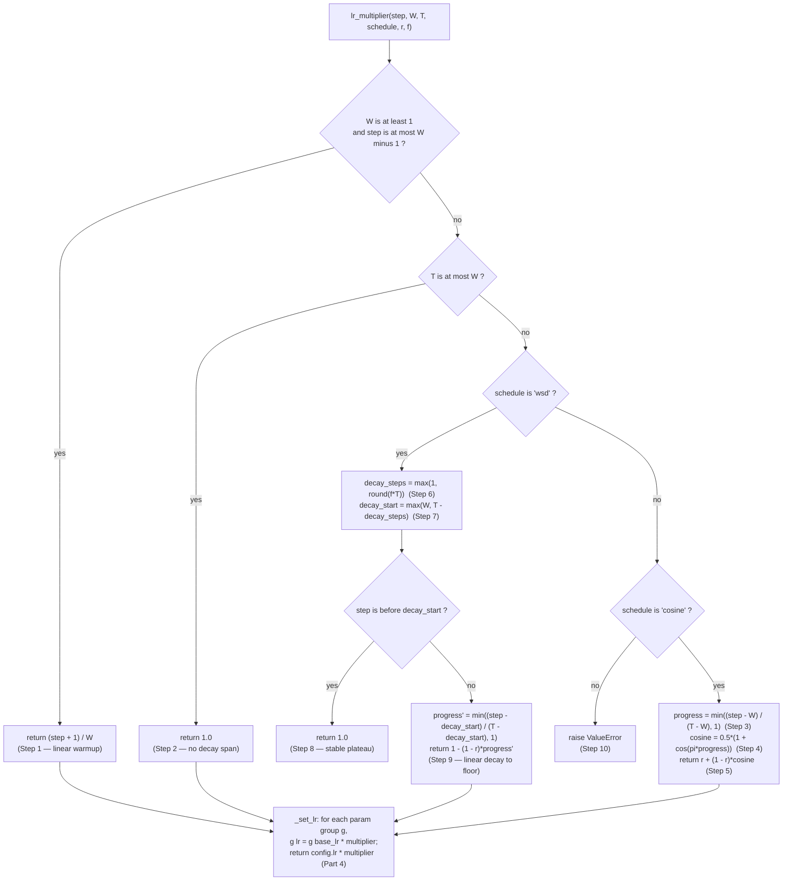
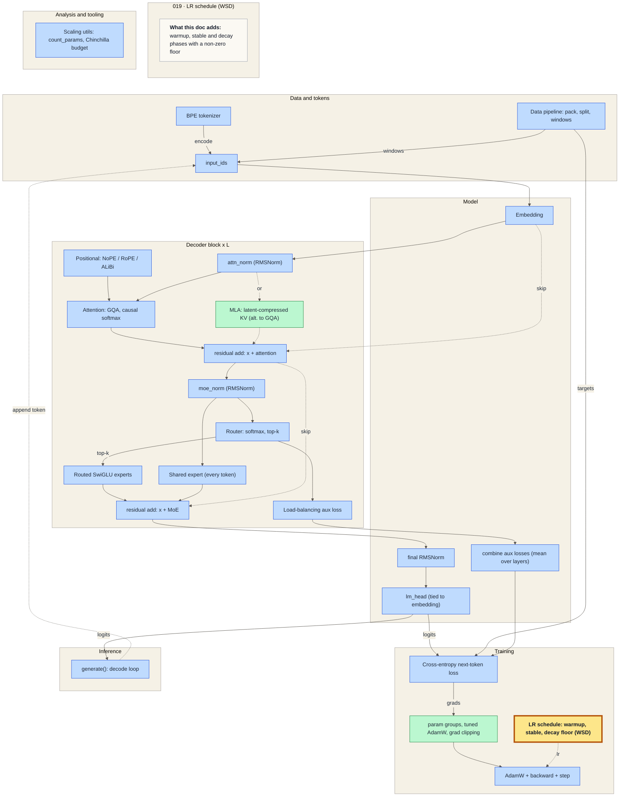

# 019 — The learning-rate schedule (decay floor + Warmup-Stable-Decay), solved by hand

**Companion to:** [`journey_of_a_model/019-lr-schedule-wsd.md`](../../journey_of_a_model/019-lr-schedule-wsd.md)
· **Code:** [`qwenmoe/train/trainer.py`](../../qwenmoe/train/trainer.py)
(`lr_multiplier`, `_set_lr`)
· **Every number here is reproduced by:** [`verify_019_lr_schedule_wsd.py`](verify_019_lr_schedule_wsd.py)
(`uv run python docs/math/verify_019_lr_schedule_wsd.py`)

---

## How to read this

The journal entry tells you *what* the learning-rate schedule is and *why*
it changed (a decay **floor** instead of decay-to-zero; an optional
**Warmup-Stable-Decay** curve that doesn't need the token budget fixed
up front). This document is the other half: **one fixed set of schedule
parameters, pushed through every single line** of `lr_multiplier` and
`_set_lr`, with each formula derived from scratch before any arithmetic,
and every intermediate checked against the real module.

This component has almost no linear algebra — it is scalar arithmetic and
one trig function. So the bar here is different from
[004](004-attention-gqa.md)/[016](016-mla-attention.md): fewer shapes,
but **every** algebraic step (why `step + 1` and not `step`, why divide by
`total_steps - warmup_steps`, why `round` and not `floor`, why the cosine
and not a straight line) gets its full derivation. No background is
assumed; every term (function, pure function, linear, interpolation,
radian, cosine, monotone, clamp) is defined at first use.

You should first skim
[`journey_of_a_model/019-lr-schedule-wsd.md`](../../journey_of_a_model/019-lr-schedule-wsd.md)
for the plain-English picture, and
[`docs/math/010-training-loop.md` §Part 3](010-training-loop.md) — entry
010 introduced warmup+cosine and this schedule is the same function grown
two new branches; 010's Part 3 is the short version of Parts 2–3 here.

---

## Part 0 — What are we computing, and why

### 0.1 The one job of a schedule

Training nudges every weight a little on every step. The **learning rate**
(`lr`) is the size of that nudge. A single fixed `lr` for the whole run is
a bad compromise: too big early (the freshly-random weights explode), too
big late (the model is close to a good setting and a big nudge overshoots
it). A **schedule** is a rule that says what `lr` to use as a function of
the step number — small, then big, then small again.

`lr_multiplier` does not return an `lr`. It returns a **multiplier** — a
number, usually between `0` and `1`, that the caller multiplies onto the
run's *peak* learning rate. Keeping it as a bare multiplier is what lets
one schedule *shape* drive two different peak magnitudes at once (Part 4).

### 0.2 The two things that changed in this task

Entry 010's schedule was **linear warmup, then cosine decay to zero**:

- **Warmup:** ramp the multiplier from near `0` up to `1` over the first
  `warmup_steps` steps. (Why: derived in Step 1.)
- **Cosine decay:** from the end of warmup to the very last step, glide
  the multiplier from `1` down to `0` along a cosine curve.

Two problems, two fixes (this task):

1. **Decay-to-zero wastes the tail.** The last stretch of a
   decay-to-zero curve uses a learning rate so near zero that those steps
   process real tokens but barely move the weights. **Fix:** a floor.
   `min_lr_ratio` $= r$ stops the decay at $r \times \text{peak}$ instead
   of `0`. Exact algebra — the same formula, with `0` replaced by `r`.

2. **Cosine's shape is welded to `total_steps`.** The curve is built so
   it hits its floor *exactly* on the last step. Decide mid-run to train
   20% longer and the whole curve was "wrong" in hindsight — every past
   step used a rate shaped for a schedule that didn't happen. **Fix:** an
   alternative shape, **Warmup-Stable-Decay** (WSD): after warmup, hold
   the multiplier flat at `1` for a long "stable" plateau, and only decay
   over a short window at the very end. Any checkpoint saved during the
   plateau is in the *same* optimization regime, so it is a valid launch
   point for a fresh short decay whenever the run actually needs to stop.

Both live in the same function, selected by a `schedule` argument. This
document computes **both**, from the **same** parameters.

---

## Part 1 — The running example

### 1.1 Definitions we need right now

- **Scalar:** a single number, e.g. `3` or `-0.5`. Everything
  `lr_multiplier` touches is a scalar (contrast the tensors — grids of
  numbers — in [004](004-attention-gqa.md)).
- **Integer / 0-indexed:** `step` is a whole number, and counting starts
  at `0`. "Step `0`" is the first step; a run of `T` steps executes steps
  `0, 1, …, T-1`. The step passed to `lr_multiplier` is *the one about to
  run*.
- **Function:** a rule that takes inputs and returns an output.
  `lr_multiplier(step, …)` is a function of the integer `step`.
- **Pure function:** a function whose output depends *only* on its
  inputs — no hidden state, no memory of previous calls. `lr_multiplier`
  is pure: `lr_multiplier(7, …)` returns the same thing whether it is the
  first call or the thousandth. This is why a run can stop at step 300,
  reload, and resume at step 300 with the identical rate — nothing was
  accumulated (entry 010, checkpoint/resume).
- **Ratio / fraction:** one number divided by another. `min_lr_ratio` is
  "floor `lr` ÷ peak `lr`"; `decay_fraction` is "decay steps ÷ total
  steps".
- **Linear (of a quantity `x`):** of the form $a + b x$ — a straight
  line: constant slope, no curve. "Ramp linearly from `0` to `1`" means
  the value at fraction `p` of the way through is exactly `p`.
- **Interpolation between `A` and `B` by `t` ∈ [0, 1]:** the value
  $A + t\,(B - A)$, equivalently $(1-t)A + tB$. At `t=0` it is `A`, at
  `t=1` it is `B`, and it moves at constant speed in between. Used twice
  below (the `min_lr_ratio` blend; WSD's linear decay).
- **Clamp / clip to [lo, hi]:** replace a value with `lo` if it is below
  `lo`, with `hi` if above, else leave it. `min(x, 1.0)` clamps the top
  at `1`.
- **Monotone (decreasing):** never goes back up. Both decay curves here
  are monotone decreasing after the warmup peak.
- **Radian:** the unit of angle for which one full turn is
  $2\pi \approx 6.2832$. A half-turn is $\pi \approx 3.1416$ rad; a
  quarter-turn is $\pi/2 \approx 1.5708$ rad.
- **Cosine, $\cos\phi$:** a function that takes an angle $\phi$ (in
  radians) and returns a number in $[-1, 1]$. Picture a point walking
  counter-clockwise around a circle of radius `1` starting at the
  3-o'clock position; $\cos\phi$ is its **horizontal** coordinate after
  it has walked $\phi$ radians. Key values used below:
  $\cos 0 = 1$ (start, far right), $\cos(\pi/2) = 0$ (top),
  $\cos\pi = -1$ (far left). It is **flat** (momentarily horizontal
  slope) at $\phi = 0$ and $\phi = \pi$ — that flatness at both ends is
  the whole reason it is used here.
- **`round(x)`:** nearest integer to `x`. Python rounds a `.5` to the
  nearest *even* integer (`round(2.5) == 2`, `round(5.5) == 6`) — noted
  where it could matter.
- **`max(a, b)` / `min(a, b)`:** the larger / smaller of two numbers.

### 1.2 The schedule parameters — the "weights" of this component

The smallest set of parameters that still forces every branch of
`lr_multiplier` to execute:

| Symbol | Code name | Value | Why this value |
|---|---|---|---|
| $W$ | `warmup_steps` | $4$ | $> 0$ so the warmup branch runs; $4$ distinct ramp steps, the last landing on exactly `1.0` |
| $T$ | `total_steps` | $20$ | $T - W = 16$, so cosine's `progress` hits $0, \tfrac14, \tfrac12, \tfrac34, 1$ at steps $4, 8, 12, 16, 20$ — angles $0, \tfrac\pi4, \tfrac\pi2, \tfrac{3\pi}4, \pi$, all exact textbook cosines |
| $r$ | `min_lr_ratio` | $0.25$ | $\ne 0$ so the floor branch is exercised (not the old decay-to-zero); $1 - r = 0.75$ keeps the blend arithmetic clean |
| $f$ | `decay_fraction` | $0.28$ | $\operatorname{round}(0.28 \times 20) = \operatorname{round}(5.6) = 6$ — a **non-integer** product, so the `round` actually rounds |
| — | peak `lr` (`config.lr`) | $0.01$ | the magnitude the multiplier scales; also every AdamW group's `base_lr` |
| — | `muon_lr` | $0.02$ | $\ne$ `config.lr`, so `_set_lr` rides **one** shape at **two** peak magnitudes (Part 4) |

`warmup_steps` is a **raw step count** the user sets directly.
`total_steps` is **derived** by `Trainer.fit` from the token budget
([`trainer.py:582`](../../qwenmoe/train/trainer.py#L582)):
$T = \max\!\big(1,\ \texttt{total\_tokens} \,//\, (\texttt{eff\_batch} \times \texttt{seq\_len})\big)$.
In the verify script `total_tokens = 60`, `eff_batch = 1`, `seq_len = 3`
$\Rightarrow T = 60 // 3 = 20$.

**Exact vs. empirical.** Every *formula* below is provable algebra given
these inputs. The *values* of $r$ and $f$ are **empirical
hyperparameters** — MiniCPM found ~10% of tokens is enough for the decay
phase (this project defaults $f = 0.2$); `min_lr_ratio = 0.1` is "common
practice" (this project's default). They are choices, not derived
quantities. The **cosine shape** itself is also an empirical finding
(SGDR, Loshchilov & Hutter 2016) — no theorem says a cosine beats other
smooth monotone curves; it is what the field converged on.

### 1.3 There is no input tensor — the "input" is the step counter

Unlike the attention docs, nothing here is looked up or projected. The
only "input" that varies is the integer `step`, sweeping `0 → 20`. The
"output" we trace is the **sequence of 21 multipliers** that sweep
produces — one per step — for each of the two schedules. That sequence is
this component's equivalent of a traced tensor, and the "shape ledger" is
replaced by a **step ledger**: at each step, `(which branch fired) →
(multiplier) → (lr = 0.01 × multiplier)`.

---

## Part 2 — The code path

A real training step reaches the schedule as
`Trainer.fit` → `_run_step` → `_set_lr` → `lr_multiplier`
([`trainer.py:389`](../../qwenmoe/train/trainer.py#L389)). There is no
`forward_with_trace` variant — `lr_multiplier` is already a plain pure
function of a few scalars, so we walk it directly.



**Step ledger — start:** `step` sweeps `0 → 20`; peak `lr` `= 0.01`.

---

## Part 3 — `lr_multiplier`, one branch at a time

### Step 1 — The warmup guard and the linear ramp

Code ([`trainer.py:98-99`](../../qwenmoe/train/trainer.py#L98)):

```python
if warmup_steps > 0 and step < warmup_steps:
    return (step + 1) / warmup_steps
```

**Why warmup exists.** At step `0` the weights are random noise. The
gradient — the direction that most steeply reduces the loss — computed
from noise is itself mostly noise, and often has a large magnitude. A
full-size step along it can throw the weights so far that the loss
becomes `inf` and the run is dead. Warmup spends the first few steps
*creeping*: a tiny rate at step `0`, growing to the full rate by the end
of warmup, by which point the weights are no longer pure noise and a
full step is safe. (The linear ramp itself is the warmup half of the
"Noam" schedule of *Attention Is All You Need*, §5.3 — which then decays
by inverse-square-root; here it is cosine or WSD instead.)

**Why the guard `warmup_steps > 0`.** If `warmup_steps == 0` the
condition `step < warmup_steps` would be `step < 0` — never true for a
0-indexed step — but the division `(step + 1) / 0` on the next line would
be a crash if it were ever reached. The `> 0` check means "no warmup
requested → skip straight to the decay curve" without touching the
division. **Exact** (a guard, not a formula).

**Why `(step + 1) / warmup_steps` and not `step / warmup_steps`.** We
want the ramp to satisfy two endpoints:

- The **last** warmup step should reach exactly `1.0`, so it meets the
  decay curve with no jump. `step` is 0-indexed, so the last warmup step
  is `step = W - 1`. We need $g(W-1) = 1$.
- The **first** step, `step = 0`, should be a small positive number (a
  step of size *zero* would waste step 0 entirely).

Try $g(\text{step}) = (\text{step} + 1)/W$:

- $g(W - 1) = \dfrac{(W - 1) + 1}{W} = \dfrac{W}{W} = 1.$ ✓ (exact)
- $g(0) = \dfrac{0 + 1}{W} = \dfrac{1}{W}$ — smallest positive multiple of
  $1/W$, not zero. ✓

The plain `step / W` would give $g(0) = 0$ (dead first step) and
$g(W-1) = (W-1)/W < 1$ (never quite reaches peak during warmup). The
`+ 1` fixes both. **Exact** — it is forced by the two endpoint
requirements.

**Compute** ($W = 4$):

$$
g(\text{step}) = \frac{\text{step} + 1}{4}
$$

| step | $(\text{step}+1)/4$ | multiplier | `lr` $= 0.01 \times$ mult |
|---:|:---:|---:|---:|
| 0 | $1/4$ | $0.25$ | $0.0025$ |
| 1 | $2/4$ | $0.50$ | $0.0050$ |
| 2 | $3/4$ | $0.75$ | $0.0075$ |
| 3 | $4/4$ | $1.00$ | $0.0100$ |

The ramp is **independent of `schedule`, `r`, and `f`** — all three are
only read *after* this early return. The verify script confirms the WSD
call returns the identical `[0.25, 0.5, 0.75, 1.0]` for steps 0–3.

**Step ledger:** steps `0–3` → branch = warmup → multipliers
`[0.25, 0.50, 0.75, 1.00]`.

---

### Step 2 — The "no decay span" guard

Code ([`trainer.py:100-101`](../../qwenmoe/train/trainer.py#L100)):

```python
if total_steps <= warmup_steps:
    return 1.0
```

**Why.** Every decay formula below divides by `total_steps - warmup_steps`
(the length of the post-warmup span). If `total_steps <= warmup_steps`
that denominator is `0` or negative — a crash, or a nonsense negative
`progress`. This can genuinely happen: `warmup_steps` is set by hand,
`total_steps` is derived from the token budget, and a small budget with a
big `warmup_steps` gives $T \le W$. The guard says: *if the run is no
longer than its own warmup, there is no room to decay — just hold at
peak.* **Exact** (a guard).

Our example has $T = 20 > W = 4$, so this branch does **not** fire in the
main trace. To exercise it the verify script calls
`lr_multiplier(step=12, warmup_steps=10, total_steps=8)`: step `12` is
past warmup (`12 < 10` is false, so Step 1 didn't fire), then
`8 <= 10` is true → returns `1.0`. A mis-specified run like this pins the
rate at peak forever after warmup.

**Step ledger:** not taken in the main example ($20 > 4$).

---

The remaining branches split on `schedule`. We do **cosine** first
(Steps 3–5, the default), then **wsd** (Steps 6–9), then the error
(Step 10) — all from the same $W=4$, $T=20$, $r=0.25$, $f=0.28$.

---

### Step 3 — Cosine: `progress`

Code ([`trainer.py:113`](../../qwenmoe/train/trainer.py#L113)):

```python
progress = min((step - warmup_steps) / (total_steps - warmup_steps), 1.0)
```

**Why.** `progress` is "how far through the post-warmup span are we", as a
fraction from `0` to `1`.

- Numerator `step - warmup_steps`: steps elapsed *since warmup ended*. At
  `step = W` it is `0`; at `step = T` it is `T - W`.
- Denominator `total_steps - warmup_steps`: the **total** length of that
  span, `T - W`. Dividing gives `0` at the start of decay, `1` at the
  planned last step.
- `min(…, 1.0)`: the **clamp**. `Trainer` only ever calls with
  `step` in `[0, total_steps)` (the step about to run), so
  `step - W < T - W` and the ratio is `< 1` in real training. The clamp
  matters only for a *direct* call with `step >= total_steps` — it stops
  `progress` exceeding `1`, which would send the cosine back *up* the
  other side of its curve. **Exact.**

**Compute** ($W = 4$, $T - W = 16$):

$$
\text{progress}(\text{step}) = \min\!\left(\frac{\text{step} - 4}{16},\ 1\right)
$$

| step | 4 | 8 | 12 | 16 | 20 | 24 |
|---|---|---|---|---|---|---|
| $(\text{step}-4)/16$ | $0$ | $\tfrac{4}{16}=0.25$ | $\tfrac{8}{16}=0.5$ | $\tfrac{12}{16}=0.75$ | $\tfrac{16}{16}=1$ | $\tfrac{20}{16}=1.25$ |
| after clamp | $0$ | $0.25$ | $0.5$ | $0.75$ | $1$ | $\mathbf{1}$ |

Step 24 (past the end) shows the clamp doing its job: `1.25 → 1.0`.

**Step ledger:** step → `progress` ∈ `[0, 1]`.

---

### Step 4 — Cosine: the curve $\tfrac12(1 + \cos(\pi \cdot \text{progress}))$

Code ([`trainer.py:114`](../../qwenmoe/train/trainer.py#L114)):

```python
cosine = 0.5 * (1.0 + math.cos(math.pi * progress))
```

**What shape do we want?** A function of `progress` that

1. **starts at `1`** when `progress = 0` (decay begins at peak),
2. **ends at `0`** when `progress = 1` (so the blend in Step 5 lands
   exactly on the floor $r$),
3. is **flat at both ends** — leaves the peak gently (no sudden cut the
   moment warmup ends) and arrives at the floor gently (the last steps
   fine-tune rather than lurch),
4. **monotonically decreases** in between (never briefly goes back up).

**Why $\cos$ delivers this.** Recall $\cos\phi$ is the horizontal
position of a point walking around a unit circle from the 3-o'clock
start. Over the walk from $\phi = 0$ to $\phi = \pi$ (a half-turn), that
horizontal position slides from $+1$ (far right) through $0$ (top) to
$-1$ (far left), and — because the point is moving *vertically* at both
the start and the end of that half-turn — the horizontal position is
**flat** (zero slope) at both $\phi = 0$ and $\phi = \pi$. That is
exactly requirements 3 + 4, for free.

**Building the formula:**

- We want `progress` $\in [0, 1]$ to map to angle $\phi \in [0, \pi]$, so
  set $\phi = \pi \cdot \text{progress}$. That is `math.pi * progress`.
- $\cos\phi$ now runs $+1 \to -1$ as `progress` goes $0 \to 1$. We need
  $1 \to 0$. Rescale: add `1` (giving $2 \to 0$), then halve (giving
  $1 \to 0$). That is $\tfrac12(1 + \cos\phi)$.

Check the endpoints: at `progress = 0`, $\tfrac12(1 + \cos 0) =
\tfrac12(1 + 1) = 1$ ✓. At `progress = 1`, $\tfrac12(1 + \cos\pi) =
\tfrac12(1 - 1) = 0$ ✓.

The **half-period** shape ($\phi$ only sweeps $0 \to \pi$, not a full
$0 \to 2\pi$) is what makes it a *decay* and not a bump — a full period
would come back up to `1`. This is the cosine-annealing curve of SGDR,
restricted to one downward half.

- The **formula** $\tfrac12(1 + \cos(\pi p))$ is **exact** given the four
  requirements above.
- *That a cosine is a better decay shape than, say, a straight line* is
  **empirical** (SGDR) — the four requirements could be met by other
  curves too.

**Compute.** Three of our five anchor angles are exact textbook values:
$\cos 0 = 1$, $\cos(\pi/2) = 0$, $\cos\pi = -1$. The other two involve
$\cos(\pi/4) = \cos 45° = \tfrac{\sqrt2}{2} = 0.70710678\ldots$ and
$\cos(3\pi/4) = -\tfrac{\sqrt2}{2}$ — irrational, but *exact* textbook
values (the diagonal of a unit square). Digit by digit for the clean
anchors:

**step 4** ($p = 0$): $\phi = 0$, $\cos 0 = 1$,
$\text{cosine} = \tfrac12(1 + 1) = 1.0$.

**step 8** ($p = 0.25$): $\phi = \pi/4 = 0.78539816$,
$\cos\phi = 0.70710678$,
$\text{cosine} = \tfrac12(1 + 0.70710678) = \tfrac12(1.70710678) =
0.85355339$.

**step 12** ($p = 0.5$): $\phi = \pi/2 = 1.57079633$, $\cos\phi = 0$,
$\text{cosine} = \tfrac12(1 + 0) = 0.5$.

**step 16** ($p = 0.75$): $\phi = 3\pi/4 = 2.35619449$,
$\cos\phi = -0.70710678$,
$\text{cosine} = \tfrac12(1 - 0.70710678) = \tfrac12(0.29289322) =
0.14644661$.

**step 20** ($p = 1$): $\phi = \pi = 3.14159265$, $\cos\phi = -1$,
$\text{cosine} = \tfrac12(1 - 1) = 0.0$.

**Step ledger:** `progress` → `cosine` ∈ `[0, 1]`.

---

### Step 5 — Cosine: the `min_lr_ratio` blend

Code ([`trainer.py:115`](../../qwenmoe/train/trainer.py#L115)):

```python
return min_lr_ratio + (1.0 - min_lr_ratio) * cosine
```

**Why.** Step 4's `cosine` runs from `1` (peak) down to `0`
(decay-to-zero — the old behaviour). We want it to run from `1` down to
`r` instead. This is exactly **interpolation** (§1.1): map the value
`cosine` $\in [0, 1]$ onto the interval $[r, 1]$.

Interpolation from `A` to `B` by `t`: $A + t(B - A)$. Here the "fraction"
is `cosine` itself, `A = r` (where `cosine = 0` should land) and `B = 1`
(where `cosine = 1` should land):

$$
\text{mult} = r + \text{cosine}\,(1 - r).
$$

Endpoints: `cosine = 1` → $r + 1\cdot(1 - r) = 1$ (peak, unchanged);
`cosine = 0` → $r + 0 = r$ (the floor). Setting $r = 0$ collapses it back
to `mult = cosine` — **entry 010's exact formula**, which is why the new
default is a "pure-win" change: old callers passing no `min_lr_ratio` (it
defaults to `0.0` in `lr_multiplier`) are numerically untouched.
**Exact** (interpolation algebra).

**Compute** ($r = 0.25$, so $1 - r = 0.75$): $\text{mult} = 0.25 +
0.75 \times \text{cosine}$.

| step | `progress` $p$ | $\cos(\pi p)$ | $\text{cosine} = \tfrac12(1{+}\cos)$ | $\text{mult} = 0.25 + 0.75\,\text{cosine}$ | `lr` |
|---:|:---:|:---:|:---:|---:|---:|
| 4  | 0.00 | $+1$ | $1.0$ | $0.25 + 0.75(1.0) = \mathbf{1.00000000}$ | 0.01000000 |
| 8  | 0.25 | $+\tfrac{\sqrt2}{2}$ | $0.85355339$ | $0.25 + 0.64016504 = \mathbf{0.89016504}$ | 0.00890165 |
| 12 | 0.50 | $0$ | $0.5$ | $0.25 + 0.375 = \mathbf{0.62500000}$ | 0.00625000 |
| 16 | 0.75 | $-\tfrac{\sqrt2}{2}$ | $0.14644661$ | $0.25 + 0.10983496 = \mathbf{0.35983496}$ | 0.00359835 |
| 20 | 1.00 | $-1$ | $0.0$ | $0.25 + 0 = \mathbf{0.25000000}$ | 0.00250000 |

`0.75 × 0.85355339 = 0.64016504`; `0.25 + 0.64016504 = 0.89016504`.
`0.75 × 0.14644661 = 0.10983496`; `0.25 + 0.10983496 = 0.35983496`.

The full step-by-step curve (all 17 post-warmup steps), quoted verbatim
from `verify_019_lr_schedule_wsd.py` Part 4:

```
  step |  p = (t-W)/(T-W) | angle pi*p |  cos(pi p)  |  mult      |  lr
     4 |     0.000000     |  0.000000 | +1.00000000 | 1.00000000 | 0.01000000
     5 |     0.062500     |  0.196350 | +0.98078528 | 0.99279448 | 0.00992794
     6 |     0.125000     |  0.392699 | +0.92387953 | 0.97145482 | 0.00971455
     7 |     0.187500     |  0.589049 | +0.83146961 | 0.93680110 | 0.00936801
     8 |     0.250000     |  0.785398 | +0.70710678 | 0.89016504 | 0.00890165
     9 |     0.312500     |  0.981748 | +0.55557023 | 0.83333884 | 0.00833339
    10 |     0.375000     |  1.178097 | +0.38268343 | 0.76850629 | 0.00768506
    11 |     0.437500     |  1.374447 | +0.19509032 | 0.69815887 | 0.00698159
    12 |     0.500000     |  1.570796 | +0.00000000 | 0.62500000 | 0.00625000
    13 |     0.562500     |  1.767146 | -0.19509032 | 0.55184113 | 0.00551841
    14 |     0.625000     |  1.963495 | -0.38268343 | 0.48149371 | 0.00481494
    15 |     0.687500     |  2.159845 | -0.55557023 | 0.41666116 | 0.00416661
    16 |     0.750000     |  2.356194 | -0.70710678 | 0.35983496 | 0.00359835
    17 |     0.812500     |  2.552544 | -0.83146961 | 0.31319890 | 0.00313199
    18 |     0.875000     |  2.748894 | -0.92387953 | 0.27854518 | 0.00278545
    19 |     0.937500     |  2.945243 | -0.98078528 | 0.25720552 | 0.00257206
    20 |     1.000000     |  3.141593 | -1.00000000 | 0.25000000 | 0.00250000
```

**Continuity at the seam.** Warmup's last value ($\text{step} = 3$) is
`1.0`; cosine's first value ($\text{step} = 4$, $p = 0$) is
$0.25 + 0.75(1) = 1.0$. **No jump** — the two pieces meet. Verify Part 10
asserts `mult(W-1) == mult(W) == 1.0`.

**Step ledger:** cosine schedule complete — steps `0–20` →
`[0.25, 0.50, 0.75, 1.00, 1.00, 0.9928, …, 0.2572, 0.2500]`.

---

### Step 6 — WSD: `decay_steps`

Now the **other** branch, `schedule == "wsd"`
([`trainer.py:103-104`](../../qwenmoe/train/trainer.py#L103)), same
parameters:

```python
if schedule == "wsd":
    decay_steps = max(1, round(decay_fraction * total_steps))
```

**Why.** WSD decays only over the *last* `decay_fraction` of the run.
`decay_steps` is that window's length **in steps**.

- `decay_fraction * total_steps` = $0.28 \times 20 = 5.6$. Not a whole
  number — you cannot decay over `5.6` steps.
- `round(5.6) = 6`. **Why `round` and not `floor`/`ceil`:** the window
  has to be a whole number of real training steps, and *nearest* is the
  least-biased choice — `floor` would systematically make every decay
  window shorter than requested, `ceil` longer. **Exact** (nearest-integer
  is the definition of least rounding error). The journal's own example:
  $f = 0.2$, $T = 33$ → $6.6$ → `round` → `7`.
- `max(1, …)`: if $f$ and $T$ are small enough that
  `round(f*T) == 0`, this forces at least a 1-step window. Without it,
  `decay_start` (Step 7) would equal `total_steps`, and Step 9's
  denominator `total_steps - decay_start` would be `0` — a
  **ZeroDivisionError**. The `max(1, …)` is precisely that crash guard.
  **Exact.**

**Compute:** $\text{decay\_steps} = \max(1, \operatorname{round}(0.28
\times 20)) = \max(1, \operatorname{round}(5.6)) = \max(1, 6) = 6.$

**Step ledger:** scalar `decay_steps = 6`.

---

### Step 7 — WSD: `decay_start`

Code ([`trainer.py:105`](../../qwenmoe/train/trainer.py#L105)):

```python
decay_start = max(warmup_steps, total_steps - decay_steps)
```

**Why.** The step at which the flat plateau ends and the decay begins.

- `total_steps - decay_steps` = $20 - 6 = 14$: start decaying `decay_steps`
  steps before the end.
- `max(warmup_steps, …)`: the clamp. If `decay_fraction` is large, `T -
  decay_steps` could be *less than* `warmup_steps` — the decay window
  would want to start *during* (or before) warmup. That is incoherent:
  warmup is still ramping *up*. The `max` clamps the decay start to no
  earlier than the end of warmup. The plateau can shrink to **zero
  length** (decay begins the instant warmup ends) but never overlaps
  warmup. **Exact** (a clamp).

**Compute:** $\text{decay\_start} = \max(4,\ 20 - 6) = \max(4, 14) = 14.$

So: warmup is steps `0–3`; the **stable plateau** is steps `4–13`; the
**decay window** is steps `14–19` (and the mathematical endpoint
`step = 20`).

**Step ledger:** scalar `decay_start = 14`.

---

### Step 8 — WSD: the stable plateau

Code ([`trainer.py:106-107`](../../qwenmoe/train/trainer.py#L106)):

```python
if step < decay_start:
    return 1.0  # stable phase: held at peak
```

**Why.** Between the end of warmup and `decay_start`, the multiplier is
**exactly `1.0`** — every step in this range trains at the full peak
learning rate. This is the entire point of WSD: because the rate is a
*constant* here, every checkpoint saved anywhere in this range is in the
identical optimization regime, so it is an equally valid starting point
for a later, fresh decay. Cosine has no such range — it starts curving
downward at `progress = 0`. **Exact** (a literal `return 1.0`).

**Compute:** steps `4, 5, 6, 7, 8, 9, 10, 11, 12, 13` all return `1.0`
(`lr = 0.01`). Verify Part 5 asserts
`all(wsd_mults[t] == 1.0 for t in range(4, 14))`.

**Step ledger:** steps `4–13` → branch = stable → multiplier `1.00`.

---

### Step 9 — WSD: the linear decay to the floor

Code ([`trainer.py:108-109`](../../qwenmoe/train/trainer.py#L108)):

```python
progress = min((step - decay_start) / (total_steps - decay_start), 1.0)
return 1.0 - (1.0 - min_lr_ratio) * progress  # linear decay to the floor
```

**`progress` (call it $p'$ to distinguish from cosine's).**

- Numerator `step - decay_start`: steps into the decay window. `0` at
  `step = decay_start`, `total_steps - decay_start` at the end.
- Denominator `total_steps - decay_start` = $20 - 14 = 6$ (= `decay_steps`
  here, but only because Step 7's `max` didn't clamp — in the clamped
  case they differ, and the denominator is the honest window length).
- `min(…, 1.0)`: same clamp role as cosine — only bites for a direct call
  past `total_steps`.

**The decay formula.** We want a straight line (hence "linear") from `1`
at $p' = 0$ down to $r$ at $p' = 1$. Interpolation from `1` to `r` by
$p'$: $1 + p'(r - 1) = 1 - p'(1 - r) = 1 - (1 - r)\,p'$.

Endpoints: $p' = 0 \Rightarrow 1$; $p' = 1 \Rightarrow 1 - (1 - r) = r$.
**Linear**, not cosine — MiniCPM's paper actually uses an *exponential*
(half-life) decay in this window (§4.2, Eq. 1); this project chose a
straight line, in the spirit of the "constant LR + cooldown" studied by
Hägele et al. (2024), who found the cooldown *shape* (linear, `1-sqrt`,
exponential) matters far less than *having* a decoupled cooldown at all.
**The linear choice is empirical**; the algebra *given* "linear" is
exact.

Why linear and not the cosine here? The cosine's value comes from
*wanting a gentle exit from the peak*. WSD already got its gentle exit —
it sat at the peak for the whole plateau. The decay window's only job is
to bring the rate down fast over a short span, and a straight line is the
simplest thing that does that.

**Compute** ($r = 0.25$, $1 - r = 0.75$, window length `6`):
$\text{mult} = 1 - 0.75\,p'$, with $p' = (\text{step} - 14)/6$.

| step | $p' = (\text{step}-14)/6$ | $1 - 0.75\,p'$ | `lr` |
|---:|:---:|---:|---:|
| 14 | $0/6 = 0$ | $1 - 0 = \mathbf{1.000}$ | 0.01000 |
| 15 | $1/6 = 0.16667$ | $1 - 0.125 = \mathbf{0.875}$ | 0.00875 |
| 16 | $2/6 = 0.33333$ | $1 - 0.25 = \mathbf{0.750}$ | 0.00750 |
| 17 | $3/6 = 0.5$ | $1 - 0.375 = \mathbf{0.625}$ | 0.00625 |
| 18 | $4/6 = 0.66667$ | $1 - 0.5 = \mathbf{0.500}$ | 0.00500 |
| 19 | $5/6 = 0.83333$ | $1 - 0.625 = \mathbf{0.375}$ | 0.00375 |
| 20 | $6/6 = 1$ | $1 - 0.75 = \mathbf{0.250}$ | 0.00250 |

Every step drops the raw `lr` by the *same*
$0.75 \times \tfrac16 \times 0.01 = 0.00125$ — that constant step size is
what "linear" means. Verify Part 5:
`per-step lr drop = [0.00125, 0.00125, 0.00125, 0.00125, 0.00125, 0.00125]`.

Step 14 is the *first* decay step and it is still at `1.0` (because
$p' = 0$ there) — so WSD's genuine last-full-rate step is 14, one beyond
`decay_start`. And `step = 20` hits `r = 0.25` **exactly** — the decay is
built to land on the floor precisely at `total_steps` (verify:
`approx(wsd_mults[20], 0.25)`).

**Clamp check.** `lr_multiplier(23, …)` → $p' = \min(9/6, 1) = 1$ → `0.25`
= same as step 20. Verify Part 5.

**Step ledger:** WSD schedule complete — steps `0–20` →
`[0.25, 0.50, 0.75, 1.00, 1.00, 1.00, 1.00, 1.00, 1.00, 1.00, 1.00, 1.00,
1.00, 1.00, 1.00, 0.875, 0.75, 0.625, 0.50, 0.375, 0.25]`.

---

### Step 10 — An unrecognised schedule name

Code ([`trainer.py:111-112`](../../qwenmoe/train/trainer.py#L111)):

```python
if schedule != "cosine":
    raise ValueError(f"Unknown lr_schedule: {schedule!r}")
```

This sits **after** the `wsd` block (which `return`s, so it is never
reached when `schedule == "wsd"`) and **before** the cosine math. So the
only way here is `schedule` being neither `"wsd"` nor `"cosine"`.

`lr_multiplier(8, 4, 20, schedule="linear")` → not `"wsd"` → `"linear"
!= "cosine"` → `ValueError: Unknown lr_schedule: 'linear'`. Verify
Part 7 catches exactly this.

**Subtlety:** the check is only reached *past warmup, with a real decay
span*. `lr_multiplier(0, 4, 20, schedule="linear")` returns `0.25` (the
warmup branch fired first and never inspected `schedule`). So a typo in
`lr_schedule` surfaces on step `W`, not step `0`. `TrainConfig` also
constrains the field to `Literal["cosine", "wsd"]`, so in practice a bad
value only arrives via a direct `lr_multiplier` call.

**Step ledger:** raises — no multiplier produced.

---

## Part 4 — `_set_lr`: one shape, applied to every param group

Code ([`trainer.py:138-148`](../../qwenmoe/train/trainer.py#L138)):

```python
multiplier = lr_multiplier(
    step, config.warmup_steps, total_steps,
    schedule=config.lr_schedule,
    min_lr_ratio=config.min_lr_ratio,
    decay_fraction=config.decay_fraction,
)
for group in optimizer.param_groups:
    group["lr"] = group.get("base_lr", base_lr) * multiplier
return base_lr * multiplier
```

**What a "param group" is.** An optimizer does not treat every weight
identically — it partitions them into **groups**, each with its own
settings. This project has up to three:

- **AdamW decay group** — the weight *matrices* (attention/expert/router
  projections), which get weight decay. `base_lr = config.lr = 0.01`
  ([`optim.py:275`](../../qwenmoe/train/optim.py#L275)).
- **AdamW no-decay group** — 1-D tensors and norm gains, no weight decay.
  `base_lr = config.lr = 0.01`
  ([`optim.py:276`](../../qwenmoe/train/optim.py#L276)).
- **Muon group** (only when `optimizer == "muon"`) — the same hidden
  matrices, optimised by Muon instead of AdamW, with its **own** peak
  `base_lr = config.muon_lr = 0.02`
  ([`optim.py:301`](../../qwenmoe/train/optim.py#L301)).

**Why multiply `base_lr`, not set `lr` directly.** `lr_multiplier`
returns a pure *shape* in `[0, 1]`. `_set_lr` stamps that one shape onto
each group by scaling from *that group's own* peak. So a Muon run's two
sub-optimizers ride the identical warmup/decay **curve** at two different
**magnitudes** — you tune "how aggressive is Muon vs. AdamW" once
(`muon_lr` vs `lr`) and the schedule respects the ratio automatically.
`group.get("base_lr", base_lr)` falls back to the passed-in `base_lr`
(`= config.lr`) for any group built before `base_lr` stamping existed
(there are none left, but it keeps the function total).

**The return value.** `base_lr * multiplier` = `config.lr * multiplier` —
the rate for the **default** (`config.lr`-based) group. This single
number is what the step log records as `"lr"`
([`trainer.py:658`](../../qwenmoe/train/trainer.py#L658)); the Muon
group's larger rate is applied but not separately logged.

**Compute** at `step = 8`, cosine, from Step 5 the multiplier is
`0.89016504`. Verify Part 8 builds a **real** `CombinedOptimizer` via
`build_optimizer(model, config)` with `optimizer="muon"` on the tiny
model — which leaves **two** non-empty groups (the tied embedding and
norm gains are all no-decay; Muon claims every 2-D hidden matrix, so the
AdamW *decay* group is empty and dropped):

| group | `base_lr` | `base_lr × 0.89016504` (`= group["lr"]`) |
|---|---:|---:|
| Muon (hidden matrices) | `0.02` | **`0.01780330`** |
| AdamW no-decay (embedding, norm gains) | `0.01` | **`0.00890165`** |

(A full-size model additionally has a populated *AdamW decay* group, also
at `base_lr = 0.01` — same `0.00890165` here.) `_set_lr` returns
`0.01 × 0.89016504 = 0.00890165` (the logged value). Verify Part 8
asserts each `group["lr"] == group["base_lr"] * mult` and the return
`== 0.01 * mult`.

**Step ledger:** multiplier `m` → `{Muon: 0.02m, AdamW: 0.01m}`; logged
`lr = 0.01m`.

---

## Part 5 — Both schedules, side by side

Same $W = 4$, $T = 20$, $r = 0.25$, $f = 0.28$, peak `0.01`:

| step | phase (cosine / wsd) | cosine mult | cosine `lr` | wsd mult | wsd `lr` |
|---:|---|---:|---:|---:|---:|
| 0 | warmup / warmup | 0.25000 | 0.002500 | 0.25000 | 0.002500 |
| 3 | warmup / warmup | 1.00000 | 0.010000 | 1.00000 | 0.010000 |
| 4 | cosine / **stable** | 1.00000 | 0.010000 | 1.00000 | 0.010000 |
| 8 | cosine / stable | 0.89017 | 0.008902 | 1.00000 | 0.010000 |
| 12 | cosine / stable | 0.62500 | 0.006250 | 1.00000 | 0.010000 |
| 13 | cosine / stable | 0.55184 | 0.005518 | 1.00000 | 0.010000 |
| 14 | cosine / **decay** | 0.48149 | 0.004815 | 1.00000 | 0.010000 |
| 16 | cosine / decay | 0.35983 | 0.003598 | 0.75000 | 0.007500 |
| 17 | cosine / decay | 0.31320 | 0.003132 | 0.62500 | 0.006250 |
| 20 | (endpoint) | 0.25000 | 0.002500 | 0.25000 | 0.002500 |

The contrast the journal draws: **by step 12, cosine is already at 62.5%
of peak** while **WSD is still at exactly 100%**. Every checkpoint WSD
saves through step 13 sits at the identical optimization state (flat peak
`lr`) no matter what final step count the run settles on — the property
cosine structurally cannot offer, because its step-12 value *depends* on
`total_steps` being 20.

Both curves end at the same place ($r \times \text{peak} = 0.0025$) — WSD
just gets there later and faster.

---

## Part 6 — The real `Trainer.fit`, and the off-by-one

`verify_019_lr_schedule_wsd.py` Part 9 runs an actual `Trainer(...).fit`
to `total_steps == 20` for **both** schedules and reads the logged `lr`
from `train.jsonl`. Because `Trainer` increments `global_step` *after*
the step runs, the log record `"step": k` carries the rate for
0-indexed step `k - 1` — i.e. `lr[k] == 0.01 * lr_multiplier(k - 1, …)`.
Verified exactly:

```
  cosine: logged (step, lr) vs 0.01 * lr_multiplier(step - 1, ...)
    logged step  1 (0-idx  0):  lr = 0.00250000   hand = 0.00250000
    logged step  4 (0-idx  3):  lr = 0.01000000   hand = 0.01000000
    logged step  5 (0-idx  4):  lr = 0.01000000   hand = 0.01000000
    logged step  9 (0-idx  8):  lr = 0.00890165   hand = 0.00890165
    logged step 13 (0-idx 12):  lr = 0.00625000   hand = 0.00625000
    logged step 14 (0-idx 13):  lr = 0.00551841   hand = 0.00551841
    logged step 17 (0-idx 16):  lr = 0.00359835   hand = 0.00359835
    logged step 20 (0-idx 19):  lr = 0.00257206   hand = 0.00257206
    max |logged - hand| over all 20 steps = 0.00e+00

  wsd: logged (step, lr) vs 0.01 * lr_multiplier(step - 1, ...)
    logged step  1 (0-idx  0):  lr = 0.00250000   hand = 0.00250000
    logged step  4 (0-idx  3):  lr = 0.01000000   hand = 0.01000000
    logged step  5 (0-idx  4):  lr = 0.01000000   hand = 0.01000000
    logged step  9 (0-idx  8):  lr = 0.01000000   hand = 0.01000000
    logged step 13 (0-idx 12):  lr = 0.01000000   hand = 0.01000000
    logged step 14 (0-idx 13):  lr = 0.01000000   hand = 0.01000000
    logged step 17 (0-idx 16):  lr = 0.00750000   hand = 0.00750000
    logged step 20 (0-idx 19):  lr = 0.00375000   hand = 0.00375000
    max |logged - hand| over all 20 steps = 0.00e+00
```

**The off-by-one, quantified.** The last step a 20-step run *executes* is
0-indexed step 19, not 20. So neither schedule's *executed* rates reach
the floor `r = 0.25`:

- cosine's last executed multiplier is `0.25720552` (`lr = 0.00257206`),
  not `0.25`;
- WSD's is `0.375` (`lr = 0.00375`), not `0.25`.

The mathematical floor is only *touched* by a direct
`lr_multiplier(total_steps, …)` call (which the tests do, but `Trainer`
never does). This is the same "essentially the floor, not exactly it"
behaviour entry 010 already noted for plain cosine.

---

## Part 7 — Degenerate configs (asides — different parameters)

The main trace ($W=4, T=20, r=0.25, f=0.28$) exercises the common
branches. Four remaining edge branches need *different* parameters —
each is a self-contained call, clearly not the running example.

### 7.1 `warmup_steps = 0`

`lr_multiplier(0, warmup_steps=0, total_steps=20, min_lr_ratio=0.25)`:
`warmup_steps > 0` is **false**, so Step 1 is skipped entirely →
`progress = min((0 - 0)/(20 - 0), 1) = 0` → `cosine = 1` → `mult = 1.0`.
Step `0` starts at full peak, no ramp. (A run with pre-trained weights,
where warmup is unnecessary.)

### 7.2 `total_steps <= warmup_steps` — the Step 2 guard

`lr_multiplier(step=12, warmup_steps=10, total_steps=8)`: past warmup
(`12 < 10` false), then `8 <= 10` → `return 1.0`. A run shorter than its
own warmup pins at peak after warmup. Verify Part 3.

### 7.3 WSD, tiny `decay_fraction` — the `max(1, …)` guard (Step 6)

$f = 0.01$, $T = 20$: `round(0.01 * 20) = round(0.2) = 0` →
`max(1, 0) = 1`. So `decay_steps = 1`, `decay_start = max(4, 19) = 19`.
Without the `max(1, …)`, `decay_start` would be `20 == total_steps` and
Step 9's `(step - 20)/(20 - 20)` is `0/0` — a **ZeroDivisionError**. With
it, the single in-range decay step (`step = 19`) sits at $p' = 0$ → still
`1.0`, and only the out-of-range `step = 20` reaches `r`. Verify Part 6.

### 7.4 WSD, huge `decay_fraction` — the `max(warmup_steps, …)` clamp (Step 7)

$f = 0.95$, $T = 20$: `round(19.0) = 19` → `decay_steps = 19` →
`decay_start = max(4, 20 - 19) = max(4, 1) = 4`. The `max` clamps the
decay start to the end of warmup; the stable plateau has **zero length**
(decay begins the instant warmup ends, step 4), and warmup steps `0–3`
are still untouched at their ramp values. Verify Part 6.

---

## Part 8 — Cost, and why it is built this way

### 8.1 Compute cost

`lr_multiplier` is **one `cos` call, three multiplies, two `min`/`max`,
one division** — all on scalars. Per step:
$O(1)$, unmeasurably small next to a forward/backward pass. `_set_lr`
loops over `param_groups` (≤ 3 here) doing one multiply each: also
$O(\text{groups})$, negligible. The schedule is *free*; the only thing
that ever mattered about its design is the *shape* it produces.

### 8.2 Why a pure function of `step`

Because it takes no accumulated state, `lr_multiplier(step)` gives the
identical answer on a fresh run and on a run resumed from a step-13
checkpoint. Entry 010 leaned on this for exact resumability; this task
kept it — the two new parameters are still just arguments, the two new
branches still just `return` a number computed from `step`. A stateful
scheduler (e.g. one that tracked "steps since last improvement") would
need to be serialized into every checkpoint and could desync on resume.

### 8.3 Why WSD is offered *alongside* cosine, not instead

On our example, at a **fixed, fully-committed** budget of 20 steps, the
two schedules' final executed rates are `0.00257` (cosine) vs `0.00375`
(WSD) — cosine has spent more of the run at low rates, and published
results (including MiniCPM's) show it edges out WSD on *final loss* at a
single fixed budget. What WSD buys, quantified on the example: a
checkpoint at step 13 is at multiplier **exactly `1.0`** regardless of
whether the run ends at step 20, 25, or 40 — so you can

- **decay now:** run a fresh 6-step (or shorter) linear cooldown from the
  step-13 weights, or
- **keep going:** extend the plateau to step 30 and decay then,

without any step already taken being "wrong" for the schedule that
happened. Cosine's step-13 multiplier is `0.55184` *because* `total_steps
= 20`; change the plan and that 0.55184 was the wrong rate in hindsight.
The project keeps both behind `TrainConfig.lr_schedule` so it is a
measurable `run_comparison` axis, not a one-sided replacement.

### 8.4 Why `min_lr_ratio = 0.1` became the default (both schedules)

The last ~10% of a decay-to-zero curve trains at
< 10% of peak `lr` — real tokens, near-zero weight movement. Flooring at
`0.1 × peak` reclaims those steps for useful learning. It is exact
algebra (Step 5 with $r \ne 0$), reduces to the old curve at $r = 0$
(so no existing caller shifts), and `0.1` matches common practice — an
**empirical** pick, not a derived constant.

---

## Questions that might come to mind

- **Why is `progress` clamped when `Trainer` never calls out of range?**
  Defensive, and it makes `lr_multiplier` a total function anyone can
  call directly — the tests call `lr_multiplier(total_steps, …)` to check
  the floor is hit *exactly*, and without the clamp
  `lr_multiplier(total_steps + 3, …)` would send the cosine back *up*
  (angle past $\pi$) or drive the linear decay *below* `r`.

- **WSD step 14 is the "first decay step" but its multiplier is still
  `1.0` — bug?** No: `progress' = (14 - 14)/6 = 0`, and
  `1 - (1-r)·0 = 1`. The decay window `[decay_start, total_steps]`
  includes its left endpoint at full rate by construction, so the genuine
  count of below-peak steps is `decay_steps - 1 = 5` within
  `[0, total_steps)`. The linear ramp *reaches* `r` only at the right
  endpoint `step = total_steps`.

- **`decay_steps` and `total_steps - decay_start` are both `6` here — are
  they the same thing?** Only when Step 7's `max` didn't clamp. If
  `decay_fraction` is large enough that `total_steps - decay_steps <
  warmup_steps`, then `decay_start = warmup_steps` and the *actual*
  window length `total_steps - decay_start` is **longer** than
  `decay_steps`. Step 9's denominator always uses the honest window
  length, so the decay still lands on `r` exactly at `total_steps`.

- **Why does WSD decay *linearly* when MiniCPM's paper uses exponential
  decay ($0.5^{(s-S)/T}$)?** A deliberate simplification. Hägele et al.
  (2024) studied "constant LR + cooldown" (the same idea as WSD) and
  found the cooldown *shape* — linear, `1-sqrt`, exponential — changes
  the final loss only marginally; *having* a decoupled cooldown is what
  matters. Linear is the simplest to reason about and to reproduce by
  hand. **Empirical choice.**

- **Can I switch `cosine → wsd` mid-run from a checkpoint?** Yes, and
  that is the point — but only cleanly *from a checkpoint saved during
  cosine's own early plateau-ish region*, which barely exists. From a WSD
  plateau checkpoint it is trivial (the rate there is exactly peak). From
  a cosine checkpoint at step 13 the weights have already been trained
  under a decaying rate, so a fresh WSD schedule starting there is a
  genuine change of regime, not a seamless continuation.

- **What clamps `min_lr_ratio` and `decay_fraction` to sane values?**
  `TrainConfig.__post_init__`
  ([`config.py:182-185`](../../qwenmoe/config.py#L182)): `min_lr_ratio` ∈
  `[0, 1]`, `decay_fraction` ∈ `(0, 1]`. `lr_multiplier` itself does not
  re-validate — a direct call with `decay_fraction = 5.0` would give
  `decay_steps = max(1, round(5·T))` = a window longer than the whole
  run, then `decay_start = max(W, negative) = W`, i.e. it degrades to
  "decay over the entire post-warmup span" rather than crashing.

- **`round(5.5)` → `6`, but `round(4.5)` → `4` (banker's rounding). Does
  that ever bite?** Only exactly on a `decay_fraction * total_steps` that
  lands on a `.5` *and* where ±1 step matters. It is a 1-step difference
  in a decay window that is tens-to-hundreds of steps long in any real
  run — cosmetically surprising, practically irrelevant. `f = 0.28` was
  chosen for the example so the product is `5.6` (unambiguous).

---

## Symbol reference

| symbol | code name | meaning | value here |
|---|---|---|---|
| `step` / $t$ | `step` | the 0-indexed step about to run | sweeps `0–20` |
| $W$ | `warmup_steps` | length of the linear ramp | `4` |
| $T$ | `total_steps` | planned total steps (derived from token budget) | `20` |
| $r$ | `min_lr_ratio` | decay floor as a fraction of peak | `0.25` |
| $f$ | `decay_fraction` | fraction of `total_steps` spent decaying (WSD) | `0.28` |
| — | `schedule` / `lr_schedule` | `"cosine"` or `"wsd"` | both traced |
| $p$ | `progress` | fraction through the post-warmup span (cosine) | `0 → 1` |
| $p'$ | `progress` (wsd branch) | fraction through the decay window | `0 → 1` |
| — | `decay_steps` | `max(1, round(f·T))` — decay window length | `6` |
| — | `decay_start` | `max(W, T − decay_steps)` — plateau→decay boundary | `14` |
| — | `cosine` | $\tfrac12(1 + \cos(\pi p))$, in `[0, 1]` | per step |
| — | `multiplier` | `lr_multiplier`'s return value | `[0, 1]` |
| — | `base_lr` | a param group's peak `lr` | `0.01` / `0.02` |
| — | `config.lr` | peak `lr` for AdamW groups; `_set_lr`'s `base_lr` arg | `0.01` |
| — | `muon_lr` | peak `lr` for the Muon group | `0.02` |
| $\phi$ | — | an angle in radians, `= π·progress` | `0 → π` |

---

## Citations

All links verified by web search on 2026-09-10; the MiniCPM link is
shared with the journal entry.

**Warmup-Stable-Decay**
- Hu et al. (OpenBMB / Tsinghua), *MiniCPM: Unveiling the Potential of
  Small Language Models with Scalable Training Strategies*, 2024 —
  [arXiv:2404.06395](https://arxiv.org/abs/2404.06395). §4.2, Eq. (1):
  the WSD scheduler — warmup to $\eta$, a constant-$\eta$ stable phase,
  then a decay function over the final window. The paper's decay is
  **exponential** (a half-life form, $\eta$ scaled by $0.5^{\,\cdot}$ as
  the decay progresses); it reports that a decay of ~10% of total tokens
  is sufficient, and that the whole point is not having to fix the token
  budget in advance. This project implements the same three-phase
  structure with a **linear** decay to `min_lr_ratio`.
- Hägele et al. (EPFL / HuggingFace), *Scaling Laws and Compute-Optimal
  Training Beyond Fixed Training Durations*, NeurIPS 2024 —
  [arXiv:2405.18392](https://arxiv.org/abs/2405.18392). Studies "constant
  learning rate + cooldown" (WSD without the name), shows it scales as
  predictably as cosine while allowing many run lengths from one trunk,
  and that the cooldown *shape* (linear / `1-sqrt` / exponential) is a
  minor factor — the basis for this project's choice of a simple linear
  decay.

**Cosine decay** (also cited in [math 010 §Part 3](010-training-loop.md))
- Loshchilov & Hutter, *SGDR: Stochastic Gradient Descent with Warm
  Restarts*, 2016 — [arXiv:1608.03983](https://arxiv.org/abs/1608.03983).
  The cosine-annealing curve $\tfrac12(1 + \cos(\pi\,\cdot))$ used in
  Step 4. That a cosine is a good decay *shape* is this paper's empirical
  finding.

**Linear warmup**
- Vaswani et al., *Attention Is All You Need*, 2017 —
  [arXiv:1706.03762](https://arxiv.org/abs/1706.03762). §5.3: learning
  rate increased linearly for the first `warmup_steps`, decreased
  thereafter — the origin of the linear-ramp warmup in Step 1.

---

*Every intermediate number in this document is reproduced and asserted by
[`verify_019_lr_schedule_wsd.py`](verify_019_lr_schedule_wsd.py). If you
change the running example, rerun it.*

<!-- arch-evolution:start (generated by build_architecture_footer.py; do not edit by hand) -->

---

## Where this fits in the architecture (the growing view)

← previous: [018 Optimizer hardening](018-optimizer-hardening.md) · next: [020 Muon optimizer](020-muon-optimizer.md) →

**This doc adds to the architecture:** warmup, stable and decay phases with a non-zero floor. (Code: `qwenmoe/train/trainer.py`.)

**Components introduced here (highlighted in the diagram), with where each one lives:**

| component | math doc (section) | journal | code |
|---|---|---|---|
| LR schedule: warmup, stable, decay floor (WSD) | [019 · Part 3 — lr_multiplier, one branch at a time](019-lr-schedule-wsd.md#part-3--lr_multiplier-one-branch-at-a-time) | [journal 019](../../journey_of_a_model/019-lr-schedule-wsd.md) | [`qwenmoe/train/trainer.py:97`](../../qwenmoe/train/trainer.py#L97) |

**Verified by:** [`verify_019_lr_schedule_wsd.py`](verify_019_lr_schedule_wsd.py) (`uv run python docs/math/verify_019_lr_schedule_wsd.py`); latest results in [verify-status.md](verify-status.md).

**Example continuity:** Standalone: the input is the step counter, not a tensor (`r=0.25`, `f=0.28`, 20 steps). See the [example-family map](README.md#which-example-does-each-doc-use).

The diagram is cumulative: every box derived by this doc or an earlier one is shown, and components from later docs are not drawn yet, so reading the docs in order replays how the architecture grew. The top box is this doc's title and what it adds. The [full final architecture](architecture-evolution.md) has everything.

**Colour key:** 🟨 **introduced by this doc** · 🟦 Foundation (004-011) · 🟩 Modernization (016-031) · 🟪 Evaluation and scale (032-038) · 🟧 Real data and hardware (039-044). Dotted lines are optional or alternative paths.



**How we got here (every doc up to and including this one):**

| | math doc | journal | what it added |
|---|---|---|---|
|  | [004 Attention (GQA)](004-attention-gqa.md) | [journal](../../journey_of_a_model/004-attention-gqa.md) | scaled dot-product attention with grouped K/V heads, the positional transform and the causal mask |
|  | [005 MoE layer](005-moe-layer.md) | [journal](../../journey_of_a_model/005-moe-layer.md) | the router, top-k selection, routed SwiGLU experts, the shared expert and the load-balancing aux loss |
|  | [006 Full model](006-full-model-assembly.md) | [journal](../../journey_of_a_model/006-full-model-assembly.md) | token embedding, pre-norm residual wiring, the final norm, the tied head and the cross-layer aux-loss combine; attention and MoE appear here as black boxes |
|  | [007 Tokenizers](007-tokenizers.md) | [journal](../../journey_of_a_model/007-tokenizers.md) | text to `input_ids`: byte-level BPE and the char tokenizer |
|  | [008 Data pipeline](008-data-pipeline.md) | [journal](../../journey_of_a_model/008-data-pipeline.md) | packing documents, train/val split, fixed slices and the shifted `(x, y)` windows |
|  | [009 Scaling utilities](009-scaling-law-utilities.md) | [journal](../../journey_of_a_model/009-scaling-law-utilities.md) | parameter counting (total vs active), the compute-optimal budget and throughput calibration |
|  | [010 Training loop](010-training-loop.md) | [journal](../../journey_of_a_model/010-training-loop.md) | the next-token cross-entropy loss, backward pass and AdamW step, carried through a real `Trainer.fit` |
|  | [011 Inference and generation](011-inference-generation.md) | [journal](../../journey_of_a_model/011-inference-generation.md) | the autoregressive decode loop (greedy, temperature, top-k, top-p) |
|  | [016 MLA attention](016-mla-attention.md) | [journal](../../journey_of_a_model/016-mla-attention.md) | Multi-Head Latent Attention: K/V compressed to a small latent, an alternative to GQA |
|  | [018 Optimizer hardening](018-optimizer-hardening.md) | [journal](../../journey_of_a_model/018-optimizer-hardening.md) | param groups (decay vs no-decay), tuned AdamW and gradient clipping |
| **▶** | [019 LR schedule (WSD)](019-lr-schedule-wsd.md) | [journal](../../journey_of_a_model/019-lr-schedule-wsd.md) | warmup, stable and decay phases with a non-zero floor |

<!-- arch-evolution:end -->
