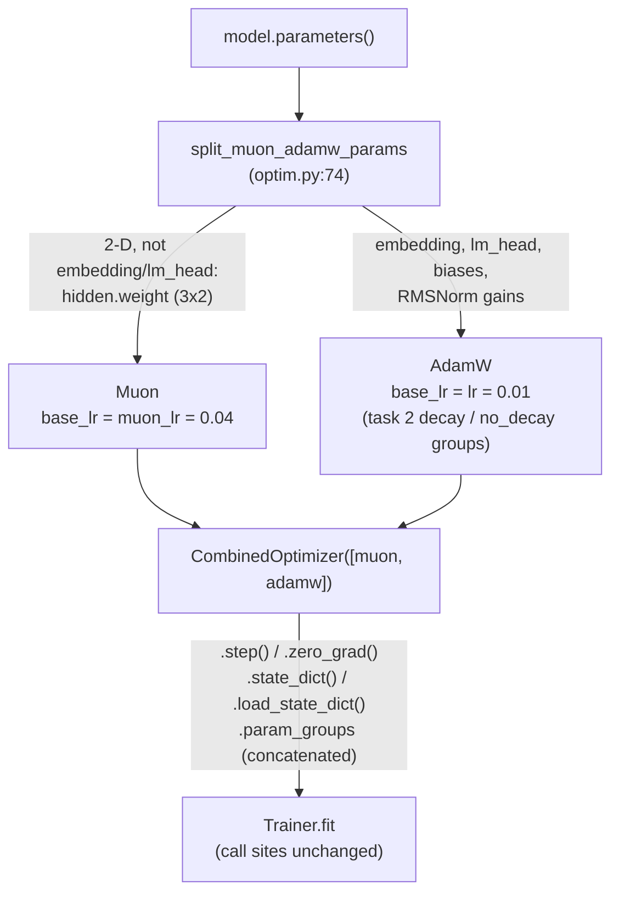
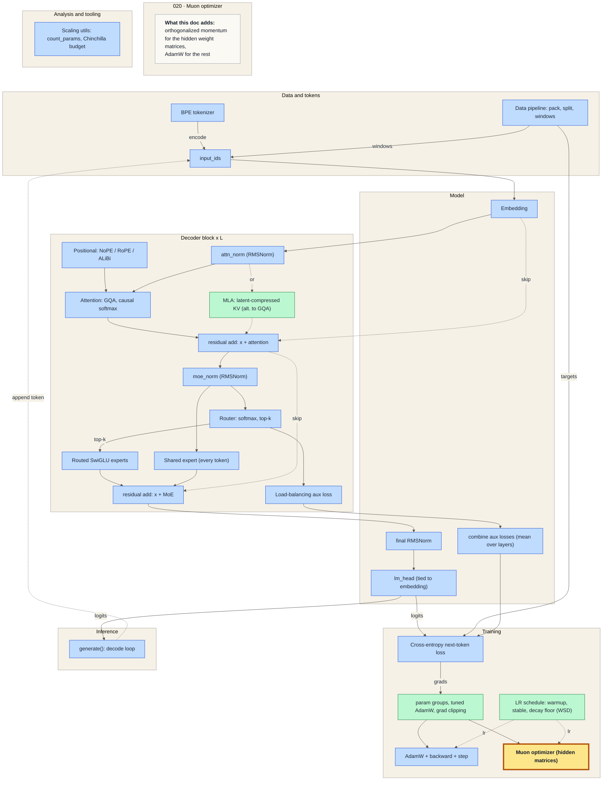

# 020 — The Muon optimizer: orthogonalized momentum, solved by hand

**Companion to:** [`journey_of_a_model/020-muon-optimizer.md`](../../journey_of_a_model/020-muon-optimizer.md)
· **Code:** [`qwenmoe/train/optim.py`](../../qwenmoe/train/optim.py),
[`qwenmoe/train/trainer.py`](../../qwenmoe/train/trainer.py)
· **Every number here is reproduced by:** [`verify_020_muon_optimizer.py`](verify_020_muon_optimizer.py)
(`uv run python docs/math/verify_020_muon_optimizer.py`)

---

## How to read this

The journal entry tells you *what* Muon is (a different optimizer for
weight matrices, using "orthogonalization") and *why* the project uses it.
This document is the other trade-off: **maximum detail, minimum
summarising.** We

1. fix one tiny gradient and one tiny weight matrix, written out in full,
2. push them through **every line** of the `optimizer="muon"` path —
   `split_muon_adamw_params`, `build_optimizer`, `Muon.step`,
   `zeropower_via_newtonschulz5`, `CombinedOptimizer`, and
   `trainer.py::_set_lr` — citing `file.py:line` at each step,
3. and for every operation — a matrix multiply, a reshape, a polynomial —
   first derive *why* it has the form it does, then **do the arithmetic on
   paper**, digit by digit, and check it against the real module.

Nothing is skipped. You do **not** need a linear-algebra background: every
term (vector, matrix, transpose, dot product, singular value, norm,
momentum, …) is defined at first use. You *should* skim the journal entry
first for the plain-English picture, and
[`docs/math/010-training-loop.md`](010-training-loop.md) Part 6 for the
AdamW half of the story, which Muon does **not** replace (see Part 2).

---

## Part 0 — What is Muon computing?

### 0.1 The one-line update rule

Every optimizer answers one question: *given a parameter and the gradient
of the loss with respect to it, how should the parameter change?* Plain
gradient descent's answer is "take a small step directly against the
gradient." Muon's answer, for a 2-D weight matrix $W$ with gradient $G$
([`optim.py:169-172`](../../qwenmoe/train/optim.py#L169)):

$$
\begin{aligned}
B &\leftarrow \mu\,B + G                                       &&\text{(momentum buffer)}\\
O &\leftarrow \operatorname{orthogonalize}(B)                  &&\text{(Newton--Schulz)}\\
W &\leftarrow W - \eta\;\sqrt{\max\!\left(1, \tfrac{\text{rows}}{\text{cols}}\right)}\; O
\end{aligned}
$$

- $\mu$ (`momentum`, default $0.95$) and $\eta$ (`lr` / `muon_lr`) are
  numbers you choose.
- **momentum buffer** $B$: a running blend of the recent gradients (Part
  4.1).
- $\operatorname{orthogonalize}$: replace a matrix by the "most similar"
  matrix whose stretch factors are all $\approx 1$ (Part 4.2 — this is the
  whole game).
- the $\sqrt{\max(1, \text{rows}/\text{cols})}$ factor rescales the update
  so its typical entry size doesn't depend on the matrix's shape (Part
  4.3).

Compare AdamW's update (derived in full in
[`010-training-loop.md`](010-training-loop.md#part-6--adamw-the-update-derived-from-zero)):
AdamW treats every one of $W$'s entries as an unrelated scalar and divides
each by its own running gradient magnitude. Muon treats $W$ as a genuine
matrix and reshapes the *whole update at once*.

### 0.2 Why orthogonalize — the one exact sentence

**Norm.** A *norm* is a rule that assigns a single number $\ge 0$ to a
vector or matrix, measuring its "size." The **Frobenius norm** of a matrix
is $\sqrt{\text{sum of every entry squared}}$. The **spectral norm**
$\lVert M\rVert_2$ is the largest factor by which $M$ can stretch any input
vector's length.

**Steepest descent under a norm.** Given the gradient $G$, the best update
$\Delta$ of a fixed "size" is the one that decreases the loss fastest —
formally, the $\Delta$ minimising $\langle G, \Delta\rangle$ (the sum of
$G_{ij}\Delta_{ij}$, the matrix version of a dot product) subject to
$\lVert\Delta\rVert \le 1$. Which $\Delta$ that is *depends on which norm
you pick*:

- **Euclidean/Frobenius norm** → $\Delta = -G / \lVert G\rVert_F$. That's
  plain SGD.
- **Spectral norm** → $\Delta = -\operatorname{orthogonalize}(G)$.

The second line is **exact** (it is the statement that the *nuclear norm*
— the sum of a matrix's singular values — is the mathematical dual of the
spectral norm; Bernstein & Newhouse 2024). Muon is, up to the momentum
buffer and the shape factor, steepest descent under the spectral norm.
Why the spectral norm is the *right* norm for a hidden weight matrix (and
not for an embedding table) is argued in the journal entry and in
Bernstein & Newhouse; this document takes it as given and derives the
arithmetic.

---

## Part 1 — The running example

### 1.1 Definitions we need right now

- **Scalar:** one number, e.g. $2$ or $-0.5$.
- **Vector:** an ordered list of numbers, e.g. $[2, 0, 1]$. Its **length**
  or **dimension** is how many numbers it holds.
- **Matrix:** a rectangle of numbers — a list of equal-length rows. An
  $m \times n$ matrix has $m$ rows and $n$ columns.
- **Transpose** $A^\top$: flip rows and columns; an $m\times n$ matrix
  becomes $n\times m$. Row $i$ of $A$ is column $i$ of $A^\top$.
- **Matrix multiply** $AB$: if $A$ is $m\times n$ and $B$ is $n\times p$,
  then $AB$ is $m\times p$ and its $(i,j)$ entry is the **dot product**
  (multiply element-wise, then add) of row $i$ of $A$ with column $j$ of
  $B$. The inner sizes must match.
- **Diagonal matrix:** zero everywhere except possibly the top-left-to-
  bottom-right diagonal. Multiplying by a diagonal matrix just rescales
  each row (or column) independently.
- **Identity matrix** $I$: the diagonal matrix of all $1$s; $AI = A$.
- **Frobenius norm** $\lVert A\rVert_F = \sqrt{\sum_{ij} A_{ij}^2}$.

### 1.2 Singular values — the one concept the whole doc rests on

**Every** matrix $M$ (shape $m\times n$) can be written as

$$M = U\,\Sigma\,V^\top$$

where:

- $U$ and $V$ are **orthogonal** matrices — square, and they only
  *rotate/reflect* vectors, never stretch them (their rows are
  perpendicular unit-length vectors; equivalently $U^\top U = I$).
- $\Sigma$ is **diagonal** with non-negative entries
  $\sigma_1 \ge \sigma_2 \ge \dots \ge 0$ called the **singular values**.

This is the **Singular Value Decomposition (SVD)**. Geometrically, "apply
$M$ to a vector" = *rotate* (by $V^\top$), then *stretch axis $i$ by
$\sigma_i$* (by $\Sigma$), then *rotate again* (by $U$). The singular
values are exactly the stretch factors; the columns of $U$ and $V$ are the
directions being stretched (the **singular vectors**).

- A matrix with **all singular values equal to $1$** stretches nothing —
  it is a rotation (or, if non-square, a "semi-rotation"). Call such a
  matrix **semi-orthogonal**.
- "**Orthogonalizing**" $M$ means: keep $U$ and $V$ (the directions),
  throw away $\Sigma$ (the stretches), i.e. replace $M$ with $UV^\top$.
  That is the matrix's "**zeroth power**," written $M(M^\top M)^{-1/2}$ —
  hence the function name `zeropower_via_newtonschulz5`.

### 1.3 The gradient and the weight

We optimize one weight matrix — think of it as `blocks.0.attn.w_q.weight`,
but we use a standalone `nn.Linear(2, 3, bias=False)` so it is exactly
$3\times2$ and every number fits on the page. PyTorch stores a `Linear`'s
weight as `(out_features, in_features)` = $(3, 2)$.

$$
W_0 = \begin{bmatrix} 1 & 0 \\ 0 & 1 \\ 1 & 1 \end{bmatrix}
\qquad\text{(the starting weight, shape } (3, 2))
$$

The **gradient** $G$ — the derivative of the loss with respect to each
entry of $W$, produced by `.backward()` — is the input to the optimizer.
We pick it, rather than deriving it from a loss, because this document is
about what the optimizer *does with* a gradient, not where gradients come
from (that is [`010-training-loop.md`](010-training-loop.md) Part 5):

$$
G = \begin{bmatrix} 2 & 0 \\ 0 & 0 \\ 0 & 1 \end{bmatrix}
\qquad\text{(shape } (3, 2))
$$

**Why this exact $G$.** Its two columns, $[2, 0, 0]$ and $[0, 0, 1]$, are
perpendicular (their dot product is $0$) and point along separate axes. So
$G$ is *already* in SVD form: $G = U\Sigma V^\top$ with $V = I$,
$\Sigma = \left[\begin{smallmatrix}2&0\\0&1\end{smallmatrix}\right]$,
$U = \left[\begin{smallmatrix}1&0\\0&0\\0&1\end{smallmatrix}\right]$ — its
singular values are **$2$ and $1$**. This is the smallest gradient that
still has *two different* singular values (so we can watch them get pulled
together) while keeping every matrix in the Newton-Schulz iteration
diagonal, so the arithmetic stays followable by hand. A general dense $G$
would need the same five iterations but with $3\times3$ dense
intermediates.

### 1.4 The config

| Symbol | `TrainConfig` field | Meaning | Value |
|---|---|---|---|
| $\eta_\text{muon}$ | `muon_lr` | Muon's peak learning rate | $0.04$ (Part 6); $0.1$ for the isolated `Muon.step` in Parts 4–5 |
| $\eta_\text{adamw}$ | `lr` | AdamW's peak learning rate | $0.01$ |
| $\mu$ | `muon_momentum` | momentum-buffer decay | $0.95$ |
| — | `ns_steps` | Newton–Schulz iterations | $5$ |
| — | `optimizer` | which optimizer | `"muon"` |
| $W$ | `warmup_steps` | LR warmup length | $5$ |
| — | `lr_schedule` | post-warmup decay shape | `"cosine"` |
| $\rho$ | `min_lr_ratio` | LR floor as a fraction of peak | $0.1$ |

> The isolated `Muon.step` in Parts 4–5 uses $\eta = 0.1$ purely so the
> weight visibly moves on one step; the project default is `muon_lr = 0.02`
> ([`config.py:125`](../../qwenmoe/config.py#L125)), and Part 6 uses
> $0.04$ to make the two-learning-rate schedule legible. All three are
> real; none changes the derivation.

---

## Part 2 — Which parameters does Muon even touch?

Source: `split_muon_adamw_params`
([`optim.py:74-109`](../../qwenmoe/train/optim.py#L74)).

**The rule** ([`optim.py:104`](../../qwenmoe/train/optim.py#L104)): a
parameter goes to Muon **iff** it is exactly 2-D (`param.ndim == 2`) **and**
its owning module is neither an `nn.Embedding` nor the model's `lm_head`.
Everything else — every 1-D tensor (biases, RMSNorm gains), the embedding
table, the LM head — goes to a second, ordinary AdamW.

**Why a 2-D gate, and why the two exceptions.** Orthogonalization is
defined through $B\,B^\top$ (Part 4.2), which only exists for a 2-D matrix
— a 1-D bias has no "rows and columns" to make interchangeable. And a
matrix only *deserves* orthogonalization if its rows/columns are
interchangeable *directions in a learned space*: true for an attention
projection, false for an embedding table (each row is one specific token)
or the LM head (each row scores one specific vocabulary token). That
carve-out is the **standard Muon convention** (Jordan's writeup: "AdamW
should be used for the embedding and final classifier head layers"), not
something derived here — marked **empirical/convention**.

### 2.1 Walked on a tiny module

We build a module with one parameter of every relevant kind and run the
real function on it (`verify_020` `TinyNet`):

| parameter | shape | `ndim` | owning module | → Muon? | → decay? |
|---|---|---:|---|---|---|
| `embedding.weight` | $(5,2)$ | 2 | `nn.Embedding` | **AdamW** (excluded module) | no_decay |
| `hidden.weight` | $(3,2)$ | 2 | `nn.Linear` | **Muon** | decay |
| `hidden.bias` | $(3,)$ | 1 | `nn.Linear` | **AdamW** (`ndim < 2`) | no_decay |
| `norm.weight` | $(2,)$ | 1 | `RMSNorm` | **AdamW** (`ndim < 2`) | no_decay |
| `lm_head.weight` | $(5,2)$ | 2 | `lm_head` | **AdamW** (identity match) | decay |

This is the exact table `verify_020_muon_optimizer.py` prints and asserts.
Note the two independent axes: `lm_head.weight` is **decay** (it is a 2-D
matrix, so weight decay helps) but **AdamW** (Muon is wrong for it) — a
parameter's decay/no-decay group (task 2's `split_param_groups`,
[`018-optimizer-hardening.md`](018-optimizer-hardening.md#part-2--split_param_groups-the-decayno-decay-split-line-by-line))
and its muon/adamw group are different questions. The journal entry has the
real-model parameter counts; here we only need to see the routing logic.

Our running weight `hidden.weight` is $(3, 2)$ → **Muon**. Onward.

---

## Part 3 — `build_optimizer`: constructing the pair

Source: `build_optimizer`'s `config.optimizer == "muon"` branch
([`optim.py:281-305`](../../qwenmoe/train/optim.py#L281)).

```python
muon_params, adamw_params = split_muon_adamw_params(model)          # :282
adamw_ids = {id(p) for p in adamw_params}
adamw_decay    = [p for p in decay    if id(p) in adamw_ids]        # :288
adamw_no_decay = [p for p in no_decay if id(p) in adamw_ids]        # :289
adamw_opt = torch.optim.AdamW(adamw_groups, lr=config.lr, ...)      # :295
muon_lr = config.muon_lr if config.muon_lr is not None else config.lr   # :299
muon_opt = Muon([{"params": muon_params, "base_lr": muon_lr}],
                lr=muon_lr, momentum=config.muon_momentum)          # :300
return CombinedOptimizer([muon_opt, adamw_opt])                     # :305
```

Three things happen:

1. **The AdamW half re-uses task 2's decay split.** `adamw_params` is just
   "everything Muon didn't take." Rather than re-deciding weight decay for
   it, the code *intersects* it with the `decay` / `no_decay` lists
   `split_param_groups` already produced — so an AdamW-routed 2-D matrix
   (the LM head) still gets weight decay, an AdamW-routed norm still
   doesn't.
2. **Each group is stamped with `"base_lr"`** — `config.lr` ($0.01$) for
   the AdamW groups, `config.muon_lr` ($0.04$) for the Muon group. This is
   the hook Part 6 uses to drive two peak rates off one schedule.
3. **`CombinedOptimizer([muon_opt, adamw_opt])`** wraps the pair.

### 3.1 What `CombinedOptimizer` is

Source: [`optim.py:216-262`](../../qwenmoe/train/optim.py#L216). It is a
thin fan-out, **not** a `torch.optim.Optimizer` subclass:

| call | what it does |
|---|---|
| `.param_groups` | returns `muon.param_groups + adamw.param_groups` concatenated ([`:237`](../../qwenmoe/train/optim.py#L237)) |
| `.step()` | calls `muon.step()` then `adamw.step()` ([`:247`](../../qwenmoe/train/optim.py#L247)) |
| `.zero_grad()` | forwards to both ([`:253`](../../qwenmoe/train/optim.py#L253)) |
| `.state_dict()` | `{"sub_optimizers": [muon.state_dict(), adamw.state_dict()]}` ([`:257`](../../qwenmoe/train/optim.py#L257)) |
| `.load_state_dict(sd)` | restores each sub-optimizer from its entry ([`:260`](../../qwenmoe/train/optim.py#L260)) |

`Trainer` calls `.step()` / `.zero_grad()` / `.state_dict()` exactly as it
did for plain AdamW — it never learns there are two optimizers inside. The
`verify_020` script builds the real `CombinedOptimizer` over a tiny
`QwenMoEModel`, and asserts: two sub-optimizers, the Muon one carries
`base_lr == 0.04` and a `"momentum"` key, the AdamW one carries
`base_lr == 0.01` and a `"betas"` key, and every model parameter appears
in exactly one group.



---

## Part 4 — `Muon.step`, step 1, one operation at a time

Source: `Muon.step` ([`optim.py:188-213`](../../qwenmoe/train/optim.py#L188)).
The loop body, per parameter `p` with gradient `p.grad`:

```python
assert p.ndim == 2                                          # :202
state = self.state[p]
if "momentum_buffer" not in state:
    state["momentum_buffer"] = torch.zeros_like(p)          # :205
buf = state["momentum_buffer"]
buf.mul_(momentum).add_(p.grad)                             # :207

update = zeropower_via_newtonschulz5(buf, steps=ns_steps)   # :209
scale = math.sqrt(max(1.0, p.size(0) / p.size(1)))          # :210
p.add_(update, alpha=-lr * scale)                           # :211
```

**Shape ledger (start):** `p` $(3,2)$, `p.grad` $= G$ $(3,2)$,
`momentum_buffer` not yet created.

### Step 4.0 — the `assert p.ndim == 2`

[`optim.py:202`](../../qwenmoe/train/optim.py#L202). `Muon` is only ever
built over the pre-filtered `muon_params` list (Part 2), so a 1-D
parameter arriving here is a *routing bug*, not a case to handle. The
assert makes that bug loud instead of letting the next line compute
$B B^\top$ on a vector (undefined). Our `p` is $(3,2)$ → passes.

### Step 4.1 — the momentum buffer

[`optim.py:204-207`](../../qwenmoe/train/optim.py#L204).

**Why momentum.** Each training batch gives a slightly different, noisy
gradient. Stepping on each one separately zig-zags. A **momentum buffer**
keeps a running blend
$$B_t = \mu\,B_{t-1} + G_t,$$
so a direction that shows up *consistently* across batches accumulates,
while noise that flips sign cancels. $\mu = 0.95$ means "keep 95% of the
old blend, add the new gradient." (This is the un-normalised cousin of the
exponential moving average AdamW uses; Muon's Newton-Schulz step is about
to discard the overall scale anyway, so there is no $(1-\mu)$ factor and
no bias correction — see Part 5.)

**First step.** `momentum_buffer` is created as `zeros_like(p)`
([`optim.py:205`](../../qwenmoe/train/optim.py#L205)), so $B_0 = 0$, and

$$B_1 = \mu\cdot 0 + G = G = \begin{bmatrix} 2 & 0 \\ 0 & 0 \\ 0 & 1 \end{bmatrix}.$$

`buf.mul_(momentum).add_(p.grad)` does this **in place** (the trailing
underscores): multiply the buffer by $0.95$, then add the gradient. The
`verify_020` script confirms `momentum_buffer` after step 1 is exactly
$G$.

**Shape ledger:** `momentum_buffer` created $(3,2)$, value $= G$.

### Step 4.2 — `zeropower_via_newtonschulz5(B_1)` — the heart of Muon

Source: [`optim.py:112-155`](../../qwenmoe/train/optim.py#L112).

```python
assert G.ndim == 2                                  # :142
a, b, c = _NS_COEFFS   # (3.4445, -4.7750, 2.0315)  # :143
X = G.bfloat16()                                    # :144
transposed = X.size(0) > X.size(1)                  # :145
if transposed:
    X = X.T                                         # :147
X = X / (X.norm() + eps)                            # :148
for _ in range(steps):                              # :149
    A = X @ X.T                                     # :150
    B = b * A + c * A @ A                           # :151
    X = a * X + B @ X                               # :152
if transposed:
    X = X.T                                         # :154
return X.to(G.dtype)                                # :155
```

We feed it $B_1 = G$ (the momentum buffer). Call the input matrix $G$ for
the rest of this part, matching the code's parameter name. (The loop's
local `B` on line 151 is an unrelated temporary — a code-font `B`, never
the math-italic buffer $B_t$.)

#### 4.2a — Why orthogonalizing is exactly "map every singular value to 1"

From Part 1.2, $G = U\Sigma V^\top$ and orthogonalizing means returning
$UV^\top$ — i.e. **the same $U$ and $V$, but with every $\sigma_i$
replaced by $1$.** The exact way to get $U, \Sigma, V$ is to *compute the
SVD*, which for an $n\times n$ matrix costs on the order of $n^3$
arithmetic operations and does not run well on a GPU. Muon needs this for
*every* 2-D weight *every* step. So it approximates.

#### 4.2b — The polynomial trick: act on $\Sigma$ without ever finding it

Consider the specific matrix function
([`optim.py:150-152`](../../qwenmoe/train/optim.py#L150), one iteration):

$$f(X) = aX + b\,(XX^\top)X + c\,(XX^\top)^2X.$$

Substitute $X = U\Sigma V^\top$. First,

$$XX^\top = (U\Sigma V^\top)(U\Sigma V^\top)^\top = U\Sigma V^\top V \Sigma U^\top = U\Sigma^2 U^\top$$

because $V^\top V = I$ ($V$ is orthogonal) and $\Sigma^\top = \Sigma$
($\Sigma$ is diagonal). Then $(XX^\top)^2 = U\Sigma^2 U^\top U\Sigma^2 U^\top
= U\Sigma^4 U^\top$ (again $U^\top U = I$), and

$$(XX^\top)\,X = U\Sigma^2 U^\top\,U\Sigma V^\top = U\Sigma^3 V^\top,
\qquad (XX^\top)^2 X = U\Sigma^5 V^\top.$$

So every term is $U\,(\text{diagonal})\,V^\top$ with the **same** $U, V$:

$$\boxed{\,f(X) = U\,\bigl(a\Sigma + b\Sigma^3 + c\Sigma^5\bigr)\,V^\top\,}$$

$a\Sigma + b\Sigma^3 + c\Sigma^5$ is still diagonal, so **$f$ leaves the
singular vectors $U, V$ untouched and sends each singular value $\sigma$
through the same one-variable polynomial**

$$p(\sigma) = a\sigma + b\sigma^3 + c\sigma^5.$$

This is **exact algebra** — no approximation yet. (Aside: $f$ is built only
from $X$ and $XX^\top$, i.e. it is an *odd* polynomial in $X$; that is
what forces the clean $U(\dots)V^\top$ form. An even term like $XX^\top$
alone would give $U\Sigma^2U^\top$ — wrong shape, and it would mangle
$V$.)

**Iterating.** Running the loop `steps=5` times composes $f$ with itself
five times, which — since $f$ only ever touches singular values through
$p$ — is the same as composing the scalar $p$ with itself five times:
$\sigma \mapsto p(p(p(p(p(\sigma)))))$, written $p^{\circ 5}(\sigma)$,
independently for each singular value.

#### 4.2c — The coefficients, and where $p$ actually sends a singular value

$(a, b, c) = (3.4445,\ -4.7750,\ 2.0315)$
([`optim.py:40`](../../qwenmoe/train/optim.py#L40),
`_NS_COEFFS`). These are **not** derived in closed form — Jordan et al.
picked them by numerical search so that $p^{\circ 5}$ pulls the whole
range $\sigma \in (0, 1]$ close to $1$ in as few as five steps, accepting
that it *overshoots and never exactly settles* on $1$. Marked
**empirical**. What we *can* derive exactly is where $p$'s **fixed
points** are — the $\sigma$ with $p(\sigma) = \sigma$, which are the only
values a single step leaves unchanged:

$$
a\sigma + b\sigma^3 + c\sigma^5 = \sigma
\;\Longleftrightarrow\;
\sigma\bigl[(a - 1) + b\sigma^2 + c\sigma^4\bigr] = 0.
$$

Ignoring $\sigma = 0$, substitute $u = \sigma^2$ to get an ordinary
quadratic:

$$c\,u^2 + b\,u + (a - 1) = 0
\;\Longrightarrow\;
2.0315\,u^2 - 4.7750\,u + 2.4445 = 0.$$

The quadratic formula $u = \dfrac{-b \pm \sqrt{b^2 - 4c(a-1)}}{2c}$:

$$
b^2 - 4c(a-1) = 22.800625 - 4(2.0315)(2.4445) = 22.800625 - 19.864007 = 2.936618,
$$
$$
u = \frac{4.7750 \pm 1.713657}{4.063}
= \begin{cases} 1.597011 \\ 0.753469 \end{cases}
\;\Longrightarrow\;
\sigma = \sqrt{u} = \begin{cases} 1.263729 \\ 0.868026. \end{cases}
$$

So $p$ has fixed points at $\sigma \approx 0.868$ and $\sigma \approx
1.264$ — **not** at $1$. And they are *unstable*: numerically solving
$p(p(\sigma)) = \sigma$ (a value the *2-step* map leaves alone) turns up a
genuine attracting **2-cycle** that the iteration falls into instead,
bouncing between

$$\sigma \approx 0.709264 \quad\longleftrightarrow\quad \sigma \approx 1.103977$$

($p(0.709264) = 1.103977$ and $p(1.103977) = 0.709264$, both checked in
`verify_020`). **Take-away:** five Newton-Schulz steps don't pin singular
values to $1.000$; they pull *any* starting singular value into the narrow
band $\approx [0.69,\ 1.10]$ around $1$. That is enough to make a weight
matrix's stretch factors *nearly equal across directions*, which is the
point.

#### 4.2d — `X = G.bfloat16()` and the transpose

- [`optim.py:144`](../../qwenmoe/train/optim.py#L144): cast to **bfloat16**
  — a 16-bit float with an ~8-bit fraction (≈2–3 decimal digits). Five
  small matrix multiplies in bf16 are much cheaper than in 32-bit, and
  since $p$ only ever nudges singular values *toward* the band (never
  explodes them), the low precision doesn't destabilise anything. This is
  a **speed choice**, not mathematical — we quantify its cost in Part 7.
- [`optim.py:145-147`](../../qwenmoe/train/optim.py#L145): if $X$ has more
  rows than columns, **transpose it** so the iterated matrix is at least as
  wide as it is tall. Then $A = XX^\top$
  ([`optim.py:150`](../../qwenmoe/train/optim.py#L150)) is the *smaller* of
  the two possible square products (min(rows, cols) on a side), so every
  matmul in the loop is cheaper. Orthogonality is symmetric — $UV^\top$
  transposed is $VU^\top$, still semi-orthogonal — so transposing back at
  the end ([`optim.py:154`](../../qwenmoe/train/optim.py#L154)) recovers
  the right answer.

Our $G$ is $(3, 2)$: $3 > 2$, so **`transposed = True`** and $X$ becomes
$G^\top$, shape $(2, 3)$:

$$X = G^\top = \begin{bmatrix} 2 & 0 & 0 \\ 0 & 0 & 1 \end{bmatrix}.$$

**Shape ledger:** buffer $(3,2)$ → bf16 → transpose → $X$ $(2,3)$.

#### 4.2e — `X = X / (X.norm() + eps)` — normalise so every $\sigma \le 1$

[`optim.py:148`](../../qwenmoe/train/optim.py#L148). `X.norm()` with no
arguments is the **Frobenius norm**. Here

$$\lVert X\rVert_F = \sqrt{2^2 + 0 + 0 + 0 + 0 + 1^2} = \sqrt{5} \approx 2.2360680.$$

Dividing $X$ by this makes $\lVert X\rVert_F = 1$. **Why that guarantees
every singular value starts in $(0, 1]$:** the Frobenius norm squared
equals the sum of the squared singular values (an exact identity — the
same $U^\top U = I$ argument: $\lVert X\rVert_F^2 = \operatorname{trace}(XX^\top)
= \operatorname{trace}(U\Sigma^2U^\top) = \operatorname{trace}(\Sigma^2)
= \sum_i \sigma_i^2$). So after dividing by $\lVert X\rVert_F$,
$\sum_i \sigma_i^2 = 1$, which forces every $\sigma_i \le 1$. The
coefficients were tuned for that starting range; feeding in a singular
value $> 1$ could make the quintic diverge. **Exact.** ($\varepsilon =
10^{-7}$ just avoids $0/0$ on a zero gradient.)

Our two singular values, $2$ and $1$, become

$$
\sigma_1^{(0)} = \frac{2}{\sqrt{5}} \approx 0.8944272, \qquad
\sigma_2^{(0)} = \frac{1}{\sqrt{5}} \approx 0.4472136.
$$

Concretely $X$ is now
$\left[\begin{smallmatrix} 0.894427 & 0 & 0 \\ 0 & 0 & 0.447214 \end{smallmatrix}\right]$.

**Shape ledger:** $X$ $(2,3)$, unchanged; entries scaled by $1/\sqrt5$.

#### 4.2f — The five iterations, by hand

Because $X$ has one non-zero entry per row and they sit in different
columns, **every matrix in the loop stays diagonal-shaped** and the whole
iteration *is* the scalar recursion $\sigma \leftarrow p(\sigma)$ applied
to $\sigma_1$ and $\sigma_2$ separately. Let's confirm that on iteration 1
before trusting it:

- `A = X @ X.T` ([`:150`](../../qwenmoe/train/optim.py#L150)): $X$ is
  $(2,3)$, $X^\top$ is $(3,2)$, product is $(2,2)$. Row $i$ of $X$ dotted
  with column $j$ of $X^\top$ (= row $j$ of $X$). Rows of $X$ are
  $[\sigma_1, 0, 0]$ and $[0, 0, \sigma_2]$ — perpendicular — so
  $$A = \begin{bmatrix} \sigma_1^2 & 0 \\ 0 & \sigma_2^2 \end{bmatrix}
  = \begin{bmatrix} 0.8 & 0 \\ 0 & 0.2 \end{bmatrix}.$$
- `A @ A` is $\left[\begin{smallmatrix}\sigma_1^4&0\\0&\sigma_2^4\end{smallmatrix}\right]$;
  `B = b*A + c*(A@A)` ([`:151`](../../qwenmoe/train/optim.py#L151)) is
  diagonal with entries $b\sigma_i^2 + c\sigma_i^4$.
- `B @ X` scales row $i$ of $X$ by $B_{ii}$; `X = a*X + B@X`
  ([`:152`](../../qwenmoe/train/optim.py#L152)) scales row $i$ of $X$ by
  $a + b\sigma_i^2 + c\sigma_i^4$. So the non-zero entry of row $i$ goes

$$\sigma_i \;\longmapsto\; \bigl(a + b\sigma_i^2 + c\sigma_i^4\bigr)\,\sigma_i
= a\sigma_i + b\sigma_i^3 + c\sigma_i^5 = p(\sigma_i). \checkmark$$

**One evaluation of $p$, digit by digit** — $\sigma_1^{(0)} = 0.894427191$
(note $\sigma_1^2 = 4/5 = 0.8$ exactly, $\sigma_1^3 = 0.8\,\sigma_1 =
0.715541753$, $\sigma_1^5 = 0.64\,\sigma_1 = 0.572433402$):

$$
\begin{aligned}
a\sigma_1 &= 3.4445 \times 0.894427191 = 3.080854459\\
b\sigma_1^3 &= -4.7750 \times 0.715541753 = -3.416711870\\
c\sigma_1^5 &= 2.0315 \times 0.572433402 = 1.162898457\\[2pt]
p(\sigma_1^{(0)}) &= 3.080854459 - 3.416711870 + 1.162898457 = \mathbf{0.827041046}
\end{aligned}
$$

Repeating for both singular values, five times (`verify_020` prints this
table; each row is one pass of the loop):

| after iteration | $\sigma_1$ (from $0.894427$) | $\sigma_2$ (from $0.447214$) |
|---:|---:|---:|
| 1 | 0.827041 | 1.149679 |
| 2 | 0.933610 | 0.784343 |
| 3 | 0.771049 | 1.000663 |
| 4 | 1.020651 | 0.700523 |
| 5 | **0.688763** | **1.114164** |

Neither marches monotonically to $1$. Instead both land in the
$\{0.69,\ 1.11\}$ band predicted by the 2-cycle in 4.2c — **even though
they started at $0.894$ and $0.447$, a $2\times$ ratio apart.** The
iteration's job is not "$\sigma \to 1$", it is "different $\sigma$'s → the
same narrow range."

#### 4.2g — Transpose back, and the result

[`optim.py:154`](../../qwenmoe/train/optim.py#L154): `transposed` was
`True`, so `X = X.T` returns to $(3, 2)$. The two evolved singular values
sit back in the positions $G$'s originals occupied:

$$
O_{\text{fp}} = \operatorname{orthogonalize}(G)
= \begin{bmatrix} 0.688763 & 0 \\ 0 & 0 \\ 0 & 1.114164 \end{bmatrix}
\qquad (3, 2)
$$

(subscript "fp" = full-precision; the real bf16 result is in Part 7).
Its singular values are $1.114164$ and $0.688763$ — compare $G$'s $2$ and
$1$: the ratio collapsed from $2.00$ to $1.62$, and both moved toward $1$.
`verify_020` reimplements the loop in float64 (no bf16 cast) and confirms
this matrix to $<10^{-6}$ against the by-hand quintic above.

**Shape ledger:** $X$ $(2,3)$ → transpose → `update` $(3,2)$.

### Step 4.3 — the shape factor $\sqrt{\max(1, \text{rows}/\text{cols})}$

[`optim.py:210`](../../qwenmoe/train/optim.py#L210):
`scale = math.sqrt(max(1.0, p.size(0) / p.size(1)))`. `p` is $(3, 2)$, so

$$\text{scale} = \sqrt{\max\!\left(1,\ \tfrac{3}{2}\right)} = \sqrt{1.5} \approx 1.2247449.$$

**Why any factor at all.** After orthogonalization the update's overall
magnitude carries *no information* — every gradient of a given shape
produces an update with roughly the same total size. We want that size to
match what a well-tuned learning rate expects, *regardless of the matrix's
shape*, so one `muon_lr` works for a tall $2000\times512$ projection and a
square $512\times512$ one alike.

**The exact part.** A perfectly semi-orthogonal $m\times n$ matrix (all
$\min(m,n)$ singular values $= 1$) has Frobenius norm $\sqrt{\min(m,n)}$
(sum of squared singular values $= \min(m,n)$). Spread over $mn$ entries,
its **root-mean-square entry** (typical entry magnitude,
$\lVert O\rVert_F / \sqrt{mn}$) is

$$\sqrt{\frac{\min(m,n)}{mn}} = \frac{1}{\sqrt{\max(m,n)}}.$$

For a **tall** matrix ($m > n$) that is $1/\sqrt m$ — too small; the
$\sqrt{m/n}$ boost brings it to $1/\sqrt n = 1/\sqrt{\min(m,n)}$. For a
**wide** matrix ($m \le n$) the factor is $\max(1, m/n) = 1$: no boost,
because a wide semi-orthogonal matrix's rows are already unit-norm. The
*precise choice* of $\sqrt{\max(1, m/n)}$ (rather than, say, the
Moonshot report's $0.2\sqrt{\max(m,n)}$) is **Muon's own published
convention** — marked **empirical**; the code comment says as much.

**On our numbers.** For a true semi-orthogonal $3\times2$ matrix: RMS
entry $= \sqrt{2}/\sqrt{6} = 1/\sqrt3 \approx 0.577$, and
$\sqrt{1.5}\times 0.577 = 1/\sqrt2 \approx 0.707$. Our *actual* $O_{\text{fp}}$
(singular values $0.689,\ 1.114$, not $1,1$) has
$\lVert O_{\text{fp}}\rVert_F = \sqrt{0.688763^2 + 1.114164^2} = 1.309869$,
RMS entry $1.309869/\sqrt6 = 0.534752$, scaled to
$1.2247449 \times 0.534752 = 0.654934$.

### Step 4.4 — `p.add_(update, alpha=-lr * scale)` — the parameter update

[`optim.py:211`](../../qwenmoe/train/optim.py#L211). This is
$W \leftarrow W - \eta\cdot\text{scale}\cdot O$, in place. With $\eta = 0.1$
(Part 1.4), scale $= 1.2247449$:

$$\eta\cdot\text{scale} = 0.1 \times 1.2247449 = 0.12247449.$$

The update matrix $O_{\text{fp}}$ is non-zero only at $(0,0)$ and $(2,1)$,
so only those two weight entries move:

$$
\begin{aligned}
\Delta W_{0,0} &= 0.12247449 \times 0.688763 = 0.0843559\\
\Delta W_{2,1} &= 0.12247449 \times 1.114164 = 0.1364567
\end{aligned}
$$

$$
W_1 = W_0 - \eta\,\text{scale}\,O_{\text{fp}}
= \begin{bmatrix} 1 & 0 \\ 0 & 1 \\ 1 & 1 \end{bmatrix}
- \begin{bmatrix} 0.0843559 & 0 \\ 0 & 0 \\ 0 & 0.1364567 \end{bmatrix}
= \boxed{\begin{bmatrix} 0.915644 & 0 \\ 0 & 1 \\ 1 & 0.863543 \end{bmatrix}}
$$

The real `Muon.step` (bf16 inside the orthogonalization) returns
$\left[\begin{smallmatrix} 0.915799 & 0 \\ 0 & 1 \\ 1 & 0.860303 \end{smallmatrix}\right]$
— agreeing with the hand computation to $0.0032$, i.e. to bf16's own
rounding (Part 7). Entries $(1,0)$, $(1,1)$, $(2,0)$ are byte-identical
to $W_0$: the update there was exactly $0$.

**Shape ledger (end of step 1):** `p` $(3,2)$ updated in place;
`momentum_buffer` $(3,2)$ holds $G$.

---

## Part 5 — Step 2: the buffer grows, the update does not

Run `Muon.step` a second time on the **same** gradient $G$ (mirroring
[`010`](010-training-loop.md)'s fixed-window trick — it isolates the
optimizer's own memory as the only thing that changed).

### 5.1 The buffer accumulates

[`optim.py:207`](../../qwenmoe/train/optim.py#L207),
`buf.mul_(0.95).add_(G)` with $B_1 = G$:

$$
B_2 = 0.95\,G + G = 1.95\,G
= \begin{bmatrix} 3.9 & 0 \\ 0 & 0 \\ 0 & 1.95 \end{bmatrix}.
$$

`verify_020` asserts `momentum_buffer` is exactly $1.95\,G$.

### 5.2 …but orthogonalization throws the growth away

`update = zeropower_via_newtonschulz5(B_2)`. The **first thing** that
function does after the bf16 cast and transpose is
`X = X / (X.norm() + eps)` (Part 4.2e). And

$$\frac{1.95\,G}{\lVert 1.95\,G\rVert_F} = \frac{1.95\,G}{1.95\,\lVert G\rVert_F} = \frac{G}{\lVert G\rVert_F}.$$

The factor $1.95$ cancels **exactly**. Every subsequent line sees the
identical normalised matrix, so

$$\operatorname{orthogonalize}(1.95\,G) = \operatorname{orthogonalize}(G) = O_{\text{fp}}.$$

`verify_020` computes both in float64 and reports
$\max|\,\cdot\,| = 4.2\times10^{-8}$ (only the $\varepsilon = 10^{-7}$ in
the denominator differs). **Newton-Schulz is scale-free.**

### 5.3 The second update

Same $O_{\text{fp}}$, same scale, so

$$
W_2 = W_1 - \eta\,\text{scale}\,O_{\text{fp}}
= \begin{bmatrix} 0.915644 & 0 \\ 0 & 1 \\ 1 & 0.863543 \end{bmatrix}
- \begin{bmatrix} 0.0843559 & 0 \\ 0 & 0 \\ 0 & 0.1364567 \end{bmatrix}
= \begin{bmatrix} 0.831288 & 0 \\ 0 & 1 \\ 1 & 0.727087 \end{bmatrix}
$$

(real bf16 `Muon.step`:
$\left[\begin{smallmatrix} 0.831598 & 0 \\ 0 & 1 \\ 1 & 0.720605 \end{smallmatrix}\right]$,
agreeing to $0.0065$).

**Contrast with AdamW.** AdamW's step *is* proportional to (a bias-
corrected, per-entry-normalised version of) the momentum magnitude — a
growing buffer means a growing step until the second moment catches up
([`010`](010-training-loop.md#part-7--steps-25-momentum-becomes-visible)).
Muon's step depends only on the buffer's *direction* — the momentum term
$\mu$ controls how fast the direction turns as new gradients arrive, and
nothing else. When the gradient is steady, Muon takes the *same size*
step every time.

> **General case (different gradients).** With $G_1 \ne G_2$, the buffer
> $B_2 = \mu G_1 + G_2$ is a genuine blend of two directions, and
> $\operatorname{orthogonalize}(B_2)$ is a new matrix — the derivation is
> identical, just without the "$1.95\,G$" shortcut. The scale-invariance
> (5.2) still holds: doubling *every* gradient leaves every Muon update
> unchanged.

---

## Part 6 — One schedule, two peak learning rates

Source: `_set_lr` ([`trainer.py:118-148`](../../qwenmoe/train/trainer.py#L118)),
called once per step at [`trainer.py:389`](../../qwenmoe/train/trainer.py#L389).

```python
multiplier = lr_multiplier(step, config.warmup_steps, total_steps, ...)   # :138
for group in optimizer.param_groups:                                      # :146
    group["lr"] = group.get("base_lr", base_lr) * multiplier              # :147
```

`optimizer.param_groups` here is `CombinedOptimizer`'s **concatenation**
(Part 3.1): the Muon group (stamped `base_lr = muon_lr = 0.04`) followed
by the AdamW groups (`base_lr = lr = 0.01`). `_set_lr` multiplies **each
group by the same `multiplier`, from its own `base_lr`** — so one
warmup/decay *shape* drives two different peak *heights*.

### 6.1 The multiplier curve (derived in full in [`010`](010-training-loop.md#part-3--the-learning-rate-schedule))

`lr_multiplier` ([`trainer.py:72-115`](../../qwenmoe/train/trainer.py#L72)),
with `warmup_steps = 5`, `total_steps = 40`, `min_lr_ratio = 0.1`:

- **Warmup**, `step < 5`: linear, $(\text{step}+1)/5$.
- **Cosine**, `step ≥ 5`: with $\text{progress} = \dfrac{\text{step} - 5}{40 - 5}$,
  $$\text{mult} = \rho + (1 - \rho)\cdot\tfrac12\bigl(1 + \cos(\pi\cdot\text{progress})\bigr),
  \qquad \rho = 0.1.$$

**Step 10, digit by digit:** $\text{progress} = 5/35 = 1/7 \approx
0.142857$; $\cos(\pi/7) = \cos(25.714^\circ) = 0.900969$;
$\tfrac12(1 + 0.900969) = 0.950484$;
$0.1 + 0.9\times 0.950484 = \mathbf{0.955436}$.

### 6.2 The two rates, from the one multiplier

`verify_020` runs the **real** `_set_lr` over the **real**
`CombinedOptimizer` and prints:

| step | phase | multiplier | Muon `lr` ($0.04\times$) | AdamW `lr` ($0.01\times$) | ratio |
|---:|---|---:|---:|---:|---:|
| 0 | warmup | 0.200000 | 0.008000 | 0.002000 | 4.00 |
| 2 | warmup | 0.600000 | 0.024000 | 0.006000 | 4.00 |
| 4 | warmup | 1.000000 | 0.040000 | 0.010000 | 4.00 |
| 5 | cosine | 1.000000 | 0.040000 | 0.010000 | 4.00 |
| 10 | cosine | 0.955436 | 0.038217 | 0.009554 | 4.00 |
| 20 | cosine | 0.650134 | 0.026005 | 0.006501 | 4.00 |
| 40 | cosine | 0.100000 | 0.004000 | 0.001000 | 4.00 |

One curve, two heights, ratio pinned at $4.0$ throughout. `verify_020`
asserts `muon_lr == 0.04 * multiplier` and `adamw_lr == 0.01 *
multiplier` at every step.

**Why Muon wants the bigger rate.** Its update is already normalised by
orthogonalization + the shape factor (Parts 4.2–4.3) — every entry is
$O(1/\sqrt{\min(m,n)})$ regardless of how large or small the raw gradient
was. AdamW's per-entry update is $O(1)$ *times* whatever the learning rate
is. They are different units, so they take different learning rates; the
project exposes `muon_lr` separately rather than hard-coding a ratio
(the Moonshot report found the good ratio is model-dependent).

### 6.3 Checkpoint round-trip

`CombinedOptimizer.state_dict()` →
`{"sub_optimizers": [muon_state, adamw_state]}`
([`optim.py:257`](../../qwenmoe/train/optim.py#L257)). `verify_020` saves
it, builds a fresh `CombinedOptimizer` over a new model, and
`load_state_dict`s — both Muon's `momentum_buffer`s and AdamW's
`exp_avg`/`exp_avg_sq` come back. A resumed Muon run continues from the
checkpointed step, not from a zeroed buffer.

---

## Part 7 — bf16 vs. exact: the measured cost of the fast path

`zeropower_via_newtonschulz5` casts to bfloat16 internally
([`optim.py:144`](../../qwenmoe/train/optim.py#L144)). This is the analog
of the fused-kernel comparison in other entries: two paths, same maths,
measured difference.

| quantity | by hand / float64 | real (bf16 inside) | max abs. difference |
|---|---|---|---|
| orthogonalized $G$, singular values | $0.688763,\ 1.114164$ | $0.687500,\ 1.140625$ | — |
| orthogonalized $G$, full matrix | $\left[\begin{smallmatrix}0.688763&0\\0&0\\0&1.114164\end{smallmatrix}\right]$ | $\left[\begin{smallmatrix}0.687500&0\\0&0\\0&1.140625\end{smallmatrix}\right]$ | $0.026461$ |
| $W_1$ | $\left[\begin{smallmatrix}0.915644&0\\0&1\\1&0.863543\end{smallmatrix}\right]$ | $\left[\begin{smallmatrix}0.915799&0\\0&1\\1&0.860303\end{smallmatrix}\right]$ | $0.003241$ |
| $W_2$ | see Part 5.3 | — | $0.006482$ |

The bf16 error on the *orthogonalized matrix* is $\sim 0.03$ (bf16 near
$1$ has spacing $\approx 1/256 \approx 0.004$, and five iterations
compound it). But it lands on the **weight** scaled by $\eta\cdot\text{scale}
= 0.122$, so the error that actually reaches $W$ is $\sim 0.003$ per step
— and, being roughly unbiased noise on an already-approximate update
direction, it does not accumulate the way a biased error would. The
project's tests bound the real function's output singular values to
$[0.5, 1.5]$ rather than "$\approx 1.0$" precisely because of this
(`test_zeropower_via_newtonschulz5_orthogonalizes_a_random_matrix`).

---

## Part 8 — Cost, and why it is built this way

### 8.1 What one Muon step costs, on our example

Per Muon parameter of shape $m\times n$ (here $3\times2$), with
$k = \min(m,n)$ the short side:

| operation | cost | our numbers |
|---|---|---|
| momentum buffer `mul_ ; add_` | $2mn$ flops | $12$ |
| bf16 cast + transpose | $mn$ | $6$ |
| Frobenius normalise | $2mn$ | $12$ |
| Newton–Schulz: 5 × (`X@X.T`, `A@A`, `B@X`) | $\approx 30\,k^2\max(m,n)$ flops | $\approx 360$ |
| shape scale + `p.add_` | $2mn$ | $12$ |

The Newton-Schulz iteration dominates: **$O(k^2 \max(m,n))$ per step per
matrix**, versus AdamW's $O(mn)$. For a square $d\times d$ weight that is
$O(d^3)$ vs $O(d^2)$ — a real cost, paid for the spectral-norm update. It
is still far cheaper than an exact SVD (also $O(d^3)$ but with a large
constant and no GPU-friendly form), and the five matmuls run at full
tensor-core throughput.

**Memory:** Muon stores **one** extra tensor per parameter (the momentum
buffer) — $1\times$ the parameter memory, versus AdamW's **two** ($m$ and
$v$), $2\times$. In a `muon` run the embeddings/head/norms still pay
AdamW's $2\times$; the hidden matrices pay Muon's $1\times$.

### 8.2 Why the pieces are shaped the way they are

- **Why a separate optimizer for matrices at all** — the spectral norm
  (not the entrywise norm) is the natural way to measure a linear map's
  update, and steepest descent under it is the orthogonalized gradient
  (Part 0.2). AdamW's entrywise normalisation lets whichever single
  direction has the largest gradient dominate the step.
- **Why Newton-Schulz and not SVD** — same asymptotic cost, but
  Newton-Schulz is five matmuls (tensor-core friendly, bf16-stable)
  while SVD is iterative, branchy, and slow on a GPU. The price is
  landing in a band around $1$ instead of exactly at $1$ (Part 4.2c) —
  empirically fine.
- **Why the buffer has no $(1-\mu)$ or bias correction** — the next step
  orthogonalizes it, discarding the scale (Part 5.2), so the only thing
  that matters is the *direction*, which $B_t = \mu B_{t-1} + G_t$ and
  $B_t = \mu B_{t-1} + (1-\mu)G_t$ share.
- **Why `CombinedOptimizer` instead of one custom optimizer** — Muon and
  AdamW have genuinely different per-parameter state and update maths;
  merging them into one class would just be two code paths behind one
  `if`. Fanning `.step()` out to two real `Optimizer` objects keeps each
  one a plain, testable unit and lets `Trainer` stay oblivious.
- **Why `muon_lr` is its own knob** — Muon's update and AdamW's update are
  in different units (Part 6.2); the good ratio between their learning
  rates depends on model scale (Moonshot report), so the project keeps
  them independently configurable rather than fixing a multiplier.

---

## Questions that might come to mind

- **Does `optimizer="muon"` mean AdamW is gone?** No. `CombinedOptimizer`
  *always* runs both — Muon only ever touches 2-D hidden weights; AdamW
  still handles the embedding table, the LM head, every RMSNorm gain, and
  every bias. There is no pure-Muon mode, by design (the convention Muon's
  authors established) — see Part 2.

- **The singular values ended at $0.69$ and $1.11$, not $1$. Is that a
  bug?** No — it is the documented trade (Part 4.2c). The coefficients
  $(3.4445, -4.7750, 2.0315)$ are tuned to pull a *wide range* of singular
  values close to $1$ in five steps, at the cost of oscillating in a band
  around $1$ instead of converging exactly. What matters for the update is
  that $G$'s $2\!:\!1$ singular-value ratio became $\approx 1.6\!:\!1$ —
  the matrix's directions are now stretched much more evenly.

- **Why assert `p.ndim == 2` instead of skipping non-matrix params?**
  Because `Muon` is only ever constructed over `split_muon_adamw_params`'s
  pre-filtered list. A 1-D tensor arriving in `Muon.step` is a routing
  bug; the assert surfaces it immediately instead of computing
  $BB^\top$ on a vector (undefined). See Part 4.0.

- **Why bf16 inside the orthogonalization even when the weight is fp32?**
  Five small matmuls in bf16 are much cheaper, and the quintic only ever
  nudges singular values toward the band (never explodes them), so the
  reduced precision is stable. Measured cost: $\sim 0.003$ per weight
  entry per step, roughly unbiased (Part 7).

- **Does the transpose (`X.T` when rows > cols) change the answer?** No.
  It makes $XX^\top$ the smaller square product (cheaper), and
  orthogonality survives transposition ($UV^\top \to VU^\top$, still
  semi-orthogonal), so transposing back at the end is exact. Our $3\times2$
  $G$ takes this branch.

- **What if two gradients point different ways?** The buffer
  $B_t = \mu B_{t-1} + G_t$ blends them; $\mu$ sets how quickly the blend
  turns toward a new direction. Orthogonalization then reshapes *that*
  blended direction. The "same-gradient → same-update" result of Part 5 is
  the special case that isolates the scale-invariance.

- **Is `muon_lr` on the same cosine curve as `lr`?** Yes — one
  `lr_multiplier(step, …)` shape, applied to each group from its own
  `base_lr`. Part 6's table shows the ratio held at exactly $4.0$ across
  warmup and cosine decay.

---

## Symbol reference

| symbol | meaning |
|---|---|
| $W$, $W_0$, $W_1$ | the weight matrix being optimized (`hidden.weight`, $3\times2$) and its value after 0 / 1 steps |
| $G$ | the gradient of the loss w.r.t. $W$ (the optimizer's input) |
| $B_t$ | the momentum buffer after step $t$ ($B_0 = 0$) |
| $\mu$ | `momentum` / `muon_momentum`, the buffer decay rate ($0.95$) |
| $\eta$, $\eta_\text{muon}$, $\eta_\text{adamw}$ | learning rates: generic, `muon_lr` ($0.04$ / $0.1$), `lr` ($0.01$) |
| $U, \Sigma, V$ | the SVD factors of a matrix: rotation, diagonal stretches, rotation |
| $\sigma_i$ | the $i$-th singular value (a stretch factor) |
| $\sigma_i^{(k)}$ | that singular value after $k$ Newton–Schulz iterations |
| $p(\sigma)$ | the scalar quintic $a\sigma + b\sigma^3 + c\sigma^5$ |
| $(a,b,c)$ | the Newton–Schulz coefficients $(3.4445, -4.7750, 2.0315)$ |
| $O$, $O_\text{fp}$ | $\operatorname{orthogonalize}(B)$; the "fp" subscript is the float64 value |
| $\lVert\cdot\rVert_F$, $\lVert\cdot\rVert_2$ | Frobenius norm, spectral norm |
| $\text{scale}$ | $\sqrt{\max(1, \text{rows}/\text{cols})}$, the shape factor ($\sqrt{1.5}$) |
| $m, n$ | a matrix's rows, columns; $k = \min(m,n)$ |
| $\rho$ | `min_lr_ratio`, the LR floor as a fraction of peak ($0.1$) |

---

## Citations

All links verified by web search on 2026-09-10; the three the journal
entry already uses are cross-referenced to it.

**Muon itself**
- Keller Jordan, *Muon: An optimizer for hidden layers in neural networks*,
  December 2024 —
  [kellerjordan.github.io/posts/muon](https://kellerjordan.github.io/posts/muon/).
  The source of the coefficients $(3.4445, -4.7750, 2.0315)$, the
  5-step count, "run the NS iteration for only 5 steps," the
  "$\varepsilon$ can be as high as around 0.3 without harming the loss
  curve" trade, and the "AdamW for the embedding and final classifier
  head" convention. (This repo's `Muon` uses plain SGD-momentum, not the
  writeup's default Nesterov momentum — a deliberate simplification.)
- Jingyuan Liu, Jianlin Su, et al. (Moonshot AI), *Muon is Scalable for
  LLM Training*, February 2025 —
  [arXiv:2502.16982](https://arxiv.org/abs/2502.16982). Scaling Muon to a
  16B-parameter MoE (Moonlight); the "add weight decay" and "adjust the
  per-parameter update scale" findings, and the observation that the good
  Muon-vs-AdamW learning-rate ratio is model-dependent (why this project
  keeps `muon_lr` a separate knob).

**Why orthogonalizing is principled**
- Jeremy Bernstein & Laker Newhouse, *Old Optimizer, New Norm: An
  Anthology*, September 2024 (rev. December 2024) —
  [arXiv:2409.20325](https://arxiv.org/abs/2409.20325). Optimizers as
  steepest descent under a chosen norm; assigning different norms to
  different tensors by their role — the framing behind "spectral norm for
  hidden matrices, not for embeddings."

**Newton–Schulz iteration**
- Nicholas J. Higham, *Functions of Matrices: Theory and Computation*,
  SIAM, 2008 — [doi:10.1137/1.9780898717778](https://doi.org/10.1137/1.9780898717778).
  The classical Newton–Schulz iteration for the polar decomposition's
  orthogonal factor (Chapter 8), the numerical-analysis technique Muon's
  quintic adapts. Classical coefficients $(\tfrac32, -\tfrac12)$ converge
  only once singular values are already near $1$.
- Noah Amsel, David Persson, Christopher Musco, Robert M. Gower, *The
  Polar Express: Optimal Matrix Sign Methods and Their Application to the
  Muon Algorithm*, May 2025 —
  [arXiv:2505.16932](https://arxiv.org/abs/2505.16932). Confirms Muon's
  fixed $(3.4445, -4.7750, 2.0315)$ are *not* the minimax-optimal
  coefficients, and derives per-iteration-adaptive ones — context for
  "the coefficients are an empirical choice."

**Companion**
- [`docs/math/010-training-loop.md`](010-training-loop.md) Part 6 — AdamW's
  update derived from zero, the half of the optimizer this entry does not
  replace.

---

*Every intermediate value in this document is reproduced and asserted by
[`verify_020_muon_optimizer.py`](verify_020_muon_optimizer.py). If you
change the running example, rerun it.*

<!-- arch-evolution:start (generated by build_architecture_footer.py; do not edit by hand) -->

---

## Where this fits in the architecture (the growing view)

← previous: [019 LR schedule (WSD)](019-lr-schedule-wsd.md) · next: [021 Fused attention (SDPA)](021-fused-attention-sdpa.md) →

**This doc adds to the architecture:** orthogonalized momentum for the hidden weight matrices, AdamW for the rest. (Code: `qwenmoe/train/optim.py`.)

**Components introduced here (highlighted in the diagram), with where each one lives:**

| component | math doc (section) | journal | code |
|---|---|---|---|
| Muon optimizer (hidden matrices) | [020 · Part 4 — Muon.step, step 1, one operation at a time](020-muon-optimizer.md#part-4--muonstep-step-1-one-operation-at-a-time) | [journal 020](../../journey_of_a_model/020-muon-optimizer.md) | [`qwenmoe/train/optim.py:158`](../../qwenmoe/train/optim.py#L158) |

**Verified by:** [`verify_020_muon_optimizer.py`](verify_020_muon_optimizer.py) (`uv run python docs/math/verify_020_muon_optimizer.py`); latest results in [verify-status.md](verify-status.md).

**Example continuity:** Standalone tiny model (`vocab=5`, `d=2`), chosen so the Newton-Schulz iteration is small enough to do by hand. See the [example-family map](README.md#which-example-does-each-doc-use).

The diagram is cumulative: every box derived by this doc or an earlier one is shown, and components from later docs are not drawn yet, so reading the docs in order replays how the architecture grew. The top box is this doc's title and what it adds. The [full final architecture](architecture-evolution.md) has everything.

**Colour key:** 🟨 **introduced by this doc** · 🟦 Foundation (004-011) · 🟩 Modernization (016-031) · 🟪 Evaluation and scale (032-038). Dotted lines are optional or alternative paths.



**How we got here (every doc up to and including this one):**

| | math doc | journal | what it added |
|---|---|---|---|
|  | [004 Attention (GQA)](004-attention-gqa.md) | [journal](../../journey_of_a_model/004-attention-gqa.md) | scaled dot-product attention with grouped K/V heads, the positional transform and the causal mask |
|  | [005 MoE layer](005-moe-layer.md) | [journal](../../journey_of_a_model/005-moe-layer.md) | the router, top-k selection, routed SwiGLU experts, the shared expert and the load-balancing aux loss |
|  | [006 Full model](006-full-model-assembly.md) | [journal](../../journey_of_a_model/006-full-model-assembly.md) | token embedding, pre-norm residual wiring, the final norm, the tied head and the cross-layer aux-loss combine; attention and MoE appear here as black boxes |
|  | [007 Tokenizers](007-tokenizers.md) | [journal](../../journey_of_a_model/007-tokenizers.md) | text to `input_ids`: byte-level BPE and the char tokenizer |
|  | [008 Data pipeline](008-data-pipeline.md) | [journal](../../journey_of_a_model/008-data-pipeline.md) | packing documents, train/val split, fixed slices and the shifted `(x, y)` windows |
|  | [009 Scaling utilities](009-scaling-law-utilities.md) | [journal](../../journey_of_a_model/009-scaling-law-utilities.md) | parameter counting (total vs active), the compute-optimal budget and throughput calibration |
|  | [010 Training loop](010-training-loop.md) | [journal](../../journey_of_a_model/010-training-loop.md) | the next-token cross-entropy loss, backward pass and AdamW step, carried through a real `Trainer.fit` |
|  | [011 Inference and generation](011-inference-generation.md) | [journal](../../journey_of_a_model/011-inference-generation.md) | the autoregressive decode loop (greedy, temperature, top-k, top-p) |
|  | [016 MLA attention](016-mla-attention.md) | [journal](../../journey_of_a_model/016-mla-attention.md) | Multi-Head Latent Attention: K/V compressed to a small latent, an alternative to GQA |
|  | [018 Optimizer hardening](018-optimizer-hardening.md) | [journal](../../journey_of_a_model/018-optimizer-hardening.md) | param groups (decay vs no-decay), tuned AdamW and gradient clipping |
|  | [019 LR schedule (WSD)](019-lr-schedule-wsd.md) | [journal](../../journey_of_a_model/019-lr-schedule-wsd.md) | warmup, stable and decay phases with a non-zero floor |
| **▶** | [020 Muon optimizer](020-muon-optimizer.md) | [journal](../../journey_of_a_model/020-muon-optimizer.md) | orthogonalized momentum for the hidden weight matrices, AdamW for the rest |

<!-- arch-evolution:end -->
