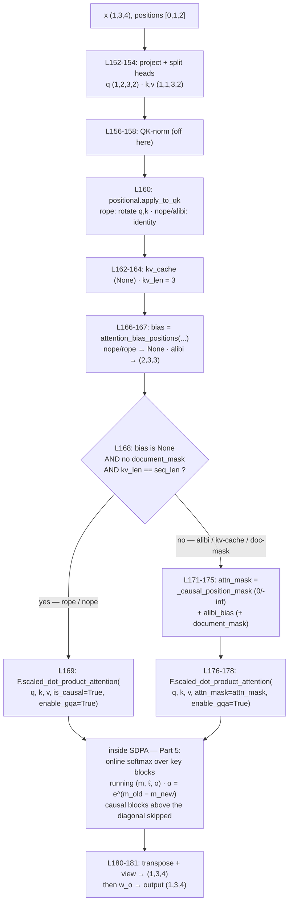
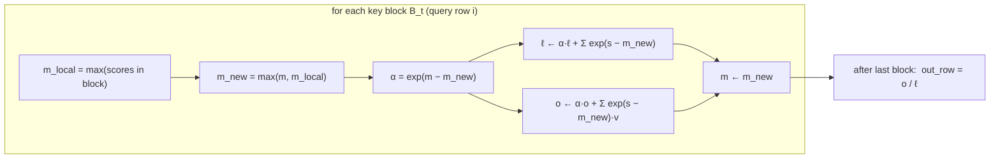
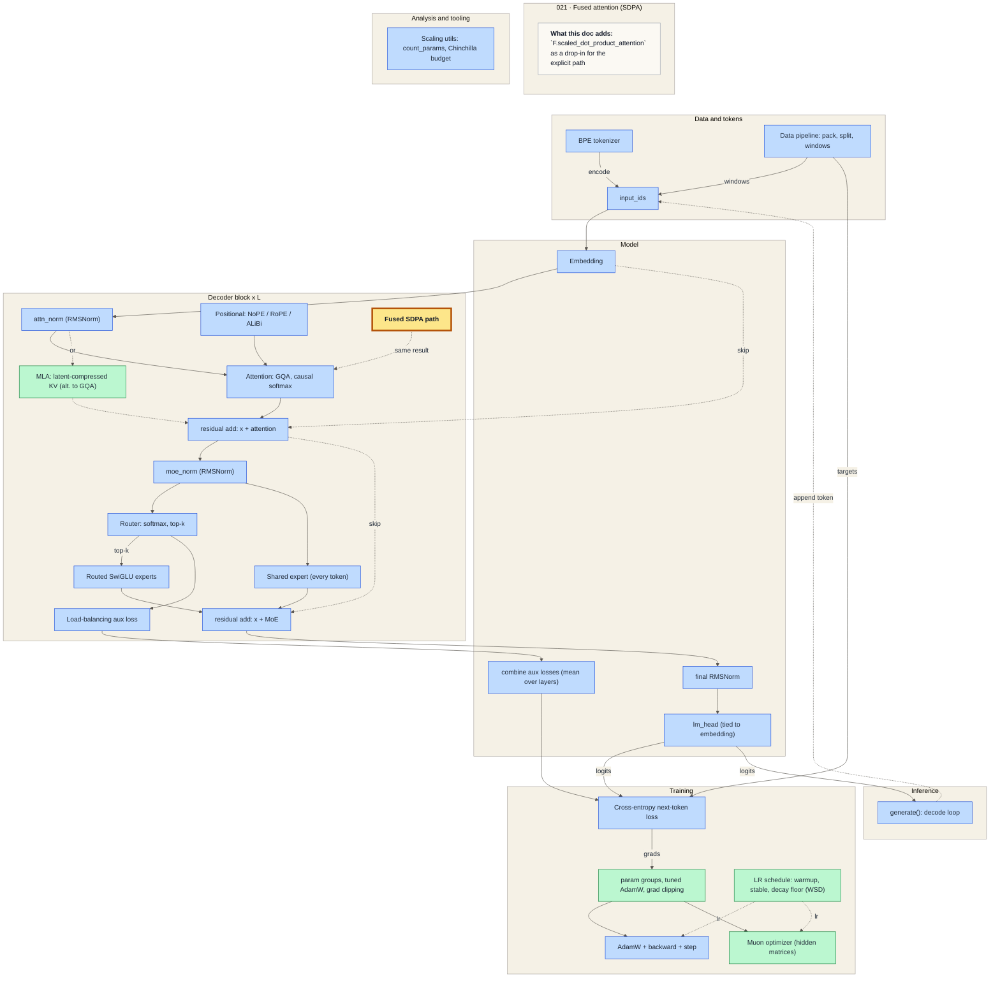

# 021 — Fused attention (`F.scaled_dot_product_attention`): the full derivation, solved by hand

**Companion to:** [`journey_of_a_model/021-fused-attention-sdpa.md`](../../journey_of_a_model/021-fused-attention-sdpa.md)
· **Code:** [`qwenmoe/model/attention.py`](../../qwenmoe/model/attention.py)
· **Every number here is reproduced by:** [`verify_021_fused_attention_sdpa.py`](verify_021_fused_attention_sdpa.py)
(`uv run python docs/math/verify_021_fused_attention_sdpa.py`)

---

## How to read this

[`docs/math/004-attention-gqa.md`](004-attention-gqa.md) already carried one
tiny example through **every line** of the *explicit* attention path,
`Attention.forward_with_trace` — projection, head-split, RoPE, the raw
scores $QK^\top$, the $\div\sqrt{d_k}$ scaling, the causal mask, softmax,
the weighted sum with $V$, and the output projection — each step derived
and then solved digit by digit.

This document is about the *other* path: `Attention.forward`
([`attention.py:119`](../../qwenmoe/model/attention.py#L119)), the one
every real `Trainer.fit` / `generate()` call takes, which replaces those
separate steps with **one call** to
`torch.nn.functional.scaled_dot_product_attention` ("SDPA"). The journal
entry explains *why* that is faster (it "fuses" four memory-bound
operations into one kernel). Here we do the maths: we show, from first
principles and then on real numbers, that the fused call computes the
**identical result** — and we open up the one piece of machinery that
makes fusion possible, the **online (streaming) softmax**.

We deliberately **reuse doc 004's example unchanged** — same input $X$,
same four weight matrices, same three tokens. Doc 004 takes it up to the
scaled score matrices; this document picks up exactly there, at the line
where `forward` and `forward_with_trace` diverge, and carries it to the
end.

You do **not** need a linear-algebra background. Every term is defined at
first use; where doc 004 already defined one (vector, dot product, matrix
multiply, variance, softmax, shift-invariance) we restate it in one line
and move on.

---

## Part 0 — Two paths, one mathematics

### 0.1 The operation both paths compute

For one attention head, with $Q, K, V$ each a matrix holding one row per
token (the **queries**, **keys**, **values** — three different learned
views of the same token, doc 004 §Step 1):

$$\text{Attention}(Q, K, V) = \operatorname{softmax}\!\left(\frac{QK^\top}{\sqrt{d_k}} + M\right) V$$

- $QK^\top$ — every query row dotted with every key row: an
  all-pairs similarity matrix, shape $S \times S$ ($S$ = number of tokens).
- $\sqrt{d_k}$ — a scaling constant ($d_k$ = width of one head), derived
  in full in doc 004 §Step 7. **Exact** under the "inputs are
  unit-variance" assumption.
- $M$ — the **causal mask**: $0$ on and below the diagonal, $-\infty$
  above it, so token $i$ cannot attend to a token $j > i$ (the future).
- $\operatorname{softmax}$ — turns each row of scores into non-negative
  weights that sum to $1$: $\operatorname{softmax}(z)_j = e^{z_j} / \sum_l e^{z_l}$.
- multiply by $V$ — the weighted average of the value rows.

### 0.2 How the two code paths differ

| | `forward_with_trace` (doc 004) | `forward` (this doc) |
|---|---|---|
| GQA (fewer KV heads than query heads) | `k.repeat_interleave(n_rep, dim=1)` — physically copies each KV head | `enable_gqa=True` — SDPA broadcasts internally, no copy |
| causal mask (`rope`/`nope`) | builds `torch.triu(full(-inf), diagonal=1)` explicitly, adds it | `is_causal=True` — the kernel applies the triangle itself |
| the softmax | `F.softmax` over a fully materialised $S\times S$ score matrix | **online softmax** — never materialises the row |
| ALiBi bias | add bias, *then* separately add the causal mask | pre-sum `bias + causal(-inf)` into one `attn_mask` |
| intermediates in memory | $QK^\top$, the masked scores, the softmax weights — all $S\times S$ | none $S\times S$; per query row just a running $(m, \ell, o)$ |

Everything else — the projections, the head split, the RoPE rotation, the
output projection — is **byte-for-byte the same code** in both paths
([`attention.py:150-160`](../../qwenmoe/model/attention.py#L150) vs.
[`:196-212`](../../qwenmoe/model/attention.py#L196)). The divergence is
entirely inside "compute $\operatorname{softmax}(QK^\top/\sqrt{d_k}+M)V$".

### 0.3 The data flow of `forward`



---

## Part 1 — The running example (recap from doc 004)

### 1.1 Configuration

The smallest setup that still exercises GQA (needs `n_kv_heads < n_heads`)
and every branch of `forward`:

| Symbol | Meaning | Value |
|---|---|---|
| `batch` | independent sequences at once | $1$ |
| `seq_len`, $S$ | tokens in the sequence | $3$ |
| `d_model`, $d$ | token-vector width everywhere | $4$ |
| `n_heads`, $H$ | **query** heads | $2$ |
| `head_dim`, $d_k$ | width of one head, $d/H$ | $2$ |
| `n_kv_heads`, $H_{kv}$ | **key/value** heads | $1$ |
| `n_rep`, $r$ | query heads per KV head, $H/H_{kv}$ | $2$ |
| `positional_scheme` | how position enters | `nope` spine; `rope`, `alibi` also run |
| `qk_norm` | per-head RMSNorm on q/k | `False` |

### 1.2 Input and weights (identical to doc 004 §1.3–1.4)

Three tokens, already embedded into length-$4$ rows (batch axis dropped
for algebra):

$$X = \begin{bmatrix} 1 & 0 & 1 & 0 \\ 0 & 2 & 0 & 1 \\ 1 & 1 & 0 & 0 \end{bmatrix}\quad(1,3,4)$$

$$
W_Q = \begin{bmatrix} 1&1&0&0 \\ 0&1&1&0 \\ 0&0&1&1 \\ 1&0&0&1 \end{bmatrix}\!,\quad
W_K = \begin{bmatrix} 1&0&1&0 \\ 0&1&0&1 \end{bmatrix}\!,\quad
W_V = \begin{bmatrix} 1&1&0&0 \\ 0&0&1&1 \end{bmatrix}\!,\quad
W_O = \begin{bmatrix} 1&0&1&0 \\ 0&1&0&1 \\ 1&0&0&1 \\ 0&1&1&0 \end{bmatrix}
$$

A `nn.Linear` with weight $W$ (stored as `(out, in)`) maps a row $x$ to
$xW^\top$ — output coordinate $j$ is the dot product of $x$ with row $j$
of $W$ (doc 004 §1.5).

### 1.3 Where doc 004 leaves us

Doc 004 §Step 1–2 computes, from $X$ and the weights above,

$$
q^{(0)} = \begin{bmatrix} 1&1\\ 2&2\\ 2&1 \end{bmatrix},\ \
q^{(1)} = \begin{bmatrix} 1&1\\ 1&1\\ 0&1 \end{bmatrix},\ \
k^{(0)} = \begin{bmatrix} 2&0\\ 0&3\\ 1&1 \end{bmatrix},\ \
v^{(0)} = \begin{bmatrix} 1&1\\ 2&1\\ 2&0 \end{bmatrix}
$$

Shapes: `q (1, 2, 3, 2)`, `k (1, 1, 3, 2)`, `v (1, 1, 3, 2)` — two query
heads, **one** KV head. With `positional_scheme="nope"` the positional
transform is the identity ([`positional.py:70-73`](../../qwenmoe/model/positional.py#L70)),
so these are also the vectors that reach the dot product.

Doc 004 §Step 6–7 then gives the **scaled** score matrices
$\text{scores}^{(h)} = q^{(h)}(k^{(h)})^\top / \sqrt{2}$ — *pre-mask*, so
still $3\times3$ with all nine entries filled:

$$
\text{scores}^{(0)} = \begin{bmatrix}
1.414214 & 2.121320 & 1.414214 \\
2.828427 & 4.242641 & 2.828427 \\
2.828427 & 2.121320 & 2.121320
\end{bmatrix},\qquad
\text{scores}^{(1)} = \begin{bmatrix}
1.414214 & 2.121320 & 1.414214 \\
1.414214 & 2.121320 & 1.414214 \\
0 & 2.121320 & 0.707107
\end{bmatrix}
$$

(The verify script re-prints these from the real module under the header
`positional_scheme = 'nope'`.) **Everything below is what the two paths do
with these.**

---

## Part 2 — The line where the paths part

`forward` after the shared prefix
([`attention.py:162-181`](../../qwenmoe/model/attention.py#L162)):

```python
if kv_cache is not None:            # L162  — None for every training call
    k, v = kv_cache.append(k, v)
kv_len = k.shape[-2]               # L164  — 3

key_positions = torch.arange(kv_len, device=x.device)          # L166 — [0,1,2]
bias = self.positional.attention_bias_positions(positions, key_positions)  # L167
if bias is None and document_mask is None and kv_len == seq_len:  # L168
    out = F.scaled_dot_product_attention(q, k, v, is_causal=True, enable_gqa=True)  # L169
else:
    attn_mask = _causal_position_mask(positions, kv_len, x.device, q.dtype)  # L171
    if bias is not None:
        attn_mask = attn_mask + bias.to(q.dtype).unsqueeze(0)   # L173
    if document_mask is not None:
        attn_mask = attn_mask + document_mask.to(q.dtype)       # L175
    out = F.scaled_dot_product_attention(
        q, k, v, attn_mask=attn_mask, enable_gqa=True           # L177
    )

out = out.transpose(1, 2).contiguous().view(batch, seq_len, self.n_heads * self.head_dim)  # L180
return self.w_o(out)                                            # L181
```

Line by line on our example:

- **L162–164** — `kv_cache` is `None` (only `generate()` with the KV cache
  passes one, journal 029). `k` is untouched; `kv_len = k.shape[-2] = 3`.
- **L166** — `key_positions = [0, 1, 2]`, the absolute position of each
  key. Equals `positions` here because we are encoding the whole prompt at
  once; a KV-cache decode step would have one query at position `N-1` and
  `N` keys at `0…N-1`, and *then* they differ.
- **L167** — `attention_bias_positions`. For `nope` and `rope` this
  returns `None` ([`positional.py:55-58`](../../qwenmoe/model/positional.py#L55),
  [`:78-81`](../../qwenmoe/model/positional.py#L78)). For `alibi` it
  returns a `(n_heads, 3, 3)` tensor of per-head positional biases
  (Part 6).
- **L168** — the branch. For our `nope` spine: `bias is None` ✓,
  `document_mask is None` ✓, `kv_len (3) == seq_len (3)` ✓ — so we take
  **L169**, the `is_causal=True` call.
- **L180–181** — reshape the per-head outputs back to `(1, 3, 4)` and
  apply $W_O$. This is byte-identical to doc 004 §Step 12, which already
  solved it: given the per-head context vectors it produces the final

  $$\text{output} = \begin{bmatrix}
  2.000000 & 2.000000 & 2.000000 & 2.000000 \\
  3.474192 & 2.000000 & 2.804430 & 2.669762 \\
  3.408561 & 1.573375 & 2.318140 & 2.663796
  \end{bmatrix}$$

So the whole job of Parts 3–5 is to show that
`F.scaled_dot_product_attention(q, k, v, is_causal=True, enable_gqa=True)`
produces **the same per-head context vectors** doc 004 computed by hand —
`out`$^{(0)}$ $= \left[\begin{smallmatrix}1&1\\ 1.804430&1\\ 1.496510&0.751745\end{smallmatrix}\right]$
and `out`$^{(1)}$ $= \left[\begin{smallmatrix}1&1\\ 1.669762&1\\ 1.912051&0.821630\end{smallmatrix}\right]$.

**Shape ledger entering SDPA:** `q (1, 2, 3, 2)`, `k (1, 1, 3, 2)`,
`v (1, 1, 3, 2)`.

---

## Part 3 — `enable_gqa=True`: the broadcast that replaces the copy

### 3.1 What the explicit path did

We have $H = 2$ query heads but $H_{kv} = 1$ KV head. A per-head dot
product needs one $K$ and one $V$ per query head, so doc 004 §Step 5
**duplicated** the single KV head:

```python
k = k.repeat_interleave(self.n_rep, dim=1)   # (1,1,3,2) -> (1,2,3,2)
```

`repeat_interleave(r, dim=1)` repeats each slice $r$ times *consecutively*:
with one KV head "$A$", $[A] \to [A, A]$. Query heads $0$ and $1$ then
each hold their own physical copy of $A$. Result: `k`, `v` become
`(1, 2, 3, 2)` — twice the memory, all of it duplicate.

### 3.2 What `enable_gqa=True` does instead — derived

**Claim.** SDPA with `enable_gqa=True` never builds the `(1, 2, 3, 2)`
tensor. Instead, when it needs the key for query head $h$, it *indexes*
into the un-expanded `(1, 1, 3, 2)` tensor at KV head

$$g(h) = \left\lfloor \frac{h}{r} \right\rfloor, \qquad r = \frac{H}{H_{kv}} = n\_rep.$$

**Why that index.** The head split in doc 004 §Step 2 cut each token's
length-$d$ row into $H$ contiguous blocks, so query heads
$\{0, 1, \dots, r-1\}$ came from the first slice, $\{r, \dots, 2r-1\}$
from the second, and so on — query heads $[g\,r,\ (g{+}1)r)$ form one
"group". GQA's whole premise (Ainslie et al. 2023) is that one group
shares one KV head. So query head $h$ belongs to group $\lfloor h/r
\rfloor$ and must read KV head $\lfloor h/r \rfloor$. That is exactly the
$g(h)$ above.

**It is the same map `repeat_interleave` realises.**
`repeat_interleave` places the copies of KV head $g$ at output positions
$g\,r, g\,r+1, \dots$, i.e. output head $h$ holds a copy of input KV head
$\lfloor h/r \rfloor$. Broadcasting reads that same original directly;
copying first duplicates it and then reads the duplicate. Identical data,
so identical arithmetic.

### 3.3 On our numbers

$r = 2$, so

$$g(0) = \lfloor 0/2 \rfloor = 0, \qquad g(1) = \lfloor 1/2 \rfloor = 0.$$

Both query heads read KV head $0$: $k^{(0)} = \left[\begin{smallmatrix}
2&0\\ 0&3\\ 1&1\end{smallmatrix}\right]$, $v^{(0)} = \left[\begin{smallmatrix}
1&1\\ 2&1\\ 2&0\end{smallmatrix}\right]$ — precisely the $k$, $v$ doc 004
§Step 5–6 used for *both* heads. So the raw scores SDPA forms internally
are doc 004's $\text{scores}^{(0)}_{\text{raw}}$ and
$\text{scores}^{(1)}_{\text{raw}}$, unchanged.

### 3.4 Verified

The verify script (§4) runs SDPA both ways on this example:

```
k shape into enable_gqa path : (1, 1, 3, 2)  (never expanded)
k shape after repeat_interleave: (1, 2, 3, 2)
max |enable_gqa - repeat_interleave| = 0.0
query-head -> kv-head map (h // n_rep, n_rep=2): [0, 0]
```

`0.0` — **bit-for-bit identical** on this example (the broadcast reads the
very same floats; there is no reordering of any sum). This step is
therefore **exact**: pure integer indexing, no arithmetic of its own.

### 3.5 What it saves, on our numbers

| | expanded (explicit) | broadcast (fused) |
|---|---|---|
| `k` floats in memory | $H \cdot S \cdot d_k = 2\cdot3\cdot2 = 12$ | $H_{kv}\cdot S\cdot d_k = 1\cdot3\cdot2 = 6$ |
| `v` floats | $12$ | $6$ |

At this size it is 12 floats. At the `BASELINE` config
($H = 8$, $H_{kv} = 4$, $S = 256$, $d_k = 32$) it is
$8\cdot256\cdot32 = 65{,}536$ vs. $32{,}768$ per tensor per layer — and
during generation that difference is re-read for every token produced,
which is the memory-traffic bottleneck GQA exists to cut (doc 004 §3.1,
journal 029).

---

## Part 4 — `is_causal=True`: the mask the kernel builds for itself

### 4.1 What the explicit path did

Doc 004 §Step 9: build the mask, add it to the scaled scores.

```python
causal_mask = torch.triu(torch.full((seq_len, seq_len), float("-inf")), diagonal=1)
scores = scores + causal_mask
```

`torch.triu(..., diagonal=1)` keeps everything **strictly above** the main
diagonal and zeroes the rest, so with a `-inf` fill:

$$M = \begin{bmatrix} 0 & -\infty & -\infty \\ 0 & 0 & -\infty \\ 0 & 0 & 0 \end{bmatrix}$$

Adding $M$ leaves allowed entries ($j \le i$) untouched and sends
forbidden ones ($j > i$) to $-\infty$; softmax then gives them weight
$e^{-\infty} = 0$ exactly (doc 004 §Step 10).

### 4.2 What `is_causal=True` does — derived

PyTorch's SDPA reference implementation
([docs](https://docs.pytorch.org/docs/stable/generated/torch.nn.functional.scaled_dot_product_attention.html))
does, in effect:

```python
attn_bias = torch.zeros(L, S)                       # additive, starts at 0
if is_causal:
    temp = torch.ones(L, S, dtype=bool).tril(0)     # lower triangle True
    attn_bias.masked_fill_(temp.logical_not(), float("-inf"))   # upper -> -inf
attn_weight = softmax(Q @ K.transpose(-2,-1) * scale + attn_bias) @ V
```

For the square, aligned case ($L = S$, query $i$ at absolute position
$i$) `temp.tril(0)` is `True` on and below the diagonal, so
`attn_bias` becomes **exactly the $M$ above**. So `is_causal=True` is not
an approximation of the explicit mask — it *is* the explicit mask, built
inside the kernel from a one-word flag instead of passed in as an
$S\times S$ tensor.

**Why it is worth a special flag** (rather than "just pass the mask"): the
lower-triangular pattern is fixed and known, so a tiled kernel can **skip
whole key-blocks that lie entirely above the diagonal** — for query block
rows near the top, most of the sequence is masked and never needs to be
touched. An arbitrary caller-supplied `attn_mask` could be any shape, so
the kernel cannot assume anything and must visit every block. That is why
SDPA makes you choose one or the other and **throws an error if both
`attn_mask` and `is_causal` are set** (confirmed in the docs) — the topic
of Part 6.

### 4.3 The project's general helper vs. `triu`

`forward` on the *else* branch (Part 6) does not call `torch.triu`; it
calls `_causal_position_mask(positions, kv_len, ...)`
([`attention.py:26`](../../qwenmoe/model/attention.py#L26)), which builds a
`(1, len(q_positions), kv_len)` mask that is `0` where
`key_pos ≤ query_pos` and `-inf` otherwise. That form is needed when
queries and keys are **not** aligned $1{:}1$ (a KV-cache step) or when a
per-row bias must be folded in. For our square case the verify script
confirms:

```
_causal_position_mask(arange(3), 3) == triu(-inf, diag=1)?  True
```

They are the same matrix; `is_causal=True` and `_causal_position_mask`
and `triu` are three spellings of one triangle here.

---

## Part 5 — Inside the fused kernel: online (streaming) softmax

This is the piece that makes "fused" mean something. Parts 3–4 were
bookkeeping (which K to read, which entries to forbid); this part is the
actual softmax-times-V, computed **without ever holding a full score
row**.

### 5.1 The problem with one-shot softmax

To compute row $i$ of $\operatorname{softmax}(QK^\top/\sqrt{d_k}+M)V$ the
straightforward way, the whole score row
$s_{i,:} = [s_{i,1}, \dots, s_{i,S}]$ has to stay available while you
sweep it **more than once**:

1. once to find $\max_j s_{i,j}$ (subtracted before exponentiating, so
   $e^{\text{big}}$ never overflows — doc 004 §Step 10, "shift-invariance");
2. again to form the denominator $\sum_j e^{s_{i,j} - \max}$;
3. again to weight the values, $\sum_j e^{s_{i,j}-\max}\,v_j$.

Keeping it available means writing all $H$ heads' $\times$ all $S$ rows —
an $(H, S, S)$ tensor — out to memory and reading it back. That tensor
grows **quadratically** in sequence length, while the actual output is
only $(S, d_k)$. That write-and-reread traffic is the cost FlashAttention
(Dao et al. 2022) removed.

### 5.2 The online-softmax recurrence — derived

**Idea (Milakov & Gimelshein 2018; Rabe & Staats 2021).** Walk the keys
in **blocks** $B_1, B_2, \dots, B_T$ (a real kernel uses blocks of
64–128; we will use blocks of **1** so every step is visible). After
processing blocks $1..t$ keep three running quantities for the current
query row:

| symbol | meaning | after all $T$ blocks it equals |
|---|---|---|
| $m^{(t)}$ | largest score seen so far | $\max_j s_{i,j}$ |
| $\ell^{(t)}$ | $\displaystyle\sum_{j \le \text{blk }t} e^{s_{i,j} - m^{(t)}}$ | the softmax denominator |
| $o^{(t)}$ | $\displaystyle\sum_{j \le \text{blk }t} e^{s_{i,j} - m^{(t)}}\, v_j$ | the un-normalised weighted value sum |

**The update.** A new block $B_{t+1}$ arrives with scores
$\{s_{i,j}\}_{j \in B_{t+1}}$ and values $\{v_j\}$. Let

$$\tilde m = \max_{j \in B_{t+1}} s_{i,j}, \qquad
m^{(t+1)} = \max\!\big(m^{(t)},\ \tilde m\big).$$

The running $\ell^{(t)}$ and $o^{(t)}$ were built with every term scaled
by $e^{-m^{(t)}}$. We now want everything scaled by $e^{-m^{(t+1)}}$
instead. Multiply the old accumulators by

$$\alpha \;=\; \frac{e^{-m^{(t+1)}}}{e^{-m^{(t)}}} \;=\; e^{\,m^{(t)} - m^{(t+1)}} \;\le\; 1,$$

then add the new block's contributions (already scaled by the new max):

$$
\ell^{(t+1)} = \alpha\,\ell^{(t)} + \sum_{j \in B_{t+1}} e^{s_{i,j} - m^{(t+1)}},
\qquad
o^{(t+1)} = \alpha\,o^{(t)} + \sum_{j \in B_{t+1}} e^{s_{i,j} - m^{(t+1)}}\, v_j.
$$

**Final answer for the row:** $\displaystyle o_i = \frac{o^{(T)}}{\ell^{(T)}}$.

### 5.3 Why $\alpha$ is exactly right — it is shift-invariance again

Doc 004 §Step 10 proved: adding the same constant to every score before
softmax changes nothing, because the constant factors out of numerator
and denominator identically. The $\alpha$ rescale is that fact applied
*mid-stream*. When the running max jumps from $m^{(t)}$ to $m^{(t+1)}$:

- **denominator** $\ell$: every stored term $e^{s - m^{(t)}}$ must become
  $e^{s - m^{(t+1)}} = e^{s - m^{(t)}} \cdot e^{m^{(t)} - m^{(t+1)}}$ —
  multiply by $\alpha$.
- **numerator** $o$: same factor on every stored term.

Both get multiplied by the *same* $\alpha$, so the ratio $o/\ell$ they
will eventually form is untouched — the rescale is pure numerical
hygiene, not a change of value.

### 5.4 Why the final answer is exact — induction

**Claim:** $\ell^{(t)} = \sum_{j \in B_1\cup\dots\cup B_t} e^{s_{i,j} - m^{(t)}}$
and likewise for $o^{(t)}$, at every $t$.

- **Base ($t=1$):** $m^{(1)} = \tilde m$ over $B_1$;
  $\ell^{(1)} = \sum_{j \in B_1} e^{s_{i,j} - m^{(1)}}$ directly. ✓
- **Step:** assume it holds at $t$. Then
  $\alpha\,\ell^{(t)} = \sum_{j \le \text{blk }t} e^{s_{i,j}-m^{(t)}}\,e^{m^{(t)}-m^{(t+1)}}
  = \sum_{j \le \text{blk }t} e^{s_{i,j}-m^{(t+1)}}$, and we add
  $\sum_{j \in B_{t+1}} e^{s_{i,j}-m^{(t+1)}}$, giving the claim at
  $t{+}1$. ✓ (Same argument for $o$.)

At $t = T$, $m^{(T)} = \max_j s_{i,j}$ (the running max has seen every
key), so

$$\frac{o^{(T)}}{\ell^{(T)}}
= \frac{\sum_j e^{s_{i,j} - \max}\, v_j}{\sum_j e^{s_{i,j} - \max}}
= \frac{\sum_j e^{s_{i,j}}\, v_j}{\sum_j e^{s_{i,j}}}
= \sum_j \operatorname{softmax}(s_{i,:})_j\, v_j.$$

The $e^{-\max}$ cancels (shift-invariance one more time). **Exactly** the
one-shot result — this is provable algebra, not an approximation. The
*block size* is the only free knob, and it is an **empirical /
hardware** choice (fit a tile in on-chip memory); it does not affect the
value.

### 5.5 Solved by hand — head 1, query row 2

From Part 1: row $2$ of $\text{scores}^{(1)}$ (all three keys visible,
since query $2$ may attend to $0, 1, 2$) is

$$s_{2,:} = [\,0,\ \ 2.121320,\ \ 0.707107\,], \qquad
v_0 = [1, 1],\ v_1 = [2, 1],\ v_2 = [2, 0].$$

Blocks of one key each: $B_1 = \{0\}$, $B_2 = \{1\}$, $B_3 = \{2\}$.
Initialise $m = -\infty$, $\ell = 0$, $o = [0, 0]$.

**Block $B_1$ — key 0, score $0$.**
$\tilde m = 0$; $m^{(1)} = \max(-\infty, 0) = 0$.
$\alpha = e^{-\infty - 0} = 0$ — but it multiplies $\ell = 0$ and
$o = [0,0]$, so it is a harmless $0\cdot 0$ (equivalently: "just
initialise from the first block").
New term: $e^{0 - 0} = 1$.
$\ell^{(1)} = 0\cdot 0 + 1 = 1$.
$o^{(1)} = 0\cdot[0,0] + 1\cdot[1,1] = [1, 1]$.

**Block $B_2$ — key 1, score $2.121320$.**
$\tilde m = 2.121320$; $m^{(2)} = \max(0,\ 2.121320) = 2.121320$.
$\alpha = e^{\,0 - 2.121320} = e^{-2.121320} = 0.119873$.
New term: $e^{2.121320 - 2.121320} = e^0 = 1$.
$\ell^{(2)} = 0.119873 \cdot 1 + 1 = 1.119873$.
$o^{(2)} = 0.119873\cdot[1,1] + 1\cdot[2,1]
= [0.119873 + 2,\ \ 0.119873 + 1] = [2.119873,\ 1.119873]$.

*The block-1 accumulator $[1,1]$ was scaled down to $[0.119873, 0.119873]$
— because block 2 turned out to hold a much larger score, so block 1's
weight relative to it shrinks. This is the rescale doing its job.*

**Block $B_3$ — key 2, score $0.707107$.**
$\tilde m = 0.707107$; $m^{(3)} = \max(2.121320,\ 0.707107) = 2.121320$
(**unchanged** — this block's score is smaller).
$\alpha = e^{\,2.121320 - 2.121320} = e^0 = 1$ — **no rescale**, the old
accumulators are already on the right scale.
New term: $e^{0.707107 - 2.121320} = e^{-1.414214} = 0.243117$.
$\ell^{(3)} = 1 \cdot 1.119873 + 0.243117 = 1.362990$.
$o^{(3)} = 1\cdot[2.119873, 1.119873] + 0.243117\cdot[2, 0]
= [2.119873 + 0.486234,\ \ 1.119873 + 0] = [2.606107,\ 1.119873]$.

**Normalise:**

$$o_2 = \frac{o^{(3)}}{\ell^{(3)}}
= \left[\frac{2.606107}{1.362990},\ \ \frac{1.119873}{1.362990}\right]
= [\,1.912051,\ \ 0.821630\,].$$

Doc 004 §Step 11 computed $\text{out}^{(1)}_2 = [1.912051,\ 0.821630]$ by
one-shot softmax then $p \cdot v$. **Identical.**

All three $\alpha$ regimes showed up in one row: $\alpha = 0$
(initialisation), $\alpha < 1$ (a later block raised the max — rescale the
history), $\alpha = 1$ (a later block did not — leave it alone).

### 5.6 Verified — every row, both heads

```
featured walkthrough -- head 1, query row 2, block_size = 1:
  scaled scores  = [0.0, 2.12132, 0.707107]
  values         = [[1.0, 1.0], [2.0, 1.0], [2.0, 0.0]]
    block keys [0:1)  s=[0.0]  m_new=0.000000  alpha=0.000000  l=1.000000  o=[1.0, 1.0]
    block keys [1:2)  s=[2.12132]  m_new=2.121320  alpha=0.119873  l=1.119873  o=[2.119873, 1.119873]
    block keys [2:3)  s=[0.707107]  m_new=2.121320  alpha=1.000000  l=1.362990  o=[2.606107, 1.119873]
  final: o / l = [1.912051, 0.82163]   (last accumulator / last denominator)
  one-shot softmax(scores) @ v = [1.912051, 0.82163]

every query row, both heads, block sizes 1 and 2:
  head 0 row 0: streamed == one-shot  ([1.0, 1.0])  OK
  head 0 row 1: streamed == one-shot  ([1.80443, 1.0])  OK
  head 0 row 2: streamed == one-shot  ([1.49651, 0.751745])  OK
  head 1 row 0: streamed == one-shot  ([1.0, 1.0])  OK
  head 1 row 1: streamed == one-shot  ([1.669762, 1.0])  OK
  head 1 row 2: streamed == one-shot  ([1.912051, 0.82163])  OK
```

The streamed value and the one-shot value agree to $\sim 10^{-7}$
(float32 rounding on a handful of extra multiplications — Part 8), for
every row, at block size 1 **and** block size 2.

### 5.7 The memory it never used

For one query row the fused path holds $m$ (1 number), $\ell$ (1), $o$
($d_k = 2$) — **4 floats**, independent of $S$. The one-shot path holds
the length-$S$ score row plus the length-$S$ weights — $2S$ floats, and
across the batch/heads the full $(1, 2, 3, 3) = 18$-float score tensor
plus an 18-float weight tensor. At $S = 3$ that is nothing; the point is
the $4$ vs $2S$ asymptotics (§Part 9).



---

## Part 6 — The ALiBi branch: `attn_mask = causal(−∞) + alibi_bias`

### 6.1 Why ALiBi cannot use `is_causal=True`

ALiBi (Press et al. 2021) injects position not by rotating $q$/$k$ (that
is RoPE) but by **adding a per-head, per-distance bias to the raw
scores** (doc 004 §Step 8):

$$b_h(i, j) = (j - i)\, m_h, \qquad m_h > 0 \text{ a fixed per-head slope}.$$

For a past key ($j < i$) this is negative and grows more negative with
distance — "recent tokens matter more." It is genuine per-position data
the kernel cannot regenerate from a flag, so it must be passed as
`attn_mask`. But SDPA **rejects `attn_mask` together with
`is_causal=True`** (Part 4.2). So `forward` takes the *else* branch and
supplies **one** additive tensor that carries *both* the causal $-\infty$
pattern and the ALiBi bias.

### 6.2 The fold-in is valid — derived

Explicit path (`forward_with_trace`,
[`attention.py:219-229`](../../qwenmoe/model/attention.py#L219)):

$$\underbrace{\big(\text{scores} + \text{bias}\big)}_{\text{L223}} + \underbrace{\text{causal\_mask}}_{\text{L229}}$$

Fused path (`forward`,
[`attention.py:171-173`](../../qwenmoe/model/attention.py#L171), then SDPA
adds `attn_mask` to the scaled scores):

$$\text{scores} + \underbrace{\big(\text{causal\_mask} + \text{bias}\big)}_{\text{attn\_mask, L173}}$$

Addition is **commutative** ($a + b = b + a$) and **associative**
($(a+b)+c = a+(b+c)$), so for the finite entries these are equal term by
term. For the masked entries ($j > i$, where `causal_mask` $= -\infty$):

- explicit: $(\text{finite} + \text{finite}) + (-\infty) = -\infty$
- fused: $\text{finite} + \big((-\infty) + \text{finite}\big)
  = \text{finite} + (-\infty) = -\infty$

Same. And **no `NaN`**: the only indeterminate form is $-\infty + (+\infty)$,
and $\text{bias} = (j-i)m_h$ is always finite, so it never arises. After
softmax those entries are $e^{-\infty} = 0$ either way.

### 6.3 Solved by hand — head 0

Slopes for $H = 2$ (doc 004 §Step 8;
[`positional.py:131-143`](../../qwenmoe/model/positional.py#L131)):
$\text{start} = 2^{-8/2} = 2^{-4} = 0.0625$, then $m_h = \text{start}^{\,h}$:

$$m_1 = 0.0625, \qquad m_2 = 0.0625^2 = 0.00390625.$$

**Bias matrix, head 0**, $b_0(i,j) = (j-i)\cdot 0.0625$:

$$b_0 = \begin{bmatrix}
0 & 0.0625 & 0.125 \\
-0.0625 & 0 & 0.0625 \\
-0.125 & -0.0625 & 0
\end{bmatrix}$$

**`causal_mask` + `bias`** (this is `attn_mask[0, 0]` in `forward`):

$$
\text{causal} + b_0 =
\begin{bmatrix} 0 & -\infty & -\infty \\ 0 & 0 & -\infty \\ 0 & 0 & 0 \end{bmatrix}
+ b_0
= \begin{bmatrix}
0 & -\infty & -\infty \\
-0.0625 & 0 & -\infty \\
-0.125 & -0.0625 & 0
\end{bmatrix}
$$

**Scaled scores$^{(0)}$ + that** — take
$\text{scores}^{(0)} = \left[\begin{smallmatrix}
1.414214 & 2.121320 & 1.414214 \\
2.828427 & 4.242641 & 2.828427 \\
2.828427 & 2.121320 & 2.121320\end{smallmatrix}\right]$
from Part 1 and add the matrix above entry by entry
($-\infty + \text{finite} = -\infty$):

$$
\begin{bmatrix}
1.414214 + 0 & 2.121320 - \infty & 1.414214 - \infty \\
2.828427 - 0.0625 & 4.242641 + 0 & 2.828427 - \infty \\
2.828427 - 0.125 & 2.121320 - 0.0625 & 2.121320 + 0
\end{bmatrix}
=
\begin{bmatrix}
1.414214 & -\infty & -\infty \\
2.765927 & 4.242641 & -\infty \\
2.703427 & 2.058820 & 2.121320
\end{bmatrix}
$$

Now compare the explicit path: doc 004 §Step 8 adds $b_0$ to the scaled
scores *first*, giving (its printed `alibi` `attn_scores_pre_mask`, head 0)

$$
\begin{bmatrix}
1.414214 & 2.183820 & 1.539214 \\
2.765927 & 4.242641 & 2.890927 \\
2.703427 & 2.058820 & 2.121320
\end{bmatrix}
$$

then adds `causal_mask`, sending the upper triangle to $-\infty$ — landing
on **the same matrix**. The verify script confirms the two orders are not
just equal but produce a **bit-identical softmax**:

```
_causal_position_mask(arange(3), 3) == triu(-inf, diag=1)?  True
finite entries equal   : True
masked entries -inf both: True
any NaN (would mean -inf + +inf somewhere): False
softmax(A) == softmax(B) bit-for-bit:  True
```

This step is **exact** — associativity/commutativity of `+`, and
`-inf + finite = -inf` in IEEE-754 with no rounding.

---

## Part 7 — `MLAAttention`'s fused path

`MLAAttention.forward`
([`attention.py:352-358`](../../qwenmoe/model/attention.py#L352)) gets the
same treatment, **simpler**:

```python
if document_mask is None and kv_len == seq_len:
    out = F.scaled_dot_product_attention(q, k, v, is_causal=True)
```

- **No `enable_gqa`.** MLA's compression happens in a *shared latent*, not
  by cutting the head count: after the per-head up-projection, $q$ and $k$
  both have $H$ heads (doc 016 §Step 2). No head-count mismatch, nothing
  to broadcast.
- **No ALiBi branch.** MLA always applies its own *decoupled RoPE*
  regardless of `positional_scheme` (doc 016 §Step 4), and RoPE adds no
  score bias — so `is_causal=True` always suffices (unless a cache /
  document mask forces the explicit-mask branch).
- **The scale is already right.** SDPA's default scale is
  $1/\sqrt{\text{(last dim of }q)}$. MLA's $q$ is
  `cat([q_content, q_rope], dim=-1)`, width $d_k + d_k^{\text{rope}}$, and
  `forward_with_trace` hard-codes exactly
  $1/\sqrt{d_k + d_k^{\text{rope}}}$
  ([`attention.py:395`](../../qwenmoe/model/attention.py#L395)). They
  match with nothing to pass.

The online-softmax machinery of Part 5 is identical. Doc 016's verify
script measures the fused-vs-explicit agreement for MLA on its own worked
example (`max |trace − fused|`, printed under "Real module:
forward_with_trace vs fused forward").

---

## Part 8 — Numerical (non-)equivalence, measured

### 8.1 What the verify script measures on this example

```
measured max |forward - forward_with_trace| (this module):
  nope   2.38e-07   (0.024 x the 1e-5 test tolerance)
  rope   2.38e-07   (0.024 x the 1e-5 test tolerance)
  alibi  2.38e-07   (0.024 x the 1e-5 test tolerance)
```

The journal entry measures the same thing on a *different* config
(a full `ModelConfig(d_model=16, n_heads=4, n_kv_heads=2, …)`, prompt
`"hello"`, comparing final logits): rope $8.57\times10^{-8}$, nope
$1.12\times10^{-7}$, alibi $7.45\times10^{-8}$. Same order of magnitude;
the exact figure depends on shapes and how many additions accumulate.

### 8.2 Why not bit-identical — floating-point addition is not associative

A float stores only ~7 significant decimal digits (float32). Each `+`
rounds its result to the nearest representable value, and rounding a
different *grouping* of the same numbers can land differently:

```
(1.0 + -1.0) + 1e-8  =  1.0e-08     <- the 1e-8 survives
(1.0 + 1e-8) + -1.0  =  0.0e+00     <- 1.0 + 1e-8 already rounded back to 1.0; the 1e-8 is gone
```

Both are "$1 - 1 + 10^{-8}$". They disagree by $10^{-8}$ purely from
association order. Over a long reduction the effect compounds — summing
4096 random values left-to-right vs. right-to-left:

```
sum(4096 randn) left-to-right = -51.20204926
sum(4096 randn) right-to-left = -51.20203018
difference (pure summation order) = 1.91e-05
```

The explicit path forms $\sum_j p_{ij} v_j$ as **one left-to-right matmul
reduction**. The fused path forms it **block by block with the $\alpha$
rescales** (Part 5) — a different grouping, plus extra multiplications.
The mathematics is identical (Part 5.4); the rounding is not. The gap
sits at $\sim 10^{-7}$, i.e. float32 machine epsilon ($\approx 1.19\times
10^{-7}$), which is what "$2.38\times10^{-7}$" above is.

### 8.3 Why the tests check `1e-5`

$10^{-5}$ is ~40× looser than the $2.4\times10^{-7}$ this CPU-vs-CPU
comparison shows — deliberately, so a *different* backend (a real CUDA
FlashAttention-2 kernel vs. a CPU manual softmax) can disagree by more
than a pure-CPU run does and still pass, while a genuine correctness bug —
which produces differences many orders of magnitude larger than
$\varepsilon$ — is still caught (`design.md` Requirement 7.2).

---

## Part 9 — Cost, on this example's own numbers

### 9.1 What the explicit path materialised, here

| tensor | shape | floats |
|---|---:|---:|
| `k`, `v` after `repeat_interleave` | `(1,2,3,2)` each | $12 + 12$ |
| $QK^\top$ scaled scores | `(1,2,3,3)` | $18$ |
| softmax weights | `(1,2,3,3)` | $18$ |
| **total intermediate** | | **$60$** |
| the actual output | `(1,3,4)` | $12$ |

### 9.2 What the fused path materialised

`q`, `k`, `v` in (unexpanded `k`/`v`: $12 + 6 + 6$), the output `(1,3,4)`
out, and — per query row, transiently — the running $(m, \ell, o)$: **4
floats**. No $S\times S$ tensor is ever written.

### 9.3 Why it matters at scale (it barely does at $S = 3$)

The materialised score tensor is $(H, S, S)$ — **quadratic** in sequence
length — while the output is $(S, d_k)$ — **linear**. The streaming state
is $O(d_k)$ per row regardless of $S$.

| $S$ | one-shot scores $(H{=}2)$: $2S^2$ floats | streaming state per row: $d_k + 2$ |
|---:|---:|---:|
| 3 | 18 | 4 |
| 32 | 2,048 | 4 |
| 256 | 131,072 | 4 |
| 2,048 | 8,388,608 | 4 |

This project's configs top out at `max_seq_len=256`, so the *memory* win
is real but small here; the FlashAttention papers target the regime where
that $(H,S,S)$ tensor does not fit in fast memory at all.

### 9.4 Measured speed

The verify script times the attention core (SDPA call vs. a hand copy of
the pre-task-5 manual-softmax code) at the `BASELINE` shape
($d_{\text{model}}=256$, $H=8$, $H_{kv}=4$, batch $4$, $S=256$, CPU,
50-call average after 5 warm-ups). One representative run:

```
fused SDPA        : 0.41 ms/call
manual softmax    : 1.18 ms/call
speedup           : 2.9x
max |fused - manual| on the output: 1.79e-07
```

Across repeated runs on this machine the fused call lands at
$0.4$–$0.65$ ms and the manual copy at $1.1$–$1.2$ ms — a $\sim1.8$–$2.9\times$
speedup, noisy because it is a CPU wall-clock micro-benchmark. (The
journal measures the *whole* `Attention` module — projections included —
and reports 1.590 ms vs. 2.738 ms, ~1.7×. This script isolates the
softmax-times-V core, so the ratio it sees is a little larger; both
numbers are real, they measure different spans.) The
`max |fused - manual|` on the output is a stable $1.79\times10^{-7}$ —
float32 noise, not a correctness gap. Rerun the script for your machine's
figures.

---

## Questions that might come to mind

- **Does the fused path change what the model computes?** No. Same maths
  (Parts 3–6 derive each step's equivalence; Part 5.4 proves the softmax
  is exact), agreeing here to $2.4\times10^{-7}$ — about $0.024\times$ the
  $10^{-5}$ the tests enforce. The difference is rounding, not error.

- **Then why keep `forward_with_trace` slow on purpose?** A fused kernel's
  entire point is to *never materialise* the $(S, S)$ score matrix — but
  that matrix (`attn_scores_pre_mask` / `attn_scores_post_softmax`) is
  exactly what the Manim attention scene animates (journal 013). Fusing
  the trace path would leave it nothing to show.

- **$\alpha = 0$ for the very first block — is that a bug?** No. Formally
  $\alpha = e^{-\infty - m^{(1)}} = 0$, and it multiplies $\ell = 0$,
  $o = [0,0]$ — a harmless $0 \cdot 0$. Implementations either guard it
  (as the verify script does) or just seed the state from block 1
  directly.

- **What if a later block's scores are all smaller than the running
  max?** Then $m^{(t+1)} = m^{(t)}$, so $\alpha = e^0 = 1$: no rescale of
  the history, just add that block's (correctly shifted) terms. Block 3 of
  Part 5.5 is this case.

- **Does `enable_gqa` cost any accuracy vs. `repeat_interleave`?** No —
  bit-for-bit identical on this example ($|\Delta| = 0.0$). It is integer
  indexing into the same floats; no sum is reordered.

- **Why does ALiBi need a full $(H, S, S)$ mask when rope/nope get away
  with a one-word flag?** rope/nope's only additive term is the fixed
  causal triangle, which `is_causal=True` reconstructs for free. ALiBi's
  bias is per-head, per-distance *data* — the kernel cannot regenerate it,
  so it travels as an explicit tensor, and (Part 4.2) that forces the
  no-`is_causal` branch.

- **Is this actually FlashAttention running?** On a CPU run PyTorch's SDPA
  dispatcher picks its C++ fused kernel, not the CUDA FlashAttention-2
  kernel — still one fused pass over the four ops, still faster (Part 9.4).
  The specific memory-tiling FlashAttention kernel needs a GPU and long
  sequences to shine.

- **What about the KV-cache decode path?** Then one query (at position
  $N{-}1$) attends over $N$ cached keys — query and key positions no
  longer line up $1{:}1$, so `kv_len != seq_len`, and `forward` takes the
  explicit-`attn_mask` branch with `_causal_position_mask` doing the
  alignment (journal 029; [`attention.py:142-148`](../../qwenmoe/model/attention.py#L142)).

---

## Symbol reference

| symbol | meaning |
|---|---|
| $S$, `seq_len` | sequence length (3 here) |
| $d$, `d_model` | model width (4) |
| $H$, `n_heads` | query heads (2) |
| $H_{kv}$, `n_kv_heads` | key/value heads (1) |
| $d_k$, `head_dim` | width of one head, $d/H$ (2) |
| $r$, `n_rep` | query heads per KV head, $H/H_{kv}$ (2) |
| $g(h) = \lfloor h/r \rfloor$ | KV head that query head $h$ reads (`enable_gqa`) |
| $M$ | causal mask: $0$ on/below the diagonal, $-\infty$ above |
| $s_{i,j}$ | scaled score, query $i$ vs. key $j$: $q_i\cdot k_j/\sqrt{d_k}$ |
| $b_h(i,j) = (j-i)m_h$ | ALiBi bias, head $h$ |
| $m_h$ | ALiBi slope for head $h$ ($0.0625$, $0.00390625$) |
| $B_1,\dots,B_T$ | the key blocks the online softmax walks |
| $m^{(t)}$ | running max score after block $t$ |
| $\ell^{(t)}$ | running softmax denominator after block $t$ |
| $o^{(t)}$ | running weighted-value accumulator after block $t$ |
| $\alpha = e^{m^{(t)} - m^{(t+1)}}$ | rescale applied to $\ell$, $o$ when the max moves |
| $\varepsilon_{\text{f32}} \approx 1.19\times10^{-7}$ | float32 machine epsilon |

---

## Citations

All links verified by web search on 2026-09-10; those shared with the
journal entries and with doc 004 are cross-referenced rather than
re-introduced.

**The fused kernel**
- Dao, Fu, Ermon, Rudra & Ré, *FlashAttention: Fast and Memory-Efficient
  Exact Attention with IO-Awareness*, 2022 —
  [arXiv:2205.14135](https://arxiv.org/abs/2205.14135). Introduced fused,
  memory-IO-aware attention; `F.scaled_dot_product_attention` dispatches
  to a kernel in this family. (Also cited by journal 021 and doc 004.)
- Dao, *FlashAttention-2: Faster Attention with Better Parallelism and
  Work Partitioning*, 2023 —
  [arXiv:2307.08691](https://arxiv.org/abs/2307.08691). Refactors the
  online-softmax recurrence to cut non-matmul FLOPs (defers the
  $1/\ell$ division to the end of the row) — the specific kernel PyTorch's
  SDPA names as a backend.
- Rabe & Staats, *Self-attention Does Not Need $O(n^2)$ Memory*, 2021 —
  [arXiv:2112.05682](https://arxiv.org/abs/2112.05682). The
  block-by-block running $(m, \ell, o)$ formulation of attention with
  $O(\sqrt{n})$ practical memory.
- Milakov & Gimelshein, *Online normalizer calculation for softmax*, 2018
  — [arXiv:1805.02867](https://arxiv.org/abs/1805.02867). The
  single-pass running-max/running-sum softmax the recurrence in Part 5 is
  built on. (Also cited by doc 004.)
- PyTorch, `torch.nn.functional.scaled_dot_product_attention`
  [documentation](https://docs.pytorch.org/docs/stable/generated/torch.nn.functional.scaled_dot_product_attention.html)
  — the reference implementation, the default `scale = 1/\sqrt{E}`, the
  `attn_mask`/`is_causal` mutual exclusion, and the experimental
  `enable_gqa` (requires `n_heads_q % n_heads_kv == 0`). (Also cited by
  journal 021.)

**Attention, GQA, ALiBi** (full derivations in doc 004 / journal 003–004)
- Vaswani et al., *Attention Is All You Need*, 2017 —
  [arXiv:1706.03762](https://arxiv.org/abs/1706.03762). The
  $\operatorname{softmax}(QK^\top/\sqrt{d_k})V$ operation and the
  $\sqrt{d_k}$ scaling.
- Ainslie et al., *GQA: Training Generalized Multi-Query Transformer
  Models from Multi-Head Checkpoints*, 2023 —
  [arXiv:2305.13245](https://arxiv.org/abs/2305.13245). The query-head
  grouping `enable_gqa` broadcasts over.
- Press, Smith & Lewis, *Train Short, Test Long: Attention with Linear
  Biases Enables Input Length Extrapolation* (ALiBi), 2021 —
  [arXiv:2108.12409](https://arxiv.org/abs/2108.12409). The additive
  per-head score bias that forces the explicit-`attn_mask` branch.

---

*Every intermediate tensor in this document is reproduced and asserted by
[`verify_021_fused_attention_sdpa.py`](verify_021_fused_attention_sdpa.py).
If you change the running example, rerun it.*

<!-- arch-evolution:start (generated by build_architecture_footer.py; do not edit by hand) -->

---

## Where this fits in the architecture (the growing view)

← previous: [020 Muon optimizer](020-muon-optimizer.md) · next: [022 QK-norm](022-qk-norm.md) →

**This doc adds to the architecture:** `F.scaled_dot_product_attention` as a drop-in for the explicit path. (Code: `qwenmoe/model/attention.py`.)

**Components introduced here (highlighted in the diagram), with where each one lives:**

| component | math doc (section) | journal | code |
|---|---|---|---|
| Fused SDPA path | [021 · Part 2 — The line where the paths part](021-fused-attention-sdpa.md#part-2--the-line-where-the-paths-part) | [journal 021](../../journey_of_a_model/021-fused-attention-sdpa.md) | [`qwenmoe/model/attention.py:169`](../../qwenmoe/model/attention.py#L169) |

**Verified by:** [`verify_021_fused_attention_sdpa.py`](verify_021_fused_attention_sdpa.py) (`uv run python docs/math/verify_021_fused_attention_sdpa.py`); latest results in [verify-status.md](verify-status.md).

**Example continuity:** **Reuses family A unchanged** (004's `X` and weights) and shows the fused and explicit paths agree. See the [example-family map](README.md#which-example-does-each-doc-use).

The diagram is cumulative: every box derived by this doc or an earlier one is shown, and components from later docs are not drawn yet, so reading the docs in order replays how the architecture grew. The top box is this doc's title and what it adds. The [full final architecture](architecture-evolution.md) has everything.

**Colour key:** 🟨 **introduced by this doc** · 🟦 Foundation (004-011) · 🟩 Modernization (016-031) · 🟪 Evaluation and scale (032-038) · 🟧 Real data and hardware (039-044). Dotted lines are optional or alternative paths.



**How we got here (every doc up to and including this one):**

| | math doc | journal | what it added |
|---|---|---|---|
|  | [004 Attention (GQA)](004-attention-gqa.md) | [journal](../../journey_of_a_model/004-attention-gqa.md) | scaled dot-product attention with grouped K/V heads, the positional transform and the causal mask |
|  | [005 MoE layer](005-moe-layer.md) | [journal](../../journey_of_a_model/005-moe-layer.md) | the router, top-k selection, routed SwiGLU experts, the shared expert and the load-balancing aux loss |
|  | [006 Full model](006-full-model-assembly.md) | [journal](../../journey_of_a_model/006-full-model-assembly.md) | token embedding, pre-norm residual wiring, the final norm, the tied head and the cross-layer aux-loss combine; attention and MoE appear here as black boxes |
|  | [007 Tokenizers](007-tokenizers.md) | [journal](../../journey_of_a_model/007-tokenizers.md) | text to `input_ids`: byte-level BPE and the char tokenizer |
|  | [008 Data pipeline](008-data-pipeline.md) | [journal](../../journey_of_a_model/008-data-pipeline.md) | packing documents, train/val split, fixed slices and the shifted `(x, y)` windows |
|  | [009 Scaling utilities](009-scaling-law-utilities.md) | [journal](../../journey_of_a_model/009-scaling-law-utilities.md) | parameter counting (total vs active), the compute-optimal budget and throughput calibration |
|  | [010 Training loop](010-training-loop.md) | [journal](../../journey_of_a_model/010-training-loop.md) | the next-token cross-entropy loss, backward pass and AdamW step, carried through a real `Trainer.fit` |
|  | [011 Inference and generation](011-inference-generation.md) | [journal](../../journey_of_a_model/011-inference-generation.md) | the autoregressive decode loop (greedy, temperature, top-k, top-p) |
|  | [016 MLA attention](016-mla-attention.md) | [journal](../../journey_of_a_model/016-mla-attention.md) | Multi-Head Latent Attention: K/V compressed to a small latent, an alternative to GQA |
|  | [018 Optimizer hardening](018-optimizer-hardening.md) | [journal](../../journey_of_a_model/018-optimizer-hardening.md) | param groups (decay vs no-decay), tuned AdamW and gradient clipping |
|  | [019 LR schedule (WSD)](019-lr-schedule-wsd.md) | [journal](../../journey_of_a_model/019-lr-schedule-wsd.md) | warmup, stable and decay phases with a non-zero floor |
|  | [020 Muon optimizer](020-muon-optimizer.md) | [journal](../../journey_of_a_model/020-muon-optimizer.md) | orthogonalized momentum for the hidden weight matrices, AdamW for the rest |
| **▶** | [021 Fused attention (SDPA)](021-fused-attention-sdpa.md) | [journal](../../journey_of_a_model/021-fused-attention-sdpa.md) | `F.scaled_dot_product_attention` as a drop-in for the explicit path |

<!-- arch-evolution:end -->
