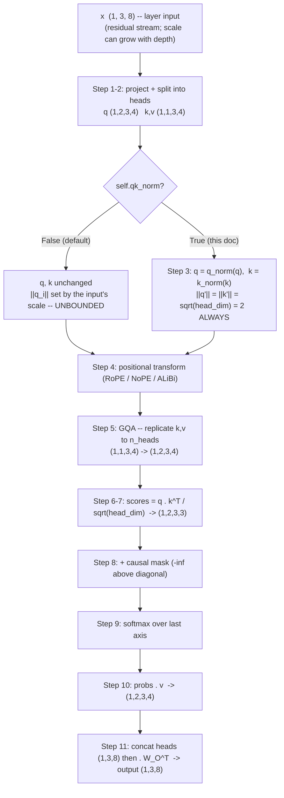
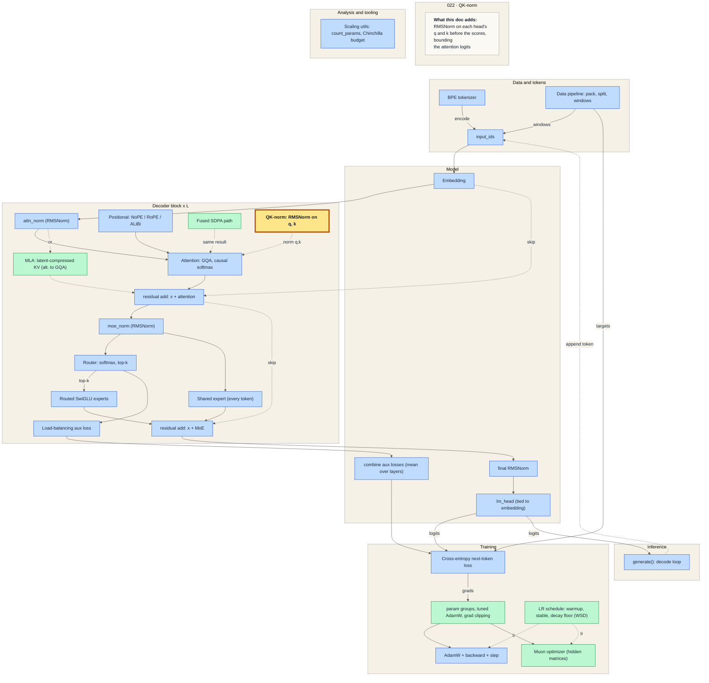

# 022 — QK-norm: the full derivation, solved by hand

**Companion to:** [`journey_of_a_model/022-qk-norm.md`](../../journey_of_a_model/022-qk-norm.md)
· **Code:** [`qwenmoe/model/attention.py`](../../qwenmoe/model/attention.py)
· **Every number here is reproduced by:** [`verify_022_qk_norm.py`](verify_022_qk_norm.py)
(`uv run python docs/math/verify_022_qk_norm.py`)

---

## How to read this

The journal entry tells you *what* QK-norm is (a per-head `RMSNorm` on the
queries and keys, off by default) and *why* it exists (attention logits
can grow without bound as a model gets deeper, and an unbounded logit
saturates the softmax). This document is the other half: **we push one
tiny, fully-written-out input through every single line of the QK-norm
code path and do all the arithmetic on paper**, digit by digit, then check
every intermediate against the real module.

We

1. fix one tiny input and one tiny set of weights (§1),
2. walk **every operation** of `Attention.forward_with_trace`
   ([`attention.py:183`](../../qwenmoe/model/attention.py#L183)) — the
   explicit-math path — with `qk_norm=True`, deriving each step's formula
   in full before computing it (§2),
3. then quantify, on the example's own numbers, *why the norm is there*:
   the Cauchy–Schwarz ceiling it puts on the logits (§3), why the norm
   goes **before** the positional transform (§4), and that the fused
   `forward` path computes the identical thing (§5).

You do **not** need a linear-algebra background. Every term (vector, dot
product, norm, variance, root mean square, softmax, entropy, rotation,
Cauchy–Schwarz) is defined at first use. It helps to have skimmed
[`journey_of_a_model/022-qk-norm.md`](../../journey_of_a_model/022-qk-norm.md)
and the attention derivation [`004-attention-gqa.md`](004-attention-gqa.md)
first — this document reuses that one's structure and only slows down on
the parts QK-norm actually changes.

---

## Part 0 — What are we even computing, and where does QK-norm sit?

A single attention head computes (Vaswani et al. 2017)

$$\text{Attention}(Q, K, V) = \operatorname{softmax}\!\left(\frac{QK^{\top}}{\sqrt{d_k}} + M\right) V$$

where $Q$, $K$, $V$ hold one row per token (the **queries**, **keys**,
**values**), $QK^{\top}$ is the all-pairs similarity score, $\sqrt{d_k}$
is a fixed scaling constant, and $M$ is the causal mask. The number
$q_i \cdot k_j$ — one query row dotted with one key row — is called an
**attention logit** (or "score"). It is the thing QK-norm controls.

**The failure mode.** As a transformer gets deeper, each layer *adds* its
output back into a running sum called the **residual stream** (the vector
that is passed from block to block, with every block's contribution added
on). That sum tends to grow in magnitude with depth. The query and key
are linear functions of it ($q_i = W_q x_i$), so they grow too, and
$q_i \cdot k_j$ grows *with the square* of that magnitude (§3 derives the
exact bound). Dehghani et al. (2023), training a 22-billion-parameter
Vision Transformer, saw training diverge after a few thousand steps from
"extremely large values in attention logits, which lead to (almost
one-hot) attention weights with near-zero entropy."

**The fix.** Insert a normalization that rescales each $q_i$ and each
$k_j$ to a **fixed size** before the dot product. Then the logit's
ceiling is a constant, no matter what the residual stream is doing. This
repo uses `RMSNorm` for that normalization (the Qwen3 choice), applied
per head, only when `ModelConfig.qk_norm=True`:



By the end of §2 you will have computed by hand the exact `(1, 3, 8)`
tensor the real module returns with `qk_norm=True`:

```
[[1.000000, 0.000000, 0.000000, 0.000000, 1.000000, 0.000000, 0.000000, 0.000000],
 [0.568624, 0.431376, 0.000000, 0.000000, 0.324745, 0.675255, 0.000000, 0.000000],
 [0.784293, 0.607853, 0.392147, 0.000000, 0.500959, 0.900902, 0.401861, 0.000000]]
```

---

## Part 1 — The running example

### 1.1 Terms we need right now

- **Scalar:** a single number, e.g. $3$ or $-0.5$.
- **Vector:** an ordered list of numbers, written in brackets, e.g.
  $[3, 0, 4, 0]$. Its **length** / **dimension** is how many numbers it
  holds (here $4$); each number is a **component** or **entry**.
- **Dot product** of two equal-length vectors $a, b$: multiply component
  by component and add.
  $[3,0,4,0]\cdot[1,1,1,1] = 3+0+4+0 = 7$. One number; large when the two
  vectors "point the same way."
- **Norm** (Euclidean length, "$\ell_2$ norm", written $\lVert a\rVert$):
  $\sqrt{a\cdot a} = \sqrt{\sum_p a_p^2}$ — the length of the arrow from
  the origin to the point $a$. $\lVert[3,0,4,0]\rVert = \sqrt{9+16} = 5$.
- **Unit vector:** a vector of norm $1$.
- **Matrix:** a rectangle of numbers = a list of equal-length row
  vectors; $r\times c$ means $r$ rows, $c$ columns.
- **Transpose** $A^{\top}$: flip rows ↔ columns; $r\times c \to c\times r$.
- **Matrix multiply** $AB$ (with $A$ being $m\times n$, $B$ being
  $n\times p$): result is $m\times p$, entry $(i,j)$ = (row $i$ of $A$)
  $\cdot$ (column $j$ of $B$).
- **Tensor:** the same idea with more than two axes; PyTorch calls them
  all `Tensor`, and its **shape** is the tuple of axis lengths, e.g.
  `(1, 2, 3, 4)`.
- **Broadcast:** when an operation needs two tensors of the same shape but
  one is "shorter" on some axis of length $1$, that axis is *repeated* to
  match — no data is copied, the same numbers are just reused.
- **Mean** of $n$ numbers: their sum $\div n$.
- **Population variance** of $n$ numbers: the mean of their squared
  distances from their own mean. **Standard deviation:** $\sqrt{\text{variance}}$
  — the "typical size" of the spread.
- **Root mean square (RMS)** of a vector $a$ of length $d$:
  $\sqrt{\tfrac1d\sum_p a_p^2}$ — the square root of the mean of the
  squared components. Note $\lVert a\rVert = \text{RMS}(a)\cdot\sqrt{d}$
  (pull the $\tfrac1d$ out of the square root). If the components have
  mean $0$, RMS *is* the standard deviation.

### 1.2 The model configuration

The smallest configuration that still exercises every behaviour of
QK-norm:

| Symbol | Meaning | Value |
|---|---|---|
| `batch` | independent sequences at once | $1$ |
| `seq_len`, $S$ | tokens in the sequence | $3$ |
| `d_model`, $d$ | width of a token vector | $8$ |
| `n_heads`, $H$ | **query** heads | $2$ |
| `head_dim`, $d_k$ | width of one head $= d/H$ | $4$ |
| `n_kv_heads`, $H_{kv}$ | **key/value** heads (GQA) | $1$ |
| `n_rep`, $r$ | query heads per KV head $= H/H_{kv}$ | $2$ |
| `positional_scheme` | how position enters | `nope` (spine), then `rope` (§4) |
| **`qk_norm`** | **per-head RMSNorm on q/k** | **`True`** |
| `rope_theta`, $\theta$ | RoPE base frequency | $10000$ |

Why these:

- $d_k = 4$, not $2$: the "root **mean** square" is only a meaningful
  *average* over three or four numbers. With $d_k = 2$ every step would
  collapse to a special case.
- $H_{kv} = 1 < H = 2$: this is **Grouped-Query Attention** (Ainslie et
  al. 2023) — the one KV head is shared across both query heads. It makes
  `q_norm` normalize $H \cdot S = 6$ vectors while `k_norm` normalizes
  $H_{kv}\cdot S = 3$, and puts the QK-norm step *before* the GQA
  replication, both of which we want to see.
- three tokens whose per-head vectors have mean-square $1, 2, 3,$ and
  $6.25$ — so the normalization does something genuinely different to
  each, and one of them is the journal's own
  $[3,0,4,0] \to [1.2, 0, 1.6, 0]$.

`ModelConfig.__post_init__` guarantees $d \bmod H = 0$ and
$H \bmod H_{kv} = 0$ ([`config.py:56`](../../qwenmoe/config.py#L56)), so
`Attention` never re-checks them.

### 1.3 The input

We make each of the three token embeddings a **standard basis vector**: a
vector that is $1$ in exactly one slot and $0$ everywhere else. Call the
matrix $X$ (shape `(batch, S, d)` = `(1, 3, 8)`, batch axis dropped for
algebra):

$$X = \begin{bmatrix} x_0 \\ x_1 \\ x_2 \end{bmatrix}
= \begin{bmatrix}
1 & 0 & 0 & 0 & 0 & 0 & 0 & 0 \\
0 & 1 & 0 & 0 & 0 & 0 & 0 & 0 \\
0 & 0 & 1 & 0 & 0 & 0 & 0 & 0
\end{bmatrix}$$

This is a deliberate simplification: as §1.5 shows, a one-hot input makes
each projected $q_i$ **exactly the $i$-th column of $W_Q$**, so we get to
*choose* the query/key/value vectors directly by writing down the weight
matrices — and the projection step, which is not what this document is
about, takes no arithmetic. (For a projection worked the hard way, see
[`004-attention-gqa.md`](004-attention-gqa.md) §Step 1.)

`positions` $= [0, 1, 2]$: token $i$ may attend to positions $0 \dots i$.

### 1.4 The weights

Four projection matrices, matching the four `nn.Linear` layers in
[`Attention.__init__`](../../qwenmoe/model/attention.py#L101), plus the
two `RMSNorm` submodules from
[`attention.py:114-117`](../../qwenmoe/model/attention.py#L114).

PyTorch stores a `Linear`'s weight as `(out_features, in_features)`. We
give each of $W_Q, W_K, W_V$ its **columns** $0, 1, 2$ directly (columns
$3\text{–}7$ are zero and never read, since only tokens $0,1,2$ exist):

$$
W_Q^{\top}\text{'s used columns} \;=\;
\underbrace{\begin{bmatrix}
1 & 3 & 2 \\ 1 & 0 & 2 \\ 1 & 4 & 0 \\ 1 & 0 & 0 \\[2pt]
2 & 1 & 0 \\ 0 & 1 & 3 \\ 2 & 1 & 0 \\ 0 & 1 & 4
\end{bmatrix}}_{\text{column }i \,=\, q_i \,=\, [\text{head 0}\;;\;\text{head 1}]}
\qquad
W_K,\,W_V\ \text{used columns} \;=\;
\begin{bmatrix}
2 & 0 & 1 \\ 0 & 2 & 1 \\ 0 & 2 & 1 \\ 0 & 2 & 1
\end{bmatrix},\;
\begin{bmatrix}
1 & 0 & 1 \\ 0 & 1 & 1 \\ 0 & 0 & 1 \\ 0 & 0 & 0
\end{bmatrix}
$$

Reading the columns off:

| | head 0 slice (cols 0–3) | head 1 slice (cols 4–7) |
|---|---|---|
| $q_0$ | $[1, 1, 1, 1]$ | $[2, 0, 2, 0]$ |
| $q_1$ | $[3, 0, 4, 0]$ | $[1, 1, 1, 1]$ |
| $q_2$ | $[2, 2, 0, 0]$ | $[0, 3, 0, 4]$ |

| | the single KV head |
|---|---|
| $k_0$ | $[2, 0, 0, 0]$ |
| $k_1$ | $[0, 2, 2, 2]$ |
| $k_2$ | $[1, 1, 1, 1]$ |
| $v_0$ | $[1, 0, 0, 0]$ |
| $v_1$ | $[0, 1, 0, 0]$ |
| $v_2$ | $[1, 1, 1, 0]$ |

$W_O$ (shape $(d, H d_k) = (8, 8)$) is the **identity matrix** — $1$s on
the diagonal, $0$ elsewhere — so Step 11's output projection just
concatenates the two heads and we can read the per-head results straight
out. ([`004-attention-gqa.md`](004-attention-gqa.md) §Step 12 shows $W_O$
doing real head-mixing; here it would only obscure the QK-norm arithmetic.)

The two `RMSNorm(head_dim=4)` submodules `q_norm` and `k_norm` each hold a
learnable **weight vector** $w$ of length $d_k = 4$, initialised to
all-ones ([`rmsnorm.py:12`](../../qwenmoe/model/rmsnorm.py#L12)) — and we
leave them there, because "what QK-norm does at initialisation" is exactly
the question. Their `eps` is $10^{-6}$.

### 1.5 What `nn.Linear` computes (the one fact we need)

`nn.Linear` with weight $W$ (shape `(out, in)`) maps a row vector $x$
(length `in`) to $y = x W^{\top}$, i.e. $y_j = \sum_p x_p W_{j,p}$ =
**dot product of $x$ with row $j$ of $W$**. When $x = x_i$ is $1$ in slot
$i$ and $0$ elsewhere, that sum has a single surviving term:
$y_j = W_{j,i}$. So $y = $ **column $i$ of $W$**. That is why §1.4 could
just write the columns.

---

## Part 2 — The forward pass, one operation at a time

We follow `Attention.forward_with_trace`
([`attention.py:183`](../../qwenmoe/model/attention.py#L183)). The
production path is `Attention.forward`
([`attention.py:119`](../../qwenmoe/model/attention.py#L119)), which runs
the same maths through one fused `F.scaled_dot_product_attention` kernel;
§5 shows the two agree to $3\times10^{-8}$ here.

**Shape ledger — start:** `x (1, 3, 8)`.

---

### Step 1 — Project `x` into queries, keys, values

Code ([`attention.py:198-200`](../../qwenmoe/model/attention.py#L198)):

```python
q = self.w_q(x).view(batch, seq_len, self.n_heads, self.head_dim).transpose(1, 2)
k = self.w_k(x).view(batch, seq_len, self.n_kv_heads, self.head_dim).transpose(1, 2)
v = self.w_v(x).view(batch, seq_len, self.n_kv_heads, self.head_dim).transpose(1, 2)
```

The `.view(...).transpose(1, 2)` is Step 2; here just the `w_q(x)` /
`w_k(x)` / `w_v(x)` part.

**Why three projections?** The same token vector plays three roles — a
*query* ("what am I looking for?"), a *key* ("what do I offer?"), a
*value* ("what do I contribute once chosen?"). Three learned matrices
shape the three roles independently.

By §1.5, because every $x_i$ is a basis vector, $q_i$ is column $i$ of
$W_Q$, etc. So directly:

$$
q = \begin{bmatrix}
1&1&1&1&\;2&0&2&0\\
3&0&4&0&\;1&1&1&1\\
2&2&0&0&\;0&3&0&4
\end{bmatrix}\ (1,3,8),\quad
k = \begin{bmatrix}2&0&0&0\\0&2&2&2\\1&1&1&1\end{bmatrix}\ (1,3,4),\quad
v = \begin{bmatrix}1&0&0&0\\0&1&0&0\\1&1&1&0\end{bmatrix}\ (1,3,4)
$$

$k$ and $v$ are only $4$ wide, not $8$: there is $H_{kv} = 1$ KV head of
width $d_k = 4$. **Shape ledger:** `q (1,3,8)`, `k (1,3,4)`, `v (1,3,4)`.

---

### Step 2 — Split the projections into heads

Code: `.view(batch, seq_len, n_heads, head_dim).transpose(1, 2)`.

**Why heads?** One dot product scores tokens on *one* notion of
relatedness. Splitting the width into $H$ blocks and attending
independently in each lets heads specialise, at the same total cost.

**`.view(1, 3, H, d_k)`** relabels the shape without moving a number: each
token's length-$8$ row is cut into $H = 2$ contiguous pieces of $d_k = 4$
(first 4 = head 0, last 4 = head 1). **`.transpose(1, 2)`** swaps the
token and head axes: `(1, S, H, d_k) → (1, H, S, d_k)`, so the tensor
becomes "per head, a stack of token rows" — what a per-head matrix
multiply wants. `transpose` also only relabels (changes strides, not
memory).

$$
q^{(h=0)} = \begin{bmatrix}1&1&1&1\\3&0&4&0\\2&2&0&0\end{bmatrix},\qquad
q^{(h=1)} = \begin{bmatrix}2&0&2&0\\1&1&1&1\\0&3&0&4\end{bmatrix}
\qquad\text{inside}\ q\ (1, 2, 3, 4)
$$

For $k$, $v$: `(1, S, H_{kv}, d_k) → (1, 1, 3, 4)` — a single KV head,
$k^{(0)}$ and $v^{(0)}$ exactly the matrices from Step 1.

These are the real module's `trace["q_pre_norm"]` and
`trace["k_pre_norm"]` — captured here, *before* the norm, only because
`qk_norm=True`
([`attention.py:205-207`](../../qwenmoe/model/attention.py#L205)):

```
q_pre_norm  head 0: [[1,1,1,1],  [3,0,4,0],  [2,2,0,0]]
            head 1: [[2,0,2,0],  [1,1,1,1],  [0,3,0,4]]
k_pre_norm        : [[2,0,0,0],  [0,2,2,2],  [1,1,1,1]]
```

**Shape ledger after Step 2:** `q (1, 2, 3, 4)`, `k (1, 1, 3, 4)`,
`v (1, 1, 3, 4)`.

---

### Step 3 — QK-norm  ← the operation this whole document is about

Code ([`attention.py:206-210`](../../qwenmoe/model/attention.py#L206),
`forward_with_trace`; identical logic at
[`attention.py:156-158`](../../qwenmoe/model/attention.py#L156) in
`forward`):

```python
trace_q_pre, trace_k_pre = None, None
if self.qk_norm:
    trace_q_pre, trace_k_pre = q.squeeze(0), k.squeeze(0)
    q = self.q_norm(q)
    k = self.k_norm(k)
trace_q, trace_k, trace_v = q.squeeze(0), k.squeeze(0), v.squeeze(0)
```

`q` goes through `q_norm`, `k` goes through the **separate** module
`k_norm`. Both are `RMSNorm(head_dim=4)`. `v` is **not** normed — only the
two vectors that meet in the dot product need their scale controlled.

#### 3.1 Deriving RMSNorm from first principles

`RMSNorm.forward` ([`rmsnorm.py:14-17`](../../qwenmoe/model/rmsnorm.py#L14)):

```python
variance = x.pow(2).mean(dim=-1, keepdim=True)
x_normed = x * torch.rsqrt(variance + self.eps)
return x_normed * self.weight
```

Read literally, for a single vector $z = [z_1, \dots, z_d]$ (here
$d = d_k = 4$, and $z$ is one head's query or key for one token):

$$
\operatorname{RMSNorm}(z) \;=\;
\frac{z}{\sqrt{\underbrace{\tfrac{1}{d}\sum_{p=1}^{d} z_p^2}_{\texttt{variance}\ \text{in the code}} + \varepsilon}}\;\odot\; w
$$

where $\odot$ is component-wise multiply and $w$ is the length-$d$
learnable weight ($w = [1,1,1,1]$ here).

**Term by term:**

- $\sum_p z_p^2$ is $z \cdot z = \lVert z\rVert^2$, the squared norm.
- $\tfrac1d\sum_p z_p^2$ is the **mean of the squared components**. The
  code calls it `variance`, and it *is* the population variance **only
  when $z$ has mean $0$** (variance = mean of squared distances from the
  mean; if the mean is $0$, that's the mean of $z_p^2$). RMSNorm does not
  subtract the mean, so in general this quantity is the **mean square**,
  not the variance. (This is the one deliberate difference from
  LayerNorm — see §3.4.)
- $\sqrt{\tfrac1d\sum_p z_p^2}$ is the **root mean square** of $z$,
  written $\text{RMS}(z)$. It equals $\lVert z\rVert / \sqrt d$.
- `torch.rsqrt(t)` is $1/\sqrt{t}$ ("reciprocal square root", one
  hardware instruction). So `x * rsqrt(variance + eps)` divides every
  component of $z$ by $\sqrt{\text{RMS}(z)^2 + \varepsilon}$, which for
  $\varepsilon \to 0$ is just **dividing $z$ by its own RMS**.
- $\varepsilon = 10^{-6}$ (**empirical** — a small guard constant, not
  derived) stops a divide-by-zero when $z$ is all zeros and bounds the
  output when $z$ is tiny.
- $\odot\, w$: a per-component learnable rescale. At initialisation
  $w = 1$, so it does nothing *yet*; training can move it.

#### 3.2 The two properties that make this the right fix

**Property A — exact scale-invariance.** For any constant $c > 0$, ignoring
$\varepsilon$ and with $w = 1$:

$$
\operatorname{RMSNorm}(c\,z)
= \frac{c\,z}{\sqrt{\tfrac1d\sum_p (c z_p)^2}}
= \frac{c\,z}{\sqrt{c^2\cdot\tfrac1d\sum_p z_p^2}}
= \frac{c\,z}{c\,\sqrt{\tfrac1d\sum_p z_p^2}}
= \operatorname{RMSNorm}(z).
$$

Multiplying the input by any positive number leaves the output **exactly
unchanged**. This is provable algebra — **exact**, not approximate — the
$\sqrt{c^2} = c$ step is the whole trick. (With $\varepsilon > 0$ it
becomes $z / \sqrt{\text{RMS}(z)^2 + \varepsilon/c^2}$: still converges to
the same vector as $c$ grows, with an error of order $\varepsilon/c^2$.
§4's table measures that residue at $1.9\times10^{-6}$.)

**Property B — the output norm is fixed at $\sqrt{d}$.** With $w = 1$ and
$\varepsilon \to 0$, write $s = \text{RMS}(z)$. Then
$\operatorname{RMSNorm}(z) = z/s$, and

$$
\big\lVert z/s \big\rVert^2 = \frac{1}{s^2}\sum_p z_p^2
= \frac{\sum_p z_p^2}{\tfrac1d\sum_p z_p^2} = d
\qquad\Longrightarrow\qquad
\big\lVert \operatorname{RMSNorm}(z) \big\rVert = \sqrt{d}.
$$

Equivalently: the mean square of the *output* is forced to exactly $1$.
So RMSNorm does **not** produce a unit vector — it produces a vector of
norm $\sqrt{d}$ ($= 2$ here). It keeps the *direction* of $z$ (every
component scaled by the same $1/s$) and throws away only its *magnitude*.

Together: **A** says the query/key directions the model learned survive
untouched no matter how big the residual stream grew; **B** says whatever
comes out has norm exactly $\sqrt{d_k}$, which §3.3 turns into a hard
ceiling on the logit.

#### 3.3 Do it by hand — `q_norm(q)`

`RMSNorm` runs on `q` of shape `(1, 2, 3, 4)`. `mean(dim=-1, keepdim=True)`
averages over the **last axis only** (the $d_k = 4$ components), giving
shape `(1, 2, 3, 1)` — one mean-square per (head, token). Then
`rsqrt(...)` keeps that shape, and `x * rsqrt(...)` **broadcasts** it back
across the 4 components. Finally `* self.weight` broadcasts the length-4
$w$ across (head, token). No number leaves its (head, token, component)
slot; each is just divided by its vector's RMS.

**Head 0, token 1: $z = q^{(0)}_1 = [3, 0, 4, 0]$** (the journal's
example).

1. square each component: $[9,\ 0,\ 16,\ 0]$.
2. sum $= 25$; mean square $= 25/4 = 6.25$.
3. add $\varepsilon$: $6.25 + 10^{-6} = 6.250001$.
4. $\sqrt{6.250001}$: since $\sqrt{6.25} = 2.5$ exactly and
   $\tfrac{d}{dx}\sqrt{x}\big|_{6.25} = \tfrac{1}{2\cdot 2.5} = 0.2$, this
   is $2.5 + 0.2\times10^{-6} = 2.50000020$.
5. reciprocal: $1/2.50000020 = 0.39999997$ (the module's `rsqrt` prints
   `0.3999999762`).
6. multiply $z$ by it: $[3, 0, 4, 0]\times 0.39999997
   = [1.19999992,\ 0,\ 1.59999990,\ 0]$.
7. $\odot\, w$ with $w = [1,1,1,1]$: unchanged.

Real module: `[1.19999993, 0.00000000, 1.59999990, 0.00000000]`. The
target $[1.2, 0, 1.6, 0]$ is missed by $8\times10^{-8}$ — **entirely** the
$\varepsilon$ guard (step 3). Check Property B:
$\sqrt{1.2^2 + 1.6^2} = \sqrt{1.44 + 2.56} = \sqrt{4} = 2 = \sqrt{d_k}$;
module prints $\lVert\cdot\rVert = 1.9999999$.

**Head 0, token 0: $z = [1,1,1,1]$.** Mean square $= 4/4 = 1$; RMS $= 1$;
divide by $\approx 1$ → $[1,1,1,1]$ essentially unchanged (module:
`0.99999952` in each slot, again the $\varepsilon$). This vector was
*already* at mean-square $1$, so RMSNorm barely moves it — but note its
norm is $\sqrt4 = 2$, not $1$. **RMSNorm targets mean-square $1$, not unit
norm.**

**Head 0, token 2: $z = [2,2,0,0]$.** Squares $[4,4,0,0]$, sum $8$, mean
$2$, RMS $\sqrt2 = 1.41421356$. Divide: $[2,2,0,0]/1.41421356
= [1.41421356, 1.41421356, 0, 0]$ (module: `1.41421318` — `rsqrt` is an
approximate instruction). Norm $= \sqrt{2 + 2} = 2$. ✓

Doing all six query vectors:

$$
q' \;=\; \operatorname{q\_norm}(q) \;=\;
\begin{array}{c}
\text{head 0}\\[2pt]
\text{head 1}
\end{array}
\!\!
\begin{bmatrix}
[0.99999952,\;0.99999952,\;0.99999952,\;0.99999952]\\
[1.19999993,\;0,\;1.59999990,\;0]\\
[1.41421318,\;1.41421318,\;0,\;0]\\[6pt]
[1.41421318,\;0,\;1.41421318,\;0]\\
[0.99999952,\;0.99999952,\;0.99999952,\;0.99999952]\\
[0,\;1.19999993,\;0,\;1.59999990]
\end{bmatrix}
$$

(These are the module's `trace["q"]` — captured **after** the norm, so the
trace shows the vectors that actually flow onward, not the pre-norm ones.)

#### 3.4 Do it by hand — `k_norm(k)`

`k` has shape `(1, 1, 3, 4)` — the single KV head. `k_norm` is a
*different* `nn.Module` than `q_norm` (different parameters), though at
init both compute the identical function.

- $k_0 = [2, 0, 0, 0]$: mean square $= 4/4 = 1$, RMS $= 1$ → unchanged,
  $[1.99999905, 0, 0, 0]$. Norm already $2 = \sqrt{d_k}$; RMSNorm is
  (almost) the identity on it.
- $k_1 = [0, 2, 2, 2]$: squares $[0,4,4,4]$, sum $12$, mean $3$,
  RMS $= \sqrt3 = 1.73205081$. Divide: $[0, 2, 2, 2]/1.73205081
  = [0, 1.15470054, 1.15470054, 1.15470054]$ (module: `1.15470028`). Norm
  $= \sqrt{0 + 3\times(4/3)} = \sqrt4 = 2$. ✓
- $k_2 = [1, 1, 1, 1]$: mean square $1$ → unchanged, $[0.99999952]\times4$.

$$
k' \;=\; \operatorname{k\_norm}(k) \;=\;
\begin{bmatrix}
1.99999905 & 0 & 0 & 0\\
0 & 1.15470028 & 1.15470028 & 1.15470028\\
0.99999952 & 0.99999952 & 0.99999952 & 0.99999952
\end{bmatrix}
$$

> **`RMSNorm` vs. the two neighbours it is often confused with.**
> *LayerNorm* (Ba et al. 2016) subtracts the mean first — $(z - \bar z)$
> then $\div$ std — which costs a second pass and forces mean $0$; Zhang &
> Sennrich (2019) showed the mean-subtraction is dispensable, giving
> RMSNorm. *Henry et al.'s (2020) original QKNorm* divides by the
> $\ell_2$ norm $\lVert z\rVert$ (→ unit vector) then multiplies by **one
> learnable scalar $g$**. Since
> $\lVert z\rVert = \text{RMS}(z)\cdot\sqrt{d_k}$, RMSNorm-with-$w{=}1$ is
> exactly Henry's $\ell_2$-normalise-then-scale with the scalar fixed at
> $g = \sqrt{d_k}$ and then a *per-component* $w$ layered on instead of a
> single $g$. All three kill the input's magnitude; they differ only in
> what they do afterward.

**Shape ledger after Step 3:** unchanged — `q (1,2,3,4)`, `k (1,1,3,4)`,
`v (1,1,3,4)`. Only the *values* changed.

---

### Step 4 — Positional transform

Code ([`attention.py:212`](../../qwenmoe/model/attention.py#L212)):
`q, k = self.positional.apply_to_qk(q, k, positions)`.

Our spine uses `positional_scheme="nope"`, whose `apply_to_qk` returns
`q, k` **unchanged** ([`positional.py:70-73`](../../qwenmoe/model/positional.py#L70)):
position information then enters only through the causal mask (Step 8).
So for the spine, $q' , k'$ are exactly the Step 3 output.

**Why the norm ran first (Step 3 before Step 4), and why it matters:** see
§4 below — with RoPE the two orders happen to coincide at init, but the
spec fixes norm-then-positional for *all* schemes.

---

### Step 5 — GQA: replicate K and V up to `n_heads`

Code ([`attention.py:215-217`](../../qwenmoe/model/attention.py#L215)):

```python
if self.n_rep > 1:
    k = k.repeat_interleave(self.n_rep, dim=1)
    v = v.repeat_interleave(self.n_rep, dim=1)
```

We have $H = 2$ query heads but only $H_{kv} = 1$ KV head. To dot each
query head against a key head we need one $K$/$V$ per query head, so the
single normed KV head is **duplicated** $r = n\_rep = 2$ times along the
head axis. `repeat_interleave(2, dim=1)` turns $[A]$ into $[A, A]$.

Crucially this happens **after** Step 3: both copies are the *same*
already-normed $k'$. (QK-norm operates on the $H_{kv}$ distinct KV heads,
not on the post-replication copies — cheaper, and the copies would be
identical anyway.)

$$
k'^{(0)} = k'^{(1)} = \begin{bmatrix}
1.99999905 & 0 & 0 & 0\\
0 & 1.15470028 & 1.15470028 & 1.15470028\\
0.99999952 & 0.99999952 & 0.99999952 & 0.99999952
\end{bmatrix},\quad
v^{(0)} = v^{(1)} = \begin{bmatrix}1&0&0&0\\0&1&0&0\\1&1&1&0\end{bmatrix}
$$

**Shape ledger after Step 5:** `q (1,2,3,4)`, `k (1,2,3,4)`,
`v (1,2,3,4)` — all aligned on $H = 2$.

> The fused `forward` path skips this copy: `enable_gqa=True` makes the
> SDPA kernel broadcast KV head $\lfloor h / r\rfloor$ into query head $h$
> internally ([`attention.py:169`](../../qwenmoe/model/attention.py#L169)).
> Same maths, no `[A, A]` tensor. See
> [`021-fused-attention-sdpa.md`](021-fused-attention-sdpa.md) §3.

---

### Step 6 — Raw attention scores $q' {k'}^{\top}$

Code ([`attention.py:219`](../../qwenmoe/model/attention.py#L219)):
`scores = (q @ k.transpose(-2, -1)) / math.sqrt(self.head_dim)`. This step
is the matrix multiply `q @ k.transpose(-2, -1)`; the $\div\sqrt{d_k}$ is
Step 7.

`k.transpose(-2, -1)` flips each head's $k'$ from $(S, d_k) = (3, 4)$ to
$(4, 3)$, so `q @ kᵀ` is $(3,4)(4,3) = (3, 3)$ per head: entry $(i, j)$ is
$q'_i \cdot k'_j$ — "how much does the query at position $i$ match the key
at position $j$."

#### Head 0

$q'^{(0)}$ rows: $a_0 \approx [1,1,1,1]$, $a_1 \approx [1.2, 0, 1.6, 0]$,
$a_2 \approx [1.41421, 1.41421, 0, 0]$.
$k'^{(0)}$ rows: $b_0 = [1.99999905, 0, 0, 0]$,
$b_1 = [0, 1.15470, 1.15470, 1.15470]$, $b_2 \approx [1,1,1,1]$.

$$
\begin{array}{c|ccc}
q'_i \backslash k'_j & b_0 & b_1 & b_2 \\\hline
a_0 & 1{\cdot}2 = 2.0 & 1{\cdot}1.15470\times 3 = 3.46410 & 1{+}1{+}1{+}1 = 4.0 \\
a_1 & 1.2{\cdot}2 = 2.4 & 1.6{\cdot}1.15470 = 1.84752 & 1.2{+}1.6 = 2.8 \\
a_2 & 1.41421{\cdot}2 = 2.82843 & 1.41421{\cdot}1.15470 = 1.63299 & 1.41421{+}1.41421 = 2.82843
\end{array}
$$

$$\text{scores}^{(0)}_{\text{raw}} \approx
\begin{bmatrix} 2.0 & 3.46410 & 4.0 \\ 2.4 & 1.84752 & 2.8 \\ 2.82843 & 1.63299 & 2.82843 \end{bmatrix}$$

#### Head 1

$q'^{(1)}$ rows: $c_0 \approx [1.41421, 0, 1.41421, 0]$,
$c_1 \approx [1,1,1,1]$, $c_2 \approx [0, 1.2, 0, 1.6]$. Same $k'$.

$$
\begin{array}{c|ccc}
 & b_0 & b_1 & b_2 \\\hline
c_0 & 1.41421{\cdot}2 = 2.82843 & 1.41421{\cdot}1.15470 = 1.63299 & 1.41421{+}1.41421 = 2.82843 \\
c_1 & 2.0 & 3.46410 & 4.0 \\
c_2 & 0 & 1.2{\cdot}1.15470 + 1.6{\cdot}1.15470 = 3.23316 & 1.2 + 1.6 = 2.8
\end{array}
$$

$$\text{scores}^{(1)}_{\text{raw}} \approx
\begin{bmatrix} 2.82843 & 1.63299 & 2.82843 \\ 2.0 & 3.46410 & 4.0 \\ 0 & 3.23316 & 2.8 \end{bmatrix}$$

**Shape ledger:** `scores (1, 2, 3, 3)`.

---

### Step 7 — Scale by $1/\sqrt{d_k}$

Same code line: divide every score by $\sqrt{d_k} = \sqrt4 = 2$.

**Why $\sqrt{d_k}$.** A dot product of two random $d_k$-component vectors
with mean-$0$, variance-$1$ entries has variance $d_k$ (the $d_k$
independent product terms each have variance $1$, and independent
variances add), hence standard deviation $\sqrt{d_k}$. Dividing by
$\sqrt{d_k}$ pulls that back to $1$, for any head size. Full derivation
(with an exact enumeration check) in
[`004-attention-gqa.md`](004-attention-gqa.md) §Step 7; this part is
**exact** under the stated assumptions, which is why Vaswani et al. also
checked it empirically.

**Interaction with QK-norm.** After the norm,
$\lVert q'_i\rVert = \lVert k'_j\rVert = \sqrt{d_k}$ exactly, so
$q'_i \cdot k'_j$ is *already* bounded by $d_k$ (§3.3) and this $1/\sqrt{d_k}$
is no longer load-bearing for scale — but it is kept anyway (the code
divides unconditionally), so a `qk_norm=True` run is otherwise
bit-identical to the pipeline around it and so that turning QK-norm off
needs no compensating change elsewhere.

$$
\text{scores}^{(0)} = \tfrac12 \text{scores}^{(0)}_{\text{raw}} \approx
\begin{bmatrix}
0.99999905 & 1.73204947 & 1.99999809 \\
1.19999933 & 0.92376018 & 1.39999926 \\
1.41421247 & 0.81649619 & 1.41421247
\end{bmatrix}
$$

$$
\text{scores}^{(1)} \approx
\begin{bmatrix}
1.41421247 & 0.81649619 & 1.41421247 \\
0.99999905 & 1.73204947 & 1.99999809 \\
0 & 1.61658025 & 1.39999926
\end{bmatrix}
$$

These match the module's `trace["attn_scores_pre_mask"]` exactly. **Note
every finite entry is between $0$ and $2 = \sqrt{d_k}$** — §3.3's ceiling,
visible in the data. (There is no ALiBi bias step here; `nope` and `rope`
both return `None` from `attention_bias`. ALiBi's `+ (j-i)m_h` term is
covered in [`004-attention-gqa.md`](004-attention-gqa.md) §Step 8.)

---

### Step 8 — The causal mask

Code ([`attention.py:226-229`](../../qwenmoe/model/attention.py#L226)):

```python
causal_mask = torch.triu(torch.full((seq_len, seq_len), float("-inf")), diagonal=1)
scores = scores + causal_mask
```

`torch.triu(full(-inf), diagonal=1)` is $-\infty$ strictly above the
diagonal, $0$ on and below:

$$M = \begin{bmatrix} 0 & -\infty & -\infty \\ 0 & 0 & -\infty \\ 0 & 0 & 0 \end{bmatrix}$$

Adding it leaves the allowed entries ($j \le i$) untouched and sends the
forbidden ones ($j > i$, "looking at a future token") to $-\infty$. After
the mask:

$$
\text{scores}^{(0)}_{\text{masked}} \approx
\begin{bmatrix}
0.99999905 & -\infty & -\infty \\
1.19999933 & 0.92376018 & -\infty \\
1.41421247 & 0.81649619 & 1.41421247
\end{bmatrix},\quad
\text{scores}^{(1)}_{\text{masked}} \approx
\begin{bmatrix}
1.41421247 & -\infty & -\infty \\
0.99999905 & 1.73204947 & -\infty \\
0 & 1.61658025 & 1.39999926
\end{bmatrix}
$$

---

### Step 9 — Softmax

Code ([`attention.py:231`](../../qwenmoe/model/attention.py#L231)):
`probs = F.softmax(scores, dim=-1)` — independently on each row.

**Definition.** For a row of scores $z = [z_1, \dots, z_S]$,

$$
p_j = \operatorname{softmax}(z)_j = \frac{e^{z_j}}{\sum_{l=1}^{S} e^{z_l}}.
$$

Exponentiating makes every $p_j > 0$ and turns score *gaps* into weight
*ratios* ($p_a/p_b = e^{z_a - z_b}$); dividing by the sum makes
$\sum_j p_j = 1$, so $\sum_j p_j v_j$ is a genuine weighted average.
Softmax is **shift-invariant**: $\operatorname{softmax}(z + c) =
\operatorname{softmax}(z)$ for any constant $c$ (the $e^c$ cancels top and
bottom), so implementations subtract $c = \max_l z_l$ first — the largest
exponent becomes $e^0 = 1$ and nothing overflows. A $-\infty$ entry gives
$e^{-\infty} = 0$ exactly, so masked keys drop out cleanly.

#### By hand — head 0

**Row 0:** $[0.99999905, -\infty, -\infty]$ → one finite entry →
$p^{(0)}_0 = [1, 0, 0]$.

**Row 1:** $[1.19999933, 0.92376018, -\infty]$. Subtract max
$1.19999933$: $[0, -0.27623915, -\infty]$. Exponentiate:
$e^0 = 1$, $e^{-0.27623915} = 0.75864$, $e^{-\infty} = 0$. Sum
$= 1.75864$.

$$p^{(0)}_1 = \Big[\tfrac{1}{1.75864},\ \tfrac{0.75864}{1.75864},\ 0\Big]
= [0.56862,\ 0.43138,\ 0].$$

Module: `[0.56862396, 0.43137604, 0]`. ✓

**Row 2:** $[1.41421247, 0.81649619, 1.41421247]$. Subtract max
$1.41421247$: $[0, -0.59771628, 0]$. Exponentiate: $[1,\ 0.55007,\ 1]$.
Sum $= 2.55014$.

$$p^{(0)}_2 = [0.39215,\ 0.21570,\ 0.39215].$$

Module: `[0.39214665, 0.21570671, 0.39214665]`. ✓

#### By hand — head 1

**Row 0:** $[1.41421247, -\infty, -\infty]$ → $[1, 0, 0]$.

**Row 1:** $[0.99999905, 1.73204947, -\infty]$. Minus max $1.73204947$:
$[-0.73205042, 0, -\infty]$ → $[0.48090,\ 1,\ 0]$, sum $1.48090$.

$$p^{(1)}_1 = [0.32474,\ 0.67526,\ 0].$$

Module: `[0.32474494, 0.67525506, 0]`. ✓

**Row 2:** $[0, 1.61658025, 1.39999926]$. Minus max $1.61658025$:
$[-1.61658025,\ 0,\ -0.21658099]$. Exponentiate:
$[0.19859,\ 1,\ 0.80527]$. Sum $= 2.00386$.

$$p^{(1)}_2 = [0.09910,\ 0.49904,\ 0.40186].$$

Module: `[0.09909785, 0.49904084, 0.40186128]`. ✓

$$
\text{probs}^{(0)} = \begin{bmatrix}
1 & 0 & 0 \\
0.56862396 & 0.43137604 & 0 \\
0.39214665 & 0.21570671 & 0.39214665
\end{bmatrix},\quad
\text{probs}^{(1)} = \begin{bmatrix}
1 & 0 & 0 \\
0.32474494 & 0.67525506 & 0 \\
0.09909785 & 0.49904084 & 0.40186128
\end{bmatrix}
$$

Every row sums to $1$; matches `trace["attn_scores_post_softmax"]`.

---

### Step 10 — Weighted sum with the values

Code ([`attention.py:233`](../../qwenmoe/model/attention.py#L233)):
`out = probs @ v` — per head, $(3\times3)(3\times4) = (3\times4)$. Row $i$
is $\sum_j p_{i,j} v_j$, the attention-weighted average of the value
vectors. $v_0 = [1,0,0,0]$, $v_1 = [0,1,0,0]$, $v_2 = [1,1,1,0]$.

#### Head 0

- **Row 0:** $[1,0,0]\Rightarrow 1\cdot v_0 = [1, 0, 0, 0]$. (Position 0
  sees only itself — it copies its own value.)
- **Row 1:** $0.56862396\,v_0 + 0.43137604\,v_1 + 0
  = [0.56862396,\ 0.43137604,\ 0,\ 0]$.
- **Row 2:** $0.39214665\,v_0 + 0.21570671\,v_1 + 0.39214665\,v_2$:
  - coord 0: $0.39214665 + 0 + 0.39214665 = 0.78429330$
  - coord 1: $0 + 0.21570671 + 0.39214665 = 0.60785336$
  - coord 2: $0 + 0 + 0.39214665 = 0.39214665$
  - coord 3: $0$

$$\text{out}^{(0)} = \begin{bmatrix}
1 & 0 & 0 & 0 \\
0.56862396 & 0.43137604 & 0 & 0 \\
0.78429330 & 0.60785336 & 0.39214665 & 0
\end{bmatrix}$$

#### Head 1

- **Row 0:** $[1, 0, 0, 0]$.
- **Row 1:** $0.32474494\,v_0 + 0.67525506\,v_1
  = [0.32474494,\ 0.67525506,\ 0,\ 0]$.
- **Row 2:** $0.09909785\,v_0 + 0.49904084\,v_1 + 0.40186128\,v_2$:
  - coord 0: $0.09909785 + 0 + 0.40186128 = 0.50095913$
  - coord 1: $0 + 0.49904084 + 0.40186128 = 0.90090212$
  - coord 2: $0.40186128$
  - coord 3: $0$

  (using the *printed*, 8-dp-rounded probs; the module's own unrounded
  float32 probs sum to $0.50095916$ and $0.90090215$ — a
  $3\times10^{-8}$ gap from rounding the displayed probabilities before
  re-adding them, not a real discrepancy.)

$$\text{out}^{(1)} = \begin{bmatrix}
1 & 0 & 0 & 0 \\
0.32474494 & 0.67525506 & 0 & 0 \\
0.50095916 & 0.90090215 & 0.40186128 & 0
\end{bmatrix}$$

**Shape ledger:** `out (1, 2, 3, 4)`.

---

### Step 11 — Concatenate the heads and project out

Code ([`attention.py:235-236`](../../qwenmoe/model/attention.py#L235)):

```python
out = out.transpose(1, 2).contiguous().view(batch, seq_len, self.n_heads * self.head_dim)
output = self.w_o(out)
```

`transpose(1, 2)` → `(1, 3, 2, 4)`; `.contiguous()` reorders memory to
match; `.view(1, 3, 8)` glues each token's two head-vectors into one
length-$8$ row, head 0 then head 1:

| token | head 0 part | head 1 part | concatenated row |
|---|---|---|---|
| 0 | $[1,0,0,0]$ | $[1,0,0,0]$ | $[1,0,0,0,\ 1,0,0,0]$ |
| 1 | $[0.56862,0.43138,0,0]$ | $[0.32474,0.67526,0,0]$ | $[0.56862,0.43138,0,0,\ 0.32474,0.67526,0,0]$ |
| 2 | $[0.78429,0.60785,0.39215,0]$ | $[0.50096,0.90090,0.40186,0]$ | $[0.78429,0.60785,0.39215,0,\ 0.50096,0.90090,0.40186,0]$ |

$W_O$ is the identity, so $\text{output} = \text{concat}$ unchanged.

#### Final result

$$
\boxed{\ \text{output} \approx \begin{bmatrix}
1 & 0 & 0 & 0 & 1 & 0 & 0 & 0 \\
0.568624 & 0.431376 & 0 & 0 & 0.324745 & 0.675255 & 0 & 0 \\
0.784293 & 0.607853 & 0.392147 & 0 & 0.500959 & 0.900902 & 0.401861 & 0
\end{bmatrix}\ (1,3,8)\ }
$$

The real module (`forward_with_trace`) returns

```
[[1.0,        0.0,        0.0,        0.0,  1.0,        0.0,        0.0, 0.0],
 [0.56862396, 0.43137604, 0.0,        0.0,  0.32474494, 0.67525506, 0.0, 0.0],
 [0.78429329, 0.60785335, 0.39214665, 0.0,  0.50095916, 0.90090215, 0.40186128, 0.0]]
```

— matching the hand computation to $\sim10^{-5}$ (the drift is the
`rsqrt`/`eps` slack from Step 3, propagated). The fused `forward` returns
the same to $3\times10^{-8}$ (§5).

> **Not shown here:** the residual add. `Attention` returns only this
> tensor; `TransformerBlock` adds it back onto its input:
> $x \leftarrow x + \text{Attention}(\text{RMSNorm}(x))$.

---

## Part 3 — Why bound the logit: Cauchy–Schwarz, on this example's numbers

### 3.1 The inequality

**Cauchy–Schwarz inequality:** for *any* two vectors $a, b$,

$$|a \cdot b| \;\le\; \lVert a\rVert \, \lVert b\rVert,$$

with equality exactly when $a$ and $b$ are parallel (one is a scalar
multiple of the other). One-line proof: for every real $t$,
$0 \le \lVert a - t b\rVert^2 = \lVert a\rVert^2 - 2t(a\cdot b) + t^2\lVert b\rVert^2$.
A quadratic in $t$ that is never negative has discriminant $\le 0$:
$(2\,a\cdot b)^2 - 4\lVert a\rVert^2\lVert b\rVert^2 \le 0$, i.e.
$(a\cdot b)^2 \le \lVert a\rVert^2\lVert b\rVert^2$. Take square roots. ∎

### 3.2 Applied to the attention logit

The raw logit is $q_i \cdot k_j$ with $q_i = W_q x_i$, $k_j = W_k x_j$.
For any matrix $W$ there is a smallest number $\lVert W\rVert_{\text{op}}$
(the **operator norm**, a.k.a. spectral norm) such that
$\lVert W z\rVert \le \lVert W\rVert_{\text{op}} \lVert z\rVert$ for every
$z$ — by definition. So

$$
|q_i \cdot k_j| \;\le\; \lVert q_i\rVert\,\lVert k_j\rVert
\;\le\; \big(\lVert W_q\rVert_{\text{op}}\lVert W_k\rVert_{\text{op}}\big)\;
\lVert x_i\rVert\,\lVert x_j\rVert.
$$

The learned matrices are fixed once trained; the only thing that moves at
inference is $\lVert x_i\rVert$, the size of this layer's input. **The
logit ceiling grows with $\lVert x_i\rVert\,\lVert x_j\rVert$ —
quadratically in the residual-stream scale.** This is not a fitted
constant; it is Cauchy–Schwarz plus the definition of operator norm.

**With QK-norm**, $q'_i$ and $k'_j$ are replaced by their RMSNorms, which
have norm exactly $\sqrt{d_k}$ (§3.2 Property B) *regardless of
$\lVert x_i\rVert$*. So

$$
|q'_i \cdot k'_j| \;\le\; \lVert q'_i\rVert\,\lVert k'_j\rVert \;=\; d_k,
\qquad
\left|\frac{q'_i \cdot k'_j}{\sqrt{d_k}}\right| \;\le\; \sqrt{d_k}.
$$

A **fixed** ceiling. Here $d_k = 4$, so every scaled logit lies in
$[-2, 2]$.

### 3.3 The ceiling, measured on our nine logit pairs

`verify_022_qk_norm.py` §5 prints, for head 0, every
$(i,j)$ pair after the norm:

| $i$ | $j$ | $q'_i\cdot k'_j$ | $\lVert q'_i\rVert\,\lVert k'_j\rVert$ | scaled $\div\sqrt{4}$ |
|---:|---:|---:|---:|---:|
| 0 | 0 | 1.999998 | 3.999996 | 0.999999 |
| 0 | 1 | 3.464099 | 3.999997 | 1.732049 |
| 0 | 2 | **3.999996** | **3.999996** | **1.999998** |
| 1 | 0 | 2.399999 | 3.999998 | 1.199999 |
| 1 | 1 | 1.847520 | 3.999999 | 0.923760 |
| 1 | 2 | 2.799999 | 3.999998 | 1.399999 |
| 2 | 0 | 2.828425 | 3.999997 | 1.414212 |
| 2 | 1 | 1.632992 | 3.999998 | 0.816496 |
| 2 | 2 | 2.828425 | 3.999997 | 1.414212 |

Every $|q'_i\cdot k'_j| \le 4$ and every scaled logit $\le 2$, as
promised. Row $(0, 2)$ **hits the ceiling exactly**: $q'_0$ (normed
$[1,1,1,1]$) and $k'_2$ (normed $[1,1,1,1]$) are the *same* unit
direction — parallel — so Cauchy–Schwarz is tight and the dot product is
exactly $\lVert q'_0\rVert\lVert k'_2\rVert = 4$.

### 3.4 What happens without the norm — scale sweep

`verify_022_qk_norm.py` §4 takes the *same* weights and multiplies the
layer input $X$ by $1, 10, 50, 200$, reporting the standard deviation of
`attn_scores_pre_mask` (the spread of the scaled logits):

| input scale | logit std, `qk_norm=False` | logit std, `qk_norm=True` | drift of the ON scores vs. 1× |
|---:|---:|---:|---:|
| 1× | 1.4951 | 0.485933 | 0 |
| 10× | 149.5090 | 0.485933 | $1.9\times10^{-6}$ |
| 50× | 3737.7251 | 0.485933 | $1.9\times10^{-6}$ |
| 200× | 59803.6016 | 0.485933 | $1.9\times10^{-6}$ |

`qk_norm=False`'s logit spread grows by **exactly** $100\times$,
$2500\times$, $40000\times$ — i.e. as scale², the Cauchy–Schwarz
prediction — because with a one-hot input scaled by $c$, both $q$ and $k$
scale by $c$ and the dot product by $c^2$, with no randomness to blur it.
(The journal's table, on trained-random weights, sees $\approx110\times$,
$\approx2911\times$, $\approx47059\times$ — the same quadratic law with
real-data noise.)

`qk_norm=True` stays pinned at $0.485933$. The tiny $1.9\times10^{-6}$
drift is the $\varepsilon/c^2$ residue from §3.2 Property A — it appears
between 1× and 10× and then stops changing, exactly as $\varepsilon/c^2
\to 0$ predicts. **Exact** scale-invariance would give $0$; the
$\varepsilon$ guard is the only reason it isn't.

> Our ON constant ($0.486$) is *smaller* than the OFF 1× value ($1.495$)
> — the opposite of the journal's table, where ON at 1× is larger. Both
> are correct: QK-norm does not make logits *smaller*, it makes their
> scale a **constant**. Whether that constant is above or below the
> unnormalised 1× value depends on the specific weights; the point is it
> never moves.

### 3.5 Why an unbounded logit breaks training — the softmax side

A near-one-hot softmax output has two problems:

1. **Vanishing gradient.** The softmax Jacobian is
   $\partial p_i/\partial z_j = p_i(\delta_{ij} - p_j)$. If $p$ is
   one-hot ($p_m \approx 1$, the rest $\approx 0$), every entry
   $p_i(\delta_{ij}-p_j) \approx 0$ — no gradient flows back to *any*
   logit, and the attention pattern can't be corrected.
2. **Entropy collapse.** The Shannon **entropy** of the weights,
   $H(p) = -\sum_j p_j \ln p_j$ (a measure of how "spread out" $p$ is:
   $0$ for one-hot, $\ln S$ for uniform over $S$ keys), goes to $0$.

`verify_022_qk_norm.py` §8, on our example's most-peaked row (head 1,
query row 2, keys $0,1,2$):

| input scale | `qk_norm=False` weights → $H$ | `qk_norm=True` weights → $H$ |
|---:|---|---|
| 1× | $[0.00088, 0.96983, 0.02929]$ → $H = 0.13933$ | $[0.09910, 0.49904, 0.40186]$ → $H = 0.94230$ |
| 50× | $[0.0, 1.0, 0.0]$ → $H = 0.00000$ | $[0.09910, 0.49904, 0.40186]$ → $H = 0.94230$ |

Without the norm, a $50\times$ larger residual stream drives this row to a
hard one-hot ($H$ exactly $0$ — the ViT-22B failure). With the norm, the
row is **bit-identical** across the $50\times$ scale-up. (Mean entropy
over all non-trivial rows: OFF $0.546 \to 0.275$; ON $0.830$ either way;
maximum possible on 3 keys is $\ln 3 = 1.099$.)

---

## Part 4 — Why the norm goes *before* the positional transform

Step 3 (norm) runs before Step 4 (positional). The journal asks why. Three
observations, all checked in `verify_022_qk_norm.py` §6 with
`positional_scheme="rope"`.

**1. A rotation preserves norm.** RoPE (Su et al. 2021) replaces each
query/key by a rotated copy: within each 2-component slice it applies
$R(\phi) = \left[\begin{smallmatrix}\cos\phi & -\sin\phi\\ \sin\phi & \cos\phi\end{smallmatrix}\right]$,
a **rotation** by angle $\phi$ (an angle in **radians** — the arc length
on a unit circle; a full turn is $2\pi$). A rotation moves a point around
a circle centred at the origin, so it never changes the point's distance
from the origin:
$\lVert R(\phi) z\rVert^2 = (z_1\cos\phi - z_2\sin\phi)^2 + (z_1\sin\phi + z_2\cos\phi)^2
= z_1^2 + z_2^2 = \lVert z\rVert^2$ (the cross terms cancel,
$\cos^2 + \sin^2 = 1$). So after QK-norm sets $\lVert q'\rVert = \sqrt{d_k}$,
RoPE leaves it at $\sqrt{d_k}$. The module confirms: post-rotation
$\lVert q\rVert$ per vector is $1.99999905\dots2.0$ throughout. The §3
ceiling survives RoPE untouched.

**2. At initialisation, norm and rotation commute exactly.** Because a
rotation preserves every component's contribution to the sum of squares,
$\text{RMS}(R z) = \text{RMS}(z)$, and rotation is linear, so
$\operatorname{RMSNorm}(R z) = R z / \text{RMS}(z) = R\big(z/\text{RMS}(z)\big)
= R\,\operatorname{RMSNorm}(z)$ — **provided $w = 1$** (a per-component
weight would be applied in the *unrotated* frame and break the equality).
Measured: `max |norm-then-rotate − rotate-then-norm| = 1.2e-7` for both
$q$ and $k$ — float noise. So for RoPE the ordering genuinely doesn't
matter *at init*; it can matter once $w$ has trained away from $1$.

**3. The order is fixed for *all* schemes, not just RoPE.** `design.md`
and Requirement 7.3 specify norm-then-positional uniformly. ALiBi doesn't
rotate $q/k$ at all (it adds a bias to the scores later), and NoPE does
nothing — so "before the positional transform" is really "right after the
projection, once, regardless of scheme," which is simpler than a
scheme-dependent placement.

**Consequence for the trace.** `forward_with_trace` captures
`trace["q"]`/`trace["k"]` *after* the norm but *before* RoPE
([`attention.py:210`](../../qwenmoe/model/attention.py#L210)), and
`trace["q_pre_norm"]`/`["k_pre_norm"]` before both — so the visualiser can
show the normalization and the rotation as two separate animated steps.
The same-position ("diagonal") scores are identical between the `rope` and
`nope` runs — $q'_i$ and $k'_i$ are rotated by the *same* angle, and
$R(\phi)^{\top}R(\phi) = I$, so $q'_i \cdot k'_i$ is unchanged (module:
rope diagonal `[0.99999905, 0.92376, 1.41421 | 1.41421, 1.73205, 1.39999]`
equals the nope diagonal to $10^{-6}$).

---

## Part 5 — The fused path computes the identical thing

`Attention.forward` ([`attention.py:119`](../../qwenmoe/model/attention.py#L119))
applies QK-norm at [`attention.py:156-158`](../../qwenmoe/model/attention.py#L156)
— the same two lines — then hands $q'$, $k'$, $v$ to
`F.scaled_dot_product_attention(q, k, v, is_causal=True, enable_gqa=True)`,
which fuses Steps 5–10 into one kernel (`is_causal=True` supplies Step 8's
mask; `enable_gqa=True` does Step 5's broadcast without materialising
`[A, A]`; the kernel runs an online/streaming softmax for Steps 9–10).
Full derivation of that kernel in
[`021-fused-attention-sdpa.md`](021-fused-attention-sdpa.md).

`verify_022_qk_norm.py` §2 runs both paths on this example:

$$
\max\big|\ \text{forward} - \text{forward\_with\_trace}\ \big| \;=\; 2.98\times10^{-8}
$$

— not bit-identical only because a fused kernel is free to sum in a
different order and float addition is not associative
([`021` §8.2](021-fused-attention-sdpa.md)), and $2.98\times10^{-8}$ is
$\sim300\times$ under the $10^{-5}$ that `tests/test_trace.py` enforces
for the `qk_norm=True` case.

---

## Part 6 — End-to-end recap and the shape ledger

| Step | Operation | Shape in → out | Key formula |
|---|---|---|---|
| 1 | project | `(1,3,8)` → `q (1,3,8)`, `k/v (1,3,4)` | $x W^{\top}$ (= column of $W$ here) |
| 2 | split heads | → `q (1,2,3,4)`, `k/v (1,1,3,4)` | `view` + `transpose` |
| **3** | **QK-norm** | **unchanged** | $z \mapsto \dfrac{z}{\sqrt{\frac1{d_k}\sum z_p^2 + \varepsilon}}\odot w$ |
| 4 | positional (NoPE) | unchanged | — (RoPE: rotate each 2-slice) |
| 5 | GQA replicate | `k/v (1,1,3,4)` → `(1,2,3,4)` | `repeat_interleave(2, dim=1)` |
| 6 | raw scores | `(1,2,3,4)` → `(1,2,3,3)` | $q'\,{k'}^{\top}$ |
| 7 | scale | unchanged | $\div\sqrt{d_k} = \div 2$ |
| 8 | causal mask | unchanged | $+\operatorname{triu}(-\infty)$ |
| 9 | softmax | unchanged | $e^{z_j}/\sum_l e^{z_l}$ |
| 10 | weighted sum | `(1,2,3,3)·(1,2,3,4)` → `(1,2,3,4)` | $p\,v$ |
| 11 | concat + $W_O$ | → `(1,3,8)` → `(1,3,8)` | `view` then $\cdot W_O^{\top}$ (identity) |

**Final output** (`qk_norm=True`, `nope`):

```
[[1.0,        0.0,        0.0,        0.0,  1.0,        0.0,        0.0,        0.0],
 [0.56862396, 0.43137604, 0.0,        0.0,  0.32474494, 0.67525506, 0.0,        0.0],
 [0.78429329, 0.60785335, 0.39214665, 0.0,  0.50095916, 0.90090215, 0.40186128, 0.0]]
```

---

## Part 7 — Cost, on this example's own numbers

### 7.1 Extra parameters

`q_norm` and `k_norm` are each `RMSNorm(head_dim)` — one weight vector of
length $d_k$. Total extra parameters:

$$2 \times d_k = 2 \times 4 = 8.$$

The rest of this attention block ($W_Q, W_K, W_V, W_O$) holds
$8{\cdot}8 + 4{\cdot}8 + 4{\cdot}8 + 8{\cdot}8 = 192$ weights, so QK-norm
adds **$8/192 \approx 4\%$** here — and in a real config it is far less:
for `d_model=768, n_heads=12` ($d_k = 64$), it is $2{\cdot}64 = 128$
extra against $\sim 4 d^2 = 2.36\text{M}$ per block, i.e.
$\approx 0.005\%$. The scale-invariance property (§3.2) does not depend on
$d_k$, so the cost stays negligible at every size.

When `qk_norm=False`, `q_norm`/`k_norm` **are not constructed at all**
([`attention.py:114-117`](../../qwenmoe/model/attention.py#L114)) — not
even as unused attributes (`verify_022_qk_norm.py` §7 asserts
`not hasattr(attn, "q_norm")`). A pre-spec config is bit-for-bit
unchanged.

### 7.2 Extra compute

Per token per head: square $d_k$ numbers, sum, one `rsqrt`, $d_k$
multiplies by the reciprocal, $d_k$ multiplies by $w$ — $\approx 4 d_k$
flops, twice (q and k). Against the $\mathcal{O}(S \cdot d_k)$ of the
score matmul and $\mathcal{O}(S^2 d_k)$ of attention itself, it is in the
noise. On this $3$-token example the fused and explicit paths still land
within $3\times10^{-8}$ of each other (§5) with QK-norm on.

### 7.3 Why RMSNorm and not something cheaper

The job is "make $\lVert q'\rVert$ independent of $\lVert x\rVert$." The
minimal operation that does that *and* keeps the learned direction is
"divide by a scale computed from $q$ itself." RMS is the natural scale
(it's the per-component standard deviation when the mean is ~0), it needs
one pass (no mean-subtraction, unlike LayerNorm), and reusing the repo's
existing `RMSNorm` class means the q/k norm, the pre-attention norm, and
the pre-MoE norm are all the same $17$-line module.

---

## Questions that might come to mind

- **Does QK-norm make the logits *smaller*?** Not necessarily — see the
  note in §3.4. It fixes their *scale to a constant*. On our weights the
  constant ($0.486$) is below the unnormalised 1× value ($1.495$); on the
  journal's it is above. Either way it stops moving.

- **Why is `output[0]` `[1,0,0,0, 1,0,0,0]`?** Token 0 can attend only to
  itself (causal mask), so $\text{out}^{(h)}_0 = v_0 = [1,0,0,0]$ for both
  heads, and $W_O$ (identity) leaves the concat alone. Position 0 always
  copies its own value; QK-norm doesn't touch that.

- **`q_norm` and `k_norm` are identical functions here — why two
  modules?** They share the *formula* but not the *parameters*. At init
  both weights are $[1,1,1,1]$; training moves them independently, and a
  query's useful scale and a key's useful scale are different problems.
  Two modules is the only way to let them diverge.

- **Does the $1/\sqrt{d_k}$ scaling become redundant?** For controlling
  *scale*, yes — §3.2 already pins $\lVert q'\rVert\lVert k'\rVert = d_k$.
  It's kept because the code divides unconditionally (so `qk_norm` is a
  clean on/off with nothing else to adjust) and because it still sets a
  sensible *starting* temperature for the softmax before $w$ trains.

- **Why not normalize $v$ too?** Only the two vectors that meet in the
  dot product determine the logit scale. $v$ enters through
  $\sum_j p_j v_j$, a convex combination — its output is already bounded
  by the range of the $v_j$ themselves, no matter how big they are
  relative to each other.

- **Does MLA get QK-norm?** Not in this task — Requirement 7.3 scopes it
  to the GQA `Attention` class. `MLAAttention`'s decoupled-RoPE content /
  position split ([`016-mla-attention.md`](016-mla-attention.md)) would
  need its own design decision.

- **Is this the same as gradient clipping (task 2)?** No — different
  point in the pipeline. Gradient clipping
  ([`018-optimizer-hardening.md`](018-optimizer-hardening.md)) bounds how
  far one optimizer *step* can move the weights, after the backward pass.
  QK-norm bounds the *forward-pass logits* before the softmax runs.

- **What if $q$ is exactly zero?** Then mean-square $= 0$ and the output
  is $0/\sqrt{\varepsilon} = 0$ — the $\varepsilon = 10^{-6}$ guard is
  what makes that a finite $0$ rather than a `nan`. (This is the only
  regime where $\varepsilon$ is more than rounding noise.)

---

## Symbol reference

| symbol | meaning |
|---|---|
| $d$, `d_model` | model width (8 here) |
| $S$, `seq_len` | sequence length (3) |
| $H$, `n_heads` | query heads (2) |
| $H_{kv}$, `n_kv_heads` | key/value heads (1) |
| $d_k$, `head_dim` | width of one head, $d/H$ (4) |
| $r$, `n_rep` | query heads per KV head, $H/H_{kv}$ (2) |
| $X$, $x_i$ | layer input, one row per token, `(S, d)` |
| $W_Q, W_K, W_V, W_O$ | the four learned projection matrices |
| $q_i, k_j, v_j$ | projected query / key / value (pre-norm) |
| $q'_i, k'_j$ | **post-QK-norm** query / key |
| $w$ | the length-$d_k$ learnable `RMSNorm` weight (init $[1,1,1,1]$) |
| $\varepsilon$ | `RMSNorm` guard constant, $10^{-6}$ (empirical) |
| $\lVert a\rVert$ | Euclidean norm $\sqrt{\sum_p a_p^2}$ |
| $\text{RMS}(a)$ | root mean square $\sqrt{\tfrac1d\sum_p a_p^2} = \lVert a\rVert/\sqrt d$ |
| $\lVert W\rVert_{\text{op}}$ | operator (spectral) norm: smallest $c$ with $\lVert Wz\rVert \le c\lVert z\rVert$ ∀ $z$ |
| $R(\phi)$ | 2-D rotation by angle $\phi$ radians (RoPE) |
| $M$ | causal mask ($0$ on/below diagonal, $-\infty$ above) |
| $p$, `probs` | post-softmax attention weights |
| $H(p)$ | Shannon entropy $-\sum_j p_j \ln p_j$ |

---

## Citations

All links verified by web search on 2026-09-10; the three the journal
entry already uses are marked ↩.

**QK-norm itself**
- Henry, Dachapally, Pawar & Chen, *Query-Key Normalization for
  Transformers*, 2020 — [arXiv:2010.04245](https://arxiv.org/abs/2010.04245).
  ↩ The original QKNorm: $\ell_2$-normalise $q$ and $k$ along the head
  dimension, then multiply by a learnable scalar instead of dividing by
  $\sqrt{d_k}$. Aimed at low-resource NMT stability.
- Dehghani et al., *Scaling Vision Transformers to 22 Billion Parameters*,
  2023 — [arXiv:2302.05442](https://arxiv.org/abs/2302.05442). ↩
  Established QK-norm as a large-model training-stability fix: training
  diverged from "extremely large values in attention logits, which lead
  to (almost one-hot) attention weights with near-zero entropy"; the fix
  was LayerNorm on $q$/$k$ before the dot product (their §2.2, Fig. 1).
- Qwen Team, *Qwen3 Technical Report*, 2025 —
  [arXiv:2505.09388](https://arxiv.org/abs/2505.09388). ↩ This project's
  namesake family: Qwen3 "removed QKV-bias used in Qwen2 and introduced
  QK-Norm to the attention mechanism to ensure stable training" — the
  precedent `ModelConfig.qk_norm` follows (RMSNorm variant).

**Normalization**
- Zhang & Sennrich, *Root Mean Square Layer Normalization*, 2019 —
  [arXiv:1910.07467](https://arxiv.org/abs/1910.07467). RMSNorm: drop
  LayerNorm's mean-subtraction, keep only the RMS rescale; gives
  "re-scaling invariance" (our §3.2 Property A).
- Ba, Kiros & Hinton, *Layer Normalization*, 2016 —
  [arXiv:1607.06450](https://arxiv.org/abs/1607.06450). The mean-then-std
  normalization RMSNorm simplifies.

**Attention and position**
- Vaswani et al., *Attention Is All You Need*, 2017 —
  [arXiv:1706.03762](https://arxiv.org/abs/1706.03762). The
  $\operatorname{softmax}(QK^{\top}/\sqrt{d_k})V$ formula and the
  $\sqrt{d_k}$ scaling argument (footnote 4).
- Su et al., *RoFormer: Enhanced Transformer with Rotary Position
  Embedding*, 2021 — [arXiv:2104.09864](https://arxiv.org/abs/2104.09864).
  RoPE rotates each 2-D slice of $q$/$k$; a rotation preserves norm (our
  §4).
- Ainslie et al., *GQA: Training Generalized Multi-Query Transformer
  Models from Multi-Head Checkpoints*, 2023 —
  [arXiv:2305.13245](https://arxiv.org/abs/2305.13245). The
  `n_kv_heads < n_heads` sharing our example uses.

**Cross-references in this repo**
- [`004-attention-gqa.md`](004-attention-gqa.md) — the projection,
  head-split, $\sqrt{d_k}$, mask, softmax and $W_O$ steps derived in full.
- [`021-fused-attention-sdpa.md`](021-fused-attention-sdpa.md) — the fused
  `F.scaled_dot_product_attention` kernel (online softmax, `enable_gqa`,
  `is_causal`).
- [`016-mla-attention.md`](016-mla-attention.md) — MLA, which does *not*
  get QK-norm in this spec.

---

*Every intermediate tensor in this document is reproduced and asserted by
[`verify_022_qk_norm.py`](verify_022_qk_norm.py). If you change the
running example, rerun it.*

<!-- arch-evolution:start (generated by build_architecture_footer.py; do not edit by hand) -->

---

## Where this fits in the architecture (the growing view)

← previous: [021 Fused attention (SDPA)](021-fused-attention-sdpa.md) · next: [023 Principled init](023-principled-initialization.md) →

**This doc adds to the architecture:** RMSNorm on each head's q and k before the scores, bounding the attention logits. (Code: `qwenmoe/model/attention.py`.)

**Components introduced here (highlighted in the diagram), with where each one lives:**

| component | math doc (section) | journal | code |
|---|---|---|---|
| QK-norm: RMSNorm on q, k | [022 · Part 3 — Why bound the logit: Cauchy–Schwarz, on ...](022-qk-norm.md#part-3--why-bound-the-logit-cauchyschwarz-on-this-examples-numbers) | [journal 022](../../journey_of_a_model/022-qk-norm.md) | [`qwenmoe/model/attention.py:116`](../../qwenmoe/model/attention.py#L116) |

**Verified by:** [`verify_022_qk_norm.py`](verify_022_qk_norm.py) (`uv run python docs/math/verify_022_qk_norm.py`); latest results in [verify-status.md](verify-status.md).

**Example continuity:** **Defines family B** (`d=8`, one-hot `X`, `head_dim=4`) so the per-head RMS is a real average. Not 004's tensors. See the [example-family map](README.md#which-example-does-each-doc-use).

The diagram is cumulative: every box derived by this doc or an earlier one is shown, and components from later docs are not drawn yet, so reading the docs in order replays how the architecture grew. The top box is this doc's title and what it adds. The [full final architecture](architecture-evolution.md) has everything.

**Colour key:** 🟨 **introduced by this doc** · 🟦 Foundation (004-011) · 🟩 Modernization (016-031) · 🟪 Evaluation and scale (032-038) · 🟧 Real data and hardware (039-044). Dotted lines are optional or alternative paths.



**How we got here (every doc up to and including this one):**

| | math doc | journal | what it added |
|---|---|---|---|
|  | [004 Attention (GQA)](004-attention-gqa.md) | [journal](../../journey_of_a_model/004-attention-gqa.md) | scaled dot-product attention with grouped K/V heads, the positional transform and the causal mask |
|  | [005 MoE layer](005-moe-layer.md) | [journal](../../journey_of_a_model/005-moe-layer.md) | the router, top-k selection, routed SwiGLU experts, the shared expert and the load-balancing aux loss |
|  | [006 Full model](006-full-model-assembly.md) | [journal](../../journey_of_a_model/006-full-model-assembly.md) | token embedding, pre-norm residual wiring, the final norm, the tied head and the cross-layer aux-loss combine; attention and MoE appear here as black boxes |
|  | [007 Tokenizers](007-tokenizers.md) | [journal](../../journey_of_a_model/007-tokenizers.md) | text to `input_ids`: byte-level BPE and the char tokenizer |
|  | [008 Data pipeline](008-data-pipeline.md) | [journal](../../journey_of_a_model/008-data-pipeline.md) | packing documents, train/val split, fixed slices and the shifted `(x, y)` windows |
|  | [009 Scaling utilities](009-scaling-law-utilities.md) | [journal](../../journey_of_a_model/009-scaling-law-utilities.md) | parameter counting (total vs active), the compute-optimal budget and throughput calibration |
|  | [010 Training loop](010-training-loop.md) | [journal](../../journey_of_a_model/010-training-loop.md) | the next-token cross-entropy loss, backward pass and AdamW step, carried through a real `Trainer.fit` |
|  | [011 Inference and generation](011-inference-generation.md) | [journal](../../journey_of_a_model/011-inference-generation.md) | the autoregressive decode loop (greedy, temperature, top-k, top-p) |
|  | [016 MLA attention](016-mla-attention.md) | [journal](../../journey_of_a_model/016-mla-attention.md) | Multi-Head Latent Attention: K/V compressed to a small latent, an alternative to GQA |
|  | [018 Optimizer hardening](018-optimizer-hardening.md) | [journal](../../journey_of_a_model/018-optimizer-hardening.md) | param groups (decay vs no-decay), tuned AdamW and gradient clipping |
|  | [019 LR schedule (WSD)](019-lr-schedule-wsd.md) | [journal](../../journey_of_a_model/019-lr-schedule-wsd.md) | warmup, stable and decay phases with a non-zero floor |
|  | [020 Muon optimizer](020-muon-optimizer.md) | [journal](../../journey_of_a_model/020-muon-optimizer.md) | orthogonalized momentum for the hidden weight matrices, AdamW for the rest |
|  | [021 Fused attention (SDPA)](021-fused-attention-sdpa.md) | [journal](../../journey_of_a_model/021-fused-attention-sdpa.md) | `F.scaled_dot_product_attention` as a drop-in for the explicit path |
| **▶** | [022 QK-norm](022-qk-norm.md) | [journal](../../journey_of_a_model/022-qk-norm.md) | RMSNorm on each head's q and k before the scores, bounding the attention logits |

<!-- arch-evolution:end -->
