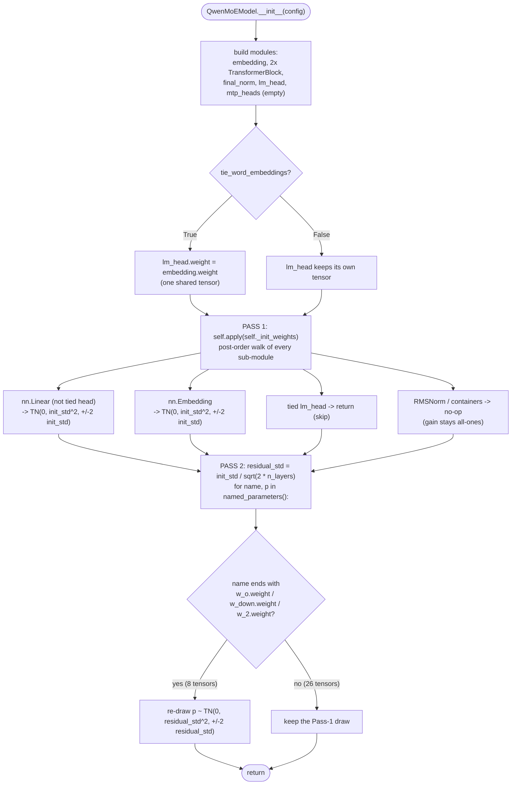
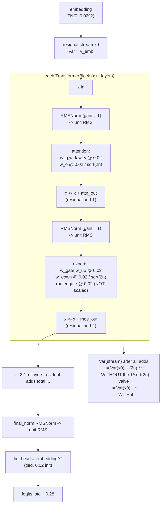
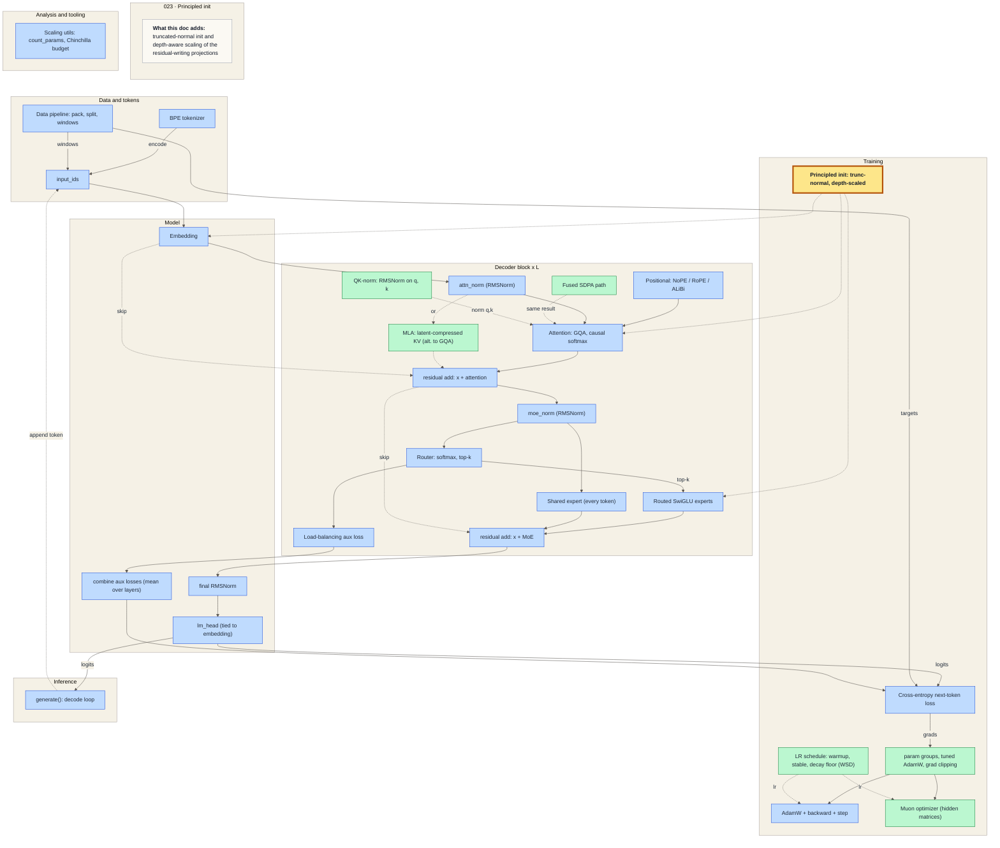

# 023 — Principled initialization (truncated-normal + depth-aware residual scaling): the full derivation, solved by hand

**Companion to:** [`journey_of_a_model/023-principled-initialization.md`](../../journey_of_a_model/023-principled-initialization.md)
· **Code:** [`qwenmoe/model/transformer.py`](../../qwenmoe/model/transformer.py)
(`QwenMoEModel.__init__`, `_init_weights`, `_trunc_normal_`,
`_RESIDUAL_PROJ_SUFFIXES`)
· **Every number here is reproduced by:** [`verify_023_principled_initialization.py`](verify_023_principled_initialization.py)
(`uv run python docs/math/verify_023_principled_initialization.py`)

---

## How to read this

The journal entry tells you *what* the initialization scheme does — every
`nn.Linear` and the embedding start from a **truncated normal** at
`init_std = 0.02` instead of PyTorch's default, and the handful of linears
that write a block's output back into the residual stream additionally get
their spread divided by `sqrt(2 · n_layers)` — and *why* (GPT-2's
depth-aware rule).

This document is the other trade-off: **maximum detail, minimum
summarising**. We

1. fix **one** tiny model — a 2-layer `QwenMoEModel` with `d_model = 4`,
   whose every parameter tensor fits on a page — and follow
   `__init__` **line by line**
   ([`transformer.py:51`](../../qwenmoe/model/transformer.py#L51)), citing
   `file.py:line` at each step;
2. for every operation — a module-tree walk, a truncated-normal draw, a
   `name.endswith(...)` string test, a square root — first **derive** why
   it has that form (the truncated-normal variance is an integration by
   parts; the `1/sqrt(2n)` rule is variance-of-a-sum), then **do the
   arithmetic digit by digit**;
3. keep a running **shape ledger** and a running **init ledger** (which
   distribution every parameter ends up drawn from);
4. and check every claim against the real module.

**One way this entry is unlike its siblings.** Initialization is
*random by construction* — there is no single "correct output tensor" to
land on. So the end-to-end assertions are on **distributional
properties**: the realized standard deviation of each weight matrix, the
`±2` cutoff, the ratio between a residual projection and an ordinary
linear, and the way the residual stream's spread grows with depth. Every
one of those numbers is still produced and asserted by the verify script
— nothing below is hand-waved.

The depth-growth effect itself is invisibly small at `d_model = 4`
(the running example) — exactly as journal 023 notes, *"not yet a
stability problem here."* So **Part 5** runs the identical init code once
at the real `BASELINE` size (`d_model = 256`, `n_layers = 6`) to make the
digits legible, then returns. That is the same code path on a bigger
tensor, not a new example.

You do **not** need a linear-algebra or probability background. Every
term (vector, matrix, fan-in, random variable, mean, variance, standard
deviation, normal distribution, independence) is defined at first use.

---

## Part 0 — What "initialization" is, and why its scale decides whether training even starts

### 0.1 The words we need first

- **Scalar:** a single number, e.g. `0.02` or `-1.7`.
- **Vector:** an ordered list of numbers, e.g. `[0.1, -0.3, 0.2, 0.0]`.
  Its **length** / **dimension** is how many numbers it holds.
- **Matrix:** a rectangle of numbers — a list of equal-length rows. A
  matrix with `r` rows and `c` columns is `r × c` ("r by c").
- **Weight:** one number inside the model that training is allowed to
  change. A `nn.Linear(in, out)` layer holds an `out × in` matrix of
  weights `W`; given an input vector `x` of length `in` it returns
  `y = W x`, the vector of length `out` whose entry `i` is
  `y_i = W[i,0]·x[0] + W[i,1]·x[1] + … + W[i,in-1]·x[in-1]` (a
  **dot product** of row `i` of `W` with `x`: multiply entry-by-entry,
  add up).
- **fan-in:** the length of the input to a layer — the number of terms in
  each of those dot products (`= in` above).
- **Random variable:** a quantity whose value is decided by chance —
  here, the value of one weight, drawn from a random-number generator.
- **Distribution:** the rule that says how likely each value is.
- **Mean** (`E[X]`, "expectation"): the long-run average value of a
  random variable `X` — the centre of its distribution.
- **Variance** (`Var(X)`): the long-run average of `(X − E[X])²` — the
  average *squared* distance from the centre. It measures **spread**.
- **Standard deviation** (`std`, `σ`): the square root of the variance —
  spread measured back in the original units.
- **Normal distribution** `N(μ, σ²)`: the bell-shaped distribution with
  mean `μ` and variance `σ²`. About 68% of its draws land within `1σ` of
  `μ`, 95% within `2σ`, 99.7% within `3σ`. Its **density** (relative
  likelihood of value `x`) is
  `φ_σ(x) = (1 / (σ·sqrt(2π)))·exp(−x² / (2σ²))` when `μ = 0`.

### 0.2 The one-line problem

Before training, every weight is a random number. Push a fixed input
through the untrained network: each layer roughly **multiplies the
spread** (standard deviation) of the signal by some factor. If that
factor is `> 1` at every layer, the signal is exponentially large by the
output — the first training step sees an enormous loss and an enormous
gradient, and the run diverges. If it is `< 1` everywhere, the signal
vanishes and early training barely moves. Initialization schemes pick the
weight spread so the factor is `≈ 1`.

Journal entry 010 hit the "factor `> 1`" failure directly: `nn.Embedding`'s
PyTorch default is `N(0, 1)` (spread `1.0`), which made the untrained
logits blow up by ~50×. The fix there was ad-hoc (custom-init the
embedding only). Task 7 — this entry — replaces the *entire* scheme with
the one GPT-2 and Llama use.

### 0.3 The whisper-chain picture (from the journal)

A line of people passing a whispered message. If each person repeats it a
little louder than they heard it, the last person is shouting. A little
softer, and the last hears nothing. Good initialization is everyone
agreeing to repeat it at **exactly the volume they heard**. The
`1/sqrt(2·n_layers)` rule in Part 3 is the refinement for a residual
network, where the message is a running *sum* of everyone's contributions
rather than a relay.

### 0.4 What PyTorch does if you say nothing, and why it is wrong here

`nn.Linear`'s default (from
`torch/nn/modules/linear.py::reset_parameters`) is

```
init.kaiming_uniform_(self.weight, a=math.sqrt(5))
```

which — the PyTorch source comment says so outright — is the same as
drawing every weight from a **uniform** distribution on
`[−1/sqrt(fan_in), +1/sqrt(fan_in)]`. A uniform distribution on
`[−b, b]` has variance `b²/3` (derived in Part 3.3), so the spread is

```
std = b / sqrt(3) = (1/sqrt(fan_in)) / sqrt(3) = 1 / sqrt(3·fan_in).
```

For the running example's `w_q` (`fan_in = d_model = 4`) that is
`1/sqrt(12) = 0.2887` — about **14× larger** than the `0.02` this project
wants. Kaiming-uniform with `a = sqrt(5)` was tuned for a plain
feed-forward ReLU stack (He et al. 2015), and it **ignores depth
entirely**. A 6-, 24- or 80-layer residual transformer needs both a
smaller base spread *and* a depth correction. That is what `__init__`
installs.

---

## Part 1 — The running example

### 1.1 The configuration

The smallest `ModelConfig` that still exercises **every** branch of the
init code: an ordinary linear, a residual output projection of an
attention block, a residual down-projection of a *routed* expert **and**
of a *shared* expert, a router gate (which must **not** be scaled), an
`nn.Embedding`, an `RMSNorm` gain (which must stay untouched), and a
**tied** LM head (which must be skipped).

| Symbol | Meaning | Value |
|---|---|---|
| `V`, `vocab_size` | vocabulary size | `6` |
| `d`, `d_model` | width of a token vector everywhere | `4` |
| `L`, `n_layers` | stacked `TransformerBlock`s | `2` |
| `H`, `n_heads` | attention query heads | `2` |
| `H_kv`, `n_kv_heads` | attention key/value heads | `1` |
| `d_k`, `head_dim` | width of one head `= d/H` | `2` |
| `d_ff` | per-expert hidden width | `3` |
| `N`, `n_routed_experts` | routed experts per MoE layer | `2` |
| `n_shared_experts` | always-on experts per MoE layer | `1` |
| `top_k` | experts each token routes to | `1` |
| `activation` | expert FFN variant | `swiglu` (`w_gate`,`w_up`,`w_down`) |
| `positional_scheme` | how position enters | `nope` |
| `tie_word_embeddings` | LM head shares the embedding matrix | `True` |
| `init_std` | truncated-normal spread for linears + embedding | `0.02` |

`math` is `import`ed at [`transformer.py:6`](../../qwenmoe/model/transformer.py#L6);
the seed for every draw below is `torch.manual_seed(0)`, set once by the
verify script immediately before `QwenMoEModel(config)`.

### 1.2 Two definitions used throughout Parts 2–3

- **Truncated normal** `TN(0, σ², [−c, c])`: draw from `N(0, σ²)`; if the
  value falls outside `[−c, c]`, throw it away and draw again. The result
  is a bell curve with its two tails sliced off at `±c`. Here `c = 2σ`
  always (`a=-2.0*std, b=2.0*std` in the code).
- **Residual stream:** the running vector `x` that flows straight down the
  model. Block `ℓ` reads it, computes a correction, and **adds** the
  correction back: `x ← x + (block ℓ's output)`. Nothing is ever
  subtracted or rescaled on that path (that is what "residual" /
  "skip connection" means — He et al. 2015). Two additions happen per
  block: one after attention, one after the MoE feed-forward.

### 1.3 The parameter inventory

`QwenMoEModel.__init__` builds these modules
([`transformer.py:54-62`](../../qwenmoe/model/transformer.py#L54)):

```
self.embedding   = nn.Embedding(vocab_size, d_model)          # (6, 4)
self.blocks      = nn.ModuleList(TransformerBlock(config) x 2)
self.final_norm  = RMSNorm(d_model)                           # gain (4,)
self.lm_head     = nn.Linear(d_model, vocab_size, bias=False) # (6, 4)
self.mtp_heads   = nn.ModuleList()                            # empty (mtp_depth = 0)
```

Every `nn.Linear` in this model is `bias=False`
(attention and expert projections, the router gate, the LM head), so the
`if module.bias is not None` branch of `_init_weights` never fires —
there are no biases to zero.

The **34 parameter tensors** the finished model owns, in
`model.named_parameters()` order, with the init branch each one takes
(verify script, Part 1 — reproduced verbatim):

| # | parameter | shape | numel | init branch |
|--:|---|---|--:|---|
| 1 | `embedding.weight` | `(6, 4)` | 24 | **embedding** → `TN(0, 0.02², ±0.04)` |
| 2 | `blocks.0.attn_norm.weight` | `(4,)` | 4 | **rmsnorm** → left as ones |
| 3 | `blocks.0.attn.w_q.weight` | `(4, 4)` | 16 | **linear** → `TN(0, 0.02², ±0.04)` |
| 4 | `blocks.0.attn.w_k.weight` | `(2, 4)` | 8 | **linear** → `TN(0, 0.02², ±0.04)` |
| 5 | `blocks.0.attn.w_v.weight` | `(2, 4)` | 8 | **linear** → `TN(0, 0.02², ±0.04)` |
| 6 | `blocks.0.attn.w_o.weight` | `(4, 4)` | 16 | **RESIDUAL** → `TN(0, 0.01², ±0.02)` |
| 7 | `blocks.0.moe_norm.weight` | `(4,)` | 4 | **rmsnorm** → left as ones |
| 8 | `blocks.0.moe.router.gate.weight` | `(2, 4)` | 8 | **linear** → `TN(0, 0.02², ±0.04)` |
| 9 | `blocks.0.moe.routed_experts.0.w_gate.weight` | `(3, 4)` | 12 | **linear** |
| 10 | `blocks.0.moe.routed_experts.0.w_up.weight` | `(3, 4)` | 12 | **linear** |
| 11 | `blocks.0.moe.routed_experts.0.w_down.weight` | `(4, 3)` | 12 | **RESIDUAL** → `TN(0, 0.01², ±0.02)` |
| 12–14 | `…routed_experts.1.{w_gate,w_up,w_down}` | | | linear, linear, **RESIDUAL** |
| 15–17 | `…shared_experts.0.{w_gate,w_up,w_down}` | | | linear, linear, **RESIDUAL** |
| 18 | `blocks.1.attn_norm.weight` | `(4,)` | 4 | rmsnorm |
| 19–33 | `blocks.1.…` | | | (same pattern as block 0) |
| 34 | `final_norm.weight` | `(4,)` | 4 | rmsnorm |

`lm_head.weight` is **not** in this list — because it *is*
`embedding.weight` (tied; Part 2, Step 2). `model.named_parameters()`
deduplicates shared tensors and yields the embedding under its first
registered name.

**8 of the 34 tensors are residual projections**: per block,
`attn.w_o` + the three experts' `w_down` (2 routed + 1 shared) = 4, times
`L = 2` layers. Total `104` of the model's `372` parameters — **28%**.

Running **shape / init ledger** (starts empty; filled through Part 2):

| tensor group | count | shape(s) | drawn from |
|---|--:|---|---|
| *(nothing initialised yet)* | | | |

---

## Part 2 — `QwenMoEModel.__init__`, line by line

Source: [`transformer.py:51-89`](../../qwenmoe/model/transformer.py#L51).

### Step 1 — build the sub-modules ([`transformer.py:54-62`](../../qwenmoe/model/transformer.py#L54))

Each `nn.Linear(...)` and `nn.Embedding(...)` **constructor** runs
PyTorch's default init immediately (Part 0.4): every linear is
Kaiming-uniform, the embedding is `N(0, 1)`. This is all about to be
overwritten — but note the RNG *has already been consumed* by these
default draws by the time `_init_weights` runs. That is why the verify
script's job is to re-run the whole thing under a fixed seed and read the
final tensors, not to predict them from first principles: the exact
values depend on PyTorch's default-init RNG usage. What we *can* derive
and check exactly is every value's **distribution**.

- Shape ledger: `embedding.weight (6,4)`; `blocks.{0,1}` each with
  `attn_norm (4,)`, `w_q (4,4)`, `w_k (2,4)`, `w_v (2,4)`, `w_o (4,4)`,
  `moe_norm (4,)`, `router.gate (2,4)`, and 3 experts × `{w_gate (3,4),
  w_up (3,4), w_down (4,3)}`; `final_norm (4,)`; `lm_head (6,4)`.

### Step 2 — tie the LM head ([`transformer.py:58-59`](../../qwenmoe/model/transformer.py#L58))

```python
if config.tie_word_embeddings:
    self.lm_head.weight = self.embedding.weight   # Requirement 1.7
```

This is a Python **rebinding**: after it runs, `self.lm_head.weight` and
`self.embedding.weight` are *the same object in memory* — the `(6, 4)`
matrix the `nn.Linear` constructor made a moment ago is now unreferenced
and will be garbage-collected. "Object identity" means `a is b` is
`True`, not merely `a == b`. Everything the two names point at is one
tensor; writing through one is visible through the other. The derivation
of *why* tying helps (a `V×d` matrix disappears; input and output
embeddings want to encode the same token-similarity structure) is in
[`docs/math/006-full-model-assembly.md`](006-full-model-assembly.md);
here we only need the identity fact for Step 6.

- Verify: `model.lm_head.weight is model.embedding.weight` → `True`.

### Step 3 — `self.apply(self._init_weights)` ([`transformer.py:69`](../../qwenmoe/model/transformer.py#L69))

`nn.Module.apply(fn)` walks the whole module tree and calls `fn(m)` on
**every** sub-module `m`. Its order is fixed by PyTorch:

> for each child in `m.children()` (registration order): `child.apply(fn)`
> — recursively — **then** `fn(m)`.

So it is a **post-order depth-first traversal**: every leaf is visited
before the container that owns it. For our model the call order is
(verify script, Part 1):

```
embedding
blocks.0.attn_norm
blocks.0.attn.w_q,  blocks.0.attn.w_k,  blocks.0.attn.w_v,  blocks.0.attn.w_o
blocks.0.attn.positional        (a NoPE module — no parameters)
blocks.0.attn                   (the container)
blocks.0.moe_norm
blocks.0.moe.router.gate,  blocks.0.moe.router
blocks.0.moe.routed_experts.0.w_gate/​w_up/​w_down,  …experts.0,
blocks.0.moe.routed_experts.1.…,  blocks.0.moe.routed_experts,
blocks.0.moe.shared_experts.0.…,  blocks.0.moe.shared_experts,
blocks.0.moe.balancer,  blocks.0.moe,  blocks.0
blocks.1.…                       (same shape)
blocks,  final_norm,  lm_head,  mtp_heads,  <root QwenMoEModel>
```

`_init_weights` is called on all ~55 of these. Most calls do nothing —
a `TransformerBlock`, an `MoELayer`, an `RMSNorm`, the NoPE module, the
root — because `_init_weights`'s body is two `isinstance` checks
([`transformer.py:82-89`](../../qwenmoe/model/transformer.py#L82)) and
falls straight through for anything that is neither `nn.Linear` nor
`nn.Embedding`.

### Step 4 — `_init_weights` on an ordinary `nn.Linear` ([`transformer.py:82-87`](../../qwenmoe/model/transformer.py#L82))

```python
if isinstance(module, nn.Linear):
    if module is self.lm_head and self.config.tie_word_embeddings:
        return
    _trunc_normal_(module.weight, self.config.init_std)
    if module.bias is not None:
        nn.init.zeros_(module.bias)
```

For `blocks.0.attn.w_q` (not the LM head, so past the guard) this calls
`_trunc_normal_(w_q.weight, 0.02)`.

#### 4a — what `_trunc_normal_` does ([`transformer.py:28-31`](../../qwenmoe/model/transformer.py#L28))

```python
def _trunc_normal_(tensor, std):
    nn.init.trunc_normal_(tensor, mean=0.0, std=std, a=-2.0*std, b=2.0*std)
```

`nn.init.trunc_normal_` fills the tensor with independent draws from
`TN(0, std², [−2·std, +2·std])` — a `N(0, std²)` normal with both tails
beyond `±2·std` removed. This PyTorch build implements it by **rejection
sampling** (draw from the full normal, redraw any value outside the
interval); older builds used an inverse-CDF transform. **Both produce the
identical distribution** — a genuine truncated normal — so the maths
below is implementation-independent.

*Why truncate at all?* A plain normal occasionally emits a weight `4`–`5`
std from zero. In a `256 × 256` matrix that is dozens of genuinely huge
entries, which bias the untrained function in a fixed direction and can
seed an instability. Clipping at `±2` std removes the outlier tail. GPT-2,
T5 and ViT all truncate at `±2` std.

*Why `mean = 0`?* So that on average a layer neither adds nor removes a
constant offset — the signal's centre is preserved, only its spread is
set.

#### 4b — the realized spread: deriving the truncated-normal variance

Truncation removes probability mass from the tails — the *widest* draws —
so the truncated distribution is **narrower** than the normal it came
from. PyTorch does **not** re-inflate to compensate (a documented library
choice), so the realized spread of the weights is *less* than the `std`
you asked for. By exactly how much is pure calculus.

Let `X ~ N(0, σ²)` with density `g(x) = (1/(σ·sqrt(2π)))·exp(−x²/(2σ²))`,
and condition on `|X| ≤ c` (here `c = 2σ`). The conditional density is
`f(x) = g(x) / P` for `|x| ≤ c`, where

```
P = probability the draw survives = ∫_{−c}^{c} g(x) dx.
```

The conditional **mean is 0** by symmetry (`x·g(x)` is an odd function;
its integral over a symmetric interval is 0). So the conditional variance
is just `E[X² | |X| ≤ c]`:

```
Var = (1/P) · ∫_{−c}^{c} x² g(x) dx.
```

**Evaluate the integral by parts.** The normal density satisfies
`g'(x) = −(x/σ²)·g(x)`, hence `x·g(x) = −σ²·g'(x)`. Write the integrand as
`x · (x·g(x))` and integrate by parts with `u = x`,
`dv = x·g(x) dx = −σ²·g'(x) dx`, so `v = −σ²·g(x)`:

```
∫_{−c}^{c} x·(x·g(x)) dx
   = [ x · (−σ²·g(x)) ]_{−c}^{c}  −  ∫_{−c}^{c} (−σ²·g(x)) dx
   = −σ²·( c·g(c) − (−c)·g(−c) )  +  σ²·∫_{−c}^{c} g(x) dx
   = −σ²·( 2c·g(c) )              +  σ²·P            (g is even)
   = σ²·P − 2σ²·c·g(c).
```

Divide by `P`:

```
Var = σ²·( 1 − 2·c·g(c) / P ).
```

Now put it in **standard-normal** units. Let `φ(z) = (1/sqrt(2π))·e^{−z²/2}`
be the standard normal density and `Φ(z)` its cumulative probability
`P(Z ≤ z)`. With `α = c/σ` (`= 2`):

- `g(c) = φ(α)/σ`, so `2·c·g(c) = 2·(ασ)·(φ(α)/σ) = 2α·φ(α)`;
- `P = Φ(α) − Φ(−α) = 2Φ(α) − 1`.

```
        ┌                              ┐
Var  =  │  1  −   2α·φ(α)              │ · σ²          (EXACT — elementary calculus)
        │        ─────────            │
        └        2Φ(α) − 1            ┘
```

#### 4c — plug in `α = 2`, digit by digit

- `e^{−2}      = 0.135335283…`
- `sqrt(2π)    = 2.506628275…`
- `φ(2) = e^{−2} / sqrt(2π) = 0.135335283 / 2.506628275 = 0.053990967`
- `Φ(2)        = 0.977249868…`   ⇒   `2Φ(2) − 1 = 0.954499736`
- numerator `2α·φ(α) = 4 × 0.053990967 = 0.215963868`
- fraction `0.215963868 / 0.954499736 = 0.226258697`
- `1 − 0.226258697 = 0.773741304`  ← this is the **variance** shrink factor
- `sqrt(0.773741304) = 0.879625661`  ← the **standard-deviation** factor

So a truncated normal built with nominal `std = s` has realized spread

```
std_realized  ≈  0.87963 · s.          (EXACT given "no re-inflation")
```

The `0.87963` is not a fudge — it is `sqrt(1 − 4·φ(2)/(2Φ(2)−1))`,
computed above. What is a *library choice* (not a law) is that PyTorch
leaves it at `0.88·s` rather than dividing by `0.88` to recover `s`.

#### 4d — the numbers for `init_std = 0.02`

```
nominal 0.02  →  realized  ≈ 0.87963 × 0.02  = 0.017593
|weight| ≤ 2 × 0.02 = 0.04  for every entry  (the truncation bound, hard)
```

- Shape → after: `w_q.weight (4,4)` unchanged; **distribution** set to
  `TN(0, 0.02², ±0.04)`.
- Init ledger: `w_q, w_k, w_v` (block 0) → `TN(0, 0.02², ±0.04)`.

### Step 5 — `_init_weights` on the `nn.Embedding` ([`transformer.py:88-89`](../../qwenmoe/model/transformer.py#L88))

```python
elif isinstance(module, nn.Embedding):
    _trunc_normal_(module.weight, self.config.init_std)
```

Same `TN(0, 0.02², ±0.04)`. This is the line that keeps journal 010's bug
fixed: `nn.Embedding`'s PyTorch default is `N(0, 1)` (spread `1.0`);
routing it through `_init_weights` at `init_std` brings it to `0.0176`,
`57×` narrower. The old `_EMBEDDING_INIT_STD = 0.02` module constant is
gone — the embedding now gets its spread from `config.init_std` like
everything else.

- Init ledger: `embedding.weight → TN(0, 0.02², ±0.04)`.

### Step 6 — `_init_weights` on the tied `lm_head` ([`transformer.py:83-84`](../../qwenmoe/model/transformer.py#L83))

When `apply` reaches `lm_head` (an `nn.Linear`), the guard fires:

```python
if module is self.lm_head and self.config.tie_word_embeddings:
    return
```

`module is self.lm_head` is `True`, `tie_word_embeddings` is `True`, so
`_init_weights` **returns without touching the weight**. The weight is
`embedding.weight`, which Step 5 already set. If we did *not* skip, we
would call `_trunc_normal_` a **second time** on the same tensor — a
fresh, independent draw — which would (a) be wasteful and (b) more
importantly, muddy the intent: the tied head is meant to *be* the input
embedding, not "an embedding-shaped thing re-rolled once more."
(Requirement 9.3.) In practice both draws are `TN(0, 0.02², ±0.04)` so
the harm is small — but the code is explicit so the reader is not left
guessing.

If `tie_word_embeddings` were `False`, `lm_head` would be a distinct
`(6, 4)` tensor and would get its own `TN(0, 0.02², ±0.04)` draw here,
like any other linear. The verify script checks both branches.

### Step 7 — `_init_weights` on an `RMSNorm` (falls through)

`RMSNorm` (from [`rmsnorm.py:8-12`](../../qwenmoe/model/rmsnorm.py#L8)) is
`nn.Module` holding `self.weight = nn.Parameter(torch.ones(dim))`. It is
neither `nn.Linear` nor `nn.Embedding`, so both `isinstance` checks in
`_init_weights` fail and the function does nothing. The gain vector stays
**exactly `[1, 1, 1, 1]`**.

*Why leave it at ones?* `RMSNorm(x) = x / rms(x) · weight`. At `weight = 1`
the layer is a pure "rescale each row to unit root-mean-square" with no
learned distortion — the neutral starting point. Training moves the gains
away from `1` only if a channel benefits from being amplified or damped.
Also: the norm gain is not on the residual *sum* path (it multiplies a
freshly-normalised, unit-scale vector), so the depth argument of Part 3
does not apply to it.

- Init ledger: `blocks.{0,1}.attn_norm.weight`,
  `blocks.{0,1}.moe_norm.weight`, `final_norm.weight` → **ones,
  untouched**.

### Step 8 — `residual_std = init_std / sqrt(2 · n_layers)` ([`transformer.py:70`](../../qwenmoe/model/transformer.py#L70))

```python
residual_std = config.init_std / math.sqrt(2 * config.n_layers)
```

Arithmetic, digit by digit, for `init_std = 0.02`, `n_layers = 2`:

```
2 · n_layers          = 2 · 2      = 4
sqrt(4)               = 2.0
residual_std          = 0.02 / 2.0 = 0.01              (EXACT)
```

Its realized spread after truncation (Step 4b) is
`0.87963 × 0.01 = 0.008796`.

The *derivation* of why this particular formula — `sqrt(2 · n_layers)` and
not `sqrt(n_layers)`, not a fixed constant — is the whole of Part 3. Here
we just record the number.

### Step 9 — the residual-projection pass: which names match ([`transformer.py:71-73`](../../qwenmoe/model/transformer.py#L71))

```python
for name, param in self.named_parameters():
    if name.endswith(_RESIDUAL_PROJ_SUFFIXES):
        _trunc_normal_(param, residual_std)
```

with ([`transformer.py:25`](../../qwenmoe/model/transformer.py#L25))

```python
_RESIDUAL_PROJ_SUFFIXES = ("w_o.weight", "w_down.weight", "w_2.weight")
```

`str.endswith(tuple)` is `True` if the string ends with **any** element of
the tuple. Walk all 34 names (Part 1's inventory) and test each tail:

| name ends with … | matches? | why |
|---|:--:|---|
| `embedding.weight` | ✗ | not a projection suffix |
| `…attn_norm.weight`, `…moe_norm.weight`, `final_norm.weight` | ✗ | norm gains |
| `…attn.w_q.weight`, `…w_k.weight`, `…w_v.weight` | ✗ | attention *inputs*, not the output |
| `…attn.w_o.weight` | **✓** | attention output projection |
| `…moe.router.gate.weight` | ✗ | ends `gate.weight`, not `w_down.weight` — the router picks experts, it does **not** write to the residual stream |
| `…routed_experts.k.w_gate.weight`, `…w_up.weight` | ✗ | expert *inputs* |
| `…routed_experts.k.w_down.weight` | **✓** | routed-expert down-projection |
| `…shared_experts.0.w_down.weight` | **✓** | shared-expert down-projection |

`w_2.weight` never matches here because this config uses `swiglu` experts
(`w_gate/w_up/w_down`); it would match the **plain-GELU** expert variant,
whose down-projection is named `w_2`
([`moe.py:53-54`](../../qwenmoe/model/moe.py#L53)). `_RESIDUAL_PROJ_SUFFIXES`
lists all three names so every activation variant is covered.

**8 matches**, exactly the residual projections from Part 1:

```
blocks.0.attn.w_o.weight
blocks.0.moe.routed_experts.0.w_down.weight
blocks.0.moe.routed_experts.1.w_down.weight
blocks.0.moe.shared_experts.0.w_down.weight
blocks.1.attn.w_o.weight
blocks.1.moe.routed_experts.0.w_down.weight
blocks.1.moe.routed_experts.1.w_down.weight
blocks.1.moe.shared_experts.0.w_down.weight
```

Note `named_parameters()` yields the **deduplicated** list, so the tied
`embedding.weight`/`lm_head.weight` tensor appears once (as
`embedding.weight`) and is tested once — it fails the suffix test, so the
tied head is never residual-scaled either. Good: the LM head does not add
into the residual stream.

### Step 10 — re-draw the 8 matched tensors at `residual_std`

Each matched `param` is overwritten by a **fresh** `TN(0, 0.01², ±0.02)`
draw (the earlier `TN(0, 0.02², ±0.04)` from Step 4/5 is discarded). After
this loop `__init__` returns.

- Shape → after: all 8 tensors unchanged in shape; **distribution** now
  `TN(0, 0.01², ±0.02)`, realized spread `≈ 0.008796`, hard bound
  `|weight| ≤ 0.02`.

### The completed init ledger

| tensor group | count | shape | drawn from | realized std | hard bound |
|---|--:|---|---|--:|--:|
| `embedding.weight` (= tied `lm_head`) | 1 | `(6,4)` | `TN(0, 0.02², ±0.04)` | `≈ 0.01759` | `0.04` |
| `w_q` | 2 | `(4,4)` | `TN(0, 0.02², ±0.04)` | `≈ 0.01759` | `0.04` |
| `w_k`, `w_v` | 4 | `(2,4)` | `TN(0, 0.02², ±0.04)` | `≈ 0.01759` | `0.04` |
| `router.gate` | 2 | `(2,4)` | `TN(0, 0.02², ±0.04)` | `≈ 0.01759` | `0.04` |
| expert `w_gate`, `w_up` | 12 | `(3,4)` | `TN(0, 0.02², ±0.04)` | `≈ 0.01759` | `0.04` |
| **`w_o`** | 2 | `(4,4)` | **`TN(0, 0.01², ±0.02)`** | **`≈ 0.00880`** | **`0.02`** |
| **expert `w_down`** (routed + shared) | 6 | `(4,3)` | **`TN(0, 0.01², ±0.02)`** | **`≈ 0.00880`** | **`0.02`** |
| norm gains (`attn_norm`, `moe_norm`, `final_norm`) | 5 | `(4,)` | **ones, untouched** | `0` spread | — |



---

## Part 3 — Why `1 / sqrt(2 · n_layers)`? The full derivation

Assume no probability background. Two facts do all the work.

### 3.1 More words

- **Independent:** two random quantities are independent if knowing one
  tells you nothing about the other. For independent `X, Y` the
  expectation **factorises**: `E[X·Y] = E[X]·E[Y]`.
- **Covariance:** `Cov(X, Y) = E[(X − E X)(Y − E Y)] = E[XY] − E[X]E[Y]`.
  It is `0` when `X, Y` are independent (or merely "uncorrelated"). It
  measures whether they tend to move together.
- **Per-coordinate variance of a random vector:** we track the variance
  of a single (typical) entry of a vector. "The residual stream has
  variance `v`" means each of its `d` numbers is a draw with spread
  `sqrt(v)`.

### 3.2 Fact A — the variance of a sum

For any two random variables,

```
Var(X + Y) = E[((X+Y) − E(X+Y))²]
           = E[((X − EX) + (Y − EY))²]
           = E[(X − EX)²] + E[(Y − EY)²] + 2·E[(X − EX)(Y − EY)]
           = Var(X) + Var(Y) + 2·Cov(X, Y).                    (EXACT)
```

If `X` and `Y` are **uncorrelated** (`Cov = 0`):

```
Var(X + Y) = Var(X) + Var(Y).
```

Apply it repeatedly (induction): for pairwise-uncorrelated
`g_1, …, g_m`,

```
Var(g_1 + g_2 + … + g_m) = Var(g_1) + Var(g_2) + … + Var(g_m).   (EXACT)
```

**Variances of uncorrelated things add.** This is the single most
important fact in initialization theory.

### 3.3 Fact B — the variance a linear layer produces

A linear layer with no bias computes `y_i = Σ_{k=1}^{n} W_{ik}·x_k`, where
`n` is the fan-in. Assume, as is true at init:

- the weights `W_{ik}` are independent, mean `0`, variance `s²` (`= std²`);
- the inputs `x_k` are mean `0`, variance `t²`, and independent of the
  weights.

Then `E[y_i] = Σ E[W_{ik}]·E[x_k] = 0`, and

```
Var(y_i) = E[y_i²] = E[ (Σ_k W_{ik} x_k) · (Σ_l W_{il} x_l) ]
         = Σ_k Σ_l E[W_{ik} W_{il} x_k x_l].
```

Split the double sum:

- `k ≠ l`: `W_{ik}, W_{il}` are distinct independent weights and
  `x_k, x_l` distinct inputs, all mean `0`, so the expectation factorises
  into a product that contains `E[W_{ik}] = 0`. Every off-diagonal term is
  `0`.
- `k = l`: `E[W_{ik}²·x_k²] = E[W_{ik}²]·E[x_k²] = s²·t²`.

```
Var(y_i) = Σ_{k=1}^{n} s²·t² = n · s² · t² = fan_in · Var(W) · Var(x).   (EXACT under the assumptions)
```

(Corollary used in Part 0.4: a uniform distribution on `[−b, b]` has mean
`0` and variance `(1/(2b))·∫_{−b}^{b} x² dx = (1/(2b))·(2b³/3) = b²/3`.)

The one line to keep: **a linear layer's output variance is
proportional to its weight variance** — double `std²`, double the output
variance.

### 3.4 The residual stream is a running sum

A pre-norm `TransformerBlock`
([`block.py:34-38`](../../qwenmoe/model/block.py#L34)) does

```
x  ←  x + Attn(RMSNorm(x))          # residual add #1
x  ←  x + MoE(RMSNorm(x))           # residual add #2
```

Start from the embedding output `x_0`. After `L` blocks:

```
x_out  =  x_0  +  g_1 + g_2 + … + g_{2L}
```

where `g_j` is sub-layer `j`'s output vector (`2L` of them: one attention
output and one MoE output per block). Every `g_j` is the output of a
**residual projection** — `w_o` for an attention sub-layer, an expert
`w_down` for an MoE sub-layer — so `g_j` has mean `0` (Fact B) and
variance controlled by that projection's `std²`.

**The pre-norm structure is what makes this tractable.** Each `g_j` is
`W_out( RMSNorm(x)·… )`, and `RMSNorm` forces its input to unit
root-mean-square *regardless of how large `x` has grown*. So the input to
`W_out` is always unit-scale, and by Fact B the spread of `g_j` is set by
`Var(W_out)` **alone** — it does **not** compound with the current size of
the stream. Call that per-sub-layer output variance `v` (roughly the same
for every `j`, since every residual projection shares the same init).

### 3.5 The stream variance grows linearly with depth

Treat `x_0, g_1, …, g_{2L}` as mutually uncorrelated (they are *not*
exactly — `g_j` depends on the partial sum `x_0 + … + g_{j−1}` through the
norm — but the correlation is second-order; the verify script measures
the leftover as a **3.7%** gap at `BASELINE`). Fact A then gives

```
Var(x_out)  ≈  Var(x_0)  +  Σ_{j=1}^{2L} Var(g_j)  ≈  Var(x_0)  +  2L · v.
```

**The residual stream's variance grows in proportion to the number of
layers.** Stack 6, 24, 80 blocks and the spread of the signal entering
the final norm keeps climbing — the whisper turns into a shout, just
additively rather than multiplicatively.

### 3.6 Cancelling the growth — the `1/sqrt(2L)` valve

We want `Var(x_out)` to **not** depend on `L`. From §3.5 the depth term is
`2L · v`. Make `v` shrink as `1 / (2L)` and the two `L`s cancel:

```
target:   v  =  v_0 / (2L)          for some depth-independent v_0
result:   Var(x_out) ≈ Var(x_0) + 2L · (v_0 / (2L)) = Var(x_0) + v_0.     (constant in L)
```

By Fact B, `v ∝ Var(W_out) = std(W_out)²`. So to divide `v` by `2L`,
divide `std(W_out)²` by `2L`, i.e. divide `std(W_out)` by `sqrt(2L)`:

```
std(W_out)  =  init_std / sqrt(2 · n_layers).            ← exactly transformer.py:70
```

- `2 · n_layers`, not `n_layers`: because there are **two** residual
  additions per block (attention, then MoE) — `2L` terms in the sum, not
  `L`. This is exact structural counting. GPT-2's rule is stated as
  "`1/sqrt(N)` where `N` is the number of residual layers"; here
  `N = 2·n_layers`.
- the exponent is `1/2` (a square root): because output *variance* scales
  with weight variance = `std²`, so to hit a `1/(2L)` factor on variance
  you take `std → std/sqrt(2L)`.

**What is exact vs. chosen:**

| ingredient | status |
|---|---|
| variances of uncorrelated terms add (Fact A) | **exact** algebra |
| linear-layer output variance `∝ std²` (Fact B) | **exact** under the init assumptions |
| `sqrt(2L)` cancels the `2L` growth term to a constant | **exact** algebra |
| the "2" = two residual adds per block | **exact** structural count |
| **targeting a *constant* residual variance** (rather than one that is allowed to drift up slowly) | **a design choice** — GPT-2 (Radford et al. 2019, §2.3) |
| `init_std = 0.02` itself | **an empirical constant** — GPT-2's value, tuned at `d_model = 768` |
| treating the `g_j` as uncorrelated | **an approximation** (3.7% at BASELINE) |
| `v` being the same for every sub-layer | **an approximation** — see §5.3 (attention's `v` drifts up with depth) |

### 3.7 Why the `0.88` truncation factor does not matter here

Every weight — ordinary or residual — is truncated the same way, so every
realized spread carries the same `0.87963` factor (Step 4c). In the
**ratio** that the scheme actually cares about,

```
std(w_o) / std(w_q)  =  (0.87963 · residual_std) / (0.87963 · init_std)
                     =  residual_std / init_std
                     =  1 / sqrt(2 · n_layers)   =   0.5   here,
```

the `0.87963` cancels exactly. The truncation shifts both scales by the
same multiplicative amount; the depth correction is untouched.

---

## Part 4 — Checking the distributions on real draws

### 4.1 The running example's `w_o`, by hand (`d_model = 4`, seed 0)

The verify script prints `blocks.0.attn.w_o.weight` (Part 3):

```
[[ 0.017791, -0.000280,  0.003677, -0.003888],
 [-0.000923,  0.004612,  0.006639, -0.007859],
 [ 0.000516, -0.000087, -0.005726, -0.012763],
 [ 0.011785,  0.001211,  0.004611, -0.000459]]
```

16 numbers. Compute their spread by hand.

- **sum** = `(0.017791 − 0.000280 + 0.003677 − 0.003888)`
  `+ (−0.000923 + 0.004612 + 0.006639 − 0.007859)`
  `+ (0.000516 − 0.000087 − 0.005726 − 0.012763)`
  `+ (0.011785 + 0.001211 + 0.004611 − 0.000459)`
  `= 0.017300 + 0.002469 − 0.018060 + 0.017148 = 0.018858`.
- **mean** = `0.018858 / 16 = 0.001179`.
- **sum of squares** `Σ w² = 0.00083101` (each term squared and added —
  e.g. `0.017791² = 0.00031652`, `0.012763² = 0.00016289`, …).
- **population variance** `= Σw²/16 − mean² = 0.00083101/16 − 0.001179²`
  `= 0.00005194 − 0.00000139 = 0.00005055`;
  **population std** `= sqrt(0.00005055) = 0.007110`.
- **unbiased variance** (dividing by `16 − 1`, PyTorch's `.std()` default)
  `= (0.00083101 − 16·0.001179²) / 15 = 0.00080879 / 15 = 0.00005392`;
  **unbiased std** `= 0.007343`.

Predicted realized spread: `0.87963 × 0.01 = 0.008796`. Measured (this
seed): `0.007343`. That is **17% low** — because a `4×4` matrix is only
**16 samples**, and the sample standard deviation of 16 draws swings by
±15–20% seed to seed. The *hard bound* is exact regardless of sample
size: `max|w_o| = 0.017791 ≤ 0.02` ✓. And `w_q` (also 16 samples) comes
out `0.015323` vs the same predicted `0.017593` — 13% low, same story,
`max|w_q| = 0.031600 ≤ 0.04` ✓.

Small tensors are noisy. To see the `0.87963` factor cleanly you need
many samples.

### 4.2 The same draws at width — law of large numbers (`d_model = 256`)

The verify script builds the identical config with `d_model = 256`,
`d_ff = 512`, `n_layers = 2` (so `residual_std` is still `0.01`) and
measures the realized spread of the now-large matrices (Part 4):

| parameter | numel | measured std | predicted | rel. error |
|---|--:|--:|--:|--:|
| `embedding.weight` | 1.05 M | `0.017611` | `0.017593` | 0.10% |
| `blocks.0.attn.w_q.weight` | 65 536 | `0.017575` | `0.017593` | 0.10% |
| `blocks.0.attn.w_k.weight` | 32 768 | `0.017518` | `0.017593` | 0.42% |
| `blocks.0.moe.routed_experts.0.w_gate.weight` | 131 072 | `0.017587` | `0.017593` | 0.03% |
| **`blocks.0.attn.w_o.weight`** | 65 536 | **`0.008791`** | **`0.008796`** | 0.06% |
| **`blocks.0.moe.routed_experts.0.w_down.weight`** | 131 072 | **`0.008799`** | **`0.008796`** | 0.03% |
| **`blocks.0.moe.shared_experts.0.w_down.weight`** | 131 072 | **`0.008798`** | **`0.008796`** | 0.02% |

With `10⁵`–`10⁶` samples the realized spread lands on the derived
`0.87963 · s` to better than half a percent. The truncated-normal
variance formula of §4b is not approximately right — it is exact, and
this is the confirmation.

### 4.3 The ratio the scheme actually installs

```
std(w_o) / std(w_q)  =  0.008791 / 0.017575  =  0.5002.
```

Predicted `1/sqrt(2·2) = 0.5` (§3.7 — the `0.88` cancels). The residual
projections start at exactly **half** the spread of every other weight,
which is the whole point of the second pass. Meanwhile the **router
gate** — which does *not* end in a residual suffix — measures `0.017260`,
the full `init_std` scale, `≈ 2×` the residual projections. The router
picks experts; it never adds to the stream; it is correctly left alone.

---

## Part 5 — The payoff: residual-stream spread vs. depth

### 5.1 The running example (`d_model = 4`, `n_layers = 2`)

Feed `input_ids = [[2, 3, 5]]` (seed 0) through the untrained model and
record the residual stream's std after the embedding and after each of the
`2L = 4` residual adds (verify script, Part 5):

| after | scaled init | unscaled init (w_o, w_down forced to 0.02) |
|---|--:|--:|
| embedding | `0.020185` | `0.020185` |
| + block 0 attn | `0.020242` | `0.020253` |
| + block 0 moe | `0.020245` | `0.020249` |
| + block 1 attn | `0.020229` | `0.020093` |
| + block 1 moe | `0.020229` | `0.020087` |
| **growth (final / embedding)** | **1.00×** | **1.00×** |

At `d_model = 4` the per-sub-layer contribution variances are
`~4·10⁻⁸`, `~10⁻¹⁰`, … — roughly **one ten-thousandth** of the stream's
own `~4·10⁻⁴`. The additions are lost in the noise, and **both** inits
show no growth. This is not a failure of the derivation — it is journal
023's own observation that *"at BASELINE's modest depth… this isn't yet a
stability problem."* The narrower/shallower the model, the smaller the
effect. You need width and depth to see it.

Requirement 9.4 still holds at this size: the untrained logit std is
`0.0587` (scaled) — comfortably inside `(0.02, 3.0)`, nowhere near
journal 010's `50×` blow-up and nowhere near vanishing.

### 5.2 The identical code at `BASELINE` (`d_model = 256`, `n_layers = 6`)

*Stepping outside the running example for one table.* Same `__init__`,
same `_init_weights`, `n_layers = 6` so
`residual_std = 0.02 / sqrt(12) = 0.005774`. Random `(2, 32)` input,
seed 1 (verify script, Part 6):

| after | scaled init | unscaled init |
|---|--:|--:|
| embedding | `0.01758` | `0.01758` |
| + block 0 (attn, moe) | `0.01916`, `0.02004` | `0.03310`, `0.03845` |
| + block 1 | `0.02373` | `0.06752` |
| + block 2 | `0.02829` | `0.10110` |
| + block 3 | `0.03307` | `0.12876` |
| + block 4 | `0.03775` | `0.15513` |
| + block 5 | `0.04176` | `0.17575` |
| **growth over 6 blocks** | **2.38×** | **10.0×** |
| untrained logit std | `0.283` | `0.281` |

The scaled stream grows `2.4×`; the unscaled stream grows `10×` — a
**4.2× steeper growth rate** for want of one `/ sqrt(12)`. (Journal 023's
table reports `2.4×` vs `9.1×` for the same setup at a different random
draw — the same phenomenon, same magnitude.)

At *this* depth the final logit std is `≈ 0.28` **either way** — the
`final_norm` RMSNorm rescales the stream to unit RMS just before the LM
head, so it hides the difference from the output. That is why journal 023
says this is "not yet a stability problem *here*." But the **growth
rate** is what compounds: extend the unscaled trend to 24 or 80 layers and
the early-training loss diverges (Wortsman et al. 2023 study exactly this
regime — "the growth of logits in attention layers"; GPT-NeoX-20B,
§2.2, adopts the same small-init + residual-scaling family for a
from-scratch 20 B model).

### 5.3 Per-sub-layer contribution variance: MoE flat, attention drifts

The derivation (§3.5) assumed every `g_j` has the same variance `v`.
Measured (verify script, Part 6):

| block | attn `v` (scaled) | moe `v` (scaled) | attn `v` (unscaled) | moe `v` (unscaled) |
|--:|--:|--:|--:|--:|
| 0 | `6.0·10⁻⁵` | `3.3·10⁻⁵` | `7.9·10⁻⁴` | `4.1·10⁻⁴` |
| 1 | `1.3·10⁻⁴` | `3.3·10⁻⁵` | `2.9·10⁻³` | `3.8·10⁻⁴` |
| 3 | `2.6·10⁻⁴` | `3.2·10⁻⁵` | `5.3·10⁻³` | `3.7·10⁻⁴` |
| 5 | `3.0·10⁻⁴` | `3.1·10⁻⁵` | `5.5·10⁻³` | `3.5·10⁻⁴` |

- **MoE's `v` is genuinely flat with depth** — `3.1`–`3.4·10⁻⁵` at every
  block. This is the pre-norm decoupling of §3.4 working exactly: the
  down-projection's output scale is set by its own `std²` and nothing
  else.
- **Attention's `v` drifts up ~5×** over 6 blocks. The attention output
  is a *weighted average* of value vectors; as the attention pattern
  sharpens with depth the average concentrates on fewer positions and its
  variance rises toward the single-vector variance. This is a real
  second-order effect the simple derivation does not capture — and it is
  why the measured growth (`2.38×`) exceeds the constant-`v` prediction.
- The **ratio** unscaled-`v` / scaled-`v` ≈ `12` for both sub-layer types
  — exactly `2·n_layers`, because the residual projections carry exactly
  `1/(2n)` the weight variance. The verify script confirms
  `Var(w_o unscaled) / Var(w_o scaled) = 12.08 ≈ 12`.

### 5.4 The linear model vs. the measurement

Fact A predicts `Var(x_out) ≈ Var(x_0) + Σ_j v_j`. At `BASELINE`,
scaled (verify script, Part 6):

```
Var(x_0)          = 3.089·10⁻⁴
Σ_j v_j (measured) = 1.499·10⁻³
sum               = 1.808·10⁻³
measured Var(x_out) = 1.744·10⁻³
relative gap       = 3.7%          ← the leftover cross-covariance Cov(g_i, g_j)
```

So the "uncorrelated increments" approximation of §3.5 is good to a few
percent. The constant-`v` idealisation (using block 0's `v` for all
sub-layers) predicts a `1.68×` growth; the measured `2.38×` is higher
purely because of the attention drift in §5.3 — still bounded, and still
far below the unscaled `10×`.

### 5.5 Why the untrained logit std is `~0.28`, not `~1.0`

`init_std = 0.02` is deliberately small (GPT-2's value). The
`final_norm` RMSNorm normalises the stream to unit RMS before the LM head,
so the logit scale is set by the (tied, `0.02`-init) LM-head weights times
roughly `sqrt(d_model)`: `0.0176 · sqrt(256) ≈ 0.28`. Requirement 9.4
asks for "within a small factor of `1.0`" — `0.28` is (and, critically,
it is not `50`, journal 010's blow-up, nor `10⁻⁴`, a vanished signal).

---

## Part 6 — Data-flow diagram



---

## Part 7 — The verify script's output

`uv run python docs/math/verify_023_principled_initialization.py` — a
faithful excerpt (whole blocks elided with `…`, numbers verbatim):

```
PART 2 -- residual_std, and the exact truncated-normal std factor
  2 * n_layers            = 4
  sqrt(2 * n_layers)      = 2.0
  residual_std            = init_std / sqrt(2n) = 0.02 / 2.0 = 0.01

  phi(2)  = 0.0539909665
  Phi(2)  = 0.9772498681   (2*Phi(2) - 1 = 0.9544997361)
  2*alpha*phi(alpha) / (2*Phi-1)   = 0.2262586965
  truncated variance factor       = 0.7737413035
  truncated  STD    factor        = 0.8796256610   (~ 0.88)
  => a nominal std of 0.02  realizes as ~ 0.017593
  => a nominal std of 0.01  realizes as ~ 0.008796

PART 3 -- the running example's actual drawn weights (TINY)
blocks.0.attn.w_o.weight  (4, 4)   -- residual, init_std/sqrt(2n) = 0.01
tensor([[ 0.017791, -0.000280,  0.003677, -0.003888],
        [-0.000923,  0.004612,  0.006639, -0.007859],
        [ 0.000516, -0.000087, -0.005726, -0.012763],
        [ 0.011785,  0.001211,  0.004611, -0.000459]])
  sum             : 0.018858
  mean            : 0.001179
  sum of squares  : 0.00083101
  abs().max()     : 0.017791   (bound 2*residual_std = 0.02)
  std (unbiased)  : 0.007343
  std (population): 0.007110
  every *_norm.weight is exactly ones (RMSNorm skipped by _init_weights): OK
  lm_head.weight IS embedding.weight (tied, _init_weights returns early): OK
  untied: lm_head is its own tensor, trunc-normal @ init_std (abs max 0.035583 <= 0.04): OK

PART 4 -- law of large numbers: realized std at width (d_model=256)
  blocks.0.attn.w_q.weight                     std=0.017575  target=0.017593  rel_err=0.099%
  blocks.0.attn.w_o.weight                     std=0.008791  target=0.008796  rel_err=0.062%
  blocks.0.moe.routed_experts.0.w_down.weight  std=0.008799  target=0.008796  rel_err=0.034%
  w_o.std() / w_q.std() = 0.008791 / 0.017575 = 0.5002   (... expect residual_std/init_std = 0.5)
  router.gate.std() = 0.017260  (plain init_std, ~2x the residual projections): OK

PART 5 -- residual-stream variance ledger, TINY running example
  input_ids: [[2, 3, 5]]
  scaled init (the real model):
    after embedding  residual-stream std = 0.020185
    + block1 moe     residual-stream std = 0.020229
    growth (final std / embedding std) = 1.0022x
    untrained logit std = 0.058738
     0.02 < untrained logit std (0.0587) < 3.0 : OK

PART 6 -- residual-stream variance ledger, BASELINE (d_model=256, n_layers=6)
  scaled init:
    after embedding  std = 0.017576
    + block5 moe     std = 0.041764
    growth = 2.376x     untrained logit std = 0.2832
  unscaled init:
    after embedding  std = 0.017576
    + block5 moe     std = 0.175745
    growth = 9.999x     untrained logit std = 0.2805
  w_o weight var: unscaled 3.097e-04 / scaled 2.564e-05 = 12.08  (= 2*n_layers = 12, exact)
  linear-model check (scaled):  Var(x0) + sum_j v_j = 3.089e-04 + 1.499e-03 = 1.808e-03   vs measured Var(final) = 1.744e-03
  relative gap (the residual-stream cross-covariance) = 3.7%
  constant-v idealisation (scaled): ... -> predicted growth 1.68x  (measured 2.38x)

PART 7 -- what the second init pass costs (TINY)
  total parameter tensors     : 34
  total parameters            : 372
  residual-proj tensors re-drawn by pass 2 : 8
  residual-proj parameters                 : 104  (28.0% of the model)
  runtime / memory cost of the whole scheme : 0 (construction-time only)

PART 8 -- no fused path: init is a single code path
  two seeded builds of the same config: max |param_a - param_b| = 0.0

All assertions passed -- every number in 023-principled-initialization.md is real.
```

---

## Part 8 — Cost / why it is built this way

Using the running example's own numbers.

- **What the second pass costs.** It re-draws **8 of 34** parameter
  tensors — `104` of the model's `372` parameters, **28%**. That is `8`
  extra `trunc_normal_` fills at *construction time* and **nothing else**:
  no extra parameters, no extra bytes in the checkpoint, **zero FLOPs** at
  train or inference time. The `state_dict` is byte-for-byte the same
  shape as before Task 7; an existing trained checkpoint still loads.
- **What it buys.** At `BASELINE` the residual stream grows `2.4×` over 6
  blocks with the valve and `10.0×` without — a `4.2×` gap in growth
  *rate*. At 6 layers the `final_norm` hides this from the logits (`0.28`
  either way); at the 24–80-layer depths real models use, the unscaled
  rate is what turns into a diverging early-training loss.
- **Why depth-aware and not a fixed constant.** The correction is
  `1 / sqrt(2 · n_layers)` — it *knows* how many times its output will be
  summed into the stream. A fixed constant (say always `× 0.5`) would
  under-correct a 48-layer model and over-correct a 2-layer one. The
  `sqrt` and the `2` are both derived (§3.6), not tuned.
- **Why not also scale the router / the norms / the LM head.** Only the
  tensors whose output is *literally* `x ← x + their_output` are on the
  depth-growth path. The router produces selection logits; the norm gains
  multiply a freshly-normalised unit-scale vector; the LM head reads the
  post-`final_norm` stream and writes to `logits`, not back into `x`.
  None of them are summed `2·n_layers` times, so none of them get the
  valve.
- **Why `trunc_normal` and not plain `normal`.** For the price of the
  `0.88` realized-vs-nominal spread discrepancy (which cancels in every
  ratio that matters, §3.7), you remove the `>2σ` outlier weights that a
  `256×256` plain-normal draw would contain dozens of. GPT-2, T5 and ViT
  all make the same trade.

---

## Part 9 — Questions that might come to mind

- **Does this break my existing checkpoints?** No. A saved
  `model_state_dict` has identical keys and shapes; it loads unchanged.
  What changed is the *starting point* a fresh, untrained model begins
  from — Kaiming-uniform → truncated-normal-at-`0.02` for every linear,
  plus the residual valve. A model trained from scratch *after* Task 7
  follows a different (better-behaved) trajectory than one trained before.
  Requirement 9.5 explicitly allows this as "a deliberate, journaled
  default change."

- **Why `sqrt(2·n_layers)` and not `sqrt(n_layers)`?** Each block adds to
  the residual stream **twice** — once after attention, once after the
  MoE feed-forward — so an `L`-block model performs `2L` residual
  additions. The sum in §3.5 has `2L` terms; cancelling its `2L` growth
  factor needs `sqrt(2L)`. GPT-2's "`N` = number of residual layers"
  counts both sub-layers.

- **Is the realized `0.0176` spread (not `0.02`) a bug?** No — it is the
  exact standard deviation of a normal truncated at `±2σ`
  (`sqrt(0.77374) · 0.02`, §4c). PyTorch's `trunc_normal_` does not
  re-inflate. The project's tests bake the fact in
  (`0.7·init_std < std < init_std`) rather than pretend the number is
  `0.02`.

- **Why compute `std(w_o)/std(w_q)` instead of checking `std(w_o)`
  directly?** Because the `0.88` truncation factor and any finite-sample
  noise both cancel in the ratio, leaving exactly
  `residual_std / init_std = 1/sqrt(2n)` — a clean, assertable target
  (`0.5` here) independent of sample size.

- **The running example shows *no* residual growth. Does the rule do
  anything at `d_model = 4`?** Almost nothing — and that is honest. At
  small width/depth the per-sub-layer contributions are `~10⁻⁴` of the
  stream, so `2L·v` is negligible next to `Var(x_0)` (§5.1). The rule
  earns its place at the width and depth of real models (§5.2), which is
  why it is *depth-aware* — it scales itself down to a near-no-op exactly
  when depth is small.

- **Why is the tied LM head skipped in `_init_weights` if both branches
  use the same `init_std` anyway?** So the *intent* is unambiguous in the
  code: the tied head **is** the input embedding, not "a linear that
  happens to be re-rolled once more." Requirement 9.3. (In the untied
  case `lm_head` is a genuine separate linear and does get its own draw.)

- **Is `router.gate` really not a residual projection?** Correct — its
  output is a length-`n_routed_experts` vector of *logits* used to pick
  which experts run. It is never added into `x`. It ends in
  `gate.weight`, not any of `w_o.weight` / `w_down.weight` / `w_2.weight`,
  so the Step 9 suffix test skips it and it keeps the plain `init_std`.

- **What about the width-aware `init_std = sqrt(2/(5·d_model))` I see in
  `configs/presets.py`?** That is a *later* development (journal 034/035's
  `BASELINE_V2`, `_V2_INIT_STD`), orthogonal to this entry: it tunes the
  *base* spread to the model width, then still applies **this** entry's
  `1/sqrt(2·n_layers)` residual valve on top. Task 7 is the depth
  correction; the width correction came afterwards. See Wortsman et al.
  2023.

- **Why does `apply` run before the residual pass, not merge with it?**
  Two passes are simpler to reason about and to test: pass 1 gives
  *everything* a well-defined base draw (so there is never an
  uninitialised tensor), pass 2 is a small, name-driven override of a
  known 8-tensor subset. Merging them would mean `_init_weights` needs to
  know each `nn.Linear`'s *fully-qualified name* (which it is not passed).

---

## Symbol reference

| symbol | meaning | value here |
|---|---|---|
| `V`, `vocab_size` | vocabulary size | `6` |
| `d`, `d_model` | model width | `4` (BASELINE: `256`) |
| `L`, `n_layers` | stacked decoder blocks | `2` (BASELINE: `6`) |
| `2L`, `N_res` | residual additions total (2 per block) | `4` (BASELINE: `12`) |
| `init_std` | base truncated-normal spread | `0.02` (empirical, GPT-2) |
| `residual_std` | `init_std / sqrt(2·n_layers)` | `0.01` (BASELINE: `0.005774`) |
| `α` | truncation cutoff in std units (`a=-2s, b=2s`) | `2` (exact, code) |
| `φ(z)` | standard-normal density `(1/sqrt(2π))·e^{−z²/2}` | `φ(2) = 0.0539910` |
| `Φ(z)` | standard-normal cumulative probability `P(Z ≤ z)` | `Φ(2) = 0.9772499` |
| truncation std factor | `sqrt(1 − 2α·φ(α)/(2Φ(α)−1))` | `0.879626` (exact) |
| realized std, plain | `0.879626 · init_std` | `≈ 0.017593` |
| realized std, residual | `0.879626 · residual_std` | `≈ 0.008796` |
| `s`, `Var(W)` | a weight's spread / variance | `s = std`, `Var = s²` |
| fan-in | length of a layer's input | `w_q`: `4`; `w_down`: `3` |
| `x_0` | residual stream after the embedding | shape `(1, S, d)` |
| `g_j` | sub-layer `j`'s output added into the stream | `2L` of them |
| `v` | per-coordinate variance of one `g_j` | BASELINE scaled: `~3·10⁻⁵` (moe) |
| `Var(x_out)` | residual-stream variance at the final norm | `≈ Var(x_0) + N_res·v` |
| `_RESIDUAL_PROJ_SUFFIXES` | `("w_o.weight", "w_down.weight", "w_2.weight")` | code, `transformer.py:25` |
| RMSNorm gain | `nn.Parameter(torch.ones(d))` | left at ones by init |

---

## Citations

All links verified by web search on 2026-09-10; the ones shared with the
journal entry are cross-referenced there.

**The residual-scaling rule this entry implements**
- Radford, Wu, Child, Luan, Amodei & Sutskever, *Language Models are
  Unsupervised Multitask Learners* (GPT-2), 2019 —
  [cdn.openai.com/better-language-models/…pdf](https://cdn.openai.com/better-language-models/language_models_are_unsupervised_multitask_learners.pdf).
  §2.3: *"A modified initialization … we scale the weights of residual
  layers at initialization by a factor of `1/sqrt(N)` where `N` is the
  number of residual layers."* This project's `1/sqrt(2·n_layers)` is that
  rule with `N` counting both residual adds per block. *(journal, 023)*
- Karpathy, *nanoGPT* `model.py` —
  [github.com/karpathy/nanoGPT/blob/master/model.py](https://github.com/karpathy/nanoGPT/blob/master/model.py).
  The widely-copied reference: `_init_weights` does
  `normal_(std=0.02)` for every `Linear`/`Embedding`, then
  `for pn, p in self.named_parameters(): if pn.endswith('c_proj.weight'):
  normal_(p, std=0.02/math.sqrt(2 * config.n_layer))`. This project
  mirrors it with truncation added and MoE's three down-projection names
  (`w_o`/`w_down`/`w_2`) handled. *(journal, 023)*
- Black, Biderman, Hallahan et al., *GPT-NeoX-20B: An Open-Source
  Autoregressive Language Model*, 2022 —
  [arXiv:2204.06745](https://arxiv.org/abs/2204.06745). §2.2 uses the
  same small-init + residual-scaling family for a from-scratch 20 B model
  — a cross-check that the rule is standard practice, not GPT-2-specific.
  *(journal, 023)*

**Initialization theory (the variance argument of Part 3)**
- Glorot & Bengio, *Understanding the difficulty of training deep
  feedforward neural networks*, 2010 —
  [proceedings.mlr.press/v9/glorot10a.html](https://proceedings.mlr.press/v9/glorot10a.html).
  The "keep the activation variance stable across layers" principle
  (Xavier/Glorot init) that Fact B formalises.
- He, Zhang, Ren & Sun, *Delving Deep into Rectifiers: Surpassing
  Human-Level Performance on ImageNet Classification*, 2015 —
  [arXiv:1502.01852](https://arxiv.org/abs/1502.01852). Kaiming/He init —
  the ReLU-tuned variance rule; PyTorch's `nn.Linear` default
  (`kaiming_uniform_(a=sqrt(5))`) is a variant of it (Part 0.4).
- Zhang, Dauphin & Ma, *Fixup Initialization: Residual Learning Without
  Normalization*, 2019 — [arXiv:1901.09321](https://arxiv.org/abs/1901.09321).
  Scaling residual branches by a depth-dependent factor lets a residual
  net train (even 10 000 layers) without any normalization — the same
  family of idea, pushed further.

**Truncated normal at ±2σ**
- Raffel, Shazeer, Roberts et al., *Exploring the Limits of Transfer
  Learning with a Unified Text-to-Text Transformer* (T5), 2020 —
  [arXiv:1910.10683](https://arxiv.org/abs/1910.10683). Uses truncated
  normal init; one of the models that established the `±2σ` convention.
- Dosovitskiy, Beyer, Kolesnikov et al., *An Image is Worth 16x16 Words:
  Transformers for Image Recognition at Scale* (ViT), 2021 —
  [arXiv:2010.11929](https://arxiv.org/abs/2010.11929). `trunc_normal_`
  at `std = 0.02`, `±2σ` — the exact call this project's `_trunc_normal_`
  makes.

**The instability this prevents at scale**
- Wortsman, Liu, Xiao et al., *Small-scale proxies for large-scale
  Transformer training instabilities*, 2023 —
  [arXiv:2309.14322](https://arxiv.org/abs/2309.14322). Shows the
  logit-growth and attention-logit instabilities that appear at high
  learning rate / large scale also appear in small models, and that
  small-init + residual scaling mitigate them. Motivates the codebase's
  later width-aware `init_std` (Part 9).

**Reused derivations**
- [`docs/math/006-full-model-assembly.md`](006-full-model-assembly.md) —
  `RMSNorm` from first principles, the pre-norm residual wiring, weight
  tying as object identity, the model's parameter count.
- [`docs/math/005-moe-layer.md`](005-moe-layer.md) — the router, the
  SwiGLU experts (`w_gate`/`w_up`/`w_down`), the shared vs. routed split.
- [`docs/math/004-attention-gqa.md`](004-attention-gqa.md) — `w_q`/`w_k`/
  `w_v`/`w_o`, the `sqrt(d_k)` scaling, why attention output is a weighted
  average of values (§5.3).

---

*Every intermediate value in this document is produced and asserted by
[`verify_023_principled_initialization.py`](verify_023_principled_initialization.py).
If you change the running example, rerun it.*

<!-- arch-evolution:start (generated by build_architecture_footer.py; do not edit by hand) -->

---

## Where this fits in the architecture (the growing view)

← previous: [022 QK-norm](022-qk-norm.md) · next: [024 Mixed precision and z-loss](024-mixed-precision-and-z-loss.md) →

**This doc adds to the architecture:** truncated-normal init and depth-aware scaling of the residual-writing projections. (Code: `qwenmoe/model/transformer.py, config.py`.)

**Components introduced here (highlighted in the diagram), with where each one lives:**

| component | math doc (section) | journal | code |
|---|---|---|---|
| Principled init: trunc-normal, depth-scaled | [023 · Part 3 — Why 1 / sqrt(2 · n_layers)? The full der...](023-principled-initialization.md#part-3--why-1--sqrt2--n_layers-the-full-derivation) | [journal 023](../../journey_of_a_model/023-principled-initialization.md) | [`qwenmoe/model/transformer.py:28`](../../qwenmoe/model/transformer.py#L28) |

**Verified by:** [`verify_023_principled_initialization.py`](verify_023_principled_initialization.py) (`uv run python docs/math/verify_023_principled_initialization.py`); latest results in [verify-status.md](verify-status.md).

**Example continuity:** Uses 006's shape (`V=6`, `d=4`, `L=2`) but only counts and samples weights, so it is a different example from 006's pinned ones. See the [example-family map](README.md#which-example-does-each-doc-use).

The diagram is cumulative: every box derived by this doc or an earlier one is shown, and components from later docs are not drawn yet, so reading the docs in order replays how the architecture grew. The top box is this doc's title and what it adds. The [full final architecture](architecture-evolution.md) has everything.

**Colour key:** 🟨 **introduced by this doc** · 🟦 Foundation (004-011) · 🟩 Modernization (016-031) · 🟪 Evaluation and scale (032-038). Dotted lines are optional or alternative paths.



**How we got here (every doc up to and including this one):**

| | math doc | journal | what it added |
|---|---|---|---|
|  | [004 Attention (GQA)](004-attention-gqa.md) | [journal](../../journey_of_a_model/004-attention-gqa.md) | scaled dot-product attention with grouped K/V heads, the positional transform and the causal mask |
|  | [005 MoE layer](005-moe-layer.md) | [journal](../../journey_of_a_model/005-moe-layer.md) | the router, top-k selection, routed SwiGLU experts, the shared expert and the load-balancing aux loss |
|  | [006 Full model](006-full-model-assembly.md) | [journal](../../journey_of_a_model/006-full-model-assembly.md) | token embedding, pre-norm residual wiring, the final norm, the tied head and the cross-layer aux-loss combine; attention and MoE appear here as black boxes |
|  | [007 Tokenizers](007-tokenizers.md) | [journal](../../journey_of_a_model/007-tokenizers.md) | text to `input_ids`: byte-level BPE and the char tokenizer |
|  | [008 Data pipeline](008-data-pipeline.md) | [journal](../../journey_of_a_model/008-data-pipeline.md) | packing documents, train/val split, fixed slices and the shifted `(x, y)` windows |
|  | [009 Scaling utilities](009-scaling-law-utilities.md) | [journal](../../journey_of_a_model/009-scaling-law-utilities.md) | parameter counting (total vs active), the compute-optimal budget and throughput calibration |
|  | [010 Training loop](010-training-loop.md) | [journal](../../journey_of_a_model/010-training-loop.md) | the next-token cross-entropy loss, backward pass and AdamW step, carried through a real `Trainer.fit` |
|  | [011 Inference and generation](011-inference-generation.md) | [journal](../../journey_of_a_model/011-inference-generation.md) | the autoregressive decode loop (greedy, temperature, top-k, top-p) |
|  | [016 MLA attention](016-mla-attention.md) | [journal](../../journey_of_a_model/016-mla-attention.md) | Multi-Head Latent Attention: K/V compressed to a small latent, an alternative to GQA |
|  | [018 Optimizer hardening](018-optimizer-hardening.md) | [journal](../../journey_of_a_model/018-optimizer-hardening.md) | param groups (decay vs no-decay), tuned AdamW and gradient clipping |
|  | [019 LR schedule (WSD)](019-lr-schedule-wsd.md) | [journal](../../journey_of_a_model/019-lr-schedule-wsd.md) | warmup, stable and decay phases with a non-zero floor |
|  | [020 Muon optimizer](020-muon-optimizer.md) | [journal](../../journey_of_a_model/020-muon-optimizer.md) | orthogonalized momentum for the hidden weight matrices, AdamW for the rest |
|  | [021 Fused attention (SDPA)](021-fused-attention-sdpa.md) | [journal](../../journey_of_a_model/021-fused-attention-sdpa.md) | `F.scaled_dot_product_attention` as a drop-in for the explicit path |
|  | [022 QK-norm](022-qk-norm.md) | [journal](../../journey_of_a_model/022-qk-norm.md) | RMSNorm on each head's q and k before the scores, bounding the attention logits |
| **▶** | [023 Principled init](023-principled-initialization.md) | [journal](../../journey_of_a_model/023-principled-initialization.md) | truncated-normal init and depth-aware scaling of the residual-writing projections |

<!-- arch-evolution:end -->
