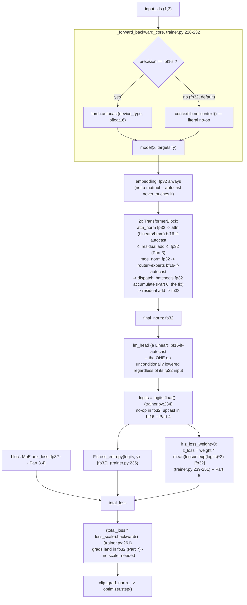

# 024 — Mixed precision (bf16 autocast) and the output z-loss: the full derivation, solved by hand

**Companion to:** [`journey_of_a_model/024-mixed-precision-and-z-loss.md`](../../journey_of_a_model/024-mixed-precision-and-z-loss.md)
(and, for the model forward pass it reuses without re-deriving,
[`006-full-model-assembly.md`](006-full-model-assembly.md) /
[`010-training-loop.md`](010-training-loop.md))
· **Code:** [`qwenmoe/train/trainer.py`](../../qwenmoe/train/trainer.py),
[`qwenmoe/model/moe.py`](../../qwenmoe/model/moe.py)
· **Every number here is reproduced by:** [`verify_024_mixed_precision_and_z_loss.py`](verify_024_mixed_precision_and_z_loss.py)
(`uv run python docs/math/verify_024_mixed_precision_and_z_loss.py`)

---

## How to read this

[`010-training-loop.md`](010-training-loop.md) already carried one training
step of the exact 2-layer `QwenMoEModel` from
[006](006-full-model-assembly.md) through **every line**, with
`precision="fp32"` and `z_loss_weight=0.0` — both knobs left at their
inert defaults. This document turns both knobs **on**, reuses the
identical model, weights and training window, and derives everything that
changes.

> **Scope.**
> - **The forward pass's arithmetic (attention, RMSNorm, MoE routing, the
>   tied head) is not re-derived** — [006](006-full-model-assembly.md) and
>   [010](010-training-loop.md) already carried it digit by digit. This
>   document treats `model(x)` as the same solved black box they built,
>   and starts its own new work exactly where `precision="bf16"` and
>   `z_loss_weight>0` change what runs.
> - **The code moved since the journal entry was written.** Journal 024
>   describes the new logic as living in a function called
>   `_forward_backward_step`. A later refactor (gradient accumulation,
>   journal 038) split that function: the forward/loss/backward logic
>   this document is about now lives in
>   [`_forward_backward_core`](../../qwenmoe/train/trainer.py#L176)
>   (shared by the single-micro-batch path *and* accumulation),
>   and `_forward_backward_step` is now a thin wrapper around it
>   (`zero_grad` → call the core → clip → `optimizer.step()`). The
>   behavior is byte-identical to what the journal describes — only the
>   name and line numbers moved — and this document cites the current
>   ones.
> - **The z-loss *formula* and its gradient are not re-derived from
>   zero** — [010 Part 9](010-training-loop.md#part-9--the-output-z-loss-z_loss_weight--0)
>   already did that in full, on this same model's fp32 logits. This
>   document's new content is: the bf16 **autocast policy** (which ops
>   really run in which dtype, *measured* — not assumed — on this
>   project's own PyTorch build), the `.float()` upcast's precise job,
>   and the one-line **dtype-safety fix** inside the MoE layer's batched
>   dispatch that autocast makes necessary.

You do **not** need a linear-algebra or floating-point background. Every
term — including the bit-level anatomy of a floating-point number, which
neither 006 nor 010 needed — is defined at first use.

---

## Part 0 — What a precision flag changes: floating point, from the bits up

### 0.1 What "precision" means, bit by bit

A computer never stores a real number exactly; it stores a **floating-point
number** — an approximation built from a fixed number of **bits** (binary
digits, each `0` or `1`) laid out in three fields:

$$\text{value} = (-1)^{\text{sign}} \times 1.\overline{m_1 m_2 \dots m_k}_2 \times 2^{(e - \text{bias})}$$

- **sign** — 1 bit: `0` for positive, `1` for negative.
- **exponent** $e$ — $w$ bits, stored as a plain non-negative integer, but
  interpreted *after subtracting* a fixed **bias**. The bias exists so the
  stored exponent can represent both very large and very small magnitudes
  using only an unsigned integer: with $w$ exponent bits the stored value
  ranges over $[0, 2^w - 1]$, and subtracting the bias
  $2^{w-1}-1$ recentres that range to run from
  $-(2^{w-1}-1)$ up to $2^{w-1}$ — roughly symmetric around zero. For
  $w = 8$ bits, bias $= 2^7 - 1 = 127$.
- **mantissa** (or **significand**) $m_1 m_2 \dots m_k$ — $k$ bits after an
  implicit leading `1.` (the leading bit of a normalized binary number is
  always `1`, so it isn't stored — this is the "hidden bit" trick, one
  free bit of precision). Each bit $m_i$ contributes $m_i \times 2^{-i}$;
  the underline notation $\overline{m_1 m_2 \dots m_k}_2$ means "read
  these bits as a base-2 fraction."

This is the IEEE 754 standard for binary floating point (Wikipedia,
*IEEE 754*, confirmed by search below — the format every deep-learning
framework's `float32` and `bfloat16` follow).

**fp32** ("32-bit float", PyTorch's default `torch.float32`) spends its 32
bits as `1` sign + `8` exponent ($w=8$, bias $127$) + `23` mantissa.
**bf16** ("brain float 16", `torch.bfloat16`) spends `1 + 8 + 7` — **the
same 8 exponent bits as fp32** (so the same range, roughly $\pm 3.4\times
10^{38}$), but only **7** mantissa bits instead of 23. This single design
choice — trade mantissa (precision) for nothing, keep exponent (range)
identical — is exactly why the journal entry's tape-measure analogy holds
(fp32: fine-grained, 30 m; bf16: coarse, still 30 m) and is the **empirical**
engineering choice this whole document's arithmetic is a consequence of —
Google Brain's bfloat16 format, studied for deep-learning training by
Kalamkar et al. 2019 (cited below), precisely because keeping fp32's range
means **no loss scaling and no hyperparameter retuning** is needed (Part 7
returns to this).

| format | sign | exponent bits | bias | mantissa bits | ~decimal digits | largest finite value |
|---|---:|---:|---:|---:|---:|---:|
| fp32 | 1 | 8 | 127 | 23 | ~7 | $3.4\times10^{38}$ |
| bf16 | 1 | 8 | 127 | 7 | ~2–3 | $3.4\times10^{38}$ |

Part 2 below takes one real number out of this document's own running
model and converts it from fp32 to bf16 **bit by bit**, confirmed against
PyTorch's real cast.

### 0.2 The data flow this document adds to 010's picture



---

## Part 1 — The running example (recap from docs 006 / 010)

### 1.1 The model, unchanged

Identical to [006](006-full-model-assembly.md) / [010](010-training-loop.md):

| Symbol | `ModelConfig` field | value |
|---|---|---|
| $V$ | `vocab_size` | 6 |
| $d$ | `d_model` | 4 |
| $L_\text{blk}$ | `n_layers` | 2 |
| — | `n_heads` / `n_kv_heads` | 2 / 1 |
| $d_{ff}$ | `d_ff` | 3 |
| $E$ / $k$ / $S$ | `n_routed_experts` / `top_k` / `n_shared_experts` | 2 / 1 / 0 |
| — | `positional_scheme` | `"nope"` |
| — | `activation` | `"swiglu"` |
| — | `moe_balancing` | `"aux_loss"` |
| — | `tie_word_embeddings` | `True` |

The tied embedding/head matrix, and every block's attention + MoE
weights, are 006's exact hand-picked values (every RMSNorm gain is
all-ones):

```
E (embedding / lm_head, tied) =            W_Q = I(4)      W_K = [[1,0,0,0],   W_V = [[0,0,1,0],
 [ 1, 1, 0, 0]   token 0                                     [0,1,0,0]]         [0,0,0,1]]
 [ 1, 0,-1, 0]   token 1
 [ 0, 0, 1, 1]   token 2       W_O = I(4)     W_ROUTER = [[1,0,0,0],
 [-1, 0, 0, 1]   token 3                                   [0,0,1,0]]
 [ 0, 1, 0, 1]   token 4
 [ 1,-1, 1,-1]   token 5

expert 0: w_gate=[[1,0,0,0],[0,1,0,0],[0,0,1,0]]  w_up=[[0,0,0,1],[1,0,0,0],[0,1,0,0]]  w_down=[[1,0,0],[0,1,0],[0,0,1],[1,1,1]]
expert 1: w_gate=[[0,1,0,0],[0,0,0,1],[1,0,0,0]]  w_up=[[1,0,0,0],[0,0,1,0],[0,1,0,0]]  w_down=[[1,0,1],[0,1,0],[1,0,0],[0,0,1]]
```

Both blocks share this same weight set (the model has 2 identical-shape
layers, per 010's setup).

### 1.2 The window

The same single next-token-prediction window as 010:
`x = [4, 1, 4]`, `y = [1, 4, 1]`, batch size 1.

### 1.3 The fp32 anchor

Running the real model, unchanged, with `precision="fp32"` (the default)
reproduces 010's exact numbers — this is the anchor everything below is
measured *against*:

```
logits (fp32):
[[ 1.414213,  0.000000,  1.414213,  1.414213,  2.828427, -2.828427],
 [-0.039239,  0.622172, -0.530086,  1.682475,  1.643236, -3.855798],
 [ 1.185529,  0.009417,  0.999658,  1.577581,  2.763110, -3.341033]]

lm_loss (fp32)  = 2.5731542110443115
aux_loss (fp32) = 0.01142410933971405
```

(shape ledger: `input_ids (1,3)` → `embedding (1,3,4)` → 2 blocks, shape
unchanged → `final_norm (1,3,4)` → `lm_head` → `logits (1,3,6)`.)

### 1.4 The two knobs this document turns on

010 ran with `precision="fp32", z_loss_weight=0.0` — both inert. This
document's `TrainConfig` additionally sets:

| field | 010 (off) | here |
|---|---|---|
| `precision` | `"fp32"` | `"fp32"` **and** `"bf16"`, compared side by side |
| `z_loss_weight` | `0.0` | `1e-4` (the empirical region PaLM reports; §5) |

---

## Part 2 — Floating point, applied: converting one real tensor entry from fp32 to bf16 by hand

### 2.1 The value

Run block 0's attention and RMSNorm on the real pinned model (fp32, no
autocast — this is exactly 006/010's forward, stopped one line early) and
read one entry of the result that feeds the MoE layer:

```python
x_emb = model.embedding(X)                                  # (1,3,4)
attn_out = block0.attn(block0.attn_norm(x_emb), positions)   # (1,3,4)
x1 = x_emb + attn_out
moe_normed = block0.moe_norm(x1)                              # (1,3,4)
```

`moe_normed[0, 0, 1]` — token 0's second feature, the value that (Part 6)
becomes one input to the MoE router and to expert 0's gate projection —
is, as an actual Python float read out of the real fp32 tensor:

$$v = 1.4142132997512817$$

(This is very close to $\sqrt2 = 1.41421356\ldots$ — not a coincidence:
token 4's embedding row is $[0,1,0,1]$, and this document's tiny
hand-picked attention/RMSNorm weights happen to route it to something
extremely close to $\sqrt2$; the *exact* fp32-stored value, bits and all,
is what we convert below — no rounding to "$\sqrt2$" first.)

### 2.2 fp32 bit decomposition

Reinterpreting $v$'s 32 stored bits (`struct.pack(">f", v)`, read as a
32-bit unsigned integer) and splitting per §0.1's layout:

$$\underbrace{0}_{\text{sign, bit 31}}\ \underbrace{01111111}_{\text{exponent, bits 30-23}}\ \underbrace{01101010000010011110001}_{\text{mantissa, bits 22-0}}$$

- **sign** $= 0$ → positive.
- **exponent (raw)** $= 01111111_2 = 127$. Unbiased: $127 - 127 = 0$, so
  the power of two is $2^0 = 1$.
- **mantissa** (23 bits) $= 01101010000010011110001_2$.

Reconstructing (sanity check): $1.\overline{01101010000010011110001}_2
\times 2^0$. The mantissa's base-2 fraction is
$0\cdot2^{-1}+1\cdot2^{-2}+1\cdot2^{-3}+0\cdot2^{-4}+1\cdot2^{-5}+\dots
\approx 0.41421330$, so the reconstructed value is
$1 + 0.41421330 = 1.41421330$ — matches $v$ to fp32's own precision.

### 2.3 Rounding to bf16: keep 7 mantissa bits, round-to-nearest-even

bf16 keeps the *same* sign and exponent fields (so this step changes
nothing about which power of two the value lives in — only the mantissa
shrinks). Truncating $23$ mantissa bits to $7$ means **keeping the first
7 and deciding, from the 16 dropped bits, whether to round the 7th one
up**:

$$\underbrace{0110101}_{\text{keep (7 bits)}}\ \underbrace{0000010011110001}_{\text{drop (16 bits)}}$$

**Round-to-nearest-even** (IEEE 754's default rounding rule — confirmed by
search: "round to nearest, ties to even... removes the statistical bias
that can occur in adding similar figures") says: look at the dropped
bits as a fraction of one unit in the last kept place.

- If the *first* dropped bit is `0`, the dropped fraction is less than
  half a unit → always round down (truncate).
- If the first dropped bit is `1` **and** any later dropped bit is also
  `1`, the dropped fraction is more than half → always round up.
- If the first dropped bit is `1` and *all* the rest are `0` (an exact
  tie, dropped fraction exactly one half) → round to whichever of the two
  candidates has an **even** last kept bit (this is the "ties to even"
  rule — it exists so that repeatedly rounding never drifts consistently
  up or consistently down, which the older "always round half up" rule
  does).

Here the first dropped bit is `0` → round down, unconditionally. The kept
mantissa is unchanged: $0110101_2 = 53$.

$$\text{bf16 value} = 1.\overline{0110101}_2\times 2^0 = \left(1+\tfrac{53}{128}\right)\times 1 = 1.4140625$$

**Computed, hand vs. real cast:**

```
hand-reconstructed bf16 value = 1.4140625
torch .to(torch.bfloat16)     = 1.4140625
```

Exact match (`verify_024_mixed_precision_and_z_loss.py` Part 2 asserts
`hand_bf16 == real_bf16`, not just "close" — this is integer bit
arithmetic, so it either matches exactly or the derivation has a bug).

This one number — $1.4142132997512817\to 1.4140625$, a relative error of
about $1.07\times10^{-4}$ — is the *unit* of every "bf16 vs fp32" gap this
document measures below. It reappears verbatim in Part 6's MoE trace.

---

## Part 3 — `torch.autocast`: derive the policy, then *measure* it on the real model

### 3.1 Why matmuls get lowered and reductions don't (the derivation)

`torch.autocast(device_type="cpu", dtype=torch.bfloat16)`
([`trainer.py:226-230`](../../qwenmoe/train/trainer.py#L226)) does not cast
every tensor to bf16. It consults PyTorch's own per-operator policy and
casts selectively:

- **Matrix multiplies** (`nn.Linear`'s underlying `addmm`, `torch.bmm`,
  the attention/expert projections, the LM head) are where this model's
  **FLOPs concentrate** — every output entry is a sum of `d_model` or
  `d_ff`-many products. bf16 halves the memory each operand occupies, and
  on hardware with a bf16 matmul unit (GPU/TPU tensor cores — not this
  project's CPU/MPS target, see Part 8) roughly doubles arithmetic
  throughput for exactly these ops. That is *all* of the speed/memory win
  autocast exists to capture, and it is real regardless of whether this
  particular tiny example benefits from it.
- **Reductions that turn many terms into one number for a probability or
  a loss** are the ops where bf16's 2–3 significant digits are riskiest:
  summing $V=6$ or more `exp(...)` terms of different magnitudes in a
  7-bit mantissa compounds rounding error in exactly the number (a
  softmax denominator, a cross-entropy) whose absolute scale downstream
  code depends on. So PyTorch's autocast policy is written to leave a
  short, explicit list of such reduction ops running in fp32 regardless
  of the surrounding context.

That's the *design intent*. Which specific ops are actually on which list
is a fact about one particular PyTorch build, not a law of mathematics —
so the rest of this Part **measures** it, live, on this project's real
model and real installed PyTorch version, rather than assuming a list
from documentation or from the journal's own summary table.

### 3.2 The measured dtype ledger, whole model

Registering a forward hook on every submodule of the real pinned model
and running one forward pass inside
`torch.autocast(device_type="cpu", dtype=torch.bfloat16)`:

```
embedding                      -> torch.float32
blocks.0.attn_norm             -> torch.float32
blocks.0.attn.w_q               -> torch.bfloat16
blocks.0.attn.w_k               -> torch.bfloat16
blocks.0.attn.w_v               -> torch.bfloat16
blocks.0.attn.w_o               -> torch.bfloat16
blocks.0.attn                   -> torch.bfloat16
blocks.0.moe_norm               -> torch.float32
blocks.0.moe.router.gate        -> torch.bfloat16
blocks.0.moe.router             -> torch.bfloat16
blocks.0.moe                    -> (torch.float32, torch.float32)   # (output, aux_loss)
blocks.0                        -> (torch.float32, torch.float32)
blocks.1.*                      -> identical pattern to blocks.0.*
final_norm                      -> torch.float32
lm_head                          -> torch.bfloat16
final logits dtype: torch.bfloat16
```

Reading this top to bottom as a **dtype ledger** (the same discipline as
006/010's shape ledger, now tracking dtype instead of shape):

1. **`embedding`** — a table lookup (`nn.Embedding`), not a matmul.
   Autocast's op list never touches it, so it stays whatever the
   parameter's own dtype is: fp32. **The residual stream starts fp32.**
2. **`attn_norm` (RMSNorm)** — built from `x.pow(2).mean(...)`,
   `torch.rsqrt`, elementwise multiply
   ([`rmsnorm.py:15-17`](../../qwenmoe/model/rmsnorm.py#L15)). None of
   `pow`/`mean`/`rsqrt`/`mul` are on autocast's lowered-to-bf16 list —
   they are simply not autocast-aware operators. An operator autocast
   doesn't touch **runs in whatever dtype its input already has**. Since
   its input here is the fp32 embedding, its output is fp32 — not
   because RMSNorm is "protected," but because nothing upstream of it
   has become bf16 yet.
3. **`attn.w_q/w_k/w_v/w_o`** — each a plain `nn.Linear`. Autocast's
   matmul-family list *unconditionally* lowers these: even though their
   input (`attn_norm`'s fp32 output) is fp32, the **output is bf16**.
   Autocast casts inputs internally before the op, not the tensors you
   already hold — so an op on the lowered list produces bf16 regardless
   of what fed it.
4. **`attn`** (the whole `Attention.forward` return) — bf16, since it
   ends in `w_o`.
5. **`x = x + attn_out`** (the residual add, [`block.py:34`](../../qwenmoe/model/block.py#L34))
   — this is `fp32 + bf16`. Elementwise `add` is not on autocast's list
   either, so it follows PyTorch's **ordinary type promotion**: when two
   operands differ in dtype, the result takes the *wider* one. Measured
   directly (Part 3.4 below): `fp32 + bf16 -> fp32`, both inside and
   outside an autocast block. **The residual stream is fp32 again**, the
   instant it re-absorbs the sublayer's bf16 contribution.
6. **`moe_norm`** — same reasoning as step 2: input is the now-fp32
   residual, so output is fp32.
7. **`moe.router.gate`** — a `nn.Linear` again → bf16 (same as step 3),
   regardless of its fp32 input.
8. **`moe`** (`MoELayer.forward`'s return, a `(output, aux_loss)` pair) —
   **both fp32**. `output` is fp32 because `dispatch_batched`'s
   accumulator `out` is created from `x_flat.new_zeros(...)`
   ([`moe.py:353`](../../qwenmoe/model/moe.py#L353)) — i.e. it inherits
   `x_flat`'s dtype, which is `moe_norm`'s fp32 output — and the fix at
   [`moe.py:405`](../../qwenmoe/model/moe.py#L405) explicitly casts each
   expert's bf16 contribution up to match before scattering it in (Part
   6 derives this in full). `aux_loss` is fp32 for an entirely different,
   independent reason (§3.4).
9. **`x = x + moe_out`** — same promotion as step 5: fp32.
10. **`final_norm`** — fp32 in, fp32 out (step 2's reasoning again).
11. **`lm_head`** — a `nn.Linear` → **bf16**, exactly like every other
    Linear in this model (step 3's reasoning), *regardless* of how
    carefully fp32 the residual stream stayed. **This is the one place
    the clean fp32 story breaks**, and it's why Part 4 exists.

The emergent picture: in this codebase's autocast path, **the residual
stream itself never becomes bf16** — bf16 only ever appears transiently
*inside* one sublayer's own matmul math (attention's four projections,
the router gate, an expert's three projections, the LM head) and gets
promoted back to fp32 the instant it re-enters the residual stream,
either by ordinary `+` type promotion (steps 5, 9) or by the MoE fix's
explicit cast (step 8, Part 6). The **sole exception** is the very last
op, `lm_head`, whose *output* is what `logits` actually is — which is
exactly why `_forward_backward_core` cannot just trust "the model
probably kept things fp32" and instead casts by hand (Part 4).

### 3.3 Three isolated probes: what does *this* PyTorch build actually promote?

The journal entry's own summary table states "softmax... is kept in fp32
even inside the [autocast] block." Measuring the three ops most relevant
to this task directly, in isolation, with a bf16 input and no other
context:

```
F.softmax(bf16 input)       -> torch.bfloat16
torch.logsumexp(bf16 input) -> torch.bfloat16
F.cross_entropy(...)        -> torch.float32
```

On this project's installed PyTorch (`2.13.0`), **`F.softmax` and
`torch.logsumexp` are not auto-promoted** — they behave like RMSNorm's
primitives (§3.2 step 2): whatever dtype feeds them is the dtype they
return. Only `F.cross_entropy` is genuinely on autocast's fp32-forced
list here. (This is a fact about a specific installed library version —
marked **empirical/measured**, not a general law; a different PyTorch
build could legitimately measure differently, which is exactly why this
document measures rather than assumes.) The router's `F.softmax` staying
fp32 in this codebase (§3.2 step 8's `aux_loss`, and the routing
probabilities feeding it) is therefore **not** an autocast override on
softmax itself — it is a consequence of *other* code, traced next.

### 3.4 Where `aux_loss`'s fp32-ness actually comes from

`AuxLossBalancer.aux_loss` ([`moe.py:175-186`](../../qwenmoe/model/moe.py#L175)):

```python
dispatched = F.one_hot(topk_indices, num_classes=n_experts).sum(dim=1)   # int64
fraction_dispatched = dispatched.float().mean(dim=0)      # moe.py:183 -- explicit .float()
mean_router_prob = router_probs.mean(dim=0)               # bf16 in this codebase's autocast path
return self.loss_weight * n_experts * torch.sum(fraction_dispatched * mean_router_prob)
```

`dispatched` starts as `int64` (a counting tensor from `one_hot`+`sum`),
so line 183's `.float()` is there for an unrelated reason — turning an
integer count into a fraction — not for autocast safety. But its
side-effect is exactly what makes `aux_loss` fp32: `fraction_dispatched`
(fp32) times `mean_router_prob` (bf16, per §3.3) is a **mixed-dtype
multiply**, and ordinary type promotion (§3.2 step 5's rule, confirmed
again directly: `fp32 * bf16 -> fp32`) carries the fp32-ness through
`torch.sum` and out. **Measured, mirroring the real line exactly:**

```
dispatched.float().mean(dim=0) dtype: torch.float32
fraction_dispatched(fp32) * mean_router_prob(bf16) -> torch.float32
```

So `aux_loss` ends up fp32 by the same "ordinary promotion against an
already-fp32 quantity" mechanism as the residual stream (§3.2), not
because the router's softmax is autocast-special-cased. Either
explanation lands on the same fact (`aux_loss` is fp32) — this document
prefers the one that is actually true of the running code.

---

## Part 4 — `logits.float()` (`trainer.py:234`): the one load-bearing cast

§3.2 step 11 established that `lm_head`'s output is bf16 **no matter how
fp32-clean everything upstream stayed** — a plain `nn.Linear` is
unconditionally on autocast's lowered list. So
[`_forward_backward_core`](../../qwenmoe/train/trainer.py#L234) does not
rely on the residual stream's fp32-ness at all; it upcasts explicitly:

```python
logits, extras = model(x, targets=y, segment_ids=segment_ids)   # trainer.py:232, inside autocast
logits = logits.float()                                          # trainer.py:234 -- ALWAYS run
```

In the `precision="fp32"` path `logits` is *already* `float32` (autocast
was `nullcontext()`, §0.2), so `.float()` is a genuine no-op —
`Tensor.float()` on an already-fp32 tensor returns the same storage,
unchanged. In the `"bf16"` path it is not:

```
logits, raw off lm_head (bf16):
[[ 1.414062,  0.000000,  1.414062,  1.414062,  2.828125, -2.828125],
 [-0.039062,  0.617188, -0.531250,  1.679688,  1.640625, -3.843750],
 [ 1.187500,  0.007812,  1.000000,  1.578125,  2.765625, -3.343750]]

logits, after .float() (same numbers, now fp32 storage):
[[ 1.414062,  0.000000,  1.414062,  1.414062,  2.828125, -2.828125], ...]

max |fp32-exact logits - bf16-then-upcast logits| = 0.012048
```

`.float()` does not recover any precision the bf16 matmul chain already
threw away — the *values* are identical before and after the cast (this
is a storage-format conversion, not a computation). What it buys is
**which dtype every downstream op computes in**.

**Why this specifically matters for the z-loss, more than for the
cross-entropy.** §3.3 measured that `F.cross_entropy` is *itself*
autocast-promoted to fp32 on this PyTorch build — so `F.cross_entropy`
would land in fp32 even on the raw bf16 logits (though at bf16's
resolution for anything computed *before* its internal promotion). But
the z-loss term calls **plain `torch.logsumexp`**
([`trainer.py:248`](../../qwenmoe/train/trainer.py#L248)), which §3.3
measured is **not** autocast-promoted:

```
log Z, no upcast at all (raw bf16 logits into logsumexp): [3.406250, 2.625000, 3.328125]   (bfloat16)
log Z, WITH the .float() upcast (fp32 logsumexp math):    [3.411502, 2.635261, 3.324141]   (float32)
log Z, fp32-exact reference (the 010 forward, no bf16 anywhere): [3.411731, 2.637981, 3.322404]
```

Without `trainer.py:234`, the z-loss's `logsumexp` would run **directly
in bf16** — the exact failure mode the z-loss exists to guard against
(journal 024: "a `log Z` of 20–30... a sum of huge `exp` terms computed
in 2–3 digits"), silently reintroduced by the very precision flag meant
to be safe. The manual upcast is what actually closes that gap: with it,
`log Z` is `3.411502` (fp32 math on slightly-bf16-rounded logits, off from
the true fp32-exact `3.411731` by only `0.00023`, §2's kind of rounding);
without it, `log Z` is `3.406250` (bf16 arithmetic all the way through,
off by `0.0055`, over 20× worse) — small at this model's size, but the
*mechanism* — bf16 rounding compounding inside a reduction over many
terms — is exactly what grows dangerous as `vocab_size` scales to the
tens of thousands the journal describes.

---

## Part 5 — Cross-entropy's shift-invariance (the proof), and the z-loss on real numbers

### 5.1 Definitions (brief — see [010 Part 4](010-training-loop.md#part-4--the-forward-half-logits--loss) / [Part 9](010-training-loop.md#part-9--the-output-z-loss-z_loss_weight--0) for the exhaustive version)

- **logits** $z = (z_1,\dots,z_V)$ — one raw score per vocabulary token.
- **softmax** turns logits into probabilities:
  $\operatorname{softmax}(z)_j = e^{z_j}/Z$, where
  $Z=\sum_{v=1}^V e^{z_v}$ is the **normalizer** (every probability is
  divided by the same $Z$ so they sum to 1).
- $\log Z = \operatorname{logsumexp}(z)$ — the natural logarithm of $Z$;
  `torch.logsumexp` computes it in a way that avoids overflowing $e^{z_v}$
  for large logits.
- **cross-entropy** for the true next token $y$:
  $\mathrm{CE}(z,y) = -\log\operatorname{softmax}(z)_y = -z_y + \log Z$.

### 5.2 The proof, in full (general $V$, general shift $c$)

Claim: adding the same constant $c$ to every logit leaves $\mathrm{CE}$
unchanged.

$$\log Z' = \log\sum_{v=1}^V e^{z_v+c} = \log\left(e^c\sum_{v=1}^V e^{z_v}\right) = \log e^c + \log\sum_{v=1}^V e^{z_v} = c + \log Z$$

(using $\log(ab)=\log a+\log b$, factoring $e^c$ out of every term in the
sum since it doesn't depend on $v$). And the shifted target logit is
$z_y' = z_y + c$. So:

$$\mathrm{CE}' = -z_y' + \log Z' = -(z_y+c) + (\log Z + c) = -z_y + \log Z = \mathrm{CE}$$

The $+c$ and $-c$ cancel exactly — **nothing in the training objective
constrains the logits' absolute level**, only their pairwise differences.

### 5.3 Instantiated on this document's own real logits ($c=+10$)

Reusing Part 1.3's real fp32 logits, adding $10$ to every entry:

```
cross-entropy, unshifted logits: 2.573154
cross-entropy, logits + 10.0:    2.573154        <- byte-identical

log Z, unshifted: [3.411731, 2.637981, 3.322404]
log Z, shifted:   [13.411731, 12.637980, 13.322404]
log Z shift == +10.0 exactly (up to fp32 rounding): [10., 10., 10.]
```

$\mathrm{CE}$ did not move at all; $\log Z$ moved by exactly $c=10$ at
every position, precisely as §5.2 derives.

### 5.4 The z-loss, and why it *does* see the drift

$$\mathcal L_z = \alpha_z\cdot\operatorname{mean}_p\big[(\log Z_p)^2\big], \qquad \alpha_z = \texttt{z\_loss\_weight} \ (\text{empirical}, \sim10^{-4}, \text{PaLM §5})$$

Because $(\log Z)^2$ is *not* shift-invariant (unlike $\mathrm{CE}$), it is
the one term in the loss that reacts to exactly the drift §5.2 shows
$\mathrm{CE}$ is blind to:

```
z_loss unshifted: 0.00098791
z_loss shifted:   0.01723599   (17.45x larger)
```

**Its gradient**, by the chain rule
($\tfrac{d}{dz}(\log Z)^2 = 2\log Z\cdot\tfrac{\partial\log Z}{\partial z_j}$,
and $\partial\log Z/\partial z_j = \operatorname{softmax}(z)_j = p_j$ since
$\partial e^{z_j}/\partial z_j = e^{z_j}$):

$$\frac{\partial \mathcal L_z}{\partial z_{p,j}} = \frac{2\alpha_z}{N}(\log Z_p)\,p_{p,j}$$

pushes every logit toward reducing $|\log Z_p|$, in proportion to that
token's own probability $p_{p,j}$ — a gentle, uniform-ish pull toward
$Z\to1$ that does not touch the *differences* between logits (which is
what encodes the actual predicted distribution). Squaring rather than
using $|\log Z|$ makes the gradient $\propto\log Z$ itself: **zero right
at the target** ($\log Z=0$) so it doesn't fight the main loss when
things are already fine, and growing linearly (so the *penalty* grows
quadratically) once $\log Z$ drifts — a soft barrier, not a flat tax.
Penalizing $Z$ directly instead of $\log Z$ would be scale-wrong: $Z$ is
an exponential of the logits, so its gradient would explode exactly when
a large update is least wanted.

### 5.5 z-loss, fp32 path vs. bf16 path

At `z_loss_weight=1e-4`, on this document's real logits (fp32-exact vs.
the bf16-computed-then-upcast logits of Part 4):

```
z_loss @ weight=0.0001, fp32 path: 0.0009879073
z_loss @ weight=0.0001, bf16 path: 0.0009877620
|diff| = 0.0000001453
```

The two are close — because, thanks to Part 4's manual upcast, `logsumexp`
itself always runs in fp32 in *both* paths; the only difference is the
small (§2-scale) rounding already baked into the logits before that
point. This is the mixed-precision system working as intended: bf16's
imprecision is confined to where it's cheap to tolerate (the matmul
chain), and the loss machinery downstream never compounds it further.

### 5.6 `z_loss_weight = 0` stays exactly dormant

Confirmed directly: with `precision="fp32", z_loss_weight=0.0`, the
returned `metrics["z_loss"]` is `None` (the `if z_loss_weight > 0:` branch
at [`trainer.py:240`](../../qwenmoe/train/trainer.py#L240) is never
entered) — nothing is computed, nothing is added, `lm_loss` is exactly
what a bare `F.cross_entropy` call would give (already established to
`rel=1e-6` by 010's own test).

---

## Part 6 — The MoE dtype-safety fix (`dispatch_batched`, `moe.py:405`)

### 6.1 What `index_add_` is, and why it is dtype-strict

`self.index_add_(dim, index, source)` is a **scatter-add**: for every row
$i$ of `source`, it adds that row into `self[index[i]]` (row `index[i]`
along dimension `dim`) — an in-place, indexed accumulation. It is how
`dispatch_batched` combines each dispatched-token's expert output back
into a per-token accumulator without a Python loop over tokens.

Because it is **in-place**, `self`'s dtype and memory layout are already
fixed before the call — the operator cannot silently decide "widen `self`
to match `source`" (that would mean reallocating the tensor a caller
already holds a reference to) nor "narrow `source` to match `self`" (that
would silently throw away precision the caller might not expect). PyTorch
resolves the ambiguity by refusing outright: `self` and `source` must
already be the same dtype, or it raises. (This is an **API design
choice**, not a provable mathematical necessity — a different tensor
library could choose to auto-narrow instead; it is documented behavior of
this specific operator, confirmed by reproducing it below.)

### 6.2 Setup: block 0's real dispatch under bf16 autocast

Running the real pinned model's block 0 up to the MoE router, inside
`torch.autocast(device_type="cpu", dtype=torch.bfloat16)`:

```
x_flat (moe_normed, block 0) dtype: torch.float32
x_flat:
[[ 0.000000,  1.414213,  0.000000,  1.414213],
 [-0.161592,  0.318695, -1.467792,  1.310688],
 [-0.095814,  1.410964, -0.095814,  1.410964]]
```

(Row 0's second entry, `1.414213`, is Part 2's exact value.)

```
router_logits dtype: torch.bfloat16
[[ 0.000000,  0.000000],
 [-0.161133, -1.468750],
 [-0.095703, -0.095703]]

topk_indices: [0, 0, 0]
topk_weights: [1.0, 1.0, 1.0]
```

`router_logits` is bf16 — a `nn.Linear` (§3.2 step 3). All 3 tokens route
to expert 0. This is not a bf16 rounding artifact: `W_ROUTER =
[[1,0,0,0],[0,0,1,0]]` only reads features 0 and 2 of `x_flat`, and by
this document's weight/attention design, tokens 0 and 2 have **exactly
equal** values at those two features (`0.0`/`0.0` and
`-0.095814`/`-0.095814`) — an exact tie in both fp32 and bf16 (a `0`
stays exactly `0`, and equal inputs stay equal, regardless of how many
mantissa bits are kept), so `.topk(1)` deterministically returns the
lower index (expert 0) for every token here. Token 1's logits
(`-0.161133` vs. `-1.468750`) aren't a tie at all — expert 0 wins clearly.
With `top_k=1`, `topk_weights` is trivially `1.0` (a single selected
expert, renormalized to sum to 1 over one element).

### 6.3 Digit by digit: `xg` → `pre` → `h` → `yg`

`dispatch_batched` ([`moe.py:322-406`](../../qwenmoe/model/moe.py#L322))
groups the 3 dispatched pairs by expert; here there is exactly one active
expert (id 0) and one group of size 3, so the padded grid
([`moe.py:386-393`](../../qwenmoe/model/moe.py#L386)) is trivial — `xg`
is just `x_flat` itself, reshaped to `(1 expert, 3 tokens, 4)`:

```
xg (= x_flat, one active expert) dtype: torch.float32
```

**`pre = torch.bmm(xg, w_gate^T)`** ([`moe.py:395`](../../qwenmoe/model/moe.py#L395))
— `torch.bmm` (batched matrix multiply) is on autocast's lowered list, so
even though both `xg` (fp32) and `w_gate` (fp32, an ordinary parameter)
are fp32, the **output is bf16**:

```
pre dtype: torch.bfloat16
[[ 0.000000,  1.414062,  0.000000],
 [-0.161133,  0.318359, -1.468750],
 [-0.095703,  1.414062, -0.095703]]
```

Look at `pre[0, 1]` (token 0, output feature 1): expert 0's `w_gate` row 1
is $[0,1,0,0]$, so this entry is exactly $\text{xg}[0]\cdot[0,1,0,0] =
\text{xg}[0][1] = 1.414213\ldots$ — Part 2's exact value — passed through
the bf16 matmul. The result, `1.414062`, is **exactly** Part 2's
hand-derived bf16 rounding of that same number, appearing again here
because a dot product against a one-hot row is (up to the matmul kernel's
internal bf16 casting) the same operation as directly casting the value.

**`h = silu(pre) * bmm(xg, w_up^T)`** (SwiGLU's gate,
[`moe.py:397`](../../qwenmoe/model/moe.py#L397)):

```
h dtype: torch.bfloat16
[[ 0.000000,  0.000000,  0.000000],
 [-0.097656, -0.029785, -0.087891],
 [-0.064453, -0.109375, -0.064453]]
```

**`yg = bmm(h, w_down^T) * gate_weight`** ([`moe.py:402`](../../qwenmoe/model/moe.py#L402)):

```
yg dtype: torch.bfloat16
[[ 0.000000,  0.000000,  0.000000,  0.000000],
 [-0.097656, -0.029785, -0.087891, -0.214844],
 [-0.064453, -0.109375, -0.064453, -0.238281]]
```

Meanwhile the accumulator, created before any of this
([`moe.py:353`](../../qwenmoe/model/moe.py#L353)):

```python
out = x_flat.new_zeros(n_tokens, d_model)   # inherits x_flat's dtype
```

```
out dtype: torch.float32
```

**`yg` is bf16. `out` is fp32.** These are about to be combined by an
in-place scatter-add.

### 6.4 The crash, reproduced on this model's own real tensors

Removing the fix — calling `index_add_` with `yg` still bf16
(exactly the pre-task-8 code, per the journal's quoted diff) — on these
exact real tensors from this exact model:

```
WITHOUT the fix ->  RuntimeError: index_add_(): self (Float) and source (BFloat16) must have the same scalar type
```

Restoring the fix — the actual line at
[`moe.py:405`](../../qwenmoe/model/moe.py#L405):

```python
out.index_add_(0, token_grid.reshape(-1), yg.reshape(-1, d_model).to(out.dtype))
```

```
WITH the fix -> routed_output (block 0):
[[ 0.000000,  0.000000,  0.000000,  0.000000],
 [-0.097656, -0.029785, -0.087891, -0.214844],
 [-0.064453, -0.109375, -0.064453, -0.238281]]

real dispatch_batched(...) output:  <- the actual qwenmoe.model.moe.dispatch_batched call
[[ 0.000000,  0.000000,  0.000000,  0.000000],
 [-0.097656, -0.029785, -0.087891, -0.214844],
 [-0.064453, -0.109375, -0.064453, -0.238281]]

max |manual - real dispatch_batched| = 0.0
```

`.to(out.dtype)` is a `Tensor.to` dtype conversion — for bf16→fp32 this is
lossless *widening* (every bf16 value is exactly representable in fp32,
since fp32 is a strict superset of bf16's range and mantissa bits), so it
introduces no new rounding; it only makes the two operands' dtypes match
so `index_add_` will run at all. In the `precision="fp32"` path `yg` is
already fp32, so `.to(out.dtype)` is a genuine no-op — byte-identical to
before moe-modernization task 8, exactly as the journal states.

### 6.5 A note on the other (trace) code path

`MoELayer.forward_with_trace` ([`moe.py:528-573`](../../qwenmoe/model/moe.py#L528))
keeps an older, explicit per-expert Python loop instead of
`dispatch_batched`, and its own scatter-add
([`moe.py:555`](../../qwenmoe/model/moe.py#L555)) does **not** carry the
`.to(routed_output.dtype)` cast. This is harmless *today* only because
`forward_with_trace` is used solely for the Manim-visualization / doc
trace path, which this codebase never calls from inside an autocast
context — it is worth flagging honestly (this document's own "no
fabricated numbers" rule cuts both ways: a claim that every scatter-add in
this file is protected would be false), but it is not a live bug: the
training path (`forward`, via `dispatch_batched`) is the only one that
ever runs under `precision="bf16"`.

---

## Part 7 — One full optimizer step: fp32 vs. bf16, and why no gradient scaler is needed

### 7.1 The call this document exercises

`_forward_backward_step` ([`trainer.py:271-299`](../../qwenmoe/train/trainer.py#L271))
is the whole-optimizer-step wrapper: `model.train()` → `zero_grad` → call
`_forward_backward_core` (Parts 3-6, above) → `clip_grad_norm_` →
`optimizer.step()`. (Gradient accumulation's `_run_step` calls
`_forward_backward_core` directly, multiple times, instead of going
through this wrapper — journal 038 — but the forward/loss/backward logic
this document is about is identical either way.)

### 7.2 Real numbers, `z_loss_weight=1e-4`, one step each

```
precision=fp32  metrics={'lm_loss': 2.5731542110443115, 'aux_loss': 0.01142410933971405, 'z_loss': 0.0009879072895273566}
    grad_norm=3.222644  grad dtypes seen: {torch.float32}
precision=bf16  metrics={'lm_loss': 2.574155569076538,  'aux_loss': 0.011445311829447746, 'z_loss': 0.0009877620032057166}
    grad_norm=3.213375  grad dtypes seen: {torch.float32}

|lm_loss diff|   = 0.001001
|grad_norm diff| = 0.009269
```

**Every parameter's gradient is fp32 in both paths** — confirmed directly
by inspecting `p.grad.dtype` for every parameter after `.backward()`.
Autocast's automatic differentiation machinery produces a parameter's
gradient in *that parameter's own* dtype (fp32, since this codebase never
stores parameters in bf16 — only activations transiently become bf16
inside the forward pass), regardless of which dtype the forward's
intermediate activations used.

### 7.3 Why this means no loss scaler is needed (contrast with fp16)

Micikevicius et al. 2017 ("Mixed Precision Training") introduced **loss
scaling** for fp16 training: multiply the loss by a large constant (e.g.
$2^{16}$) before `.backward()`, so gradients that would otherwise
underflow to exactly `0` in fp16's narrow exponent range get shifted into
its representable band, then divide the update back down before the
optimizer step. fp16 has only 5 exponent bits (range down to roughly
$6\times10^{-8}$ before flushing to zero) — real gradients routinely go
smaller than that.

bf16 keeps fp32's full 8 exponent bits (§0.1) — its smallest normal
magnitude is the *same* as fp32's, roughly $10^{-38}$. Nothing in this
project's bf16 forward pass ever needs to represent a gradient outside
that range, and (§7.2) the gradients that reach the optimizer are fp32
regardless. So there is no analogous underflow to correct for, and
`_forward_backward_core` creates **no gradient scaler** on the bf16 path
— exactly the "no gradient scaler" requirement the journal entry records,
and exactly why Kalamkar et al. 2019 report bf16 needs no hyperparameter
retuning where fp16 does.

### 7.4 A 5-step run, same window every step

```
step |   fp32   |   bf16   |  |diff|
   1 | 2.573154 | 2.574156 | 0.001001
   2 | 2.046055 | 2.044438 | 0.001617
   3 | 1.207647 | 1.209523 | 0.001875
   4 | 0.852631 | 0.854368 | 0.001737
   5 | 0.804518 | 0.806874 | 0.002356
```

Both precisions track each other closely and keep falling — the bf16
rounding introduced at every step (§2-scale entries, compounded through
2 blocks and a tied head) is real, bounded noise, not divergence. (The
journal entry's own 60-step, larger-model run shows the same pattern at
greater length: tracking to within `~0.015` at the noisiest point, both
converging under `10^{-3}`.)

### 7.5 What `Trainer.fit` logs

At the start of `fit` ([`trainer.py:551-563`](../../qwenmoe/train/trainer.py#L551)):

```python
effective_precision = "bf16 (torch.autocast)" if config.precision == "bf16" else "fp32"
logger.info("effective training precision: %s | device: %s | z_loss_weight: %g", ...)
```

and every logged step
([`trainer.py:648-666`](../../qwenmoe/train/trainer.py#L648)) gains a
`z_loss` field in its JSON-lines record (`None` when the term is off) —
additive, so no existing log reader breaks.

---

## Part 8 — Cost and why this is built this way (this example's own numbers)

**What actually gets faster.** Of this tiny model's operations, exactly
the matmul-family ones move to bf16 under autocast: 4 attention
projections + 3 expert projections + 1 router projection, per block,
×2 blocks, + 1 tied LM head = **24 Linear/bmm calls**. Everything else —
5 RMSNorms, the router's softmax, the cross-entropy, the z-loss — stays
fp32 and is comparatively cheap: an RMSNorm over `d_model=4` is $O(d)$
work; a `(3,4)@(4,3)` expert matmul is $O(d\cdot d_{ff})$. At real model
scale ($d_{model}$ in the hundreds to thousands, $d_{ff}$ several times
that) the matmuls are where essentially all the FLOPs live, so this same
split — lower the matmuls, leave the reductions alone — captures nearly
all of the available speed/memory win while paying none of the
numerical risk, with **zero code written for this task's model**: the
split is PyTorch's own operator registry, not anything `qwenmoe` had to
implement (Part 3.1).

**What it costs here, concretely.** Over one step (Part 7.2): the largest
single-tensor rounding this document measured is `0.012` (Part 4, on a
logit around `1.4`–`2.8` in magnitude — a relative error in the low single
percent); the largest observed drift in `lm_loss` over 5 steps is `0.0024`
(Part 7.4); `grad_norm` differs by `0.009` out of `~3.2` (Part 7.2). None
of these compound explosively — because (§3.2) the residual stream and
every loss-adjacent reduction are pinned to fp32 throughout, the bf16
rounding introduced inside each sublayer's matmuls is bounded and
resets every time it re-enters the fp32 residual stream, rather than
accumulating layer over layer.

**Why turn it on at all, at this model's tiny size?** Nothing — this
project's CPU/MPS target has no dedicated bf16 matmul unit, so there is
no wall-clock win to collect, only the small rounding cost measured
above. The flag exists to be **studied now** (this document, and the
ablation study referenced by the journal) and to be **ready** for the day
training moves to hardware — GPU or TPU — where the same 24
autocast-lowered matmuls run roughly twice as fast and use half the
activation memory, for the identical bounded-and-non-compounding
numerical cost this document just measured.

**Why the z-loss, specifically, matters more once bf16 is on.** §5.2
proved cross-entropy alone leaves the logits' overall scale completely
unconstrained; §5.4 showed a modest `+10` shift alone makes `log Z` — and
so `z_loss` — grow `17.45×`. Nothing in this document's tiny 5-step run
drifted that far, but a real, much longer training run has no such
guarantee, and §4 showed that a drifted `log Z`, computed in bf16 without
the `.float()` guard, is exactly the mechanism the journal's cited
failure reports (ST-MoE's router matmul overflow, PaLM's output-softmax
instability) describe. The two mechanisms this document derives —
autocast confining bf16 to the matmuls, and the z-loss actively pulling
`log Z` toward 0 — are complementary, not redundant: one bounds
per-step rounding, the other prevents the one quantity cross-entropy
can't see from drifting somewhere that rounding would matter.

---

## Questions that might come to mind

- **Does `torch.autocast` really promote `F.softmax` to fp32, like the
  journal's summary table says?** Not on this project's installed
  PyTorch build, measured directly (§3.3): plain `F.softmax` and
  `torch.logsumexp` both simply inherit their input's dtype, whichever it
  is. Only `F.cross_entropy` is genuinely autocast-promoted here. The
  router's softmax and the z-loss's `logsumexp` end up fp32 in this
  codebase's actual runs for two *different*, more mundane reasons: the
  router's softmax runs on `router_logits`... which are bf16 (§3.2 step
  7) — it is `aux_loss`, not the softmax probabilities themselves, that
  ends up fp32, via `AuxLossBalancer`'s own explicit `.float()` (§3.4);
  and the z-loss's `logsumexp` is fp32 only because `trainer.py:234`
  upcasts `logits` by hand first (§4) — without that line, per §3.3's
  measurement, it would run in bf16. Two of the journal's three
  "automatically fp32" claims turn out to be true for a different reason
  than stated; the practical conclusion (everything that matters ends up
  fp32) is unchanged.
- **Does bf16 ever change *which* expert a token routes to, in this
  example?** No — checked directly (§6.2): every tie among this model's
  router logits is an *exact* tie (identical values, often exactly `0`),
  which both fp32 and bf16 represent identically (a `0` is a `0` in every
  floating-point format; equal fp32 inputs stay equal after an identical
  bf16 rounding). A **marginal**, non-exact near-tie could in principle
  flip under bf16's coarser rounding at real model scale — nothing in
  this document's mechanism (autocast, `.float()`, the MoE dtype fix)
  specifically guards against that; it is the kind of small, bounded
  perturbation §7.4's per-step loss differences already illustrate the
  scale of.
- **Why does the fix cast the expert's *output* to `out.dtype`, rather
  than making `out` bf16 to match the experts?** `out` accumulates up to
  `top_k`-many expert contributions per token via repeated in-place adds
  — precisely the kind of reduction (§3.1) where bf16's 7 mantissa bits
  compound error fastest. Casting the (already-computed) bf16
  contribution up to fp32 before each add keeps the *accumulation* in
  fp32 — both the type-safe fix and the more accurate choice — while
  leaving the actual matmul-heavy expert computation in bf16 where the
  speed/memory win lives.
- **If `z_loss_weight=0` is the default, is any of Part 5 or Part 6 live
  in an ordinary training run?** Part 6 (the MoE dtype fix) is live
  whenever `precision="bf16"`, independent of `z_loss_weight` — it fires
  on every batched MoE dispatch. Part 5 (the z-loss term itself) is
  dormant until `z_loss_weight>0` is explicitly set (§5.6) — this
  document turns it on (`1e-4`) specifically to have real numbers to
  derive; a default run computes it not at all.
- **Is `.to(out.dtype)` ever lossy?** Not in the direction this fix uses
  it. bf16→fp32 is a strict widening — bf16 is (§0.1) fp32 with mantissa
  bits removed, so every bf16-representable value is already exactly
  representable in fp32; `.to(torch.float32)` here recovers the value
  bit-for-bit, it does not round it. Rounding only happens going the
  *other* direction (fp32→bf16, §2's derivation) — which is what already
  happened, earlier, inside the matmul that produced `yg`.

---

## Symbol / notation reference

| symbol | meaning |
|---|---|
| bit, sign, exponent, mantissa, bias | §0.1 — a floating-point number's stored fields and the offset that lets an unsigned exponent field represent negative powers |
| fp32, bf16 | 32-bit float (1/8/23 bits); "brain float 16" (1/8/7 bits) — same exponent range as fp32, fewer mantissa bits |
| round-to-nearest-even | IEEE 754's default rounding rule; ties round to whichever candidate has an even last kept bit |
| `torch.autocast` | context manager selecting, per-operator, which ops run in a lower precision and which stay in the ambient one |
| $z$, $z_y$ | logits (raw pre-softmax scores); the true-token's logit |
| $Z$, $\log Z$ | softmax normalizer $\sum_v e^{z_v}$; `torch.logsumexp(z)` |
| $\operatorname{softmax}(z)_j$ | $e^{z_j}/Z$ |
| $\mathrm{CE}(z,y)$ | cross-entropy $= -z_y + \log Z$ |
| shift-invariance | $\mathrm{CE}(z+c,y) = \mathrm{CE}(z,y)$ for any constant $c$ added to every logit (§5.2, proved) |
| $\mathcal L_z$, $\alpha_z$ | output z-loss $\alpha_z\cdot\operatorname{mean}_p[(\log Z_p)^2]$; `z_loss_weight` |
| `index_add_` | in-place scatter-add: `self[index[i]] += source[i]` per row `i` |
| `dispatch_batched` | the batched (non-loop) MoE expert-dispatch function, `moe.py:322` |
| `out`, `xg`, `pre`, `h`, `yg` | `dispatch_batched`'s accumulator; gathered per-expert input; gate-projection; SwiGLU hidden; gated down-projection output |
| `_forward_backward_core` | the shared forward+loss+backward step (`trainer.py:176`), called by both the single-batch and gradient-accumulation paths |
| loss scaling | fp16-only technique (Micikevicius et al. 2017): multiply the loss up before `.backward()` so small gradients don't underflow fp16's narrow exponent range, then divide the update back down |

---

## Citations

All links verified by web search/fetch. Entries marked *(journal)* already
appear in `journey_of_a_model/024-mixed-precision-and-z-loss.md`, where
they were confirmed; *(010)* marks a link already confirmed in
[`010-training-loop.md`](010-training-loop.md)'s own citation list.

**Precision / stability**
- Chowdhery et al., *PaLM: Scaling Language Modeling with Pathways*, 2022
  — [arXiv:2204.02311](https://arxiv.org/abs/2204.02311). §5 ("Training
  Setup," Loss function subsection): "We additionally use an auxiliary
  loss of `z_loss = 10^-4 · log²Z` to encourage the softmax normalizer
  `log(Z)` to be close to 0, which we found increases the stability of
  training" — this document's Part 5 formula and its `1e-4` region.
  *(journal, 010)*
- Zoph et al., *ST-MoE: Designing Stable and Transferable Sparse Expert
  Models*, 2022 — [arXiv:2202.08906](https://arxiv.org/abs/2202.08906).
  The router z-loss (same `mean(logsumexp(·)²)` shape, applied to router
  logits instead of output logits — Requirement 4.3, not this document's
  subject but the same mechanism). *(journal, 010)*
- Micikevicius et al., *Mixed Precision Training*, 2017 —
  [arXiv:1710.03740](https://arxiv.org/abs/1710.03740). Introduces **loss
  scaling** for fp16 to prevent gradient underflow — Part 7.3's contrast
  case for why bf16 needs none. *(journal)*
- Kalamkar et al., *A Study of BFLOAT16 for Deep Learning Training*, 2019
  — [arXiv:1905.12322](https://arxiv.org/abs/1905.12322). Confirms bf16
  "the same range as FP32" and that training with it needs "no changes to
  hyper-parameters" (i.e., no loss scaler) — Part 0.1 / 7.3.
- *IEEE 754* — [Wikipedia](https://en.wikipedia.org/wiki/IEEE_754). The
  sign/exponent(+bias)/mantissa binary layout and the "round to nearest,
  ties to even" default rounding rule Part 2's bit-level derivation
  follows.

**Architecture pieces reused (their weights/forward are 006's / 010's)**
- Zhang & Sennrich, *Root Mean Square Layer Normalization*, 2019 —
  [arXiv:1910.07467](https://arxiv.org/abs/1910.07467). RMSNorm, whose
  primitive-built forward (§3.2) is why it inherits its input's dtype
  rather than being autocast-special-cased. *(010)*
- Shazeer, *GLU Variants Improve Transformer*, 2020 —
  [arXiv:2002.05202](https://arxiv.org/abs/2002.05202). SwiGLU experts,
  traced digit-by-digit under bf16 in Part 6.3. *(010)*
- Fedus, Zoph & Shazeer, *Switch Transformers: Scaling to Trillion
  Parameter Models with Simple and Efficient Sparsity*, 2021 —
  [arXiv:2101.03961](https://arxiv.org/abs/2101.03961). The load-balancing
  auxiliary loss `AuxLossBalancer.aux_loss` (Part 3.4) generalizes; see
  [`005-moe-layer.md`](005-moe-layer.md) for its own full derivation.

---

*Every intermediate value in this document is produced and asserted by
[`verify_024_mixed_precision_and_z_loss.py`](verify_024_mixed_precision_and_z_loss.py).
If you change the running example, rerun it.*
