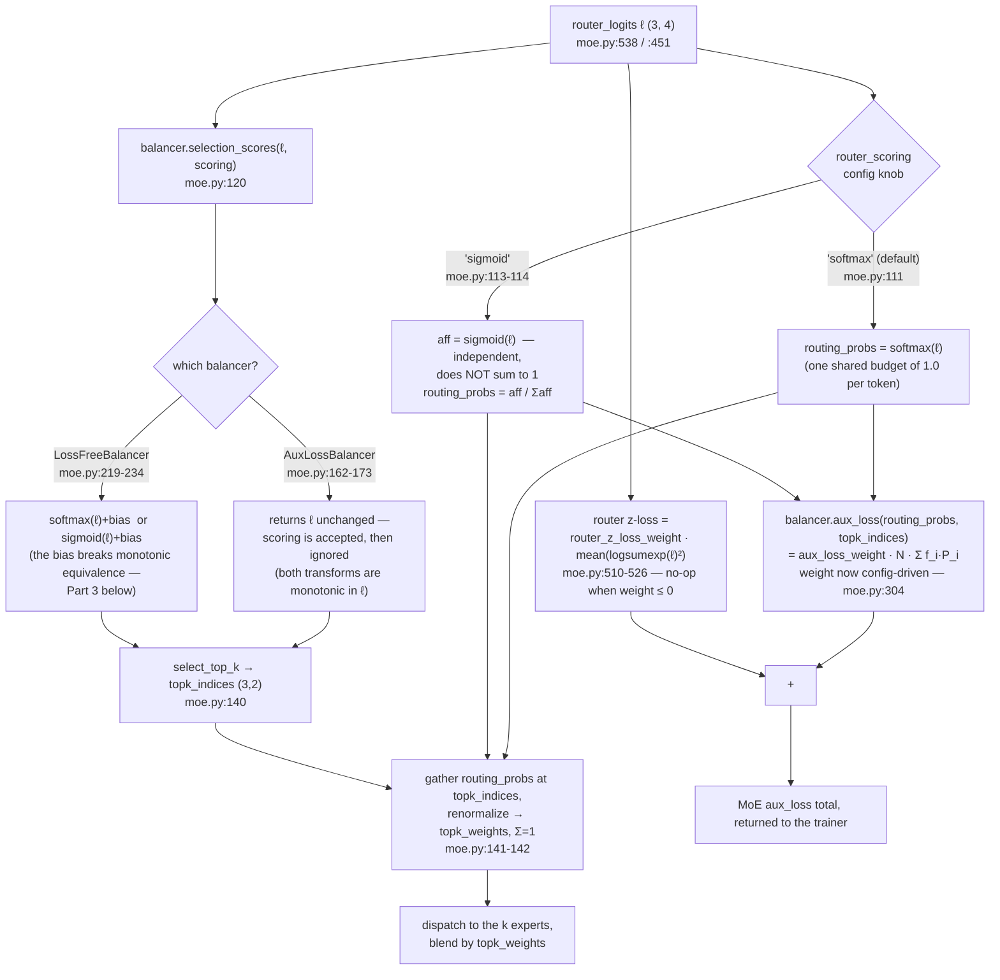
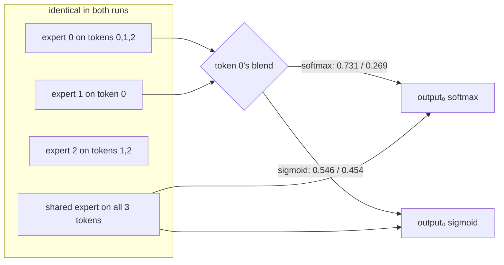
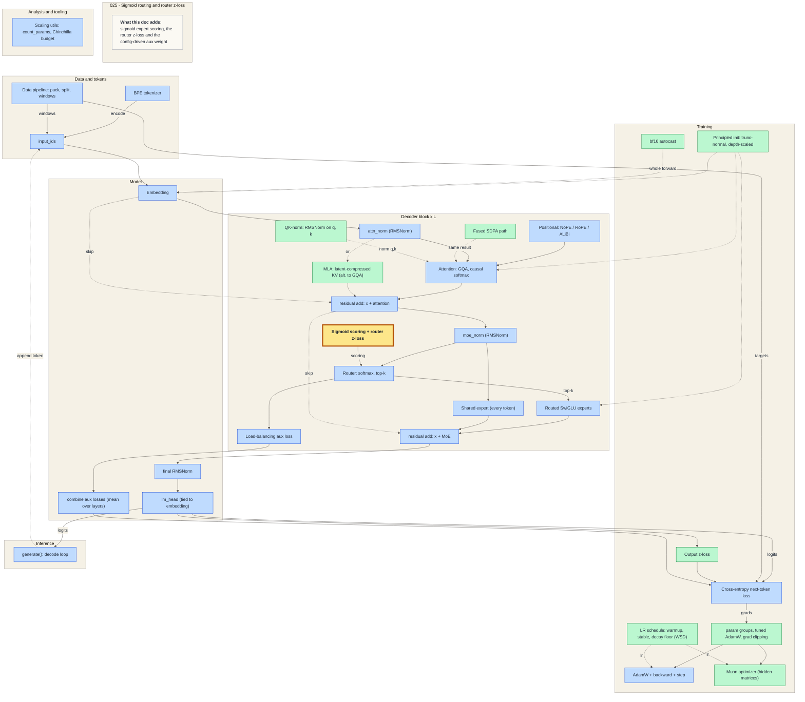

# 025 — MoE routing: sigmoid scoring, the router z-loss, and the config-driven aux weight, solved by hand

**Companion to:** [`journey_of_a_model/025-moe-routing-sigmoid-and-router-z-loss.md`](../../journey_of_a_model/025-moe-routing-sigmoid-and-router-z-loss.md)
· **Code:** [`qwenmoe/model/moe.py`](../../qwenmoe/model/moe.py)
· **Every number here is reproduced by:** [`verify_025_moe_routing_sigmoid_and_router_z_loss.py`](verify_025_moe_routing_sigmoid_and_router_z_loss.py)
(`uv run python docs/math/verify_025_moe_routing_sigmoid_and_router_z_loss.py`)

---

## How to read this

[`docs/math/005-moe-layer.md`](005-moe-layer.md) already carried one tiny
example through **every line** of `MoELayer.forward_with_trace`: the router
matmul, softmax, top-$k$ selection, renormalization, the per-expert SwiGLU
dispatch, the shared expert, and the Switch-Transformer auxiliary loss. That
document's scope note flagged three things as "later opt-in variants" and
set them aside. This document is those three variants, derived in full:

1. **sigmoid routing** — `score_and_select`'s other branch
   ([`moe.py:112-114`](../../qwenmoe/model/moe.py#L112)) — score each expert
   independently instead of through one shared softmax competition;
2. **the router z-loss** — `MoELayer._add_router_z_loss`
   ([`moe.py:510-526`](../../qwenmoe/model/moe.py#L510)) — a penalty that
   keeps router logits from drifting to sizes that overflow low-precision
   matmuls;
3. **the config-driven auxiliary-loss weight** — `build_balancer`
   ([`moe.py:298-307`](../../qwenmoe/model/moe.py#L298)) threading
   `ModelConfig.aux_loss_weight` into `AuxLossBalancer` instead of a
   hard-coded `0.01`.

We deliberately **reuse doc 005's example unchanged** — same $X$, same
router weight $W_{\text{router}}$, same four routed experts, same one
shared expert, same `aux_loss_weight = 0.01`. Doc 005 walks the router
logits through *softmax*; this document picks up at that exact same
`router_logits` tensor and asks "what if the code took the other branch, or
added one of these two loss terms?" — so every difference you see below is
caused by *only* the code this document is about. Where an operation is
unchanged from doc 005 (the router matmul, the SwiGLU expert, the shared
expert, `topk`'s definition) we cite doc 005's step and state the result
rather than re-deriving it.

You do **not** need a linear-algebra background. Every term is defined at
first use; where doc 005 already defined one (vector, dot product, matrix
multiply, logit, softmax, the logistic sigmoid $\sigma$ inside SiLU) we
restate it in one line and move on. Read doc 005 first if you haven't.

---

## Part 0 — What's being added, and where it plugs in

`score_and_select` ([`moe.py:87-122`](../../qwenmoe/model/moe.py#L87)) is
the one function both `MoELayer.forward` and `forward_with_trace` call to
turn `router_logits` into `(topk_indices, topk_weights, routing_probs)`.
Doc 005 walked its `scoring == "softmax"` branch. Here is the whole
function, both branches, plus the two loss terms bolted onto its output
downstream:



Everything **left** of `topk_indices` and `routing_probs` can change; the
per-expert SwiGLU dispatch, the shared expert, and the final
`routed + shared` combine (doc 005 Steps 6-8) are **byte-for-byte the same
code** regardless of `router_scoring`. So Part 4 below will show something
notable: with the same `topk_indices`, the exact same *experts* run on the
exact same *tokens* — only the *blend weight* changes.

---

## Part 1 — The running example (recap from doc 005)

### 1.1 Terms carried over from doc 005 (restated in one line each)

- **Vector**: an ordered list of numbers. **Dot product** of two
  equal-length vectors: multiply elementwise, add the results.
  **Matrix**: a rectangle of numbers; **matrix multiply** $AB$'s entry
  $(i,j)$ is the dot product of $A$'s row $i$ with $B$'s column $j$.
- **Logit**: a raw, unbounded real-valued score before any squashing —
  "the router logit for expert $e$" is $x \cdot (\text{row } e \text{ of }
  W_{\text{router}})$.
- **Probability distribution** over $N$ options: a length-$N$ vector,
  each entry $\ge 0$, summing to $1$.
- **The logistic sigmoid** $\sigma(z) = 1/(1+e^{-z})$: a smooth increasing
  function squashing any real number into $(0, 1)$, with $\sigma(0) =
  \tfrac12$. Doc 005 §6c already tabulated $1+e^{-z}$ for
  $z \in \{-1, 0, 1, 2\}$ to compute $\operatorname{silu}(z) = z\,\sigma(z)$
  — $\sigma(z)$ *is* the reciprocal of that same column, so we reuse it
  directly below (extended to $z=3$).

### 1.2 New terms this document needs

- **Affinity**: this document's word (DeepSeek-V3's term) for
  $\sigma(\text{logit})$ used as a routing score — chosen instead of
  "probability" because, unlike softmax outputs, the $N$ affinities for one
  token do **not** sum to $1$; each is scored independently.
- **Normalizer** (a.k.a. partition function) $Z = \sum_j e^{z_j}$: the
  softmax denominator for one token's logit row $z$.
- **`logsumexp`**: $\log Z = \log \sum_j e^{z_j}$, computed in one
  numerically stable step (`torch.logsumexp`) rather than by forming $Z$
  and then taking its log (which can overflow before the log ever runs).
- **Bias** (in the load-balancing sense): a per-expert additive number a
  balancer can add to its selection score *only* — a way to nudge *which*
  experts get chosen without touching the combination weights.

### 1.3 The configuration and weights (identical to doc 005 §1.2-1.4)

| Symbol | Meaning | Value |
|---|---|---|
| $T$ | tokens in the sequence | $3$ |
| $d$ | width of a token vector | $2$ |
| $d_{\text{ff}}$ | width inside one expert | $3$ |
| $N$ | `n_routed_experts` | $4$ |
| $k$ | `top_k` | $2$ |
| $n_{\text{shared}}$ | always-on shared experts | $1$ |
| $\alpha$ | `aux_loss_weight` (baseline; Part 6 varies it) | $0.01$ |
| $\lambda_{\text{rz}}$ | `router_z_loss_weight` (0 unless noted) | $0$ or $10^{-3}$ |

$$X = \begin{bmatrix} 1 & 0 \\ 0 & 1 \\ 1 & 1 \end{bmatrix}
\qquad
W_{\text{router}} = \begin{bmatrix} 2 & 1 \\ 1 & -1 \\ -1 & 2 \\ 0 & 0 \end{bmatrix}
\quad\text{(rows: expert 0,1,2,3)}$$

The four routed experts ($W_{\text{gate}}, W_{\text{up}}, W_{\text{down}}$
each) and the one shared expert are identical to doc 005 §1.4 — we don't
repeat the numbers here; they're pinned by the verify script exactly as
written there.

By doc 005 §Step 2, the router logits (unaffected by anything this document
changes — `score_and_select` receives them as its input, doc 005 already
did the $x\,W_{\text{router}}^{\top}$ matmul) are:

$$\text{router\_logits} = \begin{bmatrix} 2 & 1 & -1 & 0 \\ 1 & -1 & 2 & 0 \\ 3 & 0 & 1 & 0 \end{bmatrix}\qquad\text{shape }(3, 4)$$

**Shape ledger — start:** `router_logits (3, 4)` (everything before this
point is identical to doc 005 Steps 1-2).

---

## Part 2 — `score_and_select`'s sigmoid branch, derived and computed

Code ([`moe.py:110-122`](../../qwenmoe/model/moe.py#L110)):

```python
if scoring == "softmax":
    routing_probs = F.softmax(router_logits, dim=-1)
elif scoring == "sigmoid":
    affinities = torch.sigmoid(router_logits)
    routing_probs = affinities / affinities.sum(dim=-1, keepdim=True)
...
selection_scores = balancer.selection_scores(router_logits, scoring=scoring)
topk_indices, topk_weights = select_top_k(selection_scores, routing_probs, top_k)
```

### 2.1 The softmax branch — recap

Doc 005 §Step 3 derives $\operatorname{softmax}(z)_e = e^{z_e}/\sum_l
e^{z_l}$ from two requirements (non-negative, sums to $1$) and computes it
digit by digit. Its result, needed again below for the aux-loss comparison:

$$\text{routing\_probs}_{\text{softmax}} = \begin{bmatrix}
0.643914 & 0.236883 & 0.032059 & 0.087144 \\
0.236883 & 0.032059 & 0.643914 & 0.087144 \\
0.809776 & 0.040316 & 0.109591 & 0.040316
\end{bmatrix}$$

### 2.2 The sigmoid branch — why it has this form

**Why score experts independently at all?** Softmax forces the $N$ scores
to *compete* for a fixed budget of $1.0$ — raising one expert's share
necessarily lowers everyone else's, even if, in truth, three experts are
all excellent fits for this token and one is a poor fit. Sigmoid instead
asks $N$ separate yes/no questions — "how relevant is expert $e$ to this
token, on its own?" — with no shared budget. DeepSeek-V3 (§2.1.2 of
[arXiv:2412.19437](https://arxiv.org/abs/2412.19437)) made this switch from
DeepSeek-V2's softmax gate; the identifiability argument for *why* (softmax
has a redundant "add $c$ to everything" direction that sigmoid removes) is
in the journal entry and isn't repeated here — this document's job is the
arithmetic.

**The formula.** $\sigma(z) = 1/(1+e^{-z})$ is the standard logistic
function: as $z \to +\infty$, $e^{-z}\to 0$ so $\sigma \to 1$; as
$z\to-\infty$, $e^{-z}\to\infty$ so $\sigma\to 0$; at $z=0$,
$\sigma = 1/2$. It is **strictly increasing** — its derivative
$\sigma'(z) = \sigma(z)(1-\sigma(z))$ is positive everywhere since
$0 < \sigma(z) < 1$ always — which is the fact Part 3 needs.

**Why divide by the sum afterward, if each affinity is independent?**
Because `routing_probs` still has to serve two downstream consumers that
*require* a distribution: `AuxLossBalancer.aux_loss`'s $P_e$ (a per-expert
mean that should reflect "share of attention," doc 005 §Step 9) and the
trace's "sums to 1" contract (journal 025's design note). Normalizing after
the fact produces a valid distribution built from independent scores — a
deliberate two-stage design ("score independently, then normalize for
bookkeeping") that is genuinely different from softmax's "normalize is
scoring."

### 2.3 Do it by hand

Reuse the $1+e^{-z}$ values doc 005 §6c already tabulated for SiLU
(extended to $z=3$ for token 2's logit of $3$):

| $z$ | $1+e^{-z}$ | $\sigma(z) = 1/(1+e^{-z})$ |
|---|---|---|
| $-1$ | $1+e^{1}=3.718282$ | $1/3.718282 = 0.268941$ |
| $0$ | $1+e^{0}=2$ | $1/2 = 0.500000$ |
| $1$ | $1+e^{-1}=1.367879$ | $1/1.367879 = 0.731059$ |
| $2$ | $1+e^{-2}=1.135335$ | $1/1.135335 = 0.880797$ |
| $3$ | $1+e^{-3}=1.049787$ | $1/1.049787 = 0.952574$ |

**Token 0**, $z = [2, 1, -1, 0]$: read off $\sigma(2), \sigma(1),
\sigma(-1), \sigma(0)$:

$$\text{aff}_0 = [\,0.880797,\ 0.731059,\ 0.268941,\ 0.500000\,]$$

Row sum: $0.880797+0.731059+0.268941+0.500000 = 2.380797$ — **not** $1$,
confirming the affinities are independent, not a distribution yet.

Divide every entry by $2.380797$:

$$
\text{routing\_probs}_0 = \left[\tfrac{0.880797}{2.380797}, \tfrac{0.731059}{2.380797}, \tfrac{0.268941}{2.380797}, \tfrac{0.500000}{2.380797}\right]
= [\,0.369959,\ 0.307065,\ 0.112963,\ 0.210014\,]
$$

**Token 1**, $z = [1, -1, 2, 0]$ — the same four $\sigma$ values reordered,
so the row sum is the same $2.380797$:

$$\text{aff}_1 = [\,0.731059,\ 0.268941,\ 0.880797,\ 0.500000\,]
\;\Rightarrow\;
\text{routing\_probs}_1 = [\,0.307065,\ 0.112963,\ 0.369959,\ 0.210014\,]$$

**Token 2**, $z = [3, 0, 1, 0]$:

$$\text{aff}_2 = [\,0.952574,\ 0.500000,\ 0.731059,\ 0.500000\,]$$

Row sum: $0.952574+0.500000+0.731059+0.500000 = 2.683633$.

$$
\text{routing\_probs}_2 = \left[\tfrac{0.952574}{2.683633}, \tfrac{0.500000}{2.683633}, \tfrac{0.731059}{2.683633}, \tfrac{0.500000}{2.683633}\right]
= [\,0.354957,\ 0.186315,\ 0.272414,\ 0.186315\,]
$$

$$\text{routing\_probs}_{\text{sigmoid}} = \begin{bmatrix}
0.369959 & 0.307065 & 0.112963 & 0.210014 \\
0.307065 & 0.112963 & 0.369959 & 0.210014 \\
0.354957 & 0.186315 & 0.272414 & 0.186315
\end{bmatrix}$$

Each row still sums to $1$ (check row 0: $0.369959+0.307065+0.112963+
0.210014 = 1.000001$, the last digit is float rounding) — the normalizing
division restored the "distribution" contract even though the raw
affinities didn't have it. Compare to `routing_probs_softmax` above: the
sigmoid row is visibly **flatter** — its smallest entry ($0.112963$) is
much closer to its largest ($0.369959$) than softmax's ($0.032059$ vs
$0.643914$). That's the direct numeric picture of "sigmoid doesn't amplify
gaps the way a shared softmax denominator does."

**Shape ledger:** `router_logits (3,4)` → `affinities (3,4)` →
`routing_probs (3,4)` (sigmoid branch; same shapes as the softmax branch).

---

## Part 3 — Selection: identical set here, and the loss-free bias that breaks it

### 3.1 `AuxLossBalancer.selection_scores` ignores `scoring` — and that's exact, not lazy

Code ([`moe.py:162-173`](../../qwenmoe/model/moe.py#L162)):

```python
def selection_scores(self, router_logits, scoring="softmax"):
    return router_logits
```

**Why this is correct regardless of `scoring`.** We only need the *top-$k$
set*, not the scores' exact values. Both transforms are **order-preserving
(monotonic)**:

- softmax: for the same per-token normalizer $Z>0$,
  $z_i > z_j \iff e^{z_i} > e^{z_j} \iff e^{z_i}/Z > e^{z_j}/Z$ (doc 005
  §4a — exact algebra).
- sigmoid: $\sigma$ is strictly increasing (§2.2 above), so
  $z_i > z_j \iff \sigma(z_i) > \sigma(z_j)$ directly — no shared
  denominator even needed for the proof.

So "top-$k$ by raw logit," "top-$k$ by softmax probability," and "top-$k$
by sigmoid affinity" are the same set of experts, **for every token**,
regardless of which `scoring` is active. Ranking by the raw logit is simply
the cheapest of the three to compute — this is why the method can afford to
accept and discard the `scoring` argument.

Applying `.topk(2, dim=-1)` to `router_logits`:

- Token 0, $[2,1,-1,0]$: top 2 are $2$ (expert 0), $1$ (expert 1) →
  $[0, 1]$.
- Token 1, $[1,-1,2,0]$: top 2 are $2$ (expert 2), $1$ (expert 0) →
  $[2, 0]$.
- Token 2, $[3,0,1,0]$: top 2 are $3$ (expert 0), $1$ (expert 2) →
  $[0, 2]$.

$$\text{topk\_indices} = \begin{bmatrix}0&1\\2&0\\0&2\end{bmatrix}\qquad\text{— identical for both scorings}$$

### 3.2 Gather + renormalize: same indices, different weights

`select_top_k` ([`moe.py:140-142`](../../qwenmoe/model/moe.py#L140))
gathers `routing_probs` (not the selection scores) at `topk_indices`, then
renormalizes to sum to $1$ — doc 005 §4c derives *why* renormalizing is
required (the selected probabilities alone sum to $s<1$; dividing by $s$
restores a true weighted average). We repeat only the arithmetic, once per
scoring, reading off each token's two selected `routing_probs` entries:

| token | selected experts | softmax `routing_probs` at those | sigmoid `routing_probs` at those |
|---|---|---|---|
| 0 | $\{0,1\}$ | $0.643914,\ 0.236883$ | $0.369959,\ 0.307065$ |
| 1 | $\{2,0\}$ | $0.643914,\ 0.236883$ | $0.369959,\ 0.307065$ |
| 2 | $\{0,2\}$ | $0.809776,\ 0.109591$ | $0.354957,\ 0.272414$ |

Renormalize each pair by its own sum $s$:

**Softmax** (doc 005 §4c, restated): token 0/1 $s = 0.880797 \Rightarrow
w=[0.731059, 0.268941]$; token 2 $s=0.919367 \Rightarrow
w=[0.880797,0.119203]$.

**Sigmoid** — new:
- Tokens 0 and 1: $s = 0.369959 + 0.307065 = 0.677024$.
  $$w = \left[\tfrac{0.369959}{0.677024},\ \tfrac{0.307065}{0.677024}\right] = [\,0.546449,\ 0.453551\,]$$
- Token 2: $s = 0.354957 + 0.272414 = 0.627371$.
  $$w = \left[\tfrac{0.354957}{0.627371},\ \tfrac{0.272414}{0.627371}\right] = [\,0.565785,\ 0.434215\,]$$

$$\text{topk\_weights}_{\text{sigmoid}} = \begin{bmatrix}
0.546449 & 0.453551 \\ 0.546449 & 0.453551 \\ 0.565785 & 0.434215
\end{bmatrix}$$

vs. softmax's $\begin{bmatrix}0.731059&0.268941\\0.731059&0.268941\\
0.880797&0.119203\end{bmatrix}$. Same shape, same "sums to 1 per row"
contract (both rows above sum to $1.000000$), **visibly gentler weights**:
softmax's most extreme split is $88:12$; sigmoid's is $57:43$ — the exact
numeric echo of §2.3's "flatter row" observation, now propagated all the
way to the combination weights.

**Shape ledger:** `routing_probs (3,4)` + `topk_indices (3,2)` →
`topk_weights (3,2)` (both branches; values differ, shape doesn't).

### 3.3 Aside — `LossFreeBalancer.selection_scores`: where `scoring` stops being ignorable

Code ([`moe.py:219-234`](../../qwenmoe/model/moe.py#L219)):

```python
def selection_scores(self, router_logits, scoring="softmax"):
    if scoring == "sigmoid":
        base = torch.sigmoid(router_logits)
    else:
        base = F.softmax(router_logits, dim=-1)
    return base + self.bias
```

`LossFreeBalancer` (Wang, Gao, Zhao, Sun & Dai, 2024,
[arXiv:2408.15664](https://arxiv.org/abs/2408.15664)) holds one learned-by-a-
sign-rule, non-trainable **bias** per expert (a running correction updated
after each training step based on which experts got overloaded — the
journal entry and the paper's Algorithm 1 cover that update; it is
orthogonal to this document). The bias is added to the *selection* score
only, **after** the scoring transform. Once a bias is added, §3.1's
monotonicity argument **no longer applies** — `base + bias` is not a
monotonic function of `router_logits` alone (the bias term doesn't move
with the logit), so which transform produced `base` can now change the
*set* of experts selected, not just their relative order.

**Why, concretely.** Softmax `routing_probs` values live in a narrow band
determined by a shared budget of $1.0$ split $N$ ways — on token 2 above,
the two non-selected experts sit at $0.040316$ each, tiny next to the
selected pair's $0.81$/$0.11$. Sigmoid affinities are each independently
bounded in $(0,1)$ with **no shared budget to shrink toward** — on the same
token they're $0.95, 0.50, 0.73, 0.50$, all within a factor of $2$ of each
other. A fixed-size additive bias is therefore *much* more powerful,
relative to the surrounding scores, when added to the cramped softmax
values than to the roomier sigmoid ones. That asymmetry is exactly what
lets the same bias flip a softmax-based ranking while leaving a
sigmoid-based one alone.

**Worked example**, using the *same* `router_logits` as everywhere else in
this document, with an illustrative bias $b = [0,\ 0.15,\ 0,\ 0]$ (nudging
expert 1 only — chosen small enough to leave tokens 0 and 1 alone, so the
effect is isolated to one token):

$$\text{softmax}(\ell) + b = \begin{bmatrix}
0.643914 & 0.386883 & 0.032059 & 0.087144 \\
0.236883 & 0.182059 & 0.643914 & 0.087144 \\
0.809776 & 0.190316 & 0.109591 & 0.040316
\end{bmatrix}
\qquad
\sigma(\ell) + b = \begin{bmatrix}
0.880797 & 0.881059 & 0.268941 & 0.500000 \\
0.731059 & 0.418941 & 0.880797 & 0.500000 \\
0.952574 & 0.650000 & 0.731059 & 0.500000
\end{bmatrix}$$

Reading off top-2 per row:

| token | softmax-biased top-2 | sigmoid-biased top-2 | same set? |
|---|---|---|---|
| 0 | $\{0,1\}$ (was $\{0,1\}$) | $\{0,1\}$ (order flips: $1$ edges out $0$ by $0.000262$) | yes |
| 1 | $\{2,0\}$ (unchanged) | $\{2,0\}$ (unchanged) | yes |
| **2** | $\{0,1\}$ — expert **1** now beats expert 2 ($0.190316 > 0.109591$) | $\{0,2\}$ — expert 2 still beats expert 1 ($0.731059 > 0.650000$) | **no** |

On token 2, adding $0.15$ to expert 1's score pushed it past expert 2 under
softmax scoring ($0.040316+0.15=0.190316 > 0.109591$) but **not** under
sigmoid scoring ($0.5+0.15=0.65 < 0.731059$) — the exact +$0.15$ nudge, two
genuinely different selected sets. This is the mechanism behind the
journal's larger-scale measurement ("18% of tokens get a different top-2
set at bias range $\pm0.1$, rising to 40% at $\pm0.3$") — that number comes
from a real trained router with many tokens and biases; this is the same
effect isolated to one bias, one token, fully by hand.

**Shape ledger:** `router_logits (3,4)` + `bias (4,)` (broadcast) →
`selection_scores (3,4)` → two different `(3,2)` top-2 index sets.

---

## Part 4 — Consequence: same experts run, different blend, different output

Because `topk_indices` came out identical (§3.1), the rest of `forward_with_
trace`'s per-expert loop ([`moe.py:546-559`](../../qwenmoe/model/moe.py#L546),
doc 005 §Steps 6-7 — unchanged code) dispatches **the same tokens to the
same experts** under both scorings: expert 0 still runs on tokens $\{0,1,2\}$,
expert 1 on token $\{0\}$, expert 2 on tokens $\{1,2\}$, expert 3 is idle.
The raw per-expert outputs $E_e(x)$ and the shared output are therefore
**byte-identical** between the two runs (the verify script confirms this
with `torch.equal`) — only the *gate* changes.



**Token 0's routed output**, doc 005's $E_0(x_0)=[0.731059,0]$ and
$E_1(x_0)=[1.492653,3.223711]$, blended with each scoring's gate:

$$
\text{routed}_0^{\text{softmax}} = 0.731059\,[0.731059,0]+0.268941\,[1.492653,3.223711] = [0.935883,\ 0.866989]
$$
$$
\text{routed}_0^{\text{sigmoid}} = 0.546449\,[0.731059,0]+0.453551\,[1.492653,3.223711] = [1.076480,\ 1.462117]
$$

Add doc 005's shared output for token 0, $[0.731059, 0]$:

$$\text{output}_0^{\text{softmax}} = [1.666941,\ 0.866989] \qquad \text{output}_0^{\text{sigmoid}} = [1.807540,\ 1.462117]$$

(The verify script's float32 run gives $[1.807539,\ 1.462117]$ — a
$10^{-6}$ rounding difference from the six-decimal hand arithmetic above,
the same order of accumulation noise doc 005 flags throughout its own
Step 6-8.) Running the same blend for every token:

$$\text{output}_{\text{softmax}} = \begin{bmatrix}
1.666941 & 0.866989 \\ 1.484440 & 2.018887 \\ 4.808671 & 3.346554
\end{bmatrix}
\qquad
\text{output}_{\text{sigmoid}} = \begin{bmatrix}
1.807539 & 1.462117 \\ 1.294194 & 1.878290 \\ 5.133303 & 3.671185
\end{bmatrix}$$

$$\max\big|\,\text{output}_{\text{softmax}} - \text{output}_{\text{sigmoid}}\,\big| = 0.595128 \quad\text{(token 0, coordinate 1)}$$

— a large, real difference, entirely attributable to the gate, since every
expert output that fed it was identical.

**The fused path agrees.** `MoELayer.forward`'s batched `dispatch_batched`
([`moe.py:322`](../../qwenmoe/model/moe.py#L322)) runs the identical maths
as a few batched matrix multiplies rather than a Python loop (doc 005
§Step 11). On this example, measured:

$$\max|\text{forward} - \text{forward\_with\_trace}| = 0.0 \text{ (softmax)} \qquad 0.0 \text{ (sigmoid)}$$

**The aux loss differs too**, because $P_e$ — the batch-mean of
`routing_probs` — is scoring-dependent even though $f_e$ (the hard
top-$k$ count) is not:

$$f = [\,1.0,\ \tfrac13,\ \tfrac23,\ 0\,] \quad\text{(identical — same topk\_indices)}$$

$$P^{\text{softmax}} = [\,0.563524,\ 0.103086,\ 0.261855,\ 0.071535\,]
\qquad
P^{\text{sigmoid}} = [\,0.343994,\ 0.202114,\ 0.251778,\ 0.202114\,]$$

$$
\mathcal{L}_{\text{aux}}^{\text{softmax}} = 0.01\cdot4\cdot\big(1.0{\cdot}0.563524+\tfrac13{\cdot}0.103086+\tfrac23{\cdot}0.261855+0\big) = 0.030898
$$
$$
\mathcal{L}_{\text{aux}}^{\text{sigmoid}} = 0.01\cdot4\cdot\big(1.0{\cdot}0.343994+\tfrac13{\cdot}0.202114+\tfrac23{\cdot}0.251778+0\big) = 0.023169
$$

Sigmoid's flatter $P$ (its idle expert 3's $0.202114$ is closer to its
busiest expert 0's $0.343994$ than softmax's $0.071535$ is to $0.563524$)
gives it a **smaller** aux loss on this example — the toy-scale echo of the
journal's 60-step measurement that sigmoid routing ends up better balanced
in practice.

**Shape ledger:** `expert_outputs`, `shared_output` unchanged `(·,2)`
tensors across both runs; `output (1,3,2)` and `aux_loss ()` differ in
value only.

---

## Part 5 — The router z-loss, derived from zero

Code ([`moe.py:510-526`](../../qwenmoe/model/moe.py#L510)):

```python
def _add_router_z_loss(self, aux_loss, router_logits):
    if self.router_z_loss_weight <= 0:
        return aux_loss
    z_loss = self.router_z_loss_weight * torch.logsumexp(
        router_logits.float(), dim=-1
    ).pow(2).mean()
    return z_loss if aux_loss is None else aux_loss + z_loss
```

### 5.1 The problem this solves — derived in full

Take any one token's logit row $z = [z_1,\dots,z_N]$ and add the same
constant $c$ to every entry. The normalizer becomes

$$
Z' = \sum_j e^{z_j+c} = e^{c}\sum_j e^{z_j} = e^{c} Z ,
$$

using $e^{a+b}=e^a e^b$ and factoring the (constant, so index-independent)
$e^c$ out of the sum. Then for any expert $e$,

$$
\operatorname{softmax}(z')_e = \frac{e^{z_e+c}}{Z'} = \frac{e^{c}e^{z_e}}{e^{c}Z} = \frac{e^{z_e}}{Z} = \operatorname{softmax}(z)_e .
$$

**Softmax is exactly shift-invariant** — you can slide the whole logit
vector up or down by any amount and get bit-for-bit the same probabilities
(this is the "hidden redundant knob" the journal entry names). Nothing in
the main training loss can see or resist that drift — the router z-loss's
whole purpose is to give training *something* that does.

**Why $\log Z$, not $Z$ itself.** Take logs of the identity above:
$\log Z' = c + \log Z$ — additive, not multiplicative, in $c$. So $\log Z$
moves in lockstep with any shift $c$, one-to-one, while $Z$ itself would
move exponentially (harder to keep in a numerically friendly range as a
penalty target). `logsumexp` computes exactly this $\log Z$, and does so by
subtracting the row max before exponentiating (Milakov & Gimelshein 2018,
already used in doc 005 §Step 3) so the sum never overflows even when the
logits already are large — the numerically safe way to watch for the very
problem being penalized.

**Why square it.** Define

$$
\mathcal{L}_{\text{rz}} = \lambda_{\text{rz}} \cdot \operatorname{mean}\big[(\log Z)^2\big].
$$

Its derivative with respect to $\log Z$ is $2\lambda_{\text{rz}}\log Z$ —
**zero exactly when** $\log Z=0$ (i.e. $Z=1$), and growing **linearly** in
$\log Z$ away from there, so the penalty itself grows **quadratically**.
Two consequences: (a) near the target the gradient vanishes, so this term
doesn't fight the main loss when logits are already reasonable, and (b) far
from the target the penalty grows without bound, so it *cannot* be ignored
once logits blow up — a soft barrier, not a flat tax. (Penalizing $|\log
Z|$ instead would apply a constant-size push even when things are already
fine; penalizing $Z$ directly would differentiate an exponential, whose
gradient is largest exactly where you'd want a gentle correction. Full
comparison and PaLM's original wording:
[journal 024](../../journey_of_a_model/024-mixed-precision-and-z-loss.md).)

**Why the router, specifically (ST-MoE).** The output z-loss (task 8,
journal 024) applies this same shape to the `vocab`-sized logits at the
model's head. ST-MoE ([arXiv:2202.08906](https://arxiv.org/abs/2202.08906))
identifies a *second* place large logits cause damage: "large logits
entering the gating network can lead to numeric overflows in the large
matrix multiplications" that route tokens to experts. Same shift-invariance
problem, same fix, applied one layer earlier — to `router_logits`
($N$-wide) instead of the head's logits ($V$-wide).

### 5.2 Do it by hand, on this document's own router logits

$$\text{router\_logits} = \begin{bmatrix}2&1&-1&0\\1&-1&2&0\\3&0&1&0\end{bmatrix}$$

Twelve entries; their absolute values are $2,1,1,0,1,1,2,0,3,0,1,0$, summing
to $12$, so:

$$\operatorname{mean}|\text{logit}| = 12/12 = 1.0 \quad\text{(exact, on this example)}$$

**`logsumexp` per row.** Row 0's normalizer is $Z_0 = e^2+e^1+e^{-1}+e^0 =
7.389056+2.718282+0.367879+1 = 11.475217$ (doc 005 §Step 3 already computed
this sum for the softmax denominator — reuse it). $\log(11.475217) =
2.440190$. Row 1 has the same four terms in a different order, so
$Z_1=Z_0$ and $\log Z_1 = 2.440190$ too. Row 2's normalizer, also already
computed in doc 005 §Step 3, is $Z_2 = e^3+e^0+e^1+e^0 = 20.085537+1+
2.718282+1 = 24.803819$, and $\log(24.803819) = 3.210998$.

$$\text{logsumexp} = [\,2.440190,\ 2.440190,\ 3.210998\,] \qquad \operatorname{mean} = 2.697126$$

**Square and average**, at $\lambda_{\text{rz}} = 10^{-3}$:

$$
2.440190^2 = 5.954527 \qquad 2.440190^2 = 5.954527 \qquad 3.210998^2 = 10.310508
$$
$$
\operatorname{mean}\big[(\log Z)^2\big] = \frac{5.954527+5.954527+10.310508}{3} = \frac{22.219562}{3} = 7.406521
$$
$$
\mathcal{L}_{\text{rz}} = 10^{-3}\times 7.406521 = \boxed{7.406521\times10^{-3}}
$$

The real module (`.float()`-cast `logsumexp`, then `.pow(2).mean()`) gives
$7.406520\times10^{-3}$ — matching to the sixth decimal, the usual float32
gap.

### 5.3 Scale the logits up: the penalty is not linear in the scale, and why

Multiply every logit by a constant $c$ and recompute. This is *not* the
same operation as the shift-invariance argument above ($z \to z+c$ is a
shift; $z \to c\,z$ is a **rescale**) — softmax itself is **not** invariant
to rescaling (it sharpens as $c$ grows, the "temperature" effect), so both
$\log Z$ and $\mathcal{L}_{\text{rz}}$ move.

**At $c=5$:** row 0 becomes $[10,5,-5,0]$. The largest term, $e^{10} =
22026.466$, already dwarfs the rest ($e^5=148.413$, $e^{-5}=0.0067$,
$e^0=1$); $Z = 22026.466+148.413+0.0067+1 = 22175.886$. Factor out the
max: $\log Z = 10 + \log(22175.886/22026.466) = 10+\log(1.006784) =
10+0.006761 = 10.006761$. Row 2 becomes $[15,0,5,0]$, dominant term
$e^{15}=3269017.37$; $\log Z = 15+\log(1+2/3269017.37+148.413/3269017.37)
\approx 15+0.000046 = 15.000046$.

$$\text{logsumexp}(5\times\text{logits}) = [\,10.006761,\ 10.006761,\ 15.000046\,] \qquad \mathcal{L}_{\text{rz}} = 1.417573\times10^{-1}$$

**At $c=20$:** row 0 becomes $[40,20,-20,0]$; every non-max term is now so
far below $e^{40}$ that, in float32, it rounds to exactly $0$ relative to
the max — $\log Z$ collapses onto **exactly** $40 = c \cdot \max(z)$. Row 2
similarly collapses onto $60$.

$$\text{logsumexp}(20\times\text{logits}) = [\,40.0,\ 40.0,\ 60.0\,] \qquad \mathcal{L}_{\text{rz}} = 2.266667$$

| scale $c$ | mean logsumexp | $\mathcal{L}_{\text{rz}}$ ($\lambda=10^{-3}$) | ratio to $c{=}1$ |
|---:|---:|---:|---:|
| $1$ | $2.697126$ | $7.4\times10^{-3}$ | $1\times$ |
| $5$ | $11.671188$ | $1.42\times10^{-1}$ | $19.1\times$ |
| $20$ | $46.666668$ | $2.27$ | $306.0\times$ |

**Why the ratios aren't clean powers of the scale.** $\log Z$ interpolates
between two regimes: at $c=0$ every term is $e^0=1$, so $Z=N$ and
$\log Z=\log N$ (a constant, independent of the logits' *shape*); as
$c\to\infty$, one term dominates completely and
$\log Z \to c\cdot\max(z)$ — **linear** in $c$. Real router logits sit
between these extremes, so $\log Z$'s growth in $c$ is neither flat nor
perfectly linear until $c$ is large enough to reach the second regime
(exactly what happened at $c=20$ above — the row hit the linear regime
exactly, in float32). This is empirically the correct shape for a soft
barrier: nearly free while logits are modest, then rising sharply and
predictably once they aren't — but the exact multiplier a given scale
produces is not a clean formula, only a monotonic, convex one. (This
matches the journal's own table on the untrained 64-wide router — different
numbers, same qualitative "no-op, mild, then dominant" progression.)

### 5.4 Where it lands in the code path

- **`router_z_loss_weight = 0` (the default) is a true no-op.** The `if`
  guard at [`moe.py:521`](../../qwenmoe/model/moe.py#L521) returns
  `aux_loss` untouched — measured: `aux_loss` is **byte-identical**
  ($0.030898246914...$ both with and without the guard active) to the
  Part 4 softmax value, not merely close.
- **With `AuxLossBalancer`, it adds.** At $\lambda_{\text{rz}}=10^{-3}$:
  $$
  \mathcal{L}_{\text{total}} = \underbrace{0.030898}_{\text{Switch aux loss}} + \underbrace{0.007407}_{\text{router z-loss}} = 0.038305
  $$
  — measured $0.038305$, matching to $10^{-6}$.
- **With `LossFreeBalancer`, it becomes the *entire* term.**
  `LossFreeBalancer.aux_loss` always returns `None`
  ([`moe.py:236-239`](../../qwenmoe/model/moe.py#L236)) — there is no
  gradient-based balancing loss by that strategy's design. `_add_router_
  z_loss`'s `None`-handling branch (`z_loss if aux_loss is None else
  aux_loss + z_loss`) means the returned `aux_loss` **is** the z-loss,
  unmixed with anything else. Measured, on a `moe_balancing="loss_free"`
  layer with the same router logits and $\lambda_{\text{rz}}=10^{-3}$:
  `aux_loss = 0.0074065...` — identical to §5.2's $\mathcal{L}_{\text{rz}}$
  computed standalone. This is Requirement 4.3's correction over the
  original design sketch (which would have put the term inside
  `AuxLossBalancer` and silently dropped it for every loss-free run).

**Shape ledger:** `router_logits (3,4)` → `logsumexp (3,)` →
`z_loss ()` (a scalar), added into `aux_loss ()`.

---

## Part 6 — The config-driven auxiliary-loss weight

Code ([`moe.py:298-304`](../../qwenmoe/model/moe.py#L298)):

```python
def build_balancer(config: ModelConfig) -> nn.Module:
    if config.moe_balancing == "aux_loss":
        return AuxLossBalancer(config.n_routed_experts, loss_weight=config.aux_loss_weight)
    ...
```

Previously `AuxLossBalancer(n_routed_experts, loss_weight=0.01)` was called
with the `0.01` written directly into the call site; now it reads
`ModelConfig.aux_loss_weight` (default `0.01`, validated `\ge 0` at
[`config.py:89-90`](../../qwenmoe/config.py#L89)). The formula itself
(doc 005 §Step 9) is **linear** in $\alpha$:

$$\mathcal{L}_{\text{aux}}(\alpha) = \alpha \cdot N \cdot \sum_e f_e P_e = \alpha \cdot \underbrace{\left(N\sum_e f_e P_e\right)}_{\text{independent of }\alpha}$$

so scaling $\alpha$ by any factor scales $\mathcal{L}_{\text{aux}}$ by that
same factor — **exact algebra**, no approximation. On this example's
softmax path, $N\sum_e f_eP_e = 3.089825$ (from Part 4); at $\alpha=0.01$
that's $0.030898$ (Part 4's number); at $\alpha=0.05$:

$$\mathcal{L}_{\text{aux}}(0.05) = 0.05\times 3.089825 = 0.154491$$

Measured: $\alpha=0.01\to0.030898$, $\alpha=0.05\to0.154491$, ratio
$=5.000000$ — the exact $5\times$ the weight ratio predicts, to six
decimals. Nothing about the routing changes; this knob only rescales how
hard the optimizer is pushed toward balance.

**Shape ledger:** no shape changes anywhere in this part — a single scalar
multiplier moves.

---

## Part 7 — Why built this way, quantified on this example

**Zero extra parameters, either way.** `router_scoring` picks a
*function* (`sigmoid` vs `softmax`), not a new weight matrix — the router
is still the same $N\times d = 4\times2=8$-parameter `nn.Linear` from doc
005 §3.1 regardless. The router z-loss reads `router_logits`, which
already exist; it adds no parameters, only an extra handful of scalar ops
(`logsumexp`, square, mean) per forward pass, and *zero* extra cost at all
when `router_z_loss_weight <= 0` (the guard returns immediately — no
`logsumexp` is even computed). `aux_loss_weight` is a single Python float.
All three changes are **loss-shaping and selection-shaping only** — nothing
here touches inference-time cost, and every one of them defaults to the
exact pre-existing behavior (doc 005's numbers, verified bit-identical
above) so a config written before this task keeps training identically.

**What each buys, in this example's own numbers:**

| change | what moved | what didn't |
|---|---|---|
| `router_scoring="sigmoid"` | `topk_weights` ($88{:}12 \to 57{:}43$ on token 2), final `output` (max diff $0.595$), `aux_loss` ($0.0309\to0.0232$) | `topk_indices`, every `expert_outputs` entry, `shared_output` |
| `router_z_loss_weight=10^{-3}` | `aux_loss` gains $+0.0074$ (Aux) or *becomes* $0.0074$ (loss-free) | `topk_indices`, `topk_weights`, `output` — it never touches routing, only the loss |
| `aux_loss_weight: 0.01→0.05` | `aux_loss` scales $\times5$ exactly | everything else — routing and output are $\alpha$-independent |

**Why this matters beyond this toy example.** The identifiability argument
(journal 025) says softmax's shift-invariance gives router logits a free
direction to drift along during training with no gradient resistance; the
router z-loss directly counters that (§5.1), and sigmoid scoring removes
the free direction structurally (§2.2) — two independent lines of defense
against the same failure mode (ST-MoE's reported low-precision matmul
overflow), one a training-time penalty, one an architecture choice. Making
`aux_loss_weight` a config field turns "how hard do we enforce balance"
from a hard-coded constant into a study axis the ablation work (task 16)
can sweep.

---

## Questions that might come to mind

- **If sigmoid affinities don't sum to 1, how can `routing_probs` (used by
  the aux loss) require that they do?** Two separate steps: `affinities =
  sigmoid(logits)` is deliberately *not* normalized (that's the whole point
  — independent per-expert scores); `routing_probs = affinities /
  affinities.sum(...)` is a second, explicit normalization applied only to
  build the distribution downstream code needs. The un-normalized
  affinities are never used for anything else in this codebase.

- **Why did `expert_outputs` come out byte-identical between the two
  scorings, when the routing_probs are completely different numbers?**
  Because `expert_outputs` only depends on `topk_indices` (which tokens
  go to which experts) — and §3.1 shows `topk_indices` is identical for
  both scorings on this (unbiased) example. The scoring only ever reaches
  the *gate weight*, applied after the expert already ran (Part 4).

- **Is `AuxLossBalancer`'s indifference to `scoring` always true, or just
  on this example?** Always, as long as no bias is added: §3.1's proof
  (both transforms strictly monotonic) holds for *any* logits, not just
  this document's numbers. It stops holding the moment a bias enters
  (§3.3) — the bias is not itself a function of the logit, so it can
  reorder things a monotonic transform alone never could.

- **The z-loss ratios in §5.3 (19.1×, 306.0×) look arbitrary — is the
  formula wrong?** No — `logsumexp` is genuinely not linear (or
  quadratic) in a uniform logit scale except in the two limiting regimes
  (§5.3 derives both). The ratios are real, monotonic, and match the real
  module; they're just not a clean closed form at intermediate scale,
  which is a property of $\log\Sigma\exp$, not a bug.

- **Does the router z-loss care which balancer is active?** No — it reads
  only `router_logits`, computed identically regardless of
  `moe_balancing`. What *does* depend on the balancer is what it gets
  added to: `AuxLossBalancer` always returns a real number to add to, so
  the z-loss is additive; `LossFreeBalancer` returns `None`, so the z-loss
  becomes the whole `aux_loss` (§5.4) — this is exactly Requirement 4.3's
  point, and the reason `_add_router_z_loss` lives on `MoELayer` rather
  than inside either balancer.

- **Why pick $b=[0, 0.15, 0, 0]$ for the §3.3 bias example instead of some
  other value?** It's the smallest round number that produces a genuine
  set-level disagreement on at least one token while leaving the other two
  tokens' selections untouched (checked directly: $b_1$ must exceed
  $0.109591-0.040316=0.069275$ to flip softmax's token-2 ranking while
  staying under $0.731059-0.5=0.231059$ so it does *not* flip sigmoid's;
  $0.15$ sits comfortably inside that window). Any value in
  $(0.069275,\ 0.231059)$ would demonstrate the same disagreement.

- **Could this same worked example show sigmoid *matching* softmax's
  selection even with a bias?** Yes — outside that window (e.g.
  $b_1=0.02$, too small to move either ranking, or $b_1=0.3$, large enough
  to flip both), the two scorings would agree again. The disagreement is a
  property of the bias landing between the two scorings' differently-sized
  "gaps," not a universal fact about sigmoid vs. softmax.

---

## Symbol reference

| symbol | meaning |
|---|---|
| $z$, `router_logits` | raw per-expert scores, `(T, N)` — unchanged from doc 005 |
| $\sigma(z)$ | logistic sigmoid $1/(1+e^{-z})$ |
| $\text{aff}$, `affinities` | $\sigma(z)$, independent per-expert scores that do **not** sum to 1 |
| $p$, `routing_probs` | the per-token distribution the aux loss / trace consume — softmax output, or normalized `affinities` |
| $S$, `topk_indices` | the $k$ selected experts per token |
| $s$ | sum of the selected `routing_probs` entries (renormalization denominator) |
| $w$, `topk_weights` | renormalized combination weights, $\sum_{S} w = 1$ |
| $b$, `bias` | `LossFreeBalancer`'s per-expert additive selection nudge |
| $Z$ | softmax normalizer $\sum_j e^{z_j}$ for one token |
| $\log Z$, `logsumexp` | numerically stable $\log\sum_j e^{z_j}$ |
| $\lambda_{\text{rz}}$, `router_z_loss_weight` | router z-loss coefficient (0 = off) |
| $\mathcal{L}_{\text{rz}}$ | $\lambda_{\text{rz}}\cdot\operatorname{mean}[(\log Z)^2]$ — the router z-loss |
| $\alpha$, `aux_loss_weight` | Switch-Transformer aux-loss coefficient, now config-driven |
| $f_e$ | fraction of tokens with expert $e$ in their top-$k$ |
| $P_e$ | batch mean of `routing_probs` for expert $e$ |
| $\mathcal{L}_{\text{aux}}$ | $\alpha N \sum_e f_e P_e$ — the load-balancing loss (doc 005 §9) |

---

## Citations

All links verified by web search on 2026-09-11.

**Sigmoid (independent-affinity) routing**
- DeepSeek-AI, *DeepSeek-V3 Technical Report*, 2024 —
  [arXiv:2412.19437](https://arxiv.org/abs/2412.19437). §2.1.2: "we use
  the sigmoid function to compute the affinity scores, and applies a
  normalization among all selected affinity scores to produce the gating
  values," replacing DeepSeek-V2's softmax gate.
- DeepSeek-AI, *DeepSeek-V2: A Strong, Economical, and Efficient
  Mixture-of-Experts Language Model*, 2024 —
  [arXiv:2405.04434](https://arxiv.org/abs/2405.04434). The softmax-gated
  predecessor this document's §2.1 recap is drawn from.

**Auxiliary-loss-free balancing (the bias in §3.3)**
- Wang, Gao, Zhao, Sun & Dai, *Auxiliary-Loss-Free Load Balancing Strategy
  for Mixture-of-Experts*, 2024 —
  [arXiv:2408.15664](https://arxiv.org/abs/2408.15664). The per-expert
  bias, added to the selection score post-transform and updated by a sign
  rule after each step; Algorithm 1 is the update this document treats as
  a fixed illustrative value.

**The router z-loss**
- Zoph, Bello, Kumar, Du, Huang, Dean, Shazeer & Fedus, *ST-MoE: Designing
  Stable and Transferable Sparse Expert Models*, 2022 —
  [arXiv:2202.08906](https://arxiv.org/abs/2202.08906). Introduces the
  router z-loss, motivated by "large logits entering the gating network"
  overflowing the MoE layer's matrix multiplications.
- Chowdhery et al., *PaLM: Scaling Language Modeling with Pathways*, 2022 —
  [arXiv:2204.02311](https://arxiv.org/abs/2204.02311). §3 (Training
  Instability): the original $10^{-4}\cdot(\log Z)^2$ output z-loss this
  document's §5.1 derivation (shared with journal 024) is built on.

**The load-balancing auxiliary loss (config-driven weight, Part 6)**
- Fedus, Zoph & Shazeer, *Switch Transformers: Scaling to Trillion
  Parameter Models with Simple and Efficient Sparsity*, 2021 —
  [arXiv:2101.03961](https://arxiv.org/abs/2101.03961). The
  $\alpha\cdot N\cdot\sum_e f_eP_e$ term whose $\alpha$ (`aux_loss_weight`)
  is the subject of Part 6; the paper's own default is $10^{-2}$, unchanged
  here.

**Softmax numerics (reused from doc 005)**
- Milakov & Gimelshein, *Online normalizer calculation for softmax*, 2018 —
  [arXiv:1805.02867](https://arxiv.org/abs/1805.02867). The subtract-the-max
  trick `logsumexp` uses internally.

---

*Every intermediate tensor in this document is reproduced and asserted by
[`verify_025_moe_routing_sigmoid_and_router_z_loss.py`](verify_025_moe_routing_sigmoid_and_router_z_loss.py).
If you change the running example, rerun it.*

<!-- arch-evolution:start (generated by build_architecture_footer.py; do not edit by hand) -->

---

## Where this fits in the architecture (the growing view)

← previous: [024 Mixed precision and z-loss](024-mixed-precision-and-z-loss.md) · next: [026 Per-sequence balance loss](026-per-sequence-balance-loss.md) →

**This doc adds to the architecture:** sigmoid expert scoring, the router z-loss and the config-driven aux weight. (Code: `qwenmoe/model/moe.py`.)

**Components introduced here (highlighted in the diagram), with where each one lives:**

| component | math doc (section) | journal | code |
|---|---|---|---|
| Sigmoid scoring + router z-loss | [025 · Part 2 — score_and_select's sigmoid branch, deriv...](025-moe-routing-sigmoid-and-router-z-loss.md#part-2--score_and_selects-sigmoid-branch-derived-and-computed) | [journal 025](../../journey_of_a_model/025-moe-routing-sigmoid-and-router-z-loss.md) | [`qwenmoe/model/moe.py:113`](../../qwenmoe/model/moe.py#L113) |

**Verified by:** [`verify_025_moe_routing_sigmoid_and_router_z_loss.py`](verify_025_moe_routing_sigmoid_and_router_z_loss.py) (`uv run python docs/math/verify_025_moe_routing_sigmoid_and_router_z_loss.py`); latest results in [verify-status.md](verify-status.md).

**Example continuity:** **Reuses family C unchanged** (005's `X` and weights); only the scoring function changes. See the [example-family map](README.md#which-example-does-each-doc-use).

The diagram is cumulative: every box derived by this doc or an earlier one is shown, and components from later docs are not drawn yet, so reading the docs in order replays how the architecture grew. The top box is this doc's title and what it adds. The [full final architecture](architecture-evolution.md) has everything.

**Colour key:** 🟨 **introduced by this doc** · 🟦 Foundation (004-011) · 🟩 Modernization (016-031) · 🟪 Evaluation and scale (032-038) · 🟧 Real data and hardware (039-044). Dotted lines are optional or alternative paths.



**How we got here (every doc up to and including this one):**

| | math doc | journal | what it added |
|---|---|---|---|
|  | [004 Attention (GQA)](004-attention-gqa.md) | [journal](../../journey_of_a_model/004-attention-gqa.md) | scaled dot-product attention with grouped K/V heads, the positional transform and the causal mask |
|  | [005 MoE layer](005-moe-layer.md) | [journal](../../journey_of_a_model/005-moe-layer.md) | the router, top-k selection, routed SwiGLU experts, the shared expert and the load-balancing aux loss |
|  | [006 Full model](006-full-model-assembly.md) | [journal](../../journey_of_a_model/006-full-model-assembly.md) | token embedding, pre-norm residual wiring, the final norm, the tied head and the cross-layer aux-loss combine; attention and MoE appear here as black boxes |
|  | [007 Tokenizers](007-tokenizers.md) | [journal](../../journey_of_a_model/007-tokenizers.md) | text to `input_ids`: byte-level BPE and the char tokenizer |
|  | [008 Data pipeline](008-data-pipeline.md) | [journal](../../journey_of_a_model/008-data-pipeline.md) | packing documents, train/val split, fixed slices and the shifted `(x, y)` windows |
|  | [009 Scaling utilities](009-scaling-law-utilities.md) | [journal](../../journey_of_a_model/009-scaling-law-utilities.md) | parameter counting (total vs active), the compute-optimal budget and throughput calibration |
|  | [010 Training loop](010-training-loop.md) | [journal](../../journey_of_a_model/010-training-loop.md) | the next-token cross-entropy loss, backward pass and AdamW step, carried through a real `Trainer.fit` |
|  | [011 Inference and generation](011-inference-generation.md) | [journal](../../journey_of_a_model/011-inference-generation.md) | the autoregressive decode loop (greedy, temperature, top-k, top-p) |
|  | [016 MLA attention](016-mla-attention.md) | [journal](../../journey_of_a_model/016-mla-attention.md) | Multi-Head Latent Attention: K/V compressed to a small latent, an alternative to GQA |
|  | [018 Optimizer hardening](018-optimizer-hardening.md) | [journal](../../journey_of_a_model/018-optimizer-hardening.md) | param groups (decay vs no-decay), tuned AdamW and gradient clipping |
|  | [019 LR schedule (WSD)](019-lr-schedule-wsd.md) | [journal](../../journey_of_a_model/019-lr-schedule-wsd.md) | warmup, stable and decay phases with a non-zero floor |
|  | [020 Muon optimizer](020-muon-optimizer.md) | [journal](../../journey_of_a_model/020-muon-optimizer.md) | orthogonalized momentum for the hidden weight matrices, AdamW for the rest |
|  | [021 Fused attention (SDPA)](021-fused-attention-sdpa.md) | [journal](../../journey_of_a_model/021-fused-attention-sdpa.md) | `F.scaled_dot_product_attention` as a drop-in for the explicit path |
|  | [022 QK-norm](022-qk-norm.md) | [journal](../../journey_of_a_model/022-qk-norm.md) | RMSNorm on each head's q and k before the scores, bounding the attention logits |
|  | [023 Principled init](023-principled-initialization.md) | [journal](../../journey_of_a_model/023-principled-initialization.md) | truncated-normal init and depth-aware scaling of the residual-writing projections |
|  | [024 Mixed precision and z-loss](024-mixed-precision-and-z-loss.md) | [journal](../../journey_of_a_model/024-mixed-precision-and-z-loss.md) | bf16 autocast for the forward pass and the output z-loss regularizer |
| **▶** | [025 Sigmoid routing and router z-loss](025-moe-routing-sigmoid-and-router-z-loss.md) | [journal](../../journey_of_a_model/025-moe-routing-sigmoid-and-router-z-loss.md) | sigmoid expert scoring, the router z-loss and the config-driven aux weight |

<!-- arch-evolution:end -->
