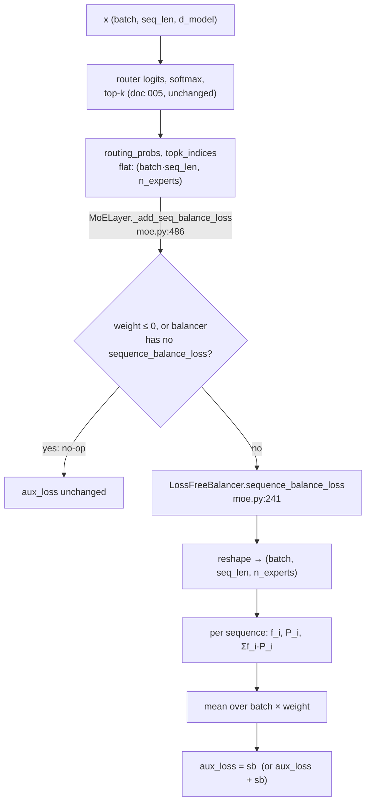
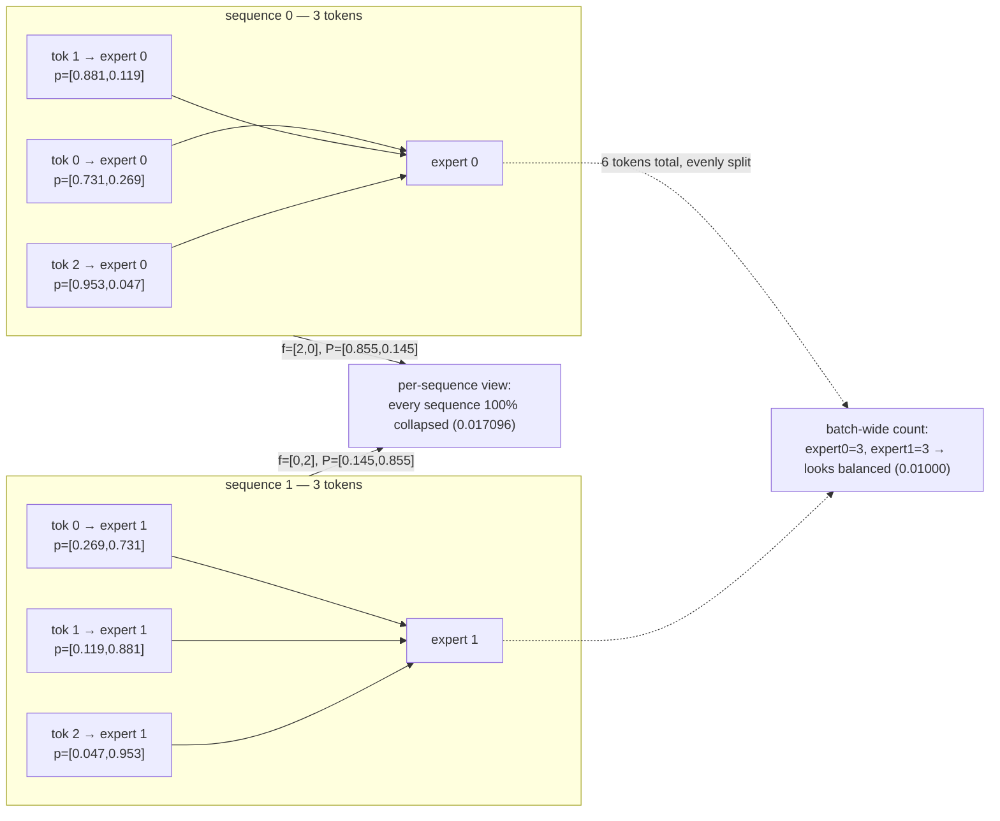
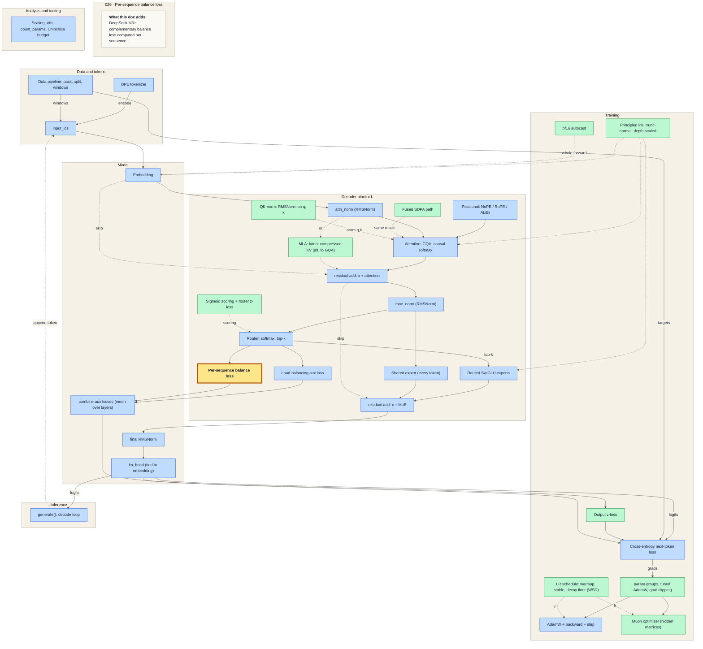

# 026 — DeepSeek-V3's complementary per-sequence balance loss: the full derivation, solved by hand

**Companion to:** [`journey_of_a_model/026-per-sequence-balance-loss.md`](../../journey_of_a_model/026-per-sequence-balance-loss.md)
· **Code:** [`qwenmoe/model/moe.py`](../../qwenmoe/model/moe.py) —
`LossFreeBalancer.sequence_balance_loss` ([`moe.py:241-280`](../../qwenmoe/model/moe.py#L241))
and `MoELayer._add_seq_balance_loss` ([`moe.py:486-508`](../../qwenmoe/model/moe.py#L486))
· **Every number here is reproduced by:**
[`verify_026_per_sequence_balance_loss.py`](verify_026_per_sequence_balance_loss.py)
(`uv run python docs/math/verify_026_per_sequence_balance_loss.py`)

---

## How to read this

The journal entry tells you *what* this loss term is for and *why* it
exists (the "balanced on average is not balanced" gap in loss-free
balancing), with one worked numeric example. This document is the
opposite trade-off: **maximum detail, minimum summarising**. We

1. fix one tiny, fully-written-out batch and one router weight,
2. push it through **every single line** of `MoELayer.forward_with_trace`
   that feeds `LossFreeBalancer.sequence_balance_loss`
   ([`moe.py:528`](../../qwenmoe/model/moe.py#L528)), then walk that
   function itself line by line,
3. for every operation — a reshape, a `one_hot`, a mean, a dot product —
   first derive *why* it has the form it does, then do the arithmetic on
   paper, digit by digit, and check it against the real module,
4. and go one step further than the journal: derive the exact algebraic
   identity behind "this loss is minimized when routing is balanced"
   (it's a *covariance* identity, not quite the folk "rearrangement
   inequality" story — including a real, code-verified counterexample),
   and chase the gradient all the way from the scalar loss back into the
   router's weight matrix, matching PyTorch's autograd to 6 decimal
   places.

You do **not** need to have taken a linear-algebra or statistics course.
Every term is defined at first use. This document assumes you've read
[`docs/math/005-moe-layer.md`](005-moe-layer.md) (or are willing to
glance at it) for the router/softmax/top-*k* mechanics — those are
identical here, just re-run on new numbers, and we point there rather
than re-deriving them.

> **Scope.** `MoELayer.forward_with_trace` also computes routed- and
> shared-expert outputs (the actual `(batch, seq_len, d_model)` layer
> output) — none of that is new in this task, so we set it aside (see
> doc 005 for its full derivation) and trace only the path that feeds the
> auxiliary loss.

---

## Part 0 — What problem is this solving?

A Mixture-of-Experts router picks, per token, a handful of experts to run
(background: [doc 005](005-moe-layer.md)). Left alone, routers collapse
onto a few favorite experts, so training needs counter-pressure toward
balance. This project has two such mechanisms, and this document is about
a small patch to the second one:

- **`AuxLossBalancer`** ([005](005-moe-layer.md) Step 9) — a
  gradient-based loss, `α·N·Σᵢ fᵢPᵢ`, computed once over the *whole
  batch flattened together*.
- **`LossFreeBalancer`** (journal
  [015](../../journey_of_a_model/015-research-comparison-framework.md)) —
  no loss at all; a per-expert bias, added to the routing score for
  *selection only*, nudged after every step toward whichever experts are
  under/over-used **in the whole batch**.

Both mechanisms share one blind spot: **they only ever look at aggregate
statistics across the batch.** A batch's tokens can be perfectly spread
across experts in total while every *individual sequence* routes all its
own tokens onto just one or two experts — the aggregate dashboard is
green, but any single sequence (which is all you have at inference, one
request at a time) never sees balanced routing at all.

DeepSeek-V3's fix (arXiv:2412.19437, §2.1.2, Eq. 17-19) keeps loss-free
balancing as the primary mechanism and adds back a **tiny** gradient-based
term — small enough not to reintroduce the quality cost that motivated
going loss-free in the first place — computed **within each sequence
separately**:

$$
f_i = \frac{N_r}{K_r\,T}\sum_{t=1}^{T}\mathbb{1}(\text{token }t\text{ selects expert }i)
\qquad
P_i = \frac{1}{T}\sum_{t=1}^{T} s'_{i,t}
\qquad
\mathcal{L}_{\text{seq}} = \alpha \cdot \underset{\text{sequences}}{\text{mean}}\Big(\sum_{i=1}^{N_r} f_i\,P_i\Big)
$$

- $N_r$ = `n_routed_experts`, $K_r$ = `top_k`, $T$ = `seq_len`,
  $s'_{i,t}$ = token $t$'s routing probability on expert $i$
  (`routing_probs`), $\alpha$ = `seq_balance_loss_weight`.
- This is the *exact same shape of formula* as `AuxLossBalancer`'s Switch
  loss — the only change is the sum runs over one sequence's $T$ tokens
  instead of the whole batch's. By the end of Part 2 we will have computed
  both, side by side, on the identical routing decisions, and seen the
  aggregate-only view completely miss what the per-sequence view catches.



---

<!-- notation:start (generated by build_architecture_footer.py) -->
> **Notation note.** The series uses one symbol set ([canonical notation](README.md#canonical-notation)). In this doc, $N_r$ stands for $N$ (`n_routed_experts`); $K_r$ stands for $k$ (`top_k`); $T$ stands for $S$, the tokens per sequence. Nothing below is changed; this only states the correspondence.
<!-- notation:end -->

## Part 1 — The running example

### 1.1 New terms we need (beyond doc 005's vector/matrix/softmax)

- **Token, sequence, batch.** A **token** is one position's embedding
  vector. A **sequence** is an ordered run of $T$ tokens processed
  together (one training example — e.g. one document window). A
  **batch** bundles several independent sequences into one forward pass
  so the GPU does one big computation instead of many small ones.
- **Average / mean** of $n$ numbers: add them up, divide by $n$. Written
  $\text{mean}(a_1,\dots,a_n) = \frac1n\sum_i a_i$.
- **Buffer vs. parameter (PyTorch).** A `nn.Parameter` is a tensor the
  optimizer updates by gradient descent. A **buffer**
  (`register_buffer`) is a tensor that's part of a module's saved state
  (moved to GPU with the model, saved in checkpoints) but is *not*
  trainable: `requires_grad=False`, and gradient descent never touches
  it. `LossFreeBalancer.bias` is a buffer — updated by a hand-written
  rule ([`moe.py:282-295`](../../qwenmoe/model/moe.py#L282)), never by
  `.backward()`.
- **Gradient / partial derivative.** For a scalar loss $L$ and one number
  $w$ it depends on, the derivative $\partial L/\partial w$ says: if you
  nudge $w$ up by a tiny amount, $L$ changes by that amount times
  $\partial L/\partial w$. Gradient descent repeatedly nudges every
  parameter *against* its gradient to shrink $L$. PyTorch computes every
  parameter's gradient automatically via the chain rule
  ("autograd") once you call `.backward()` on $L$; softmax's own
  derivative is derived in full in
  [010](../../journey_of_a_model/010-training-loop.md) — we reuse it,
  we don't re-derive it, below.
- **Covariance** of two paired lists of numbers $a_1,\dots,a_n$ and
  $b_1,\dots,b_n$ (with means $\bar a,\bar b$):
  $\text{Cov}(a,b) = \frac1n\sum_i (a_i-\bar a)(b_i-\bar b)$. It is
  positive when $a$ and $b$ tend to be above their own averages *at the
  same $i$* together, negative when one tends to be above average
  exactly when the other is below. We derive an exact identity using it
  in Step 10c.

### 1.2 The model configuration

The smallest config that exercises the full behaviour of
`sequence_balance_loss`: two experts (so "collapse onto one expert" is
meaningful with a real alternative), top-1 routing (so `f_i`'s scaling
constant $N_r/(K_r T)$ is doing real work, not hidden behind $K_r>1$
bookkeeping), and — the property this whole term exists to catch — two
sequences that are each *individually* 100% collapsed onto opposite
experts, so the **batch as a whole** looks perfectly balanced.

| Symbol | `ModelConfig` field | Meaning | Value |
|---|---|---|---|
| `batch` | — | independent sequences at once | $2$ |
| $T$ | `seq_len` (from input) | tokens per sequence | $3$ |
| $d$ | `d_model` | width of a token vector | $2$ |
| $N_r$ | `n_routed_experts` | number of routed experts | $2$ |
| $K_r$ | `top_k` | routed experts used per token | $1$ |
| $n_{\text{shared}}$ | `n_shared_experts` | always-on experts | $0$ (out of scope here — see doc 005) |
| — | `moe_balancing` | load-balancing strategy | `loss_free` (only this balancer defines `sequence_balance_loss`) |
| — | `router_scoring` | routing score function | `softmax` |
| $\alpha$ | `seq_balance_loss_weight` | per-sequence loss coefficient | $0.01$ |
| — | `router_z_loss_weight` | (off, so it doesn't add a term) | $0.0$ |

`ModelConfig.__post_init__` validates $1\le K_r\le N_r$ and
$n_{\text{shared}}\ge0$
([`config.py:68-76`](../../qwenmoe/config.py#L68)); `seq_balance_loss_weight`
itself is only checked `>= 0`
([`config.py:91-93`](../../qwenmoe/config.py#L91)) — the interesting gating
(`> 0`, and "does the balancer even support this") happens in
`_add_seq_balance_loss`, Step 7 below.

### 1.3 The input

Two sequences of 3 tokens each, $d=2$. Sequence 0's tokens all lean
toward coordinate 0 being larger; sequence 1's all lean the other way —
by design, so that (once we see the router weight in §1.4) sequence 0
routes every token to expert 0 and sequence 1 routes every token to
expert 1:

$$
X = \begin{bmatrix}
\underbrace{\begin{bmatrix}1&0\\2&0\\3&0\end{bmatrix}}_{\text{sequence 0}}
&
\underbrace{\begin{bmatrix}0&1\\0&2\\0&3\end{bmatrix}}_{\text{sequence 1}}
\end{bmatrix}
\qquad\text{shape }(2, 3, 2)
$$

(written as two stacked $3\times2$ blocks; the real tensor's shape is
`(batch, seq_len, d_model) = (2, 3, 2)`.)

### 1.4 The router weight

One `nn.Linear(d_model, n_routed_experts)` with no bias
([`moe.py:79-84`](../../qwenmoe/model/moe.py#L79)), weight shape
$(N_r, d) = (2, 2)$. We pick the **identity matrix**:

$$W_{\text{router}} = \begin{bmatrix}1&0\\0&1\end{bmatrix}\qquad\text{(row 0: expert 0, row 1: expert 1)}$$

By §1.5 of doc 005, `nn.Linear`'s output coordinate $j$ is the dot
product of the input with row $j$ of the weight. With the identity
matrix that dot product is just "pick out coordinate $j$" — so **the
router logit for expert $e$ is literally the token's coordinate $e$**, no
arithmetic required to read it off. This is the smallest possible router
weight that still makes every token's expert preference *readable by
eye* from $X$ alone, which is exactly what we want for a worked example
whose whole point is "does the per-sequence pattern get seen or missed."

We deliberately do **not** hand-pick the routed-expert FFN weights (no
`w_gate`/`w_up`/`w_down` values are written out): the per-sequence
balance loss never touches expert outputs, only `routing_probs` and
`topk_indices`, so those weights (left at their default random
initialization in the verify script) never appear in any number quoted
in this document.

---

## Part 2 — The forward pass, one operation at a time

`MoELayer.forward_with_trace` ([`moe.py:528`](../../qwenmoe/model/moe.py#L528))
is the path we walk (it's the one with named intermediates; the batched
production path `forward` computes the identical maths for this loss —
both call the same `_add_seq_balance_loss`, [`moe.py:483`](../../qwenmoe/model/moe.py#L483)
and [`moe.py:564`](../../qwenmoe/model/moe.py#L564)).

**Shape ledger — start:** `x (2, 3, 2)`.

---

### Step 1 — Flatten batch and sequence

Code ([`moe.py:535-536`](../../qwenmoe/model/moe.py#L535)):

```python
batch, seq_len, d_model = x.shape          # 2, 3, 2
x_flat = x.reshape(-1, d_model)             # (6, 2)
```

Exactly doc 005 Step 1: collapsing `(batch, seq_len)` into one "token"
axis, since the router treats every token independently. `reshape`
**never reorders memory** — it only re-labels axes — so the six rows of
`x_flat`, **in order**, are sequence 0's three tokens followed by
sequence 1's three tokens:

$$x\_\text{flat} = \begin{bmatrix}1&0\\2&0\\3&0\\0&1\\0&2\\0&3\end{bmatrix}\qquad\text{shape }(6,2)$$

This row order — **sequence-major, then token-within-sequence** — is an
invariant every later step depends on. Nothing between here and Step 10
ever re-sorts or shuffles rows, so it survives all the way to the
reshape inside `sequence_balance_loss` (Step 10b), which is what lets
that reshape correctly recover "which 3 rows belong to sequence 0."

**Shape ledger:** `x (2,3,2)` → `x_flat (6,2)`.

---

### Step 2 — Router logits

Code ([`moe.py:538`](../../qwenmoe/model/moe.py#L538)):

```python
router_logits = self.router(x_flat)     # x_flat @ W_router.T
```

With $W_{\text{router}} = I$ (§1.4), `router_logits` is **numerically
identical to `x_flat`** — the router's output *is* the input, coordinate
for coordinate:

$$\text{router\_logits} = \begin{bmatrix}1&0\\2&0\\3&0\\0&1\\0&2\\0&3\end{bmatrix}\qquad\text{shape }(6,2)$$

(Verified: `verify_026_per_sequence_balance_loss.py` asserts
`router_logits == x_flat` exactly, `atol=0`.)

**Shape ledger:** `x_flat (6,2)` → `router_logits (6,2)`.

---

### Step 3 — Selection scores and routing probabilities

Code path: `score_and_select` ([`moe.py:110-111`](../../qwenmoe/model/moe.py#L110))
computes `routing_probs = F.softmax(router_logits, dim=-1)`, then calls
`LossFreeBalancer.selection_scores` ([`moe.py:219-234`](../../qwenmoe/model/moe.py#L219)):

```python
base = F.softmax(router_logits, dim=-1)     # router_scoring == "softmax"
return base + self.bias                     # bias: a zero-initialized buffer
```

`self.bias` is a fresh `LossFreeBalancer`'s buffer, initialized to all
zeros ([`moe.py:217`](../../qwenmoe/model/moe.py#L217)), and
`forward_with_trace` **never calls `balancer.update`** (only the
production `forward` does, and only in `self.training` mode —
[`moe.py:460-465`](../../qwenmoe/model/moe.py#L460)). So for this whole
example `selection_scores == routing_probs` exactly: the bias adds
nothing, and top-1 selection is decided purely by the softmax
probabilities.

#### A shortcut for 2 experts: softmax *is* sigmoid of the gap

With only $N_r=2$ experts, softmax simplifies. For logits $[a, b]$:

$$
\operatorname{softmax}([a,b])_0 = \frac{e^a}{e^a+e^b}
= \frac{1}{1+e^{-(a-b)}}\quad\text{(divide num. and denom. by }e^a\text{)}
= \sigma(a-b)
$$

where $\sigma(z)=1/(1+e^{-z})$ is the **logistic sigmoid** (defined in
[005](005-moe-layer.md) §6c). So for a 2-expert row, "run softmax" and
"take the sigmoid of (logit 0 − logit 1)" are the *same number* —
**exact algebra**, not a coincidence of our example. This is a genuine
simplification available only at $N_r=2$; doc 005's 4-expert example
needed the full softmax formula.

#### Do it by hand

Six rows, each with logit gap $g = \text{logit}_0 - \text{logit}_1$
(reusing $e^{1}=2.718282$, $e^{2}=7.389056$, $e^{3}=20.085537$,
$e^{-1}=0.367879$, $e^{-2}=0.135335$, $e^{-3}=0.049787$ from doc 005):

| row | logits $[a,b]$ | gap $g=a-b$ | $p_0=\sigma(g)=1/(1+e^{-g})$ | $p_1=1-p_0$ |
|---|---|---|---|---|
| 0 (seq 0, tok 0) | $[1,0]$ | $1$ | $1/1.367879=0.731059$ | $0.268941$ |
| 1 (seq 0, tok 1) | $[2,0]$ | $2$ | $1/1.135335=0.880797$ | $0.119203$ |
| 2 (seq 0, tok 2) | $[3,0]$ | $3$ | $1/1.049787=0.952574$ | $0.047426$ |
| 3 (seq 1, tok 0) | $[0,1]$ | $-1$ | $1/(1+e^{1})=0.268941$ | $0.731059$ |
| 4 (seq 1, tok 1) | $[0,2]$ | $-2$ | $1/(1+e^{2})=0.119203$ | $0.880797$ |
| 5 (seq 1, tok 2) | $[0,3]$ | $-3$ | $1/(1+e^{3})=0.047426$ | $0.952574$ |

$$
\text{routing\_probs} = \begin{bmatrix}
0.731059 & 0.268941 \\ 0.880797 & 0.119203 \\ 0.952574 & 0.047426 \\
0.268941 & 0.731059 \\ 0.119203 & 0.880797 \\ 0.047426 & 0.952574
\end{bmatrix}\qquad\text{shape }(6,2)
$$

Each row sums to $1$ (softmax's defining property, derived in full in
[004](004-attention-gqa.md) §Step 10). Rows 3-5 are rows 0-2 with the two
columns swapped — the mirror-image construction from §1.3 made literal.
**Real module output** (`verify_026_per_sequence_balance_loss.py`,
`trace["router_probs"]`) matches this table to 6 decimals.

**Shape ledger:** `router_logits (6,2)` → `routing_probs (6,2)`.

---

### Step 4 — Top-1 selection

`select_top_k` ([`moe.py:125-143`](../../qwenmoe/model/moe.py#L125)) calls
`selection_scores.topk(1, dim=-1)`. With $K_r=1$ this just picks, per
row, whichever of the two columns is larger:

- Rows 0-2 ($p_0>p_1$ every time, since the gap is always positive):
  expert **0**.
- Rows 3-5 ($p_1>p_0$): expert **1**.

$$\text{topk\_indices} = [\,0,\ 0,\ 0,\ 1,\ 1,\ 1\,]^{\top}\qquad\text{shape }(6,1)$$

`select_top_k` also computes `topk_weights` (the renormalized
combination weight — with $K_r=1$ there's nothing to renormalize against,
so it's just $1.0$ for every token; derivation in
[005](005-moe-layer.md) §4c). **We do not use `topk_weights` again below**
— `sequence_balance_loss`'s signature
([`moe.py:241-248`](../../qwenmoe/model/moe.py#L241)) doesn't take it at
all, only `routing_probs` and `topk_indices`.

Also computed here but **not part of this loss**: `last_expert_counts`
([`moe.py:542-544`](../../qwenmoe/model/moe.py#L542)), a `bincount` over
*all six tokens flattened together* — $[3, 3]$ in our example (3 tokens
picked expert 0, 3 picked expert 1). Don't confuse this global count
with the per-sequence $f_i$ computed in Step 10 below: it's precisely
because this global count already looks perfectly even that the
per-sequence view is needed at all.

**Shape ledger:** adds `topk_indices (6,1)`.

---

### Step 5 — `balancer.aux_loss` — always `None` here

Code ([`moe.py:562`](../../qwenmoe/model/moe.py#L562) →
`LossFreeBalancer.aux_loss`, [`moe.py:236-239`](../../qwenmoe/model/moe.py#L236)):

```python
def aux_loss(self, router_probs, topk_indices) -> None:
    return None
```

By design: loss-free balancing's entire premise is "no gradient-based
loss term" ([`moe.py:236-239`](../../qwenmoe/model/moe.py#L236),
journal [015](../../journey_of_a_model/015-research-comparison-framework.md)).
So immediately before the per-sequence term is added, `aux_loss` is
`None` — there is, as yet, nothing to add it to.

---

### Step 6 — Router z-loss — no-op here

Code ([`moe.py:563`](../../qwenmoe/model/moe.py#L563) →
`_add_router_z_loss`, [`moe.py:510-526`](../../qwenmoe/model/moe.py#L510)):

```python
if self.router_z_loss_weight <= 0:      # our config: 0.0
    return aux_loss                     # unchanged -- still None
```

Off by default and off in this example (`router_z_loss_weight = 0.0`),
so `aux_loss` is still `None` heading into Step 7. (Its own derivation:
journal [025](../../journey_of_a_model/025-moe-routing-sigmoid-and-router-z-loss.md).)

---

### Step 7 — `_add_seq_balance_loss`: the gating logic

Code ([`moe.py:486-508`](../../qwenmoe/model/moe.py#L486)):

```python
def _add_seq_balance_loss(self, aux_loss, routing_probs, topk_indices, seq_len):
    if self.seq_balance_loss_weight <= 0:
        return aux_loss
    seq_balance_loss = getattr(self.balancer, "sequence_balance_loss", None)
    if seq_balance_loss is None:
        return aux_loss
    sb = seq_balance_loss(
        routing_probs, topk_indices, seq_len, self.top_k, self.seq_balance_loss_weight
    )
    return sb if aux_loss is None else aux_loss + sb
```

Two independent gates, both `and`-ed together by two sequential early
returns:

1. **`seq_balance_loss_weight <= 0`** — a plain float comparison, no
   model introspection. Requirement 4.4 wants this off by default
   (`ModelConfig.seq_balance_loss_weight` defaults to `0.0`,
   [`config.py:41`](../../qwenmoe/config.py#L41)) so an existing config is
   bit-identical unless a user opts in.
2. **`getattr(self.balancer, "sequence_balance_loss", None) is None`** —
   *duck typing*, not `isinstance(self.balancer, LossFreeBalancer)`. Only
   `LossFreeBalancer` defines this method
   ([`moe.py:241`](../../qwenmoe/model/moe.py#L241)); `AuxLossBalancer`
   does not. This means the gate is really "does whatever balancer this
   layer holds *support* a per-sequence term," decided structurally, not
   by name — a future third balancer could opt in just by defining the
   method, with no change needed here.

**On our config** (`seq_balance_loss_weight = 0.01 > 0`,
`self.balancer` is a `LossFreeBalancer`): both gates pass, so `sb` is
computed (Step 10 does the arithmetic) and, since `aux_loss` is still
`None` from Steps 5-6, the function returns `sb` directly — **the final
`aux_loss` for this layer equals `sequence_balance_loss`'s output,
exactly, bit for bit.** (Verified: `torch.testing.assert_close(aux_loss,
seq_balance_loss, atol=0, rtol=0)` passes — not an approximation, the
literal same float.)

**Two no-op checks, verified with a second and third `MoELayer`:**

- **Weight $=0$:** rebuild the layer with `seq_balance_loss_weight=0.0`,
  everything else identical → `forward_with_trace`'s `aux_loss` is
  `None` (gate 1 fires; `sequence_balance_loss` is never even called).
- **`moe_balancing="aux_loss"`:** rebuild with an `AuxLossBalancer`
  (which *does* return a real number from its own `aux_loss`), set
  `seq_balance_loss_weight` to $0.01$ and, on a second run, to $0.05$ —
  the returned `aux_loss` is **bit-identical** both times
  (`torch.equal`), because gate 2 fires every time (`getattr` finds
  nothing) regardless of the weight's value. An `AuxLossBalancer` layer
  is structurally incapable of ever seeing this term.

---

### Step 8, 9, 10 — Inside `sequence_balance_loss`

Code, in full ([`moe.py:241-280`](../../qwenmoe/model/moe.py#L241)):

```python
def sequence_balance_loss(self, routing_probs, topk_indices, seq_len, top_k, weight):
    n_experts = self.n_routed_experts                                    # 270
    batch = routing_probs.shape[0] // seq_len                            # 271

    dispatched = F.one_hot(topk_indices, num_classes=n_experts).sum(dim=1)   # 273
    dispatched = dispatched.reshape(batch, seq_len, n_experts).float()      # 274
    probs = routing_probs.reshape(batch, seq_len, n_experts)                # 275

    f_i = (n_experts / (top_k * seq_len)) * dispatched.sum(dim=1)          # 277
    p_i = probs.mean(dim=1)                                                 # 278
    per_sequence = (f_i * p_i).sum(dim=-1)                                  # 279
    return weight * per_sequence.mean()                                    # 280
```

We now do every one of those eight lines by hand.

#### Step 8a — Recover the batch size

`n_experts = self.n_routed_experts = 2` (a stored config value, not
computed). `batch = routing_probs.shape[0] // seq_len = 6 // 3 = 2`.

**Why integer division is safe:** `sequence_balance_loss` isn't handed
`batch` directly — only the *flat* `routing_probs`/`topk_indices`
(shape `(batch·seq_len, n_experts)`/`(batch·seq_len, top_k)`) and
`seq_len`. Since every token belongs to exactly one sequence of exactly
`seq_len` tokens, the total row count is always an exact multiple of
`seq_len`, so `//` recovers `batch` exactly — **exact arithmetic**, not
an approximation, provided (as noted in Step 1) the caller never mixes
sequences of different lengths into one `MoELayer` call, which nothing
in this codebase does.

#### Step 8b — `dispatched`: one-hot the choice, then merge the top-*k* slots

`F.one_hot(topk_indices, num_classes=2)`: turn every expert id into a
length-2 indicator vector (a $1$ at that id, $0$ elsewhere) — shape
`(6, 1, 2)` (the middle axis is $K_r=1$, "which of this token's $K_r$
picks was this"). `.sum(dim=1)` adds those $K_r$ indicator vectors
together per token; with $K_r=1$ there's only one to add, so this step
is a no-op *in this example*, but it's what makes the formula correct in
general for $K_r>1$ (a token that picked two experts contributes a $1$
to each of their columns).

$$
\text{topk\_indices} = \begin{bmatrix}0\\0\\0\\1\\1\\1\end{bmatrix}
\xrightarrow{\text{one-hot(2), sum over the }K_r=1\text{ slot}}
\text{dispatched} = \begin{bmatrix}1&0\\1&0\\1&0\\0&1\\0&1\\0&1\end{bmatrix}\qquad\text{shape }(6,2)
$$

**Shape ledger:** adds `dispatched (6,2)` — an *integer* tensor (one-hot
of a discrete index), so it carries **no gradient**: nothing computed
from `dispatched` can ever backpropagate into the router.

#### Step 8c — Reshape both tensors back to `(batch, seq_len, n_experts)`

```python
dispatched = dispatched.reshape(2, 3, 2).float()
probs = routing_probs.reshape(2, 3, 2)
```

Because the row order established in Step 1 was never disturbed (every
step since has been elementwise or row-preserving), row $b\cdot T + t$ of
the flat `(6, 2)` tensors is exactly (sequence $b$, token $t$). Reshaping
`(6, 2) → (2, 3, 2)` — the exact inverse of Step 1's flatten — recovers
that grid with **no numbers moved**, only relabeled:

$$
\text{dispatched} = \begin{bmatrix}
\underbrace{\begin{bmatrix}1&0\\1&0\\1&0\end{bmatrix}}_{\text{seq }0} &
\underbrace{\begin{bmatrix}0&1\\0&1\\0&1\end{bmatrix}}_{\text{seq }1}
\end{bmatrix}
\qquad
\text{probs} = \begin{bmatrix}
\begin{bmatrix}0.731059&0.268941\\0.880797&0.119203\\0.952574&0.047426\end{bmatrix} &
\begin{bmatrix}0.268941&0.731059\\0.119203&0.880797\\0.047426&0.952574\end{bmatrix}
\end{bmatrix}
$$

(`.float()` on `dispatched` just upcasts the one-hot integers to
floating point so the later multiply with `p_i` type-checks —
no value changes.)

**Shape ledger:** `dispatched (6,2)` → `(2,3,2)`; `probs (6,2)` → `(2,3,2)`.

#### Step 9a — $f_i$: the realized load, derived

**Why the scaling factor $N_r/(K_r T)$.** We want a number that says "of
this sequence's total selection budget, what share went to expert $i$,"
normalized so a perfectly even sequence reads as $f_i=1$ for every $i$
(matching $P_i$'s natural scale, so that the dot product in Step 10 is
comparing like with like). A sequence of $T$ tokens, each choosing
$K_r$ experts, hands out exactly $T\cdot K_r$ "(token, expert) picks"
total, spread over $N_r$ experts. If they were spread **perfectly
evenly**, expert $i$ would receive $\tfrac{T K_r}{N_r}$ of them. So
define

$$f_i = \frac{\text{(picks expert }i\text{ actually got)}}{\text{(picks expert }i\text{ would get if perfectly even)}} = \frac{\sum_t \mathbb{1}(\dots)}{T K_r / N_r} = \frac{N_r}{K_r T}\sum_t \mathbb{1}(\dots)$$

— exactly the code's formula. **This is a ratio to the balanced
baseline**, which is why perfectly even routing gives $f_i=1$ for every
$i$, not $f_i = 1/N_r$ (that would be the case if $f_i$ were left as a
raw fraction of picks, which is what `AuxLossBalancer.aux_loss` does
instead — [005](005-moe-layer.md) Step 9 — a genuinely different
normalization for the same underlying count, chosen there because that
formula's own $\times N_r$ factor is applied once, globally, afterward).

**Exact check: $\sum_i f_i = N_r$, always.** Every token contributes
exactly $K_r$ ones across all $N_r$ columns of `dispatched` (it picked
exactly $K_r$ experts), so summing `dispatched` over *both* the token
axis and the expert axis gives $T\cdot K_r$. Summing $f_i$ over $i$:

$$\sum_i f_i = \frac{N_r}{K_r T}\sum_i\sum_t\mathbb{1}(\dots) = \frac{N_r}{K_r T}\cdot (T K_r) = N_r$$

— pure algebra, true for *any* routing pattern, not just a balanced one.

**Do it by hand.** `dispatched.sum(dim=1)` sums over the token axis
(3 tokens) within each sequence:

- Sequence 0: $[1,0]+[1,0]+[1,0] = [3, 0]$.
- Sequence 1: $[0,1]+[0,1]+[0,1] = [0, 3]$.

Scale by $N_r/(K_r T) = 2/(1\times3) = 2/3$:

$$f = \begin{bmatrix}\tfrac23\cdot[3,0]\\ \tfrac23\cdot[0,3]\end{bmatrix} = \begin{bmatrix}2&0\\0&2\end{bmatrix}\qquad\text{shape }(2,2)$$

Check: each row sums to $2=N_r$. ✓ Sequence 0's tokens all went to
expert 0 — total collapse: $f_0=2$ means "expert 0 got exactly twice
what an even split would give it," the maximum possible value of $f_i$
when $K_r=1$ (one expert gets *everything*, the other gets $f_1=0$).

#### Step 9b — $P_i$: the intended load, derived

**Why a plain mean.** $P_i$ should answer "on average, how much
probability mass did this sequence's tokens *want* to put on expert
$i$" — the natural summary of $T$ numbers (one per token) is their mean.
Unlike $f_i$, no rescaling is needed: each token's `routing_probs` row
already sums to $1$ (softmax's defining property), so:

$$\sum_i P_i = \sum_i \frac1T\sum_t s'_{i,t} = \frac1T\sum_t\Big(\underbrace{\sum_i s'_{i,t}}_{=1}\Big) = \frac1T\cdot T = 1$$

— again exact algebra, for any routing_probs, any pattern.

**Do it by hand.** `probs.mean(dim=1)` — mean over the 3 tokens, per
expert, per sequence:

- Sequence 0: $P_0 = (0.731059+0.880797+0.952574)/3 = 2.564430/3 = 0.854810$.
  $P_1 = (0.268941+0.119203+0.047426)/3 = 0.435570/3 = 0.145190$.
- Sequence 1 (the mirror): $P_0 = 0.145190$, $P_1 = 0.854810$.

$$p_i = \begin{bmatrix}0.854810 & 0.145190\\ 0.145190 & 0.854810\end{bmatrix}\qquad\text{shape }(2,2)$$

Check: each row sums to $1.000000$. ✓ Unlike $f_i$ (a hard, all-or-nothing
count), $P_i$ is a genuine average of three *different* numbers
($0.731059$, $0.880797$, $0.952574$) — this is the one place in the
whole computation with room for a gradient, because $s'_{i,t}$ came out
of a softmax over the router's weights.

#### Step 10a — The per-sequence dot product

```python
per_sequence = (f_i * p_i).sum(dim=-1)     # (batch,)
```

Elementwise multiply, then sum across experts, per sequence:

- Sequence 0: $2\times0.854810 + 0\times0.145190 = 1.709620 + 0 = 1.709620$.
- Sequence 1: $0\times0.145190 + 2\times0.854810 = 0 + 1.709620 = 1.709620$.

$$\text{per\_sequence} = [\,1.709620,\ 1.709620\,]\qquad\text{shape }(2,)$$

**Why this exact combination — a dot product of "where tokens went"
($f$) with "where the router wanted them to go" ($P$).** It rewards
overlap: a sequence contributes a *large* value exactly when a *large*
$f_i$ (heavily used expert) lines up with a *large* $P_i$ (an expert the
router was already confident about) — i.e. exactly the "rich get
richer" pattern that causes collapse. A sequence with flat $f$ (every
expert used equally) contributes $\sum_i 1\cdot P_i = \sum_i P_i = 1$
**regardless of $P$** — flat usage alone is already enough to hit the
floor, no matter how skewed the router's raw preferences are.

#### Step 10b — Mean over the batch, times the weight

```python
return weight * per_sequence.mean()
```

$$\text{mean} = (1.709620+1.709620)/2 = 1.709620 \qquad \mathcal{L}_{\text{seq}} = 0.01 \times 1.709620 = 0.017096$$

**Real module** (`aux_loss` returned by `forward_with_trace`):
`0.017096199` — matches to float32 precision (`atol=0` in the verify
script; it's the *same* tensor, not a separately-rounded copy, since
Step 7 returns `sb` directly).

**Why average, not sum, over sequences (design choice, not derivable
algebra).** Summing would make the loss scale with `batch_size` — a
`seq_balance_loss_weight` tuned for `batch=8` would silently mean
something 4× larger at `batch=32`. Averaging keeps $\alpha$'s meaning
independent of how many sequences fit on the hardware — the same reason
`QwenMoEModel.forward` averages, rather than sums, per-block aux losses
(doc [006](006-full-model-assembly.md)).

#### Step 10c — Is 1 really a hard floor? An exact identity, and a counterexample

The journal entry motivates $\Sigma f_iP_i\ge1$ via "the rearrangement
inequality." Let's derive precisely what *is* exact algebra here, because
the full claim needs one more ingredient than the sum constraints alone.

Write $\bar f = \tfrac1{N_r}\sum_if_i = 1$ (from Step 9a) and
$\bar P = \tfrac1{N_r}\sum_iP_i = 1/N_r$ (from Step 9b). Expand the
per-sequence value around those means:

$$
\sum_i f_i P_i = \sum_i\big(\bar f + (f_i-\bar f)\big)P_i
= \bar f\underbrace{\sum_iP_i}_{=1} + \sum_i(f_i-\bar f)P_i
= 1 + \sum_i(f_i-\bar f)(P_i-\bar P)
$$

(the last step adds and subtracts $\bar P\sum_i(f_i-\bar f)=0$, which is
zero because $f_i$'s already sum to $\bar f\cdot N_r$ by definition of
$\bar f$). The remaining sum is $N_r$ times the definition of covariance
from §1.1:

$$
\boxed{\ \sum_i f_i P_i \;=\; 1 + N_r\cdot\text{Cov}(f, P)\ }\qquad\textbf{exact algebra}
$$

**True for any $(f, P)$ satisfying only $\sum f_i=N_r$, $\sum P_i=1$** —
no assumption about how $f$ and $P$ arose. It says: the value exceeds
$1$ exactly when the expert(s) that got *more* than their fair share of
picks ($f_i$ above its average of $1$) are *the same* experts the router
put *more* than average probability mass on ($P_i$ above its average of
$1/N_r$) — i.e. when routing "confidence" and routing "usage" line up.
That alignment is the "rich get richer" pattern; it is *plausible*, not
*forced*, because top-$k$ selection only compares experts *within one
token*, while $f$ and $P$ aggregate *across* tokens.

**Our example:** Sequence 0 has $f=[2,0]$ (above/below $\bar f=1$) lined
up with $P=[0.854810,0.145190]$ (above/below $\bar P=0.5$) — same
ordering, so $\text{Cov}(f,P)>0$ and the sum exceeds $1$ (by exactly
$1.709620-1=0.709620$).

**A counterexample, computed by the real code.** Take one sequence,
$N_r=2$, $K_r=1$, $T=3$: two tokens where expert 0 barely edges out
expert 1 ($p=[0.6,0.4]$, twice), one token where expert 1 wins by a
landslide ($p=[0.01,0.99]$). Expert 0 is picked most often (high $f$)
but only ever by a slim margin (modest $P$); expert 1 is picked rarely
(low $f$) but its one win is enormous (inflates its $P$). That's
$f$ and $P$ pointing in *opposite* directions — negative covariance:

$$f = \big[\tfrac{2}{1\cdot3}\cdot2,\ \tfrac{2}{1\cdot3}\cdot1\big] = [1.333333,\ 0.666667]\qquad P = \big[\tfrac{0.6+0.6+0.01}{3},\ \tfrac{0.4+0.4+0.99}{3}\big] = [0.403333,\ 0.596667]$$

$$
\sum_i f_iP_i = 1.333333\times0.403333 + 0.666667\times0.596667 = 0.537778 + 0.397778 = \boxed{0.935556}
$$

**Below 1.** `verify_026_per_sequence_balance_loss.py` builds exactly
this `routing_probs`/`topk_indices` pair, calls the real
`LossFreeBalancer.sequence_balance_loss` on it, and gets
`0.9355556` — confirming both that the code really can go below $1$ on a
legitimate (if adversarial) input, and that the covariance identity
above predicts it exactly ($1 + 2\times(-0.032222) = 0.935556$, matching
to $1.5\times10^{-8}$, float32 rounding). **So: the exact, unconditional
fact is the covariance identity; "$\ge1$ in practice" is an empirical
property of *typical* routing (where confident, high-probability experts
really do get picked more), not a theorem** — worth knowing if you ever
see this loss dip under its nominal floor on real training data and
wonder whether something's broken. (Nothing is: Requirement 4.4 never
promised a hard floor, only "small gradient pressure toward balance.")

**Shape ledger — final:** `per_sequence (2,)` → `aux_loss ()` (scalar).

---

### Step 11 — Contrast: the batch-wide (Switch) view, on the identical routing

To see what the per-sequence term catches that the aggregate view
doesn't, run `AuxLossBalancer.aux_loss` ([005](005-moe-layer.md) Step 9)
on the **exact same** `routing_probs`/`topk_indices` from Step 3/4 (this
project's `MoELayer` never actually runs both balancers on one layer —
this is purely for the comparison; the verify script constructs a
standalone `AuxLossBalancer(2, loss_weight=0.01)` and calls its
`.aux_loss` directly):

```python
dispatched = F.one_hot(topk_indices, num_classes=2).sum(dim=1)   # (6, 2), same one-hot as Step 8b
f = dispatched.float().mean(dim=0)     # fraction of ALL 6 tokens, per expert
P = routing_probs.mean(dim=0)          # mean prob over ALL 6 tokens, per expert
loss = 0.01 * 2 * (f * P).sum()
```

$f$: 3 of 6 tokens picked expert 0, 3 picked expert 1 → $f=[0.5, 0.5]$.
$P$: mean of all 6 rows' column 0 — by the exact seq-0/seq-1 mirror
construction, every pair of rows $(t, t{+}3)$ sums to $1.0$ in each
column, so the six-row mean is **exactly** $0.5$ in both columns too:
$P=[0.5, 0.5]$.

$$
\text{loss} = 0.01\times2\times(0.5\times0.5+0.5\times0.5) = 0.01\times2\times0.5 = \boxed{0.010000}
$$

— **exactly its perfectly-balanced floor** (the same floor doc 005 §Step
9 derives: $\alpha$ regardless of $N_r$, at $f=P=1/N_r$). The batch-wide
view sees **nothing wrong at all** with a batch where one entire
sequence never touches expert 1 and the other never touches expert 0.
Real module: `switch_loss = 0.009999999776482582` (float32's rounding of
the algebraically exact $0.01$).

**Side by side, on the identical 6 routing decisions:**

| view | formula | value |
|---|---|---|
| batch-wide (Switch, `AuxLossBalancer`) | $\alpha N_r\sum_if_iP_i$, $f=P=[0.5,0.5]$ | $0.010000$ — its floor |
| per-sequence (`LossFreeBalancer.sequence_balance_loss`) | $\alpha\cdot\text{mean}_{\text{seq}}(\sum_if_iP_i)$ | $0.017096$ |
| **ratio** | | **$1.71\times$** |

Real measured ratio: `1.7096199989318848`. (The journal's own
larger-scale measurement — 8 experts, `top_k=2`, `seq_len=32`, batch 8 —
finds a starker $3.61\times$; our tiny 2-expert, top-1 example already
shows the same qualitative gap with much smaller numbers to check by
hand.)



---

### Step 12 — Gradient: through $P_i$ into the router, never into the bias

**Why $f_i$ carries no gradient.** `dispatched` (Step 8b) comes from
`F.one_hot` of `topk_indices`, an integer tensor produced by `.topk` — a
discrete "pick the largest" operation with no defined derivative
(nudging a logit by an infinitesimal amount essentially never changes
which one is largest). PyTorch reflects this at the type level:
`topk_indices` is a `LongTensor`, incapable of `requires_grad`. So
$f_i$, built purely from `dispatched`, is a **constant** as far as
autograd is concerned — it is data (a count), not a differentiable
function of the router's weights.

**The gradient that does flow: $\partial\mathcal L/\partial P_i$.**
Since $\mathcal L_{\text{seq}} = \alpha\cdot\tfrac1{\text{batch}}\sum_b\sum_i f_i^{(b)}P_i^{(b)}$
and $f$ is constant, this is linear in each $P_i^{(b)}$:

$$\frac{\partial \mathcal L_{\text{seq}}}{\partial P_i^{(b)}} = \frac{\alpha}{\text{batch}}\,f_i^{(b)}$$

and since $P_i^{(b)} = \tfrac1T\sum_t s'^{(b)}_{i,t}$, by the chain rule
each individual token's contribution gets a further $1/T$:

$$\frac{\partial \mathcal L_{\text{seq}}}{\partial s'^{(b)}_{i,t}} = \frac{\alpha\, f_i^{(b)}}{T\cdot\text{batch}}\qquad\textbf{(same for every }t\text{ in sequence }b\textbf{)}$$

**Check against real autograd.** Detach `routing_probs`, mark it as a
fresh leaf tensor (a tensor autograd tracks gradients into directly), run
`sequence_balance_loss` on it, call `.backward()`, and read `.grad`.
For row 0 (sequence 0, token 0, expert 0): the formula predicts
$\alpha f_0^{(0)}/(T\cdot\text{batch}) = 0.01\times2/(3\times2) = 0.003333$.

**Real output:** `d(seq_balance_loss)/d(routing_probs), row 0:
[0.003333333181217313, 0.0]` — matching the closed form exactly (the
script asserts this elementwise, `atol=1e-7`, for all 6 rows × 2
experts).

**Continuing into the router weight.** From here, gradient flows through
the ordinary softmax-as-sigmoid Jacobian (derived in full for the
general $N$-expert case in [010](../../journey_of_a_model/010-training-loop.md);
for our $N_r=2$ case, $\partial p_{0,t}/\partial g_t = p_{0,t}p_{1,t}$
where $g_t$ is the logit gap — the standard sigmoid derivative
$\sigma'(z)=\sigma(z)(1-\sigma(z))$), then through the router's linear
layer ($g_t = x_t\cdot(W_0 - W_1)$, so $\partial g_t/\partial W_{0,k} = x_{t,k}$,
$\partial g_t/\partial W_{1,k} = -x_{t,k}$). Chaining these (worked out
fully in the verify script's comments) predicts, for row 0 of the router
weight:

$$\frac{\partial\mathcal L_{\text{seq}}}{\partial W_{0,0}} = \sum_{t\in\text{seq }0} \Big(\tfrac{0.01\times2}{3\times2}\Big)\cdot p_{0,t}p_{1,t}\cdot x_{t,0} = 0.000655 + 0.000700 + 0.000452 = 0.001807$$

(seq 1's tokens all have $x_{t,0}=0$, contributing nothing to this
entry). **Real autograd output** (full backward pass through the actual
`MoELayer`, `moe.router.gate.weight.grad`):

$$\begin{bmatrix}0.001807 & -0.001807\\ -0.001807 & 0.001807\end{bmatrix}$$

— matching to the displayed precision (row 1 is exactly $-$row 0, since
only the *gap* $g_t=W_0\!\cdot\!x_t - W_1\!\cdot\!x_t$ enters the loss,
so the two rows' gradients are forced to be exact negatives of each
other).

**The bias never gets a gradient.** `moe.balancer.bias.grad` is `None`
after this same `.backward()` call, and `moe.balancer.bias.requires_grad`
is `False`. Not because of some special-case masking — `bias` is a
**buffer** (§1.1), which PyTorch's autograd never tracks in the first
place. It only ever enters `selection_scores`
([`moe.py:219-234`](../../qwenmoe/model/moe.py#L219)), which decides
*which* discrete experts get chosen (feeding `topk_indices`, hence
$f_i$) — and $f_i$, as established above, is already outside the
gradient graph before `bias` would even get a chance to matter. Loss-free
balancing's whole mechanism (the sign-rule update,
[`moe.py:282-295`](../../qwenmoe/model/moe.py#L282)) and this new
gradient-based term are, by construction, **two disjoint update paths**
that happen to cooperate.

---

## Part 3 — Cost, and why built this way

### 3.1 Zero new parameters

`sequence_balance_loss` introduces **no `nn.Parameter` and no new
buffer** — it's a pure function of tensors `MoELayer` already computed
for routing (`routing_probs`, `topk_indices`). Contrast with loss-free
balancing's own mechanism, which *does* carry state: one bias per expert,
$N_r=2$ floats here (in a real config, `n_routed_experts`, e.g. $8$ or
$32$) — non-trainable, so it never touches the optimizer's parameter
count either, but it is extra model state saved in every checkpoint. This
term adds none of that.

### 3.2 Compute cost on this example

Counting scalar operations on our $(2,3,2)$ example:

- `one_hot` + `sum(dim=1)`: $6\times1\times2=12$ writes (trivial; would
  be $6\times K_r\times N_r$ in general).
- two reshapes: $0$ — no data movement, just re-labeling.
- `dispatched.sum(dim=1)`: $2\times3\times2=12$ adds.
- `probs.mean(dim=1)`: $12$ adds $+\,2$ divides.
- `f_i * p_i`, `.sum(-1)`: $2\times2=4$ multiplies $+\,2$ adds.
- `.mean()`, `* weight`: $2$ ops.

**Total: roughly 45 scalar ops** — for comparison, computing the router
logits that feed all of this already costs $6\times2\times2=24$
multiply-adds ([005](005-moe-layer.md) §3.2's convention), and a real
model's expert FFNs (the actual expensive part of an MoE layer) dwarf
both. This term's cost scales as $O(\text{batch}\cdot T\cdot N_r)$ —
*exactly* the size of the tensors the router already produced — so
adding it changes a forward pass's wall-clock by an amount too small to
measure against everything else in the layer. The entire benefit
(catching per-sequence collapse) is bought for what's asymptotically a
rounding error in compute.

### 3.3 Why gate on `getattr` and average over sequences (recap, in one place)

- **`getattr(self.balancer, "sequence_balance_loss", None)`** rather than
  `isinstance(self.balancer, LossFreeBalancer)`: keeps `MoELayer` from
  needing to import or name every balancer that might one day support a
  per-sequence term — any balancer that defines the method opts in
  automatically (Step 7).
- **`weight * per_sequence.mean()`**, not `.sum()`: keeps
  `seq_balance_loss_weight`'s meaning independent of `batch_size` (Step
  10b) — the same reasoning `QwenMoEModel.forward` uses when averaging
  per-block aux losses (doc 006), so the codebase has exactly one
  convention for "how do multiple losses of the same kind get combined
  into one scalar," used at two different scopes (across blocks, across
  sequences).
- **Why the term is *small* by design ($\alpha\approx10^{-4}$ to
  $10^{-2}$, never the primary balancing mechanism):** the entire reason
  loss-free balancing exists is that a *large* gradient-based balancing
  term distorts what the router optimizes for (arXiv:2408.15664's
  motivation). This term only has to nudge the router away from the one
  pathology (per-sequence collapse) that the bias mechanism structurally
  cannot see (it only reacts to batch-aggregate counts) — everything
  else stays on the loss-free path.

---

## Questions that might come to mind

- **Why does the reshape at [`moe.py:274-275`](../../qwenmoe/model/moe.py#L274)
  correctly recover "which rows are sequence $b$'s" without being told
  anything about sequence boundaries?** Because nothing between the
  original `x.reshape(-1, d_model)` flatten (Step 1, inside
  `forward_with_trace`) and this reshape ever reorders rows — every
  intervening op (`self.router`, `F.softmax`, `.topk`, `F.one_hot`) is
  elementwise-per-row. Row order is therefore a silent invariant the two
  reshapes rely on jointly; break it (e.g. shuffle tokens between the
  flatten and this call) and the per-sequence grouping would silently
  become wrong with no error raised.

- **Is $\sum_if_iP_i$ really always $\ge1$?** No — see Step 10c. The
  exact, unconditional fact is the covariance identity
  $\sum f_iP_i = 1+N_r\text{Cov}(f,P)$; whether that's $\ge1$ depends on
  whether high-usage experts and high-confidence experts line up, which
  holds for *typical* routing but not for every conceivable input (a
  concrete counterexample, run through the real code, gives $0.935556$).

- **What if a sequence's tokens split their $K_r$ picks across more than
  one expert (a less extreme collapse than our all-or-nothing example)?**
  The formula is unchanged — Step 8b's `F.one_hot(...).sum(dim=1)`
  already generalizes to any $K_r$, and Step 9a's exact
  $\sum_if_i=N_r$ identity holds regardless of how "spread out" the
  picks are. Our example uses $K_r=1$ purely so every step's arithmetic
  is small enough to check by hand; nothing in the derivation is
  specific to $K_r=1$.

- **Does `router_scoring="sigmoid"` (task 9, journal
  [025](../../journey_of_a_model/025-moe-routing-sigmoid-and-router-z-loss.md))
  change any of this?** No — `sequence_balance_loss`'s signature only
  ever sees `routing_probs` (already normalized to sum to $1$ per token
  by `score_and_select`, [`moe.py:110-118`](../../qwenmoe/model/moe.py#L110),
  regardless of scoring) and `topk_indices`. Step 3's softmax-as-sigmoid
  identity is a property of *this specific example's* `router_scoring`
  choice and $N_r=2$, not something the loss itself depends on.

- **Why is `n_shared_experts=0` in this example, when the real baseline
  config uses shared experts?** Shared experts run unconditionally on
  every token and are added to the layer's *output* — they never touch
  `routing_probs` or `topk_indices`, so they're structurally irrelevant
  to this loss. Set to $0$ purely to keep this document from re-deriving
  numbers doc 005 already covers.

- **What happens with `batch == 1`?** `batch = routing_probs.shape[0] //
  seq_len` becomes $1$, `per_sequence` has one entry, and
  `.mean()` over one number is that number — the formula degrades
  gracefully to "the balance loss of the one sequence you have," with no
  special-casing needed anywhere in the code.

- **Where does this scalar go after `_add_seq_balance_loss` returns
  it?** Same place as every other MoE aux loss: `MoELayer.forward`/
  `forward_with_trace` return it as the second element of their tuple,
  `TransformerBlock` (doc 006) and `QwenMoEModel` sum it (mean over
  blocks) into the total the `Trainer` adds to the cross-entropy loss
  before `.backward()` (doc [010](010-training-loop.md)) — this term
  never needs its own code path there.

---

## Symbol reference

| symbol | meaning |
|---|---|
| $T$, `seq_len` | tokens per sequence ($3$ here) |
| `batch` | independent sequences per forward pass ($2$) |
| $N_r$, `n_routed_experts` | number of routed experts ($2$) |
| $K_r$, `top_k` | experts selected per token ($1$) |
| $s'_{i,t}$, `routing_probs` | token $t$'s normalized affinity for expert $i$ |
| `topk_indices` | the $K_r$ expert ids each token selected |
| `dispatched` | one-hot(`topk_indices`), slots summed — which experts each token hit |
| $f_i$ | realized load: $\frac{N_r}{K_r T}\sum_t\mathbb 1(\dots)$, sums to $N_r$ |
| $P_i$ | intended load: $\frac1T\sum_t s'_{i,t}$, sums to $1$ |
| $\bar f, \bar P$ | means of $f$, $P$ across experts: $1$ and $1/N_r$ |
| $\text{Cov}(f,P)$ | $\frac1{N_r}\sum_i(f_i-\bar f)(P_i-\bar P)$ |
| `per_sequence` | $\sum_i f_iP_i$, one scalar per sequence, floor $1$ under positive covariance |
| $\alpha$, `seq_balance_loss_weight` | the loss's coefficient ($0.01$ here; DeepSeek-V3 $\sim10^{-4}$) |
| $\mathcal L_{\text{seq}}$ | $\alpha\cdot\text{mean}_{\text{batch}}(\text{per\_sequence})$ |
| $\sigma(z)$ | logistic sigmoid $1/(1+e^{-z})$; $=\operatorname{softmax}$ of a 2-way logit gap |
| buffer | non-trainable module state (`register_buffer`); no gradient, ever |
| `bias` | `LossFreeBalancer`'s per-expert selection bias — a buffer, untouched by this loss |
| $g$ | one token's logit gap, $\text{logit}_0-\text{logit}_1$ |

---

## Citations

Links already used by journal entry 026 are reused verbatim; the
DeepSeek-V3 and Loss-Free-Balancing links were independently
re-confirmed by web search on 2026-09-11.

- DeepSeek-AI, *DeepSeek-V3 Technical Report*, 2024 —
  [arXiv:2412.19437](https://arxiv.org/abs/2412.19437). §2.1.2
  "Complementary Sequence-Wise Auxiliary Loss" (Eq. 17-19): the exact
  per-sequence $\sum f_iP_i$ term this document derives, "to prevent
  extreme imbalance within any single sequence."
- Wang, Gao, Zhao, Sun & Dai, *Auxiliary-Loss-Free Load Balancing
  Strategy for Mixture-of-Experts*, 2024 —
  [arXiv:2408.15664](https://arxiv.org/abs/2408.15664). The bias-update
  mechanism this loss complements (`LossFreeBalancer`, journal
  [015](../../journey_of_a_model/015-research-comparison-framework.md)),
  and the argument (§1) that a *large* auxiliary loss introduces
  "non-negligible interference gradients" that this term is deliberately
  sized to avoid.
- Fedus, Zoph & Shazeer, *Switch Transformers: Scaling to Trillion
  Parameter Models with Simple and Efficient Sparsity*, 2021 —
  [arXiv:2101.03961](https://arxiv.org/abs/2101.03961). The original
  $\alpha\cdot N\cdot\sum f_iP_i$ batch-wide formula, worked in full in
  [005](005-moe-layer.md) Step 9 and reused here only for its algebraic
  form, as the batch-wide contrast in Step 11.

---

*Every intermediate tensor in this document is reproduced and asserted by
[`verify_026_per_sequence_balance_loss.py`](verify_026_per_sequence_balance_loss.py).
If you change the running example, rerun it.*

<!-- arch-evolution:start (generated by build_architecture_footer.py; do not edit by hand) -->

---

## Where this fits in the architecture (the growing view)

← previous: [025 Sigmoid routing and router z-loss](025-moe-routing-sigmoid-and-router-z-loss.md) · next: [027 Batched expert dispatch](027-batched-expert-computation.md) →

**This doc adds to the architecture:** DeepSeek-V3's complementary balance loss computed per sequence. (Code: `qwenmoe/model/moe.py`.)

**Components introduced here (highlighted in the diagram), with where each one lives:**

| component | math doc (section) | journal | code |
|---|---|---|---|
| Per-sequence balance loss | [026 · Part 2 — The forward pass, one operation at a time](026-per-sequence-balance-loss.md#part-2--the-forward-pass-one-operation-at-a-time) | [journal 026](../../journey_of_a_model/026-per-sequence-balance-loss.md) | [`qwenmoe/model/moe.py:241`](../../qwenmoe/model/moe.py#L241) |

**Verified by:** [`verify_026_per_sequence_balance_loss.py`](verify_026_per_sequence_balance_loss.py) (`uv run python docs/math/verify_026_per_sequence_balance_loss.py`); latest results in [verify-status.md](verify-status.md).

**Example continuity:** Own example (`batch=2`, `d=2`, `N=2`, `k=1`): needs two sequences, which 005's single sequence cannot show. See the [example-family map](README.md#which-example-does-each-doc-use).

The diagram is cumulative: every box derived by this doc or an earlier one is shown, and components from later docs are not drawn yet, so reading the docs in order replays how the architecture grew. The top box is this doc's title and what it adds. The [full final architecture](architecture-evolution.md) has everything.

**Colour key:** 🟨 **introduced by this doc** · 🟦 Foundation (004-011) · 🟩 Modernization (016-031) · 🟪 Evaluation and scale (032-038). Dotted lines are optional or alternative paths.



**How we got here (every doc up to and including this one):**

| | math doc | journal | what it added |
|---|---|---|---|
|  | [004 Attention (GQA)](004-attention-gqa.md) | [journal](../../journey_of_a_model/004-attention-gqa.md) | scaled dot-product attention with grouped K/V heads, the positional transform and the causal mask |
|  | [005 MoE layer](005-moe-layer.md) | [journal](../../journey_of_a_model/005-moe-layer.md) | the router, top-k selection, routed SwiGLU experts, the shared expert and the load-balancing aux loss |
|  | [006 Full model](006-full-model-assembly.md) | [journal](../../journey_of_a_model/006-full-model-assembly.md) | token embedding, pre-norm residual wiring, the final norm, the tied head and the cross-layer aux-loss combine; attention and MoE appear here as black boxes |
|  | [007 Tokenizers](007-tokenizers.md) | [journal](../../journey_of_a_model/007-tokenizers.md) | text to `input_ids`: byte-level BPE and the char tokenizer |
|  | [008 Data pipeline](008-data-pipeline.md) | [journal](../../journey_of_a_model/008-data-pipeline.md) | packing documents, train/val split, fixed slices and the shifted `(x, y)` windows |
|  | [009 Scaling utilities](009-scaling-law-utilities.md) | [journal](../../journey_of_a_model/009-scaling-law-utilities.md) | parameter counting (total vs active), the compute-optimal budget and throughput calibration |
|  | [010 Training loop](010-training-loop.md) | [journal](../../journey_of_a_model/010-training-loop.md) | the next-token cross-entropy loss, backward pass and AdamW step, carried through a real `Trainer.fit` |
|  | [011 Inference and generation](011-inference-generation.md) | [journal](../../journey_of_a_model/011-inference-generation.md) | the autoregressive decode loop (greedy, temperature, top-k, top-p) |
|  | [016 MLA attention](016-mla-attention.md) | [journal](../../journey_of_a_model/016-mla-attention.md) | Multi-Head Latent Attention: K/V compressed to a small latent, an alternative to GQA |
|  | [018 Optimizer hardening](018-optimizer-hardening.md) | [journal](../../journey_of_a_model/018-optimizer-hardening.md) | param groups (decay vs no-decay), tuned AdamW and gradient clipping |
|  | [019 LR schedule (WSD)](019-lr-schedule-wsd.md) | [journal](../../journey_of_a_model/019-lr-schedule-wsd.md) | warmup, stable and decay phases with a non-zero floor |
|  | [020 Muon optimizer](020-muon-optimizer.md) | [journal](../../journey_of_a_model/020-muon-optimizer.md) | orthogonalized momentum for the hidden weight matrices, AdamW for the rest |
|  | [021 Fused attention (SDPA)](021-fused-attention-sdpa.md) | [journal](../../journey_of_a_model/021-fused-attention-sdpa.md) | `F.scaled_dot_product_attention` as a drop-in for the explicit path |
|  | [022 QK-norm](022-qk-norm.md) | [journal](../../journey_of_a_model/022-qk-norm.md) | RMSNorm on each head's q and k before the scores, bounding the attention logits |
|  | [023 Principled init](023-principled-initialization.md) | [journal](../../journey_of_a_model/023-principled-initialization.md) | truncated-normal init and depth-aware scaling of the residual-writing projections |
|  | [024 Mixed precision and z-loss](024-mixed-precision-and-z-loss.md) | [journal](../../journey_of_a_model/024-mixed-precision-and-z-loss.md) | bf16 autocast for the forward pass and the output z-loss regularizer |
|  | [025 Sigmoid routing and router z-loss](025-moe-routing-sigmoid-and-router-z-loss.md) | [journal](../../journey_of_a_model/025-moe-routing-sigmoid-and-router-z-loss.md) | sigmoid expert scoring, the router z-loss and the config-driven aux weight |
| **▶** | [026 Per-sequence balance loss](026-per-sequence-balance-loss.md) | [journal](../../journey_of_a_model/026-per-sequence-balance-loss.md) | DeepSeek-V3's complementary balance loss computed per sequence |

<!-- arch-evolution:end -->
