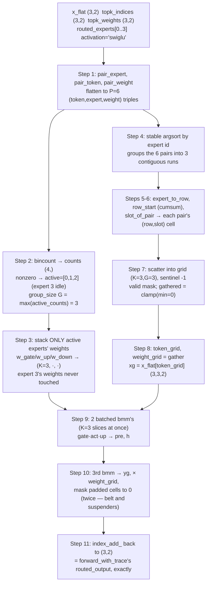
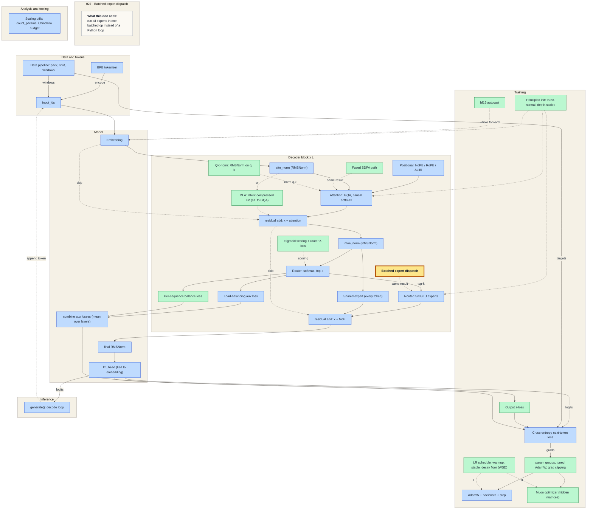

# 027 — Batched expert computation: `dispatch_batched`, derived and solved by hand

**Companion to:** [`journey_of_a_model/027-batched-expert-computation.md`](../../journey_of_a_model/027-batched-expert-computation.md)
· **Code:** [`qwenmoe/model/moe.py`](../../qwenmoe/model/moe.py) —
`dispatch_batched` ([`moe.py:322-406`](../../qwenmoe/model/moe.py#L322)) and
its helper `_stack_expert_weights` ([`moe.py:310-319`](../../qwenmoe/model/moe.py#L310))
· **Every number here is reproduced by:**
[`verify_027_batched_expert_computation.py`](verify_027_batched_expert_computation.py)
(`uv run python docs/math/verify_027_batched_expert_computation.py`)

---

## How to read this

The journal entry tells you *what* `dispatch_batched` does and *why* it's
faster than a Python loop, with one worked example of the padded grid it
builds (token/expert pairs only — no real weights, no arithmetic). This
document is the opposite trade-off: **maximum detail, minimum
summarising**. We

1. reuse [doc 005](005-moe-layer.md)'s exact tiny `MoELayer` — same input,
   same router weight, same five expert FFNs — because that config already
   has every property this function needs to exercise: an expert that gets
   **zero** tokens (must never be touched), and experts with **unequal**
   token counts (must be padded to a common shape);
2. push it through **every single line** of `dispatch_batched`
   ([`moe.py:322-406`](../../qwenmoe/model/moe.py#L322)) — the function
   this task ([journal 027](../../journey_of_a_model/027-batched-expert-computation.md))
   added — the same way earlier docs walk `forward_with_trace`;
3. for every operation — a flatten, a `bincount`, a stable sort, a
   `cumsum`, a `bmm`, a mask, a scatter-add — first derive *why* it has
   the form it does, then **do the arithmetic on paper**, digit by digit,
   and check it against the real function; and
4. show the result is bit-for-bit the same routed output as the explicit
   per-expert loop (`forward_with_trace`), and that the idle expert's
   parameters receive **no gradient at all** — not an approximately-zero
   one, `None`.

You do **not** need to have taken a linear-algebra course. Every new term
(dot product, matrix multiply, softmax, `nonzero`, `index_add_`, SiLU,
gating) is defined once, in [005](005-moe-layer.md); we reuse those
definitions here rather than repeat them, and define only the terms
`dispatch_batched` introduces that 005 didn't need (`bincount`, stable
`argsort`, `cumsum`, `bmm`, broadcasting via `unsqueeze`).

> **Scope.** This document is entirely about *how the routed experts get
> computed*, i.e. the one function this task changed. The router logits,
> softmax, top-*k* selection, and gate-weight renormalization that produce
> `dispatch_batched`'s three input tensors (`x_flat`, `topk_indices`,
> `topk_weights`) are **identical** to [005](005-moe-layer.md) Steps 1-4 —
> we quote their results below without re-deriving them. Likewise the
> shared-expert path and the final `routed + shared` combination
> ([005](005-moe-layer.md) Steps 7-8) are untouched by this task and are
> only quoted, not re-derived, in Part 4.

---

## Part 0 — What problem is this solving?

Background (full version: [journal 027](../../journey_of_a_model/027-batched-expert-computation.md)):
a Mixture-of-Experts layer ([005](005-moe-layer.md)) picks, per token, a
handful of experts and runs their small feed-forward networks. The
straightforward implementation is a Python `for` loop over experts — find
this expert's tokens, run its FFN on just those tokens, scale, scatter the
result back in. That loop makes several separate calls into PyTorch *per
expert*, and each call has a fixed dispatch overhead that doesn't shrink
with the matrix size. More experts ⇒ more calls ⇒ more overhead, even
though the total amount of *arithmetic* barely changes (the same tokens
are processed, just split into more, smaller groups).

`torch.bmm` ("batch matrix-multiply") replaces many small calls with one:
given a *stack* of `K` matrix pairs, `bmm(A, B)` with `A` shaped
`(K, m, n)` and `B` shaped `(K, n, p)` returns `(K, m, p)` — `K`
independent matrix multiplies, computed by one kernel launch instead of
`K` separate Python-level dispatches. We derive exactly what that means,
digit by digit, in Step 9 below.

**The catch:** `bmm` needs every one of its `K` slices to be the *same
shape*. Experts don't naturally get the same number of tokens. So before
any multiplication can happen, `dispatch_batched` has to (1) figure out
which experts got *any* tokens at all (an idle expert must be skipped
entirely, not padded to zero-with-garbage), and (2) lay every active
expert's real tokens into a common `(K, G, d_model)` grid, padding the
short rows and *masking the padding to exactly zero* so it never
contaminates a real token's result. That bookkeeping — not the matmuls
themselves — is almost the entire function, and it is what Part 2 derives
line by line.

---

<!-- notation:start (generated by build_architecture_footer.py) -->
> **Notation note.** The series uses one symbol set ([canonical notation](README.md#canonical-notation)). In this doc, $T$ stands for $S$, the tokens in the sequence. Nothing below is changed; this only states the correspondence.
<!-- notation:end -->

## Part 1 — The running example (reused from doc 005)

### 1.1 The model configuration

Identical to [005](005-moe-layer.md) §1.2: $d=2$ (`d_model`), $d_{\text{ff}}=3$,
$N=4$ routed experts, $k=2$ (`top_k`), 1 shared expert, `swiglu`
activation. This config was already chosen there to guarantee an idle
expert and unequal group sizes — exactly what `dispatch_batched` needs:

| Symbol | `ModelConfig` field | Value |
|---|---|---|
| $T$ | `seq_len` (from input) | $3$ tokens |
| $d$ | `d_model` | $2$ |
| $d_{\text{ff}}$ | `d_ff` | $3$ |
| $N$ | `n_routed_experts` | $4$ |
| $k$ | `top_k` | $2$ |
| — | `activation` | `swiglu` (so `dispatch_batched`'s gated branch runs — [`moe.py:368`](../../qwenmoe/model/moe.py#L368)) |

### 1.2 The input and weights

Same $X$, same router weight $W_{\text{router}}$, same five expert FFNs
(experts 0-2 routed-and-active, expert 3 routed-but-idle, one shared
expert) as [005](005-moe-layer.md) §1.3-1.4 — reproduced verbatim by
`verify_027_batched_expert_computation.py`. We do not re-list the weight
matrices here; follow the link if you want them on screen while reading.

### 1.3 The routing decisions (005 Steps 1-4, quoted)

$$x\_\text{flat} = \begin{bmatrix}1&0\\0&1\\1&1\end{bmatrix}\qquad
\text{topk\_indices} = \begin{bmatrix}0&1\\2&0\\0&2\end{bmatrix}\qquad
\text{topk\_weights} = \begin{bmatrix}0.731059&0.268941\\0.731059&0.268941\\0.880797&0.119203\end{bmatrix}$$

In words: token 0 picked experts $\{0,1\}$, token 1 picked $\{2,0\}$,
token 2 picked $\{0,2\}$. Reading `topk_indices` off by expert:
**expert 0** was picked by all three tokens (dispatch count $3$),
**expert 1** by token 0 only (count $1$), **expert 2** by tokens 1 and 2
(count $2$), **expert 3** by nobody (count $0$) — exactly
`last_expert_counts = [3, 1, 2, 0]` from 005 Step 5. These four numbers —
one idle expert, and three *different* nonzero counts among the rest —
are precisely what forces every interesting code path in
`dispatch_batched` to run on our tiny example.

### 1.4 New terms this document needs (beyond 005's vector/matrix/softmax/gather)

- **`torch.bincount(t, minlength=n)`**: given a 1-D tensor of small
  non-negative integers, returns a length-`n` tensor where entry $i$ is
  "how many times did value $i$ appear in $t$." Already used in
  [005](005-moe-layer.md) Step 5 to build `last_expert_counts` — here it's
  the same call, on a differently-named tensor with the same values.
- **`torch.nonzero(t, as_tuple=True)`** on a 1-D tensor `t`: returns (as a
  1-element tuple) the indices where `t` is nonzero, in ascending order.
  ("Which positions survived?")
- **Sort, and *stable* sort.** To *sort* a list is to output its elements
  in increasing order. `torch.argsort(t)` doesn't reorder `t` itself —
  it returns the list of **indices** that *would* put it in order: if
  `order = argsort(t)`, then `t[order]` is sorted. When two entries of
  `t` are *equal* (a "tie"), a sort has to pick which one comes first; a
  **stable** sort (`stable=True`) always keeps tied entries in their
  original relative order, never swapping them. We show exactly why that
  guarantee matters in Step 4.
- **`torch.cumsum(v, dim=0)`** ("cumulative sum" / **prefix sum**): output
  entry $i$ is $v_0+v_1+\dots+v_i$ — the running total up to and
  including position $i$. `cumsum[i] - v[i]` (used in Step 6) is therefore
  the sum of everything *strictly before* position $i$ — an **exclusive**
  prefix sum, "how much came before this one."
- **`torch.bmm(A, B)`** ("batch matrix multiply"): defined and derived in
  Part 0 above and Step 9 below.
- **Broadcasting via `.unsqueeze(-1)`**: already used once in
  [005](005-moe-layer.md) Step 6g (`gate.unsqueeze(-1)`) to let a
  per-token scalar multiply a per-token vector. Step 10 reuses the exact
  same trick one level up (per-*grid-cell* scalar × per-cell vector).
- **Sentinel value**: a value (here, $-1$) that can never legitimately
  occur in a tensor's normal range, deliberately written into unused
  slots so later code can detect "nothing here yet" by comparison
  (`grid >= 0` in Step 7).

---

## Part 2 — `dispatch_batched`, one operation at a time



**Shape ledger — start:** `x_flat (3, 2)`, `topk_indices (3, 2)`,
`topk_weights (3, 2)`.

---

### Step 1 — Flatten each token's picks into dispatch pairs

Code ([`moe.py:349-360`](../../qwenmoe/model/moe.py#L349)):

```python
n_tokens, d_model = x_flat.shape          # 3, 2
top_k = topk_indices.shape[1]             # 2
n_experts = len(routed_experts)           # 4
out = x_flat.new_zeros(n_tokens, d_model) # (3, 2), zeros -- accumulator

pair_expert = topk_indices.reshape(-1)                                       # (P,)
P = pair_expert.numel()
pair_token = torch.arange(n_tokens, device=device).repeat_interleave(top_k)
pair_weight = topk_weights.reshape(-1)
```

**Why.** `bmm` wants one flat list of independent "do this multiply" jobs,
not a `(token, slot)` grid. A **dispatch pair** is one `(token, expert)`
routing decision — token 0 choosing expert 1 is a different pair from
token 0 choosing expert 0, even though it's the same token. A token with
`top_k = k` choices contributes $k$ pairs, so the total pair count is
$P = n_{\text{tokens}} \cdot k$ — here $3 \times 2 = 6$.

- `pair_expert = topk_indices.reshape(-1)`: `reshape` never reorders
  memory (005 Step 1), only relabels axes, so this lays `topk_indices`'
  rows end to end, row-major: $[0,1,\ 2,0,\ 0,2] \to [0,1,2,0,0,2]$.
- `pair_token`: **why `repeat_interleave` and not `repeat`.** We need "the
  token index of pair $p$." Token 0 owns pairs $0,1$ (its two picks);
  token 1 owns pairs $2,3$; token 2 owns pairs $4,5$. `arange(3) = [0,1,2]`
  then `.repeat_interleave(2)` repeats **each element** in place before
  moving to the next — $[0,0,\,1,1,\,2,2]$ — which is exactly that
  grouping. (`repeat(2)`, by contrast, would tile the *whole list twice*:
  $[0,1,2,0,1,2]$ — the wrong pairing entirely; not used here.)
- `pair_weight`: same flatten as `pair_expert`, applied to
  `topk_weights` instead of `topk_indices`.

**Do it by hand.**

$$
\text{pair\_expert} = [0,\,1,\,2,\,0,\,0,\,2]
\qquad
\text{pair\_token} = [0,\,0,\,1,\,1,\,2,\,2]
$$
$$
\text{pair\_weight} = [0.731059,\ 0.268941,\ 0.731059,\ 0.268941,\ 0.880797,\ 0.119203]
$$

Reading pair $p{=}0$: token $0$, expert $0$, weight $0.731059$ — token 0's
first-choice expert, with its renormalized gate weight from 005 Step 4c.
Pair $p{=}1$: token $0$, expert $1$, weight $0.268941$ — the *same* token's
second choice. `verify_027_batched_expert_computation.py` prints exactly
these three lists and asserts them.

**Shape ledger:** `topk_indices (3,2)`, `topk_weights (3,2)` →
`pair_expert (6,)`, `pair_token (6,)`, `pair_weight (6,)`; `out (3,2)`
zeros (untouched until Step 11).

---

### Step 2 — Which experts are active, and how big is the biggest group?

Code ([`moe.py:362-366`](../../qwenmoe/model/moe.py#L362)):

```python
counts = torch.bincount(pair_expert, minlength=n_experts)   # (E,)
active = torch.nonzero(counts, as_tuple=True)[0]             # (K,) ascending ids
active_counts = counts[active]                                # (K,)
num_active = active.numel()
group_size = int(active_counts.max().item())
```

**Why `bincount` on `pair_expert` and not on `topk_indices` directly.**
It doesn't matter which — `pair_expert` *is* `topk_indices` flattened, so
counting values in either gives the same histogram (005 Step 5 used the
`topk_indices.flatten()` form for `last_expert_counts`; this is the
identical count, computed from the pairs we already built in Step 1
instead of re-flattening).

**Why `nonzero(counts)` for "active", not just "every expert 0..N-1".**
An expert with count $0$ must contribute **nothing at all** to the
computation — not a row of zeros, not even a matrix multiply on garbage
inputs. Filtering to `active` before *any* weight is touched is what
makes that guarantee structural rather than incidental (Step 3 shows
exactly how).

**Why `group_size = max(active_counts)`, derived.** Every active expert's
tokens must be laid into rows of one common-shaped grid for `bmm` to
process them together. If a row held fewer slots than that expert had
real tokens, a token would have to be **dropped** — silently never
processed by any expert, which would be a correctness bug (a per-token
guarantee: MoE routing chose that expert for a reason, dropping it changes
what the model computes). The *smallest* grid width that drops nothing is
exactly the size of the *largest* group: $G = \max_k(\text{active\_counts}_k)$.
Every expert with fewer tokens than $G$ gets padding — wasted compute
(quantified in Part 3), never a dropped token. This "no token ever
dropped" property is usually called **dropless** MoE dispatch in the
literature (contrast: capacity-factor formulations like GShard/Switch,
which pick a *fixed* $G$ and drop overflow — see Citations).

**Do it by hand.**

$$
\text{counts} = [\underbrace{3}_{e=0},\ \underbrace{1}_{e=1},\ \underbrace{2}_{e=2},\ \underbrace{0}_{e=3}]
$$

`nonzero` on this picks out the positions with a nonzero value, in
ascending order: positions $0,1,2$ qualify, position $3$ does not.

$$
\text{active} = [0,1,2] \qquad \text{active\_counts} = [3,1,2] \qquad K \;(\text{num\_active}) = 3 \qquad G\;(\text{group\_size}) = \max(3,1,2) = 3
$$

**Exact check:** $\sum_k \text{active\_counts}_k = 3+1+2 = 6 = P$ — every
one of the 6 pairs belongs to exactly one active expert (true for *any*
routing: an expert appears in `active` iff it appears in `pair_expert`,
so summing counts over exactly the experts that appear recovers the full
pair count). Verified in the script.

**Shape ledger:** adds `counts (4,)`, `active (3,)`, `active_counts (3,)`;
scalars `num_active = K = 3`, `group_size = G = 3`.

---

### Step 3 — Stack only the active experts' weights

Code ([`moe.py:368-372`](../../qwenmoe/model/moe.py#L368), calling
`_stack_expert_weights` at [`moe.py:310-319`](../../qwenmoe/model/moe.py#L310)):

```python
gated = activation in ("swiglu", "geglu")           # True here
expert_ids = active.tolist()                        # [0, 1, 2]
w_first = _stack_expert_weights(routed_experts, expert_ids, "w_gate")
w_second = _stack_expert_weights(routed_experts, expert_ids, "w_up")
w_out = _stack_expert_weights(routed_experts, expert_ids, "w_down")

# _stack_expert_weights itself:
def _stack_expert_weights(routed_experts, expert_ids, name):
    return torch.stack([getattr(routed_experts[e], name).weight for e in expert_ids])
```

**Why a Python list comprehension is fine here, and why it's the
Requirement-5.3 guarantee.** This *is* a small Python loop — but over
`expert_ids = [0, 1, 2]`, **not** over all `n_routed_experts = 4`, and it
does no arithmetic, only a `torch.stack` of existing parameter tensors
(a memory copy, not a matrix multiply). PyTorch's autograd builds its
computation graph from which tensors an operation actually *reads*;
`getattr(routed_experts[e], name).weight` for `e in [0, 1, 2]` never once
evaluates `routed_experts[3].w_gate.weight` — that tensor's data is
never read, so it cannot appear anywhere in the graph this forward pass
builds. There is no `if e == 3: skip` branch to trust; expert 3's
parameters are simply never named. This is stronger than
`forward_with_trace`'s `if token_idx.numel() == 0: continue` (005 Step
6b), which also achieves no-gradient but via an explicit skip — here it's
a consequence of which experts got listed in the first place.

**`nn.Linear.weight` shape recap** (005 §1.4): `w_gate`/`w_up` are
$(d_{\text{ff}}, d) = (3,2)$; `w_down` is $(d, d_{\text{ff}}) = (2,3)$.
Stacking $K=3$ of each along a new leading axis:

$$
w_{\text{first}} \;(\text{stacked } w_{\text{gate}}) : (3,3,2)
\qquad
w_{\text{second}}\;(\text{stacked } w_{\text{up}}) : (3,3,2)
\qquad
w_{\text{out}}\;(\text{stacked } w_{\text{down}}) : (3,2,3)
$$

— row $k$ of each is expert `expert_ids[k]`'s weight, so row $0$ is
expert 0's, row $1$ is expert **1**'s (not expert 3's — the stack is
indexed by *position in `expert_ids`*, not by global expert id; Step 5
builds the map back from global id to row).

**Shape ledger:** adds `w_first (3,3,2)`, `w_second (3,3,2)`,
`w_out (3,2,3)`. (`gated=False`, the plain-GELU branch, would instead
stack `w_1`/`w_2` and skip `w_second` — same function, two fewer
matrices; not exercised by our `swiglu` example. `geglu` stacks the same
three matrices as `swiglu`, only the activation in Step 9 differs.)

---

### Step 4 — Sort the pairs by expert, keeping ties in place

Code ([`moe.py:374-377`](../../qwenmoe/model/moe.py#L374)):

```python
order = torch.argsort(pair_expert, stable=True)   # groups pairs by expert
sorted_token = pair_token[order]
sorted_weight = pair_weight[order]
sorted_expert = pair_expert[order]
```

**Why sort at all.** Right now the 6 pairs are in **token-major** order
(token 0's two picks, then token 1's, then token 2's) — expert 0's pairs
are scattered at positions $0, 3, 4$. To lay them into contiguous rows of
a grid, they need to be **expert-major**: every pair belonging to expert
0, then every pair belonging to expert 1, etc. Sorting `pair_expert`
(and carrying `pair_token`/`pair_weight` along by the same permutation)
does exactly that.

**Why `stable=True` matters here.** `pair_expert` has *ties*: three pairs
all equal $0$ (positions $0,3,4$), two equal $2$ (positions $2,5$). An
unstable sort is free to output those tied positions in *any* order. A
**stable** sort ([defined in §1.4](#14-new-terms-this-document-needs-beyond-005s-vectormatrixsoftmaxgather))
guarantees they come out in their *original* relative order — $0$ before
$3$ before $4$. That original order is exactly the order `pair_token`
lists a token's picks, which is exactly the order `forward_with_trace`'s
`(topk_indices == e).nonzero()` would find them in (005 Step 6a builds
its `token_idx` lists in ascending row order too). **This is why, as
we'll see in Step 8, the real (non-padding) slots of the batched grid
come out in the identical order as the explicit loop's per-expert token
lists** — not a coincidence, a direct consequence of `stable=True`.

**Do it by hand.** `torch.argsort` returns the list of *indices* that
would put `pair_expert` in ascending order. Walking `pair_expert =
[0,1,2,0,0,2]` and grouping by value, preserving original order within
each group: value $0$ at positions $0, 3, 4$; value $1$ at position $1$;
value $2$ at positions $2, 5$.

$$
\text{order} = [0,\,3,\,4,\ 1,\ 2,\,5]
$$

Apply that same index list to `pair_token`, `pair_weight`, `pair_expert`
(fancy indexing: `t[order]` builds a new tensor whose $i$-th entry is
`t[order[i]]`):

$$
\text{sorted\_expert} = [0,0,0,\ 1,\ 2,2]
\qquad
\text{sorted\_token} = [0,1,2,\ 0,\ 1,2]
\qquad
\text{sorted\_weight} = [0.731059,0.268941,0.880797,\ 0.268941,\ 0.731059,0.119203]
$$

Check: `sorted_expert` is indeed sorted ascending, and every one of the
three ties landed in its original relative order ($0$ before $3$ before
$4$; $2$ before $5$). `sorted_token`'s first block, $[0,1,2]$, is
*already* "token 0, token 1, token 2, in order" — precisely
`forward_with_trace`'s `token_idx = [0,1,2]` for expert 0 (005 Step 6a's
table).

**Shape ledger:** adds `order (6,)`, `sorted_token (6,)`,
`sorted_weight (6,)`, `sorted_expert (6,)`.

---

### Step 5 — Map global expert ids to grid rows

Code ([`moe.py:380-382`](../../qwenmoe/model/moe.py#L380)):

```python
expert_to_row = torch.full((n_experts,), -1, device=device, dtype=torch.long)
expert_to_row[active] = torch.arange(num_active, device=device)
row_of_pair = expert_to_row[sorted_expert]
```

**Why this indirection.** `active = [0, 1, 2]` happens to already equal
"row index" in our example (both start at 0 and are consecutive), which
can make the mapping look unnecessary — but that's an artifact of expert
3, not 0, being the idle one. If instead expert **1** were idle,
`active` would be $[0, 2, 3]$ and grid row $1$ would need to mean
*global* expert $2$, not global expert $1$. `expert_to_row` is exactly
that lookup table, general in both directions: initialize a length-$N$
table to the sentinel $-1$ (§1.4 — "no such row" for an idle expert, by
construction never looked up, since `sorted_expert` only ever contains
active ids), then write row numbers $0..K{-}1$ into the `active`
positions. `expert_to_row[sorted_expert]` then reads off, per pair, its
target row — an example of using one tensor's values as another tensor's
indices (§1.4's fancy indexing again, now driven by a computed index
list instead of a literal one).

**Do it by hand.**

$$
\text{expert\_to\_row} = [\underbrace{0}_{e=0},\ \underbrace{1}_{e=1},\ \underbrace{2}_{e=2},\ \underbrace{-1}_{e=3}]
$$

$$
\text{row\_of\_pair} = \text{expert\_to\_row}[\,0,0,0,\ 1,\ 2,2\,] = [0,0,0,\ 1,\ 2,2]
$$

(Identical to `sorted_expert` numerically in this example only because
`active == [0,1,2,…]` starts at row 0 with no gaps below the idle expert;
the code never relies on that coincidence.)

**Shape ledger:** adds `expert_to_row (4,)`, `row_of_pair (6,)`.

---

### Step 6 — Turn a global sorted position into a within-expert slot

Code ([`moe.py:383-384`](../../qwenmoe/model/moe.py#L383)):

```python
row_start = active_counts.cumsum(0) - active_counts   # (K,)
slot_of_pair = torch.arange(P, device=device) - row_start[row_of_pair]   # (P,)
```

**Why, derived.** After Step 4, the 6 sorted pairs sit in 3 contiguous
blocks (expert 0's 3, then expert 1's 1, then expert 2's 2). We want,
for each pair, its position *within its own block* — $0$ for the first
pair of a block, $1$ for the second, etc. — so it can become a column
index into the `(K, G)` grid.

`active_counts.cumsum(0)` is the running total from §1.4:
$\text{cumsum} = [3,\ 3{+}1,\ 3{+}1{+}2] = [3,4,6]$ — "how many pairs have
been accounted for by the end of block $k$." Subtracting
`active_counts` itself removes block $k$'s own contribution, leaving
`row_start[k]` = "how many pairs came *before* block $k$ started" — the
**exclusive** prefix sum:

$$
\text{row\_start} = [3,4,6] - [3,1,2] = [0,\ 3,\ 4]
$$

(block 0 starts at position $0$; block 1 — expert 1's single pair —
starts right after block 0's 3 pairs, at position $3$; block 2 starts at
$3+1=4$.) Then for pair $j$ at global sorted position $j$, belonging to
row `row_of_pair[j]`, its local slot is simply *how far past its own
block's start it is*:

$$
\text{slot\_of\_pair}[j] = j - \text{row\_start}[\text{row\_of\_pair}[j]]
$$

**Do it by hand**, $j = 0,\dots,5$:

| $j$ | `row_of_pair[j]` | `row_start[row_of_pair[j]]` | `slot_of_pair[j]` |
|---|---|---|---|
| 0 | 0 | 0 | $0-0=0$ |
| 1 | 0 | 0 | $1-0=1$ |
| 2 | 0 | 0 | $2-0=2$ |
| 3 | 1 | 3 | $3-3=0$ |
| 4 | 2 | 4 | $4-4=0$ |
| 5 | 2 | 4 | $5-4=1$ |

$$
\text{slot\_of\_pair} = [0,1,2,\ 0,\ 0,1]
$$

Reading this off: expert 0's three pairs land at slots $0,1,2$ (fills its
whole row, since its count $3$ equals $G=3$); expert 1's one pair lands
at slot $0$ (its row will have $2$ empty slots left); expert 2's two
pairs land at slots $0,1$ (its row will have $1$ empty slot left).
Exactly the padding pattern the journal entry's worked example describes
in prose — here it falls out of `cumsum` arithmetic instead of being
asserted.

**Shape ledger:** adds `row_start (3,)`, `slot_of_pair (6,)`.

---

### Step 7 — Scatter pair positions into the padded grid

Code ([`moe.py:386-389`](../../qwenmoe/model/moe.py#L386)):

```python
grid = torch.full((num_active, group_size), -1, device=device, dtype=torch.long)  # (K, G)
grid[row_of_pair, slot_of_pair] = torch.arange(P, device=device)
valid = grid >= 0                    # (K, G)
gathered = grid.clamp(min=0)         # (K, G)
```

**Why.** `grid[k, s]` is meant to answer "which pair (by its position $j$
in the *sorted* arrays) sits at row $k$, slot $s$?" Initialize every cell
to the sentinel $-1$ ("nothing here"), then for every pair $j$ write $j$
into its own $(\text{row\_of\_pair}[j], \text{slot\_of\_pair}[j])$ cell —
a **2-D scatter**: `grid[rows, cols] = values` writes `values[i]` into
`grid[rows[i], cols[i]]` for every $i$ at once. Because Steps 5-6 gave
every pair a **unique** $(k,s)$ target (each block's slots run
$0,1,\dots,\text{count}{-}1$ with no repeats or gaps), all $P=6$ writes
land on distinct cells — no pair ever overwrites another (verified in the
script: the grid's non-sentinel entries are exactly $\{0,\dots,5\}$, each
once).

`valid = grid >= 0` marks which cells got a real pair ($-1$ never
satisfies this). `gathered = grid.clamp(min=0)` — **why clamp instead of
leaving `-1` in place**: the very next step uses `grid`'s values as
indices into 6-element arrays (`sorted_token[gathered]`, Step 8); indexing
with $-1$ would silently wrap around to the *last* element in PyTorch
(valid but meaningless), and some index tensors don't accept negative
values at all. Clamping every $-1$ up to $0$ makes every padding cell
harmlessly "pretend to be pair 0" — a placeholder whose actual value gets
thrown away by `valid`-masking three steps later (Step 10), never trusted
for real output.

**Do it by hand.** Row $k$, slot $s$: write $j$ wherever
$(\text{row\_of\_pair}[j],\text{slot\_of\_pair}[j])=(k,s)$, from the table
in Step 6 ($j{=}0{\to}(0,0)$, $j{=}1{\to}(0,1)$, $j{=}2{\to}(0,2)$,
$j{=}3{\to}(1,0)$, $j{=}4{\to}(2,0)$, $j{=}5{\to}(2,1)$):

$$
\text{grid} = \begin{bmatrix} 0 & 1 & 2 \\ 3 & -1 & -1 \\ 4 & 5 & -1 \end{bmatrix}
\qquad
\text{valid} = \begin{bmatrix} T&T&T\\T&F&F\\T&T&F \end{bmatrix}
\qquad
\text{gathered} = \begin{bmatrix} 0&1&2\\3&0&0\\4&5&0 \end{bmatrix}
$$

Row 0 (expert 0) is entirely real — its count ($3$) equals $G$. Row 1
(expert 1) has 1 real slot and 2 padding slots (clamped to reference pair
$0$). Row 2 (expert 2) has 2 real slots and 1 padding slot. Of the
$K\cdot G = 9$ grid cells, $6$ are real (`valid` is `True`) and $3$ are
padding — the wasted-compute count Part 3 uses.

**Shape ledger:** adds `grid (3,3)`, `valid (3,3)`, `gathered (3,3)`.

---

### Step 8 — Gather tokens, weights and embeddings into the grid

Code ([`moe.py:391-393`](../../qwenmoe/model/moe.py#L391)):

```python
token_grid = sorted_token[gathered]                                         # (K, G)
weight_grid = torch.where(valid, sorted_weight[gathered], sorted_weight.new_zeros(()))  # (K, G)
xg = x_flat[token_grid]                                                     # (K, G, d_model)
```

**`sorted_token[gathered]`** — indexing a length-6 tensor with a
$(3,3)$-shaped index tensor produces a $(3,3)$-shaped result, entry
$(k,s) = \text{sorted\_token}[\text{gathered}[k,s]]$: "which token sits
in this grid cell." **`torch.where(cond, a, b)`** picks `a` where `cond`
is `True`, `b` elsewhere, elementwise — here forcing every padding cell's
weight to exactly $0$ regardless of what `sorted_weight[gathered]` picked
up from its clamped placeholder pair. **`x_flat[token_grid]`** then reads
out the actual $d$-dimensional embedding for whichever token sits in each
cell, giving a full $(K, G, d)$ tensor `bmm` can consume.

**Do it by hand.**

$$
\text{token\_grid} = \begin{bmatrix}0&1&2\\0&0&0\\1&2&0\end{bmatrix}
\qquad
\text{weight\_grid} = \begin{bmatrix}0.731059&0.268941&0.880797\\0.268941&0&0\\0.731059&0.119203&0\end{bmatrix}
$$

Row 1's padding slots (columns 1-2) reused pair $0$'s token — token $0$ —
because `gathered` clamped their $-1$s to $0$ (Step 7); `weight_grid`
zeroes them regardless of that borrowed token identity. Row 2's one
padding slot (column 2) also borrows token $0$, weight forced to $0$.

$$
x_g = x\_\text{flat}[\text{token\_grid}] = \begin{bmatrix}
[1,0] & [0,1] & [1,1] \\
[1,0] & [1,0] & [1,0] \\
[0,1] & [1,1] & [1,0]
\end{bmatrix}\qquad\text{shape }(3,3,2)
$$

Row 0 is tokens $0,1,2$ in order — literally $x\_\text{flat}$ unchanged
(expert 0 processes every token). Row 1 is token $0$, three times (once
real, twice padding). Row 2 is tokens $1,2$ then a padding copy of token
$0$.

**Shape ledger:** adds `token_grid (3,3)`, `weight_grid (3,3)`,
`xg (3,3,2)`.

---

### Step 9 — The two batched matrix multiplies, digit by digit

Code ([`moe.py:395-397`](../../qwenmoe/model/moe.py#L395), `swiglu` branch):

```python
pre = torch.bmm(xg, w_first.transpose(1, 2))              # (K, G, d_ff)
h = F.silu(pre) * torch.bmm(xg, w_second.transpose(1, 2))  # (K, G, d_ff)
```

**Deriving `bmm` from ordinary matrix multiply.** $A$ shaped $(K,m,n)$
and $B$ shaped $(K,n,p)$: `bmm(A, B)` produces $(K,m,p)$ where **slice
$k$ of the output is the ordinary matrix product of slice $k$ of $A$ with
slice $k$ of $B$** — $\text{bmm}(A,B)[k] = A[k]\,B[k]$, using the
definition of matrix multiply from [005](005-moe-layer.md) §1.1. There is
no mixing across $k$: expert 0's slice of the output depends only on
expert 0's slice of $A$ and $B$, never on expert 1's or 2's data. `bmm`
is therefore *exactly* $K$ independent matrix multiplies — the definition
*is* the derivation; the only thing "batching" adds is doing all $K$ in
one call.

**Why this reproduces `nn.Linear` exactly.** `w_first` is `w_gate`
stacked, shape $(K, d_{\text{ff}}, d) = (3,3,2)$;
`w_first.transpose(1,2)` swaps its *last two* axes (leaving the leading
$K$ axis alone), giving $(3,2,3)$. Slice $k$ of that transpose is
$W^{k\top}_{\text{gate}}$ — literally 005 §1.5's `nn.Linear` formula
($Y = UW^\top$) applied with $U = x_g[k]$ ($G$ rows, one per grid slot).
So $\text{pre}[k] = x_g[k]\,W^{k\top}_{\text{gate}}$ is *the same number*
005's per-token dot products would give — `bmm` hasn't changed the
arithmetic, only how many Python-level calls compute it.

**Do it by hand, row by row** (each row $k$ is $x_g[k]$, a $(3,2)$
matrix, times expert $k$'s $(2,3)$ transposed gate weight):

**Row 0 (expert 0, tokens $0,1,2$)** — 005 §6d's exact computation,
reused verbatim (its $g$ values):

$$
\text{pre}[0] = \begin{bmatrix}1&0&1\\0&1&1\\1&1&2\end{bmatrix}
$$

**Row 1 (expert 1, tokens $0,0,0$)** — three identical rows, since every
slot (real and padding alike) holds token 0's vector; 005 §6e's $g$ for
token 0:

$$
\text{pre}[1] = \begin{bmatrix}-1&2&1\\-1&2&1\\-1&2&1\end{bmatrix}
$$

**Row 2 (expert 2, tokens $1,2,0$)** — slots 0-1 are 005 §6f's $g$ for
tokens 1, 2 (reused); slot 2 (token 0 through expert 2's weights) is a
grid cell **005 never computed**, because the loop path never runs expert
2 on token 0 at all — the padded grid does, and then discards it.
$W^2_{\text{gate}}$ rows are $[0,2],[1,-1],[0,1]$; $x_0=[1,0]$:

$$
g = \big[[1,0]{\cdot}[0,2],\ [1,0]{\cdot}[1,-1],\ [1,0]{\cdot}[0,1]\big] = [0,\,1,\,0]
$$

$$
\text{pre}[2] = \begin{bmatrix}2&-1&1\\2&0&1\\0&1&0\end{bmatrix}
$$

(Real module: `verify_027_batched_expert_computation.py` prints `pre`
exactly matching this $3\times3\times3$ tensor, and separately checks
`pre[k] == xg[k] @ w_first[k].T` for every $k$ — the "$K$ independent
matmuls" claim, confirmed on the real tensors, not asserted.)

**The gate nonlinearity and the second `bmm`.** $\operatorname{silu}$ is
defined and tabulated in [005](005-moe-layer.md) §6c; we reuse its table
verbatim (all our $g$ entries are in $\{-1,0,1,2\}$, which 005 already
covers). $\text{bmm}(x_g, w_{\text{second}}^\top)$ is the identical
construction as `pre`, with $W_{\text{up}}$ in place of $W_{\text{gate}}$
— giving $u$ for every grid cell — and $h = \operatorname{silu}(\text{pre})
\odot u$ (elementwise product, [005](005-moe-layer.md) §1.1). Row 0 and
the two real cells of rows 1-2 are, again, exactly 005 §6d-6f's $h$
values; the one new cell (row 2, slot 2 — expert 2 on token 0) needs its
own $u$: $W^2_{\text{up}}$ rows $[1,1],[0,1],[1,0]$, so
$u = \big[[1,0]{\cdot}[1,1],[1,0]{\cdot}[0,1],[1,0]{\cdot}[1,0]\big] = [1,0,1]$,
and with $g=[0,1,0]$, $\operatorname{silu}(g)=[0,\,0.731059,\,0]$:
$h = [0{\cdot}1,\ 0.731059{\cdot}0,\ 0{\cdot}1] = [0,0,0]$.

$$
h[0]\;(\text{expert }0) = \begin{bmatrix}0.731059 & 0 & 0 \\ 0 & 0 & 0.731059 \\ 1.462117 & 0.731059 & 1.761594\end{bmatrix}
$$

$$
h[1]\;(\text{expert }1) = \begin{bmatrix}-0.268941 & 1.761594 & 1.462117 \\ -0.268941 & 1.761594 & 1.462117 \\ -0.268941 & 1.761594 & 1.462117\end{bmatrix}\qquad\text{(3 identical rows — every slot is token 0)}
$$

$$
h[2]\;(\text{expert }2) = \begin{bmatrix}1.761594 & -0.268941 & 0 \\ 3.523188 & 0 & 0.731059 \\ 0 & 0 & 0\end{bmatrix}
$$

(three separate $(3,3)$ blocks, one per row $k$, stacked; `h` is
$(3,3,3)$ — printed and matched exactly by the script). Notice row 2's
new cell comes out **all zero** — $g$'s only nonzero entry (index 1,
value $1$) got multiplied by $u$'s zero at that same index. This is a
coincidence of *this* weight choice, not a general property of padding
cells (the point of masking, next, is that the code cannot and does not
rely on it).

**Shape ledger:** adds `pre (3,3,3)`, `h (3,3,3)`.

---

### Step 10 — Gate weight, and masking the padding to exactly zero

Code ([`moe.py:402-403`](../../qwenmoe/model/moe.py#L402)):

```python
yg = torch.bmm(h, w_out.transpose(1, 2)) * weight_grid.unsqueeze(-1)   # (K, G, d_model)
yg = torch.where(valid.unsqueeze(-1), yg, yg.new_zeros(()))
```

**The third `bmm`, by the same rule as Step 9:** slice $k$ of
$\text{bmm}(h, w_{\text{out}}^\top)$ is $h[k]\,W_{\text{down}}^{k\top}$ —
005 §1.5's `nn.Linear` formula again, giving each grid cell's *full*
expert output $E_k(\text{token})$ (pre-gate).

**Broadcasting the gate weight.** `weight_grid` is $(K,G)$ — one scalar
per grid cell — but each cell's expert output is a length-$d$ vector, so
`weight_grid.unsqueeze(-1)` inserts a size-1 axis, making it $(K,G,1)$.
Multiplying a $(K,G,1)$ tensor by a $(K,G,d)$ tensor **broadcasts**: the
size-1 axis is treated as "repeat this value across all $d$ positions" —
exactly [005](005-moe-layer.md) §6g's `gate.unsqueeze(-1)` trick, one
level up (there it broadcast across $d$ *output* coordinates for a flat
per-token gate; here the same operation additionally runs over the
*expert/row* axis at once, since every row's gates differ).

**Why mask twice — `weight_grid`'s built-in zero, and this explicit
`torch.where`.** `weight_grid` (Step 8) already holds $0$ in every
padding cell, so multiplying by it already sends most padding
contributions to $0$ — *provided* the thing it multiplies is finite.
Floating-point arithmetic has one exception: $0 \times (\pm\infty) =
\text{NaN}$ ("not a number," a poisoned value that would propagate through
every arithmetic operation it later touches, including the sum in Step
11). If a padding cell's expert output were ever infinite or `NaN` — not
possible in *this* example, since every padding cell reuses a real,
finite token's embedding, but not something the function can assume in
general — the plain multiply-by-zero would not be enough to clean it up.
The explicit `torch.where(valid.unsqueeze(-1), yg, 0)` is a second,
unconditional mask: "regardless of what arithmetic produced this cell,
if it's padding, the answer is *exactly* zero" — defensive, not
redundant in general, even though our example's numbers make both masks
agree.

**Do it by hand**, per row, multiplying each cell's expert output by its
`weight_grid` scalar (using $W_{\text{down}}$ rows $[1,0,1],[0,1,1]$ for
expert 0; $[1,1,0],[0,1,1]$ for expert 1; $[1,0,1],[1,1,0]$ for expert 2
— 005 §1.4):

| row (expert) | slot | expert output $E(x)$ | gate | $E(x)\times\text{gate}$ |
|---|---|---|---|---|
| 0 | 0 (tok 0) | $[0.731059, 0]$ | $0.731059$ | $[0.534447, 0]$ |
| 0 | 1 (tok 1) | $[0.731059, 0.731059]$ | $0.268941$ | $[0.196612, 0.196612]$ |
| 0 | 2 (tok 2) | $[3.223711, 2.492653]$ | $0.880797$ | $[2.839436, 2.195521]$ |
| 1 | 0 (tok 0) | $[1.492653, 3.223711]$ | $0.268941$ | $[0.401436, 0.866989]$ |
| 1 | 1 (pad) | $[1.492653, 3.223711]$ | $0$ | $[0,0]$ |
| 1 | 2 (pad) | $[1.492653, 3.223711]$ | $0$ | $[0,0]$ |
| 2 | 0 (tok 1) | $[1.761594, 1.492653]$ | $0.731059$ | $[1.287828, 1.091216]$ |
| 2 | 1 (tok 2) | $[4.254247, 3.523188]$ | $0.119203$ | $[0.507119, 0.419974]$ |
| 2 | 2 (pad) | $[0, 0]$ | $0$ | $[0,0]$ |

(Rows agree with [005](005-moe-layer.md) §6g's per-expert contributions to
within float32's last-digit rounding — e.g. $0.196612$ here vs.
$0.196611$ there, the same $\sim\!10^{-6}$ accumulation noise every doc in
this series notes.) The second `torch.where` changes **nothing** in this
table — `verify_027_batched_expert_computation.py` prints `max |yg -
yg_premask| = 0.0` — confirming the two masks agree here, as derived.

**Shape ledger:** `yg (3,3,2)` (unchanged shape through both masking
steps).

---

### Step 11 — Scatter every grid cell back to its token

Code ([`moe.py:405`](../../qwenmoe/model/moe.py#L405)):

```python
out.index_add_(0, token_grid.reshape(-1), yg.reshape(-1, d_model).to(out.dtype))
```

**Why `.reshape(-1, d_model)` first.** `index_add_` (defined in
[005](005-moe-layer.md) §6g) wants a flat list of `(index, row)` pairs,
not a `(K, G, d)` grid — `token_grid.reshape(-1)` and
`yg.reshape(-1, d_model)` flatten the first two axes together (row-major,
so cell $(k,s)$ becomes flat position $k\cdot G + s$ in both, staying
paired up), giving $9 = K\cdot G$ `(token, contribution)` rows, real and
padding alike.

**Why padding rows are harmless here, arithmetically.** `index_add_`
*adds* `yg`'s row onto `out[token_grid[i]]` for every flattened position
$i$ — including the 3 padding rows. Since Step 10 forced every padding
row to the zero vector, adding it changes nothing: a padding row still
targets *some* real token (Step 7's clamp made it point at token 0), but
contributes $[0,0]$, so `out[0]` receives three extra additions of
nothing. This is the concrete reason the masking in Step 10 has to be
*exact* zero, not merely small — `index_add_` cannot tell "intentional
padding" from "a tiny real contribution," so any nonzero leakage would
silently corrupt a real token's sum.

**`.to(out.dtype)`**: an explicit dtype upcast (relevant when the model
runs under bf16 autocast — [journal 024](../../journey_of_a_model/024-mixed-precision-and-z-loss.md) /
[doc 024](024-mixed-precision-and-z-loss.md)); `out` is always fp32 here
(no autocast in this example), so this cast is a no-op on our numbers.

**Do it by hand**, flattening row-major and adding into `out[token_grid[i]]`:

| flat $i$ | token | contribution | running `out[token]` |
|---|---|---|---|
| 0 | 0 | $[0.534447,0]$ | tok0 $=[0.534447,0]$ |
| 1 | 1 | $[0.196612,0.196612]$ | tok1 $=[0.196612,0.196612]$ |
| 2 | 2 | $[2.839436,2.195521]$ | tok2 $=[2.839436,2.195521]$ |
| 3 | 0 | $[0.401436,0.866989]$ | tok0 $=[0.935883,0.866989]$ |
| 4 | 0 | $[0,0]$ (pad) | tok0 unchanged |
| 5 | 0 | $[0,0]$ (pad) | tok0 unchanged |
| 6 | 1 | $[1.287828,1.091216]$ | tok1 $=[1.484440,1.287828]$ |
| 7 | 2 | $[0.507119,0.419974]$ | tok2 $=[3.346555,2.615495]$ |
| 8 | 0 | $[0,0]$ (pad) | tok0 unchanged |

$$
\boxed{\ \text{out (routed\_output)} = \begin{bmatrix}0.935883 & 0.866989\\1.484440 & 1.287828\\3.346554 & 2.615495\end{bmatrix}\quad\text{shape }(3,2)\ }
$$

**Real module** (`dispatch_batched(x_flat, topk_indices, topk_weights,
moe.routed_experts, "swiglu")`, called directly — not reimplemented):
identical to this table, `max |by-hand − dispatch_batched| = 0.0`. And
this is **exactly** [005](005-moe-layer.md)'s `routed_output` from its
independently-derived per-expert loop, `max |dispatch_batched −
forward_with_trace| = 0.0` in our example (the project's own tests bound
this at `1e-5` on larger, less-tidy examples; here the two literally
agree to the last printed digit).

**Shape ledger — final:** `token_grid (3,3)`, `yg (3,3,2)` →
`out (3,2)`.

---

## Part 3 — Cost, and why built this way

### 3.1 Padding waste, counted exactly on this example

$K\cdot G = 3\times3 = 9$ grid cells get a full expert-FFN evaluation;
only $P=6$ of them are real (Step 7). The other $3$ — $33\%$ — are pure
waste: real arithmetic (two matmuls' worth of work, per padding cell)
whose result is computed and then thrown away by masking. This waste is
bounded by how *unequal* the active groups are: expert 0's group ($3$
tokens) sets $G=3$, forcing expert 1's group (only $1$ real token) to
carry $2$ dead slots. With perfectly balanced routing (the load-balancing
machinery's actual job — [doc 005](005-moe-layer.md) §Step 9, [doc
026](026-per-sequence-balance-loss.md)), every active group would be
close to $P/K$ and the waste would shrink to a small constant factor
rather than growing with imbalance.

### 3.2 Kernel-launch count: fixed at 3, not $O(K)$

The `swiglu`/`geglu` branch makes **exactly 3** `torch.bmm` calls total —
one for the gate projection, one for the up projection, one for the down
projection (Steps 9-10) — regardless of how many experts are active. In
our example $K=3$, so the loop path (`forward_with_trace`) also makes
exactly 3 Python-level `expert(...)` calls; but *each* of those fans out
into 3 more `nn.Linear` dispatches internally (gate, up, down) plus a
`nonzero` and an `index_add_` (005 §6a, 6g) — roughly $3\times5=15$
separate PyTorch-level dispatches for the loop path, vs. this function's
3 `bmm` calls plus a handful of $O(1)$ bookkeeping ops (`bincount`,
`argsort`, `cumsum`, …) that touch small $(K,)$-or-$(P,)$-sized tensors,
none of which scale with $K$ or $N$ the way a Python loop's *call count*
does. At $K=3$ this difference is invisible on a stopwatch; the
journal's own measured sweep (8 → 64 routed experts, routed parameter
count held fixed) is where the fixed-3-`bmm` property becomes a real
$1.17\times \to 2.99\times$ wall-clock speed-up, because the loop's
dispatch count keeps climbing with $N$ while this function's stays at 3.
Reproducing that sweep is out of scope here — our example is deliberately
too small to show a timing difference; see
[journal 027](../../journey_of_a_model/027-batched-expert-computation.md)'s
table for the real measurement.

### 3.3 Zero new parameters, one `stack` copy per forward

`dispatch_batched` introduces no `nn.Parameter` and no buffer — every
weight it uses already belongs to some `routed_experts[e]`. The one
recurring cost the design accepted (journal 027) is `_stack_expert_weights`'s
`torch.stack` — an $O(K \cdot d_{\text{ff}} \cdot d)$ copy, every forward
pass, of only the *active* experts' weights (here: $3$ matrices of
$(3,2)$ or $(2,3)$ each, $3\times(3{\cdot}2{+}3{\cdot}2{+}2{\cdot}3)=54$
numbers copied) — negligible next to the matmuls' own
$O(K\cdot G\cdot d\cdot d_{\text{ff}})$ cost, and the price paid in
exchange for **not** migrating the checkpoint format (routed experts stay
an `nn.ModuleList` of ordinary `nn.Linear`s — see journal 027's
"Deliberate deviation from `design.md`" section for the full trade-off).

### 3.4 Why built this way (recap, in one place)

- **`stable=True`** on the `argsort` (Step 4): not for correctness of the
  final numeric result (any consistent grouping would sum to the same
  `out`), but so the real slots of the grid land in the *same order*
  `forward_with_trace`'s `nonzero()` finds them — making the two paths'
  intermediate token orderings match, not just their final sums, which is
  what let Step 9's arithmetic reuse 005's per-token numbers directly.
- **Two masks, not one** (Step 10): `weight_grid`'s built-in zero handles
  every *finite* padding value; the explicit `torch.where` is the one
  line standing between "almost always correct" and "correct even if a
  padding cell's garbage were ever non-finite" — cheap insurance, derived
  in Step 10.
- **`G = max(active_counts)`, not a fixed capacity**: guarantees zero
  tokens are ever dropped (§Step 2), at the cost of the padding waste
  quantified in §3.1 — the "dropless" choice, contrasted with
  capacity-factor formulations in the Citations below.

---

## Questions that might come to mind

- **Could two dispatch pairs ever collide on the same grid cell?** No —
  proven structurally in Step 7: `slot_of_pair` assigns each block's
  pairs the consecutive integers $0,1,\dots,\text{count}{-}1$ with no
  repeats (it's built from `arange(P)` minus a per-block constant), so
  every pair gets a distinct $(\text{row},\text{slot})$ target. Verified
  directly: the grid's non-sentinel entries are exactly $\{0,\dots,5\}$,
  each appearing once.

- **What does `expert_to_row[3]` (the idle expert's row) even mean, since
  it's never looked up?** It stays at the sentinel $-1$ forever — not a
  bug, just dead data. `sorted_expert` (Step 4) is built from
  `pair_expert`, which by construction only ever contains ids that
  appeared in `topk_indices` — an idle expert, by definition, never
  appears there, so `expert_to_row[3]` is never read as an index into
  anything. The $-1$ is there only so the tensor has *some* value at
  every position (PyTorch tensors can't have "empty" entries).

- **What if `activation="gelu"` (the plain, non-gated expert)?** `gated =
  False` (Step 3), so only `w_1`/`w_2` get stacked (no `w_second`), and
  Step 9's second `bmm` and elementwise multiply are skipped entirely —
  `h = F.gelu(pre)` directly ([`moe.py:400-401`](../../qwenmoe/model/moe.py#L400)).
  Everything from Step 4 onward (sorting, the grid, the masks, the
  scatter) is identical — none of that machinery depends on which
  activation variant is in play. Not exercised by our `swiglu` example;
  see [005](005-moe-layer.md) §6c for why `swiglu` uses 3 weight matrices
  where plain `gelu` uses 2.

- **What happens with `P = 0`** (an empty batch, or `top_k=0` — not
  actually reachable, since `ModelConfig` requires `top_k >= 1`, but the
  function still guards it)? [`moe.py:357-358`](../../qwenmoe/model/moe.py#L357)
  returns the all-zero `out` immediately, before `bincount` or any stack
  — no expert is touched, matching the loop path's behavior on an empty
  batch (every `token_idx.numel() == 0`, every iteration `continue`s).

- **Does this change training results?** No — Requirement 5.2 (journal
  027) is exactly what Step 11 measures: `dispatch_batched`'s output
  matches `forward_with_trace`'s to `0.0` on this example, and to
  `< 1e-5` on the project's larger, randomized test batches (the tiny
  residual there is `bmm` vs. `mm` accumulating in a different order —
  not a behavior change).

- **Why does `_stack_expert_weights` re-copy the weights every single
  forward pass instead of caching the stacked tensor?** Because which
  experts are *active* — and therefore which get stacked — can change
  every batch (a different set of tokens routes to a different set of
  experts). A cached stack from a previous batch could hold a stale
  `expert_ids` list, or worse, silently include an expert that happens to
  be idle *this* batch, defeating Requirement 5.3's no-gradient guarantee.
  The recomputation is what makes "only touch the active experts" true on
  every single call, not just the first.

---

## Symbol reference

| symbol | meaning |
|---|---|
| $P$ | total dispatch pairs, $n_{\text{tokens}}\cdot k$ ($6$ here) |
| `pair_expert`, `pair_token`, `pair_weight` | length-$P$ flat lists: which expert / token / gate weight each pair is |
| `counts` | per-expert dispatch count, length $N$ (`bincount` of `pair_expert`) |
| `active` | ascending ids of experts with `counts > 0` ($[0,1,2]$ here) |
| $K$, `num_active` | number of active experts ($3$) |
| $G$, `group_size` | width of the padded grid, $=\max$ active count ($3$) |
| `order` | `argsort(pair_expert, stable=True)` — indices that sort pairs by expert |
| `row_of_pair`, `slot_of_pair` | each pair's target $(k,s)$ cell in the grid |
| `row_start` | exclusive prefix sum of `active_counts` — where each expert's block begins in the sorted arrays |
| `grid` | $(K,G)$ table of pair positions, sentinel $-1$ for padding |
| `valid` | $(K,G)$ boolean, `True` where `grid >= 0` |
| `token_grid`, `weight_grid`, `xg` | the token id / gate weight / embedding at every grid cell |
| `bmm` | batch matrix multiply: $K$ independent matrix products in one call |
| `pre`, `h`, `yg` | gate pre-activation, gated hidden state, gated+masked expert output — all $(K,G,\cdot)$ |
| `out` | the function's return value, $(n_{\text{tokens}}, d)$ — same as `forward_with_trace`'s `routed_output` |
| stable sort | a sort that never reorders elements that compare equal |
| prefix sum / `cumsum` | running total; `cumsum[i] = v_0+\dots+v_i` |
| sentinel | a deliberately out-of-range value ($-1$) marking "nothing here yet" |
| broadcasting | implicitly repeating a size-1 axis to match another tensor's shape in an elementwise op |
| dropless | a dispatch scheme that never discards a routed token, only pads (contrast: fixed-capacity dispatch) |

---

## Citations

Reused from journal entry 027; the MegaBlocks author list below was
independently re-confirmed against arXiv's own metadata (the journal's
citation drops one author and adds one who isn't on the paper — noted
here for the record, harmless either way since the arXiv id is correct).

- Gale, Narayanan, Young & Zaharia, *MegaBlocks: Efficient Sparse
  Training with Mixture-of-Experts*, 2022 —
  [arXiv:2211.15841](https://arxiv.org/abs/2211.15841), MLSys 2023.
  Reformulates MoE dispatch as **block-sparse** matmuls, avoiding both
  token-dropping and the padding waste this function accepts (§3.1) — the
  reference for "why the loop and the padded-batch approach are the two
  easy-but-imperfect options." (Author list confirmed via arXiv's Atom
  API, 2026-09-11: Trevor Gale, Deepak Narayanan, Cliff Young, Matei
  Zaharia.)
- Lepikhin, Lee, Xu, Chen, Firat, Huang, Krikun, Shazeer & Chen, *GShard:
  Scaling Giant Models with Conditional Computation and Automatic
  Sharding*, 2020 — [arXiv:2006.16668](https://arxiv.org/abs/2006.16668).
  Introduced the **expert-capacity** formulation — a fixed-size
  `(n_experts, capacity, d_model)` buffer, one `einsum` — that
  `dispatch_batched`'s `(K, G, d_model)` grid mirrors, with $G$ chosen
  per-batch from the data (dropless, §Step 2) instead of a fixed capacity
  that can drop tokens. (Confirmed via arXiv, 2026-09-11.)
- Fedus, Zoph & Shazeer, *Switch Transformers: Scaling to Trillion
  Parameter Models with Simple and Efficient Sparsity*, 2021 —
  [arXiv:2101.03961](https://arxiv.org/abs/2101.03961). §2.2's *capacity
  factor* is the same padding-vs-dropping trade-off this function's
  $G=\max(\text{active\_counts})$ resolves by always choosing "just
  enough" capacity — never dropping, at the cost of the waste quantified
  in §3.1. (Confirmed via arXiv, 2026-09-11.)

---

*Every intermediate tensor in this document is reproduced and asserted by
[`verify_027_batched_expert_computation.py`](verify_027_batched_expert_computation.py).
If you change the running example, rerun it.*

<!-- arch-evolution:start (generated by build_architecture_footer.py; do not edit by hand) -->

---

## Where this fits in the architecture (the growing view)

← previous: [026 Per-sequence balance loss](026-per-sequence-balance-loss.md) · next: [028 Multi-Token Prediction](028-multi-token-prediction.md) →

**This doc adds to the architecture:** run all experts in one batched op instead of a Python loop. (Code: `qwenmoe/model/moe.py`.)

**Components introduced here (highlighted in the diagram), with where each one lives:**

| component | math doc (section) | journal | code |
|---|---|---|---|
| Batched expert dispatch | [027 · Part 2 — dispatch_batched, one operation at a time](027-batched-expert-computation.md#part-2--dispatch_batched-one-operation-at-a-time) | [journal 027](../../journey_of_a_model/027-batched-expert-computation.md) | [`qwenmoe/model/moe.py:322`](../../qwenmoe/model/moe.py#L322) |

**Verified by:** [`verify_027_batched_expert_computation.py`](verify_027_batched_expert_computation.py) (`uv run python docs/math/verify_027_batched_expert_computation.py`); latest results in [verify-status.md](verify-status.md).

**Example continuity:** **Reuses family C unchanged** (005) and shows the batched and looped paths agree. See the [example-family map](README.md#which-example-does-each-doc-use).

The diagram is cumulative: every box derived by this doc or an earlier one is shown, and components from later docs are not drawn yet, so reading the docs in order replays how the architecture grew. The top box is this doc's title and what it adds. The [full final architecture](architecture-evolution.md) has everything.

**Colour key:** 🟨 **introduced by this doc** · 🟦 Foundation (004-011) · 🟩 Modernization (016-031) · 🟪 Evaluation and scale (032-038) · 🟧 Real data and hardware (039-044). Dotted lines are optional or alternative paths.



**How we got here (every doc up to and including this one):**

| | math doc | journal | what it added |
|---|---|---|---|
|  | [004 Attention (GQA)](004-attention-gqa.md) | [journal](../../journey_of_a_model/004-attention-gqa.md) | scaled dot-product attention with grouped K/V heads, the positional transform and the causal mask |
|  | [005 MoE layer](005-moe-layer.md) | [journal](../../journey_of_a_model/005-moe-layer.md) | the router, top-k selection, routed SwiGLU experts, the shared expert and the load-balancing aux loss |
|  | [006 Full model](006-full-model-assembly.md) | [journal](../../journey_of_a_model/006-full-model-assembly.md) | token embedding, pre-norm residual wiring, the final norm, the tied head and the cross-layer aux-loss combine; attention and MoE appear here as black boxes |
|  | [007 Tokenizers](007-tokenizers.md) | [journal](../../journey_of_a_model/007-tokenizers.md) | text to `input_ids`: byte-level BPE and the char tokenizer |
|  | [008 Data pipeline](008-data-pipeline.md) | [journal](../../journey_of_a_model/008-data-pipeline.md) | packing documents, train/val split, fixed slices and the shifted `(x, y)` windows |
|  | [009 Scaling utilities](009-scaling-law-utilities.md) | [journal](../../journey_of_a_model/009-scaling-law-utilities.md) | parameter counting (total vs active), the compute-optimal budget and throughput calibration |
|  | [010 Training loop](010-training-loop.md) | [journal](../../journey_of_a_model/010-training-loop.md) | the next-token cross-entropy loss, backward pass and AdamW step, carried through a real `Trainer.fit` |
|  | [011 Inference and generation](011-inference-generation.md) | [journal](../../journey_of_a_model/011-inference-generation.md) | the autoregressive decode loop (greedy, temperature, top-k, top-p) |
|  | [016 MLA attention](016-mla-attention.md) | [journal](../../journey_of_a_model/016-mla-attention.md) | Multi-Head Latent Attention: K/V compressed to a small latent, an alternative to GQA |
|  | [018 Optimizer hardening](018-optimizer-hardening.md) | [journal](../../journey_of_a_model/018-optimizer-hardening.md) | param groups (decay vs no-decay), tuned AdamW and gradient clipping |
|  | [019 LR schedule (WSD)](019-lr-schedule-wsd.md) | [journal](../../journey_of_a_model/019-lr-schedule-wsd.md) | warmup, stable and decay phases with a non-zero floor |
|  | [020 Muon optimizer](020-muon-optimizer.md) | [journal](../../journey_of_a_model/020-muon-optimizer.md) | orthogonalized momentum for the hidden weight matrices, AdamW for the rest |
|  | [021 Fused attention (SDPA)](021-fused-attention-sdpa.md) | [journal](../../journey_of_a_model/021-fused-attention-sdpa.md) | `F.scaled_dot_product_attention` as a drop-in for the explicit path |
|  | [022 QK-norm](022-qk-norm.md) | [journal](../../journey_of_a_model/022-qk-norm.md) | RMSNorm on each head's q and k before the scores, bounding the attention logits |
|  | [023 Principled init](023-principled-initialization.md) | [journal](../../journey_of_a_model/023-principled-initialization.md) | truncated-normal init and depth-aware scaling of the residual-writing projections |
|  | [024 Mixed precision and z-loss](024-mixed-precision-and-z-loss.md) | [journal](../../journey_of_a_model/024-mixed-precision-and-z-loss.md) | bf16 autocast for the forward pass and the output z-loss regularizer |
|  | [025 Sigmoid routing and router z-loss](025-moe-routing-sigmoid-and-router-z-loss.md) | [journal](../../journey_of_a_model/025-moe-routing-sigmoid-and-router-z-loss.md) | sigmoid expert scoring, the router z-loss and the config-driven aux weight |
|  | [026 Per-sequence balance loss](026-per-sequence-balance-loss.md) | [journal](../../journey_of_a_model/026-per-sequence-balance-loss.md) | DeepSeek-V3's complementary balance loss computed per sequence |
| **▶** | [027 Batched expert dispatch](027-batched-expert-computation.md) | [journal](../../journey_of_a_model/027-batched-expert-computation.md) | run all experts in one batched op instead of a Python loop |

<!-- arch-evolution:end -->
