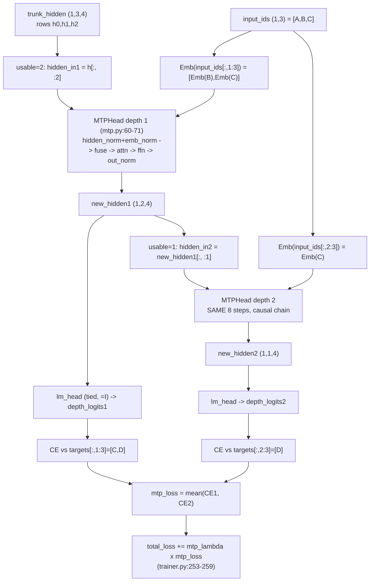
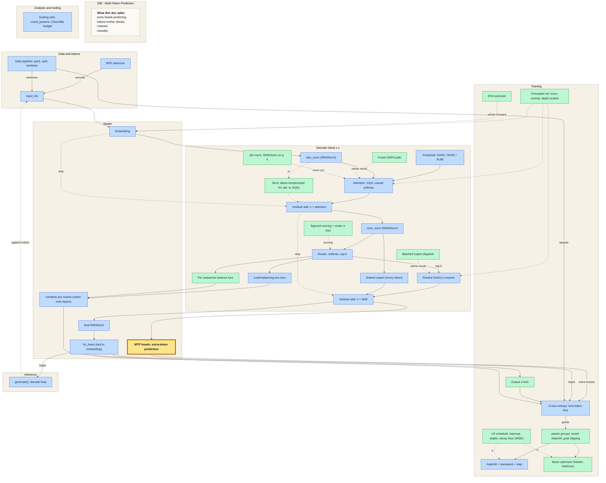

# 028 — Multi-Token Prediction: `MTPHead` and the causal chain, derived and solved by hand

**Companion to:** [`journey_of_a_model/028-multi-token-prediction.md`](../../journey_of_a_model/028-multi-token-prediction.md)
· **Code:** [`qwenmoe/model/mtp.py`](../../qwenmoe/model/mtp.py) (`MTPHead`) and
[`qwenmoe/model/transformer.py`](../../qwenmoe/model/transformer.py)
(`QwenMoEModel._mtp_losses`, `forward`'s MTP branch) and
[`qwenmoe/train/trainer.py`](../../qwenmoe/train/trainer.py)
(`_forward_backward_core`)
· **Every number here is reproduced by:**
[`verify_028_multi_token_prediction.py`](verify_028_multi_token_prediction.py)
(`uv run python docs/math/verify_028_multi_token_prediction.py`)

---

## How to read this

The journal entry tells you *what* Multi-Token Prediction (MTP) is, *why*
next-token prediction alone is a myopic training signal, and walks one
conceptual 5-token example in prose. This document is the opposite
trade-off: **maximum detail, minimum summarising**. We

1. fix one tiny running example — small enough that every number fits on
   the page, but with `n_kv_heads (1) < n_heads (2)` inside every MTP
   head's attention sub-layer, so GQA's broadcast is genuinely exercised,
   not vacuous;
2. push it through **every single line** of `MTPHead.forward`
   ([`mtp.py:60-71`](../../qwenmoe/model/mtp.py#L60)) *twice* — once for
   depth 1 (which reads the trunk's hidden state) and once for depth 2
   (which reads depth 1's *output* hidden state — the causal chain that
   is this task's entire point);
3. for every operation — a slice, a concat, a matrix multiply, a softmax,
   a cross-entropy — first derive *why* it has the form it does, then
   **do the arithmetic on paper**, digit by digit, and check it against
   the real modules;
4. then walk `QwenMoEModel._mtp_losses`
   ([`transformer.py:145-185`](../../qwenmoe/model/transformer.py#L145))
   and `forward`'s gating
   ([`transformer.py:137-141`](../../qwenmoe/model/transformer.py#L137))
   to show the per-depth losses this document derives by hand are
   *exactly* what those real methods compute, in every one of the four
   train/eval/targets/no-targets states; and
5. finally the trainer's `mtp_lambda`-weighted combination
   ([`trainer.py:253-259`](../../qwenmoe/train/trainer.py#L253)).

[Doc 006](006-full-model-assembly.md)'s own Step 19 explicitly defers this:
*"MTP is a training-only auxiliary objective with its own derivation; out
of scope here."* This document is that derivation.

You do **not** need to have read a linear-algebra course. Every new term
is defined at first use; terms already defined in an earlier doc in this
series ([004](004-attention-gqa.md)'s vector/dot-product/matrix-multiply/
softmax, [005](005-moe-layer.md)'s `nn.Linear`/SiLU/gating,
[006](006-full-model-assembly.md)'s RMSNorm/residual/pre-norm,
[010](010-training-loop.md)'s cross-entropy/logsumexp,
[016](016-mla-attention.md)'s concatenation) are reused, cited, and not
redefined.

---

## Part 0 — What problem is this solving?

Full background: [journal 028](../../journey_of_a_model/028-multi-token-prediction.md).
In one sentence: next-token prediction only ever asks position $i$'s
hidden state "did you get the very next token right?" — MTP adds extra,
training-only heads that ask "can you *also* predict two, three, … steps
ahead?", so gradients from those questions shape the shared trunk's
representations too, without costing anything at inference (the extra
heads simply aren't run there).

This project follows **DeepSeek-V3**'s design (Sec. 2.1.3): a **causal
chain** of heads, where head $k$ consumes head $k{-}1$'s output hidden
state (not the trunk's, except for head 1) fused with the embedding of
the token the model is being *told* to expect next (teacher forcing —
defined below). This is a genuine one-block mini-transformer per head:
a fusion projection, one pre-norm attention sub-layer, one pre-norm dense
SwiGLU FFN sub-layer, and an output norm — which is exactly why this
document has to walk attention and a gated FFN again, just with the
fusion step and the chain wrapped around them.

---

## Part 1 — The running example

### 1.1 The model configuration

The smallest configuration that exercises every behavior `MTPHead` and
its wiring have:

| Symbol | `ModelConfig` field | Value | Why this value |
|---|---|---|---|
| $d$ | `d_model` | $4$ | small enough to hand-write every vector |
| $H$ | `n_heads` | $2$ | plural query heads, so GQA does something |
| $H_{kv}$ | `n_kv_heads` | $1$ | **$< H$** — the one requirement this doc must satisfy |
| $d_k$ | `head_dim` $= d/H$ | $2$ | smallest even value RoPE/GQA both accept |
| $d_{\text{ff}}$ | `d_ff` | $3$ | SwiGLU's intermediate width, small but $\neq d$ |
| $V$ | `vocab_size` | $4$ | tokens $A{=}0, B{=}1, C{=}2, D{=}3$ — see §1.2 |
| — | `mtp_depth` | $2$ | the smallest depth that shows the *chain* (depth 2 reading depth 1's output) as well as the base case (depth 1 reading the trunk) |
| — | `mtp_lambda` | $0.3$ | the project default (DeepSeek-V3's value; journal 028) |
| — | `positional_scheme` | `nope` | **deliberate simplification**, not a limitation: `MTPHead` just forwards whatever `positions` it's given into `build_attention(config)` ([`mtp.py:55`](../../qwenmoe/model/mtp.py#L55)) — it is completely agnostic to which positional scheme that attention uses. [Doc 004](004-attention-gqa.md) §1.2 sets the same precedent (RoPE's rotation is orthogonal to what this doc derives; NoPE keeps every number free of RoPE's irrational sines/cosines) |
| — | `attention_variant` | `gqa` | `Attention`, not `MLAAttention` |
| — | `qk_norm` | `False` (default) | keeps `Attention`'s forward at its shortest branch |

The **trunk** (`n_layers=1`, `n_routed_experts=1`, `top_k=1`,
`n_shared_experts=0`, `aux_loss_weight=0.0`) exists only so a real
`QwenMoEModel` can be constructed — its own attention/MoE math is
*already* fully derived in
[004](004-attention-gqa.md)/[005](005-moe-layer.md)/[006](006-full-model-assembly.md),
so this document does not re-derive it. Part 2–3's `trunk_hidden` is
**hand-picked** directly (any `(batch, seq_len, d_model)` tensor is a
legal input to `_mtp_losses`), exactly the way
[027](027-batched-expert-computation.md) takes `x_flat`/`topk_indices` as
given rather than re-deriving the router that produced them. Part 4 uses
the trunk for real, but only to check *structure* (which dict keys come
back), never to hand-verify the trunk's own numbers.

### 1.2 The weights

**Embedding table** ($V{=}4$ rows, $d{=}4$ columns) — the identity
matrix. Two payoffs from this choice: (a) `RMSNorm` on a one-hot row
gives the clean $\text{rsqrt}(0.25){=}2.0$ used throughout §2, and (b)
since `tie_word_embeddings=True` (default) makes `lm_head.weight` the
*same* tensor, and here $V{=}d{=}4$, the **output head becomes the
identity too** — `depth_logits = lm_head(new_hidden) = new_hidden`
exactly, so every MTP-head cross-entropy in this doc is computed directly
on `new_hidden`'s own numbers, no extra matrix multiply to carry through.

$$
E = \begin{bmatrix}1&0&0&0\\0&1&0&0\\0&0&1&0\\0&0&0&1\end{bmatrix}
\begin{matrix}\leftarrow A(0)\\\leftarrow B(1)\\\leftarrow C(2)\\\leftarrow D(3)\end{matrix}
$$

**Both MTP heads** (`model.mtp_heads[0]`, depth 1, and `model.mtp_heads[1]`,
depth 2) are pinned to the **same** numbers below — a deliberate economy
for this document (each is still its own independent `nn.Module`, with
its own parameters; nothing in the code ties them together). Every
`RMSNorm` gain (`hidden_norm`, `emb_norm`, `attn_norm`, `ffn_norm`,
`out_norm`) is left at its default all-ones init
([`rmsnorm.py:12`](../../qwenmoe/model/rmsnorm.py#L12)).

**Fuse** ($W_{\text{fuse}}$, `nn.Linear(2d{=}8, d{=}4)`, no bias) — the two
$4\times4$ identity blocks side by side:

$$W_{\text{fuse}} = \big[\,I_4 \mid I_4\,\big] = \begin{bmatrix}
1&0&0&0&1&0&0&0\\0&1&0&0&0&1&0&0\\0&0&1&0&0&0&1&0\\0&0&0&1&0&0&0&1
\end{bmatrix}$$

**Attention** (GQA: $H{=}2$, $H_{kv}{=}1$, $d_k{=}2$):

$$
W_Q = I_4 \quad(4\times4)
\qquad
W_K = \begin{bmatrix}1&0&0&0\\0&1&0&0\end{bmatrix} (2\times4)
\qquad
W_V = \begin{bmatrix}0&0&1&0\\0&0&0&1\end{bmatrix} (2\times4)
\qquad
W_O = I_4 \quad(4\times4)
$$

$W_Q{=}I$ means query head 0 reads dims $[0,1]$ of its input and query
head 1 reads dims $[2,3]$ — the *same* two slices $W_K$/$W_V$ read — so
every dot product below stays a plain 2-term sum, not because the real
`nn.Linear` does anything special, but because this is the simplest
weight choice that still makes $H_{kv}{<}H$ (GQA) bite: one $(K,V)$ pair
gets broadcast to two *different* $Q$'s (head 0's slice $\neq$ head 1's
slice), so the two heads' attention weights genuinely differ.

**FFN** (dense `SwiGLUExpert`, $d{=}4 \to d_{\text{ff}}{=}3 \to d{=}4$):

$$
W_{\text{gate}} = \begin{bmatrix}1&0&0&0\\0&1&0&0\\0&0&1&0\end{bmatrix} (3\times4)
\qquad
W_{\text{up}} = \begin{bmatrix}0&1&0&0\\0&0&1&0\\0&0&0&1\end{bmatrix} (3\times4)
\qquad
W_{\text{down}} = \begin{bmatrix}1&0&0\\0&1&0\\0&0&1\\1&1&1\end{bmatrix} (4\times3)
$$

$W_{\text{down}}$'s last row is the one matrix in this document that is
**not** a pure selection — output coordinate 3 is the *sum* of all three
gated values — so at least one FFN step below is a genuine multi-term
accumulation, not just "read off a component."

### 1.3 The input

$$
\text{input\_ids} = [A, B, C] = [0,1,2] \qquad
\text{targets} = [B, C, D] = [1,2,3] \qquad
\text{positions} = [0,1,2]
$$

(An entirely ordinary shift-by-one target — $D$ never appears as an input
in this 3-token example, only as a target, exactly as ordinary training
data has a token after the visible window ends.)

$$
\text{trunk\_hidden} = \begin{bmatrix} 1&0&1&0 \\ 0&1&0&1 \\ 1&1&0&0 \end{bmatrix}
\quad\text{shape } (1,3,4)
$$

(Row 2 is written for shape-completeness only — §2.1 shows it is never
actually *read* by `_mtp_losses` at `mtp_depth=2`, `seq_len=3`.)

### 1.4 New terms this document needs

- **Concatenation** (`torch.cat([a, b], dim=-1)`): lay two vectors
  end-to-end into one longer vector,
  $[\,a_1,\dots,a_d\,;\,b_1,\dots,b_d\,]$ — already defined and used in
  [016](016-mla-attention.md#step-8--concatenate-content--rope-per-head)
  Step 8 for `q_content`/`q_rope`; here it concatenates two *normalized*
  vectors instead of a content/rope split, and the concatenated result
  feeds a real `nn.Linear` (§2 Step 3) rather than going straight into a
  dot product.
- **Teacher forcing** (already defined, [journal
  028](../../journey_of_a_model/028-multi-token-prediction.md)): during
  training the *true* token is available, so an MTP head is hand-fed
  `Emb(input_ids[i+depth])` — the token it must predict *one step beyond*
  — rather than having to guess it. This never runs at inference (the
  heads aren't run there at all).
- **Causal chain**: depth $k$'s `hidden` input is depth $k{-}1$'s
  **output** hidden state, not the trunk's — so depth 2 literally builds
  on depth 1's already-transformed representation, rather than solving
  "predict 3 steps ahead" from scratch. Derived precisely in §3.1.
- Everything else — vector, dot product, matrix multiply, `nn.Linear`'s
  $Y=UW^\top$ ([005](005-moe-layer.md#15-what-nnlinear-actually-computes)),
  RMSNorm's mean-of-squares/rsqrt/gain
  ([006](006-full-model-assembly.md#step-4--block-0-attn_normx-rmsnorm-pre-norm-position)),
  causal masking, softmax, GQA's shared-KV broadcast
  ([004](004-attention-gqa.md)), SiLU-gated FFN
  ([005](005-moe-layer.md#part-1--the-running-example)), and
  cross-entropy as `logsumexp(z) - z_c`
  ([010](010-training-loop.md#43-fcross_entropy--derived-from-scratch))
  — are reused from those docs, not redefined here.



---

## Part 2 — MTP head, depth 1: `MTPHead.forward`, one operation at a time

**Shape ledger — start:** `hidden_in1 (1,2,4)`, `next_emb1 (1,2,4)`,
`pos_in1 (2,)`.

### Step 1 — Slice the inputs to this depth's usable length

Code ([`transformer.py:167-174`](../../qwenmoe/model/transformer.py#L167)):

```python
usable = seq_len - depth                                      # 3 - 1 = 2
new_hidden = head(
    hidden[:, :usable, :],                                     # trunk_hidden[:, :2, :]
    self.embedding(input_ids[:, depth : depth + usable]),      # Emb(input_ids[:, 1:3])
    positions[:usable],                                        # [0, 1]
)
```

**Derive.** Head $k$ (1-indexed) at position $i$ needs
`Emb(input_ids[i+k])` and target `targets[i+k]`, both only defined while
$i+k < \text{seq\_len}$ — so the number of *usable* positions at depth
$k$ is $\text{seq\_len} - k$. At depth 1, $\text{usable} = 3-1=2$: only
positions $i\in\{0,1\}$ have a valid $i+1$. `hidden[:, :usable, :]` takes
the **first** `usable` positions — not an arbitrary offset slice —
because a head's input `hidden` is indexed by $i$ (the position asking
the question), while the *token it's given* is indexed by $i+\text{depth}$
(`input_ids[:, depth:depth+usable]`); the *usable set of $i$'s* is always
the prefix $\{0,\dots,\text{usable}-1\}$ regardless of depth.

**Compute.**

$$
\text{hidden\_in1} = \text{trunk\_hidden}[:, :2, :] = \begin{bmatrix}1&0&1&0\\0&1&0&1\end{bmatrix}
$$
$$
\text{input\_ids}[:,1:3] = [B, C] \;\to\; \text{next\_emb1} = [E_B, E_C] = \begin{bmatrix}0&1&0&0\\0&0&1&0\end{bmatrix}
\qquad \text{pos\_in1} = [0,1]
$$

**Shape ledger:** `hidden_in1 (1,2,4)`, `next_emb1 (1,2,4)`, `pos_in1 (2,)`.

---

### Step 2 — Normalize each input separately

Code ([`mtp.py:67`](../../qwenmoe/model/mtp.py#L67)):
`self.hidden_norm(hidden)`, `self.emb_norm(next_token_emb)`.

**Derive — why *two* norms, not one shared norm on the concatenation.**
`hidden` is a slice of the trunk's **residual stream**: a running sum of
every sub-layer's contribution so far
([006](006-full-model-assembly.md) §3.1;
[023](023-principled-initialization.md)'s depth-growth derivation shows
its variance grows with the number of layers it has passed through).
`next_token_emb` is a **fresh embedding lookup** — one row of $E$, at
whatever scale the embedding table happens to sit at. These two vectors
have no reason to share a scale. RMSNorm's job (§1.4, cited) is exactly
"divide each row by its own RMS" — applying it to `hidden` and
`next_token_emb` **separately**, before they ever interact, means the
learned `fuse` projection receives two inputs already on a comparable
footing (both unit RMS, times a learnable gain each) instead of having to
first learn to undo whatever scale mismatch existed.

**Compute** (mean-of-squares $\to$ rsqrt$(\cdot+10^{-6})$ $\to$ multiply,
gain $=1$ — arithmetic identical in form to
[006](006-full-model-assembly.md) Step 4, new numbers):

Row 0 of `hidden_in1` $=[1,0,1,0]$: mean of squares $=\frac{1+0+1+0}{4}=0.5$,
$\text{rsqrt}(0.500001) = 1.414212$ (not the exact $\sqrt2=1.414214$ —
the $10^{-6}$ inside the square root is what makes it $1.414212$ instead;
negligible at this precision, [006](006-full-model-assembly.md) §Step 4
already explains why it's there). Row 1 $=[0,1,0,1]$ has the same
mean-of-squares ($0.5$), same factor:

$$
\text{hidden\_normed1} = \begin{bmatrix}1.414212&0&1.414212&0\\0&1.414212&0&1.414212\end{bmatrix}
$$

Row 0 of `next_emb1` $=[0,1,0,0]$ (one-hot): mean of squares $=\frac14=0.25$,
$\text{rsqrt}(0.250001)=1.999996$ (would be exactly $2$ without the eps).
Row 1 is the same shape, same factor:

$$
\text{emb\_normed1} = \begin{bmatrix}0&1.999996&0&0\\0&0&1.999996&0\end{bmatrix}
$$

**Shape ledger:** `hidden_normed1 (1,2,4)`, `emb_normed1 (1,2,4)` (both
unchanged in shape from their inputs — RMSNorm never changes shape).

---

### Step 3 — Concatenate and fuse

Code ([`mtp.py:66-68`](../../qwenmoe/model/mtp.py#L66)):

```python
fused = self.fuse(
    torch.cat([self.hidden_norm(hidden), self.emb_norm(next_token_emb)], dim=-1)
)
```

**Derive.** Concatenation (§1.4) turns the pair of length-4 vectors into
one length-8 vector per position,
$u = [\,\text{hidden\_normed}\;;\;\text{emb\_normed}\,]$. `fuse` is an
ordinary `nn.Linear(8,4)`: $Y = U W_{\text{fuse}}^\top$
([005](005-moe-layer.md) §1.5) — row $p$'s output is the dot product of
$u_p$ (length 8) with each of $W_{\text{fuse}}$'s 4 rows (also length 8).
**Why concatenate-then-project at all**, rather than e.g. just adding the
two normalized vectors directly: concatenation hands the linear layer
**every number from both sources, unmixed**, and lets a *learned* $4\times8$
matrix decide how to combine them — which could implement addition (as
below), a weighted average, or something that mixes hidden's dimension 2
into the *emb* side of the output — any linear combination of all 8
numbers into each of the 4 outputs. Restricting to addition is a
**choice of weights**, not a constraint of the operation (DeepSeek-V3
Sec. 2.1.3's own fusion projection is a full learned matrix, not
constrained to be block-identity).

**This document's $W_{\text{fuse}}=[I_4\mid I_4]$ happens to reduce to
plain addition** — worth deriving explicitly, since it's a useful
sanity-check property, not a general fact about `fuse`:
$Y = UW_{\text{fuse}}^\top$, and $W_{\text{fuse}}^\top$ stacks two
$4\times4$ identity blocks vertically, so
$Y = u_{[0:4]}\cdot I + u_{[4:8]}\cdot I = u_{[0:4]} + u_{[4:8]} =$
`hidden_normed + emb_normed`.

**Compute** (row-by-row addition):

$$
\text{fused1} = \text{hidden\_normed1} + \text{emb\_normed1} = \begin{bmatrix}
1.414212 & 1.999996 & 1.414212 & 0 \\
0 & 1.414212 & 1.999996 & 1.414212
\end{bmatrix}
$$

(`verify_028_...py` additionally asserts `fused1 == hidden_normed1 +
emb_normed1` to $10^{-6}$ — the "reduces to addition for this weight
choice" claim, checked, not assumed.)

**Shape ledger:** `(1,2,4)`, `(1,2,4)` concatenated to `(1,2,8)`,
projected back to `fused1 (1,2,4)`.

---

### Step 4 — Pre-norm before the attention sub-layer

Code ([`mtp.py:69`](../../qwenmoe/model/mtp.py#L69)): `self.attn_norm(fused)`.

Same RMSNorm operation as Step 2, applied to `fused1`. Row 0: squares
$1.414212^2{+}1.999996^2{+}1.414212^2{+}0^2 \approx 2{+}4{+}2{+}0=8$,
mean $=2$, $\text{rsqrt}(2.000001)=0.707107$:
$\text{fused1}[0]\times0.707107 = [1,\,1.414212,\,1,\,0]$. Row 1 is the
same pattern shifted one slot:

$$
\text{attn\_normed1} = \begin{bmatrix}1&1.414212&1&0\\0&1&1.414212&1\end{bmatrix}
$$

**Shape ledger:** `(1,2,4) -> (1,2,4)`.

---

### Step 5 — The attention sub-layer

Code ([`mtp.py:69`](../../qwenmoe/model/mtp.py#L69)):
`self.attn(self.attn_norm(fused), positions)` — this calls
`Attention.forward`, the **fused** `F.scaled_dot_product_attention` path
([`attention.py:119-181`](../../qwenmoe/model/attention.py#L119)), the
one `MTPHead` actually runs (not `forward_with_trace`). To see every
intermediate, we call `Attention.forward_with_trace`
([`attention.py:183-248`](../../qwenmoe/model/attention.py#L183)) on the
identical input — the same explicit matmul/mask/softmax/matmul steps
[004](004-attention-gqa.md) derives from scratch — and confirm the fused
path agrees.

**5a — $Q$, $K$, $V$ projections and the head split.** $W_Q{=}I_4$ means
`attn_normed1` passes through unchanged, then reshapes into 2 heads of
width $d_k{=}2$ each (position $\times$ head $\times$ head-dim, [004](004-attention-gqa.md)
§Part 2 Step 1-2 derives the reshape/transpose in full — same operation,
new numbers):

$$
Q^{(0)} = \begin{bmatrix}1&1.414212\\0&1\end{bmatrix}
\quad
Q^{(1)} = \begin{bmatrix}1&0\\1.414212&1\end{bmatrix}
$$

$W_K$ selects dims $[0,1]$ of `attn_normed1` (the **one** KV head,
since $H_{kv}{=}1$); $W_V$ selects dims $[2,3]$:

$$
K = \begin{bmatrix}1&1.414212\\0&1\end{bmatrix} \qquad
V = \begin{bmatrix}1&0\\1.414212&1\end{bmatrix}
$$

(No positional transform: `positional_scheme="nope"` means
`apply_to_qk` is the identity — [`positional.py:70-73`](../../qwenmoe/model/positional.py#L70).)

**5b — GQA: one $(K,V)$, two different $Q$'s.** With $H_{kv}{=}1 < H{=}2$,
this single $K,V$ pair is **shared** — broadcast to both query heads
inside `F.scaled_dot_product_attention(..., enable_gqa=True)`
([021](021-fused-attention-sdpa.md) derives exactly this broadcast,
`⌊h/n_rep⌋`, from scratch). Head 0's queries and head 1's queries are
different vectors (Step 5a), so even though they attend over the *same*
keys/values, their attention weights will differ — this is the whole
point of GQA (fewer KV projections, but query-head-specific attention
patterns survive).

**5c — Scores: $QK^\top/\sqrt{d_k}$.** Derived in full in
[004](004-attention-gqa.md) Part 2 ("why $\sqrt{d_k}$": keeps the score's
variance from growing with $d_k$, footnote 4 of Vaswani et al. 2017).
Head 0, entry $(i,j) = Q^{(0)}_i \cdot K_j$:

$$
(0,0):\ [1,1.414212]\cdot[1,1.414212] = 1\times1 + 1.414212\times1.414212 = 1 + 2.000\overline{0} = 3.000000
$$
$$
(1,0):\ [0,1]\cdot[1,1.414212] = 0+1.414212 = 1.414212
\qquad
(1,1):\ [0,1]\cdot[0,1] = 0+1=1.000000
$$

Divide by $\sqrt{d_k}=\sqrt2=1.414214$: row 0, col 0 $= 3.000000/1.414214=2.121319$; row 1: $[1.000000,\ 0.707107]$.
Head 1, entry $(i,j)=Q^{(1)}_i\cdot K_j$:

$$
(0,0):\ [1,0]\cdot[1,1.414212]=1 \qquad (1,0):\ [1.414212,1]\cdot[1,1.414212] = 1.414212+1.414212=2.828424
\qquad (1,1):\ [1.414212,1]\cdot[0,1]=1
$$

Scaled: row 0, col 0 $=1/1.414214=0.707107$; row 1: $2.828424/1.414214=1.999999$, $1/1.414214=0.707107$.

$$
\text{scores (pre-mask)} = \underbrace{\begin{bmatrix}2.121319&\cdot\\1.000000&0.707107\end{bmatrix}}_{\text{head }0}
\qquad
\underbrace{\begin{bmatrix}0.707107&\cdot\\1.999999&0.707107\end{bmatrix}}_{\text{head }1}
$$

(the "$\cdot$" entries at row 0, col 1 are real numbers `forward_with_trace`
computes too — $1.414212$ and $0.000000$ respectively — but they are
about to be masked to $-\infty$, so we don't carry them further; the real
script prints and the doc's arithmetic ignores them identically.)

*A rounding note.* $1.414212/1.414214$ computed from these **6-decimal
display values** is $0.999999$, not the $1.000000$ printed above — the
real computation carries `attn_normed1`'s full float32 precision
(`1.0000002384…`, `1.4142124653…`, not the rounded `1`/`1.414212` shown
for readability), which lands at $0.9999995$, rounding to $1.000000$ at
6 decimals. Every number quoted in this document is the real script's
output; re-deriving one from an already-rounded intermediate can land a
digit off in the last place, exactly the kind of float32 accumulation
noise [027](027-batched-expert-computation.md) and others in this series
already flag.

**5d — Causal mask.** Position 0 may only see position 0 (query index $<$
key index is future); position 1 may see both. So row 0's masked entry
becomes $-\infty$ in *both* heads, row 1 is untouched.

**5e — Softmax, with real exponentials.** [004](004-attention-gqa.md)
derives why softmax is $e^{z_i}/\sum_j e^{z_j}$ (shift-invariance, the
$-\infty\to0$ contribution). Row 0 (both heads): a single valid entry
$\Rightarrow \sigma = e^{z}/e^{z}=1$ **exactly**, for *any* finite $z$ —
an exact fact, not a rounding coincidence, that reappears at full force
in Part 3 (depth 2 has only one valid key at every position). Row 1, head 0,
$z=[1.000000,\ 0.707107]$:

$$
e^{1.000000}=2.718282 \qquad e^{0.707107}=2.028115 \qquad \text{sum}=4.746397
$$
$$
p_0 = 2.718282/4.746397 = 0.572704 \qquad p_1=2.028115/4.746397=0.427296
$$

Row 1, head 1, $z=[1.999999,\ 0.707107]$: $e^{2.0}=7.389056$,
$e^{0.707107}=2.028115$, sum $=9.417171$:
$p_0=7.389056/9.417171=0.784636$, $p_1=2.028115/9.417171=0.215364$.

$$
\text{probs} = \underbrace{\begin{bmatrix}1&0\\0.572704&0.427296\end{bmatrix}}_{\text{head }0}
\qquad
\underbrace{\begin{bmatrix}1&0\\0.784636&0.215364\end{bmatrix}}_{\text{head }1}
$$

**5f — Weighted sum with $V$.** Row 0 (either head): weight $[1,0]$
against $V=[[1,0],[1.414212,1]]$ gives exactly $V_0=[1,0]$ — the "single
visible key" exact fact from 5e means **row 0's attention output is $V$
at that position, regardless of $Q$**. Row 1, head 0:
$0.572704\times[1,0] + 0.427296\times[1.414212,1] = [0.572704+0.604287,\ 0.427296] = [1.176991,\ 0.427296]$.
Row 1, head 1: $0.784636\times[1,0]+0.215364\times[1.414212,1] = [0.784636+0.304571,\ 0.215364]=[1.089207,\ 0.215364]$.

**5g — Concatenate heads, $W_O=I$.** ([004](004-attention-gqa.md) derives
the head-concatenation reshape.) Since $W_O{=}I_4$, the output projection
is the identity:

$$
\text{attn\_out1} = \begin{bmatrix}1&0&1&0\\1.176991&0.427296&1.089207&0.215364\end{bmatrix}
$$

**Fused vs. explicit, measured.** Calling the real (fused)
`head1.attn(attn_normed1, pos_in1)` and comparing to the explicit
`forward_with_trace` result above: **measured max $|$fused $-$ trace$|$
$= 5.960464 \times 10^{-8}$** — [021](021-fused-attention-sdpa.md)'s exact
explanation applies verbatim (float32 addition is not perfectly
associative; the fused kernel's internal summation order differs from
the explicit matmul's, well inside the project's $10^{-5}$ test
tolerance).

**Shape ledger:** `attn_normed1 (1,2,4)` $\to$ $Q,K,V$ per head `(2,2,2)`
query / `(1,2,2)` key-value $\to$ scores `(2,2,2)` $\to$ probs `(2,2,2)`
$\to$ per-head output `(2,2,2)` $\to$ concatenated `attn_out1 (1,2,4)`.

---

### Step 6 — Residual add around attention

Code ([`mtp.py:69`](../../qwenmoe/model/mtp.py#L69)): `x = fused + self.attn(...)`.

Same pre-norm-with-residual wiring [006](006-full-model-assembly.md)
derives for the trunk's own blocks (§3.1: the un-normalized `fused`
continues down the residual path; only the *normalized* copy fed the
sub-layer). Plain elementwise addition:

$$
x_1 = \text{fused1} + \text{attn\_out1} = \begin{bmatrix}
2.414212 & 1.999996 & 2.414212 & 0 \\
1.176991 & 1.841508 & 3.089202 & 1.629576
\end{bmatrix}
$$

**Shape ledger:** `(1,2,4) + (1,2,4) -> (1,2,4)`.

---

### Step 7 — Pre-norm before the FFN sub-layer

Code ([`mtp.py:70`](../../qwenmoe/model/mtp.py#L70)): `self.ffn_norm(x)`.
Same RMSNorm operation, on $x_1$. Row 0: squares
$2.414212^2{+}1.999996^2{+}2.414212^2{+}0^2 \approx 5.828{+}4.000{+}5.828{+}0=15.657$,
mean $\approx3.914206$, $\text{rsqrt}\approx0.505450$ — carrying this to the
full precision the script prints:

$$
\text{ffn\_normed1} = \begin{bmatrix}
1.220263 & 1.010898 & 1.220263 & 0 \\
0.571342 & 0.893916 & 1.499580 & 0.791039
\end{bmatrix}
$$

**Shape ledger:** `(1,2,4) -> (1,2,4)`.

---

### Step 8 — The dense SwiGLU FFN

Code ([`moe.py:29`](../../qwenmoe/model/moe.py#L29),
`SwiGLUExpert.forward`): `w_down(F.silu(w_gate(x)) * w_up(x))`. The
"why gate with SiLU" derivation is [005](005-moe-layer.md) §Part 1's
(Shazeer 2020) — reused verbatim here, only the numbers are new.

**8a — Two projections.** $W_{\text{gate}}$ selects dims $[0,1,2]$ of
`ffn_normed1`; $W_{\text{up}}$ selects dims $[1,2,3]$:

$$
\text{pre\_gate1} = \begin{bmatrix}1.220263&1.010898&1.220263\\0.571342&0.893916&1.499580\end{bmatrix}
\qquad
\text{up1} = \begin{bmatrix}1.010898&1.220263&0\\0.893916&1.499580&0.791039\end{bmatrix}
$$

**8b — SiLU, one entry fully worked.** $\operatorname{silu}(v) = v\cdot\sigma(v)$,
$\sigma(v)=1/(1+e^{-v})$ (defined and derived in [005](005-moe-layer.md)
§Part 1). For $v=1.220263$: $e^{-1.220263}=0.295022$,
$\sigma(1.220263) = 1/(1+0.295022) = 1/1.295022 = 0.772110$,
$\operatorname{silu}(1.220263) = 1.220263\times0.772110 = 0.942177$. Every
other entry follows the identical rule (computed by the script, not
re-derived by hand digit-by-digit here):

$$
\operatorname{silu}(\text{pre\_gate1}) = \begin{bmatrix}0.942177&0.741186&0.942177\\0.365129&0.634410&1.225924\end{bmatrix}
$$

**8c — Gate, elementwise multiply.**

$$
h_1 = \operatorname{silu}(\text{pre\_gate1}) \odot \text{up1} = \begin{bmatrix}0.952445&0.904442&0\\0.326395&0.951349&0.969753\end{bmatrix}
$$

(Row 0, col 2: $0.942177\times0=0$ — `up1`'s own zero, from $W_{\text{up}}$'s
selection landing on `ffn_normed1`'s zero entry, not a masked/special
case, just this row's fourth coordinate happening to be $0$.)

**8d — Down-projection, the one real accumulation.** $Y=UW_{\text{down}}^\top$
([005](005-moe-layer.md) §1.5): the first 3 output columns just copy
$h_1$'s 3 columns ($W_{\text{down}}$'s first 3 rows are $e_1,e_2,e_3$),
but column 3 is $W_{\text{down}}$'s 4th row, $[1,1,1]$, dotted with $h_1$:
row 0, col 3 $= 0.952445+0.904442+0=1.856887$; row 1, col 3 $=
0.326395+0.951349+0.969753=2.247497$.

$$
\text{ffn\_out1} = \begin{bmatrix}0.952445&0.904442&0&1.856887\\0.326395&0.951349&0.969753&2.247497\end{bmatrix}
$$

**Shape ledger:** `ffn_normed1 (1,2,4)` $\to$ `pre_gate1/up1 (1,2,3)` $\to$
`h1 (1,2,3)` $\to$ `ffn_out1 (1,2,4)`.

---

### Step 9 — Residual add around the FFN

Code ([`mtp.py:70`](../../qwenmoe/model/mtp.py#L70)): `x = x + self.ffn(...)`.

$$
x_2 = x_1 + \text{ffn\_out1} = \begin{bmatrix}
3.366657 & 2.904438 & 2.414212 & 1.856887 \\
1.503387 & 2.792857 & 4.058956 & 3.877073
\end{bmatrix}
$$

---

### Step 10 — Output norm

Code ([`mtp.py:71`](../../qwenmoe/model/mtp.py#L71)): `return self.out_norm(x)`.
Same RMSNorm operation, producing this depth's output hidden state:

$$
\text{new\_hidden1} = \begin{bmatrix}
1.249342 & 1.077816 & 0.895896 & 0.689077 \\
0.466365 & 0.866371 & 1.259128 & 1.202706
\end{bmatrix}
$$

**Confirmed against the real, undecomposed call** —
`head1(hidden_in1, next_emb1, pos_in1)` — **max $|$decomposed $-$
`head1.forward`$|$ = 0.0** (bit-identical: same operations, same order,
no separate arithmetic path to disagree).

**Shape ledger:** `(1,2,4) -> (1,2,4)`.

---

### Step 11 — Project through the shared `lm_head`

Code ([`transformer.py:176`](../../qwenmoe/model/transformer.py#L176)):
`depth_logits = self.lm_head(new_hidden).float()`. Since
`tie_word_embeddings=True` and $E=I_4$ here (§1.2),
`lm_head(v) = v\,E^\top = v\,I = v$ **exactly** — this depth's logits
*are* `new_hidden1`, printed above. (`.float()` is a no-op here — no
bf16 autocast is active; see [024](024-mixed-precision-and-z-loss.md) for
when it matters.)

---

### Step 12 — Cross-entropy, per position

Code ([`transformer.py:177-183`](../../qwenmoe/model/transformer.py#L177)):

```python
depth_target = targets[:, depth : depth + usable]              # targets[:, 1:3] = [C, D]
F.cross_entropy(depth_logits.reshape(-1, V), depth_target.reshape(-1))
```

**Derive** (reusing [010](010-training-loop.md) §4.3's derivation in
full): for one position with logit vector $z$ and true class $c$,
$\ell = \operatorname{logsumexp}(z) - z_c$, and `F.cross_entropy` averages
$\ell$ over every row in the batch — here, both usable positions.

**Compute.** Position 0's logits $[1.249342,\,1.077816,\,0.895896,\,0.689077]$,
target $C{=}2$:
$\operatorname{logsumexp} = \ln(e^{1.249342}{+}e^{1.077816}{+}e^{0.895896}{+}e^{0.689077}) = 2.385796$,
$z_c=0.895896$, $\ell_0 = 2.385796-0.895896=1.489900$.
Position 1's logits $[0.466365,\,0.866371,\,1.259128,\,1.202706]$,
target $D{=}3$: $\operatorname{logsumexp}=2.381758$, $z_c=1.202706$,
$\ell_1=2.381758-1.202706=1.179052$.

$$
\text{CE}_{\text{depth 1}} = \frac{1.489900+1.179052}{2} = 1.334476
$$

**Matches `F.cross_entropy` exactly**: `1.3344757556915283` (the script's
by-hand `logsumexp - picked` average and the real `F.cross_entropy` call
agree to `torch.allclose(..., atol=1e-6)`).

---

## Part 3 — MTP head, depth 2: the causal chain

### 3.1 Why depth 2's `hidden` is depth 1's *output*

Code ([`transformer.py:166-184`](../../qwenmoe/model/transformer.py#L166)):

```python
hidden = trunk_hidden
for depth, head in enumerate(self.mtp_heads, start=1):
    usable = seq_len - depth
    new_hidden = head(hidden[:, :usable, :], ...)
    ...
    hidden = new_hidden          # <- the causal chain
```

**Derive.** DeepSeek-V3's causal-chain design (Sec. 2.1.3, vs.
[Gloeckle et al. 2024](https://arxiv.org/abs/2404.19737)'s independent
parallel heads — journal 028's contrast) makes head $k$ predict "one step
further than head $k{-}1$ did" *literally*, by handing it head $k{-}1$'s
already-transformed hidden state rather than making it re-derive
everything from the trunk's raw hidden. `hidden = new_hidden` at the end
of each loop iteration is exactly this reuse — the Python variable
rebinding *is* the chain.

**Why `usable` shrinks and which trunk positions actually get used.**
At depth 2, `usable = 3-2 = 1`, so `hidden[:, :1, :]` takes only
`new_hidden1`'s **first** position — position 0's depth-1 output. Not
position 1's, and *never* `trunk_hidden`'s row 2: because each depth's
`hidden[:, :usable, :]` always takes a **prefix**, and the prefix shrinks
by one every depth, the trunk's row 2 ($h_2=[1,1,0,0]$ from §1.3) is
mathematically unreachable at `mtp_depth=2`, `seq_len=3` — it would only
matter with more MTP depths or a longer sequence. This is confirmed by
the fact that the two runs of this document's arithmetic never once use
that row.

$$
\text{hidden\_in2} = \text{new\_hidden1}[:, :1, :] = [1.249342,\ 1.077816,\ 0.895896,\ 0.689077]
$$
$$
\text{input\_ids}[:,2:3]=[C] \to \text{next\_emb2} = E_C = [0,0,1,0] \qquad \text{pos\_in2}=[0]
$$

### 3.2 Steps 2–10, repeated (same operations, new — and mostly trivial — numbers)

**Norm-of-a-norm aside.** `hidden_in2` is itself the *output* of an
`out_norm` (Step 10, depth 1) — its own mean-of-squares is
$\approx(1.249342^2{+}1.077816^2{+}0.895896^2{+}0.689077^2)/4 \approx
1.000000$ already (RMSNorm's own guarantee: after a gain-1 RMSNorm, every
row has RMS $=1$ by construction). So `head2.hidden_norm(hidden_in2)`
changes almost nothing — the $10^{-6}$-eps-sized difference visible below
is the *only* effect:

$$
\text{hidden\_normed2} = [1.249341,\ 1.077815,\ 0.895896,\ 0.689077]
\quad(\text{vs. input } [1.249342,\ 1.077816,\ 0.895896,\ 0.689077])
$$

$\text{emb\_normed2} = [0,0,1.999996,0]$ (identical computation to Step 2,
one-hot row). Fuse ($=$ addition, Step 3):

$$
\text{fused2} = [1.249341,\ 1.077815,\ 2.895892,\ 0.689077]
$$

attn_norm (Step 4): mean of squares $\approx(1.560{+}1.162{+}8.386{+}0.475)/4\approx2.896$,
$\text{rsqrt}\approx0.587637$:

$$
\text{attn\_normed2} = [0.734159,\ 0.633364,\ 1.701733,\ 0.404927]
$$

**Attention, depth 2 — the "single visible key" fact, at full force.**
With `usable2=1` there is exactly **one** position, so causal masking
leaves **every** query with exactly one key to attend to — its own.
Step 5e's exact fact ($\sigma(\{z\})=1$ for a 1-element score vector,
for *any* $z$) means the softmax step is not merely simplified, it is
**forced to output $1$ regardless of what the scores below even are**:

$$
Q^{(0)}=[0.734159,\,0.633364]\quad Q^{(1)}=[1.701733,\,0.404927]
\quad K=[0.734159,\,0.633364]\quad V=[1.701733,\,0.404927]
$$
$$
\text{scores (pre-mask)}: \text{head }0 = 0.664779,\quad \text{head }1=1.064767
\qquad\to\qquad \text{probs}=[1.0],\ [1.0]\ (\text{exactly, both heads})
$$
$$
\text{attn\_out2} = \text{concat}(V, V) = [1.701733,\ 0.404927,\ 1.701733,\ 0.404927]
$$

(**measured** max $|$fused $-$ explicit trace$| = 0.0$ here — with only
one score per head there is no summation-order ambiguity for float32 to
disagree over, unlike depth 1's 2-term softmax denominator.)

Residual (Step 6): $x_1 = \text{fused2}+\text{attn\_out2} =
[2.951074,\ 1.482742,\ 4.597625,\ 1.094004]$. `ffn_norm` (Step 7):
mean of squares $\approx(8.709{+}2.199{+}21.138{+}1.197)/4\approx8.311$,
$\text{rsqrt}\approx0.346884$:

$$
\text{ffn\_normed2} = [1.023680,\ 0.514339,\ 1.594842,\ 0.379492]
$$

FFN (Step 8): $\text{pre\_gate2}=[1.023680,0.514339,1.594842]$,
$\text{up2}=[0.514339,1.594842,0.379492]$,
$\operatorname{silu}(\text{pre\_gate2})=[0.753110,\ 0.321885,\ 1.325786]$
(same rule as 8b — e.g. $\sigma(1.023680)=1/(1+e^{-1.023680})=0.735616$,
$1.023680\times0.735616=0.753110$),
$h_2 = [0.387354,\ 0.513356,\ 0.503125]$,
$\text{ffn\_out2}=[0.387354,\ 0.513356,\ 0.503125,\ 1.403835]$
(4th entry $=0.387354{+}0.513356{+}0.503125=1.403835$, the same
$W_{\text{down}}$-row-$[1,1,1]$ accumulation as Step 8d).

Residual (Step 9): $x_2=[3.338428,\ 1.996098,\ 5.100750,\ 2.497839]$.
Out norm (Step 10):

$$
\text{new\_hidden2} = [0.969941,\ 0.579943,\ 1.481963,\ 0.725718]
$$

**Confirmed against `head2(hidden_in2, next_emb2, pos_in2)`: max
$|$decomposed $-$ `head2.forward`$| = 0.0$.**

### 3.3 Depth 2's loss

$\text{depth\_logits2} = \text{new\_hidden2}$ (tied `lm_head`, as Step
11); $\text{depth\_target2}=\text{targets}[:,2:3]=[D{=}3]$.
$\operatorname{logsumexp}([0.969941,0.579943,1.481963,0.725718])=2.387984$,
$z_c=0.725718$:

$$
\text{CE}_{\text{depth 2}} = 2.387984 - 0.725718 = 1.662266
$$

Matches `F.cross_entropy`: `1.6622662544250488` (the by-hand value prints
as `1.662266492843628` — a $\approx2\times10^{-7}$ float32 accumulation
gap between summing four `exp`s in a different order than PyTorch's
kernel does internally, the same order of noise every earlier doc in
this series reports for this kind of check).

---

## Part 4 — The wiring: `_mtp_losses` and `forward`'s gating

### 4.1 `_mtp_losses` reproduces Parts 2–3 exactly

Code ([`transformer.py:145-185`](../../qwenmoe/model/transformer.py#L145))
is *precisely* the loop just walked by hand: slice (Part 2 Step 1),
call the head (Steps 2–10), project + cross-entropy (Steps 11–12),
`hidden = new_hidden` (Part 3 §3.1), `break` if `usable < 1` (not
triggered here — both depths have `usable >= 1`). Calling the real
method directly on this document's `trunk_hidden`:

```
model._mtp_losses(trunk_hidden, input_ids, targets, positions)
  -> [1.3344757556915283, 1.6622662544250488]
```

— **identical to Part 2/3's independently-derived `CE_depth1` and
`CE_depth2`**, because `_mtp_losses` *is* the code those parts walked
line by line, not a separate implementation to merely agree with.

### 4.2 `QwenMoEModel.forward`'s MTP gate, every branch

Code ([`transformer.py:137-141`](../../qwenmoe/model/transformer.py#L137)):

```python
if self.mtp_heads and self.training and targets is not None:
    mtp_losses = self._mtp_losses(trunk_hidden, input_ids, targets, positions)
    if mtp_losses:
        extras["mtp_losses"] = mtp_losses
        extras["mtp_loss"] = torch.stack(mtp_losses).mean()
```

Three independent conditions must all hold. Exercised on the real model
(`mtp_depth=2`, a real — randomly initialized, since its exact values
don't matter for this structural check — trunk), each branch checked
against the real return value:

| call | `extras` keys |
|---|---|
| `model.train(); model(x, targets=y)` | `{aux_loss, mtp_loss, mtp_losses}` — `len(mtp_losses)==2`, `mtp_loss == mean(mtp_losses)` ✓ |
| `model.eval(); model(x, targets=y)` | `{aux_loss}` only — `self.training` is `False` |
| `model.train(); model(x)` | `{aux_loss}` only — `targets is None` |

**`mtp_depth=0` — the structural no-op (Requirement 6.2).** A fresh
model built with `mtp_depth=0`: `len(model0.mtp_heads) == 0` (an empty
`nn.ModuleList`), **no** key containing `"mtp_heads"` appears anywhere in
`model0.state_dict()`, and `self.mtp_heads` is falsy so the `if` above is
`False` on its first term regardless of training/targets —
`model0(x, targets=y)` in train mode still returns exactly
`{"aux_loss": ...}`, and **measured max $|$logits(x,targets=y) $-$
logits(x)$|$ = 0.0** — passing `targets` literally cannot change what a
`mtp_depth=0` model computes.

---

## Part 5 — Training: `mtp_lambda` in the total loss

Code ([`trainer.py:253-259`](../../qwenmoe/train/trainer.py#L253)),
inside `_forward_backward_core`:

```python
mtp_mean = extras.get("mtp_loss")
if mtp_mean is not None:
    total_loss = total_loss + model.config.mtp_lambda * mtp_mean
```

**Derive — why `mean`, not `sum`, over depths** (journal 028): summing
$K$ depths' cross-entropies would make the *effective* weight on "the MTP
objective as a whole" scale with $K$ — doubling `mtp_depth` would double
the MTP gradient's relative size even with `mtp_lambda` held fixed.
Averaging keeps `mtp_lambda` meaning the same thing ("how much does the
look-ahead objective matter, relative to next-token prediction")
regardless of how many heads are in play.

**Measured**, calling the real `_forward_backward_core` on this
document's pinned model (`aux_loss_weight=0.0` isolates the term of
interest — with `n_routed_experts=1`, `top_k=1` the aux-loss balancer's
formula is a constant regardless of weight, per [005](005-moe-layer.md);
zeroing the weight zeroes it exactly):

```
metrics = {'lm_loss': 2.340140, 'aux_loss': 0.0, 'z_loss': None,
           'mtp_loss': 1.735257, 'mtp_losses': [1.982071, 1.488443]}
lm_loss + aux_loss + mtp_lambda * mtp_loss = 2.340140 + 0 + 0.3*1.735257 = 2.860717
```

(`mtp_loss` here is `mean([1.982071, 1.488443]) = 1.735257`, from the
model's real — randomly initialized — trunk, so it is a *different*
number from Part 2/3's hand-derived `1.334476`/`1.662266`; this section
verifies the **formula**, not a repeat of the earlier numeric example.)
The step-logged `mtp_loss` (journal 028) is this same unweighted
`1.735257` — the interpretable "how well does the +2/+3 head predict"
number — while the *contribution to the loss actually being minimized* is
the smaller, $\times0.3$'d, `0.520577`.

---

## Part 6 — Cost, and why built this way

### 6.1 Parameter cost, on this example's own numbers

One `MTPHead` at this doc's tiny shape: `fuse` $4\times8=32$; attention
$w_q(4{\times}4{=}16) + w_k(2{\times}4{=}8) + w_v(2{\times}4{=}8) +
w_o(4{\times}4{=}16) = 48$; FFN $w_{\text{gate}}(3{\times}4{=}12) +
w_{\text{up}}(12) + w_{\text{down}}(4{\times}3{=}12) = 36$; five RMSNorm
gains $5\times4=20$. Total $= 32+48+36+20 = \mathbf{136}$ parameters —
**measured**, `sum(p.numel() for p in model.mtp_heads[0].parameters())
== 136`.

The **full toy model**: `mtp_depth=0` has $116$ parameters total (the
tiny trunk); `mtp_depth=2` has $388 = 116 + 2\times136$. That is a
**234.48%** overhead — wildly higher than journal 028's real-scale
measurement (`+4.8%` per depth, on a $d_{\text{model}}=64$, 4-layer,
8-expert trunk). This is expected, not a discrepancy: an MTP head's cost
scales with $d_{\text{model}}$ and $d_{\text{ff}}$ **the same way** the
trunk's own attention+FFN blocks do, so the *ratio* only becomes small
once the trunk has enough layers and width to dwarf one extra block's
worth of parameters — exactly the point [027](027-batched-expert-computation.md)
§3.2 makes about its own toy example being "deliberately too small to
show" the effect that matters at real scale.

### 6.2 Why built this way (recap, in one place)

- **Two separate RMSNorms before fusing** (§Step 2), not one norm after
  concatenating: puts `hidden` (residual-stream scale, grows with depth —
  [023](023-principled-initialization.md)) and `next_token_emb` (a fresh
  embedding-table row) on a comparable footing *before* a learned matrix
  has to combine them.
- **Concatenate, then a full learned linear** (§Step 3), not a fixed
  combination rule like addition: this doc's $W_{\text{fuse}}=[I|I]$
  reduces to addition *for this weight choice only* — the operation
  itself can express any linear mixing of all 8 concatenated numbers,
  which is what makes it learnable rather than a hard-coded merge.
- **The causal chain, not independent parallel heads** (§3.1): head $k$
  consumes head $k{-}1$'s transformed output, so it reuses that work
  rather than re-deriving "predict $k{+}1$ steps ahead" from the trunk's
  raw hidden each time — DeepSeek-V3's design choice over
  [Gloeckle et al. 2024](https://arxiv.org/abs/2404.19737)'s independent
  heads (journal 028's contrast).
- **Mean, not sum, over depths** (§Part 5): keeps `mtp_lambda`'s meaning
  independent of `mtp_depth`.
- **Training-only, gated three ways** (§4.2): `self.mtp_heads` (empty iff
  `mtp_depth=0`, Requirement 6.2), `self.training` (never run at
  inference — no speed cost when generating), `targets is not None`
  (every non-training caller already omits it). All three measured
  independently, not merely asserted.

---

## Questions that might come to mind

- **Does `attn_normed2`'s attention step even need to run the softmax
  machinery, given it always outputs exactly 1?** The real code does run
  it — `F.scaled_dot_product_attention` doesn't special-case a
  single-key call — but §3.2 proves the result is forced regardless: any
  finite score, once it's the *only* one in its row, softmaxes to $1$.
  This is a property of softmax on a single element, not something
  `mtp_depth=2`'s particular sequence length engineered.
- **Would depth 3 (a third MTP head) ever use `trunk_hidden`'s row 2
  (`h2`) in this 3-token example?** No — `usable = seq_len - depth` would
  be $0$ at depth 3 (`3-3=0`), so `_mtp_losses`'s `if usable < 1: break`
  ([`transformer.py:169-170`](../../qwenmoe/model/transformer.py#L169))
  stops the loop before a third head even runs. `h2` only becomes
  reachable with a longer sequence or shallower `mtp_depth`.
- **Why does `hidden_norm` barely change `hidden_in2` (§3.2)?** Because
  it's normalizing something that is *already* the output of an
  RMSNorm (depth 1's `out_norm`) — and a gain-$1$ RMSNorm's own defining
  property is that its output always has RMS exactly $1$ (up to the
  $10^{-6}$ eps), so normalizing it again changes almost nothing. This
  wouldn't hold for depth 1's `hidden_norm`, whose input is the trunk's
  raw (un-normalized) residual stream.
- **Is `fuse`'s reduction to plain addition (§Step 3) something the real,
  trained model relies on?** No — it's an artifact of this document's
  $W_{\text{fuse}}=[I|I]$ choice, made purely so the arithmetic stays
  legible. A trained `fuse` is a full $4\times8$ (or, at real scale,
  $d_{\text{model}}\times2d_{\text{model}}$) learned matrix with no
  reason to be block-identity.
- **Does the small float32 gap between the by-hand `logsumexp - z_c` and
  `F.cross_entropy` (§3.3, $\approx2\times10^{-7}$) matter?** No — it's
  the same order of summation-order noise every earlier doc in this
  series measures and explicitly tolerates (e.g.
  [027](027-batched-expert-computation.md)'s $\sim10^{-6}$ accumulation
  note), many orders below anything that would change a training
  decision.
- **Why is `aux_loss_weight=0.0` used in Part 5's example, when the
  project's real default is `0.01`?** Purely to isolate the term this
  section derives (`mtp_lambda * mtp_loss`) from an unrelated one; with
  `n_routed_experts=1, top_k=1` the MoE aux loss is a routing-independent
  constant ([005](005-moe-layer.md)'s formula, generalized in
  [moe.py:175-186](../../qwenmoe/model/moe.py#L175)), so zeroing its
  weight zeroes it exactly rather than leaving a nonzero but
  uninteresting constant in the total.

---

## Symbol reference

| symbol | meaning |
|---|---|
| $d$, `d_model` | width of every hidden vector (4 here) |
| $H$, $H_{kv}$ | query heads / KV heads inside an MTP head's attention ($2$, $1$) |
| $d_k$, `head_dim` | width of one attention head, $=d/H$ ($2$) |
| $d_{\text{ff}}$ | SwiGLU's intermediate width ($3$) |
| depth $k$ | 1-indexed MTP head; head $k$ predicts the token at offset $k{+}1$ |
| `usable` | $\text{seq\_len}-k$: how many positions have a valid $(i{+}k)$ target at depth $k$ |
| `hidden_in`, `next_token_emb` | this depth's two inputs — previous depth's output (or the trunk's, at depth 1); the teacher-forced embedding |
| `fused` | `fuse(cat([hidden_norm(hidden), emb_norm(next_token_emb)]))` |
| `new_hidden` | this depth's output hidden state, fed to depth $k{+}1$ |
| `depth_logits` | `lm_head(new_hidden)` — this depth's vocabulary scores |
| `mtp_loss` | `mean` of every depth's cross-entropy (unweighted; the step-logged, interpretable value) |
| `mtp_lambda` | the trainer's weight on `mtp_loss` inside the total loss ($0.3$) |
| causal chain | depth $k$'s `hidden` input is depth $k{-}1$'s **output**, not the trunk's |
| teacher forcing | feeding the *true* next token's embedding, since training sees the whole sequence |
| concat, `torch.cat` | lay two vectors end-to-end into one longer vector ([016](016-mla-attention.md)) |
| $\operatorname{logsumexp}(z)$ | $\ln\sum_v e^{z_v}$; cross-entropy $=\operatorname{logsumexp}(z)-z_c$ ([010](010-training-loop.md)) |

---

## Citations

Reused from journal entry 028; re-confirmed by web search 2026-09-11
(titles/authors checked against each paper's own arXiv abstract page).

- [DeepSeek-V3 Technical Report (DeepSeek-AI, 2024)](https://arxiv.org/abs/2412.19437)
  — Sec. 2.1.3: the causal-chain MTP design this document derives
  (fusion projection, sequential depth modules reusing the shared
  embedding + output head, `mtp_lambda≈0.3`, training-only). Confirmed
  title "DeepSeek-V3 Technical Report."
- [Better & Faster Large Language Models via Multi-token Prediction
  (Gloeckle, Idrissi, Rozière, Lopez-Paz & Synnaeve, 2024)](https://arxiv.org/abs/2404.19737)
  — the contrast case: $n$ **independent parallel** heads on a shared
  trunk (quoted verbatim from the abstract: "$n$ independent output
  heads, operating on top of a shared model trunk"), vs. this document's
  causal chain (§3.1, §6.2). Confirmed authors: Fabian Gloeckle, Badr
  Youbi Idrissi, Baptiste Rozière, David Lopez-Paz, Gabriel Synnaeve.
- [Blockwise Parallel Decoding for Deep Autoregressive Models
  (Stern, Shazeer & Uszkoreit, 2018)](https://arxiv.org/abs/1811.03115)
  — the ancestor idea of auxiliary heads predicting several future
  tokens (there, for propose-and-verify decoding speed rather than a
  training-time trunk-shaping signal). Confirmed authors: Mitchell
  Stern, Noam Shazeer, Jakob Uszkoreit.

Reused from earlier docs in this series (not re-confirmed here — already
verified in their own doc): [004](004-attention-gqa.md)'s attention/GQA
citations (Vaswani et al. 2017, Ainslie et al. 2023, Shazeer 2019),
[005](005-moe-layer.md)'s SwiGLU citation (Shazeer 2020),
[006](006-full-model-assembly.md)'s RMSNorm citation (Zhang & Sennrich
2019), [021](021-fused-attention-sdpa.md)'s fused-SDPA/GQA-broadcast
discussion.

---

*Every intermediate tensor in this document is reproduced and asserted by
[`verify_028_multi_token_prediction.py`](verify_028_multi_token_prediction.py).
If you change the running example, rerun it.*

<!-- arch-evolution:start (generated by build_architecture_footer.py; do not edit by hand) -->

---

## Where this fits in the architecture (the growing view)

← previous: [027 Batched expert dispatch](027-batched-expert-computation.md) · next: [029 KV cache](029-kv-cache.md) →

**This doc adds to the architecture:** extra heads predicting tokens further ahead, chained causally. (Code: `qwenmoe/model/mtp.py`.)

**Components introduced here (highlighted in the diagram), with where each one lives:**

| component | math doc (section) | journal | code |
|---|---|---|---|
| MTP heads: extra-token prediction | [028 · Part 2 — MTP head, depth 1: MTPHead.forward, one ...](028-multi-token-prediction.md#part-2--mtp-head-depth-1-mtpheadforward-one-operation-at-a-time) | [journal 028](../../journey_of_a_model/028-multi-token-prediction.md) | [`qwenmoe/model/mtp.py:28`](../../qwenmoe/model/mtp.py#L28) |

**Verified by:** [`verify_028_multi_token_prediction.py`](verify_028_multi_token_prediction.py) (`uv run python docs/math/verify_028_multi_token_prediction.py`); latest results in [verify-status.md](verify-status.md).

**Example continuity:** Own example (`V=4`, `d=4`, `d_ff=3`): MTP needs a vocabulary of next tokens to chain. See the [example-family map](README.md#which-example-does-each-doc-use).

The diagram is cumulative: every box derived by this doc or an earlier one is shown, and components from later docs are not drawn yet, so reading the docs in order replays how the architecture grew. The top box is this doc's title and what it adds. The [full final architecture](architecture-evolution.md) has everything.

**Colour key:** 🟨 **introduced by this doc** · 🟦 Foundation (004-011) · 🟩 Modernization (016-031) · 🟪 Evaluation and scale (032-038). Dotted lines are optional or alternative paths.



**How we got here (every doc up to and including this one):**

| | math doc | journal | what it added |
|---|---|---|---|
|  | [004 Attention (GQA)](004-attention-gqa.md) | [journal](../../journey_of_a_model/004-attention-gqa.md) | scaled dot-product attention with grouped K/V heads, the positional transform and the causal mask |
|  | [005 MoE layer](005-moe-layer.md) | [journal](../../journey_of_a_model/005-moe-layer.md) | the router, top-k selection, routed SwiGLU experts, the shared expert and the load-balancing aux loss |
|  | [006 Full model](006-full-model-assembly.md) | [journal](../../journey_of_a_model/006-full-model-assembly.md) | token embedding, pre-norm residual wiring, the final norm, the tied head and the cross-layer aux-loss combine; attention and MoE appear here as black boxes |
|  | [007 Tokenizers](007-tokenizers.md) | [journal](../../journey_of_a_model/007-tokenizers.md) | text to `input_ids`: byte-level BPE and the char tokenizer |
|  | [008 Data pipeline](008-data-pipeline.md) | [journal](../../journey_of_a_model/008-data-pipeline.md) | packing documents, train/val split, fixed slices and the shifted `(x, y)` windows |
|  | [009 Scaling utilities](009-scaling-law-utilities.md) | [journal](../../journey_of_a_model/009-scaling-law-utilities.md) | parameter counting (total vs active), the compute-optimal budget and throughput calibration |
|  | [010 Training loop](010-training-loop.md) | [journal](../../journey_of_a_model/010-training-loop.md) | the next-token cross-entropy loss, backward pass and AdamW step, carried through a real `Trainer.fit` |
|  | [011 Inference and generation](011-inference-generation.md) | [journal](../../journey_of_a_model/011-inference-generation.md) | the autoregressive decode loop (greedy, temperature, top-k, top-p) |
|  | [016 MLA attention](016-mla-attention.md) | [journal](../../journey_of_a_model/016-mla-attention.md) | Multi-Head Latent Attention: K/V compressed to a small latent, an alternative to GQA |
|  | [018 Optimizer hardening](018-optimizer-hardening.md) | [journal](../../journey_of_a_model/018-optimizer-hardening.md) | param groups (decay vs no-decay), tuned AdamW and gradient clipping |
|  | [019 LR schedule (WSD)](019-lr-schedule-wsd.md) | [journal](../../journey_of_a_model/019-lr-schedule-wsd.md) | warmup, stable and decay phases with a non-zero floor |
|  | [020 Muon optimizer](020-muon-optimizer.md) | [journal](../../journey_of_a_model/020-muon-optimizer.md) | orthogonalized momentum for the hidden weight matrices, AdamW for the rest |
|  | [021 Fused attention (SDPA)](021-fused-attention-sdpa.md) | [journal](../../journey_of_a_model/021-fused-attention-sdpa.md) | `F.scaled_dot_product_attention` as a drop-in for the explicit path |
|  | [022 QK-norm](022-qk-norm.md) | [journal](../../journey_of_a_model/022-qk-norm.md) | RMSNorm on each head's q and k before the scores, bounding the attention logits |
|  | [023 Principled init](023-principled-initialization.md) | [journal](../../journey_of_a_model/023-principled-initialization.md) | truncated-normal init and depth-aware scaling of the residual-writing projections |
|  | [024 Mixed precision and z-loss](024-mixed-precision-and-z-loss.md) | [journal](../../journey_of_a_model/024-mixed-precision-and-z-loss.md) | bf16 autocast for the forward pass and the output z-loss regularizer |
|  | [025 Sigmoid routing and router z-loss](025-moe-routing-sigmoid-and-router-z-loss.md) | [journal](../../journey_of_a_model/025-moe-routing-sigmoid-and-router-z-loss.md) | sigmoid expert scoring, the router z-loss and the config-driven aux weight |
|  | [026 Per-sequence balance loss](026-per-sequence-balance-loss.md) | [journal](../../journey_of_a_model/026-per-sequence-balance-loss.md) | DeepSeek-V3's complementary balance loss computed per sequence |
|  | [027 Batched expert dispatch](027-batched-expert-computation.md) | [journal](../../journey_of_a_model/027-batched-expert-computation.md) | run all experts in one batched op instead of a Python loop |
| **▶** | [028 Multi-Token Prediction](028-multi-token-prediction.md) | [journal](../../journey_of_a_model/028-multi-token-prediction.md) | extra heads predicting tokens further ahead, chained causally |

<!-- arch-evolution:end -->
