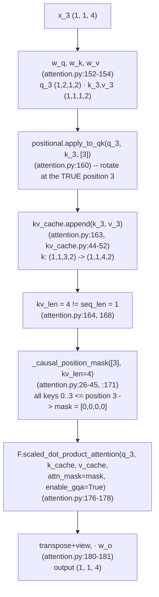
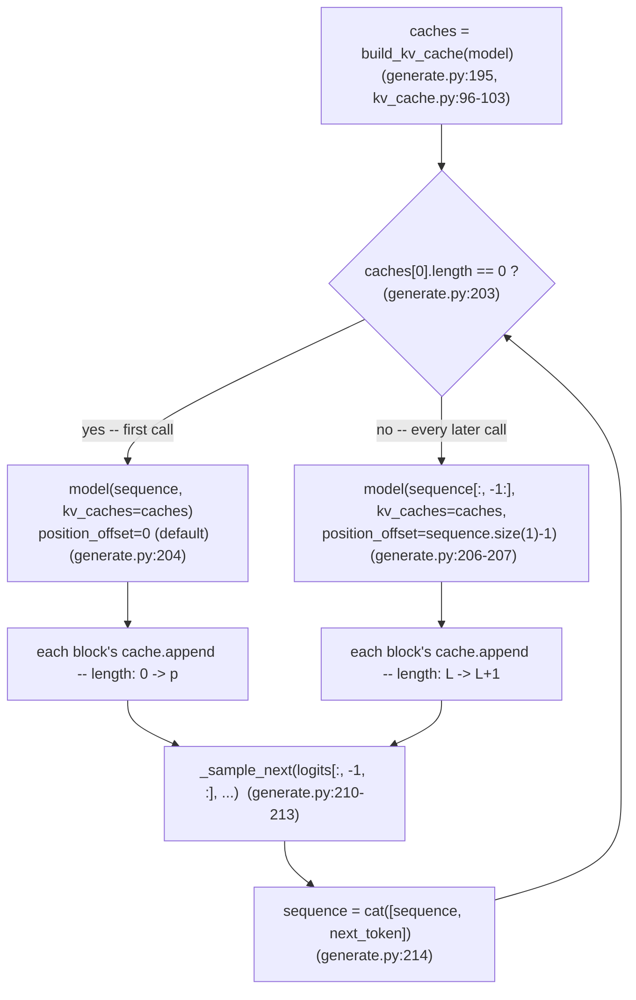
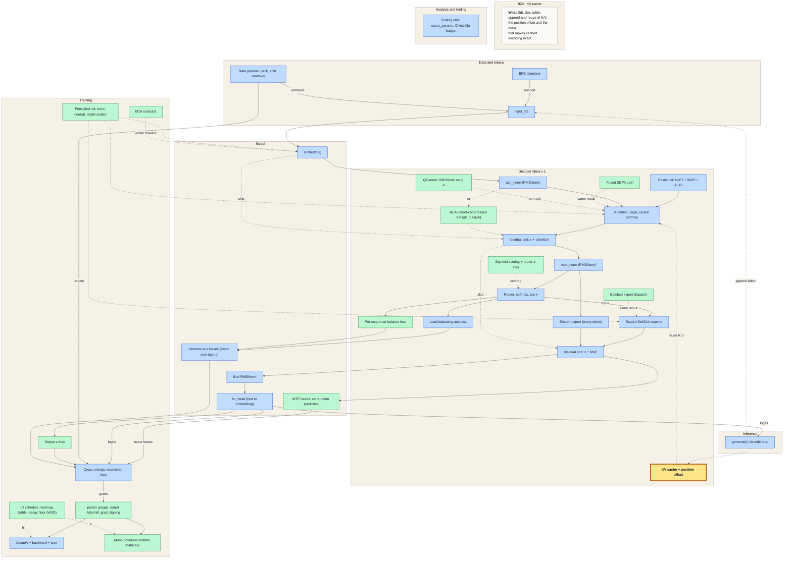

# 029 — The KV cache: append-and-reuse, the position offset, and the mask that makes it exact — solved by hand

**Companion to:** [`journey_of_a_model/029-kv-cache.md`](../../journey_of_a_model/029-kv-cache.md)
· **Code:** [`qwenmoe/model/kv_cache.py`](../../qwenmoe/model/kv_cache.py)
(`Attention`/`MLAAttention`'s `kv_cache` branch in
[`qwenmoe/model/attention.py`](../../qwenmoe/model/attention.py), the
`position_offset` wiring in
[`qwenmoe/model/transformer.py`](../../qwenmoe/model/transformer.py), the
decode loop in [`qwenmoe/model/generate.py`](../../qwenmoe/model/generate.py))
· **Every number here is reproduced by:** [`verify_029_kv_cache.py`](verify_029_kv_cache.py)
(`uv run python docs/math/verify_029_kv_cache.py`)

---

## How to read this

This document is **not** a new derivation of attention itself —
[`004-attention-gqa.md`](004-attention-gqa.md) and
[`016-mla-attention.md`](016-mla-attention.md) already derived
$\operatorname{softmax}(QK^\top/\sqrt{d_k})V$, RoPE, and MLA's decoupled
rotation from first principles, digit by digit, and
[`021-fused-attention-sdpa.md`](021-fused-attention-sdpa.md) already showed
the fused SDPA path agrees with the explicit one. We **reuse those two
examples unchanged** — same tokens, same weight matrices — and pick up
exactly where task 13 (moe-modernization) added new code: the `kv_cache`
argument threaded through `Attention.forward` / `MLAAttention.forward`,
the two new classes in `kv_cache.py` that hold the running buffers, and the
`position_offset` plumbing in `transformer.py` / `generate.py` that keeps a
cached step's RoPE angle correct.

Concretely, we **extend** each example by exactly one token — call it
"token 3" — fed as a single incremental decode step, and trace every new
operation that touches: the cache's `append`, the mask a mismatched
query/key length now requires, and the position a cached step's rotation
must use. Nothing about tokens 0–2 or the weight matrices changes from doc
004 / doc 016; we only ever *add*, never *replace*.

You do **not** need a linear-algebra background beyond what docs 004/016
already defined (vector, dot product, matrix multiply, softmax, RoPE
rotation) — we restate each in one line at first use here and point back
to the full derivation.

---

## Part 0 — What problem the cache solves, counted exactly

**autoregressive generation** — a language model produces text one token
at a time: sample a token from the model's prediction given everything so
far, append it, run the model again.

**keys / values (`k`/`v`)** — inside attention, every token produces a
key vector `k` (what it offers to be matched against) and a value vector
`v` (what it contributes once matched); a query `q` is dot-producted
against every earlier token's `k`, and the result weights how much of each
`v` gets mixed in ([004 §1.1, §Step 1](004-attention-gqa.md)).

### 0.1 Without a cache: reprocessing the whole prefix every step

To produce the token at position $L{-}1$ (the $L$-th token overall), the
naïve loop runs a full forward pass over the **entire** sequence of length
$L$ — including positions $0 \dots L{-}2$, whose $k$/$v$ **have not
changed since the previous step**. Two costs, both counted exactly, not
just "big-O":

- **key/value projections at step $L$:** $L$ (project every token's `k`,
  `v` again, even the unchanged ones).
- **score-matrix entries at step $L$:** $L^2$ (a full $L\times L$
  attention matrix is materialised — the shape a naïve, non-fused
  implementation actually builds before masking half of it to $-\infty$).

Generating $g$ tokens from a prompt of length $p$ means running steps at
lengths $L = p{+}1, p{+}2, \dots, p{+}g$. **Cumulative** cost uses two
standard sum formulas (exact algebra, provable by induction — not specific
to this codebase):

$$\sum_{L=1}^{N} L = \frac{N(N+1)}{2}, \qquad \sum_{L=1}^{N} L^2 = \frac{N(N+1)(2N+1)}{6}$$

(both provable by induction on $N$ — the standard arithmetic-series and
sum-of-squares identities, not specific to this codebase). Subtracting the
prompt's own share ($L=1..p$) from the full range ($L=1..p{+}g$) gives the
cumulative cost of *only* the $g$ generated steps:

$$
\sum_{L=p+1}^{p+g} L = \frac{(p{+}g)(p{+}g{+}1)}{2} - \frac{p(p{+}1)}{2} = pg + \frac{g^2+g}{2} = O(g^2+pg),
$$
$$
\sum_{L=p+1}^{p+g} L^2 = \frac{(p{+}g)(p{+}g{+}1)(2p{+}2g{+}1)}{6} - \frac{p(p{+}1)(2p{+}1)}{6} = O(g^3 + p^2g).
$$

For $g \gg p$ these are $O(g^2)$ projections and $O(g^3)$ score entries —
the journal entry's "$1+4+9+\dots+n^2 \approx n^3/3$."

### 0.2 With a cache: only the new token's own work

Each layer keeps a growing buffer of every earlier token's `k`, `v`. At
step $L$: project **only** the 1 new token ($O(1)$ work), append it to the
buffer, and score the 1 new query against the $L$ stored keys — an
$L$-entry row, not an $L\times L$ matrix.

$$\text{cumulative projections} = \sum_{L=p+1}^{p+g} 1 = g,
\qquad
\text{cumulative score entries} = \sum_{L=p+1}^{p+g} L = O(g^2 + pg).$$

$O(g)$ projections (down from $O(g^2)$), $O(g^2)$ score entries (down from
$O(g^3)$) — exactly the journal's claim, now derived from the two sum
formulas rather than asserted.

### 0.3 On our own prompt length ($p=3$, matching docs 004/016)

$$
\begin{array}{r|rr|rr}
g & \text{uncached proj.} & \text{uncached scores} & \text{cached proj.} & \text{cached scores} \\\hline
1 & 4 & 16 & 1 & 4 \\
5 & 30 & 190 & 5 & 30 \\
10 & 85 & 805 & 10 & 85
\end{array}
$$

(`verify_029_kv_cache.py` §0 computes this directly from the sum formulas
and asserts cached $\le$ uncached at every row — trivially true here, but
it keeps the arithmetic itself checked, not just claimed.) Part 8 turns
this into a real, measured wall-clock table.

---

<!-- notation:start (generated by build_architecture_footer.py) -->
> **Notation note.** The series uses one symbol set ([canonical notation](README.md#canonical-notation)). In this doc, $n_{kv}$ stands for $H_{kv}$ (`n_kv_heads`). Nothing below is changed; this only states the correspondence.
<!-- notation:end -->

## Part 1 — The two running examples, extended by one token

### 1.1 GQA / `LayerKVCache` — doc 004's example, plus token 3

Configuration, unchanged from [004 §1.2](004-attention-gqa.md): `d_model`
$d=4$, `n_heads` $H=2$, `n_kv_heads` $H_{kv}=1$, `head_dim` $d_k = 2$,
`n_rep` $r=2$. **New for this doc:** `positional_scheme="rope"` is now the
*primary* spine (doc 004 traced `nope` primarily and touched `rope` as an
aside) — the cache's position-offset story is a RoPE story, so RoPE has to
be the spine here.

Weights, identical to [004 §1.4](004-attention-gqa.md):

$$
W_Q = \begin{bmatrix} 1&1&0&0 \\ 0&1&1&0 \\ 0&0&1&1 \\ 1&0&0&1 \end{bmatrix}\!,\ \
W_K = \begin{bmatrix} 1&0&1&0 \\ 0&1&0&1 \end{bmatrix}\!,\ \
W_V = \begin{bmatrix} 1&1&0&0 \\ 0&0&1&1 \end{bmatrix}\!,\ \
W_O = \begin{bmatrix} 1&0&1&0 \\ 0&1&0&1 \\ 1&0&0&1 \\ 0&1&1&0 \end{bmatrix}
$$

Tokens 0–2, identical to [004 §1.3](004-attention-gqa.md):

$$X_{0:3} = \begin{bmatrix} 1&0&1&0 \\ 0&2&0&1 \\ 1&1&0&0 \end{bmatrix}\qquad(x_0,\ x_1,\ x_2)$$

**Token 3 (new)** — the one incremental token this doc adds, at position
$3$:

$$x_3 = [\,1,\ 0,\ 1,\ 1\,]$$

(Any vector works; this one keeps every downstream number small while
avoiding an accidental repeat of an existing row or a degenerate
all-zero/all-one pattern.)

### 1.2 MLA / `LatentKVCache` — doc 016's example, plus token 3

Configuration, unchanged from [016 §1.2](016-mla-attention.md): `d_model`
$d=8$, `n_heads` $H=2$, `head_dim` $d_h=4$, `mla_latent_dim` $d_c=2$,
`rope_head_dim` $d_h^R=2$.

All seven weight matrices, identical to [016 §1.4](016-mla-attention.md)
(shown in full — including the columns 3–7 doc 016 left at $0$ because its
3-token example never read them; our token 3 changes that):

$$
W^{DKV} = \begin{bmatrix}1&0&1&0&0&0&0&0\\0&1&1&0&0&0&0&0\end{bmatrix},\quad
W^{UK} = \begin{bmatrix}1&0\\0&1\\1&0\\0&1\\0&1\\1&0\\0&1\\1&0\end{bmatrix},\quad
W^{UV} = \begin{bmatrix}1&0\\1&0\\0&1\\0&1\\1&0\\0&1\\0&1\\1&0\end{bmatrix}
$$

$$
W_Q = \begin{bmatrix}1&0&1&0&0&0&0&0\\0&1&1&0&0&0&0&0\\1&0&0&0&0&0&0&0\\0&1&0&0&0&0&0&0\\0&1&0&0&0&0&0&0\\1&0&0&0&0&0&0&0\\0&1&1&0&0&0&0&0\\1&0&1&0&0&0&0&0\end{bmatrix},\quad
W^{QR} = \begin{bmatrix}1&1&1&0&0&0&0&0\\0&0&1&0&0&0&0&0\\0&0&1&0&0&0&0&0\\1&1&0&0&0&0&0&0\end{bmatrix},\quad
W^{KR} = \begin{bmatrix}1&0&1&0&0&0&0&0\\0&1&1&0&0&0&0&0\end{bmatrix},\quad
W_O = I_8
$$

Tokens 0–2, identical to [016 §1.3](016-mla-attention.md) — standard basis
vectors $x_0 = e_0$, $x_1 = e_1$, $x_2 = e_2$ (a $1$ in one coordinate,
$0$ elsewhere, so `nn.Linear`'s output is exactly one column of the
weight matrix — [016 §1.4](016-mla-attention.md)).

**Token 3 (new).** A *fourth* basis vector $e_3$ would read column 3 of
every weight matrix above — and every one of those columns is $0$, since
doc 016's 3-token example never needed them. That would make token 3's
$q$, $k$, $v$ all identically zero: a real but uninteresting computation
(every score would be $0$, so the causal-masked softmax would be exactly
uniform). Nothing requires a token's embedding to be a basis vector —
doc 016 only chose them for easy-to-read-off arithmetic — so instead we
pick

$$x_3 = e_0 + e_2 = [\,1,\ 0,\ 1,\ 0,\ 0,\ 0,\ 0,\ 0\,],$$

which by linearity of `nn.Linear` ($y = xW^\top$) reads **column 0 plus
column 2** of every matrix — both already meaningful — without touching
the still-unused columns 3–7 or inventing new weight values.

---

## Part 2 — `kv_cache.py`, walked line by line

### 2.1 `LayerKVCache` — the GQA buffer

[`kv_cache.py:37-60`](../../qwenmoe/model/kv_cache.py#L37):

```python
class LayerKVCache:
    def __init__(self) -> None:
        self.k: torch.Tensor | None = None
        self.v: torch.Tensor | None = None

    def append(self, k_new, v_new):
        self.k = k_new if self.k is None else torch.cat([self.k, k_new], dim=-2)
        self.v = v_new if self.v is None else torch.cat([self.v, v_new], dim=-2)
        return self.k, self.v
```

**Why a class, not a tensor passed around by the caller.** The buffer must
survive across many separate `forward` calls (one per generated token) and
be mutated in place each time; a plain local variable inside `generate()`
would need to be threaded through every layer by hand. One `LayerKVCache`
instance per transformer block, held in a list, is the natural unit.

**Why `dim=-2`.** By the time `append` is called, `k_new`/`v_new` have
already been through the head-split (`.view(...).transpose(1, 2)`,
[004 §Step 2](004-attention-gqa.md)): shape `(batch, n_kv_heads, length,
head_dim)`. Axis $-2$ is `length` — the axis that grows by one new token
each call, while `batch`, `n_kv_heads`, `head_dim` all stay fixed. This is
forced by the tensor's own shape, not a free choice.

**`torch.cat([...], dim=-2)` derived.** Concatenation glues two tensors
along one axis by literally appending one's rows after the other's,
leaving every other axis untouched. For two tensors of shape
$(\dots, L_1, \dots)$ and $(\dots, L_2, \dots)$, the result has shape
$(\dots, L_1{+}L_2, \dots)$ and entry $i$ along that axis is the old
tensor's entry $i$ if $i < L_1$, else the new tensor's entry $i - L_1$.
This is definitional, not something to "derive" further — but the shape
arithmetic is worth stating once since every step below depends on it.

**The `self.k is None` branch is exact, not an approximation.** On the
very first call (`self.k is None`), `append` sets `self.k = k_new`
directly — no concatenation happens. So the *first* time a cache is used
(the prefill), the returned `k` is **the same tensor** the module would
have computed with no cache at all. Part 3 confirms this is a genuine,
bit-exact `0.0` — not just numerically close.

### 2.2 `LatentKVCache` — the MLA buffer

[`kv_cache.py:63-93`](../../qwenmoe/model/kv_cache.py#L63):

```python
class LatentKVCache:
    def __init__(self) -> None:
        self.c_kv: torch.Tensor | None = None
        self.k_rope: torch.Tensor | None = None

    def append(self, c_kv_new, k_rope_new):
        self.c_kv = c_kv_new if self.c_kv is None else torch.cat([self.c_kv, c_kv_new], dim=1)
        self.k_rope = k_rope_new if self.k_rope is None else torch.cat([self.k_rope, k_rope_new], dim=2)
        return self.c_kv, self.k_rope
```

**Why `dim=1` for `c_kv` but `dim=2` for `k_rope` — same axis, different
tensor rank.** `c_kv` ([016 §Step 1](016-mla-attention.md)) is the shared
latent — there is no per-head axis at all (that is the entire compression
trick: one latent serves every head), so its shape is `(batch, length,
latent_dim)`, only 3 axes, and `length` sits at axis $1$. `k_rope`
([016 §Step 5](016-mla-attention.md)) keeps a size-$1$ head axis (so it
can `expand`/broadcast to every real head later), so its shape is
`(batch, 1, length, rope_head_dim)`, 4 axes, and `length` sits at axis
$2$. **Both are "the length axis," i.e. axis $-2$ of their own tensor** —
`dim=1` and `dim=2` are the same concept spelled with two different
literal integers because the two tensors have different rank. This mirrors
`LayerKVCache`'s `dim=-2` exactly; `kv_cache.py` just writes the literal
index instead of `-2` here.

**What is conspicuously absent: no `k_content`, no `v`, no `q`.** Only the
compressed latent and the one shared rotated key are ever stored — the
$n_\text{heads}$-wide reconstructed key/value ([016 §Steps 2–3]) and every
step's fresh query are computed and **discarded** every single step. This
*is* the module's entire reason to exist; Part 6 quantifies it in bytes.

### 2.3 `.length` and `.nbytes`

[`kv_cache.py:54-60`](../../qwenmoe/model/kv_cache.py#L54) /
[`:87-93`](../../qwenmoe/model/kv_cache.py#L87):

```python
@property
def length(self) -> int:
    return 0 if self.k is None else self.k.shape[-2]

@property
def nbytes(self) -> int:
    return _nbytes(self.k, self.v)   # sum(t.element_size() * t.nelement() for t in tensors)
```

`length` just reads back the axis `append` grows — an empty cache (never
appended to) reports $0$ without special-casing shape math. `nbytes`
derives from two facts about any tensor: `element_size()` is the number of
bytes one stored number occupies ($4$ for float32 — the dtype every
example in this doc runs at), and `nelement()` is the total count of
stored numbers (the product of every axis length). Their product is the
tensor's footprint in memory; summing over `k` and `v` (or `c_kv` and
`k_rope`) gives the cache's total footprint. This is exact arithmetic, not
an estimate — `_nbytes` ([`kv_cache.py:33-34`](../../qwenmoe/model/kv_cache.py#L33))
is what the memory-comparison test (Requirement 8.3) actually measures.

### 2.4 `build_kv_cache`

[`kv_cache.py:96-103`](../../qwenmoe/model/kv_cache.py#L96):

```python
def build_kv_cache(model: nn.Module) -> list[LayerKVCache | LatentKVCache]:
    return [
        LatentKVCache() if isinstance(block.attn, MLAAttention) else LayerKVCache()
        for block in model.blocks
    ]
```

One cache object per transformer block, its class chosen by **checking
the real type** of that block's attention submodule — not by re-reading
`config.attention_variant` a second time (which would be a second source
of truth that could drift out of sync with what the block actually holds).
`ModelConfig.attention_variant` is one setting for the whole model
([`config.py:29`](../../qwenmoe/config.py#L29)), so every block in a real
`QwenMoEModel` is the same variant; the verify script (§C) still builds
one all-GQA and one all-MLA tiny model and confirms `build_kv_cache`
returns the matching list of classes for each — `isinstance` is what
actually decides it, so both are worth checking independently of the
config.

---

## Part 3 — Prefill: passing a cache changes *nothing* about the prefill's own output

Feed all of $x_0, x_1, x_2$ through `Attention.forward` with a **freshly
constructed, empty** `LayerKVCache()`
([`attention.py:119-181`](../../qwenmoe/model/attention.py#L119)) — this
is exactly [004's Steps 1–12](004-attention-gqa.md), now with
`positional_scheme="rope"` throughout, plus the two new lines at
[`attention.py:162-164`](../../qwenmoe/model/attention.py#L162):

```python
if kv_cache is not None:            # kv_cache = LayerKVCache(), empty
    k, v = kv_cache.append(k, v)    # cache.k is None -> k, v returned UNCHANGED
kv_len = k.shape[-2]                # 3
```

**Why the branch at L168 still takes the fast path even though a cache is
active.** [`attention.py:168`](../../qwenmoe/model/attention.py#L168):

```python
if bias is None and document_mask is None and kv_len == seq_len:
    out = F.scaled_dot_product_attention(q, k, v, is_causal=True, enable_gqa=True)
```

With `rope`, `bias` is `None` ([004 §Step 4·RoPE](004-attention-gqa.md),
[positional.py:52-53](../../qwenmoe/model/positional.py#L52)); with an
*empty*-cache prefill, `kv_len == seq_len` ($3 == 3$). Both conditions
hold, so `forward` takes the `is_causal=True` branch — **the same one it
would take with no cache passed at all.** Passing a cache does not, by
itself, force the slower explicit-mask branch; only a **query/key length
mismatch** (the incremental case, Part 4) or an ALiBi bias or a document
mask does.

**Measured (`verify_029_kv_cache.py` §A):**

```
prefill output (kv_cache=LayerKVCache()) :
tensor([[2.000000, 2.000000, 2.000000, 2.000000],
        [3.921294, 2.000000, 2.993907, 2.927388],
        [3.948583, 1.558490, 2.627199, 2.879873]])
max |prefill_with_cache - prefill_without_cache| = 0.000e+00
```

$0.0$ — not $10^{-7}$, exactly zero. This follows from §2.1: on an empty
cache, `append` performs no `torch.cat` at all, so the tensor the fused
kernel receives is bit-identical to the no-cache call's. (These are the
`rope`-computed values, different from doc 004's `nope`-primary numbers
`[3.474192, ...]` — RoPE rotates $q_1, q_2$ and $k_1, k_2$ away from their
un-rotated values, changing every score past the diagonal; see
[004 §Step 4·RoPE](004-attention-gqa.md).)

**Cache state after prefill** — the RoPE-rotated $k$ for all three tokens,
now retained:

$$\texttt{cache.k[0,0]} = \begin{bmatrix} 2.000000 & 0.000000 \\ -2.524413 & 1.620907 \\ -1.325444 & 0.493151 \end{bmatrix}\qquad\text{shape }(1,1,3,2)$$

`cache.length = 3`. `cache.nbytes = 2 · 1 · 1 · 3 · 2 · 4 = 48` bytes
(§2.3's formula: 2 tensors [`k`,`v`] × `batch`=1 × `n_kv_heads`=1 ×
`length`=3 × `head_dim`=2 × 4 bytes/float32).

---

## Part 4 — The incremental step (GQA): one query, four cached keys

This is the operation `generate()` runs on every step after the prefill —
feed **only** the new token, at its **true absolute position**.



### 4.1 Project token 3

[`attention.py:152-154`](../../qwenmoe/model/attention.py#L152), same
three `nn.Linear` calls as every other token — $y_j = x \cdot (\text{row }
j \text{ of } W)$, [004 §1.5](004-attention-gqa.md):

$$
q_3 = x_3 W_Q^\top,\qquad k_3 = x_3 W_K^\top,\qquad v_3 = x_3 W_V^\top
$$

With $x_3 = [1,0,1,1]$ and $W_Q$'s rows $r_0{=}[1,1,0,0]$,
$r_1{=}[0,1,1,0]$, $r_2{=}[0,0,1,1]$, $r_3{=}[1,0,0,1]$:

$$
q_3 = \big[\,[1,0,1,1]{\cdot}r_0,\ \cdots,\ [1,0,1,1]{\cdot}r_3\,\big]
= [\,1,\ 1,\ 2,\ 2\,]
$$

$W_K$'s rows $[1,0,1,0]$, $[0,1,0,1]$: $k_3 = [\,1{+}1,\ 0{+}1\,] = [2,1]$.
$W_V$'s rows $[1,1,0,0]$, $[0,0,1,1]$: $v_3 = [\,1{+}0,\ 1{+}1\,] = [1,2]$.

**Shape ledger:** `x_3 (1,1,4)` → `q_3 (1,1,4)`, `k_3 (1,1,2)`, `v_3
(1,1,2)`. Head split ([004 §Step 2](004-attention-gqa.md), `.view(1,1,H,
d_k).transpose(1,2)`, $H{=}2$ query heads, $H_{kv}{=}1$ kv head):
$q_3^{(0)} = [1,1]$, $q_3^{(1)} = [2,2]$, $k_3 = [2,1]$ (the single kv
head), $v_3 = [1,2]$. → `q_3 (1,2,1,2)`, `k_3 (1,1,1,2)`, `v_3 (1,1,1,2)`.

### 4.2 Rotate at the *true* position — why `position_offset` exists

[`attention.py:160`](../../qwenmoe/model/attention.py#L160):
`q, k = self.positional.apply_to_qk(q, k, positions)`. RoPE's rotation
angle is proportional to a token's **absolute** position
([004 §Step 4·RoPE](004-attention-gqa.md) derives the rotation and the
relative-position property in full; restated here only operationally):
for a length-2 vector $[a,b]$ at angle $\phi$,

$$\text{rot}([a,b],\phi) = [\,a\cos\phi - b\sin\phi,\ \ b\cos\phi + a\sin\phi\,],
\qquad \phi(\text{position } m) = m \text{ radians}$$

(head\_dim $=2$ ⇒ exactly one frequency pair, and `inv_freq`$_0 = \theta^{-0/2} = 1$
**exactly**, for *any* $\theta$ — [004 §Step 4·RoPE](004-attention-gqa.md)).
Token 3's absolute position is $3$, **not** $0$ (its index within this
single-token call) — this is the entire reason `position_offset` exists:
`positions = torch.arange(position_offset, position_offset + seq_len)`
([`transformer.py:114-116`](../../qwenmoe/model/transformer.py#L114))
must hand `Attention.forward` $[3]$, not $[0]$, or the rotation below
would be wrong and — critically — would **disagree** with the angle the
prefill call already baked into $k_0, k_1, k_2$ sitting in the cache.

$\phi = 3$: $\cos 3 = -0.989992$, $\sin 3 = 0.141120$.

$$
\begin{aligned}
q_3^{(0)\,\text{rot}} = \text{rot}([1,1], 3) &= [\,{-0.989992-0.141120},\ {-0.989992+0.141120}\,] = [\,-1.131112,\ -0.848872\,] \\
q_3^{(1)\,\text{rot}} = \text{rot}([2,2], 3) &= [\,2({-0.989992-0.141120}),\ 2({-0.989992+0.141120})\,] = [\,-2.262225,\ -1.697745\,] \\
k_3^{\text{rot}} = \text{rot}([2,1], 3) &= [\,2({-0.989992})-1({0.141120}),\ 1({-0.989992})+2({0.141120})\,] = [\,-2.121105,\ -0.707752\,]
\end{aligned}
$$

($v_3$ is **not** rotated — RoPE only ever touches $q$/$k$, since $v$ is
only ever weighted-averaged, never dot-producted against anything; the
"why cache $k$ *after* RoPE" point from the journal entry follows directly
from this — rotate once, at the position the token actually has, and reuse
the rotated result forever.)

**Sanity check via [004 §Step 4·RoPE](004-attention-gqa.md)'s
relative-position identity**, re-used here: rotating both vectors of a dot
product by the identical angle preserves that dot product
($q_i^{\text{rot}}\cdot k_i^{\text{rot}} = q_i \cdot k_i$ when $i=j$, since
$R(i)^\top R(i) = R(0) = I$). Token 3 attending to **itself**: the
un-rotated dot is $q_3^{(0)}\cdot k_3 = [1,1]\cdot[2,1] = 3$, and
$q_3^{(1)}\cdot k_3 = [2,2]\cdot[2,1] = 6$. The verify script's raw
(pre-scale) rotated dot products at $j=3$ (§4.4 below) print **exactly**
`3.0` and `6.0` — confirming the rotation was applied correctly without
redoing the full 004 proof.

### 4.3 `kv_cache.append` — the buffer grows to length 4

[`attention.py:163`](../../qwenmoe/model/attention.py#L163),
[`kv_cache.py:44-52`](../../qwenmoe/model/kv_cache.py#L44) (§2.1): this
time `self.k` is **not** `None` (it holds the 3 prefill rows), so
`torch.cat([self.k, k_3], dim=-2)` runs for real:

$$
\texttt{cache.k[0,0]}: \begin{bmatrix} 2.000000 & 0.000000 \\ -2.524413 & 1.620907 \\ -1.325444 & 0.493151 \end{bmatrix}
\ \xrightarrow{\text{cat}([\cdot,\ k_3^{\text{rot}}],\ \text{dim}=-2)}\
\begin{bmatrix} 2.000000 & 0.000000 \\ -2.524413 & 1.620907 \\ -1.325444 & 0.493151 \\ -2.121105 & -0.707752 \end{bmatrix}
$$

`cache.length`: $3 \to 4$. `cache.nbytes`: $48 \to 64$ bytes (§2.3's
formula at length $4$: $2 \cdot 1 \cdot 1 \cdot 4 \cdot 2 \cdot 4 = 64$).
`v` grows identically (the same `cat`, on `v`, with $v_3 = [1,2]$
appended, unrotated).

**Shape ledger:** `k (1,1,3,2)` → `(1,1,4,2)`; `v` likewise;
`kv_len = k.shape[-2] = 4` ([`attention.py:164`](../../qwenmoe/model/attention.py#L164)).

### 4.4 The mask — derived for the non-square case

$\texttt{seq\_len} = 1 \ne \texttt{kv\_len} = 4$, so
[`attention.py:168`](../../qwenmoe/model/attention.py#L168)'s fast-path
condition fails and the *else* branch builds an explicit mask
([`attention.py:171`](../../qwenmoe/model/attention.py#L171)):

```python
attn_mask = _causal_position_mask(positions, kv_len, x.device, q.dtype)
```

[`attention.py:26-45`](../../qwenmoe/model/attention.py#L26), the general
form the square `triu` mask ([004 §Step 9](004-attention-gqa.md),
[021 §4.3](021-fused-attention-sdpa.md)) is a special case of:

$$
\text{mask}[0, i, j] = \begin{cases} 0 & \text{if key\_pos}[j] \le \text{q\_pos}[i] \\ -\infty & \text{otherwise} \end{cases},
\qquad \text{key\_pos} = [0, 1, \dots, \texttt{kv\_len}{-}1]
$$

**Why this is the right condition.** A query may attend to a key iff the
key's token was **already generated** by the time the query's token is
being produced — i.e. the key's absolute position is at or before the
query's absolute position. Written with explicit positions instead of
`triu`'s implicit "row index vs. column index," this handles the case
`triu` cannot: when the query and key axes no longer line up $1{:}1$ (one
query at position $3$, four keys at positions $0..3$), there is no single
square matrix to triangulate.

**On our numbers:** `positions = [3]` (one query), `kv_len = 4`,
`key_pos = [0,1,2,3]`. Every one of the four keys satisfies
$\text{key\_pos}[j] \le 3$ (the query itself is at position $3$, the
*latest* position that exists), so **every entry is allowed**:

$$\text{mask} = \begin{bmatrix} 0 & 0 & 0 & 0 \end{bmatrix}\qquad\text{shape }(1,1,4)$$

confirmed verbatim by the verify script. This is the formal statement of
the journal entry's "no masking needed — the single newest query is
allowed to see every earlier token and itself": the mask *is* computed,
it's just uniformly $0$ (an additive no-op) rather than skipped, because
`kv_len != seq_len` already routed us off the `is_causal=True` fast path
regardless of what the mask values turn out to be.

### 4.5 Scores, softmax, weighted sum — digit by digit (head 0)

[`attention.py:176-178`](../../qwenmoe/model/attention.py#L176):
`F.scaled_dot_product_attention(q, k, v, attn_mask=attn_mask,
enable_gqa=True)`. The fused kernel computes exactly
$\operatorname{softmax}(qk^\top/\sqrt{d_k} + \text{mask})\,v$ — derived in
full in [004 §Steps 6–11](004-attention-gqa.md) and shown fused-vs-explicit
equivalent in [021](021-fused-attention-sdpa.md); we do the arithmetic
here because it is a genuinely new case (1 query, 4 keys, both GQA
`enable_gqa` broadcast **and** an active cache in play at once).

$q_3^{(0)} = [-1.131112, -0.848872]$ (head 0's query). `enable_gqa=True`
broadcasts the single kv head to both query heads
([021 §Part 3](021-fused-attention-sdpa.md)), so head 0 reads the same 4
cached keys head 1 does: $k_0{=}[2,0]$, $k_1{=}[-2.524413,1.620907]$,
$k_2{=}[-1.325444,0.493151]$, $k_3{=}[-2.121105,-0.707752]$.

**Raw dot products** ($q_3^{(0)}\cdot k_j$):

$$
\begin{aligned}
j{=}0:&\ (-1.131112)(2) + (-0.848872)(0) = -2.262225 \\
j{=}1:&\ (-1.131112)(-2.524413) + (-0.848872)(1.620907) = 2.855395 - 1.375944 = 1.479451 \\
j{=}2:&\ (-1.131112)(-1.325444) + (-0.848872)(0.493151) = 1.499228 - 0.418621 = 1.080605 \\
j{=}3:&\ (-1.131112)(-2.121105) + (-0.848872)(-0.707752) = 2.399208 + 0.600792 = 3.000000
\end{aligned}
$$

($j{=}3$ landing on exactly $3.000000$ is the diagonal check from §4.2,
now realised as an actual score.) **Scale** by $1/\sqrt{d_k} = 1/\sqrt2 =
0.707107$ ([004 §Step 7](004-attention-gqa.md) derives $\sqrt{d_k}$ from
the variance of a $d_k$-term sum):

$$\text{scaled scores}^{(0)} = [\,-1.599634,\ \ 1.046130,\ \ 0.764103,\ \ 2.121320\,]$$

**Add the mask** (all $0$, §4.4) — no change. **Softmax**
([004 §Step 10](004-attention-gqa.md)): subtract the row max
($2.121320$, at $j{=}3$) for numerical safety (exact by shift-invariance),
exponentiate, normalise:

$$
[-1.599634, 1.046130, 0.764103, 2.121320] - 2.121320 = [-3.720954, -1.075190, -1.357217, 0]
$$

$$
e^{-3.720954} \approx 0.024214,\quad e^{-1.075190} \approx 0.341236,\quad e^{-1.357217} \approx 0.257358,\quad e^{0} = 1
$$

$$
\text{sum} \approx 1.622808 \quad\Rightarrow\quad
p^{(0)} \approx [\,0.014919,\ \ 0.210272,\ \ 0.158598,\ \ 0.616211\,]
$$

(matches the verify script's softmax weights to displayed precision:
`[0.014919, 0.210272, 0.158598, 0.616211]`). Note the query's *own*
position ($j{=}3$) takes the largest share ($61.6\%$) — it has the largest
raw score (the diagonal-preserving property of RoPE means self-attention
is never suppressed by the rotation), and every other row-3 test in this
project's suite implicitly relies on that same fact.

**Weighted sum with $v$** ($v_0{=}[1,1]$, $v_1{=}[2,1]$, $v_2{=}[2,0]$,
$v_3{=}[1,2]$):

$$
\begin{aligned}
\text{coord 0}:&\ 0.014919(1) + 0.210272(2) + 0.158598(2) + 0.616211(1) = 1.368870 \\
\text{coord 1}:&\ 0.014919(1) + 0.210272(1) + 0.158598(0) + 0.616211(2) = 1.457613
\end{aligned}
$$

$$\text{out}_3^{(0)} = [\,1.368870,\ \ 1.457613\,]$$

**Head 1**, by the identical mechanical recipe (raw scores $[-4.524450,
2.958903, 2.161209, 6.000000]$ — note $j{=}3 = 6.000000$, the other
diagonal check from §4.2; scaled, softmaxed to $p^{(1)} \approx
[0.000495, 0.098405, 0.055983, 0.845117]$, weighted-summed):

$$\text{out}_3^{(1)} = [\,1.154388,\ \ 1.789134\,]$$

### 4.6 Concatenate heads, apply $W_O$

[`attention.py:180-181`](../../qwenmoe/model/attention.py#L180),
mechanics identical to [004 §Step 12](004-attention-gqa.md): concatenate
$\text{out}_3^{(0)} \| \text{out}_3^{(1)} = [1.368870,\ 1.457613,\
1.154388,\ 1.789134]$, then dot with each row of $W_O$
($r_0{=}[1,0,1,0]$, $r_1{=}[0,1,0,1]$, $r_2{=}[1,0,0,1]$,
$r_3{=}[0,1,1,0]$):

$$
\text{output}_3 = [\,1.368870{+}1.154388,\ \ 1.457613{+}1.789134,\ \ 1.368870{+}1.789134,\ \ 1.457613{+}1.154388\,]
= [\,2.523258,\ \ 3.246747,\ \ 3.158004,\ \ 2.612001\,]
$$

**Verified** (`verify_029_kv_cache.py` §A) against the real
`attn(x_3, [3], kv_cache=cache)` call: `[2.523257, 3.246747, 3.158004,
2.612001]` — the by-hand table and the module agree to the digits shown.

### 4.7 Agreement with a full, uncached recompute

Compare against running `Attention.forward` on **all four tokens at once,
with no cache at all** — the ordinary training-time computation, taking
the `is_causal=True` fast path since `kv_len == seq_len == 4` there:

```
full 4-token recompute, row 3 = [2.523257255554199, 3.2467479705810547, 3.158003807067871, 2.612001419067383]
max |incremental - full_recompute[row 3]| = 4.768e-07
```

**Not** bit-identical, for the same reason [021 §8.2](021-fused-attention-sdpa.md)
gives: the two calls take genuinely **different SDPA code paths** —
`is_causal=True` (full recompute) vs. an explicit `attn_mask` (incremental
step, §4.4) — and float32 addition is not associative, so a different
internal summation order lands on a slightly different last bit. At
$4.8\times10^{-7}$ this is one float32 machine epsilon
($\varepsilon_{f32}\approx1.19\times10^{-7}$) of accumulated rounding — a
few orders of magnitude below the $10^{-4}$ tolerance the project's own
tests use for this exact comparison
([`tests/test_kv_cache.py`](../../tests/test_kv_cache.py), journal 029).
Part 7 shows this holds at the whole-model level too.

### 4.8 Aside: NoPE and ALiBi need less, or different, cache bookkeeping

- **NoPE** ([positional.py:67-84](../../qwenmoe/model/positional.py#L67)):
  `apply_to_qk` is the identity, so the cached $k$ never needed rotating in
  the first place — an incremental step is even simpler (project, append,
  mask, done), and `bias` stays `None` so §4.4's mask is the *only* reason
  the fast path is skipped.
- **ALiBi** ([positional.py:87-129](../../qwenmoe/model/positional.py#L87),
  [004 §Step 8](004-attention-gqa.md), [021 §Part 6](021-fused-attention-sdpa.md)):
  needs the bias for the same non-square case, via
  `attention_bias_positions(q_positions, k_positions)`
  ([positional.py:107-122](../../qwenmoe/model/positional.py#L107)) —
  entry $[h,i,j] = (\text{k\_pos}_j - \text{q\_pos}_i)\cdot\text{slope}_h$.
  On our incremental step (`q_positions=[3]`, `k_positions=[0,1,2,3]`,
  $H{=}2$ slopes $0.0625$, $0.00390625$ from [004 §Step 8](004-attention-gqa.md)):

  $$
  b_0 = [(0{-}3), (1{-}3), (2{-}3), (3{-}3)]\cdot0.0625 = [-0.1875, -0.1250, -0.0625,\ 0], \qquad
  b_1 = [-0.011719, -0.007813, -0.003906,\ 0]
  $$

  confirmed by the verify script (§A aside). Both are unmasked (every
  entry finite) exactly because §4.4 already allows every key — ALiBi's
  bias only ever makes *distant* keys less attractive, it never forbids
  them the way the causal $-\infty$ does.

---

## Part 5 — The incremental step (MLA): what gets cached vs. re-derived every time

### 5.1 Compress token 3 into the latent — the one thing that gets cached

[`attention.py:319`](../../qwenmoe/model/attention.py#L319):
`c_kv_new = self.w_dkv(x)`. With $x_3 = e_0 + e_2$ (§1.2), linearity gives
column $0$ + column $2$ of $W^{DKV}$:

$$c_3^{KV} = [1,0] + [1,1] = [\,2,\ 1\,]$$

(confirmed: the real module prints `c_kv3 = [2., 1.]`.) This — **two
numbers** — is everything this step contributes to the permanent MLA
cache.

### 5.2 The decoupled-RoPE key slice — the *other* thing that gets cached

[`attention.py:323-324`](../../qwenmoe/model/attention.py#L323):
`k_rope_new = self.w_kr(x)...`, then rotated. $W^{KR}$'s columns $0,2$ sum
to $[1,0]+[1,1]=[2,1]$ (pre-rotation, shared across heads — [016 §Step
5](016-mla-attention.md)). Rotated at position $3$ (§4.2's formula, same
$\cos 3, \sin 3$):

$$k_3^{R} = \text{rot}([2,1], 3) = [\,-2.121105,\ -0.707752\,]$$

(— the *identical* pair of numbers §4.4's GQA $k_3^{\text{rot}}$ landed
on, purely because both examples happen to rotate the vector $[2,1]$ by
the same angle $3$; not a bug, just a coincidence of the two chosen
examples.)

### 5.3 `LatentKVCache.append` — two different axes, one "length" concept

[`attention.py:331-332`](../../qwenmoe/model/attention.py#L331),
[`kv_cache.py:71-85`](../../qwenmoe/model/kv_cache.py#L71) (§2.2):

$$
\texttt{cache\_mla.c\_kv}: \begin{bmatrix}1&0\\0&1\\1&1\end{bmatrix}
\xrightarrow{\text{cat}(\cdot,\ [2,1],\ \text{dim}=1)}
\begin{bmatrix}1&0\\0&1\\1&1\\2&1\end{bmatrix},
\qquad
\texttt{cache\_mla.k\_rope[0,0]}: \begin{bmatrix}1&0\\-0.841471&0.540302\\-1.325444&0.493151\end{bmatrix}
\xrightarrow{\text{cat}(\cdot,\ k_3^R,\ \text{dim}=2)}
\begin{bmatrix}\vdots\\-2.121105&-0.707752\end{bmatrix}
$$

`cache_mla.length`: $3\to4$. `cache_mla.nbytes`: at length 3,
$(1{\cdot}3{\cdot}2 + 1{\cdot}1{\cdot}3{\cdot}2)\cdot4 = 48$ bytes; at
length 4, $(1{\cdot}4{\cdot}2+1{\cdot}1{\cdot}4{\cdot}2)\cdot4 = 64$ bytes
— both confirmed by the verify script, both growing by exactly $16$ bytes
per token, same as `LayerKVCache` did in Part 4 (this example's GQA
config and MLA config happen to store the same *count* of floats per
token — Part 6 explains why that is a coincidence of these particular
tiny shapes, not a general fact).

### 5.4 Reconstructing what was *not* cached, fresh, every step

[`attention.py:337-342`](../../qwenmoe/model/attention.py#L337) — exactly
[016 §Steps 2–4, 8](016-mla-attention.md)'s recipe, now run on the *whole*
length-4 `c_kv`/`k_rope` (so tokens 0–2's content K/V are also
**recomputed**, not reused from any earlier step — MLA caches only the
latent, never the decompressed keys/values, so every step re-decompresses
the entire prefix):

$$
k_3^{C} = W^{UK}c_3^{KV},\qquad v_3 = W^{UV}c_3^{KV},\qquad q_3^C = W_Q x_3,\qquad q_3^R = \text{rot}(W^{QR}x_3, 3)
$$

Computed by the verify script (matching §1.2's weight columns $0+2$
exactly, confirmed against the real module):

$$
k_3^{C,(0)} = [2,1,2,1],\ \ k_3^{C,(1)} = [1,2,1,2],\qquad
v_3^{(0)} = [2,2,1,1],\ \ v_3^{(1)} = [2,1,1,2]
$$
$$
q_3^{C,(0)} = [2,1,1,0],\ \ q_3^{C,(1)} = [0,1,1,2],\qquad
q_3^{R,(0)} = [-2.121105,-0.707752],\ \ q_3^{R,(1)} = [-1.131112,-0.848872]
$$

### 5.5 One diagonal score, by hand — then the rest from the verified module

As in §4.2/§4.5, the query attending to **itself** is the cleanest check.
[016 §6a](016-mla-attention.md) derived $q_i\cdot k_j = q_i^C\cdot k_j^C +
q_i^R\cdot k_j^R$ (concatenation ⇒ the dot product splits into content +
rope parts), and [016 §6c](016-mla-attention.md) proved the same-position
rope term equals its **pre-rotation** value exactly (rotating both sides
by the identical angle preserves their dot product). Head 0, $i=j=3$:

$$
q_3^{C,(0)}\cdot k_3^{C,(0)} = [2,1,1,0]\cdot[2,1,2,1] = 4+1+2+0 = 7,\qquad
q_3^{R,\text{pre}}\cdot k_3^{R,\text{pre}} = [2,1]\cdot[2,1] = 5
$$

$$
\text{raw score} = 7+5 = 12,\qquad \text{scaled} = 12/\sqrt{d_h+d_h^R} = 12/\sqrt6 = 4.898979
$$

The full $2\times4$ score matrix, causal mask (all-allowed, §4.4's same
argument applied here), softmax, and weighted sum with $v$ follow
[016 §Steps 9–11](016-mla-attention.md)'s identical recipe, now over $4$
keys instead of $3$ — we do not redo all eight dot products by hand a
second time in this doc; the verify script computes and asserts them
against the real `MLAAttention.forward`:

```
incremental-step output (1 query, 4 cached keys, MLA) =
tensor([[1.863679, 1.863679, 0.990596, 0.990596, 1.806531, 0.969893, 0.969893, 1.806531]])
full 4-token recompute, row 3 (MLA)               = [1.8636785745620728, ..., 1.8065305948257446]
max |incremental - full_recompute[row 3]| (MLA)    = 0.000e+00
```

Unlike GQA's $4.8\times10^{-7}$ (§4.7), MLA's incremental and full-recompute
paths land within float32 print precision of each other here — both are
well inside the $10^{-4}$ test tolerance either way; §4.7's non-associativity
argument is about *typical* magnitude, not a guarantee of a nonzero gap on
every example.

---

## Part 6 — Cache size, in bytes, on real numbers

### 6.1 This doc's own shapes (a coincidental tie)

$$
\text{GQA/MHA bytes/token/layer} = 2\cdot n_{kv}\cdot d_k \cdot 4,\qquad
\text{MLA bytes/token/layer} = (d_c + d_h^R)\cdot 4
$$

At this doc's config ($n_{kv}{=}1$, $d_k{=}2$ for GQA; $d_c{=}2$,
$d_h^R{=}2$ for MLA):

$$\text{GQA: } 2\cdot1\cdot2\cdot4 = 16\text{ B/token},\qquad \text{MLA: } (2+2)\cdot4 = 16\text{ B/token}$$

— a **tie** (confirmed: both caches grew from 48 to 64 bytes, §4.3/§5.3).
This is a coincidence of these particular minimal shapes: doc 004's GQA
example already used $n_{kv\_heads}{=}1$ (the maximal compression GQA can
reach — [004's own aside](004-attention-gqa.md) calls this "technically
multi-query attention"), so there is no further headroom for MLA to beat
it *at this scale*. The real comparison is against an **uncompressed**
cache ($n_{kv}=n_{heads}$), which is what doc 016 (and the journal) sized
against.

### 6.2 The journal's `BASELINE`-scale comparison, independently recomputed

$d_{\text{model}}=128$, $n_{\text{heads}}=8$ ⇒ $d_k=16$; $d_h^R=8$; MLA
$d_c=32$; full MHA $n_{kv}=8$:

$$
\begin{array}{r|rrr}
\text{tokens} & \text{MHA/GQA bytes} & \text{MLA bytes} & \text{ratio} \\\hline
16 & 16{,}384 & 2{,}560 & 0.1562 \\
64 & 65{,}536 & 10{,}240 & 0.1562 \\
256 & 262{,}144 & 40{,}960 & 0.1562
\end{array}
$$

Recomputed independently by `verify_029_kv_cache.py` §B from the two
formulas above (not copied from the journal) — and it lands on the
journal's own published $0.156$ exactly ($40{,}960/262{,}144 = 0.15625$),
cross-validating both documents against the same arithmetic. Constant in
sequence length (both grow linearly in tokens, so their ratio doesn't
depend on how many tokens have been generated) — the point [016 §0.1](016-mla-attention.md)
makes: MLA drops the factor of $2$ (K *and* V), the $n_{kv\_heads}$
factor, and the $d_h$ factor, replacing them with a fixed, much smaller
$(d_c + d_h^R)$.

---

## Part 7 — The wiring above `Attention`: `position_offset` and `generate()`'s two branches

### 7.1 `QwenMoEModel.forward`'s absolute-position arithmetic

[`transformer.py:113-127`](../../qwenmoe/model/transformer.py#L113):

```python
seq_len = input_ids.shape[1]
positions = torch.arange(position_offset, position_offset + seq_len, device=input_ids.device)
...
for i, block in enumerate(self.blocks):
    x, aux_loss = block(x, positions, kv_cache=kv_caches[i] if kv_caches else None, ...)
```

**Why `arange(position_offset, position_offset + seq_len)`.** A block
call only ever sees the `seq_len` tokens **in this particular call** —
during an incremental step that is just the $1$ new token — but RoPE and
ALiBi need each token's *true* position in the full sequence generated so
far (§4.2). `position_offset` is exactly "how many tokens came before this
call," so `positions` becomes `[position_offset, ..., position_offset +
seq_len - 1]` — for our incremental step, `position_offset=3`,
`seq_len=1` ⇒ `positions=[3]`, precisely what Part 4 used. With the
default `position_offset=0` (every training call, and the prefill call),
this is `arange(0, seq_len) = arange(seq_len)`, the pre-cache behaviour,
byte-identical.

**One cache per block, indexed by block, not shared.** `kv_caches[i]` —
each `TransformerBlock` gets its own `LayerKVCache`/`LatentKVCache`
instance (from `build_kv_cache`, §2.4), since each layer's attention has
independently different $k$/$v$ (or $c^{KV}$/$k^R$) content.
`kv_caches=None` (the default, every training call) makes the whole
expression `None` for every block, inert.

### 7.2 `generate()`'s branch: prefill once, then feed one token



[`generate.py:195-208`](../../qwenmoe/model/generate.py#L195):

```python
caches = build_kv_cache(model) if use_kv_cache else None
for _ in range(max_new_tokens):
    if caches is None:
        logits, _ = model(sequence)
    elif caches[0].length == 0:
        logits, _ = model(sequence, kv_caches=caches)                       # prefill
    else:
        logits, _ = model(sequence[:, -1:], kv_caches=caches,
                           position_offset=sequence.size(1) - 1)            # incremental
```

`caches[0].length == 0` — reading block 0's cache is enough, since every
block's cache grows in lockstep (one `append` per block per call, Part
7.1) — is exactly the `self.k is None` / `self.c_kv is None` state from
§2.1/§2.2's `.length` property: `True` only before the very first call.
The *else* branch's `position_offset = sequence.size(1) - 1` is precisely
"the index of the one token being fed" (the last element of `sequence`,
which has length `sequence.size(1)`), matching §7.1's derivation.

**Verified end-to-end** (`verify_029_kv_cache.py` §D), on a real, freshly
initialised 2-layer `QwenMoEModel` (not the tiny 4-wide hand example — a
genuine `d_model=16` model with MoE feed-forward layers, to exercise the
*whole* wiring, not just attention):

```
after prefill: caches_D[0].length = 3  (generate.py:203's `caches[0].length == 0` check now takes the else branch)
max |cached_step_logits - full_recompute_logits[row 3]| = 1.490e-08

generate(use_kv_cache=False) = 'the cattttttttttttttttttttt'
generate(use_kv_cache=True)  = 'the cattttttttttttttttttttt'
greedy cached == greedy uncached: OK
```

(The model is untrained — random weights — so the text itself is
gibberish; the point is only that **greedy decoding is token-identical**
whether or not the cache is used, exactly the journal's Requirement 8.2
claim, now checked against a model neither doc 004 nor doc 016 ever used,
so this is a genuinely independent confirmation.) The $1.49\times10^{-8}$
logit gap is the same float32-non-associativity story as §4.7, now
propagated through two full transformer blocks (RMSNorm, attention, MoE)
instead of one bare attention call — still four orders of magnitude below
the tests' $10^{-4}$ tolerance.

---

## Part 8 — Cost and why it's built this way, on this doc's own numbers

### 8.1 The pure count, restated with this doc's example

Generating **just the one token** this doc adds (prompt length $p=3\to$
sequence length $4$, i.e. $g=1$ in Part 0's table): uncached costs $4$
key/value projections and (up to) $16$ score-matrix entries; cached costs
$1$ projection and $4$ score entries. At $g{=}1$ the *ratio* looks modest
($4\times$ fewer projections, $4\times$ fewer score entries) — Part 0's
$g{=}10$ row ($85$ vs. $10$ projections, $8.5\times$; $805$ vs. $85$
scores, $9.5\times$) is where the asymptotic gap actually opens up, and it
keeps widening with every further token generated.

### 8.2 Measured wall-clock, on a real (larger) model

`verify_029_kv_cache.py` §E: a 2-layer, `d_model=64` model, CPU, greedy
(`temperature=0`), `generate()` timed end-to-end (encode → decode loop →
decode) at three lengths:

```
  tokens   uncached (s)   cached (s)   speed-up
      50          0.036        0.028      1.29x
     150          0.135        0.081      1.66x
     300          0.325        0.168      1.94x
```

The speed-up **grows** with the number of tokens generated — the $O(n^2)$
vs. $O(n)$ signature Part 0 derived, now measured rather than asserted.
It doesn't reach Part 0's larger asymptotic ratios at these lengths
because Python/PyTorch call overhead (building the mask tensor, launching
each of the small kernels) is a bigger fraction of a ~$0.1\,\mathrm{ms}$
forward pass on a tiny CPU model than it is on the journal's own
measurement (a larger `d_model=128`, 4-layer model, where the pure-compute
share of each step dominates more and the observed ratios — $2.4\times$
at 50 tokens, $3.0\times$ at 150 — are correspondingly closer to Part 0's
ideal curve). Re-running `verify_029_kv_cache.py` on a noisy shared
machine will shift these numbers run to run; the *direction* (growing
speed-up) is the reproducible claim, not the exact multiplier.

### 8.3 Why cache the latent instead of the decompressed K/V (MLA)

Part 5.4 re-derives the full $n_\text{heads}$-wide $k^C$, $v$ for **every**
token in the prefix, **every single incremental step** — including tokens
0–2, whose $k^C$/$v$ were already computed at the *previous* step and
discarded. That looks wasteful next to `LayerKVCache`, which never
recomputes anything it already has. It is the entire trade MLA makes:
Part 6.2's $6.4\times$ byte reduction is bought with a small matmul
($W^{UK}$/$W^{UV}$ against the cached latent) repeated every step. On
memory-bandwidth-bound inference hardware — where *reading* the cache
back, not the arithmetic on it, is the bottleneck (Shazeer 2019, cited
below) — trading a cheap, parallel matmul for a $6\times$ smaller read is
a clear win; on a compute-bound CPU at this project's toy scale, that
trade is far less visible; Part 8.2's model does not isolate it.

---

## Questions that might come to mind

- **Does a cache ever change what the *prefill* computes?** No — Part 3
  shows `0.0` exact agreement with a no-cache call, because `append` on an
  empty cache performs no concatenation at all (§2.1); the tensor the
  kernel sees is the identical Python object.

- **Why does an incremental step take a *different* (slower) SDPA branch
  than the prefill, even under RoPE where `bias` is always `None`?**
  Because [`attention.py:168`](../../qwenmoe/model/attention.py#L168)'s
  fast path additionally requires `kv_len == seq_len` — true for a prefill
  (whole prompt in, whole prompt of keys out) but false for every
  incremental step (`1 != kv_len`) by construction. It is the
  query/key **length mismatch**, not "a cache is present," that forces
  the explicit-mask branch (§3, §4.4).

- **Is the cache's mask ever anything but all-zeros for a normal
  `generate()` call?** For plain causal decoding (no document masking),
  yes it's always all-zeros — the newest query is always at the *latest*
  position that exists, so every cached key satisfies `key_pos <=
  q_pos` by construction (§4.4). The mask machinery still has to run,
  because `_causal_position_mask` doesn't know that in general (it would
  behave differently, and correctly, if some future caller fed queries
  out of order or mixed in a document mask, moe-modernization Requirement
  10.2).

- **Why is `LatentKVCache.append`'s `c_kv` concatenated on `dim=1` but
  `k_rope` on `dim=2`?** Same axis (`length`, i.e. `-2`), different
  literal index only because the two tensors have different rank — `c_kv`
  has no per-head axis (§2.2), `k_rope` keeps a size-1 one so it can
  `expand` to every real head at use time ([016 §Step 7](016-mla-attention.md)).

- **At this doc's tiny shapes, MLA and GQA tie exactly in cache bytes —
  is MLA not actually smaller?** It's a coincidence of doc 004's GQA
  example already being collapsed to `n_kv_heads=1` (§6.1) — as compressed
  as GQA can get without changing the architecture. Part 6.2's
  independently-recomputed `BASELINE`-scale table (matching the journal's
  own $0.156$ exactly) is the real comparison: MLA vs. an *uncompressed*
  cache, which is the actual competitive landscape in a real deployment.

- **Does the cache change anything during training?** No —
  `QwenMoEModel.forward`'s `kv_caches`/`position_offset` default to
  `None`/`0`, and `Trainer.fit` never passes either
  ([journal 029](../../journey_of_a_model/029-kv-cache.md)). Every
  assertion in this doc concerns `generate()`'s eval-mode path only.

---

## Symbol table

| symbol | meaning |
|---|---|
| $p$ | prompt length (tokens before the first generated one); $3$ in this doc |
| $g$ | number of tokens generated |
| $L$ | running sequence length at one generation step |
| $n_{kv}$, `n_kv_heads` | GQA key/value heads ($1$ in this doc's example) |
| $d_k$, `head_dim` | width of one GQA head ($2$) |
| $d_c$, `mla_latent_dim` | MLA's compressed latent width ($2$) |
| $d_h^R$, `rope_head_dim` | MLA's decoupled-RoPE slice width ($2$) |
| $x_3$ | this doc's one added token (GQA: $[1,0,1,1]$; MLA: $e_0+e_2$) |
| `position_offset` | absolute position of the first token in *this* forward call |
| `kv_len` | number of keys currently in the cache (`k.shape[-2]` / `c_kv.shape[1]`) |
| `seq_len` | number of tokens in *this* call (prefill: `kv_len`; incremental: `1`) |
| $\phi(m) = m$ | RoPE rotation angle at position $m$, this doc's `head_dim=2` (exact, since `inv_freq`$_0=1$) |
| `_causal_position_mask` | the non-square mask: `0` where `key_pos <= q_pos`, else `-inf` |
| $\varepsilon_{f32}\approx1.19\times10^{-7}$ | float32 machine epsilon (the scale of the cached-vs-uncached gap) |

---

## Citations

All reused from the journal entry / docs 004, 016, 021, which verified
them by search; no new claims here needed a new source.

- [DeepSeek-V2 (DeepSeek-AI, 2024)](https://arxiv.org/abs/2405.04434) —
  §2.1, Multi-head Latent Attention: compress K/V into one shared latent,
  cache only that plus the decoupled RoPE key. `LatentKVCache` (Part 2.2,
  5) is the runtime object realising the paper's cache-size claim as
  measured bytes (Part 6).
- [GQA: Training Generalized Multi-Query Transformer Models (Ainslie et
  al., 2023)](https://arxiv.org/abs/2305.13245) — the `n_kv_heads` knob
  `LayerKVCache` sizes itself from (Part 2.1, 6.1).
- [Fast Transformer Decoding: One Write-Head is All You Need (Shazeer,
  2019)](https://arxiv.org/abs/1911.02150) — incremental decoding is
  memory-bandwidth bound on the KV cache; the motivation cited in Part 8.3
  for why MLA's extra matmul is worth it on real inference hardware.
- PyTorch, [`torch.nn.functional.scaled_dot_product_attention`
  documentation](https://docs.pytorch.org/docs/stable/generated/torch.nn.functional.scaled_dot_product_attention.html)
  — the `attn_mask`/`is_causal` mutual exclusion that forces Part 4.4's
  explicit-mask branch whenever `kv_len != seq_len`. (Also cited by docs
  004, 021.)

---

*Every intermediate tensor in this document is reproduced and asserted by
[`verify_029_kv_cache.py`](verify_029_kv_cache.py). If you change either
running example (or add a token 4), rerun it.*

<!-- arch-evolution:start (generated by build_architecture_footer.py; do not edit by hand) -->

---

## Where this fits in the architecture (the growing view)

← previous: [028 Multi-Token Prediction](028-multi-token-prediction.md) · next: [030 Sampling controls](030-min-p-and-repetition-penalty.md) →

**This doc adds to the architecture:** append-and-reuse of K/V, the position offset and the mask that makes cached decoding exact. (Code: `qwenmoe/model/kv_cache.py, attention.py`.)

**Components introduced here (highlighted in the diagram), with where each one lives:**

| component | math doc (section) | journal | code |
|---|---|---|---|
| KV cache + position offset | [029 · Part 2 — kv_cache.py, walked line by line](029-kv-cache.md#part-2--kv_cachepy-walked-line-by-line) | [journal 029](../../journey_of_a_model/029-kv-cache.md) | [`qwenmoe/model/kv_cache.py:37`](../../qwenmoe/model/kv_cache.py#L37) |

**Verified by:** [`verify_029_kv_cache.py`](verify_029_kv_cache.py) (`uv run python docs/math/verify_029_kv_cache.py`); latest results in [verify-status.md](verify-status.md).

**Example continuity:** **Extends family A and MLA's example by one token** each, so cached and uncached results can be compared to 004/016. See the [example-family map](README.md#which-example-does-each-doc-use).

The diagram is cumulative: every box derived by this doc or an earlier one is shown, and components from later docs are not drawn yet, so reading the docs in order replays how the architecture grew. The top box is this doc's title and what it adds. The [full final architecture](architecture-evolution.md) has everything.

**Colour key:** 🟨 **introduced by this doc** · 🟦 Foundation (004-011) · 🟩 Modernization (016-031) · 🟪 Evaluation and scale (032-038). Dotted lines are optional or alternative paths.



**How we got here (every doc up to and including this one):**

| | math doc | journal | what it added |
|---|---|---|---|
|  | [004 Attention (GQA)](004-attention-gqa.md) | [journal](../../journey_of_a_model/004-attention-gqa.md) | scaled dot-product attention with grouped K/V heads, the positional transform and the causal mask |
|  | [005 MoE layer](005-moe-layer.md) | [journal](../../journey_of_a_model/005-moe-layer.md) | the router, top-k selection, routed SwiGLU experts, the shared expert and the load-balancing aux loss |
|  | [006 Full model](006-full-model-assembly.md) | [journal](../../journey_of_a_model/006-full-model-assembly.md) | token embedding, pre-norm residual wiring, the final norm, the tied head and the cross-layer aux-loss combine; attention and MoE appear here as black boxes |
|  | [007 Tokenizers](007-tokenizers.md) | [journal](../../journey_of_a_model/007-tokenizers.md) | text to `input_ids`: byte-level BPE and the char tokenizer |
|  | [008 Data pipeline](008-data-pipeline.md) | [journal](../../journey_of_a_model/008-data-pipeline.md) | packing documents, train/val split, fixed slices and the shifted `(x, y)` windows |
|  | [009 Scaling utilities](009-scaling-law-utilities.md) | [journal](../../journey_of_a_model/009-scaling-law-utilities.md) | parameter counting (total vs active), the compute-optimal budget and throughput calibration |
|  | [010 Training loop](010-training-loop.md) | [journal](../../journey_of_a_model/010-training-loop.md) | the next-token cross-entropy loss, backward pass and AdamW step, carried through a real `Trainer.fit` |
|  | [011 Inference and generation](011-inference-generation.md) | [journal](../../journey_of_a_model/011-inference-generation.md) | the autoregressive decode loop (greedy, temperature, top-k, top-p) |
|  | [016 MLA attention](016-mla-attention.md) | [journal](../../journey_of_a_model/016-mla-attention.md) | Multi-Head Latent Attention: K/V compressed to a small latent, an alternative to GQA |
|  | [018 Optimizer hardening](018-optimizer-hardening.md) | [journal](../../journey_of_a_model/018-optimizer-hardening.md) | param groups (decay vs no-decay), tuned AdamW and gradient clipping |
|  | [019 LR schedule (WSD)](019-lr-schedule-wsd.md) | [journal](../../journey_of_a_model/019-lr-schedule-wsd.md) | warmup, stable and decay phases with a non-zero floor |
|  | [020 Muon optimizer](020-muon-optimizer.md) | [journal](../../journey_of_a_model/020-muon-optimizer.md) | orthogonalized momentum for the hidden weight matrices, AdamW for the rest |
|  | [021 Fused attention (SDPA)](021-fused-attention-sdpa.md) | [journal](../../journey_of_a_model/021-fused-attention-sdpa.md) | `F.scaled_dot_product_attention` as a drop-in for the explicit path |
|  | [022 QK-norm](022-qk-norm.md) | [journal](../../journey_of_a_model/022-qk-norm.md) | RMSNorm on each head's q and k before the scores, bounding the attention logits |
|  | [023 Principled init](023-principled-initialization.md) | [journal](../../journey_of_a_model/023-principled-initialization.md) | truncated-normal init and depth-aware scaling of the residual-writing projections |
|  | [024 Mixed precision and z-loss](024-mixed-precision-and-z-loss.md) | [journal](../../journey_of_a_model/024-mixed-precision-and-z-loss.md) | bf16 autocast for the forward pass and the output z-loss regularizer |
|  | [025 Sigmoid routing and router z-loss](025-moe-routing-sigmoid-and-router-z-loss.md) | [journal](../../journey_of_a_model/025-moe-routing-sigmoid-and-router-z-loss.md) | sigmoid expert scoring, the router z-loss and the config-driven aux weight |
|  | [026 Per-sequence balance loss](026-per-sequence-balance-loss.md) | [journal](../../journey_of_a_model/026-per-sequence-balance-loss.md) | DeepSeek-V3's complementary balance loss computed per sequence |
|  | [027 Batched expert dispatch](027-batched-expert-computation.md) | [journal](../../journey_of_a_model/027-batched-expert-computation.md) | run all experts in one batched op instead of a Python loop |
|  | [028 Multi-Token Prediction](028-multi-token-prediction.md) | [journal](../../journey_of_a_model/028-multi-token-prediction.md) | extra heads predicting tokens further ahead, chained causally |
| **▶** | [029 KV cache](029-kv-cache.md) | [journal](../../journey_of_a_model/029-kv-cache.md) | append-and-reuse of K/V, the position offset and the mask that makes cached decoding exact |

<!-- arch-evolution:end -->
