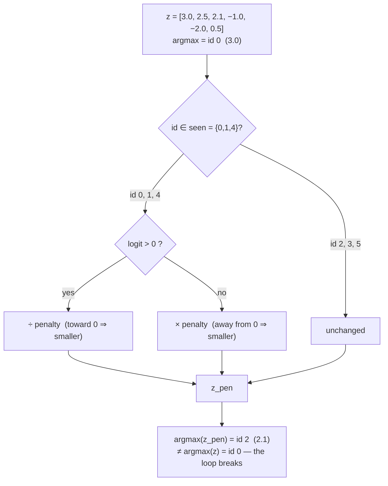
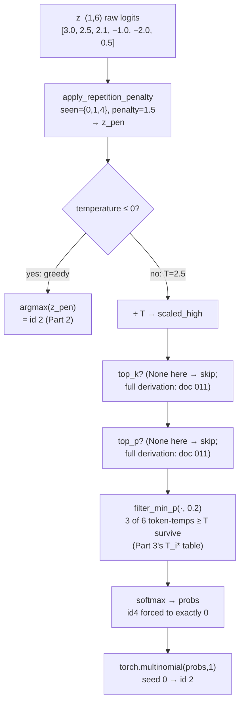
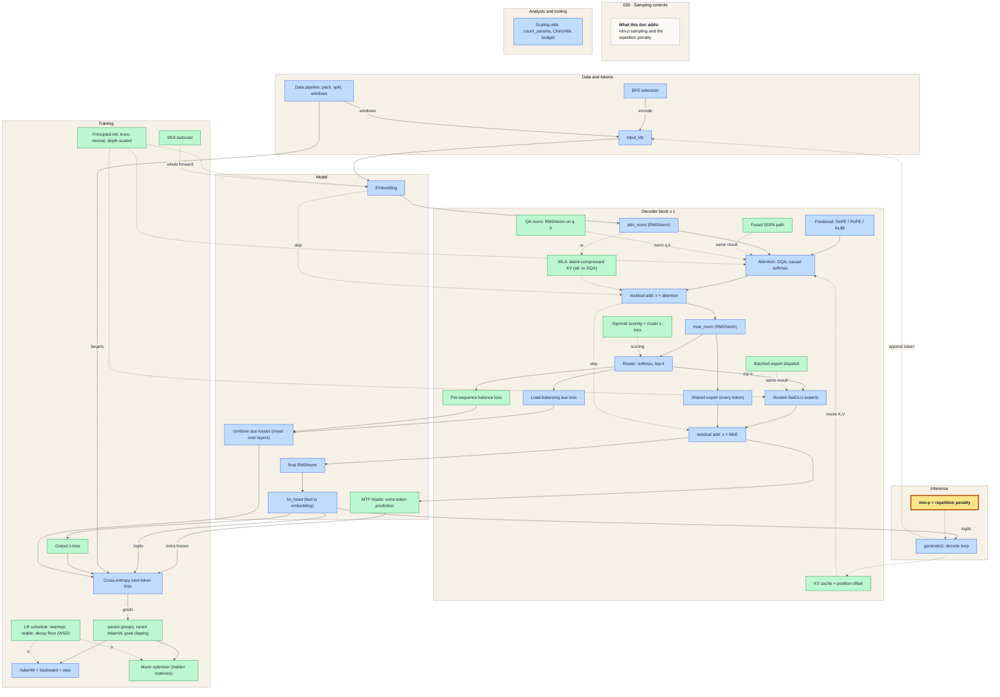

# 030 — min-p sampling and the repetition penalty, derived and solved by hand

**Companion to:** [`journey_of_a_model/030-min-p-and-repetition-penalty.md`](../../journey_of_a_model/030-min-p-and-repetition-penalty.md)
(and, for the surrounding decode loop these two functions are wired into,
[`011-inference-generation.md`](011-inference-generation.md); for the model
whose real logits Part 5 borrows,
[`006-full-model-assembly.md`](006-full-model-assembly.md))
· **Code:** [`qwenmoe/model/generate.py`](../../qwenmoe/model/generate.py)
(`filter_min_p` L53-70, `apply_repetition_penalty` L73-96, their wiring in
`_sample_next` L99-131)
· **Every number here is reproduced by:** [`verify_030_min_p_and_repetition_penalty.py`](verify_030_min_p_and_repetition_penalty.py)
(`uv run python docs/math/verify_030_min_p_and_repetition_penalty.py`)

---

## How to read this

The journal entry tells you *what* these two sampling knobs do and *why* —
min-p as an adaptive alternative to top-p's fixed cumulative-mass cutoff,
the repetition penalty as a sign-aware nudge that stops a small model
locking into `"the the the the"`. It gives one illustrative number per
idea.

Doc [011](011-inference-generation.md) already walked the *entire*
`generate()` pipeline end to end, including a pass through both of these
functions as two stops along a longer road.

This document does neither of those jobs. It does the other trade-off —
**maximum detail on exactly these two functions, minimum summarising** —
and it adds three things 011 didn't need to:

1. **A running example built to interrogate both functions at once** — one
   logits vector and one "already generated" set that hits every sign ×
   seen/unseen combination `apply_repetition_penalty` branches on, carried
   through to `filter_min_p` by literally reusing its output.
2. **A closed-form explanation of *why* min-p is adaptive** — not just
   "confident keeps few, unsure keeps many" (the journal's framing) but an
   exact per-token formula, derived from scratch, that predicts *which*
   tokens survive at *which* temperature.
3. **The repetition penalty run against a real, previously-verified
   model's actual degeneration** (`"DADDDD"`, from doc 006/011) to see,
   honestly, both what it fixes and what it doesn't.

We do **not** re-derive `softmax`, `argmax`, the temperature limits, or
`torch.multinomial`'s inverse-CDF sampling — [004](004-attention-gqa.md)
and [011](011-inference-generation.md) already did, and we cite them at
each use. We also do not re-derive a transformer's forward pass — Part 5
borrows 006/011's already-hand-verified model as a black box that produces
real logits, and only traces what happens to those logits here.

You need no linear-algebra background. Every term is defined at first use,
and we keep a running **shape ledger**.

---

## Part 0 — The problem these two knobs solve

A language model outputs one **logit** per vocabulary token at every
position: a raw, unnormalised score, any real number. `softmax` turns a
vector of logits into a **probability distribution** — non-negative
numbers summing to 1 (full derivation:
[004](004-attention-gqa.md#step-10--softmax)). Decoding samples (or takes
the largest of) that distribution to pick the next token, feeds it back
in, and repeats — the **autoregressive** loop diagrammed in
[011 Part 0](011-inference-generation.md#part-0--what-are-we-even-computing).

Two specific failure modes of that loop motivate this task's two
functions:

- **Fixed nucleus cutoffs waste the tail at high temperature.** top-p
  keeps the smallest prefix summing to a *fixed* probability mass `p`; when
  temperature flattens the distribution, reaching that fixed mass requires
  scooping up many low-quality tokens. **min-p**
  ([`filter_min_p`](../../qwenmoe/model/generate.py#L53)) instead keeps
  every token within a *relative* band of the top one — a threshold that
  shrinks and grows with the model's own confidence.
- **Greedy decoding can lock onto a token forever.** If a token's context
  makes it likely, picking it enlarges that same context, which can make
  it likelier still — a positive feedback loop with no built-in exit
  ("neural text degeneration," [Holtzman et al.
  2019](https://arxiv.org/abs/1904.09751)). The **repetition penalty**
  ([`apply_repetition_penalty`](../../qwenmoe/model/generate.py#L73), CTRL-style,
  [Keskar et al. 2019](https://arxiv.org/abs/1909.05858)) directly shrinks
  the logit of every token already used, breaking the loop from the
  outside.

Both are pure **post-processing on a logits vector** — neither looks
inside the model. That is also why this doc's running example does not
need a transformer at all for Parts 1-4: a hand-built logits vector is a
completely legitimate input (the functions' own docstrings call them out
as "standalone... directly testable with hand-built logits tensors").

---

## Part 1 — The running example, written out in full

**One vocabulary of 6 tokens, ids 0–5** (no tokenizer needed yet — Part 5
adds one). **One logits vector.** **One "already generated" set.** Carried
through every part below without modification.

$$
z = [\,\underbrace{3.0}_{\text{id }0},\ \underbrace{2.5}_{1},\ \underbrace{2.1}_{2},\ \underbrace{-1.0}_{3},\ \underbrace{-2.0}_{4},\ \underbrace{0.5}_{5}\,] \qquad (1,6)
$$

$$
\text{generated\_ids} = [[\,0,\ 1,\ 4,\ 0,\ 1\,]] \qquad (1,5)
$$

$$
\text{penalty} = 1.5 \qquad \text{min\_p} = 0.2
$$

**Why this exact vector.** Six tokens is the smallest vocabulary that can
hold every combination `apply_repetition_penalty` branches on *and* still
leave enough room for `filter_min_p` to show a real adaptive gap:

| id | logit | sign | in `generated_ids`? | role |
|---|---:|---|---|---|
| 0 | $3.0$ | + | **yes** | seen, positive, **and the current argmax** — the "self-reinforcing loop" case |
| 1 | $2.5$ | + | **yes** | seen, positive, not the argmax |
| 2 | $2.1$ | + | no | unseen — close enough to id 0 to become the new argmax once id 0 is penalized |
| 3 | $-1.0$ | − | no | unseen, negative — the contrast case for the sign-aware rule |
| 4 | $-2.0$ | − | **yes** | seen, negative — the branch a naive "always divide" rule gets backwards |
| 5 | $0.5$ | + | no | unseen, positive, small |

`generated_ids` is a length-5 sequence containing ids `0` and `1` twice
each and `4` once — mirroring a real `sequence` tensor (`generate.py:193`,
`210-213`) where the whole history, prompt included, is what
`apply_repetition_penalty` sees.

**Shape ledger** (filled in as we go):

| name | shape | born at |
|---|---|---|
| `z` | `(1, 6)` | Part 1 |
| `generated_ids` | `(1, 5)` | Part 1 |
| `seen` | `(3,)` | Part 2, Step 1 |
| `z_pen` | `(1, 6)` | Part 2, Step 4 |
| `scaled_low` / `scaled_high` | `(1, 6)` each | Part 3, Step 1 |
| `f_low` / `f_high` | `(1, 6)` each | Part 3, Step 3 |
| `probs`, `cdf` | `(1, 6)` each | Part 4 |
| `next_token` | `(1, 1)` | Part 4 |

---

## Part 2 — `apply_repetition_penalty`, line by line

Code ([`generate.py:73-96`](../../qwenmoe/model/generate.py#L73)):

```python
def apply_repetition_penalty(logits, generated_ids, penalty):
    if penalty <= 0:
        raise ValueError(f"repetition_penalty must be > 0, got {penalty}")
    if penalty == 1.0:
        return logits
    seen = torch.unique(generated_ids)
    logits = logits.clone()
    current = logits[..., seen]
    logits[..., seen] = torch.where(current > 0, current / penalty, current * penalty)
    return logits
```

### Step 1 — Validate, then the no-op

`generate.py:88-91`. `penalty <= 0` is rejected outright — a `penalty` of
`0` would divide a positive logit by `0` (`inf`) and multiply a negative
one by `0` (exactly `0`, i.e. *maximally* likely — the opposite of the
intent). `penalty == 1.0` returns the **same tensor object**, unmodified —
a genuine no-op, not "shrink by a factor of 1": no clone, no computation.
Neither branch applies to our example (`penalty = 1.5`), but the verify
script checks both: `apply_repetition_penalty(z, ids, 1.0)` returns a
tensor `torch.equal` to `z`, and `penalty = 0.0` / `-1.0` both raise.

### Step 2 — `seen = torch.unique(generated_ids)`

**Why `unique`.** `generated_ids` is `[[0, 1, 4, 0, 1]]` — token `0` and
`1` each occur *twice*. The penalty must be applied **once** per distinct
token id, not once per occurrence (dividing a logit by `penalty` twice
because it appeared twice would over-penalize it). `torch.unique` returns
the sorted set of distinct values, discarding both order and repeat count
— exactly "which ids have appeared," nothing about how often.

**Compute.** The five entries `{0, 1, 4, 0, 1}` collapse to the 3 distinct
values, returned sorted ascending:

$$
\text{seen} = [\,0,\ 1,\ 4\,] \qquad (3,)
$$

**Shape:** `generated_ids (1, 5)` → `seen (3,)`.

### Step 3 — Clone, then gather the seen logits

`logits = logits.clone()` — the function must not mutate the caller's
tensor (`generate()` passes `sequence`'s logits by reference every decode
step; a mutating penalty would corrupt the next step's inputs).

`current = logits[..., seen]` — **advanced indexing**: `seen` is an
integer tensor, so `logits[..., seen]` gathers the columns at those exact
indices, in that order, dropping everything else. This is *not* a slice
(`a:b`, contiguous) — it can pick arbitrary, non-adjacent positions.

**Compute.** `seen = [0, 1, 4]`, so `current` gathers $z$'s entries at
those three ids:

$$
\text{current} = [\,z_0,\ z_1,\ z_4\,] = [\,3.0,\ 2.5,\ -2.0\,] \qquad (3,)
$$

**Shape:** `logits (1, 6)` → `current (1, 3)` (batch axis kept; we drop it
for the algebra above).

### Step 4 — The sign-aware update, derived in full

`logits[..., seen] = torch.where(current > 0, current / penalty, current * penalty)`.

**The goal, stated precisely:** for every seen token, *lower its
probability relative to what it would otherwise be*. Because `softmax` is
strictly increasing in each logit (a larger $z_i$, all else fixed, always
yields a larger $\operatorname{softmax}(z)_i$ — it is a ratio of $e^{z_i}$,
itself increasing, to a sum that includes it), "lower the probability" is
equivalent to "lower the logit." The only question is *how* to lower a
number of unknown sign by a knob $\text{penalty} > 1$ meant to mean
"discourage this token":

- **Positive logit** ($z_i > 0$): dividing by $\text{penalty} > 1$ moves it
  *toward* $0$ — strictly smaller. **Correct.**
- **Negative logit** ($z_i < 0$): dividing by $\text{penalty} > 1$ *also*
  moves it toward $0$ — but toward $0$ from below means **larger** (less
  negative). That *raises* its probability. **Backwards.** The fix is to
  do the opposite arithmetic operation: **multiply** by $\text{penalty} >
  1$, which pushes a negative number further from $0$ — strictly smaller.
  **Correct.**

So "always divide" (the literal reading of a rule like "divide the logit
by the penalty") is only correct for half the number line. The
`torch.where(current > 0, current / penalty, current * penalty)` split is
what makes the rule correct on *both* halves — this matches
[CTRL](https://arxiv.org/abs/1909.05858) §4.1 and Hugging Face's
`RepetitionPenaltyLogitsProcessor`
(`torch.where(score < 0, score * penalty, score / penalty)`, same rule
with the branches written the other way round).

**Compute**, entry by entry, on `current = [3.0, 2.5, -2.0]`
(ids `0, 1, 4`), `penalty = 1.5`:

$$
\begin{aligned}
z_0 &= 3.0 > 0 &&\Rightarrow\ 3.0 / 1.5 = 2.000000 \\
z_1 &= 2.5 > 0 &&\Rightarrow\ 2.5 / 1.5 = 1.666667 \\
z_4 &= -2.0 < 0 &&\Rightarrow\ -2.0 \times 1.5 = -3.000000
\end{aligned}
$$

These three values are written back into `logits` at positions `0, 1, 4`;
positions `2, 3, 5` (unseen) are untouched, since `logits[..., seen] = ...`
only ever assigns to the gathered indices:

$$
z^{\text{pen}} = [\,\mathbf{2.000000},\ \mathbf{1.666667},\ 2.100000,\ -1.000000,\ \mathbf{-3.000000},\ 0.500000\,]
$$

Verified (`verify_030...py`, Part 1):

```
z             : [3.0, 2.5, 2.0999999, -1.0, -2.0, 0.5]
z_pen         : [2.0, 1.6666666, 2.0999999, -1.0, -3.0, 0.5]
```

(`2.1` prints as `2.0999999...` — it has no exact float32 representation;
the doc rounds to 6 places throughout, the script's `assert_close` checks
to `1e-6`.)

**Shape:** `logits (1, 6)` → `logits (1, 6)` (values change at 3 of 6
positions; shape never changes — this is a mask/rewrite, not a filter).

### The negative branch, isolated

Id `3` ($z_3 = -1.0$) is *unseen* in our example, so it passes through
row 4 unchanged. To see the negative branch actually fire, the verify
script calls `apply_repetition_penalty(z, [[3]], 1.5)` — pretending id 3
*had* been generated:

$$
z_3 = -1.0 < 0 \ \Rightarrow\ -1.0 \times 1.5 = \mathbf{-1.5}
$$

more negative, lower probability. **Confirmed against the naive rule**:
"always divide" would instead give $-1.0 / 1.5 = -0.666667$ — *closer* to
$0$, a **higher** probability, exactly backwards. The verify script
computes both and asserts $-1.5 < -1.0 <$ (naive) $-0.666667$.

### The argmax flip — the point of the whole exercise

$$
\operatorname{argmax}(z) = 0 \ (\text{value } 3.0) \qquad\qquad \operatorname{argmax}(z^{\text{pen}}) = 2\ (\text{value } 2.1)
$$

Before the penalty, id 0 — a token that has already appeared twice — is
the single most likely next token: exactly the "self-reinforcing loop"
setup from the journal. After the penalty, id 0's score drops from $3.0$
to $2.0$, which is now *below* id 2's untouched $2.1$: **the argmax moves
to a token that has never been generated.** This is the entire mechanism
by which the repetition penalty can break a greedy lock — proved here on
one vector by direct computation, and shown again on a real model's real
logits in Part 5.



---

## Part 3 — `filter_min_p`, line by line, adaptivity derived exactly

Code ([`generate.py:53-70`](../../qwenmoe/model/generate.py#L53)):

```python
def filter_min_p(logits, min_p):
    if not (0.0 < min_p <= 1.0):
        raise ValueError(f"min_p must be in (0, 1], got {min_p}")
    probs = F.softmax(logits, dim=-1)
    threshold = min_p * probs.max(dim=-1, keepdim=True).values
    return torch.where(probs < threshold, torch.full_like(logits, float("-inf")), logits)
```

**Derivation of the rule.** min-p sampling
([Nguyen et al., *Turning Up the Heat: Min-p Sampling for Creative and
Coherent LLM Outputs*, 2024](https://arxiv.org/abs/2407.01082), ICLR 2025)
keeps token $i$ iff its probability is at least a fraction $\text{min\_p}$
of the *top* token's probability:

$$
P(i) \ge \text{min\_p} \times P_{\max}, \qquad P_{\max} = \max_j P(j).
$$

This is the paper's threshold applied per-row. Because $\text{min\_p} \le
1$, the top token satisfies $P_{\max} \ge \text{min\_p}\cdot P_{\max}$
trivially — **it can never exclude itself**, so the surviving set is never
empty (an exact consequence of the inequality, proved once here, reused in
Part 4).

We apply this to `_sample_next`'s real pipeline, which computes `filter_min_p`
on `scaled_logits = next_logits / temperature`
([`generate.py:123-129`](../../qwenmoe/model/generate.py#L123)) — so our
input is **the same `z_pen` from Part 2**, scaled by temperature. Nothing
new is invented: we take the *one* vector this doc has built so far and ask
what a real decode step would do with it at two different temperatures.

### Step 1 — Temperature scaling

`scaled_logits = next_logits / temperature` (`generate.py:123`). Division
by a **positive** scalar $T$ never changes any logit's *sign*, only its
magnitude — this matters later. Two settings, $T_{\text{low}} = 0.5$
(sharper) and $T_{\text{high}} = 2.5$ (flatter), both applied to the exact
same $z^{\text{pen}}$:

$$
z^{\text{pen}}/0.5 = [\,4.000000,\ 3.333333,\ 4.200000,\ -2.000000,\ -6.000000,\ 1.000000\,]
$$
$$
z^{\text{pen}}/2.5 = [\,0.800000,\ 0.666667,\ 0.840000,\ -0.400000,\ -1.200000,\ 0.200000\,]
$$

**Shape:** `(1, 6)` → `(1, 6)`, twice (two independent scalings of the same
tensor — Run "low" and Run "high," not two examples).

### Step 2 — `probs = softmax(logits)`

Softmax (defined and derived in
[004](004-attention-gqa.md#step-10--softmax)):
$\operatorname{softmax}(z)_i = e^{z_i} / \sum_j e^{z_j}$. Computed on each
scaled vector (verify script; subtract-the-max numerically-stable form
used internally, same result):

$$
\text{probs}_{\text{low}} = [\,0.358792,\ 0.184210,\ \mathbf{0.438229},\ 0.000889,\ 0.000016,\ 0.017863\,] \quad(\text{sum } 1.000000)
$$
$$
\text{probs}_{\text{high}} = [\,0.256323,\ 0.224327,\ \mathbf{0.266784},\ 0.077203,\ 0.034690,\ 0.140673\,] \quad(\text{sum } 1.000000)
$$

$P_{\max,\text{low}} = 0.438229$ (id 2) — nearly *half* the mass on one
token. $P_{\max,\text{high}} = 0.266784$ (id 2 again) — barely more than a
sixth. **Same underlying logit gaps, same identity of the top token, very
different concentration** — purely a consequence of $T$, as derived next.

### Step 3 — The threshold, and the filter

$\text{threshold} = \text{min\_p} \times P_{\max}$:

$$
\text{threshold}_{\text{low}} = 0.2 \times 0.438229 = 0.087646
\qquad
\text{threshold}_{\text{high}} = 0.2 \times 0.266784 = 0.053357
$$

`torch.where(probs < threshold, -inf, logits)` — note it masks the
**logits**, using **probs** only to decide *which* ones, coordinate by
coordinate:

| id | $\text{probs}_{\text{low}}$ | $< 0.087646$? | kept? | $\text{probs}_{\text{high}}$ | $< 0.053357$? | kept? |
|---|---:|---|---|---:|---|---|
| 0 | $0.358792$ | no | ✓ | $0.256323$ | no | ✓ |
| 1 | $0.184210$ | no | ✓ | $0.224327$ | no | ✓ |
| 2 | $0.438229$ | no | ✓ | $0.266784$ | no | ✓ |
| 3 | $0.000889$ | **yes** | ✗ | $0.077203$ | no | ✓ |
| 4 | $0.000016$ | **yes** | ✗ | $0.034690$ | **yes** | ✗ |
| 5 | $0.017863$ | **yes** | ✗ | $0.140673$ | no | ✓ |

$$
f_{\text{low}} = [\,4.000000,\ 3.333333,\ 4.200000,\ -\infty,\ -\infty,\ -\infty\,] \qquad\text{3 survivors}
$$
$$
f_{\text{high}} = [\,0.800000,\ 0.666667,\ 0.840000,\ -0.400000,\ -\infty,\ 0.200000\,] \qquad\text{5 survivors}
$$

**This is the adaptivity, exactly and numerically**: the identical
function, the identical `min_p = 0.2`, applied to two scalings of the
identical logits, keeps **3** tokens when the distribution is sharp
(low $T$) and **5** when it's flat (high $T$).

**Shape:** `(1, 6)` → `(1, 6)`, twice.

### Why, exactly — the per-token survival temperature

The journal states adaptivity as an observation. Here is where it comes
from, in closed form. Token $i$ survives iff
$P(i) \ge \text{min\_p}\cdot P_{\max}$. Write $z_{\max} =
\max_j z_j/T$; because softmax's normalizer $\sum_j e^{z_j/T}$ is the same
for every $i$, it cancels in the ratio (the identical trick used for the
temperature $T\to 0$ limit in
[011](011-inference-generation.md#step-10--the-greedy-branch-run-a-temperature--0)):

$$
\frac{P(i)}{P_{\max}} = \frac{e^{z_i/T}}{e^{z_{\max}/T}} = e^{(z_i - z_{\max})/T}
$$

so the survival condition $e^{(z_i-z_{\max})/T} \ge \text{min\_p}$
becomes, taking $\ln$ of both sides (valid since both sides are positive,
and $\ln$ is increasing so the inequality direction is preserved):

$$
\frac{z_i - z_{\max}}{T} \ge \ln(\text{min\_p})
$$

$z_i - z_{\max} \le 0$ (it's a gap below the max) and $\ln(\text{min\_p})
\le 0$ (since $0 < \text{min\_p} \le 1$). Multiplying both sides by $T>0$
keeps the direction; dividing both sides by $\ln(\text{min\_p})$ — a
**negative** number — **flips** it:

$$
\boxed{\ T \ \ge\ T_i^{*} \ :=\ \frac{z_i - z_{\max}}{\ln(\text{min\_p})}\ }
$$

Every token has its own **survival temperature** $T_i^{*} \ge 0$ (a ratio
of two non-positive numbers): token $i$ is kept iff the *current*
temperature is at or above its own $T_i^{*}$. The max token itself has
$z_i - z_{\max} = 0 \Rightarrow T_i^{*} = 0$ — always survives, at any
$T>0$, matching the "never empty" proof above. As $T$ *shrinks*, fewer
tokens have $T \ge T_i^{*}$ — **exactly why lower temperature makes min-p
stricter.**

**Compute**, on $z^{\text{pen}}$, $z_{\max} = 2.1$ (id 2),
$\ln(0.2) = -1.609438$:

| id | $z_i$ | $z_i - z_{\max}$ | $T_i^{*} = \dfrac{z_i-z_{\max}}{\ln 0.2}$ |
|---|---:|---:|---:|
| 2 | $2.100000$ | $0$ | $0.000000$ |
| 0 | $2.000000$ | $-0.100000$ | $0.062133$ |
| 1 | $1.666667$ | $-0.433333$ | $0.269245$ |
| 5 | $0.500000$ | $-1.600000$ | $0.994136$ |
| 3 | $-1.000000$ | $-3.100000$ | $1.926138$ |
| 4 | $-3.000000$ | $-5.100000$ | $3.168808$ |

At $T_{\text{low}} = 0.5$: only ids with $T_i^{*}\le 0.5$ survive — $\{2,
0, 1\}$ (three). At $T_{\text{high}} = 2.5$: ids with $T_i^{*}\le 2.5$ —
$\{2, 0, 1, 5, 3\}$ (five, everyone except id 4 at $3.169$). **These are
exactly the survivor sets computed directly in Step 3** — the closed form
predicts the table, not just describes it. Verified
(`verify_030...py`, Part 2):

```
per-token survival temperature T_i* = (z_i - z_max) / ln(min_p):
  [0.062133, 0.269245, -0.0, 1.926138, 3.168808, 0.994136]
T_i* <= T_low (0.5) predicts survivors: [0, 1, 2]
T_i* <= T_high(2.5) predicts survivors: [0, 1, 2, 3, 5]
```

### Edge cases: never masks everything, and ties

**Extreme `min_p = 1.0`** on a sharply peaked vector `[8.0, 1, 1, 1, 1,
1]`: threshold $= 1.0\times P_{\max} = P_{\max}$ itself, so *only* the
argmax can satisfy `prob >= threshold` unless another token ties it
exactly. Verified:

```
filter_min_p(peaked, min_p=1.0)  : [8.0, -inf, -inf, -inf, -inf, -inf]  survivors = 1
```

**Extreme `min_p = 1.0` on a perfectly uniform vector** `[0,0,0,0,0,0]`:
every probability equals $1/6$ *exactly*, so `threshold = 1.0 * (1/6) =
1/6` too, and the comparison is `probs < threshold` — **strict**. No
probability is *strictly less than* an identical threshold, so **all 6
survive**:

```
filter_min_p(uniform, min_p=1.0) : [0.0, 0.0, 0.0, 0.0, 0.0, 0.0]  survivors = 6
```

This is why the never-empty guarantee holds even at the strictest legal
setting — the comparison's strictness protects exact ties, and the
$\text{min\_p}\le 1$ constraint protects the argmax specifically.

**Out-of-range rejection**, all four confirmed to raise:

```
filter_min_p(min_p=0.0)  -> ValueError: min_p must be in (0, 1], got 0.0
filter_min_p(min_p=-0.1) -> ValueError: min_p must be in (0, 1], got -0.1
filter_min_p(min_p=1.5)  -> ValueError: min_p must be in (0, 1], got 1.5
apply_repetition_penalty(penalty=0.0)  -> ValueError: repetition_penalty must be > 0, got 0.0
apply_repetition_penalty(penalty=-1.0) -> ValueError: repetition_penalty must be > 0, got -1.0
```

---

## Part 4 — Composition inside `_sample_next`

Code ([`generate.py:99-131`](../../qwenmoe/model/generate.py#L99)):

```python
def _sample_next(next_logits, temperature, top_k, top_p, min_p=None,
                  repetition_penalty=1.0, generated_ids=None):
    if repetition_penalty != 1.0 and generated_ids is not None:
        next_logits = apply_repetition_penalty(next_logits, generated_ids, repetition_penalty)
    if temperature <= 0:
        return torch.argmax(next_logits, dim=-1, keepdim=True)
    scaled_logits = next_logits / temperature
    if top_k is not None:
        scaled_logits = filter_top_k(scaled_logits, top_k)
    if top_p is not None:
        scaled_logits = filter_top_p(scaled_logits, top_p)
    if min_p is not None:
        scaled_logits = filter_min_p(scaled_logits, min_p)
    probs = F.softmax(scaled_logits, dim=-1)
    return torch.multinomial(probs, num_samples=1)
```

`top_k` and `top_p` slot in between the `/ temperature` line and
`filter_min_p` — out of this doc's scope (fully derived in
[011 Steps 12-13](011-inference-generation.md#step-12--filter_top_k-k--4)).
We run our example with `top_k=None, top_p=None`, which the code's own
`if` guards skip entirely — so every number below is exactly what
`_sample_next(Z, ..., top_k=None, top_p=None, min_p=0.2, ...)` really
computes, not a simplification. Because each stage only ever turns a
finite logit into $-\infty$ and never the reverse, inserting `top_k`/`top_p`
between temperature and `min_p` could only shrink the survivor set
`filter_min_p` sees — it cannot change the mechanism this section derives.

### Why the repetition penalty runs *before* temperature — derived, not asserted

The journal states this as a design choice. Here is the reason, made
precise. First, an exact algebraic fact: for a **fixed** seen set (fixed
sign classification), swapping the order of `÷ temperature` and the
penalty changes nothing numerically. For a positive seen logit,

$$
(z_i / \text{penalty}) / T \;=\; z_i / (\text{penalty}\cdot T) \;=\; (z_i / T)/\text{penalty}
$$

— real division commutes this way regardless of grouping — and
symmetrically for the negative branch's multiplication. Dividing by $T>0$
**never flips a sign**, so which branch a token takes is unaffected by
when temperature is applied either. **The arithmetic result is
order-invariant.**

So why does the code fix the order? Look at the *control flow*, not the
arithmetic: `if temperature <= 0: return argmax(...)` is a **hard early
return** — greedy decoding never executes the `/ temperature` line, or
`filter_top_k`/`filter_top_p`/`filter_min_p`, or `softmax`+`multinomial`
at all. If `apply_repetition_penalty` were called *after* that check
(e.g. only inside the sampling branch), greedy decoding would **never see
it** — exactly the scenario that produces `"DADDDD"` in Part 5 below with
no penalty at all. Placing the penalty call at `generate.py:119-120`,
*before* the `temperature <= 0` fork at `121-122`, is what makes it apply
to greedy decoding too (Requirement 11.2's intent, and 011's "Why apply
the repetition penalty before temperature, not after?"). **The ordering
matters for control flow, not for arithmetic** — a distinction the journal
doesn't draw and the code comment only hints at ("so it shapes greedy
decoding too").

### The composed run, digit by digit

Take $T = T_{\text{high}} = 2.5$ (Part 3's "unsure" setting — the more
interesting one, since it leaves multiple live candidates for
`multinomial` to actually choose among) with `min_p = 0.2`,
`repetition_penalty = 1.5`, `generated_ids` as in Part 1.

1. **Repetition penalty** on raw $z$: this is exactly Part 2 →
   $z^{\text{pen}} = [2.000000, 1.666667, 2.100000, -1.000000, -3.000000, 0.500000]$.
2. **`temperature <= 0`?** No ($2.5 > 0$) — continue.
3. **`÷ 2.5`**: this is exactly Part 3's `scaled_high` →
   $[0.800000, 0.666667, 0.840000, -0.400000, -1.200000, 0.200000]$.
4. **`top_k`, `top_p`**: both `None`, skipped.
5. **`filter_min_p(·, 0.2)`**: this is exactly Part 3's $f_{\text{high}}$ →
   $[0.800000, 0.666667, 0.840000, -0.400000, -\infty, 0.200000]$.
6. **`softmax`**: subtract the max ($0.840000$), exponentiate, normalize
   (verify script):
   $$
   \text{probs} = [\,0.265534,\ 0.232389,\ 0.276371,\ 0.079977,\ 0.000000,\ 0.145728\,]
   $$
   sums to $1.000000$. Id 4 has probability *exactly* $0$ (the surviving
   $-\infty$ maps through $e^{-\infty}=0$) — it structurally cannot be
   drawn.

**Shape:** `(1, 6)` at every stage above.

### `torch.multinomial` — the draw

**Definition (reused from [011 Step
16](011-inference-generation.md#step-16--torchmultinomialprobs-num_samples1)):**
form the cumulative distribution function (CDF) $C_i = \sum_{j\le
i}\text{probs}_j$; draw $u$ uniform in $[0,1)$; return the smallest $i$
with $C_i > u$. Our CDF:

$$
C = [\,0.265534,\ 0.497923,\ 0.774294,\ 0.854272,\ 0.854272,\ 1.000000\,]
$$

— note $C_3 = C_4 = 0.854272$: id 4 owns a zero-width interval, i.e. it is
unreachable, consistent with `probs[4] = 0`. This partitions $[0,1)$:
id 0 → $[0, 0.2655)$; id 1 → $[0.2655, 0.4979)$; id 2 →
$[0.4979, 0.7743)$; id 3 → $[0.7743, 0.8543)$; id 5 → $[0.8543, 1)$.

With `torch.manual_seed(0)`, the real draw lands in **id 2**'s interval:

```
manual torch.multinomial(probs, 1), seed 0 -> 2
_sample_next(Z, T=2.5, min_p=0.2, penalty=1.5, seed 0) -> 2
```

— the hand-built call and the real `_sample_next(Z, 2.5, None, None,
min_p=0.2, repetition_penalty=1.5, generated_ids=generated_ids)` agree
exactly, confirming `_sample_next` really does apply the penalty, the
division, and the filter in the order just walked.

**Which index a *particular* seeded draw lands on is not provable
algebra** — it depends on PyTorch's RNG implementation. That $P(\text{draw
}=i) = \text{probs}_i$ *is* exact for any correct sampler, and is checked
empirically with 100,000 draws:

```
100k-draw empirical frequency: [0.263250, 0.232640, 0.280000, 0.079300, 0.000000, 0.144810]
```

matching `probs` (`[0.265534, 0.232389, 0.276371, 0.079977, 0, 0.145728]`)
to within `0.01` — well inside the expected sampling noise at $n=100{,}000$.

**Shape:** `(1, 6)` → `(1, 1)`.



---

## Part 5 — `generate()` in the wild: does the penalty actually cure the loop?

Parts 1-4 used a hand-built vector to isolate the two functions'
mechanics. This part plugs `apply_repetition_penalty` into a **real**
`generate()` call on a **real** (if tiny) transformer, to see the argmax
flip from Part 2 happen on genuine model output, and to be honest about
what it does and doesn't fix.

We reuse — **not re-derive** — the exact `QwenMoEModel` that
[006](006-full-model-assembly.md) hand-built and
[011](011-inference-generation.md) already ran `generate()` on: 2 layers,
`vocab_size=6`, `d_model=4`, the same pinned weights, the same
`CharTokenizer` trained on `"DAD BED ACE CAB"` (ids: `·`=0, `A`=1, `B`=2,
`C`=3, `D`=4, `E`=5), the same 3-character prompt `"DAD"` → `[4, 1, 4]`,
and the same `max_seq_len=6` (so, as in 011, exactly 3 new tokens get
generated before the context cap stops the loop —
[`generate.py:197-199`](../../qwenmoe/model/generate.py#L197)).

**011's finding, cited not repeated:** with `temperature=0.0` and no
repetition penalty, greedy decoding locks onto `D` and produces
`"DADDDD"` — `D`'s logit *rises* every step (the self-reinforcing loop
from Part 0). We take that as our baseline and ask: does turning the
repetition penalty on, *with greedy decoding still on* (`temperature=0.0`,
so `top_k`/`top_p`/`min_p`/sampling never run — only the penalty and the
argmax), change anything?

```
repetition_penalty=1.0 (default) : 'DADDDD'
repetition_penalty=1.3           : 'DADDDD'
repetition_penalty=2.0           : 'DADCCC'
```

`penalty=1.3` — the journal's own worked value — **does not** change the
output here. `penalty=2.0` **does**. Both are explained by the exact same
mechanism as Part 2's flip, now on the model's real step-1 logits.

### The step-1 flip, on real numbers

The model's real last-position logits for `"DAD"` — already hand-derived
and verified in [006](006-full-model-assembly.md) and reused in
[011](011-inference-generation.md), **not re-derived here**:

$$
z_1 = [\,1.185529,\ 0.009417,\ 0.999658,\ 1.577581,\ \mathbf{2.763110},\ -3.341033\,]
$$

`generated_ids = [[4, 1, 4]]` (the prompt itself — `generate()` passes the
*whole* `sequence`, prompt included, to `apply_repetition_penalty` every
step: [`generate.py:210-213`](../../qwenmoe/model/generate.py#L210)), so
$\text{seen} = \{1, 4\}$: `A` and `D`.

$$
z_1^{\text{pen}}(\text{penalty}=1.3) = [\,1.185529,\ 0.007244,\ 0.999658,\ 1.577581,\ \mathbf{2.125470},\ -3.341033\,]
$$
$$
z_1^{\text{pen}}(\text{penalty}=2.0) = [\,1.185529,\ 0.004709,\ 0.999658,\ 1.577581,\ 1.381555,\ -3.341033\,]
$$

At `penalty=1.3`: `D`'s penalized score ($2.125470$) is still the largest
— larger than `C`'s untouched $1.577581$. **Argmax stays `D`.** At
`penalty=2.0`: `D`'s penalized score ($1.381555$) has fallen **below**
`C`'s untouched $1.577581$. **Argmax flips to id 3 (`C`)** — the identical
mechanism as Part 2's id-0-to-id-2 flip, just with different numbers:

```
apply_repetition_penalty(z1, seen={1,4}, penalty=1.3) -> argmax = 4
apply_repetition_penalty(z1, seen={1,4}, penalty=2.0) -> argmax = 3
```

### The full trace, and an honest result

`penalty=2.0` breaks the `D`-lock at step 1. What happens next? The
verify script re-runs the model at each of the 3 steps and applies the
penalty to that step's real logits:

```
step 1: seen=[1, 4]
  z  = [1.185529, 0.009417, 0.999658, 1.577581, 2.76311, -3.341033]
  zp = [1.185529, 0.004709, 0.999658, 1.577581, 1.381555, -3.341033]
  argmax(raw)=4  argmax(penalized)=3 ('C')
step 2: seen=[1, 3, 4]
  z  = [-0.415367, -0.578706, 0.548109, 2.419293, 2.003926, -3.87511]
  zp = [-0.415367, -1.157412, 0.548109, 1.209646, 1.001963, -3.87511]
  argmax(raw)=3  argmax(penalized)=3 ('C')
step 3: seen=[1, 3, 4]
  z  = [-0.38569, -0.567337, 0.555198, 2.41006, 2.02437, -3.879232]
  zp = [-0.38569, -1.134673, 0.555198, 1.20503, 1.012185, -3.879232]
  argmax(raw)=3  argmax(penalized)=3 ('C')
```

**`C` itself becomes a seen token from step 2 onward** — `seen` grows to
`{1, 3, 4}` — and gets penalized too (compare `zp[3] = 1.209646` to the
unpenalized `z[3] = 2.419293`). But `C`'s *raw* logit is now so dominant
(the model itself, having just emitted `C`, predicts `C` again strongly —
$2.419$ and $2.410$ vs. the next-best $2.004$ / $2.024$ for `D`) that even
halved, it stays on top. **Final output: `"DADCCC"`.**

This is a genuinely honest result, not a cherry-picked success story:
`penalty=2.0` broke the *first* lock (`D`) but the model settled into a
*second* one (`C`). A single-step, relative logit nudge changes *which*
token dominates; it does not, by itself, guarantee variety — the test this
project's suite uses to grade the repetition penalty
(`test_generate_repetition_penalty_changes_greedy_output_toward_less_repetition`)
correspondingly only checks "changes the output" and "at least as many
distinct characters" (`{D,A,D,C,C,C}` → 3 distinct chars vs.
`{D,A,D,D,D,D}` → 2), not "never repeats again." Real variety needs the
sampling stack too — Part 4's composed run above, or [011 Run
B](011-inference-generation.md#part-4--the-loop-closes-run-a-end-to-end)
(`"DADD D"`, breaking free via an actual random draw, not just a shifted
argmax).

### Agreement with the KV-cache path

`apply_repetition_penalty` and `filter_min_p` operate on whatever
last-position logits `generate()` hands them — they have no idea whether
those logits came from a full recompute or from
[the KV cache](../../journey_of_a_model/029-kv-cache.md). There is no
separate fused/optimised kernel for either function in this codebase (they
are plain elementwise tensor ops); the one "two paths agree" check that
applies here is whether the *cache* changes anything upstream. 011 already
measured this for the plain greedy case (`max diff = 2.4e-7`); we extend
it to our `penalty=2.0` case specifically, since that's the one where the
penalty actually changes the decoded path:

```
cached ids  : [4, 1, 4, 3, 3, 3]
uncached ids: [4, 1, 4, 3, 3, 3]
max |cached - uncached| last-position logit = 4.77e-07
generate(repetition_penalty=2.0, use_kv_cache=True): 'DADCCC'
```

Byte-identical token sequence; the $4.8\times10^{-7}$ logit gap is the same
float32 summation-order noise 011 and [021](021-fused-attention-sdpa.md)
measured elsewhere, ten million times smaller than the gap between `C`'s
logit and its runner-up, so it never threatens to flip an argmax.

---

## Cost, and why it's built this way

Both functions are $O(V)$ per call, where $V$ is the vocabulary size — one
pass over the logits row, no matrix multiplies:

- `filter_min_p`: one `softmax` ($V$ exponentials, one sum, one divide),
  one `max`, one comparison, one `where` — on our $V=6$ example, about 30
  scalar floating-point operations.
- `apply_repetition_penalty`: one `unique` over `generated_ids` (at most
  $\min(V, \text{seq\_len})$ distinct values — here 3 of 6), one gather,
  one `where`, one scatter — strictly cheaper than touching all $V$
  entries, since it only ever writes to the seen subset.

Compare that to the cost of *producing* the logits vector these functions
consume: one full transformer forward pass over up to `max_seq_len`
positions — in our example, 2 layers of attention + MoE over up to 6
positions, and the final tied LM head alone is a $(d_{\text{model}},V)$
matrix multiply. Even at this toy scale the forward pass dwarfs the
$O(V)$ post-processing; at this project's real preset sizes (`bpe_vocab_size
= 4096` by default, `d_model` in the hundreds, multiple transformer
blocks), the gap widens by orders of magnitude. **This is exactly why
these two knobs are implemented as free functions bolted onto the logits
after the model call, not as anything inside the model itself** — they
cost nothing worth optimizing relative to the forward pass that feeds
them, so the code optimizes for *clarity and testability* instead
(both functions are public, take plain tensors, and are unit-tested
directly with hand-built inputs — see `tests/test_generate.py`).

**Why min-p over always using top-p.** Part 3's $T_i^{*}$ derivation makes
the practical difference concrete: top-p's cutoff is a *fixed* target
cumulative mass, independent of how peaked the distribution is; min-p's
cutoff is a per-token *survival temperature* relative to the current max —
the same `min_p=0.2` yields 3 survivors at $T=0.5$ and 5 at $T=2.5$
*automatically*, with no re-tuning. A fixed top-p at high temperature has
to keep scooping tokens until it hits its target mass regardless of how
long a tail that requires (the journal's own point, restated here with an
exact formula behind it).

**Why the repetition penalty is sign-aware and applied to raw logits.**
Both are provable consequences of how the rest of the pipeline is built,
not taste: sign-awareness is required for the *same* multiplicative rule
to lower probability on both sides of $0$ (Part 2's derivation); applying
it before the `temperature <= 0` early return is required for greedy
decoding to see it at all (Part 4's control-flow argument) — and Part 5
shows both requirements are load-bearing: the identical mechanism that
looks clean on a hand-built vector (Part 2's id 0 → id 2 flip) is exactly
what breaks — and only partially fixes — a real model's real degeneration.

---

## Questions that might come to mind

- **If the arithmetic is order-invariant, why does the code even fix an
  order between the penalty and temperature?** Because *arithmetic* order
  doesn't matter (Part 4 proves it — real multiplication/division
  commutes here since $T>0$ never flips a sign), but *control-flow* order
  does: the `temperature <= 0` branch is a hard early return that skips
  everything after it, so anything meant to affect greedy decoding must
  run *before* that check, not merely "before dividing by $T$" in the
  abstract.
- **Does `penalty=2.0` guarantee no more repetition?** No — Part 5 shows
  it breaking the `D`-lock but landing in a `C`-lock, because once `C` is
  generated it also becomes "seen" and gets penalized in turn, yet its
  raw dominance survives even halved. A single relative nudge changes
  *which* token wins; only combining it with actual sampling (temperature
  + a nucleus filter, Part 4's composed run, or 011 Run B) reliably
  produces variety.
- **Does `apply_repetition_penalty` respect batch boundaries?** Not as
  written: `seen = torch.unique(generated_ids)` flattens *every* axis of
  its input, including a batch axis, into one global seen set applied
  identically to every row. `generate()` always calls it with `batch=1`
  (a single prompt), so this never matters in this codebase — but calling
  the function directly on a `(batch>1, seq_len)` tensor would apply one
  sequence's seen tokens to every other sequence in the batch too.
- **Why does `filter_min_p` use a strict `<` for masking?** So that exact
  ties survive — demonstrated on a perfectly uniform distribution at the
  strictest legal `min_p=1.0`: every token ties the threshold exactly and
  all 6 survive, rather than the comparison arbitrarily keeping only one.
- **Could you get min-p's adaptivity out of top-p by just changing `p`
  per step?** Not with a single number chosen in advance — Part 3's
  $T_i^{*}$ table shows min-p's cutoff moves with *both* the temperature
  and the logit gaps simultaneously, in closed form; matching that with
  top-p would require recomputing a different `p` at every step from
  quantities top-p's own definition doesn't use.
- **Is there a fused/optimised kernel for either function?** No — both
  are $O(V)$ elementwise tensor ops (Cost section above), dwarfed by the
  forward pass that produces their input; the only "two paths agree" check
  that applies is the KV-cache path (Part 5's `4.77e-07` measured
  agreement), which is orthogonal to these functions entirely.

---

## Symbol table

| Symbol | Meaning |
|---|---|
| $V$ | vocabulary size (here $6$) |
| $z$ | raw logits vector, shape `(1, V)` |
| $z^{\text{pen}}$ | logits after `apply_repetition_penalty` |
| `seen` | `torch.unique(generated_ids)` — distinct already-used token ids |
| `penalty` | repetition-penalty strength, $> 0$; `1.0` = no-op |
| $T$ | temperature — divides logits before sampling; $T\to0^+$ = greedy, $T\to\infty$ = uniform |
| $P(i)$, $\operatorname{softmax}(z)_i$ | probability of token $i$ under the (possibly scaled/filtered) logits |
| $P_{\max}$ | the largest entry of $P$ — the top token's probability |
| `min_p` | min-p threshold fraction, $(0, 1]$ |
| $T_i^{*}$ | this doc's derived per-token "survival temperature": the smallest $T$ at which token $i$ clears a given `min_p` threshold |
| $C_i$ | cumulative distribution function value at sorted/original position $i$, used by `torch.multinomial` |
| `argmax` | index of a vector's largest entry |
| $-\infty$ | the sentinel a filter writes; `softmax` maps it to probability exactly $0$ |

---

## Papers

- [Turning Up the Heat: Min-p Sampling for Creative and Coherent LLM
  Outputs (Nguyen, Baker, Kirsch & Neo, 2024)](https://arxiv.org/abs/2407.01082)
  — ICLR 2025. Introduces min-p (this doc's Eq. `probs >= min_p * p_max`,
  derived in full in Part 3, including the closed-form $T_i^{*}$ survival
  temperature this doc adds on top of the paper's own presentation).
- [CTRL: A Conditional Transformer Language Model for Controllable
  Generation (Keskar, McCann, Varshney, Xiong & Socher,
  2019)](https://arxiv.org/abs/1909.05858) — §4.1's sign-aware repetition
  penalty, derived from the "lower probability ⇒ lower logit" requirement
  in Part 2.
- [The Curious Case of Neural Text Degeneration (Holtzman, Buys, Du,
  Forbes & Choi, 2019)](https://arxiv.org/abs/1904.09751) — names the
  repetition/degeneration failure Part 0 and Part 5 both exhibit on a real
  (if tiny) model's real logits.

All three links confirmed live via web search while writing this doc; the
min-p paper's full author list per arXiv is Nguyen, Baker, Neo, Roush,
Kirsch & Shwartz-Ziv — the journal's and this doc's shorthand
"Nguyen, Baker, Kirsch & Neo" matches doc 011's existing citation style.

---

## Reproduce this

```bash
uv run python docs/math/verify_030_min_p_and_repetition_penalty.py
```

Every boxed/table number above is printed and `assert`ed there — nothing
in this document was computed by hand without the real
`qwenmoe.model.generate` functions checking it.

<!-- arch-evolution:start (generated by build_architecture_footer.py; do not edit by hand) -->

---

## Where this fits in the architecture (the growing view)

← previous: [029 KV cache](029-kv-cache.md) · next: [031 Document-boundary masking](031-document-boundaries.md) →

**This doc adds to the architecture:** min-p sampling and the repetition penalty. (Code: `qwenmoe/model/generate.py`.)

**Components introduced here (highlighted in the diagram), with where each one lives:**

| component | math doc (section) | journal | code |
|---|---|---|---|
| min-p + repetition penalty | [030 · Part 3 — filter_min_p, line by line, adaptivity d...](030-min-p-and-repetition-penalty.md#part-3--filter_min_p-line-by-line-adaptivity-derived-exactly) | [journal 030](../../journey_of_a_model/030-min-p-and-repetition-penalty.md) | [`qwenmoe/model/generate.py:53`](../../qwenmoe/model/generate.py#L53) |

**Verified by:** [`verify_030_min_p_and_repetition_penalty.py`](verify_030_min_p_and_repetition_penalty.py) (`uv run python docs/math/verify_030_min_p_and_repetition_penalty.py`); latest results in [verify-status.md](verify-status.md).

**Example continuity:** Own logits vector, plus the real `DADDDD` degeneration from 006/011 as a motivating case. See the [example-family map](README.md#which-example-does-each-doc-use).

The diagram is cumulative: every box derived by this doc or an earlier one is shown, and components from later docs are not drawn yet, so reading the docs in order replays how the architecture grew. The top box is this doc's title and what it adds. The [full final architecture](architecture-evolution.md) has everything.

**Colour key:** 🟨 **introduced by this doc** · 🟦 Foundation (004-011) · 🟩 Modernization (016-031) · 🟪 Evaluation and scale (032-038) · 🟧 Real data and hardware (039-044). Dotted lines are optional or alternative paths.



**How we got here (every doc up to and including this one):**

| | math doc | journal | what it added |
|---|---|---|---|
|  | [004 Attention (GQA)](004-attention-gqa.md) | [journal](../../journey_of_a_model/004-attention-gqa.md) | scaled dot-product attention with grouped K/V heads, the positional transform and the causal mask |
|  | [005 MoE layer](005-moe-layer.md) | [journal](../../journey_of_a_model/005-moe-layer.md) | the router, top-k selection, routed SwiGLU experts, the shared expert and the load-balancing aux loss |
|  | [006 Full model](006-full-model-assembly.md) | [journal](../../journey_of_a_model/006-full-model-assembly.md) | token embedding, pre-norm residual wiring, the final norm, the tied head and the cross-layer aux-loss combine; attention and MoE appear here as black boxes |
|  | [007 Tokenizers](007-tokenizers.md) | [journal](../../journey_of_a_model/007-tokenizers.md) | text to `input_ids`: byte-level BPE and the char tokenizer |
|  | [008 Data pipeline](008-data-pipeline.md) | [journal](../../journey_of_a_model/008-data-pipeline.md) | packing documents, train/val split, fixed slices and the shifted `(x, y)` windows |
|  | [009 Scaling utilities](009-scaling-law-utilities.md) | [journal](../../journey_of_a_model/009-scaling-law-utilities.md) | parameter counting (total vs active), the compute-optimal budget and throughput calibration |
|  | [010 Training loop](010-training-loop.md) | [journal](../../journey_of_a_model/010-training-loop.md) | the next-token cross-entropy loss, backward pass and AdamW step, carried through a real `Trainer.fit` |
|  | [011 Inference and generation](011-inference-generation.md) | [journal](../../journey_of_a_model/011-inference-generation.md) | the autoregressive decode loop (greedy, temperature, top-k, top-p) |
|  | [016 MLA attention](016-mla-attention.md) | [journal](../../journey_of_a_model/016-mla-attention.md) | Multi-Head Latent Attention: K/V compressed to a small latent, an alternative to GQA |
|  | [018 Optimizer hardening](018-optimizer-hardening.md) | [journal](../../journey_of_a_model/018-optimizer-hardening.md) | param groups (decay vs no-decay), tuned AdamW and gradient clipping |
|  | [019 LR schedule (WSD)](019-lr-schedule-wsd.md) | [journal](../../journey_of_a_model/019-lr-schedule-wsd.md) | warmup, stable and decay phases with a non-zero floor |
|  | [020 Muon optimizer](020-muon-optimizer.md) | [journal](../../journey_of_a_model/020-muon-optimizer.md) | orthogonalized momentum for the hidden weight matrices, AdamW for the rest |
|  | [021 Fused attention (SDPA)](021-fused-attention-sdpa.md) | [journal](../../journey_of_a_model/021-fused-attention-sdpa.md) | `F.scaled_dot_product_attention` as a drop-in for the explicit path |
|  | [022 QK-norm](022-qk-norm.md) | [journal](../../journey_of_a_model/022-qk-norm.md) | RMSNorm on each head's q and k before the scores, bounding the attention logits |
|  | [023 Principled init](023-principled-initialization.md) | [journal](../../journey_of_a_model/023-principled-initialization.md) | truncated-normal init and depth-aware scaling of the residual-writing projections |
|  | [024 Mixed precision and z-loss](024-mixed-precision-and-z-loss.md) | [journal](../../journey_of_a_model/024-mixed-precision-and-z-loss.md) | bf16 autocast for the forward pass and the output z-loss regularizer |
|  | [025 Sigmoid routing and router z-loss](025-moe-routing-sigmoid-and-router-z-loss.md) | [journal](../../journey_of_a_model/025-moe-routing-sigmoid-and-router-z-loss.md) | sigmoid expert scoring, the router z-loss and the config-driven aux weight |
|  | [026 Per-sequence balance loss](026-per-sequence-balance-loss.md) | [journal](../../journey_of_a_model/026-per-sequence-balance-loss.md) | DeepSeek-V3's complementary balance loss computed per sequence |
|  | [027 Batched expert dispatch](027-batched-expert-computation.md) | [journal](../../journey_of_a_model/027-batched-expert-computation.md) | run all experts in one batched op instead of a Python loop |
|  | [028 Multi-Token Prediction](028-multi-token-prediction.md) | [journal](../../journey_of_a_model/028-multi-token-prediction.md) | extra heads predicting tokens further ahead, chained causally |
|  | [029 KV cache](029-kv-cache.md) | [journal](../../journey_of_a_model/029-kv-cache.md) | append-and-reuse of K/V, the position offset and the mask that makes cached decoding exact |
| **▶** | [030 Sampling controls](030-min-p-and-repetition-penalty.md) | [journal](../../journey_of_a_model/030-min-p-and-repetition-penalty.md) | min-p sampling and the repetition penalty |

<!-- arch-evolution:end -->
