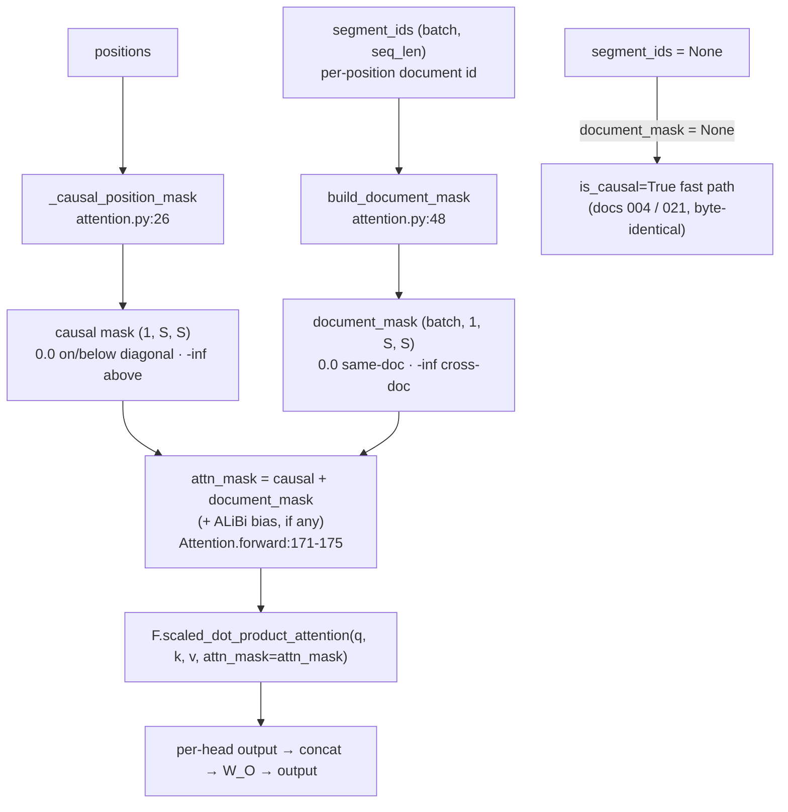
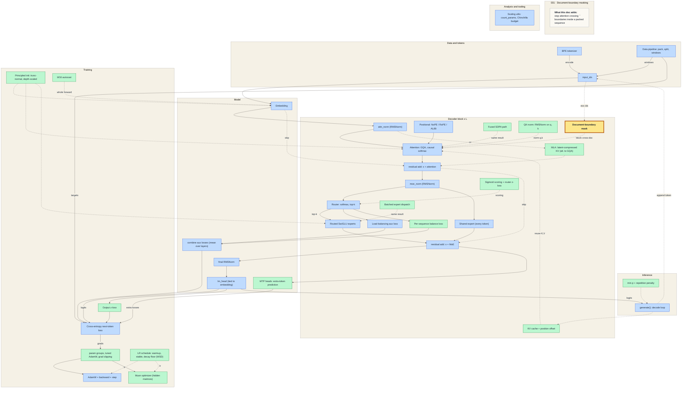

# 031 — Document-boundary masking: the full derivation, solved by hand

**Companion to:** [`journey_of_a_model/031-document-boundaries.md`](../../journey_of_a_model/031-document-boundaries.md)
· **Code:** [`qwenmoe/model/attention.py`](../../qwenmoe/model/attention.py) (`build_document_mask`,
`Attention.forward`, `MLAAttention.forward`) · [`qwenmoe/model/transformer.py`](../../qwenmoe/model/transformer.py)
(`QwenMoEModel.forward`) · [`qwenmoe/model/block.py`](../../qwenmoe/model/block.py) (`TransformerBlock.forward`)
· **Every number here is reproduced by:** [`verify_031_document_boundaries.py`](verify_031_document_boundaries.py)
(`uv run python docs/math/verify_031_document_boundaries.py`)

---

## How to read this

[`docs/math/004-attention-gqa.md`](004-attention-gqa.md) carried one tiny
example through the explicit causal-attention path, and
[`docs/math/021-fused-attention-sdpa.md`](021-fused-attention-sdpa.md)
proved the fused `F.scaled_dot_product_attention` path computes the
identical mathematics, including the online-softmax recurrence used
*inside* the kernel. Neither of those documents has more than one document
in its 3-token example — every query is free to look at every earlier key.

This document reuses that **exact same example, unchanged** — same input
$X$, same four weight matrices, same three tokens — and adds exactly **one**
new ingredient: the tokens no longer all belong to the same document. We
derive, from `qwenmoe/model/attention.py`'s `build_document_mask`, what
changes when position 2 belongs to a *different* document than position 0,
and trace that change all the way through `Attention.forward` to a final
output — then, briefly, show `MLAAttention.forward` and the model-level
threading (`QwenMoEModel.forward` → every `TransformerBlock`) get the same
treatment.

You do **not** need a linear-algebra background. Every term is defined at
first use; where doc 004 / doc 021 already defined one (vector, dot
product, matrix multiply, softmax, shift-invariance, the online-softmax
recurrence) we restate it in one line and move on. One new term this
document *does* introduce properly: **broadcasting** (Part 2).

---

## Part 0 — The problem, in one sentence

Training packs many short documents end to end into one long token stream
and slices fixed-length windows out of it (**sequence packing** — see the
journal entry, and [`docs/math/008-data-pipeline.md`](008-data-pipeline.md)
for `TokenDataset`'s slicing). A window can straddle a boundary: `...end of
story A | start of story B...`. The **causal mask** alone (doc 004 §Step 9)
only forbids looking at the *future* — it does nothing to stop a token in
story B from attending back into story A, which is unrelated text. The
fix — Llama 3's intra-document masking (Grattafiori et al. 2024, §3.1) — is
a *second* additive mask: block attention between any two positions that
are not in the same document, on top of the causal mask that already blocks
attention into the future.



---

## Part 1 — The running example

### 1.1 Configuration (identical to docs 004 / 021)

| Symbol | Meaning | Value |
|---|---|---|
| `batch` | independent sequences at once | $1$ |
| `seq_len`, $S$ | tokens in the sequence | $3$ |
| `d_model`, $d$ | token-vector width everywhere | $4$ |
| `n_heads`, $H$ | query heads | $2$ |
| `head_dim`, $d_k$ | width of one head, $d/H$ | $2$ |
| `n_kv_heads`, $H_{kv}$ | key/value heads | $1$ |
| `n_rep`, $r$ | query heads per KV head | $2$ |
| `positional_scheme` | how position enters | `nope` |
| `qk_norm` | per-head RMSNorm on q/k | `False` |

Needing $H_{kv} < H$ (a genuine GQA case, not plain multi-head attention) is
exactly why docs 004/021 picked this shape, and we inherit it unchanged.

### 1.2 Input and weights (identical to docs 004 / 021)

$$X = \begin{bmatrix} 1 & 0 & 1 & 0 \\ 0 & 2 & 0 & 1 \\ 1 & 1 & 0 & 0 \end{bmatrix}\quad(1,3,4),
\qquad \text{positions} = [0, 1, 2]$$

$$
W_Q = \begin{bmatrix} 1&1&0&0 \\ 0&1&1&0 \\ 0&0&1&1 \\ 1&0&0&1 \end{bmatrix}\!,\quad
W_K = \begin{bmatrix} 1&0&1&0 \\ 0&1&0&1 \end{bmatrix}\!,\quad
W_V = \begin{bmatrix} 1&1&0&0 \\ 0&0&1&1 \end{bmatrix}\!,\quad
W_O = \begin{bmatrix} 1&0&1&0 \\ 0&1&0&1 \\ 1&0&0&1 \\ 0&1&1&0 \end{bmatrix}
$$

Doc 004 §Step 1–2 pushes these through `w_q`/`w_k`/`w_v` and the head split
to get (`nope`, so the positional transform is the identity and these are
also the vectors that reach the dot product):

$$
q^{(0)} = \begin{bmatrix} 1&1\\ 2&2\\ 2&1 \end{bmatrix},\ \
q^{(1)} = \begin{bmatrix} 1&1\\ 1&1\\ 0&1 \end{bmatrix},\ \
k^{(0)} = k^{(1)} = \begin{bmatrix} 2&0\\ 0&3\\ 1&1 \end{bmatrix},\ \
v^{(0)} = v^{(1)} = \begin{bmatrix} 1&1\\ 2&1\\ 2&0 \end{bmatrix}
$$

($k$, $v$ repeat across both query heads — GQA, $H_{kv}=1$.) Doc 004
§Step 6–7 then gives the **scaled**, pre-mask score matrices:

$$
\text{scores}^{(0)} = \begin{bmatrix}
1.414214 & 2.121320 & 1.414214 \\
2.828427 & 4.242641 & 2.828427 \\
2.828427 & 2.121320 & 2.121320
\end{bmatrix},\qquad
\text{scores}^{(1)} = \begin{bmatrix}
1.414214 & 2.121320 & 1.414214 \\
1.414214 & 2.121320 & 1.414214 \\
0 & 2.121320 & 0.707107
\end{bmatrix}
$$

Doc 004 §Step 9 then adds only the **causal** mask to these and gets a final
output of

$$
\text{causal-only output} = \begin{bmatrix}
2.000000 & 2.000000 & 2.000000 & 2.000000 \\
3.474192 & 2.000000 & 2.804430 & 2.669762 \\
3.408561 & 1.573375 & 2.318140 & 2.663796
\end{bmatrix}
$$

**Everything below is what changes once position 2 (and 1) belong to a
different document than position 0.**

### 1.3 The new ingredient: `segment_ids`

`segment_ids` is not invented for this document — it is a real
`TokenDataset(return_segments=True)` output, derived in full in
[`docs/math/008-data-pipeline.md`](008-data-pipeline.md) (`_document_ids`,
[`dataset.py:25-33`](../../qwenmoe/data/dataset.py#L25)). We only need the
one-line recap and one concrete window.

For a flat, `eos_id`-separated token stream, a new document begins **one
position after** each separator (the separator itself is the *last* token
of the document it ends — the Llama-3 convention):

$$
\text{starts}[p] = \begin{cases}1 & \text{token}[p-1] = \texttt{eos\_id}\\0 & \text{otherwise}\end{cases}
\ (\text{starts}[0]=0),
\qquad
\text{doc\_id}[p] = \sum_{q=0}^{p}\text{starts}[q]
$$

("$\sum_{q=0}^{p}$" — a **running sum**, a.k.a. **prefix sum**: the value at
position $p$ is the sum of every term up to and including $p$. `cumsum` is
`torch`'s name for it.) Take the 5-token stream `[5, 99, 7, 3, 9]` with
`eos_id = 99` (documents `[5, 99]` and `[7, 3, 9]`):

$$
\text{token}: [5,\ 99,\ 7,\ 3,\ 9],\qquad
\text{starts}: [0,\ 0,\ 1,\ 0,\ 0],\qquad
\text{doc\_id}: [0,\ 0,\ 1,\ 1,\ 1]
$$

(`starts[2]=1` because `token[1]=99`.) `TokenDataset(seq_len=3,
return_segments=True, eos_id=99)` window `idx=1` is `x = token[1:4] = [99,
7, 3]`, `y = token[2:5] = [7, 3, 9]`; its `doc_id` slice is `doc_id[1:4] =
[0, 1, 1]`, and `__getitem__` rebases it so every window starts at document
`0` ([`dataset.py:86`](../../qwenmoe/data/dataset.py#L86)):

$$\text{segments} = [0,1,1] - [0,1,1][0] = [0,1,1] - 0 = [0, 1, 1]$$

The verify script instantiates this exact `TokenDataset` and asserts
`segments.tolist() == [0, 1, 1]` — this is a *measured* output, not a
hand-picked one. We now treat **position 0 as document 0**, and **positions
1, 2 as document 1** — the token stream's own real story boundary, lined up
against our attention example's three positions:

$$\texttt{segment\_ids} = [\,0,\ 1,\ 1\,] \quad\text{(shape } (1,3)\text{, batch axis included)}$$

**Shape ledger so far:** `X (1,3,4)`, `segment_ids (1,3)`.

---

## Part 2 — `build_document_mask`, line by line

Code ([`attention.py:48-70`](../../qwenmoe/model/attention.py#L48)):

```python
def build_document_mask(segment_ids: torch.Tensor) -> torch.Tensor:
    if segment_ids.dim() != 2:
        raise ValueError(...)
    same_document = segment_ids[:, :, None] == segment_ids[:, None, :]  # (batch, S, S)
    mask = torch.zeros(same_document.shape, dtype=torch.float32, device=segment_ids.device)
    mask.masked_fill_(~same_document, float("-inf"))
    return mask.unsqueeze(1)
```

### Step 1 — the shape guard (L63-66)

`segment_ids` must be exactly 2-axis, `(batch, seq_len)`. Ours is
`(1, 3)` ✓. This function is never called on anything else — the only
caller, `QwenMoEModel.forward`, always hands it the trainer's `(batch,
seq_len)` tensor directly ([`transformer.py:117`](../../qwenmoe/model/transformer.py#L117)).

### Step 2 — `same_document`, and what broadcasting means (L67)

**What we want:** an $S \times S$ boolean table, one entry per (query
position $i$, key position $j$) pair, that is `True` exactly when $i$ and
$j$ are in the same document — i.e. `segment_ids[i] == segment_ids[j]`, for
every pair, at once.

**The tool:** PyTorch **broadcasting** — a rule for combining two tensors
of *different* shapes without writing an explicit loop. The rule ([PyTorch
broadcasting semantics](https://docs.pytorch.org/docs/stable/notes/broadcasting.html)):
compare shapes from the *right*; two axis sizes are compatible if they are
equal, **or one of them is $1$** (a size-1 axis is *virtually stretched* to
match — no data is copied, only the read pattern changes), or one tensor
simply has fewer axes (missing axes count as size $1$).

`segment_ids` has shape `(1, 3)`. `[:, :, None]` inserts a new size-1 axis
at the end → shape `(1, 3, 1)`. `[:, None, :]` inserts a new size-1 axis in
the *middle* → shape `(1, 1, 3)`. Comparing them element-wise with `==`:

$$
(1, 3, 1) \quad\text{vs.}\quad (1, 1, 3)
$$

Axis 0: $1 = 1$ ✓. Axis 1: $3$ vs. $1$ → stretch the size-$1$ side to $3$.
Axis 2: $1$ vs. $3$ → stretch the size-$1$ side to $3$. Result shape:
`(1, 3, 3)`. Concretely, stretching means: `segment_ids[:, :, None]`'s
value at `[b, i, j]` is just `segment_ids[b, i]` (repeated across every
$j$, since its own axis-2 size was $1$); `segment_ids[:, None, :]`'s value
at `[b, i, j]` is `segment_ids[b, j]` (repeated across every $i$). So the
`==` at `[b, i, j]` really is `segment_ids[b, i] == segment_ids[b, j]` —
exactly the all-pairs comparison we wanted, with **zero** explicit loop and
no tensor bigger than the $S \times S$ output actually materialised twice
(only the two length-$S$ inputs are read, stretched on the fly).

**Compute it, entry by entry.** `segment_ids[0] = [0, 1, 1]` (dropping the
size-1 batch axis for the arithmetic):

| $i \backslash j$ | $j{=}0\ (\text{seg }0)$ | $j{=}1\ (\text{seg }1)$ | $j{=}2\ (\text{seg }1)$ |
|---|---|---|---|
| $i{=}0$ (seg $0$) | $0{=}0\to$ **True** | $0{=}1\to$ False | $0{=}1\to$ False |
| $i{=}1$ (seg $1$) | $1{=}0\to$ False | $1{=}1\to$ **True** | $1{=}1\to$ **True** |
| $i{=}2$ (seg $1$) | $1{=}0\to$ False | $1{=}1\to$ **True** | $1{=}1\to$ **True** |

$$
\text{same\_document} = \begin{bmatrix} T&F&F\\ F&T&T\\ F&T&T \end{bmatrix}
$$

The diagonal is always `True` — a position always shares a document with
itself, whatever `segment_ids` says — and the matrix is symmetric, since
"$i,j$ same document" doesn't care which one you call query and which key.

### Step 3 — turn it into an additive mask (L68-69)

```python
mask = torch.zeros(same_document.shape, dtype=torch.float32, device=segment_ids.device)
mask.masked_fill_(~same_document, float("-inf"))
```

`torch.zeros(...)` starts every entry at `0.0` (shape `(1,3,3)`, **always**
`float32` regardless of the model's compute dtype — it is cast to
`q.dtype` later, at the point it is added to the scores, `attention.py:175`).
`~same_document` is the logical NOT (`True`↔`False` swapped): `True`
exactly where the two positions are in **different** documents.
`masked_fill_(cond, v)` writes `v` into every position where `cond` is
`True`, leaving the rest alone — an in-place, no-loop way of saying "where
different document, overwrite with $-\infty$; where same document, leave
the $0.0$ that's already there."

$$
\text{document\_mask}[0,0] = \begin{bmatrix} 0 & -\infty & -\infty \\ -\infty & 0 & 0 \\ -\infty & 0 & 0 \end{bmatrix}
$$

Reading row $i$: "position $i$ may add $0$ (no penalty) to a key in its own
document, and $-\infty$ (fatal) to a key in any other document." This is
**exactly** the additive-mask idiom doc 004 §Step 9 used for the causal
triangle — the same trick, applied to a different criterion.

The verify script confirms this is not just our derivation's fantasy: `pin`
it into `build_document_mask` and compare, `atol=0`:

```
build_document_mask(segment_ids)[0, 0]:
 tensor([[0., -inf, -inf],
        [-inf, 0., 0.],
        [-inf, 0., 0.]])
matches the hand-derived matrix exactly (torch.testing.assert_close, atol=0)
```

(As a cross-check of the journal's own worked claim — a *different*, larger
`segment_ids = [0,0,0,1,1]`, not this document's running example — the
script also reproduces the $5\times5$ table the journal prints; see
Appendix A.)

### Step 4 — add the head axis (L70)

```python
return mask.unsqueeze(1)
```

`unsqueeze(1)` inserts a new size-$1$ axis at position $1$:
`(batch, S, S)` → `(batch, 1, S, S)`, i.e. `(1, 3, 3)` → `(1, 1, 3, 3)`.
This is the *same* broadcasting idea from Step 2, used for the opposite
purpose: a real attention score tensor has shape `(batch, n_heads, S, S)`;
by making the mask's head axis size $1$ instead of $n\_heads$, adding the
mask to the scores (Part 4) broadcasts the identical $S\times S$ mask
across **every query head** without copying it $H$ times — "which document
a token belongs to" has nothing to do with which head is looking at it.

**Shape ledger:** `segment_ids (1,3)` → `same_document (1,3,3)` →
`mask (1,3,3)` → `document_mask (1,1,3,3)`.

---

## Part 3 — Folding it into `Attention.forward`

Doc 021 Part 2 already walked the branch structure of `Attention.forward`
([`attention.py:162-181`](../../qwenmoe/model/attention.py#L162)) for
`document_mask=None`. Reproduced with the new argument (`document_mask`
first appears at [`attention.py:120`](../../qwenmoe/model/attention.py#L120)):

```python
key_positions = torch.arange(kv_len, device=x.device)                       # L166
bias = self.positional.attention_bias_positions(positions, key_positions)   # L167
if bias is None and document_mask is None and kv_len == seq_len:            # L168
    out = F.scaled_dot_product_attention(q, k, v, is_causal=True, enable_gqa=True)  # L169
else:
    attn_mask = _causal_position_mask(positions, kv_len, x.device, q.dtype)  # L171
    if bias is not None:
        attn_mask = attn_mask + bias.to(q.dtype).unsqueeze(0)               # L173
    if document_mask is not None:
        attn_mask = attn_mask + document_mask.to(q.dtype)                   # L175
    out = F.scaled_dot_product_attention(q, k, v, attn_mask=attn_mask, enable_gqa=True)  # L177
```

**L168 — the branch, on our numbers.** `bias is None` ✓ (`nope`), `kv_len
(3) == seq_len (3)` ✓ — the same two conditions doc 021's `nope` example
satisfied. But now **`document_mask is not None`**, so the whole
conjunction is `False`: we take the `else` branch. This is the one new
consequence of Part 2's work — an input that used to take the fast
`is_causal=True` kernel path now has to build an explicit `(batch, 1, S,
S)` tensor. (Part 5 confirms `document_mask=None` still takes L169,
byte-identical to before.)

**L171 — the causal mask, on our numbers.** `_causal_position_mask` is the
general helper docs 004/021 already derived: `0` where
`key_pos ≤ query_pos`, `-inf` otherwise. For `positions = [0,1,2]`,
`kv_len = 3` it is the familiar triangle:

$$
\text{causal} = \begin{bmatrix} 0 & -\infty & -\infty \\ 0 & 0 & -\infty \\ 0 & 0 & 0 \end{bmatrix}
$$

**L173 — skipped.** `bias is None` for `nope`.

**L175 — add the document mask, entry by entry.** $-\infty + \text{finite}
= -\infty$ and $-\infty + (-\infty) = -\infty$ (IEEE-754; no `NaN` risk here
since neither term is ever $+\infty$):

$$
\text{attn\_mask} = \text{causal} + \text{document\_mask}
= \begin{bmatrix} 0+0 & -\infty+(-\infty) & -\infty+(-\infty) \\
0+(-\infty) & 0+0 & -\infty+0 \\
0+(-\infty) & 0+0 & 0+0 \end{bmatrix}
= \begin{bmatrix} 0 & -\infty & -\infty \\ -\infty & 0 & -\infty \\ -\infty & 0 & 0 \end{bmatrix}
$$

Read row by row — this is the entire effect of document masking on our
example:

- **Row 0** (query 0, document 0): unchanged from causal-only. Causal
  already only allowed key 0 (itself); the document mask's row-0 entries
  agree with causal everywhere they matter (key 0 is trivially "same
  document as itself," keys 1, 2 were already `-inf` from causal). **Query
  0 was never going to see documents 1's tokens anyway — the future, not
  the mask, was doing the blocking.**
- **Row 1** (query 1, document 1): causal alone allowed keys $\{0, 1\}$.
  Key 0 is document 0 — now blocked. **Only key 1 survives.**
- **Row 2** (query 2, document 1): causal alone allowed keys $\{0, 1, 2\}$.
  Key 0 is document 0 — blocked. **Keys 1, 2 survive.**

Verified — the script builds `_causal_position_mask` and `document_mask`
independently and adds them:

```
causal + document_mask (what Attention.forward builds at L171+L175):
 tensor([[0., -inf, -inf],
        [-inf, 0., -inf],
        [-inf, 0., 0.]])
```

**L177 — the SDPA call.** `F.scaled_dot_product_attention(q, k, v,
attn_mask=attn_mask, enable_gqa=True)` computes
$\operatorname{softmax}(QK^\top/\sqrt{d_k} + \text{attn\_mask})V$ using the
**online (streaming) softmax** doc 021 Part 5 derives and proves exact —
that proof never assumed the mask was the causal triangle specifically, it
only used "$e^{-\infty} = 0$" and shift-invariance, both true of *any*
additive mask. So the one-shot computation below is guaranteed
(doc 021 Part 5.4) to equal what the fused kernel actually does; we do it
one-shot here because with only 2–3 finite entries per row it is simpler to
read by hand, and Part 4 checks the real `forward()` call agrees.

---

## Part 4 — Softmax, weighted sum, and the output projection

### Step 1 — mask the scaled scores

Add `attn_mask` (broadcasting over the head axis — one $(3,3)$ matrix
applied to both heads) to the pre-mask scaled scores from Part 1.2:

$$
\text{scores}^{(0)}_{\text{masked}} = \begin{bmatrix}
1.414214 & -\infty & -\infty \\ -\infty & 4.242641 & -\infty \\ -\infty & 2.121320 & 2.121320
\end{bmatrix},\quad
\text{scores}^{(1)}_{\text{masked}} = \begin{bmatrix}
1.414214 & -\infty & -\infty \\ -\infty & 2.121320 & -\infty \\ -\infty & 2.121320 & 0.707107
\end{bmatrix}
$$

(E.g. head 0, row 1: causal-only had $[2.828427,\ 4.242641,\ -\infty]$;
adding the document mask row $[-\infty, 0, -\infty]$ sends position 0 to
$-\infty$ too, leaving only $4.242641$.)

### Step 2 — softmax, with real exponentials

Recap (doc 004 §Step 10): $\operatorname{softmax}(z)_j = e^{z_j}/\sum_l
e^{z_l}$; subtracting the row max first doesn't change the result
(shift-invariance) and avoids overflow; $e^{-\infty} = 0$ exactly.

**Head 0, row 0:** one finite entry $\Rightarrow [1, 0, 0]$.

**Head 0, row 1:** $[-\infty, 4.242641, -\infty]$ — one finite entry
$\Rightarrow [0, 1, 0]$. (Under causal-only this row was $[0.195570,
0.804430, 0]$ — a genuine blend of keys 0 and 1. Blocking key 0 doesn't
*reweight* the blend, it **collapses it to a single point mass** on the one
surviving key.)

**Head 0, row 2:** $[-\infty, 2.121320, 2.121320]$. Subtract the max
$2.121320$: $[-\infty, 0, 0]$. Exponentiate: $[0, 1, 1]$. Sum $= 2$.

$$p^{(0)}_2 = [\,0,\ 0.5,\ 0.5\,]$$

Both surviving keys have the *same* scaled score, so they split the weight
exactly evenly — a clean tie, not a coincidence of rounding.

**Head 1, row 0:** $[1, 0, 0]$ (same reasoning as head 0).

**Head 1, row 1:** $[-\infty, 2.121320, -\infty] \Rightarrow [0, 1, 0]$.

**Head 1, row 2:** $[-\infty, 2.121320, 0.707107]$. Subtract max
$2.121320$: $[-\infty, 0, -1.414214]$. Exponentiate: $e^0=1$,
$e^{-1.414214}=0.243117$ (doc 004 already computed this constant — the
$e^{-\sqrt2}$ value reappears verbatim). Sum $=1.243117$.

$$p^{(1)}_2 = \left[0,\ \tfrac{1}{1.243117},\ \tfrac{0.243117}{1.243117}\right] = [\,0,\ 0.804430,\ 0.195570\,]$$

*Aside — why this pair of numbers looks familiar:* doc 004's causal-only
row 1 (head 0) had probabilities $[0.195570, 0.804430]$ over a **score
gap** of $4.242641 - 2.828427 = 1.414214$. Here the surviving gap is
$2.121320 - 0.707107 = 1.414214$ — the *same* gap. Softmax only depends on
differences between scores (shift-invariance again — doc 004 §Step 10), so
an unrelated pair of raw scores that happens to differ by the same amount
produces the identical probability split. Not a bug, not a coincidence to
chase — just the one property of softmax showing up twice.

$$
\text{probs}^{(0)} = \begin{bmatrix} 1&0&0\\ 0&1&0\\ 0&0.5&0.5 \end{bmatrix},\qquad
\text{probs}^{(1)} = \begin{bmatrix} 1&0&0\\ 0&1&0\\ 0&0.804430&0.195570 \end{bmatrix}
$$

Verified — real `F.softmax` on the real masked scores:

```
softmax(scaled scores + combined mask):
 tensor([[[1.000000, 0.000000, 0.000000],
         [0.000000, 1.000000, 0.000000],
         [0.000000, 0.500000, 0.500000]],
        [[1.000000, 0.000000, 0.000000],
         [0.000000, 1.000000, 0.000000],
         [0.000000, 0.804430, 0.195570]]])
```

### Step 3 — weighted sum with $v$

$v^{(0)}=v^{(1)}=\left[\begin{smallmatrix}1&1\\2&1\\2&0\end{smallmatrix}\right]$
($v_0=[1,1]$, $v_1=[2,1]$, $v_2=[2,0]$). Row $i$ of the output is
$\sum_j p_{i,j}\,v_j$:

**Head 0:** row 0 $\to v_0=[1,1]$. Row 1 $\to v_1=[2,1]$. Row 2 $\to
0.5\,v_1+0.5\,v_2 = [1,0.5]+[1,0]=[2,0.5]$.

**Head 1:** row 0 $\to [1,1]$. Row 1 $\to [2,1]$. Row 2 $\to
0.804430\,v_1+0.195570\,v_2 = [1.608860,0.804430]+[0.391140,0]=[2.000000,0.804430]$.

$$
\text{out}^{(0)} = \begin{bmatrix} 1&1\\2&1\\2&0.5 \end{bmatrix},\qquad
\text{out}^{(1)} = \begin{bmatrix} 1&1\\2&1\\2&0.804430 \end{bmatrix}
$$

### Step 4 — concat heads, then $W_O$

`transpose(1,2).contiguous().view(...)` concatenates head 0 then head 1 for
each token ([`attention.py:180`](../../qwenmoe/model/attention.py#L180)):

$$\text{concat} = \begin{bmatrix} 1&1&1&1\\ 2&1&2&1\\ 2&0.5&2&0.804430 \end{bmatrix}$$

Then $y = \text{concat}\,W_O^\top$ (§1.5 of doc 004: output coordinate $j$
is the dot product of the row with $W_O$'s row $j$). Token 2's row,
$[2, 0.5, 2, 0.804430]$, against $W_O$'s rows
$[1,0,1,0],[0,1,0,1],[1,0,0,1],[0,1,1,0]$:

$$
\begin{aligned}
y_{2,0} &= 2+0+2+0=4 \\
y_{2,1} &= 0+0.5+0+0.804430=1.304430 \\
y_{2,2} &= 2+0+0+0.804430=2.804430 \\
y_{2,3} &= 0+0.5+2+0=2.5
\end{aligned}
$$

$$
\text{output} = \begin{bmatrix}
2.000000 & 2.000000 & 2.000000 & 2.000000 \\
4.000000 & 2.000000 & 3.000000 & 3.000000 \\
4.000000 & 1.304430 & 2.804430 & 2.500000
\end{bmatrix}
$$

**Verified against the real fused `forward()` call** (not `forward_with_trace`
— that method has no `document_mask` parameter at all, so there is no
explicit-path trace to compare against here; the by-hand arithmetic above
*is* the explicit path for this document):

```
concat(head0, head1) @ W_O^T  (by hand):
 tensor([[2.000000, 2.000000, 2.000000, 2.000000],
        [4.000000, 2.000000, 3.000000, 3.000000],
        [4.000000, 1.304430, 2.804430, 2.500000]])

Attention.forward(X, positions, document_mask=doc_mask)  (real module):
 tensor([[2.000000, 2.000000, 2.000000, 2.000000],
        [4.000000, 2.000000, 3.000000, 3.000000],
        [4.000000, 1.304430, 2.804430, 2.500000]])

max |by-hand - real fused forward| = 0.0
```

**Bit-for-bit**, not merely close — with only 2–3 finite terms per row and
no rescale needed (Part 3's SDPA argument is about the *mechanism* being
identical, not that float rounding must differ; here it doesn't). Side by
side with causal-only:

| row | causal-only | causal + document-mask | $|\Delta|$ |
|---|---|---|---|
| 0 | $[2, 2, 2, 2]$ | $[2, 2, 2, 2]$ | $[0,0,0,0]$ |
| 1 | $[3.474192, 2, 2.804430, 2.669762]$ | $[4, 2, 3, 3]$ | $[0.525808, 0, 0.195570, 0.330238]$ |
| 2 | $[3.408561, 1.573375, 2.318140, 2.663796]$ | $[4, 1.304430, 2.804430, 2.5]$ | $[0.591439, 0.268945, 0.486290, 0.163796]$ |

Row 0 is untouched (derived below, Part 6). Rows 1 and 2 move because they
lost real information — a key that used to be part of their weighted
average.

---

## Part 5 — `document_mask=None`: the fast path is untouched

L168's condition is `bias is None and document_mask is None and kv_len ==
seq_len`. With `document_mask=None` (the default — every pre-spec call site
and every call that doesn't opt into `TrainConfig.document_masking`), this
is *exactly* the condition docs 004/021 already analysed, and L169's
`is_causal=True` fused kernel path runs, unchanged. Verified:

```
document_mask=None reproduces the no-argument call bit-for-bit (fast path intact)
```

(`torch.testing.assert_close(..., atol=0, rtol=0)` — literally the same
floats, not merely close ones.) This is Requirement 10.3's whole
backward-compatibility claim, reduced to one boolean short-circuit: a
tensor argument that is `None` cannot change which branch runs.

---

## Part 6 — Exactness: two provable extremes

### 6.1 Row 0 is unaffected — *exactly*, and provably so, not just here

Query 0 can only ever attend to key 0: causal masking alone already forces
this (no key at $j>0$ survives $j\le i$ at $i=0$), and the document mask's
diagonal is **always** `True` (Part 2 — a position is always in the same
document as itself, whatever `segment_ids` says). So row 0's combined mask
is $[0, -\infty, -\infty]$ **regardless of `segment_ids`** — the document
mask can only ever agree with what causal masking already decided for the
very first position. Consequently $\text{probs}_0 = [1, 0, 0]$ **always**, and

$$\text{out}_0 = v_0 = x_0 W_V^\top \quad\text{(both heads, since } H_{kv}=1\text{)}$$

— a genuinely **linear** function of $x_0$ alone, independent of $x_1$,
$x_2$, or `segment_ids`. So a perturbation $\Delta x_0$ produces an *exactly
predictable* change with **no approximation**: $\Delta(\text{concat}) =
[\Delta v_0, \Delta v_0]$, then $\Delta \text{output}_0 = \Delta(\text{concat})\, W_O^\top$.
Take $\Delta x_0 = [50, 50, 50, 50]$ (the perturbation the next section
uses): $\Delta v_0 = \Delta x_0\,W_V^\top = [50{+}50,\ 50{+}50] = [100,
100]$ (from $W_V$'s rows $[1,1,0,0]$ and $[0,0,1,1]$), so
$\Delta(\text{concat}) = [100,100,100,100]$, and each $W_O$ row sums two of
these $100$s: $\Delta\text{output}_0 = [200,200,200,200]$ **exactly** — no
softmax, no rounding, pure linear algebra. This is the $200.000000$ the
next section measures.

### 6.2 Rows 1–2 are unaffected by document 0 — *exactly*, by the algebra of $-\infty$

$e^{-\infty} = 0$ exactly in IEEE-754 (doc 004 §Step 10) — not "a very
small number that rounds to zero," an actual `0.0` bit pattern with no
rounding involved. A blocked key therefore contributes **precisely zero**
weight, for *any* value that key's $q$, $k$, or $v$ might have held. So
document 1's output is a function only of document 1's own $q$, $k$, $v$ —
whatever happens to document 0's tokens (however extreme) cannot move it by
even one ULP (unit in the last place — the smallest possible change in a
floating-point number).

### 6.3 Measured — perturb document 0, watch both extremes at once

$$X' = X\ \text{with}\ x_0 \mathrel{+}= 50 \ \text{on all four coordinates}$$

```
segment_ids            : [0, 1, 1]
max|Δoutput| per position: [200.0, 0.0, 0.0]
  position 0  (document 0)  max|Δ| = 200.000000
  position 1  (document 1)  max|Δ| = 0.000000
  position 2  (document 1)  max|Δ| = 0.000000
positions 1, 2 (document 1): max|Δ| == 0.0 EXACTLY -- torch.equal, not allclose
```

$200.000000$ matches §6.1's hand derivation exactly; $0.000000$ (checked
with `torch.equal`, i.e. every bit) matches §6.2. Two opposite, both
*exact*, extremes from the same one mechanism.

---

## Part 7 — `MLAAttention.forward` gets the same treatment

`MLAAttention.forward` ([`attention.py:314-361`](../../qwenmoe/model/attention.py#L314))
takes the identical shape of branch (structurally simpler — no ALiBi
branch, since MLA always applies its own decoupled RoPE; see doc 021 Part
7):

```python
if document_mask is None and kv_len == seq_len:                              # L352
    out = F.scaled_dot_product_attention(q, k, v, is_causal=True)
else:
    attn_mask = _causal_position_mask(positions, kv_len, x.device, q.dtype)   # L355
    if document_mask is not None:
        attn_mask = attn_mask + document_mask.to(q.dtype)                    # L357
    out = F.scaled_dot_product_attention(q, k, v, attn_mask=attn_mask)        # L358
```

Line for line, this is Part 3's `Attention.forward` fold-in with the ALiBi
branch removed — same causal-plus-document addition, same
"`document_mask=None` keeps the fast path" gate. We don't repeat the full
digit-by-digit derivation on a second example (Part 1 says: one running
example) — the mechanism is identical algebra. The verify script instead
*runs* it on a small MLA module (`d_model=8, n_heads=2, mla_latent_dim=2`)
with the **same** `segment_ids = [0,1,1]`, and checks the same two
invariants Part 6 proved in general:

```
max|causal-only - causal+doc| (rows 1,2 must differ; row 0 must not):
  [0.0, 0.064126, 0.01785]
perturb token 0 -> max|Δ| per position: [3.363035, 0.0, 0.0]
MLAAttention: document 1 (positions 1,2) unaffected, exactly, here too
MLA document_mask=None still matches its own is_causal=True output: True
```

Row 0's causal-vs-masked delta is `0.0` (§6.1's argument — row 0 only ever
sees itself — never mentioned $H_{kv}$, $\text{head\_dim}$, or any other
GQA-specific quantity, so it applies verbatim to MLA); rows 1, 2's deltas
are non-zero (real information was removed) but their response to the
document-0 perturbation is `0.0` exactly (§6.2's argument only used
$e^{-\infty}=0$, likewise architecture-agnostic).

---

## Part 8 — Threading: one mask, shared across every block

### 8.1 `QwenMoEModel.forward` builds it once

([`transformer.py:91-127`](../../qwenmoe/model/transformer.py#L91), relevant lines:)

```python
document_mask = build_document_mask(segment_ids) if segment_ids is not None else None  # L117
x = self.embedding(input_ids)
for i, block in enumerate(self.blocks):
    x, aux_loss = block(x, positions, kv_cache=..., document_mask=document_mask)         # L122-127
```

`document_mask` is a single local Python variable, computed **once** before
the loop, and the *same object* is passed as the keyword argument on every
iteration — Python doesn't copy it, so all `n_layers` blocks receive
literally the identical tensor. This matters for two reasons: (1) which
document a token belongs to has nothing to do with which layer is looking
at it, so recomputing the mask per layer would be pure waste — the same
$O(S^2)$ comparison, `n_layers` times, for a provably identical result; and
(2) it means the mask is a pure function of `segment_ids` alone, entirely
independent of anything the model itself computes.

Verified — the script monkey-patches `build_document_mask` at its import
site inside `qwenmoe.model.transformer` to count calls, then runs one
`forward()` on a 2-layer model:

```
n_layers = 2; build_document_mask called 1 time(s) per forward()
```

(one call regardless of `n_layers` — with `n_layers=6`, still one call).

### 8.2 `TransformerBlock.forward` passes it straight through

([`block.py:31-36`](../../qwenmoe/model/block.py#L31)):

```python
def forward(self, x, positions, kv_cache=None, document_mask=None):
    x = x + self.attn(self.attn_norm(x), positions, kv_cache=kv_cache, document_mask=document_mask)
    moe_out, aux_loss = self.moe(self.moe_norm(x))
    x = x + moe_out
    return x, aux_loss
```

`document_mask` reaches `self.attn` (Part 3/7's `forward`) unmodified; the
MoE sublayer (`self.moe`) never sees it at all — `MoELayer.forward` takes
only `x`, because a Mixture-of-Experts feed-forward is applied **per
token**, independently (docs 005/027): it has no mechanism to mix
information *between* positions in the first place, so it has nothing to
mask. **Attention is the only token-mixing operation in the whole block**,
which is exactly why masking it is sufficient to isolate documents through
an arbitrary number of layers — see 8.3.

### 8.3 Isolation survives the full stack, measured

Extend the running example into a genuine (tiny) 2-layer `QwenMoEModel`:
embed token ids $0,1,2$ to exactly $x_0,x_1,x_2$ from Part 1, pin block
0's attention weights to $W_Q,W_K,W_V,W_O$, and run `forward(input_ids=[[0,1,2]],
segment_ids=[[0,1,1]])` before and after adding $50$ to token 0's embedding
row (which now also passes through an `RMSNorm` and a full MoE sublayer,
twice, before reaching the logits):

```
full 2-layer model, perturb token-0 embedding by +50, max|Δlogit| per position:
  position 0  (document 0)  max|Δ| = 0.006772
  position 1  (document 1)  max|Δ| = 0.000000
  position 2  (document 1)  max|Δ| = 0.000000
document 1 (positions 1, 2): max|Δlogit| == 0.0 EXACTLY, even after 2 full blocks
```

Two things worth noticing. First, positions 1–2's delta is still `0.0`
*exactly* (`torch.equal` on the logits) — §6.2's argument survives
composition with more attention layers and any number of purely per-token
sublayers in between, because none of them can undo a weight that was
already zero going in. Second, position 0's own delta ($0.006772$) is much
smaller than §6.1's clean $200$: `RMSNorm` ([`block.py:26`](../../qwenmoe/model/block.py#L26))
rescales its input by (roughly) the inverse of its RMS magnitude before
`Attention` ever sees it, so a raw $+50$ shift on the embedding gets
compressed before it can reach $W_Q/W_K/W_V$ — a real, separate effect
(journal entry 003/023), not a sign the isolation is "only approximately"
exact; the exactness claim is about the *zero* at positions 1–2, which
`RMSNorm` (a per-token operation) has no bearing on either way.

---

## Cost, on this example's own numbers

- **Extra memory:** `build_document_mask` allocates one `(batch, 1, S, S)`
  float32 tensor — here $1\times1\times3\times3=9$ floats, i.e. $36$ bytes.
  The head axis is size $1$ (Part 2, Step 4), so this does **not** scale
  with $n\_heads$; at the `BASELINE` config ($S=256$) it is $256^2=65{,}536$
  floats **per batch item**, the same order as the $(H,S,S)$ score tensor
  SDPA already has to touch for that batch item — one same-sized extra
  array, not a new asymptotic class.
- **Extra compute to build it:** one `(S,S)` broadcasted comparison
  ($S^2=9$ boolean compares here) plus one `masked_fill_` — negligible next
  to the $O(S^2 d_k)$ the actual dot products cost ($3^2\times2=18$
  multiply-adds per head here; $256^2\times32\approx2.1$M at `BASELINE`).
- **What it actually costs:** giving up the `is_causal=True` fast path
  (Part 5) — an explicit `(batch,1,S,S)` tensor must be materialised and
  added to the scores every layer, instead of a one-word flag the kernel
  expands for free. Built **once** per `forward()` call (Part 8.1), not
  once per layer, so this cost does not scale with `n_layers` either.
- **Why it's worth it:** the journal entry measures, on a plain 8-token/
  2-document stream with only a causal mask, up to $78.4\%$ of a new
  document's first-token attention weight landing on the *previous*,
  unrelated document. This document's own numbers show the same
  mechanism at the smallest possible scale: row 1 goes from a genuine
  blend of two keys (weights $[0.195570, 0.804430]$) to depending on
  exactly one ($[0,1,0]$) the instant that other key falls in a
  different document — for the price of one extra $(S,S)$ tensor.

---

## Questions that might come to mind

- **Does the online-softmax proof from doc 021 still apply with a
  document mask in the mix?** Yes — doc 021 Part 5.4's induction only used
  two facts: shift-invariance (any constant added to every score in a row
  cancels) and $e^{-\infty}=0$. Neither assumed the mask was the causal
  triangle specifically; `attn_mask` there is *any* additive `(0/-inf/finite)`
  tensor, and the causal-plus-document sum built in Part 3 is one instance
  of exactly that. So the fused kernel is guaranteed exact here too — which
  is why Part 4's real-module check passes at `atol=0`, not merely `1e-5`.

- **Why does row 0's output not move under the document mask at all, while
  row 1's moves a lot?** Row 0 has only one *possible* key under causal
  masking to begin with (itself), so the document mask's row can only ever
  restate what causal masking already decided (§6.1). Row 1 had two
  genuinely different candidate keys under causal masking; the document
  mask removes one of them, which is a real change, not a restatement.

- **Could `segment_ids` differ per batch item?** Yes — `same_document`
  (Part 2) is computed independently for each row of the batch axis
  (broadcasting never mixes batch items together), so one training batch
  can freely pack documents differently across its rows.

- **What if `segment_ids` has values that repeat non-contiguously — e.g.
  `[0, 1, 0]`?** `build_document_mask` only ever checks *equality*, not
  adjacency, so it would mark positions 0 and 2 "same document" even though
  position 1 sits between them. `TokenDataset`'s real `segment_ids` (Part
  1.3) never does this — `doc_id` is a running sum, so it is
  non-decreasing by construction — but the function itself has no opinion
  on where its input came from; this is a documented case the tests exist
  to pin down (`tests/test_attention.py`), not a risk in the actual
  pipeline.

- **Does the MoE sublayer need a document mask too?** No — Part 8.2's
  point exactly: `MoELayer` processes each token's vector independently
  ([`docs/math/005-moe-layer.md`](005-moe-layer.md),
  [`027-batched-expert-computation.md`](027-batched-expert-computation.md)).
  It has no operation that reads *another* token's vector, so there is
  nothing for a mask to block.

- **Does this interact with the KV cache (doc 029)?** Not in this task —
  document masking only matters for a packed *training* window;
  `generate()`'s incremental decode never builds one (journal entry). The
  additive-`attn_mask` machinery (Part 3's `else` branch) is the only piece
  the two features share, exactly as doc 021's `kv_len != seq_len` branch
  already established for the cache alone.

- **Where does `Trainer` actually get `segment_ids` from, and forward it?**
  That is training-loop wiring, not attention math — see
  [`docs/math/010-training-loop.md`](010-training-loop.md) for the general
  `Trainer.fit`/`evaluate` walk; the `document_masking` flag only changes
  which tuple length the data loader yields (`(x,y)` vs `(x,y,segment_ids)`,
  [`qwenmoe/train/trainer.py:397-398`](../../qwenmoe/train/trainer.py#L397))
  and is otherwise inert to everything derived in this document.

---

## Appendix A — the journal's own worked example, reproduced

Not this document's running example — a separate claim from the journal
entry, confirmed here for completeness. `segment_ids = [0,0,0,1,1]` (a
5-token window: the tail of one document, the head of the next):

```
cross-check -- journal's own worked example, segment_ids=[0,0,0,1,1]:
 tensor([[0., 0., 0., -inf, -inf],
        [0., 0., 0., -inf, -inf],
        [0., 0., 0., -inf, -inf],
        [-inf, -inf, -inf, 0., 0.],
        [-inf, -inf, -inf, 0., 0.]])
```

Two $3\times3$ and $2\times2$ all-`0` blocks (each document attends freely
within itself) with `-inf` everywhere the blocks don't overlap — the same
Step 2/3 mechanism from Part 2, at a size where the "block structure" is
visually obvious.

---

## Symbol table

| symbol | meaning |
|---|---|
| $S$, `seq_len` | sequence length (3 here) |
| $d$, `d_model` | model width (4) |
| $H$, `n_heads` | query heads (2) |
| $H_{kv}$, `n_kv_heads` | key/value heads (1) |
| $d_k$, `head_dim` | width of one head, $d/H$ (2) |
| `segment_ids` | `(batch, seq_len)` integer document id per position; `[0,1,1]` here |
| `eos_id` | the reserved separator token id between packed documents |
| `starts[p]`, `doc_id[p]` | 1 iff a separator ended at $p{-}1$; its running sum |
| **broadcasting** | PyTorch's rule for combining tensors of different shapes: axis sizes must match, or one of them be $1$ (stretched to fit) |
| `same_document[b,i,j]` | `segment_ids[b,i] == segment_ids[b,j]` |
| `document_mask` | `(batch,1,S,S)` additive mask: $0.0$ same document, $-\infty$ otherwise |
| $M_{\text{causal}}$ | $0$ on/below the diagonal, $-\infty$ above (doc 004 §Step 9) |
| `attn_mask` | $M_{\text{causal}} + \text{document\_mask}$ ($+$ ALiBi bias, if any) |
| $\varepsilon_{\text{f32}}$, ULP | float32 machine epsilon; "unit in the last place," the smallest representable step |

---

## Citations

Links shared with the journal entry are reused, not re-searched, per that
entry's own citation date; the one link new to this document (PyTorch
broadcasting semantics) was confirmed live on 2026-09-11.

- Grattafiori et al. (Meta), *The Llama 3 Herd of Models*, 2024 —
  [arXiv:2407.21783](https://arxiv.org/abs/2407.21783). §3.1: the
  intra-document attention mask this task implements, and the "important
  for continued pre-training on very long sequences" framing this
  document's Cost section reuses.
- Zhao, Qu, Staniszewski, Tworkowski, Liu, Miłoś, Wu & Minervini,
  *Analysing the Impact of Sequence Composition on Language Model
  Pre-Training*, ACL 2024 —
  [arXiv:2402.13991](https://arxiv.org/abs/2402.13991). The measured
  cross-document contamination this document's Cost section's $78.4\%$
  figure comes from (journal entry).
- Krell, Kosec, Fu & Bharti, *Efficient Sequence Packing without
  Cross-contamination*, 2021 —
  [arXiv:2107.02027](https://arxiv.org/abs/2107.02027). Earlier
  (BERT-era) statement of the same packing/masking trade-off.
- PyTorch, [Broadcasting semantics](https://docs.pytorch.org/docs/stable/notes/broadcasting.html)
  — the rule Part 2 derives `same_document` from: two axes are
  broadcastable when equal, when one is $1$, or when one doesn't exist.

Full derivations this document builds on directly, not re-cited paper by
paper here: [`004-attention-gqa.md`](004-attention-gqa.md) (attention,
GQA, softmax, shift-invariance — Vaswani et al. 2017, Ainslie et al. 2023)
and [`021-fused-attention-sdpa.md`](021-fused-attention-sdpa.md) (the fused
SDPA path, the online-softmax proof — Dao et al. 2022/2023, Milakov &
Gimelshein 2018, Rabe & Staats 2021).

---

*Every intermediate tensor in this document is reproduced and asserted by
[`verify_031_document_boundaries.py`](verify_031_document_boundaries.py).
If you change the running example, rerun it.*

<!-- arch-evolution:start (generated by build_architecture_footer.py; do not edit by hand) -->

---

## Where this fits in the architecture (the growing view)

← previous: [030 Sampling controls](030-min-p-and-repetition-penalty.md) · next: [032 Multi-seed and param-matched ablations](032-multi-seed-and-param-matched-ablations.md) →

**This doc adds to the architecture:** stop attention crossing `<eos>` boundaries inside a packed sequence. (Code: `qwenmoe/model/attention.py, data/`.)

**Components introduced here (highlighted in the diagram), with where each one lives:**

| component | math doc (section) | journal | code |
|---|---|---|---|
| Document-boundary mask | [031 · Part 2 — build_document_mask, line by line](031-document-boundaries.md#part-2--build_document_mask-line-by-line) | [journal 031](../../journey_of_a_model/031-document-boundaries.md) | [`qwenmoe/model/attention.py:48`](../../qwenmoe/model/attention.py#L48) |

**Verified by:** [`verify_031_document_boundaries.py`](verify_031_document_boundaries.py) (`uv run python docs/math/verify_031_document_boundaries.py`); latest results in [verify-status.md](verify-status.md).

**Example continuity:** **Reuses family A unchanged** (004) plus an eos pattern. See the [example-family map](README.md#which-example-does-each-doc-use).

The diagram is cumulative: every box derived by this doc or an earlier one is shown, and components from later docs are not drawn yet, so reading the docs in order replays how the architecture grew. The top box is this doc's title and what it adds. The [full final architecture](architecture-evolution.md) has everything.

**Colour key:** 🟨 **introduced by this doc** · 🟦 Foundation (004-011) · 🟩 Modernization (016-031) · 🟪 Evaluation and scale (032-038). Dotted lines are optional or alternative paths.



**How we got here (every doc up to and including this one):**

| | math doc | journal | what it added |
|---|---|---|---|
|  | [004 Attention (GQA)](004-attention-gqa.md) | [journal](../../journey_of_a_model/004-attention-gqa.md) | scaled dot-product attention with grouped K/V heads, the positional transform and the causal mask |
|  | [005 MoE layer](005-moe-layer.md) | [journal](../../journey_of_a_model/005-moe-layer.md) | the router, top-k selection, routed SwiGLU experts, the shared expert and the load-balancing aux loss |
|  | [006 Full model](006-full-model-assembly.md) | [journal](../../journey_of_a_model/006-full-model-assembly.md) | token embedding, pre-norm residual wiring, the final norm, the tied head and the cross-layer aux-loss combine; attention and MoE appear here as black boxes |
|  | [007 Tokenizers](007-tokenizers.md) | [journal](../../journey_of_a_model/007-tokenizers.md) | text to `input_ids`: byte-level BPE and the char tokenizer |
|  | [008 Data pipeline](008-data-pipeline.md) | [journal](../../journey_of_a_model/008-data-pipeline.md) | packing documents, train/val split, fixed slices and the shifted `(x, y)` windows |
|  | [009 Scaling utilities](009-scaling-law-utilities.md) | [journal](../../journey_of_a_model/009-scaling-law-utilities.md) | parameter counting (total vs active), the compute-optimal budget and throughput calibration |
|  | [010 Training loop](010-training-loop.md) | [journal](../../journey_of_a_model/010-training-loop.md) | the next-token cross-entropy loss, backward pass and AdamW step, carried through a real `Trainer.fit` |
|  | [011 Inference and generation](011-inference-generation.md) | [journal](../../journey_of_a_model/011-inference-generation.md) | the autoregressive decode loop (greedy, temperature, top-k, top-p) |
|  | [016 MLA attention](016-mla-attention.md) | [journal](../../journey_of_a_model/016-mla-attention.md) | Multi-Head Latent Attention: K/V compressed to a small latent, an alternative to GQA |
|  | [018 Optimizer hardening](018-optimizer-hardening.md) | [journal](../../journey_of_a_model/018-optimizer-hardening.md) | param groups (decay vs no-decay), tuned AdamW and gradient clipping |
|  | [019 LR schedule (WSD)](019-lr-schedule-wsd.md) | [journal](../../journey_of_a_model/019-lr-schedule-wsd.md) | warmup, stable and decay phases with a non-zero floor |
|  | [020 Muon optimizer](020-muon-optimizer.md) | [journal](../../journey_of_a_model/020-muon-optimizer.md) | orthogonalized momentum for the hidden weight matrices, AdamW for the rest |
|  | [021 Fused attention (SDPA)](021-fused-attention-sdpa.md) | [journal](../../journey_of_a_model/021-fused-attention-sdpa.md) | `F.scaled_dot_product_attention` as a drop-in for the explicit path |
|  | [022 QK-norm](022-qk-norm.md) | [journal](../../journey_of_a_model/022-qk-norm.md) | RMSNorm on each head's q and k before the scores, bounding the attention logits |
|  | [023 Principled init](023-principled-initialization.md) | [journal](../../journey_of_a_model/023-principled-initialization.md) | truncated-normal init and depth-aware scaling of the residual-writing projections |
|  | [024 Mixed precision and z-loss](024-mixed-precision-and-z-loss.md) | [journal](../../journey_of_a_model/024-mixed-precision-and-z-loss.md) | bf16 autocast for the forward pass and the output z-loss regularizer |
|  | [025 Sigmoid routing and router z-loss](025-moe-routing-sigmoid-and-router-z-loss.md) | [journal](../../journey_of_a_model/025-moe-routing-sigmoid-and-router-z-loss.md) | sigmoid expert scoring, the router z-loss and the config-driven aux weight |
|  | [026 Per-sequence balance loss](026-per-sequence-balance-loss.md) | [journal](../../journey_of_a_model/026-per-sequence-balance-loss.md) | DeepSeek-V3's complementary balance loss computed per sequence |
|  | [027 Batched expert dispatch](027-batched-expert-computation.md) | [journal](../../journey_of_a_model/027-batched-expert-computation.md) | run all experts in one batched op instead of a Python loop |
|  | [028 Multi-Token Prediction](028-multi-token-prediction.md) | [journal](../../journey_of_a_model/028-multi-token-prediction.md) | extra heads predicting tokens further ahead, chained causally |
|  | [029 KV cache](029-kv-cache.md) | [journal](../../journey_of_a_model/029-kv-cache.md) | append-and-reuse of K/V, the position offset and the mask that makes cached decoding exact |
|  | [030 Sampling controls](030-min-p-and-repetition-penalty.md) | [journal](../../journey_of_a_model/030-min-p-and-repetition-penalty.md) | min-p sampling and the repetition penalty |
| **▶** | [031 Document-boundary masking](031-document-boundaries.md) | [journal](../../journey_of_a_model/031-document-boundaries.md) | stop attention crossing `<eos>` boundaries inside a packed sequence |

<!-- arch-evolution:end -->
