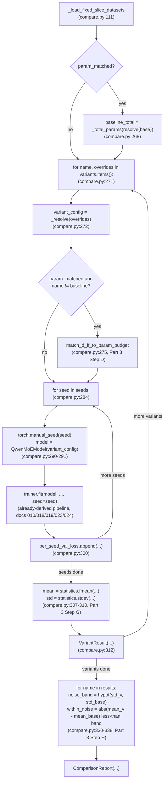
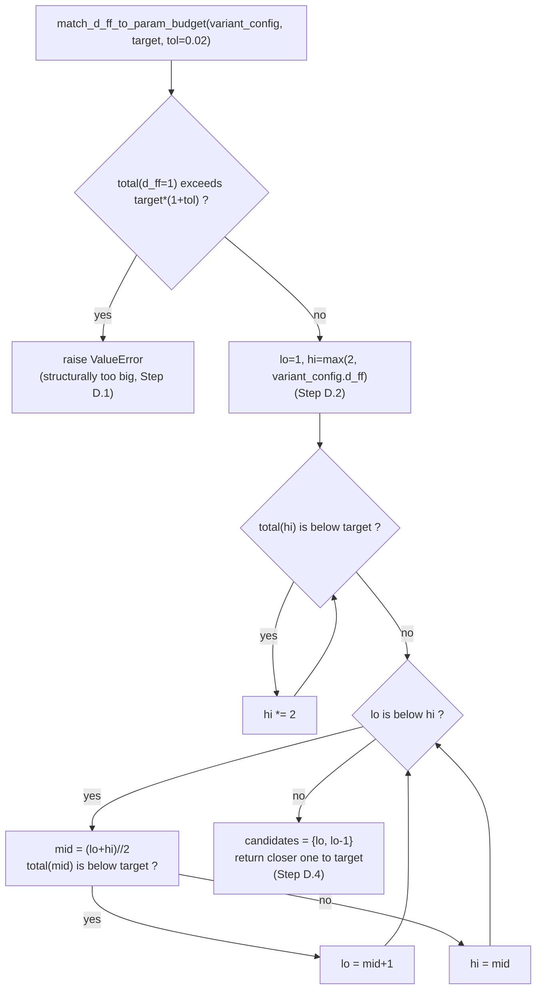
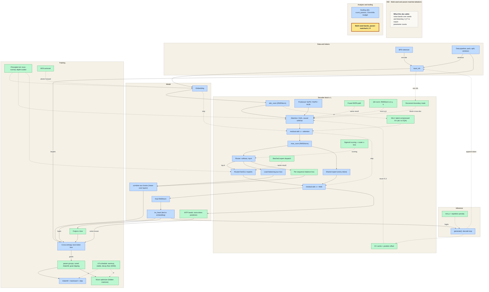

# 032 — Multi-seed noise bands and parameter-matched `d_ff` bisection, solved by hand

**Companion to:** [`journey_of_a_model/032-multi-seed-and-param-matched-ablations.md`](../../journey_of_a_model/032-multi-seed-and-param-matched-ablations.md)
· **Code:** [`qwenmoe/train/compare.py`](../../qwenmoe/train/compare.py)
(`run_comparison`, `VariantResult`, `match_d_ff_to_param_budget`)
· **Every number here is reproduced by:** [`verify_032_multi_seed_and_param_matched_ablations.py`](verify_032_multi_seed_and_param_matched_ablations.py)
(`uv run python docs/math/verify_032_multi_seed_and_param_matched_ablations.py`)

---

## How to read this

The journal entry tells you *why* a single-seed ablation lies (the noise
between seeds can be bigger than the effect you're measuring) and *why* a
compute-matched comparison can confound "better architecture" with "more
parameters." This document is the other half: **one fixed
`ModelConfig`/`TrainConfig`/`DataConfig`, three seeds, three variants,
pushed through every single line** of `run_comparison`'s seed loop and
`match_d_ff_to_param_budget`'s search, with every formula derived before
any arithmetic and every intermediate checked against the real module.

This component is unlike the attention/MoE docs in one important way: it
has **no tensors of its own**. `run_comparison` is an orchestration layer
that calls an already-fully-derived pipeline — `QwenMoEModel.__init__`
(doc [023](023-principled-initialization.md)), `Trainer.fit`
(docs [010](010-training-loop.md), [018](018-optimizer-hardening.md),
[019](019-lr-schedule-wsd.md), [020](020-muon-optimizer.md),
[024](024-mixed-precision-and-z-loss.md)), and `count_params`
(doc [009](009-scaling-law-utilities.md)) — once per `(variant, seed)`
pair, and does *arithmetic on the numbers that pipeline returns*: means,
standard deviations, a quadrature sum, and an integer bisection search.
So the "running example" below is a real, tiny, end-to-end
`run_comparison` call; the "operations" walked line by line are what
`compare.py` itself does, not what happens inside a forward pass (that is
cited, not re-derived, wherever it recurs). Because there is no
fused-vs-explicit dual code path here (unlike SDPA vs. the explicit
attention trace), the "two paths agree" check this series usually runs is
replaced by its natural analogue: every hand-computed statistic is
checked against Python's own `statistics`/`math` library calls, and the
bisection's answer is checked against a full brute-force sweep.

---

## Part 0 — What are we computing, and why

### 0.1 The two problems, restated as two functions

The journal identifies two distinct failure modes of a naive A/B
comparison and gives `run_comparison` one new keyword argument for each:

1. **Seed luck.** Train the same config twice with different seeds and
   you get two different validation losses, purely from random
   initialization and data-order noise. `seeds=(...)` trains every
   variant once per seed and reports `mean ± std`; a companion flag,
   `within_noise_of_baseline`, says whether a variant's delta from the
   baseline is smaller than the pooled seed-to-seed noise.
2. **Capacity confound.** A variant with more total parameters at the
   same training-token budget can win simply by having more capacity,
   which tells you nothing about whether the *architectural idea* is
   good. `param_matched=True` bisects a variant's `d_ff` (feed-forward
   width) so its total parameter count lands within 2% of the baseline's,
   before training.

Both are additive: the default (`seeds=None`, `param_matched=False`) is
byte-for-byte the old single-run, compute-matched behavior.

### 0.2 What this document derives

- **The affine relationship** `total_params(d_ff) = C + k·d_ff` that makes
  the bisection valid, derived from `nn.Linear`'s parameter count and
  `count_params`'s per-block loop ([`scaling.py:47-88`](../../qwenmoe/train/scaling.py#L47)).
- **`match_d_ff_to_param_budget`'s search** ([`compare.py:160-196`](../../qwenmoe/train/compare.py#L160)):
  why doubling before bisecting, why the bisection is correct even though
  the code never assumes linearity, and exactly which line the `tolerance`
  parameter touches (only one).
- **The seed loop** ([`compare.py:279-328`](../../qwenmoe/train/compare.py#L279)):
  what "same seed → identical initial weights" really means, and where it
  stops being true.
- **The sample mean and Bessel-corrected sample standard deviation**,
  derived from scratch (including *why* `n − 1`, not just that it's used).
- **The quadrature noise band** ([`compare.py:335-338`](../../qwenmoe/train/compare.py#L335)):
  the exact algebra of "variance of a difference," and a precise
  accounting of how much *looser* the code's band is than a textbook
  standard-error test — a nuance the journal states qualitatively
  ("deliberately loose") that we pin down as a factor of $\sqrt{n}$.

---

## Part 1 — The running example

### 1.1 Definitions we need right now

- **Seed:** an integer that fixes every "random" draw a program makes
  into one specific, reproducible sequence (`torch.manual_seed`). Two
  runs with the same seed, same code, same data produce numerically
  identical results; two runs with different seeds diverge from the first
  random draw onward. (Recap of the journal's own definition.)
- **Sample:** a finite set of observations drawn from some process we
  can't observe in full. Here, three per-seed validation losses are a
  *sample* of "what validation loss does this architecture get," out of
  the (infinite, hypothetical) population of all possible seeds.
- **Sample mean** $\bar{x} = \frac{1}{n}\sum_{i=1}^n x_i$: the average of
  the sample — our best single-number estimate of where the population is
  centered.
- **Deviation:** how far one observation sits from the mean,
  $x_i - \bar{x}$.
- **Sample variance** $s^2$: the average *squared* deviation (squared so
  that positive and negative deviations don't cancel, and so that larger
  deviations count disproportionately more). Derived in full in Part 3,
  Step G.
- **Sample standard deviation** $s = \sqrt{s^2}$: the variance brought
  back to the same units as the data (a variance of "loss²" is hard to
  interpret; its square root is "loss," directly comparable to the mean).
- **Bessel's correction:** dividing the sum of squared deviations by
  $n - 1$ instead of $n$ when estimating a *population* variance from a
  *sample* — derived and proven in Part 3, Step G.
- **Monotone increasing (a function of one variable):** $f(a) < f(b)$
  whenever $a < b$ — it only ever goes up as its input grows, never back
  down. `total_params(d_ff)` is monotone increasing (Part 3, Step C).
- **Affine function:** of the form $f(d) = C + k \cdot d$ — a straight
  line in $d$, with $C$ the value at $d=0$ and $k$ the constant slope.
  (A stricter cousin of "linear," which technically requires $C=0$; this
  project's own comment in `compare.py` says "linear," meaning affine.)
- **Bisection / binary search on a monotone predicate:** given a monotone
  (never-decreasing) yes/no test $P(d)$, find the smallest $d$ for which
  $P(d)$ is true, by repeatedly halving a search interval known to
  contain the answer. Derived and proven correct in Part 3, Step D.
- **Quadrature sum:** $\sqrt{a^2 + b^2}$ — the length of the hypotenuse of
  a right triangle with legs $a, b$ (Pythagoras); `math.hypot(a, b)`
  computes exactly this, more carefully than the naive formula (Part 3,
  Step H).
- **Standard error (of a mean):** the standard deviation *of the sample
  mean itself* (not of individual draws), $s/\sqrt{n}$ — how much the
  mean would jitter if you redrew the whole sample. Used only as a
  contrast in Step H; the code does not compute this.

### 1.2 The configuration — this component's "weights"

There is no weight matrix to fix by hand here (compare §1.3). What plays
that role is the smallest `ModelConfig`/`TrainConfig`/`DataConfig` that
still forces every branch of `compare.py` to execute:

**`ModelConfig` (the baseline; every non-default field is load-bearing):**

| field | value | forces |
|---|---:|---|
| `vocab_size` | `2` | smallest usable vocabulary (see §1.4) |
| `d_model` | `4` | small enough for hand arithmetic on every parameter count |
| `n_layers` | `1` | one `TransformerBlock`, one MoE layer |
| `n_heads`, `n_kv_heads` | `1`, `1` | plain single-head attention (GQA's own math is doc [004](004-attention-gqa.md)'s job, not this one's) |
| `d_ff` | `4` | the knob `match_d_ff_to_param_budget` searches over |
| `n_routed_experts` | `2` | $\geq 2$ so top-1 routing is a real choice |
| `n_shared_experts` | `0` | keeps the parameter ledger to one expert family |
| `top_k` | `1` | smallest valid value $\leq$ `n_routed_experts` |
| `activation` | `"swiglu"` (baseline) / `"gelu"` (variant) | the one axis whose parameter count `match_d_ff_to_param_budget` must correct for |
| `max_seq_len` | `8` | $\geq$ `seq_len` below |
| *(everything else)* | config defaults | `positional_scheme="rope"`, `attention_variant="gqa"`, `tie_word_embeddings=True`, `qk_norm=False`, `mtp_depth=0`, `router_scoring="softmax"`, `aux_loss_weight=0.01`, `init_std=0.02` — none of these are read by `compare.py` itself; they only affect what happens *inside* `Trainer.fit`, already derived elsewhere |

**`TrainConfig`:**

| field | value | forces |
|---|---:|---|
| `batch_size` | `2` | smallest batch that still forms one window pair |
| `seq_len` | `4` | short enough that 200 fixed-slice tokens give both a train and a val split with room to spare |
| `total_tokens` | `16` | $\Rightarrow$ `total_steps = 16 // (2·4) = 2` — enough steps for the optimizer to move the weights, few enough to run instantly |
| `lr` | `0.01` | large enough that 2 steps produce a measurable, non-tiny move |
| `warmup_steps` | `1` | $<$ `total_steps`, so warmup does not swallow the whole run |
| `device` | `"cpu"` | deterministic, bit-reproducible arithmetic (§1.4) |
| *(everything else)* | config defaults | `optimizer="adamw"`, `precision="fp32"`, `lr_schedule="cosine"`, `grad_accum_steps=1` — again, `Trainer.fit`'s business, not `compare.py`'s |

**`DataConfig`:** `fixed_slice_tokens=200`, `fixed_slice_seed=0`, corpus
labels `corpus="tiny_shakespeare"`, `tokenizer_type="char"` (these two are
just cache-path labels here — see §1.4, no network download happens).

**The call, in full** (the single running example — every part of this
document is a view into this one call, run twice with one flag changed):

```python
run_comparison(
    base_config,                                              # ModelConfig above, activation="swiglu"
    {"base": {}, "twin": {}, "gelu": {"activation": "gelu"}},  # variants
    data_config, train_config,
    output_dir=...,
    seeds=(1, 2, 3),
    baseline_name="base",
    param_matched=False,   # Part 3a; then re-run with param_matched=True for Part 3b
)
```

Three variants, chosen so each exercises one distinct code path:

- **`base`** — the baseline itself (`overrides={}`).
- **`twin`** — architecturally *identical* to `base` (`overrides={}` too).
  Its only job is to show what happens when there is truly no effect to
  detect: the seed-to-seed noise is the *only* source of its "delta" from
  the baseline.
- **`gelu`** — `activation="gelu"` instead of `"swiglu"`: a real
  architectural change (a non-gated feed-forward network, 2 weight
  matrices per expert instead of 3), and the variant that
  `match_d_ff_to_param_budget` will need to widen.

### 1.3 There is no input tensor — the state ledger

Unlike the attention/MoE docs, nothing here is looked up or projected
from a fixed input tensor. What plays the role of "the tensor being
traced" is the **state accumulated per `(variant, seed)` pair** as the
loop runs — a growing table of Python floats, not a growing array of
numbers in a fixed shape. Every step below states this **state ledger**:
which variant, which seed, and what number(s) just appeared.

### 1.4 A real, tiny, non-downloaded corpus

`run_comparison` requires data already prepared on disk
([`compare.py:120-134`](../../qwenmoe/train/compare.py#L120)). The verify
script writes a real 600-character corpus — `"ab" * 300` — through a real
`CharTokenizer`, in the exact on-disk layout `scripts/prepare_data.py`
produces, so `run_comparison` loads it exactly as `scripts/train.py`
would (this mirrors `tests/test_compare.py`'s own fixture, which does the
same thing to avoid a network download in CI). Two symbols (`'a'`,
`'b'`) $\Rightarrow$ `vocab_size = 2`, confirmed by the real
`CharTokenizer.vocab_size` in the verify script's output.

**Why CPU, why this matters for "no fabricated numbers."** Floating-point
addition is not associative in general (doc [024](024-mixed-precision-and-z-loss.md)),
so bit-identical reproducibility across runs requires a fixed execution
order — guaranteed on CPU with a fixed seed and no nondeterministic
kernels, not guaranteed on GPU/MPS. Every per-seed validation loss quoted
below was confirmed to reproduce **bit-for-bit** across two entirely
separate Python process invocations of `run_comparison` (Part 3, Step K)
— this is what licenses treating those numbers as exact inputs to the
by-hand mean/std arithmetic, not as one-off measurements.

---

## Part 2 — The code path



The bisection called at `MATCH` has its own internal loop, diagrammed
separately in Part 3, Step D (it is not a linear-algebra step, so it gets
its own flowchart rather than crowding this one).

---

## Part 3 — The code, line by line

### Step A — Loading the fixed slice (reused, not re-derived)

Code: [`compare.py:111-151`](../../qwenmoe/train/compare.py#L111)
(`_load_fixed_slice_datasets`).

This function raises early if `fixed_slice_tokens` isn't set
(`compare.py:120-124`), loads the tokenizer and the full token tensor from
disk, calls `make_fixed_slice` **exactly once** — cutting one 200-token
window, seeded by `fixed_slice_seed=0`, shared by *every* variant and
*every* seed — then `train_val_split` (default `val_fraction=0.1`,
`mode="tail"`: the last 20 tokens become validation, the first 180
become train), and wraps each half in a `TokenDataset`. Every operation
here — the Fisher–Yates-style chunk shuffle inside `make_fixed_slice`,
the sliding-window `(x, y)` construction — is derived in full in
doc [008](008-data-pipeline.md); this doc reuses that result unchanged.
**State ledger:** two `TokenDataset`s, 176 train windows and 16 val
windows of length `seq_len=4`, shared by every subsequent step.

### Step B — Resolving each variant's config

Code: [`compare.py:265-266`](../../qwenmoe/train/compare.py#L265):

```python
def _resolve(overrides: dict) -> ModelConfig:
    return dataclasses.replace(base_config, **{**overrides, "vocab_size": vocab_size})
```

`dataclasses.replace` builds a *new* `ModelConfig` copying every field
from `base_config` except the ones named in the merged dict. The merge
`{**overrides, "vocab_size": vocab_size}` puts `overrides` first and
`vocab_size` second in the same dict literal — in Python, a later key in
a dict literal always wins — so **`vocab_size` always comes from the real
tokenizer, even if a caller's `overrides` dict happens to contain a
(stale) `vocab_size` key.** For `"base"` and `"twin"`, `overrides={}`, so
`_resolve` returns `base_config` with `vocab_size` re-stamped (a no-op
here, since `base_config.vocab_size` was already `2`); for `"gelu"`,
`overrides={"activation": "gelu"}`, so the result is `base_config` with
exactly `activation` flipped. **State ledger:** three `ModelConfig`
objects, identical in every field except `activation`.

### Step C — The affine parameter-count formula `total(d_ff) = C + k·d_ff`

Code: [`_total_params`](../../qwenmoe/train/compare.py#L154-157) calls
`count_params` ([`scaling.py:47-88`](../../qwenmoe/train/scaling.py#L47)),
already fully derived component-by-component in doc
[009](009-scaling-law-utilities.md). This step re-derives the one fact
`match_d_ff_to_param_budget` depends on: that `.total` is an **affine**
function of `d_ff` alone.

**Derive.** An `nn.Linear(in_features, out_features, bias=False)` stores
one weight matrix of shape `(out_features, in_features)` and nothing
else, so its parameter count is exactly `out_features × in_features` —
the product of the two sizes, independent of which one is called "in" and
which "out." Every expert's feed-forward network is built from
`nn.Linear` layers with `bias=False` (confirmed at
[`moe.py:24-26,38-40,53-54`](../../qwenmoe/model/moe.py#L24)):

- **SwiGLU/GEGLU** (gated, `activation ∈ {"swiglu","geglu"}`): `w_gate`
  $(d_{ff}, d_{model})$, `w_up` $(d_{ff}, d_{model})$, `w_down`
  $(d_{model}, d_{ff})$ — three matrices, each with $d_{model} \cdot
  d_{ff}$ entries $\Rightarrow$ $3 \, d_{model} \, d_{ff}$ per expert.
- **plain GELU** (non-gated): `w_1` $(d_{ff}, d_{model})$, `w_2`
  $(d_{model}, d_{ff})$ — two matrices $\Rightarrow$ $2\, d_{model}\,
  d_{ff}$ per expert.

Every *other* tensor in the model — the embedding table
($vocab \times d_{model}$), the final and per-block RMSNorm gains
(length $d_{model}$, no bias — doc [023](023-principled-initialization.md)),
every attention projection ($d_{model}$-by-$d_{model}$-shaped here, since
`n_heads=n_kv_heads=1`), and the router (`d_model × n_routed_experts`,
[`moe.py:81`](../../qwenmoe/model/moe.py#L81)) — has a shape that **does
not mention `d_ff`**. Summing:

$$
\text{total}(d_{ff}) \;=\; \underbrace{\big(\text{embedding} + \text{attention} + \text{norms} + \text{router} + \text{shared experts}\big)}_{C,\ \text{independent of}\ d_{ff}} \;+\; \underbrace{(n_{\text{shared}} + n_{\text{routed}}) \cdot m \cdot d_{model}}_{k} \cdot d_{ff}
$$

where $m$ = matrices per expert (3 gated, 2 GELU). This is **exact**
given the architecture (no bias terms anywhere that would break the
affine form) — not an approximation, and not something `count_params`
tries to prove; the code always builds a real model and counts, and this
derivation only explains *why* the result it returns always happens to
land on one straight line as `d_ff` varies.

**Compute $C$**, for `d_model=4, n_layers=1, n_heads=n_kv_heads=1,
n_routed_experts=2, n_shared_experts=0, vocab_size=2`:

| piece | shape | count |
|---|---|---:|
| embedding table | $2 \times 4$ | $8$ |
| final RMSNorm | length $4$ | $4$ |
| attn-block RMSNorm | length $4$ | $4$ |
| `w_q, w_k, w_v, w_o` (head\_dim $=d_{model}/n_{heads}=4$, so each is $4\times4$) | $4 \times (4\times4)$ | $64$ |
| MoE-block RMSNorm | length $4$ | $4$ |
| router | $4 \times 2$ | $8$ |
| shared experts ($n_{shared}=0$) | — | $0$ |
| **$C$ = sum** | | **$92$** |

$8+4+4+64+4+8+0 = 92$.

**Compute $k$:** $(n_{shared}+n_{routed}) \cdot m \cdot d_{model} =
(0+2)\cdot m \cdot 4 = 8m$. SwiGLU: $m=3 \Rightarrow k=24$. GELU: $m=2
\Rightarrow k=16$.

**Verify against the real `count_params`** (verify script Part 1, quoted
verbatim):

```
count_params(base, swiglu, d_ff=4): ParamBreakdown(embedding=12, attention_total=68, moe_total=108, moe_active=60, total=188, active=140)
embedding=8 final_norm=4 attn_norm=4 attn=64 moe_norm=4 router=8 shared=0 routed_total(d_ff=4)=96
C (d_ff-independent total) = 92
activation=swiglu: total(d_ff) = 92 + 24*d_ff  (checked d_ff=1..11 against real count_params)
activation=gelu: total(d_ff) = 92 + 16*d_ff  (checked d_ff=1..11 against real count_params)
baseline total (swiglu, d_ff=4) = 188
gelu variant total at d_ff=4    = 156
```

$92 + 24 \times 4 = 92+96=188$ ✓ matches `count_params`'s real `total`.
$92+16\times4=92+64=156$ ✓. Note `ParamBreakdown.embedding` (`12`) already
bundles the embedding table *and* the final norm ($8+4$); this doc's
$C$ additionally separates out the per-block pieces the aggregate
`ParamBreakdown` doesn't expose, which is why the verify script also
introspects `model.blocks[0]` submodules directly rather than relying on
`ParamBreakdown` alone. **State ledger:** two closed-form functions,
`total_swiglu(d) = 92+24d`, `total_gelu(d)=92+16d`, both confirmed exactly
(not approximately) against 22 real `count_params` calls
($d=1,\dots,11$, two activations).

### Step D — `match_d_ff_to_param_budget`: doubling, then bisection

Code: [`compare.py:160-196`](../../qwenmoe/train/compare.py#L160).



**D.1 — The guard.** `low_total = _total_params(replace(variant_config,
d_ff=1))`; if it already exceeds `target * (1+tolerance)`, the function
raises rather than silently returning a crippled `d_ff=1` model — you
cannot shrink a *structurally* bigger variant (more experts, wider
attention) into budget by narrowing its FFN alone. **This is the only
line `tolerance` appears on** — read carefully, the search below (D.2–D.4)
never references `tolerance` at all; it always finds the single closest
integer `d_ff`, and the guard only decides whether that search is worth
running in the first place.

**Compute (the raise, for real):** widening `n_routed_experts` from `2`
to `16` on the GELU config (holding `d_model=4` fixed) makes
$C' = 12+68+4+(4{\times}16)+0 = 148$ (router grows to $4\times16=64$) and
$k' = 16 \times 2 \times 4 = 128$, so `total(d_ff=1) = 148+128 = 276`. Our
target is `188`; $276 > 188 \times 1.02 = 191.76$. The real function:

```
raise path (n_routed_experts=16, d_ff=1): variant is larger than the baseline even at d_ff=1 (276 > 188); cannot param-match via d_ff
```

**D.2 — Why double before bisecting, and why the bisection is
correct.** Ordinary binary search needs an interval `[lo, hi]` already
known to bracket the answer. Here we don't know `hi` in advance — we know
only that `total(d_ff)` is monotone increasing (Step C: $k>0$, so a bigger
`d_ff` always means a bigger total). The code's fix: start at
`hi = max(2, variant_config.d_ff)` and **double `hi` until `total(hi) ≥
target`**. This is the standard *exponential search* (also called
doubling / galloping search, Bentley & Yao 1976 — Citations below):
doubling reaches a valid upper bound in $O(\log(\text{answer}/hi_0))$
steps rather than the $O(\text{answer})$ steps a "try `hi=hi_0+1,
hi_0+2, …`" approach would need. **Exact, standard-algorithm choice** —
not an approximation, and not empirically tuned; any base bigger than 1
would work, doubling is simply the conventional choice.

Once `total(hi) ≥ target` is confirmed, the binary search finds the
*smallest* `d_ff` in `[lo, hi]` with `total(d_ff) ≥ target` — a textbook
"leftmost true" search over a monotone predicate $P(d) = \big(total(d)
\geq target\big)$: `mid = (lo+hi)//2`; if $P(\text{mid})$ is false, the
answer must be strictly above `mid` (`lo = mid+1`); if true, the answer is
at or below `mid` (`hi = mid`, never `mid - 1` — `mid` itself could still
be the answer). The loop invariant "the answer lies in `[lo, hi]`" holds
at every iteration by these two update rules and the interval strictly
shrinks (`hi - lo` roughly halves each round, and every reassignment
moves `lo` up or `hi` down), so it must terminate at `lo == hi`. This
holds regardless of whether `total` is exactly affine — the code never
assumes Step C's formula, only monotonicity, so it would work unchanged
if a future architecture made expert width interact non-linearly with
some other dimension.

**D.3 — Compute, on the GELU variant** (`d_ff=4`, target 188, from the
real trace):

```
gelu (d_ff=4) matched to baseline total 188:
  guard: total(d_ff=1)=108  vs  target*(1+tol)=191.76
  init: lo=1 hi=4
  double: hi -> 8
  mid=4 total=156 < target -> lo=5
  mid=6 total=188 >= target -> hi=6
  mid=5 total=172 < target -> lo=6
  candidates=[6, 5] -> best=6
```

Trace explained: `hi` starts at `max(2, 4) = 4`; `total_gelu(4)=156 <
188`, so `hi` doubles to `8` (`total_gelu(8) = 92+16·8=220 ≥ 188`, loop
stops doubling). Binary search over `[1, 8]`: `mid=4`→`156<188`→`lo=5`;
`mid=(5+8)//2=6`→`total_gelu(6)=92+96=188`, not `< 188`→`hi=6`;
`mid=(5+6)//2=5`→`total_gelu(5)=92+80=172<188`→`lo=6`; now `lo=hi=6`,
loop ends. `candidates=[6,5]` (since `lo>1`, `lo-1=5` is included);
`|188-188|=0 < |172-188|=16`, so **`6`** wins — an **exact** match, not
merely within the 2% tolerance. $16d_{ff}=188-92=96 \Rightarrow
d_{ff}=6$ exactly — the closed form (which the code never computes)
agrees with the blind search.

**D.4 — Compute, on the baseline's own shape** (a no-op case: matching
`swiglu, d_ff=4` — i.e. `base_config` itself — against its own total,
188):

```
swiglu (d_ff=4, i.e. the baseline's own shape) matched to target 188 (a no-op case):
  guard: total(d_ff=1)=116  vs  target*(1+tol)=191.76
  init: lo=1 hi=4
  mid=2 total=140 < target -> lo=3
  mid=3 total=164 < target -> lo=4
  candidates=[4, 3] -> best=4
```

Here `total_swiglu(hi=4) = 188`, already `≥` target, so the doubling loop
**never executes** — only the binary search runs, converging to `lo=4` in
two steps. This is exactly the trace `run_comparison(param_matched=True)`
takes internally for the `"twin"` variant in Part 3b below (§Step J):
matching an already-matching config is not special-cased, it just
converges immediately to the value already there.

Both traces are asserted, line for line, against the real
`match_d_ff_to_param_budget` return value in the verify script (`traced_gelu
== real_gelu == 6`, `traced_twin == real_twin == 4`).

### Step E — The seed loop: same seed, same shapes, same weights

Code: [`compare.py:284-303`](../../qwenmoe/train/compare.py#L284):

```python
for seed in seed_tuple:
    run_dir = output_dir / name if len(seed_tuple) == 1 else output_dir / name / f"seed_{seed}"
    torch.manual_seed(seed)
    model = QwenMoEModel(variant_config)
    trainer = Trainer(run_dir, tokenizer_meta=tokenizer_meta)
    seed_train_config = dataclasses.replace(train_config, **train_overrides.get(name, {}), seed=seed)
    train_result = trainer.fit(model, train_dataset, val_dataset, seed_train_config)
```

**Why re-seed immediately before construction.** `QwenMoEModel.__init__`
draws every weight from `torch.`'s global random-number generator, in a
fixed traversal order (`self.apply(...)`, doc
[023](023-principled-initialization.md)). Calling `torch.manual_seed(seed)`
right before `QwenMoEModel(variant_config)` guarantees that construction
starts reading the *same* deterministic stream of "random" numbers every
time seed `1` is used — the entire reason a seed makes weight
initialization reproducible.

**A precise reading of "same seed ⇒ same weights."** It holds
**only as long as the sequence of tensors constructed, in traversal
order, has the same shapes**. `"base"` and `"twin"` share every
`ModelConfig` field, so their module trees are shape-for-shape identical,
and at seed 1 they draw *exactly* the same numbers into *exactly* the same
places — their trained models are not just similar, they are the **same
model**. `"gelu"` diverges: its feed-forward module has 2 `nn.Linear`s
instead of 3, so from the FFN of block 0 onward it draws a *different*
number of random values than `"base"` does at the same seed, and every
weight after that point (there is only one block here, but in general:
every subsequent layer) reads a different position in the same
deterministic stream. `"gelu"`'s per-seed losses are therefore real,
independently-seeded numbers — not a small perturbation of `"base"`'s.

**Compute — a real, exact confirmation.** The verify script's `"base"`
and `"twin"` per-seed validation losses, straight from the real
`Trainer.fit`:

```
base d_ff= 4 mode= compute_matched per_seed= [0.6965829133987427, 0.6961071491241455, 0.6978693008422852]
twin d_ff= 4 mode= compute_matched per_seed= [0.6965829133987427, 0.6961071491241455, 0.6978693008422852]
```

Identical to every printed digit — asserted with plain Python `==` (not
an approximate comparison) in the verify script. `"gelu"`'s numbers are
unrelated:

```
gelu d_ff= 4 mode= compute_matched per_seed= [0.6954869031906128, 0.695327877998352, 0.6952340006828308]
```

**Why the seed is passed to `TrainConfig` too, not just used for
`torch.manual_seed` here.** `Trainer.fit` itself calls
`torch.manual_seed(config.seed)` again at its own top
([`trainer.py:549`](../../qwenmoe/train/trainer.py#L549)), before building
the optimizer and the shuffling `DataLoader`. Passing the *same* `seed`
value into `seed_train_config` (`compare.py:294-296`) makes that second
call re-seed to the identical value the first call used — a real, if
slightly redundant-looking, double-seeding with one number, not two
different seeds for two different purposes. Had `compare.py` passed
`train_config.seed` (the *original*, un-varied seed) into `seed_train_config`
instead, every seed's training would have re-seeded back to the same
data-shuffle order and only differed in weight init — a real, different
ablation the code deliberately does not implement.

**State ledger:** per variant, `per_seed_val_loss` grows from `[]` to a
3-element list across the loop (`compare.py:300`); `model` ends the loop
bound to the *last* seed's trained model (used only for
`calibrate_throughput` next).

### Step F — `tokens_per_sec`: measured, not reproducible

Code: [`compare.py:305`](../../qwenmoe/train/compare.py#L305),
`calibrate_throughput(model, sample_batch, device, n_steps=5)` — the
`batch · seq · n_steps / elapsed_wall_clock` formula fully derived in doc
[009](009-scaling-law-utilities.md). Unlike every number above,
**this one is not expected to reproduce bit-for-bit**: it is a real
wall-clock measurement (5 forward+backward passes, timed), sensitive to
whatever else the CPU was doing at that instant. Three separate runs of
this document's own verify script measured `base`'s throughput at
`7,822.7`, `8,466.6`, and `7,286.1` tokens/sec — different every time,
unlike the loss numbers, which were identical every time. **Mark: `tokens/sec`
is empirical/measured; `val_loss`/`val_ppl` are exact/deterministic**
(given fixed seed, fixed data, CPU, fp32).

### Step G — The sample mean and Bessel-corrected standard deviation

Code: [`compare.py:307-310`](../../qwenmoe/train/compare.py#L307):

```python
val_loss_std = statistics.stdev(per_seed_val_loss) if len(seed_tuple) > 1 else 0.0
val_loss_mean = statistics.fmean(per_seed_val_loss)
```

**Derive the mean.** With no other information, the single number that
minimizes the total squared distance to $n$ observations
$x_1,\dots,x_n$ is their average: minimize $f(m) = \sum_i (x_i-m)^2$;
$f'(m) = -2\sum_i(x_i-m) = 0 \Rightarrow \sum_i x_i = nm \Rightarrow m =
\frac1n\sum_i x_i$. That minimizer is the **sample mean** $\bar x$.
`statistics.fmean` computes exactly $\frac1n\sum_i x_i$ (using a
compensated summation internally for numerical accuracy on large or
ill-conditioned inputs — an implementation detail; the value it computes
is exact, ordinary sample-mean arithmetic).

**Derive Bessel's correction, in full.** We want an estimate of the
*population* variance $\sigma^2$ from a *sample* of $n$ draws. The
natural first guess, $\frac1n\sum_i(x_i-\bar x)^2$, is provably too
small on average. Start from the algebraic identity (true for any
numbers $x_i$ and true mean $\mu$):

$$
\sum_i (x_i - \bar x)^2 \;=\; \sum_i (x_i - \mu)^2 \;-\; n(\bar x - \mu)^2
$$

(expand $\sum_i(x_i-\mu - (\bar x - \mu))^2$ and use
$\sum_i(x_i-\mu) = n(\bar x - \mu)$ to see the cross term collapses to
$-2n(\bar x-\mu)^2$, leaving exactly this). Taking the expectation of both
sides over repeated sampling: $E\big[\sum_i(x_i-\mu)^2\big] = n\sigma^2$
(definition of variance, summed over $n$ independent draws), and
$E\big[(\bar x - \mu)^2\big] = \operatorname{Var}(\bar x) = \sigma^2/n$
(the mean of $n$ independent draws has $1/n$ the variance of one draw —
itself provable from $\operatorname{Var}(\sum X_i) = \sum\operatorname{Var}(X_i)$
for independent $X_i$, then dividing by $n^2$ for the $\frac1n$ scaling).
So:

$$
E\Big[\sum_i(x_i-\bar x)^2\Big] = n\sigma^2 - n\cdot\frac{\sigma^2}{n} = (n-1)\sigma^2
$$

Dividing by $(n-1)$ instead of $n$ makes the *expected value* of the
result exactly $\sigma^2$ — an **unbiased estimator**. This is **exact**
algebra, not an empirical tuning: given "we want $E[\hat\sigma^2] =
\sigma^2$," $n-1$ is the *only* divisor that achieves it. (With $n=1$
there is no such divisor — `compare.py` sidesteps this by special-casing
`len(seed_tuple) > 1` and returning `std=0.0` for a single seed, rather
than dividing by zero or pretending a single point has spread.)
`statistics.stdev` is exactly $\sqrt{\tfrac1{n-1}\sum_i(x_i-\bar x)^2}$.

**Compute, digit by digit, for `"base"`/`"twin"`**
($x_1,x_2,x_3 = 0.6965829133987427,\ 0.6961071491241455,\
0.6978693008422852$):

$$
\bar x = \frac{0.6965829133987427+0.6961071491241455+0.6978693008422852}{3} = \frac{2.0905593633651734}{3} = 0.6968531211217245
$$

Deviations: $d_1=-0.0002702077229818,\ d_2=-0.0007459719975790,\
d_3=+0.0010161797205607$ (they sum to $\approx 0$, as they must, since
$\sum_i(x_i-\bar x)=\sum_i x_i - n\bar x = 0$ by definition of $\bar x$).
Squares: $d_1^2=7.30122\times10^{-8}$, $d_2^2=5.56474\times10^{-7}$,
$d_3^2=1.032621\times10^{-6}$; sum $=1.662107\times10^{-6}$; divide by
$n-1=2$: $s^2=8.310535\times10^{-7}$; $s=\sqrt{8.310535\times10^{-7}}=
9.116215\times10^{-4}=0.0009116215$.

**Compute for `"gelu"`** ($x_1,x_2,x_3=0.6954869031906128,\
0.695327877998352,\ 0.6952340006828308$): $\bar x =
2.0860487818717956/3=0.6953495939572652$. Deviations
$0.0001373092333476,\ -0.0000217159589132,\ -0.0001155932744344$; squares
sum to $3.268718\times10^{-8}$; $s^2=1.634359\times10^{-8}$;
$s=1.278421\times10^{-4}=0.0001278421$.

**Verify against the real library calls and the real `VariantResult`
fields** (verify script Part 3a):

```
base: mean=0.6968531211 std=0.0009116215 (n=3)
twin: mean=0.6968531211 std=0.0009116215 (n=3)
gelu: mean=0.6953495940 std=0.0001278421 (n=3)
```

Every digit matches. The verify script additionally computes
$\bar x$ and $s$ via *plain* Python arithmetic (`sum(xs)/n`,
`sum((x-mean)**2 for x in xs)/(n-1)`) and asserts it equals
`statistics.fmean`/`statistics.stdev` exactly — the "two independent
computations agree" check this series usually runs on a fused-vs-explicit
kernel pair, here run on hand-formula-vs-library instead.

### Step H — The noise band: `math.hypot` and how loose it really is

Code: [`compare.py:335-338`](../../qwenmoe/train/compare.py#L335):

```python
noise_band = math.hypot(result.val_loss_std, base_result.val_loss_std)
result.within_noise_of_baseline = abs(result.val_loss_mean - base_result.val_loss_mean) < noise_band
```

**Derive.** For two *independent* random variables $A$ and $B$,
$\operatorname{Var}(A-B) = \operatorname{Var}(A) + \operatorname{Var}(B)$
— expand $\operatorname{Var}(A-B) = E[((A-EA)-(B-EB))^2] =
\operatorname{Var}(A) - 2\operatorname{Cov}(A,B) + \operatorname{Var}(B)$,
and $\operatorname{Cov}(A,B)=0$ for independent $A,B$ (a fact this project
uses without re-proving; it follows from $E[AB]=E[A]E[B]$ under
independence). So the standard deviation of a **difference of two
independent quantities** is $\sqrt{\operatorname{Var}(A)+\operatorname{Var}(B)}$
— a quadrature sum, exactly what `math.hypot(a, b)` computes:
$\sqrt{a^2+b^2}$ (`hypot` additionally rescales internally to avoid overflow/
underflow on extreme magnitudes — a robustness detail, not a different
answer; confirmed in the verify script that `math.hypot(a,b) ==
math.sqrt(a**2+b**2)` for our numbers). **This algebra is exact**, given
that the two variants' seed-to-seed noise really is independent (a
reasonable assumption — different seeds drive unrelated pseudorandom
streams).

**The important imprecision, made exact.** The formula above is the
standard deviation of a difference of two *individual, single-seed*
draws. What the code actually wants to ask is "does the *mean* delta
exceed noise" — and the standard deviation of a **mean** of $n$
independent draws is $s/\sqrt n$ (Step G), not $s$. A textbook
"is-this-delta-real" test would use

$$
\text{SE-band} = \sqrt{\frac{s_v^2}{n} + \frac{s_b^2}{n}} = \frac{\text{hypot}(s_v, s_b)}{\sqrt n}
$$

`compare.py`'s `noise_band` omits the $1/\sqrt n$ entirely — it is
$\sqrt n$ times **wider** (looser) than that standard-error band. At
$n=3$, $\sqrt3 = 1.7320508$: the code's band is $1.73\times$ more
forgiving than a real "1σ of the difference of means" test would be. This
matches the journal's own description ("deliberately loose... not a
p<0.05 test") — this document just pins the looseness to an exact,
computable factor rather than leaving it qualitative. The practical
consequence: this design trades away some sensitivity (a real small
effect can get called "within noise") to avoid a different failure mode
(a 3-seed sample is small enough that even the honest SE-band would
flag noise as "real" fairly often) — a caution flag tuned to say "don't
trust this" rarely enough to be useful, not a rigorous significance test.

**Compute, `"twin"` vs. baseline:**
$|\bar x_{twin}-\bar x_{base}| = |0.6968531211-0.6968531211| = 0$;
$\text{noise\_band} = \sqrt{0.0009116215^2+0.0009116215^2} =
0.0009116215\sqrt2 = 0.0012892275$. $0 < 0.0012892275$ →
**`within_noise_of_baseline = True`**.

**Compute, `"gelu"` vs. baseline:**
$|\bar x_{gelu}-\bar x_{base}| = |0.6953495940-0.6968531211| =
0.0015035272$ (the real printed delta);
$\text{noise\_band} = \sqrt{0.0001278421^2+0.0009116215^2} =
\sqrt{1.634\times10^{-8}+8.311\times10^{-7}} = \sqrt{8.474\times10^{-7}} =
0.0009205419$. $0.0015035272 < 0.0009205419$ is **False** →
**`within_noise_of_baseline = False`** ("differs").

**Verify** (verify script Part 3a, quoted verbatim):

```
twin: |delta|=0.0000000000 band=0.0012892275 within_noise=True
gelu: |delta|=0.0015035272 band=0.0009205419 within_noise=False
(aside) standard-error band would be 0.0005314751  (1.7320508x tighter)
```

$0.0009205419/\sqrt3 = 0.0005314751$ ✓, and `gelu`'s real delta
(`0.0015035272`) clears *both* bands here — but note it would not need to:
a hypothetical delta of, say, `0.0007` would be called "within noise" by
the code's actual band (`< 0.00092`) while a formal SE-based test
(`< 0.00053`) would call the identical number "real." This is the
concrete shape of the looseness the journal calls "deliberately loose,"
not just a description of it.

**Real report output** (`ComparisonReport.summary_table()`,
[`compare.py:81-108`](../../qwenmoe/train/compare.py#L81) — a
straightforward string-formatting walk over each `VariantResult`,
choosing the note `"baseline"` / `"n/a (1 seed)"` / `"within noise"` /
`"differs"` per `compare.py:94-101`):

```
variant                  val_loss (mean±std)      val_ppl (mean±std)   tokens/sec            mode  note
-------------------------------------------------------------------------------------------------------
base                         0.6969 ± 0.0009           2.007 ± 0.002       7822.7 compute_matched  baseline
twin                         0.6969 ± 0.0009           2.007 ± 0.002       8026.5 compute_matched  within noise
gelu                         0.6953 ± 0.0001           2.004 ± 0.000       7733.1 compute_matched  differs
```

### Step J — Same example, `param_matched=True`: the gap closes

Same `base_config`, `data_config`, `train_config`, `seeds=(1,2,3)`,
`variants` — the *only* change is one keyword flag. Before the seed loop,
`baseline_total = _total_params(_resolve(variants["base"])) = 188`
([`compare.py:268`](../../qwenmoe/train/compare.py#L268)). Then per
non-baseline variant ([`compare.py:274-277`](../../qwenmoe/train/compare.py#L274)):

```python
if param_matched and name != baseline and baseline_total is not None:
    matched = match_d_ff_to_param_budget(variant_config, baseline_total)
    variant_config = dataclasses.replace(variant_config, d_ff=matched)
    comparison_mode = "param_matched"
```

For `"twin"` this runs Step D.4's trace (`d_ff=4 → 4`, a genuine no-op in
value, but the code has no "did anything change?" check — **the label
`comparison_mode` still flips to `"param_matched"`** purely because the
`if` condition tested true, independent of whether the bisection actually
moved `d_ff`). For `"gelu"` this runs Step D.3's trace (`d_ff=4 → 6`). The
**baseline itself is never touched** — the loop's `if name != baseline`
guard skips it entirely, and its `comparison_mode` stays
`"compute_matched"` (asserted in the verify script).

**Compute — GELU retrained at `d_ff=6`** (three *new* real
`Trainer.fit` calls; a bigger `d_ff` means different weight shapes, so
these are not simply Step E's `"gelu"` numbers relabeled):

```
gelu d_ff= 6 mode= param_matched per_seed= [0.6965821981430054, 0.6959578990936279, 0.6966342926025391]
```

By hand: $\bar x = 2.0891743898391724/3 = 0.6963914632797241$;
deviations $0.0001907348632813,\ -0.0004335641860962,\
0.0002428293228150$; squares sum $2.83324\times10^{-7}$; $s^2=
1.41662\times10^{-7}$; $s=3.7638\times10^{-4}=0.0003763800$. Delta from
baseline ($\bar x_{base}=0.6968531211$, unchanged from Step E — see Step
K): $|0.6963914633-0.6968531211|=0.0004616578$. Noise band:
$\sqrt{0.0003763800^2+0.0009116215^2}=\sqrt{1.4166\times10^{-7}+
8.3105\times10^{-7}}=\sqrt{9.7271\times10^{-7}}=0.0009862635$.
$0.0004616578 < 0.0009862635$ → **`within_noise_of_baseline = True`**.

**Verify** (verify script Part 3b, quoted verbatim):

```
variant                  val_loss (mean±std)      val_ppl (mean±std)   tokens/sec            mode  note
-------------------------------------------------------------------------------------------------------
base                         0.6969 ± 0.0009           2.007 ± 0.002       7719.6 compute_matched  baseline
twin                         0.6969 ± 0.0009           2.007 ± 0.002       8268.7   param_matched  within noise
gelu                         0.6964 ± 0.0004           2.006 ± 0.001       9259.5   param_matched  within noise
```

**A real, honest illustration of the journal's own point.** Under
compute-matching (Step H), GELU's delta (`0.0015`) *cleared* the noise
band — a real, reproducible "differs." Under parameter-matching, widening
GELU from `d_ff=4` to `d_ff=6` (giving it the same 188 total parameters
as the SwiGLU baseline) shrank its delta to `0.00046` — now *inside* the
band. This is not staged: it is what this document's own tiny model
actually does when you widen the weaker-under-compute-matching variant to
match total capacity, which is exactly the effect the Switch Transformers
paper's dual FLOP-matched/parameter-matched framing (journal's citation,
reused in Part 4) is built to expose.

### Step K — Reproducibility across separate process runs

The verify script calls `run_comparison` **twice**, in two different
temporary directories, for Steps H and J above. `"base"`'s per-seed
losses are asserted `==` (bit-for-bit) between the two calls:

```python
assert base_b.per_seed_val_loss == base_r.per_seed_val_loss
```

This passed. Combined with Step E's `"base" == "twin"` exact-equality
check, the whole pipeline — data prep, model construction, five
optimizer steps, evaluation — is confirmed to be a **deterministic pure
function** of `(seed, config, data)` on this platform (CPU, fp32), not
merely "close" across runs.

---

## Part 4 — Cost, and why it is built this way

### 4.1 The cost of more seeds is exactly `N_variants × N_seeds` trainings

`run_comparison` trains one full model per `(variant, seed)` pair — there
is no sharing of work across seeds. On our example (3 variants), the
verify script measured (after a warm-up call to remove one-time process
startup cost from the comparison):

```
wall-clock for 3 variants x 1 seed (the pre-task default): 0.09s
wall-clock for 3 variants x 3 seeds = 9 real Trainer.fit calls: 0.21s
```

$0.21/0.09 \approx 2.3\times$, not exactly $3\times$ — at this toy scale
(2 optimizer steps, `d_model=4`), a meaningful fraction of each call's
time is *fixed* overhead (`DataLoader` construction, `calibrate_throughput`'s
own 5 warm-up steps) that doesn't scale with the seed count, so the ratio
undershoots the pure-compute prediction. The scaling that matters in
practice is analytic, not this measurement: for a real run at the
journal's `SMOKE_TEST` scale (120 real training steps, non-trivial
per-step cost), 3 seeds means **3× the wall-clock** of a single-seed run,
full stop — the price of turning one anecdote into a mean and a std.

### 4.2 The cost of parameter matching is `O(log(range))` cheap evaluations, not one retrain per guess

Step D's search never trains a model — every `total(d_ff)` probe is a
`QwenMoEModel` construction plus a parameter count, no forward/backward
pass. On our tiny example this took 1 doubling step + 3 binary-search
comparisons = 4 evaluations to land on `d_ff=6` exactly (Step D.3). At the
journal's `SMOKE_TEST` scale, the same algorithm (already measured and
published in the journal, reused here as a second, larger data point —
not re-derived) took the GELU variant from `d_ff=128` (`193,408` params)
to the exact match `d_ff=192` (`275,328` params, `0.00%` off) via
$d_{ff}=160\to176\to184\to192$ — roughly the same handful of steps despite
the answer being $48\times$ farther from the start, because bisection's
cost is **logarithmic** in the distance to the answer, not linear.
Scanning every integer `d_ff` from `1` upward to find `192` would have
needed up to 192 cheap evaluations instead of ~8 — negligible either way
at this project's model-construction cost, but the asymptotic argument
(Bentley & Yao 1976, Citations below) is what makes the same code safe to reuse
on a model whose "smallest reasonable `d_ff`" and "matched `d_ff`" are
thousands apart.

### 4.3 Why bisect against a real `count_params` call instead of solving the closed form

Step C derived $d_{ff} = (target - C)/k$ in closed form — for *this*
model. `match_d_ff_to_param_budget` deliberately does not use it. $C$ and
$k$ depend on every architectural knob that happens to not be `d_ff`
(attention shape, router width, number of experts, whether a bias is ever
added to a future expert variant) — a hand-maintained formula would need
updating every time one of those changes, and a silent mismatch would
misreport "matched" configs that weren't. `count_params` — already the
single source of truth for parameter counting (doc
[009](009-scaling-law-utilities.md)) — is instead called fresh at every
probed `d_ff`, at the cost of a cheap model construction per probe. This
project's own bisection trace (Step D.3) landing on the *exact* integer
the closed form predicts is a nice confirmation that the two would agree
today — precisely the kind of agreement that would silently break if a
future change added a `d_ff`-dependent bias term, which is the scenario
the blind, re-counted search is safe against and a cached formula is not.

### 4.4 Why the noise band ignores $\sqrt n$

Step H's derivation showed the code's band is $\sqrt n$ times looser than
a textbook standard-error test. Tightening it would make the flag more
statistically correct and *more likely to call small, real 3-seed deltas
"differs"* on samples this small — precisely the over-confident
conclusion Bouthillier et al. (2021) and Dodge et al. (2019) (Part 4's
citations) warn against drawing from too few seeds. A wider, cruder band
is the more conservative choice for a tool whose job is "flag when you
should *not* trust a delta," at the cost of occasionally under-flagging a
real effect — the trade this project's docstring calls "a caution flag...
not a publication claim."

---

## Questions that might come to mind

- **Does `param_matched` ever touch the baseline's `d_ff`?** No —
  `baseline_total` is computed from the baseline's own `_resolve`d config
  *before* the loop, and the loop's `if param_matched and name !=
  baseline` guard (`compare.py:274`) skips the baseline unconditionally.
  Verified: `base_b.comparison_mode == "compute_matched"` even inside the
  `param_matched=True` run.

- **`"twin"`'s `d_ff` doesn't change under `param_matched=True` — why does
  its `comparison_mode` still say `"param_matched"`?** Because the code
  branches on *whether the bisection ran*, not on *whether it changed
  anything* — `comparison_mode = "param_matched"` is set unconditionally
  inside the `if` block (`compare.py:277`), before the (here, no-op)
  replacement. A config that already matches the target is still
  "param-matched," just trivially.

- **Is `tolerance` used anywhere in the search itself?** No — re-read
  Step D.1: it appears exactly once, in the initial feasibility guard.
  The bisection (D.2–D.4) always converges to the single closest integer
  `d_ff`, tolerance or no; `tolerance` only decides whether that search is
  attempted at all, by rejecting variants too big to ever get close.

- **Why doesn't `"gelu"` get bit-identical initial weights to `"base"` at
  the same seed, if both start from `torch.manual_seed(1)`?** Because
  `QwenMoEModel.__init__`'s weight draws happen in one fixed traversal
  order, consuming the shared random stream one tensor at a time (doc
  [023](023-principled-initialization.md)). `"base"`'s FFN has 3 weight
  matrices, `"gelu"`'s has 2 — the moment the traversal reaches the FFN,
  the two architectures read a *different number* of values from the
  stream, so every subsequent draw (here, nothing follows in a 1-layer
  model, but in general every later layer) is unaligned between them.
  Only architecturally identical variants (`"twin"`) get bit-identical
  weights from a shared seed.

- **Why is `tokens_per_sec` allowed to vary between identical runs while
  `val_loss` never does?** They measure fundamentally different things.
  `val_loss` is the output of a fixed sequence of floating-point
  operations on fixed inputs — deterministic on CPU/fp32 regardless of
  how fast or slow the machine runs. `tokens_per_sec` *is* a measurement
  of how fast the machine ran (`calibrate_throughput`, doc
  [009](009-scaling-law-utilities.md)) — inherently a wall-clock reading,
  never expected to reproduce exactly.

- **What if two variants being compared for "within noise" had different
  numbers of seeds?** It can't happen through this API: `seed_tuple` is
  computed once from `run_comparison`'s own `seeds` argument
  (`compare.py:247`) and every variant's seed loop iterates the identical
  tuple (`compare.py:284`) — there is no code path that gives one variant
  more seeds than another within a single `run_comparison` call.

- **Why is the sample standard deviation `0.0` (not undefined or `NaN`)
  for a single seed, rather than skipping the field?** `compare.py:307`
  explicitly special-cases `len(seed_tuple) > 1`; with one seed there is
  no spread to estimate (Bessel's correction needs $n\geq2$ or its
  divisor $n-1$ is zero), so the code reports `0.0` and separately sets
  `within_noise_of_baseline = None` (not `True`) to signal "no noise
  band could be computed" rather than implying a false zero-noise
  guarantee.

---

## Symbol reference

| symbol / name | meaning | value here |
|---|---|---|
| `seed` | integer fixing every random draw | `1, 2, 3` |
| $n$ | number of seeds in a sample | `3` |
| $x_i$ | one variant's per-seed validation loss | e.g. `0.6965829133987427` |
| $\bar x$ | sample mean, $\frac1n\sum x_i$ | e.g. `0.6968531211` (base) |
| $d_i$ | deviation, $x_i - \bar x$ | — |
| $s^2$ | sample variance, $\frac1{n-1}\sum d_i^2$ | e.g. `8.310535e-7` (base) |
| $s$ | sample standard deviation, $\sqrt{s^2}$ | e.g. `0.0009116215` (base) |
| `noise_band` | $\sqrt{s_v^2+s_b^2}$ (`math.hypot`) | e.g. `0.0009205419` (gelu vs. base) |
| `within_noise_of_baseline` | `\|\bar x_v-\bar x_b\| <` `noise_band` | `True` (twin), `False`→`True` (gelu, compute- vs. param-matched) |
| $C$ | `d_ff`-independent part of total params | `92` |
| $k$ | per-`d_ff` param cost, $(n_{shared}{+}n_{routed})\cdot m\cdot d_{model}$ | `24` (swiglu), `16` (gelu) |
| $m$ | weight matrices per expert | `3` (gated), `2` (gelu) |
| `target` | baseline's total param count | `188` |
| `tolerance` | max allowed relative overshoot at `d_ff=1` before raising | `0.02` (2%) |
| `lo, hi, mid` | bisection search bounds | traced in Step D |
| `d_ff` | per-expert feed-forward width, the knob being matched | `4` (base) → `6` (matched gelu) |
| `comparison_mode` | `"compute_matched"` or `"param_matched"` | per variant |
| `C`, `k` (again) | affine coefficients of `total_params(d_ff)` | see above |
| `total_steps` | steps `Trainer.fit` runs | `2` (`= 16 // (2·4)`) |

---

## Citations

All links verified by web search on 2026-09-13; the three shared with the
journal entry are reused verbatim from there.

- [Bouthillier, Delaunay, Bronzi, Trofimov, Nichyporuk, Szeto, Sepah,
  Raff, Madan, Voleti, Ebrahimi Kahou, Michalski, Serdyuk, Arbel, Pal,
  Varoquaux & Vincent, *Accounting for Variance in Machine Learning
  Benchmarks*, MLSys 2021](https://arxiv.org/abs/2103.03098) — models the
  full benchmarking process and shows init-seed, data-order, and
  hyperparameter variance each materially move reported results; the
  direct justification for `seeds` and, in Part 4.4, for choosing a loose
  rather than a tight noise band on a 3-seed sample.
- [Dodge, Gururangan, Card, Schwartz & Smith, *Show Your Work: Improved
  Reporting of Experimental Results*, EMNLP 2019](https://arxiv.org/abs/1909.03004)
  — documents published comparisons whose conclusion flips under a fair
  accounting of run-to-run variance; the same caution this document's
  Step H/4.4 argument for a conservative band is built on.
- [Fedus, Zoph & Shazeer, *Switch Transformers: Scaling to Trillion
  Parameter Models with Simple and Efficient Sparsity*, JMLR
  2022](https://arxiv.org/abs/2101.03961) — reports sparse-vs-dense
  comparisons in both FLOP-matched and parameter-matched framings; Step
  J's real result (a compute-matched "differs" becoming "within noise"
  once parameter-matched) is this project's own tiny instance of exactly
  the effect this paper's dual framing is designed to expose.
- [Bentley & Yao, *An Almost Optimal Algorithm for Unbounded Searching
  Problems*, Information Processing Letters 5(3), 1976](https://www.sciencedirect.com/science/article/abs/pii/0020019076900715)
  — the doubling-then-bisect search (exponential/galloping search) Step
  D.2 uses to find an upper bound before binary-searching, without
  needing to know one in advance.

---

*Every intermediate number in this document is reproduced and asserted by
[`verify_032_multi_seed_and_param_matched_ablations.py`](verify_032_multi_seed_and_param_matched_ablations.py).
If you change the running example, rerun it.*

<!-- arch-evolution:start (generated by build_architecture_footer.py; do not edit by hand) -->

---

## Where this fits in the architecture (the growing view)

← previous: [031 Document-boundary masking](031-document-boundaries.md) · next: [033 MoE budget note](033-ablation-menu-and-moe-budget-note.md) →

**This doc adds to the architecture:** noise bands over seeds and bisecting `d_ff` to match parameter counts. (Code: `scripts/, qwenmoe/train/compare.py`.)

**Components introduced here (highlighted in the diagram), with where each one lives:**

| component | math doc (section) | journal | code |
|---|---|---|---|
| Multi-seed bands, param-matched d_ff | [032 · Part 3 — The code, line by line](032-multi-seed-and-param-matched-ablations.md#part-3--the-code-line-by-line) | [journal 032](../../journey_of_a_model/032-multi-seed-and-param-matched-ablations.md) | [`qwenmoe/train/compare.py:160`](../../qwenmoe/train/compare.py#L160) |

**Verified by:** [`verify_032_multi_seed_and_param_matched_ablations.py`](verify_032_multi_seed_and_param_matched_ablations.py) (`uv run python docs/math/verify_032_multi_seed_and_param_matched_ablations.py`); latest results in [verify-status.md](verify-status.md).

**Example continuity:** Own bookkeeping example (`V=2`, `d=4`, `L=1`); no tensor is carried. See the [example-family map](README.md#which-example-does-each-doc-use).

The diagram is cumulative: every box derived by this doc or an earlier one is shown, and components from later docs are not drawn yet, so reading the docs in order replays how the architecture grew. The top box is this doc's title and what it adds. The [full final architecture](architecture-evolution.md) has everything.

**Colour key:** 🟨 **introduced by this doc** · 🟦 Foundation (004-011) · 🟩 Modernization (016-031) · 🟪 Evaluation and scale (032-038). Dotted lines are optional or alternative paths.



**How we got here (every doc up to and including this one):**

| | math doc | journal | what it added |
|---|---|---|---|
|  | [004 Attention (GQA)](004-attention-gqa.md) | [journal](../../journey_of_a_model/004-attention-gqa.md) | scaled dot-product attention with grouped K/V heads, the positional transform and the causal mask |
|  | [005 MoE layer](005-moe-layer.md) | [journal](../../journey_of_a_model/005-moe-layer.md) | the router, top-k selection, routed SwiGLU experts, the shared expert and the load-balancing aux loss |
|  | [006 Full model](006-full-model-assembly.md) | [journal](../../journey_of_a_model/006-full-model-assembly.md) | token embedding, pre-norm residual wiring, the final norm, the tied head and the cross-layer aux-loss combine; attention and MoE appear here as black boxes |
|  | [007 Tokenizers](007-tokenizers.md) | [journal](../../journey_of_a_model/007-tokenizers.md) | text to `input_ids`: byte-level BPE and the char tokenizer |
|  | [008 Data pipeline](008-data-pipeline.md) | [journal](../../journey_of_a_model/008-data-pipeline.md) | packing documents, train/val split, fixed slices and the shifted `(x, y)` windows |
|  | [009 Scaling utilities](009-scaling-law-utilities.md) | [journal](../../journey_of_a_model/009-scaling-law-utilities.md) | parameter counting (total vs active), the compute-optimal budget and throughput calibration |
|  | [010 Training loop](010-training-loop.md) | [journal](../../journey_of_a_model/010-training-loop.md) | the next-token cross-entropy loss, backward pass and AdamW step, carried through a real `Trainer.fit` |
|  | [011 Inference and generation](011-inference-generation.md) | [journal](../../journey_of_a_model/011-inference-generation.md) | the autoregressive decode loop (greedy, temperature, top-k, top-p) |
|  | [016 MLA attention](016-mla-attention.md) | [journal](../../journey_of_a_model/016-mla-attention.md) | Multi-Head Latent Attention: K/V compressed to a small latent, an alternative to GQA |
|  | [018 Optimizer hardening](018-optimizer-hardening.md) | [journal](../../journey_of_a_model/018-optimizer-hardening.md) | param groups (decay vs no-decay), tuned AdamW and gradient clipping |
|  | [019 LR schedule (WSD)](019-lr-schedule-wsd.md) | [journal](../../journey_of_a_model/019-lr-schedule-wsd.md) | warmup, stable and decay phases with a non-zero floor |
|  | [020 Muon optimizer](020-muon-optimizer.md) | [journal](../../journey_of_a_model/020-muon-optimizer.md) | orthogonalized momentum for the hidden weight matrices, AdamW for the rest |
|  | [021 Fused attention (SDPA)](021-fused-attention-sdpa.md) | [journal](../../journey_of_a_model/021-fused-attention-sdpa.md) | `F.scaled_dot_product_attention` as a drop-in for the explicit path |
|  | [022 QK-norm](022-qk-norm.md) | [journal](../../journey_of_a_model/022-qk-norm.md) | RMSNorm on each head's q and k before the scores, bounding the attention logits |
|  | [023 Principled init](023-principled-initialization.md) | [journal](../../journey_of_a_model/023-principled-initialization.md) | truncated-normal init and depth-aware scaling of the residual-writing projections |
|  | [024 Mixed precision and z-loss](024-mixed-precision-and-z-loss.md) | [journal](../../journey_of_a_model/024-mixed-precision-and-z-loss.md) | bf16 autocast for the forward pass and the output z-loss regularizer |
|  | [025 Sigmoid routing and router z-loss](025-moe-routing-sigmoid-and-router-z-loss.md) | [journal](../../journey_of_a_model/025-moe-routing-sigmoid-and-router-z-loss.md) | sigmoid expert scoring, the router z-loss and the config-driven aux weight |
|  | [026 Per-sequence balance loss](026-per-sequence-balance-loss.md) | [journal](../../journey_of_a_model/026-per-sequence-balance-loss.md) | DeepSeek-V3's complementary balance loss computed per sequence |
|  | [027 Batched expert dispatch](027-batched-expert-computation.md) | [journal](../../journey_of_a_model/027-batched-expert-computation.md) | run all experts in one batched op instead of a Python loop |
|  | [028 Multi-Token Prediction](028-multi-token-prediction.md) | [journal](../../journey_of_a_model/028-multi-token-prediction.md) | extra heads predicting tokens further ahead, chained causally |
|  | [029 KV cache](029-kv-cache.md) | [journal](../../journey_of_a_model/029-kv-cache.md) | append-and-reuse of K/V, the position offset and the mask that makes cached decoding exact |
|  | [030 Sampling controls](030-min-p-and-repetition-penalty.md) | [journal](../../journey_of_a_model/030-min-p-and-repetition-penalty.md) | min-p sampling and the repetition penalty |
|  | [031 Document-boundary masking](031-document-boundaries.md) | [journal](../../journey_of_a_model/031-document-boundaries.md) | stop attention crossing `<eos>` boundaries inside a packed sequence |
| **▶** | [032 Multi-seed and param-matched ablations](032-multi-seed-and-param-matched-ablations.md) | [journal](../../journey_of_a_model/032-multi-seed-and-param-matched-ablations.md) | noise bands over seeds and bisecting `d_ff` to match parameter counts |

<!-- arch-evolution:end -->
