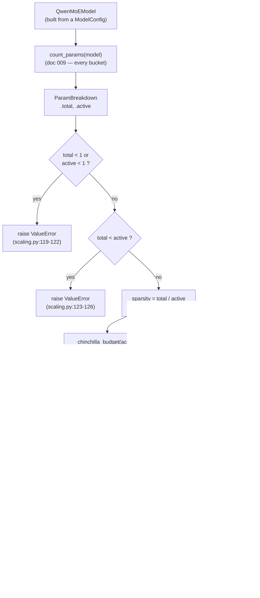
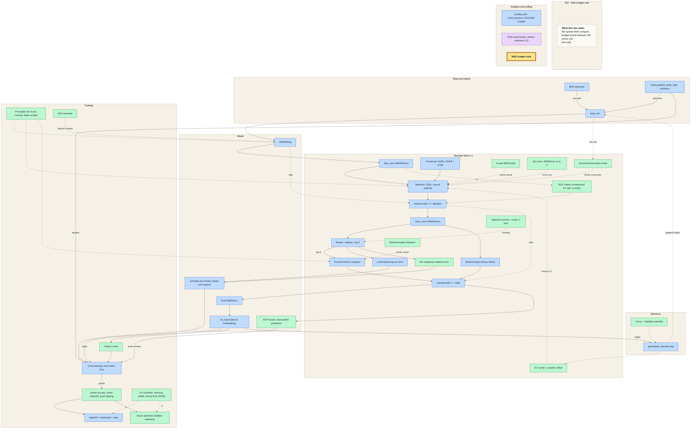

# 033 — The MoE budget note, solved by hand

**Companion to:** [`journey_of_a_model/033-ablation-menu-and-moe-budget-note.md`](../../journey_of_a_model/033-ablation-menu-and-moe-budget-note.md)
· **Code:** [`qwenmoe/train/scaling.py`](../../qwenmoe/train/scaling.py) (`moe_budget_note`, `chinchilla_budget`)
· **Every number here is reproduced by:** [`verify_033_ablation_menu_and_moe_budget_note.py`](verify_033_ablation_menu_and_moe_budget_note.py)
(`uv run python docs/math/verify_033_ablation_menu_and_moe_budget_note.py`)
· **Builds on:** [`009-scaling-law-utilities.md`](009-scaling-law-utilities.md) (`count_params`, `chinchilla_budget`, and its own short Part 7 on this same function) · [`journey_of_a_model/001-spec-approved.md`](../../journey_of_a_model/001-spec-approved.md) (the full Chinchilla $L(N,D)$ derivation)

---

## How to read this

Journal entry 033 describes three things: the ablation menu growing from 8
variants to 14, `run_comparison`'s new `train_overrides` parameter, and
`moe_budget_note`. The first two are software plumbing — a 4-tuple, a
`dataclasses.replace` call threading a `dict` of field overrides. There is
no arithmetic to solve by hand there, so this document does not cover
them; read the journal entry directly for those.

**This document is `moe_budget_note` alone** — nine lines of scalar
arithmetic and an f-string
([`scaling.py:103–141`](../../qwenmoe/train/scaling.py#L103)) — plus the
`chinchilla_budget` it calls twice
([`scaling.py:91–100`](../../qwenmoe/train/scaling.py#L91)). It is small,
but "small" is not the same as "shallow": the function's entire reason to
exist is a claim about *where a number must lie*, and that claim rests on
a real (if informal) argument about compute, capacity, and a 2022 paper.
This document derives that argument from first principles rather than
taking the docstring's word for it.

[`docs/math/009-scaling-law-utilities.md`](009-scaling-law-utilities.md)
already has a short treatment of this exact function, in its own Part 7 —
written as a rider on that document's larger tour of every helper in
`scaling.py`. That version states the sparsity ratio, the two bounds, and
moves on. This document is the expansion: every guard, every branch, the
full "why between, and why *these* two numbers bound it" argument, the
boundary case where the two bounds coincide exactly, and a reproduction of
this project's own real numbers (journal 033's own quoted paragraph,
regenerated byte for byte).

You do **not** need a linear-algebra background — this function barely
touches a matrix. What it does need is arithmetic on large plain integers
and one piece of unfamiliar vocabulary (`,`/`.1f` **format specifiers**,
defined in Part 4). Where a fact is already fully derived elsewhere in
this project (the $D\approx20N$ Chinchilla fit, `count_params`'s
per-bucket walk), this document restates the *result* compactly, cites
where the full derivation lives, and spends its own effort on what's new
here.

---

## Part 0 — What `moe_budget_note` is for, and where it sits

### 0.1 The one-sentence version

`chinchilla_budget(active_params)` returns a single number: `20 ×
active_params`, a reference count of training tokens. That formula was
fit on **dense** models — every one of whose parameters is used on every
token — so there was only one kind of "parameter count" to plug in. A
**Mixture-of-Experts (MoE)** model breaks that: a token only ever touches
a subset of the routed experts, so there are now *two* honest parameter
counts (`total` and `active`), and `20 × active_params` alone can no
longer claim to be *the* answer. `moe_budget_note` is the caveat: given
both counts, it says which of the two is a floor, which is a ceiling, and
names the paper that shows the true compute-optimal point lies strictly
between them.

### 0.2 Terms, defined before they're used

- A **parameter** is one learnable number inside the model — one entry of
  a weight matrix, or one slot of a normalization layer's gain vector.
  "Learnable" means gradient descent is allowed to change it during
  training.
- A model's **total parameter count** is every parameter it owns, full
  stop.
- A model's **active parameter count** is, per the exact phrasing in this
  project's own code
  ([`scaling.py:47–49`](../../qwenmoe/train/scaling.py#L47)), the subset
  that "mirrors exactly which weights a real forward pass multiplies
  against for one token." For a dense model these are the same number.
  For a routed MoE, `active < total` whenever the router selects fewer
  than all of the routed experts per token — see Part 3 for why this is a
  structural guarantee, not an empirical tendency.
- The **sparsity ratio** of a model is `total ÷ active` — how many times
  more parameters are installed than any single token's forward pass
  touches. A dense model has sparsity exactly $1$.
- A **token** is one chunk of text the model reads or predicts (a
  sub-word piece, for this project's BPE tokenizer). A **token budget** is
  how many next-token predictions a training run will be scored on in
  total — the $D$ in the formulas below.
- **FLOPs** (floating-point operations) is a count of individual
  add/multiply arithmetic operations. It is the currency `chinchilla_budget`'s
  underlying fit is denominated in (Part 2).

### 0.3 Where this sits in a real training run



`count_params` and `chinchilla_budget` are fully derived in doc 009; this
document begins at the point where two plain integers (`total`, `active`)
are already in hand, exactly the interface `moe_budget_note` consumes.

---

<!-- notation:start (generated by build_architecture_footer.py) -->
> **Notation note.** The series uses one symbol set ([canonical notation](README.md#canonical-notation)). In this doc, $E$ (routing context) stands for $N$ (`n_routed_experts`); the loss-surface constant $E$ of the Chinchilla fit is a different, unrelated $E$. Nothing below is changed; this only states the correspondence.
<!-- notation:end -->

## Part 1 — The running example

Because this function's entire domain is two plain integers, "the
smallest example that exercises every behavior" doesn't mean small
tensors — it means small, clean, *real* integers, chosen so the
arithmetic is checkable by eye rather than requiring a calculator for
every step. Three of this document's numbers are not invented for this
document at all — they are lifted verbatim from this project's own test
suite, which already treats them as the canonical cases:

| role | `total_params` | `active_params` | sparsity | source |
|---|---:|---:|---:|---|
| **main worked example** (sparse MoE branch) | $1{,}000{,}000$ | $250{,}000$ | $4.0\times$ | `tests/test_scaling.py::test_moe_budget_note_states_both_bounds_and_the_dense_constant` |
| near-dense branch | $101{,}000$ | $100{,}000$ | $1.01\times$ | `tests/test_scaling.py::test_moe_budget_note_near_dense_model_says_chinchilla_applies_directly` |
| guard: non-positive | $0$ | $10$ | — | `tests/test_scaling.py::test_moe_budget_note_rejects_invalid_args` |
| guard: non-positive | $100$ | $0$ | — | (same) |
| guard: `total < active` | $50$ | $100$ | — | (same) |

The **main worked example** — $\texttt{total\_params}=1{,}000{,}000$,
$\texttt{active\_params}=250{,}000$ — is what Part 2 through Part 5 carry
end to end. It is not a random round number: it is a $4\times$-sparse
model, deliberately in the same ballpark as this project's own real
`BASELINE` preset ($23{,}477{,}504$ total / $9{,}321{,}728$ active,
measured $2.52\times$ — see journal 033's own worked case, reproduced
independently in Part 8 below), just scaled to numbers you can multiply
by $20$ in your head. It also does not switch mid-document: every step
from here through Part 5 uses exactly these two numbers. Parts 6–8
introduce the near-dense case, the guards, and two real-model checks as
clearly separated *additional* scenarios, following the same "aside, not
a swap" pattern doc 025 uses for `LossFreeBalancer`'s bias — the main
thread is never revisited with different inputs partway through its own
derivation.

---

## Part 2 — `chinchilla_budget`, recapped and computed on this example

Source: [`scaling.py:91–100`](../../qwenmoe/train/scaling.py#L91).

```python
def chinchilla_budget(active_params: int) -> int:
    if active_params < 1:
        raise ValueError(f"active_params must be >= 1, got {active_params}")
    return 20 * active_params
```

### 2.1 Why $20\times$, in one page (full derivation: doc 009 §6.2 / journal 001)

Hoffmann et al. (2022) fit real training runs to a loss surface

$$L(N, D) = E + \frac{A}{N^{\alpha}} + \frac{B}{D^{\beta}}$$

where $N$ = parameter count, $D$ = training tokens, and $E,A,B,\alpha,\beta$
are constants fit to data. Training compute is approximately $C\approx6ND$
FLOPs (a standard rule of thumb: about $2$ FLOPs per parameter per token
for the forward pass, about $4$ more for the backward pass — used here as
given, not re-derived). Fixing $C$ and minimizing $L$ over the split
between $N$ and $D=C/(6N)$ gives, after setting the derivative to zero,

$$N^{*}\propto C^{\beta/(\alpha+\beta)}, \qquad D^{*}\propto C^{\alpha/(\alpha+\beta)}.$$

Hoffmann et al.'s fit came out with $\alpha\approx\beta$, so both
exponents are $\approx\tfrac12$ and the ratio $D^{*}/N^{*}$ is a constant
**independent of the compute budget** — that a single fixed ratio exists
at all is exact algebra given $\alpha=\beta$. The *value* of that ratio,
$\approx20$, is not derivable from theory; it is whatever the five fitted
constants came out to on Hoffmann et al.'s real experiments. `scaling.py`
hard-codes this fitted $20$ verbatim.

> **Exact:** a fixed $D/N$ ratio follows from $\alpha=\beta$ by calculus
> alone. **Empirical:** the ratio's value, $20$, and the premise
> $\alpha\approx\beta$ itself.

The guard `active_params < 1` rejects a model with no capacity at all — a
budget of $20\times0=0$ tokens is not a valid plan for anything.

### 2.2 Computed, on this document's own numbers

$$\texttt{chinchilla\_budget}(250{,}000) = 20\times250{,}000.$$

Digit by digit: $250{,}000\times20 = 250{,}000\times2\times10 =
500{,}000\times10 = 5{,}000{,}000$.

$$\texttt{chinchilla\_budget}(1{,}000{,}000) = 20\times1{,}000{,}000 = 20{,}000{,}000$$

(multiplying by $10^6$ just appends six zeros to $20$).

Verify-script output (verbatim):

```
================ Part 1 -- chinchilla_budget ================
  chinchilla_budget(250_000)   = 5,000,000
  chinchilla_budget(1_000_000) = 20,000,000
```

`moe_budget_note` will call this function twice — once on `active_params`
and once on `total_params` — and print both results as its two brackets.
This is why it doesn't inline `20 * total_params` itself: the "$20\times$
whatever you feed it" logic is `chinchilla_budget`'s, reused rather than
duplicated.

---

## Part 3 — Why `total ≥ active` is structural, not incidental

Before `moe_budget_note` can talk about "sparsity," it needs `total` and
`active` to stand in a fixed relationship — otherwise "floor" and
"ceiling" would be meaningless labels that could swap depending on the
model. This section proves `total ≥ active` always holds, using only this
project's own code, not a general claim about all possible MoE
implementations.

### 3.1 The proof

`count_params` (doc 009 §2) builds both numbers from the same four
buckets per layer:

$$\texttt{total} = \texttt{embedding} + \texttt{attention\_total} +
\underbrace{\sum_{\ell} \big(\text{moe\_norm}_\ell + \text{router}_\ell +
\text{shared}_\ell + E\cdot P_{\text{expert}}\big)}_{\texttt{moe\_total}}$$

$$\texttt{active} = \texttt{embedding} + \texttt{attention\_total} +
\underbrace{\sum_{\ell} \big(\text{moe\_norm}_\ell + \text{router}_\ell +
\text{shared}_\ell + k\cdot P_{\text{expert}}\big)}_{\texttt{moe\_active}}$$

where $E$ = `n_routed_experts`, $k$ = `top_k`, and $P_{\text{expert}}$ is
the (equal, by `build_expert`'s construction) parameter count of one
routed expert. The **embedding** and **attention** terms are identical in
both sums — attention is fully dense, so it has no "active" distinction
at all (doc 009 §Part 0's `ParamBreakdown` docstring makes this explicit).
The only term that differs is the last one inside the MoE bracket:
$E\cdot P_{\text{expert}}$ vs. $k\cdot P_{\text{expert}}$. Subtracting,

$$\texttt{total} - \texttt{active} = \sum_{\ell}(E-k)\cdot P_{\text{expert}} \;\ge\; 0
\iff E \ge k.$$

And $E\ge k$ is not merely typical — it is **enforced** at
`ModelConfig` construction time:
[`config.py:72–75`](../../qwenmoe/config.py#L72) raises `ValueError` the
moment `top_k > n_routed_experts`. So for every `QwenMoEModel` this
codebase can actually build, `total ≥ active` is guaranteed, with equality
**iff** $k=E$ (every routed expert fires on every token — the MoE
degenerates into an unconditionally-dense, wider FFN).

### 3.2 Confirmed on a real model, not just algebra

The verify script builds doc 009's exact tiny model
(`tests/test_scaling.py::_tiny_config`: $V{=}50,\ d{=}16,\ L{=}2,\
H{=}4,\ H_{kv}{=}2,\ d_{ff}{=}32,\ E{=}4,\ S{=}1$) twice — once at its
usual $k{=}2$, once with $k{=}4{=}E$ — and runs the real `count_params`
on both:

```
================ Part 5 -- sparsity >= 1 is structural ================
  top_k=2 (sparse): ParamBreakdown(embedding=816, attention_total=1568, moe_total=15520, moe_active=9376, total=17904, active=11760)
  top_k=4 (dense) : ParamBreakdown(embedding=816, attention_total=1568, moe_total=15520, moe_active=15520, total=17904, active=17904)
  sparsity top_k=2 = 1.5224x   (doc 009's own example)
  sparsity top_k=4 = 1.0000x
```

Exactly as §3.1 predicts: `total` is **untouched** by the `top_k` change
(both read $17{,}904$ — `top_k` never enters the `total` formula at all),
while `active` climbs from $11{,}760$ to $17{,}904$ to meet it, because
`moe_active`'s last term went from $2\times1536\times2\text{ layers}=6144$
to $4\times1536\times2=12288$ — precisely the $(E-k)\cdot P_{\text{expert}}
\cdot L = (4-2)\times1536\times2=6144$ gap closing to $0$.

### 3.3 Sparsity on the main example

$$\texttt{sparsity} = \frac{\texttt{total}}{\texttt{active}} =
\frac{1{,}000{,}000}{250{,}000}.$$

Long division: $250{,}000$ fits into $1{,}000{,}000$ exactly $4$ times
($250{,}000\times4 = 1{,}000{,}000$, remainder $0$), so
$\texttt{sparsity}=4.0$ **exactly** — no repeating decimal to round.

```
================ Part 2 -- moe_budget_note (4.0x sparse) ================
  sparsity = 1,000,000 / 250,000 = 4.0000x
```

---

## Part 4 — `moe_budget_note`, line by line

Source: [`scaling.py:103–141`](../../qwenmoe/train/scaling.py#L103).

```python
def moe_budget_note(total_params: int, active_params: int) -> str:
    if total_params < 1 or active_params < 1:
        raise ValueError(
            f"total_params and active_params must be >= 1, got {total_params}, {active_params}"
        )
    if total_params < active_params:
        raise ValueError(
            f"total_params ({total_params}) cannot be less than active_params ({active_params})"
        )
    sparsity = total_params / active_params
    active_ref = chinchilla_budget(active_params)
    total_ref = chinchilla_budget(total_params)
    if sparsity < 1.05:
        return (
            f"model is ~dense (total {total_params:,} ~= active {active_params:,}); "
            f"chinchilla_budget's 20 x active = {active_ref:,} tokens applies directly."
        )
    return (
        f"MoE sparsity: {active_params:,} active of {total_params:,} total "
        f"params ({sparsity:.1f}x). Chinchilla's 20x tokens/param is a DENSE-model "
        f"constant (total == active); for a sparse MoE the compute-optimal budget "
        f"lies between 20 x active = {active_ref:,} and 20 x total = {total_ref:,} tokens "
        f"(Clark et al. 2022). Use 20 x active as a floor, not the target."
    )
```

Feeding it `total_params=1_000_000, active_params=250_000`:

**`scaling.py:119`** — `total_params < 1 or active_params < 1`. $1{,}000{,}000\ge1$
and $250{,}000\ge1$: both false, guard passes. (Part 7 exercises the
`True` branch.)

**`scaling.py:123`** — `total_params < active_params`. $1{,}000{,}000 <
250{,}000$ is false (Part 3 guarantees it always will be, for any model
this codebase can build): guard passes.

**`scaling.py:127`** — `sparsity = total_params / active_params`. Python's
`/` is true (float) division, not integer floor division: $1{,}000{,}000 /
250{,}000 = 4.0$, a `float`, computed in Part 3.3.

**`scaling.py:128–129`** — two calls into the function derived in Part 2:
`active_ref = chinchilla_budget(250_000) = 5_000_000`,
`total_ref = chinchilla_budget(1_000_000) = 20_000_000`.

**`scaling.py:130`** — `if sparsity < 1.05`. $4.0 < 1.05$ is false, so
execution falls through to the second `return` — the sparse-MoE message.
(Part 6 walks the `True` branch on a different input; never on this one —
the two branches are mutually exclusive by construction, so no single
`(total, active)` pair can visit both.)

**`scaling.py:135–141`** — the f-string, built piece by piece. A
**format specifier** is the part after the `:` inside an f-string's
`{...}` — it controls *how* a value is rendered as text, not its value.
Two are used here:

- `{active_params:,}` — the `,` specifier inserts a comma every three
  digits: `250000` → `"250,000"`.
- `{sparsity:.1f}` — `.1f` renders a float with exactly one digit after
  the decimal point, rounding: `4.0` → `"4.0"`.

Substituting every placeholder with this example's numbers:

| placeholder | value | rendered |
|---|---:|---|
| `{active_params:,}` | $250{,}000$ | `250,000` |
| `{total_params:,}` | $1{,}000{,}000$ | `1,000,000` |
| `{sparsity:.1f}` | $4.0$ | `4.0` |
| `{active_ref:,}` | $5{,}000{,}000$ | `5,000,000` |
| `{total_ref:,}` | $20{,}000{,}000$ | `20,000,000` |

Assembled:

```
MoE sparsity: 250,000 active of 1,000,000 total params (4.0x). Chinchilla's
20x tokens/param is a DENSE-model constant (total == active); for a sparse
MoE the compute-optimal budget lies between 20 x active = 5,000,000 and
20 x total = 20,000,000 tokens (Clark et al. 2022). Use 20 x active as a
floor, not the target.
```

Verify-script output (verbatim, one physical line, wrapped above only for
display):

```
================ Part 2 -- moe_budget_note (4.0x sparse) ================
  sparsity = 1,000,000 / 250,000 = 4.0000x
  note: MoE sparsity: 250,000 active of 1,000,000 total params (4.0x). Chinchilla's 20x tokens/param is a DENSE-model constant (total == active); for a sparse MoE the compute-optimal budget lies between 20 x active = 5,000,000 and 20 x total = 20,000,000 tokens (Clark et al. 2022). Use 20 x active as a floor, not the target.
```

---

## Part 5 — Why *between*: deriving the bracket, not just quoting it

This is the part the code's docstring asserts but does not derive. Doing
so requires looking at what the dense-model derivation in Part 2 actually
assumed, and where a MoE breaks that assumption.

### 5.1 In a dense model, $N$ plays two roles at once — and that's *why* one clean ratio exists

Look back at Part 2's derivation. The symbol $N$ appears in **two
different places** with two different jobs:

1. Inside $L(N,D)=E+A/N^{\alpha}+B/D^{\beta}$, $N$ measures **capacity**
   — how well the model *could* fit the data, given enough of it. This is
   a claim about what training converges toward.
2. Inside $C\approx6ND$, $N$ measures **per-token compute** — literally
   how many multiply-adds one forward+backward pass costs, which is
   $\propto$ the number of parameters that pass actually touches.

For a dense model these two numbers are, by definition, the *same*
$N$ — every parameter is touched by every token, so "how much capacity do
I have" and "how much compute does using it cost" move in lockstep. That
lockstep is exactly what let Part 2 substitute $D=C/(6N)$ into $L(N,D)$
and solve for a single optimal $N^{*}$: there was only one unknown to
solve for, because $N$ never had to answer to two masters with different
answers.

### 5.2 A routed MoE splits those two roles apart

This project's own `count_params` docstrings already say, precisely,
which of `total`/`active` plays which of those two roles:

- **Compute role → `active`.** Per
  [`scaling.py:47–49`](../../qwenmoe/train/scaling.py#L47): "'Active'
  mirrors exactly which weights a real forward pass multiplies against
  for one token." A token's actual FLOPs are $\approx6\times
  \texttt{active}$ per token, *not* $6\times\texttt{total}$ — the
  $(E-k)$ unselected experts (Part 3) do zero arithmetic on that token.
- **Capacity role → somewhere at or above `total`, not `active` alone.**
  A token that is never routed to expert #7 still benefits from expert
  #7's *existence*, because on a different training step some other token
  *did* route there and updated it — the model's total learned
  representational capacity is not limited to what one token touches.
  Clark, de las Casas, Guy et al. (2022) make exactly this point their
  paper's headline: for routing networks, "parameter count and
  computational requirement form two independent axes along which an
  increase leads to better performance" (their abstract, verified below)
  — i.e. adding experts helps *even when the compute per token, active,
  is held fixed*. That would be impossible if capacity were bottlenecked
  by `active` alone.

So a routed MoE has **two different candidate values for $N$**, doing two
different jobs that a dense model's single $N$ used to do at once. Neither
one is simply "the" parameter count to hand to $D^{*}=20N$:

- **Plug in $N=\texttt{active}$ for *both* roles** (as if the extra
  `total − active` parameters didn't exist at all, not even for
  capacity): you get $D^{*}=20\times\texttt{active}$ — this document's
  `active_ref`. This **under**-counts, because it throws away the
  Clark-et-al. finding that those extra parameters *do* help, and a model
  that's actually going to exploit that extra capacity needs the gradient
  steps to train it — every expert, not just the ones any one token
  reaches, still needs to see enough data to converge.
- **Plug in $N=\texttt{total}$ for *both* roles** (as if a token's compute
  cost were $6\times\texttt{total}$): you get
  $D^{*}=20\times\texttt{total}$ — `total_ref`. This **over**-counts,
  because it manufactures a compute cost per token that never actually
  happens — by definition of "active" (§5.2, first bullet), no forward
  pass here ever multiplies against more than `active` parameters.

### 5.3 The honest answer needs a third quantity — which is what Clark et al. built, and why `moe_budget_note` doesn't compute it

The correct move is not to pick one of `active`/`total` for the capacity
role — it's to use some **effective** parameter count strictly between
them: large enough to credit the extra experts' real contribution to
capacity, but not so large as to imply a compute cost the model never
pays. Clark et al. (2022) derive exactly such a quantity, which they call
the **Effective Parameter Count** — a way to place any routed model on
the *same* performance-vs-size curve a dense model would trace out, fit
from "an extensive evaluation of Routing Networks across five orders of
magnitude of size, including models with hundreds of experts and hundreds
of billions of parameters" (their abstract, verified below).

`moe_budget_note` does not attempt to compute that quantity. Two honest
reasons, both stated in the code's own reasoning and this project's scale:

1. Clark et al.'s fit is calibrated on models from millions to hundreds of
   billions of parameters trained on hundreds of billions of tokens; this
   project's models (thousands to tens of millions of parameters, journal
   033's own `BASELINE` included) sit well below where that fit is known
   to be reliable.
2. Their paper (February 2022) predates Hoffmann et al.'s Chinchilla fit
   (March 2022) by weeks and was not itself framed as a token-budget
   recipe — it fixed every model's token count at $130$B and studied how
   *performance* varied with size and routing, not how to *choose* a
   token budget. Applying their Effective-Parameter-Count logic to
   Chinchilla's $D^{*}=20N$ formula is *this project's own* combination of
   the two results, not a claim either paper makes directly.

So instead of guessing a point value it can't defend, `moe_budget_note`
reports the two numbers it *can* defend exactly (`chinchilla_budget`
applied to each candidate $N$) and states, correctly, that the honest
answer is somewhere strictly inside that interval — "use `20 × active` as
a floor, not the target."

**Confirmed by direct search** (2026-09-13): Clark et al.'s abstract reads,
verbatim: *"For these models, parameter count and computational
requirement form two independent axes along which an increase leads to
better performance. [...] first deriving an Effective Parameter Count
along which all models scale at the same rate [...] Our analysis derives
from an extensive evaluation of Routing Networks across five orders of
magnitude of size, including models with hundreds of experts and hundreds
of billions of parameters."* (PMLR v162, `proceedings.mlr.press/v162/clark22a.html`).

---

## Part 6 — The near-dense branch, derived and computed

### 6.1 Why the branch exists at all

Once sparsity is close enough to $1$, Part 5's whole argument collapses:
if `active` ≈ `total`, then the "third quantity strictly between them"
Clark et al.'s Effective Parameter Count would land on is squeezed into a
range so narrow it's indistinguishable from either endpoint. Printing a
paragraph about "a floor and a ceiling that bracket a mystery point" would
be actively misleading when the floor and ceiling nearly coincide — the
honest thing to say is simply "these are basically the same number, use
the dense formula."

### 6.2 Why $1.05$, specifically — an engineering choice, not a derived constant

> **Empirical / arbitrary, marked as such by the code itself:** nothing
> in Chinchilla or in Clark et al. picks out $1.05$. It is a **materiality
> threshold** this project's authors chose: "close enough to dense that
> the MoE caveat isn't worth printing." A model that's $1\%$ sparse (one
> negligible always-on extra expert, say) is, for all practical training
> purposes, dense — nobody wants the elaborate two-bounds paragraph for
> that. A genuinely dense model (Part 3.2's $k=E$ case) gives sparsity
> **exactly** $1.0$, not merely "close to $1$" — so the slack is there to
> also catch models that are *almost* dense, not just to guard against
> floating-point noise from $1.0$ itself (that division is exact for
> integers here in any case). Any other small threshold ($1.02$, $1.1$)
> would serve the same purpose; $1.05$ is simply the number this project
> picked.

### 6.3 Computed on the near-dense example

$\texttt{total\_params}=101{,}000$, $\texttt{active\_params}=100{,}000$.

$$\texttt{sparsity} = \frac{101{,}000}{100{,}000} = 1.01.$$

$1.01 < 1.05$ is **true**, so `moe_budget_note` takes the first `return`
branch (`scaling.py:131–134`) this time, not the one Part 4 walked:

```python
return (
    f"model is ~dense (total {total_params:,} ~= active {active_params:,}); "
    f"chinchilla_budget's 20 x active = {active_ref:,} tokens applies directly."
)
```

Only `chinchilla_budget(active_params)` is used here — `total_ref` was
still computed at `scaling.py:129` (both calls happen before the branch),
but this return statement never reads it. $\texttt{chinchilla\_budget}(100{,}000)
= 20\times100{,}000 = 2{,}000{,}000$.

Verify-script output (verbatim):

```
================ Part 3 -- moe_budget_note (1.01x near-dense) ================
  sparsity = 101,000 / 100,000 = 1.0100x  (< 1.05 -> other branch)
  note: model is ~dense (total 101,000 ~= active 100,000); chinchilla_budget's 20 x active = 2,000,000 tokens applies directly.
```

---

## Part 7 — The guards, derived and demonstrated

### 7.1 `scaling.py:119` — non-positive counts

`total_params < 1 or active_params < 1` rejects a "model" with zero or
negative parameters in either count. Zero active parameters means the
model does no computation on any token at all; a negative count cannot
correspond to any real tensor's `.numel()`. Either would make
`chinchilla_budget` return $0$ or a negative number — not a valid token
budget for anything.

### 7.2 `scaling.py:123` — `total < active`

Part 3.1 proved `total ≥ active` is a structural guarantee for every
`QwenMoEModel` this codebase can construct (`config.py`'s own
`top_k ≤ n_routed_experts` guard makes it so). If a caller ever passes
`total < active` anyway, that isn't a valid-but-unusual model — it's
**definitionally impossible** given what `active`/`total` mean (a token
cannot touch *more* parameters than the model owns), so this is a
programmer-error guard, not a modeling one: it protects against a caller
accidentally swapping the two arguments.

### 7.3 All three, on the real function

```
================ Part 4 -- guards ================
  moe_budget_note(0, 10) -> ValueError: total_params and active_params must be >= 1, got 0, 10
  moe_budget_note(100, 0) -> ValueError: total_params and active_params must be >= 1, got 100, 0
  moe_budget_note(50, 100) -> ValueError: total_params (50) cannot be less than active_params (100)
```

`(0, 10)` and `(100, 0)` both hit `scaling.py:119`'s `or` — either
non-positive count alone is enough, and the f-string always reports
*both* values (`got {total_params}, {active_params}`) regardless of which
one triggered it, so `(100, 0)`'s message names $100$ even though
`total_params` itself was fine — a small but deliberate readability
choice: you see both inputs, not just the offending one.

`(50, 100)` passes the first guard ($50\ge1$ and $100\ge1$) and fails the
second (`50 < 100`), reporting the exact numbers in the order the caller
gave them.

---

## Part 8 — Grounded in this project's own real model

Every number so far was chosen for hand-arithmetic clarity. This part
closes the loop back to journal 033's own motivating case, run through
the real, unmodified pipeline `scripts/train.py:174–177` uses.

### 8.1 The real `BASELINE` preset

[`configs/presets.py:15–26`](../../configs/presets.py#L15) — $V{=}4096,\
d{=}256,\ L{=}6,\ H{=}8,\ H_{kv}{=}4,\ d_{ff}{=}512,\ E{=}8,\ S{=}1,\
k{=}2$. Building the real `QwenMoEModel` and running the real
`count_params` on it:

```
================ Part 6 -- BASELINE (journal 033's own numbers) ================
  ParamBreakdown(embedding=1048832, attention_total=1181184, moe_total=21247488, moe_active=7091712, total=23477504, active=9321728)
  sparsity = 23,477,504 / 9,321,728 = 2.5186x
  note: MoE sparsity: 9,321,728 active of 23,477,504 total params (2.5x). Chinchilla's 20x tokens/param is a DENSE-model constant (total == active); for a sparse MoE the compute-optimal budget lies between 20 x active = 186,434,560 and 20 x total = 469,550,080 tokens (Clark et al. 2022). Use 20 x active as a floor, not the target.
```

$9{,}321{,}728$ active, $23{,}477{,}504$ total — matching journal 033's
own reported figures exactly. The printed `note` string above is, byte
for byte, journal 033's own quoted paragraph (`journey_of_a_model/033-ablation-menu-and-moe-budget-note.md:189–193`)
— the verify script asserts this equality directly rather than merely
eyeballing it. This closes the "no fabricated numbers" loop for the
journal entry itself, not just for this document's own worked examples.

### 8.2 Sanity: BASELINE's sparsity, by the same long-division method as Part 3.3

$$\frac{23{,}477{,}504}{9{,}321{,}728}: \quad 9{,}321{,}728\times2 =
18{,}643{,}456,\ \text{remainder } 4{,}834{,}048;\quad
4{,}834{,}048 / 9{,}321{,}728 \approx 0.5186.$$

So $\texttt{sparsity}\approx2.5186$, which `{:.1f}` rounds to `"2.5x"` —
matching the printed note. (Journal 033's own prose separately rounds
this to "$2.52\times$" using more decimal places; both are the same
number, $23{,}477{,}504/9{,}321{,}728$, reported at different precision.)

---

## Part 9 — Why built this way, quantified on this document's own numbers

**Zero training-time cost.** `moe_budget_note` runs once, at startup,
after `count_params` has already walked the model (`scripts/train.py:174–177`).
Its own body is nine lines of scalar arithmetic — two multiplications
(inside the two `chinchilla_budget` calls), one division, one comparison,
one string format. On any of this document's examples that's
microseconds against a training run measured in hours; it is not a
candidate for optimization and has no fused/alternate implementation to
reconcile against (unlike, say, the batched-vs-explicit MoE kernels in
doc 027).

**Threshold on the *ratio*, not the raw gap.** Comparing `sparsity < 1.05`
rather than, say, `total - active < some_count` is what makes the
near-dense check scale-invariant: a $1$M-active model with $50$K extra
parameters ($1.05\times$) and a $1$K-active model with $50$ extra
($1.05\times$) both sit at exactly the boundary, even though their raw
gaps differ by three orders of magnitude — because "is this practically
dense" is a question about proportion, not absolute count.

**Two numbers, not a point estimate, and not just two numbers either.**
Compare what each of this document's three worked notes actually
communicates:

| example | sparsity | what the note says |
|---|---:|---|
| main ($1$M / $250$K) | $4.0\times$ | bracket: $[5{,}000{,}000,\ 20{,}000{,}000]$ tokens, "floor not target" |
| near-dense ($101$K / $100$K) | $1.01\times$ | single number: $2{,}000{,}000$ tokens, "applies directly" |
| `BASELINE` ($23.5$M / $9.3$M) | $2.52\times$ | bracket: $[186{,}434{,}560,\ 469{,}550{,}080]$ tokens |

A function returning a single number (say, the midpoint of the bracket)
would let a caller `print(budget)` and move on — implicitly asserting a
precision this project's own reasoning (Part 5.3) explicitly disclaims.
Returning the *reasoning*, in words, forces every caller to see the same
caveat journal 033's Q&A section makes explicit: "there's no single right
number at this project's scale... the note exists to stop someone typing
`20 * total_params` and calling it Chinchilla."

---

## Questions that might come to mind

- **Could `moe_budget_note` just check `total == active` instead of a
  `< 1.05` slack?** It could, but that would only catch the Part 3.2 case
  ($k=E$) exactly — a model with, say, one shared expert added on top of
  an otherwise-tiny routed set (sparsity $1.02\times$) is dense *in every
  practical sense* but would never hit `total == active` bit-for-bit. The
  slack is there precisely to cover that near-miss zone, not just the
  exact-equality case.

- **Does the branch order matter — could `sparsity < 1.05` and the
  "sparse" `return` ever both fire?** No: `if/return` short-circuits — the
  function returns from whichever branch's condition is true and never
  reaches the other `return` at all. Part 4 and Part 6 walk the two
  branches on two different inputs precisely because no single
  `(total, active)` pair can visit both.

- **`total_ref` is computed at `scaling.py:129` even on the near-dense
  path, where it's never used (Part 6.3). Is that wasted work?** Yes,
  technically — one extra multiplication that gets thrown away. It is
  also completely immaterial (a single `int * int`) next to the training
  run it's printed alongside, and computing both unconditionally before
  branching is simpler to read than duplicating the branch logic to skip
  one call.

- **Why does the sparse-branch message list `active` before `total` in
  its first clause ("`{active_params:,} active of {total_params:,}
  total`") but the near-dense message lists `total` first ("`total
  {total_params:,} ~= active {active_params:,}`")?** They're answering
  different questions. The sparse message's opening clause is "how much
  of what's installed gets used" — active-of-total reads naturally in
  that order (compare: "9,321,728 active of 23,477,504 total"). The
  near-dense message is asserting an approximate *equality*
  (`total ~= active`), and equalities conventionally read
  larger/first-computed side first.

- **This document derives a "third quantity between the two bounds"
  argument (Part 5) that goes further than the code's own docstring. Is
  that derivation itself something the code asserts?** No — the code's
  docstring states the conclusion (the bracket, and the citation) without
  walking through *why* a routed model needs a third quantity at all.
  Part 5.1–5.3's "$N$ splits into two roles" framing is this document's
  own reconstruction of the reasoning, built from facts each independently
  verifiable in this codebase (the `count_params` docstring, the
  `config.py` guard) and the paper's own confirmed abstract — not a
  quotation from either the code or the paper.

- **The paper is titled `Unified Scaling Laws`, and this document quotes
  its abstract rather than a specific numbered equation for the "between"
  claim — why not cite the exact formula?** Because the paper's Effective
  Parameter Count is defined by a multi-parameter fit (exponents that
  themselves depend on the routing architecture and expert count) that
  isn't reproducible from the abstract alone, and this project's own
  scale sits far outside where the fit was calibrated (Part 5.3) — citing
  a specific equation here would imply a precision `moe_budget_note`
  itself deliberately avoids claiming. The abstract's plain-English claim
  ("two independent axes") is the part load-bearing for *this* function's
  design, and it's the part directly verified.

---

## Symbol reference

| symbol | meaning |
|---|---|
| $N$ | parameter count, in the general Chinchilla derivation (Part 2, Part 5.1) |
| $D$ | training token budget |
| $C$ | training compute, in FLOPs, $\approx 6ND$ |
| $E, A, B, \alpha, \beta$ | Hoffmann et al.'s fitted loss-surface constants |
| `total_params` / $\texttt{total}$ | every parameter the model owns |
| `active_params` / $\texttt{active}$ | the subset one token's forward pass actually multiplies against |
| `sparsity` | $\texttt{total}/\texttt{active}$, always $\ge1$ for this codebase's models (Part 3) |
| `active_ref` | `chinchilla_budget(active_params)` $= 20\times\texttt{active}$ — the floor |
| `total_ref` | `chinchilla_budget(total_params)` $= 20\times\texttt{total}$ — the ceiling |
| $E$ (routing context) | `n_routed_experts` — do not confuse with the loss-surface constant $E$ above; each use is scoped to its own section |
| $k$ | `top_k`, experts actually selected per token, $k \le E$ enforced by `config.py` |
| $P_{\text{expert}}$ | parameter count of one routed expert (equal across experts, by construction) |
| format specifier | the `:...` suffix inside an f-string `{...}`, controlling how a value renders as text (`,` = thousands separator, `.1f` = one decimal place) |

---

## Citations

All links verified by web search on 2026-09-13.

- [Training Compute-Optimal Large Language Models (Hoffmann, Borgeaud,
  Mensch, Buchatskaya, Cai, … Sifre, 2022)](https://arxiv.org/abs/2203.15556)
  — arXiv:2203.15556. The "Chinchilla" paper: fits $L(N,D)$ on real
  training runs and derives the compute-optimal $D\approx20N$ ratio for
  **dense** models that `chinchilla_budget` implements directly and
  `moe_budget_note` qualifies for the sparse case. Confirmed finding: "for
  compute-optimal training, the model size and the number of training
  tokens should be scaled equally."
- [Unified Scaling Laws for Routed Language Models (Clark, de las Casas,
  Guy, Mensch, Paganini, Hoffmann, … Simonyan, ICML 2022 /
  PMLR v162)](https://arxiv.org/abs/2202.01169) — arXiv:2202.01169,
  published at ICML 2022 (confirmed via `proceedings.mlr.press/v162/clark22a.html`).
  Confirmed abstract text: "parameter count and computational requirement
  form two independent axes along which an increase leads to better
  performance," and the derivation of an "Effective Parameter Count along
  which all models scale at the same rate," evaluated "across five orders
  of magnitude of size, including models with hundreds of experts and
  hundreds of billions of parameters." This paper predates Chinchilla by
  roughly a month and does not itself frame a token-budget recipe (it
  fixes token count at 130B across its own experiments) — the bracket
  `moe_budget_note` prints is this project's own application of its
  Effective-Parameter-Count argument to Hoffmann et al.'s $D\approx20N$
  formula (derived in full in Part 5 above), not a direct quotation from
  either paper.

<!-- arch-evolution:start (generated by build_architecture_footer.py; do not edit by hand) -->

---

## Where this fits in the architecture (the growing view)

← previous: [032 Multi-seed and param-matched ablations](032-multi-seed-and-param-matched-ablations.md) · next: [034 Modernized presets](034-modernized-presets.md) →

**This doc adds to the architecture:** the sparse-MoE compute-budget bound between 20x active and 20x total. (Code: `qwenmoe/train/scaling.py`.)

**Components introduced here (highlighted in the diagram), with where each one lives:**

| component | math doc (section) | journal | code |
|---|---|---|---|
| MoE budget note | [033 · Part 4 — moe_budget_note, line by line](033-ablation-menu-and-moe-budget-note.md#part-4--moe_budget_note-line-by-line) | [journal 033](../../journey_of_a_model/033-ablation-menu-and-moe-budget-note.md) | [`qwenmoe/train/scaling.py:103`](../../qwenmoe/train/scaling.py#L103) |

**Verified by:** [`verify_033_ablation_menu_and_moe_budget_note.py`](verify_033_ablation_menu_and_moe_budget_note.py) (`uv run python docs/math/verify_033_ablation_menu_and_moe_budget_note.py`); latest results in [verify-status.md](verify-status.md).

**Example continuity:** Reuses 009's parameter counts for its model and otherwise pure arithmetic. See the [example-family map](README.md#which-example-does-each-doc-use).

The diagram is cumulative: every box derived by this doc or an earlier one is shown, and components from later docs are not drawn yet, so reading the docs in order replays how the architecture grew. The top box is this doc's title and what it adds. The [full final architecture](architecture-evolution.md) has everything.

**Colour key:** 🟨 **introduced by this doc** · 🟦 Foundation (004-011) · 🟩 Modernization (016-031) · 🟪 Evaluation and scale (032-038) · 🟧 Real data and hardware (039-044). Dotted lines are optional or alternative paths.



**How we got here (every doc up to and including this one):**

| | math doc | journal | what it added |
|---|---|---|---|
|  | [004 Attention (GQA)](004-attention-gqa.md) | [journal](../../journey_of_a_model/004-attention-gqa.md) | scaled dot-product attention with grouped K/V heads, the positional transform and the causal mask |
|  | [005 MoE layer](005-moe-layer.md) | [journal](../../journey_of_a_model/005-moe-layer.md) | the router, top-k selection, routed SwiGLU experts, the shared expert and the load-balancing aux loss |
|  | [006 Full model](006-full-model-assembly.md) | [journal](../../journey_of_a_model/006-full-model-assembly.md) | token embedding, pre-norm residual wiring, the final norm, the tied head and the cross-layer aux-loss combine; attention and MoE appear here as black boxes |
|  | [007 Tokenizers](007-tokenizers.md) | [journal](../../journey_of_a_model/007-tokenizers.md) | text to `input_ids`: byte-level BPE and the char tokenizer |
|  | [008 Data pipeline](008-data-pipeline.md) | [journal](../../journey_of_a_model/008-data-pipeline.md) | packing documents, train/val split, fixed slices and the shifted `(x, y)` windows |
|  | [009 Scaling utilities](009-scaling-law-utilities.md) | [journal](../../journey_of_a_model/009-scaling-law-utilities.md) | parameter counting (total vs active), the compute-optimal budget and throughput calibration |
|  | [010 Training loop](010-training-loop.md) | [journal](../../journey_of_a_model/010-training-loop.md) | the next-token cross-entropy loss, backward pass and AdamW step, carried through a real `Trainer.fit` |
|  | [011 Inference and generation](011-inference-generation.md) | [journal](../../journey_of_a_model/011-inference-generation.md) | the autoregressive decode loop (greedy, temperature, top-k, top-p) |
|  | [016 MLA attention](016-mla-attention.md) | [journal](../../journey_of_a_model/016-mla-attention.md) | Multi-Head Latent Attention: K/V compressed to a small latent, an alternative to GQA |
|  | [018 Optimizer hardening](018-optimizer-hardening.md) | [journal](../../journey_of_a_model/018-optimizer-hardening.md) | param groups (decay vs no-decay), tuned AdamW and gradient clipping |
|  | [019 LR schedule (WSD)](019-lr-schedule-wsd.md) | [journal](../../journey_of_a_model/019-lr-schedule-wsd.md) | warmup, stable and decay phases with a non-zero floor |
|  | [020 Muon optimizer](020-muon-optimizer.md) | [journal](../../journey_of_a_model/020-muon-optimizer.md) | orthogonalized momentum for the hidden weight matrices, AdamW for the rest |
|  | [021 Fused attention (SDPA)](021-fused-attention-sdpa.md) | [journal](../../journey_of_a_model/021-fused-attention-sdpa.md) | `F.scaled_dot_product_attention` as a drop-in for the explicit path |
|  | [022 QK-norm](022-qk-norm.md) | [journal](../../journey_of_a_model/022-qk-norm.md) | RMSNorm on each head's q and k before the scores, bounding the attention logits |
|  | [023 Principled init](023-principled-initialization.md) | [journal](../../journey_of_a_model/023-principled-initialization.md) | truncated-normal init and depth-aware scaling of the residual-writing projections |
|  | [024 Mixed precision and z-loss](024-mixed-precision-and-z-loss.md) | [journal](../../journey_of_a_model/024-mixed-precision-and-z-loss.md) | bf16 autocast for the forward pass and the output z-loss regularizer |
|  | [025 Sigmoid routing and router z-loss](025-moe-routing-sigmoid-and-router-z-loss.md) | [journal](../../journey_of_a_model/025-moe-routing-sigmoid-and-router-z-loss.md) | sigmoid expert scoring, the router z-loss and the config-driven aux weight |
|  | [026 Per-sequence balance loss](026-per-sequence-balance-loss.md) | [journal](../../journey_of_a_model/026-per-sequence-balance-loss.md) | DeepSeek-V3's complementary balance loss computed per sequence |
|  | [027 Batched expert dispatch](027-batched-expert-computation.md) | [journal](../../journey_of_a_model/027-batched-expert-computation.md) | run all experts in one batched op instead of a Python loop |
|  | [028 Multi-Token Prediction](028-multi-token-prediction.md) | [journal](../../journey_of_a_model/028-multi-token-prediction.md) | extra heads predicting tokens further ahead, chained causally |
|  | [029 KV cache](029-kv-cache.md) | [journal](../../journey_of_a_model/029-kv-cache.md) | append-and-reuse of K/V, the position offset and the mask that makes cached decoding exact |
|  | [030 Sampling controls](030-min-p-and-repetition-penalty.md) | [journal](../../journey_of_a_model/030-min-p-and-repetition-penalty.md) | min-p sampling and the repetition penalty |
|  | [031 Document-boundary masking](031-document-boundaries.md) | [journal](../../journey_of_a_model/031-document-boundaries.md) | stop attention crossing `<eos>` boundaries inside a packed sequence |
|  | [032 Multi-seed and param-matched ablations](032-multi-seed-and-param-matched-ablations.md) | [journal](../../journey_of_a_model/032-multi-seed-and-param-matched-ablations.md) | noise bands over seeds and bisecting `d_ff` to match parameter counts |
| **▶** | [033 MoE budget note](033-ablation-menu-and-moe-budget-note.md) | [journal](../../journey_of_a_model/033-ablation-menu-and-moe-budget-note.md) | the sparse-MoE compute-budget bound between 20x active and 20x total |

<!-- arch-evolution:end -->
