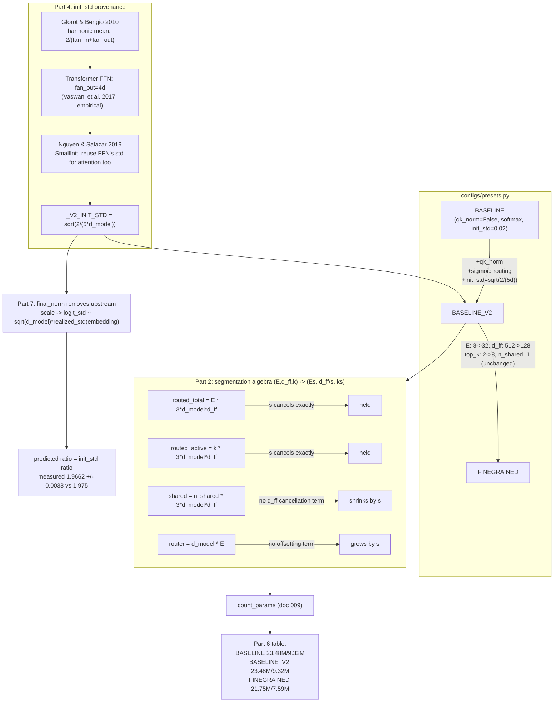
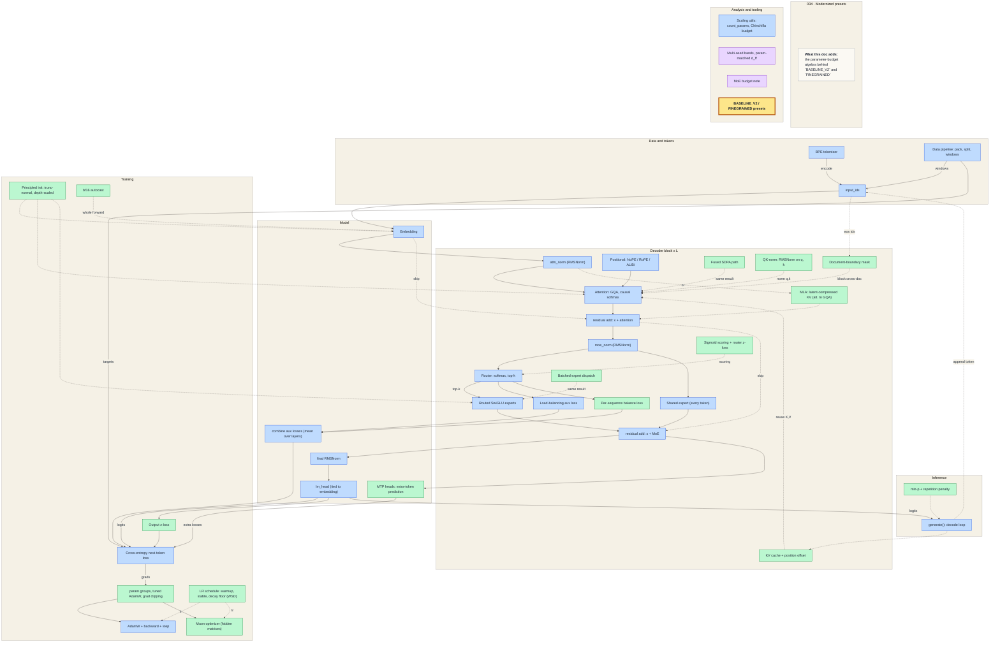

# 034 — `BASELINE_V2` and `FINEGRAINED`: the parameter-budget algebra, solved by hand

**Companion to:** [`journey_of_a_model/034-modernized-presets.md`](../../journey_of_a_model/034-modernized-presets.md)
· **Code:** [`configs/presets.py`](../../configs/presets.py) (`BASELINE_V2`, `FINEGRAINED`) · [`qwenmoe/model/moe.py`](../../qwenmoe/model/moe.py) (`SwiGLUExpert`, `Router`, `MoELayer`) · [`qwenmoe/model/transformer.py`](../../qwenmoe/model/transformer.py) (`_init_weights`) · [`qwenmoe/train/scaling.py`](../../qwenmoe/train/scaling.py) (`count_params`)
· **Every number here is reproduced by:** [`verify_034_modernized_presets.py`](verify_034_modernized_presets.py)
(`uv run python docs/math/verify_034_modernized_presets.py`)
· **Builds on:** [`009-scaling-law-utilities.md`](009-scaling-law-utilities.md) (`count_params`'s per-bucket walk) · [`022-qk-norm.md`](022-qk-norm.md) · [`023-principled-initialization.md`](023-principled-initialization.md) (the `_trunc_normal_`/residual-scaling machinery, and §5.5's untrained-logit-std formula, reused in Part 7) · [`025-moe-routing-sigmoid-and-router-z-loss.md`](025-moe-routing-sigmoid-and-router-z-loss.md)

---

## How to read this

Journal entry 034 is a **decision** entry, not a task entry: it adds two
`dataclasses.replace` calls (`configs/presets.py:107–126`) and spends its
words on *why* three axes went into `BASELINE_V2` and one more went into
`FINEGRAINED`. Three of those four axes already have a full by-hand
derivation elsewhere in this folder:

| axis | full derivation |
|---|---|
| `qk_norm=True` | [`022-qk-norm.md`](022-qk-norm.md) |
| `router_scoring="sigmoid"` | [`025-moe-routing-sigmoid-and-router-z-loss.md`](025-moe-routing-sigmoid-and-router-z-loss.md) |
| the `_trunc_normal_`/residual-scaling machinery `init_std` plugs into | [`023-principled-initialization.md`](023-principled-initialization.md) |

This document does not re-derive those three — Part 5 recaps each in one
paragraph, with a pointer. What it *does* derive, from scratch, is
everything journal 034 states but doesn't show the arithmetic for:

1. **Where the exact formula `sqrt(2/(5·d_model))` comes from** (Part 4) —
   doc 023 derives the machinery this constant feeds *into* (the
   `1/sqrt(2·n_layers)` residual scaling), but not this constant's own
   origin. It traces to Glorot & Bengio (2010) plus one architectural
   convention borrowed from a paper that isn't this project's own shape.
2. **Why `FINEGRAINED`'s parameter budget comes out held in some places
   and not others** (Part 2) — the general algebra of DeepSeekMoE's
   fine-grained expert segmentation, proved once and then applied to real
   numbers, on the real module.
3. **A quantitative reading of "more flexible combination of activated
   experts"** (Part 3) — the paper's own phrase, turned into an actual
   count.
4. **Why the untrained-logit-std column in journal 034's own table reads
   `0.284 → 0.558 → 0.557`** (Part 7) — doc 023 §5.5 already has the
   formula; this document is the first place that applies it to *predict*
   a specific ratio between two configs, and checks the prediction against
   the real presets rather than just quoting the numbers.

You do not need a linear-algebra background. Every term (parameter, weight
matrix, fan-in/fan-out, combination, variance, standard deviation) is
defined at first use in Part 0.

---

## Part 0 — Terms, defined before they're used

- A **parameter** is one learnable number the model owns — one entry of a
  weight matrix. "Learnable" means gradient descent may change it.
- A **weight matrix** is a rectangular grid of parameters; an `(m, n)`
  matrix has `m` rows and `n` columns and `m·n` entries.
- A **linear layer** `nn.Linear(in_features, out_features, bias=False)`
  holds one weight matrix of shape `(out_features, in_features)` — hence
  `in_features · out_features` parameters — and computes `y = W x`, one
  dot product per output entry (a dot product is a sum of elementwise
  products; see docs 004/009 if this is unfamiliar). This project's
  experts and router use `bias=False` throughout, so there is no separate
  bias vector to count.
- **`fan_in`** / **`fan_out`** are a linear layer's input and output
  widths — `in_features` and `out_features` above.
- An **expert** (here) is one small feed-forward network — see the
  `SwiGLUExpert` definition in Part 1. A Mixture-of-Experts (MoE) layer
  holds many of them; **routed** experts are chosen per-token by a
  **router**, a linear layer producing one score per expert; **shared**
  experts run for every token unconditionally. **`top_k`** (written `k`
  below) is how many routed experts a token's forward pass actually uses.
- The **segmentation factor** `s` (this document's own name for the
  variable DeepSeekMoE calls `m`) is the integer by which `FINEGRAINED`
  multiplies the expert count and divides each expert's width.
- **`n choose k`**, written $\binom{n}{k}$, counts how many distinct
  `k`-element subsets a set of `n` items has, with order not mattering.
  Derived in Part 3.
- A **factorial** $n! = n\times(n-1)\times\cdots\times1$ (and $0!=1$) counts
  the number of orderings of $n$ distinct items.
- **Variance** of a random quantity is the average squared distance from
  its own mean — $\mathrm{Var}(X)=E[(X-E[X])^2]$; **standard deviation**
  (std) is variance's square root, in the same units as the quantity
  itself. A **truncated normal** distribution is a normal (bell-curve)
  distribution with its tails clipped off past some cutoff and the
  remaining mass re-normalized to still sum to 1.
- Two weights are **tied** when they are, literally, the same tensor
  object in memory (`a is b` in Python), so a gradient step through either
  name updates the same numbers.
- **RMSNorm** (root-mean-square normalization) rescales a vector so its
  root-mean-square is a fixed target (1, before the learnable gain) —
  full derivation in doc 006; recapped where used in Part 6.

---

<!-- notation:start (generated by build_architecture_footer.py) -->
> **Notation note.** The series uses one symbol set ([canonical notation](README.md#canonical-notation)). In this doc, $E$ stands for $N$ (`n_routed_experts`). Nothing below is changed; this only states the correspondence.
<!-- notation:end -->

## Part 1 — The running example

`FINEGRAINED`'s change has no dedicated derivation anywhere in this
project, and its entire content is a claim about parameter *counts*, not
about forward-pass numerics (docs 005/025/027 already own the routing
arithmetic; nothing about *how* a token picks or combines experts changes
here — only *how many* experts there are and *how wide* each one is). So
"the smallest example that exercises every behavior" means the smallest
**real** `MoELayer` at two granularities, built with the exact same ratios
`configs/presets.py:120–126` uses — not invented shapes.

| | routed experts $E$ | expert width $d_\text{ff}$ | `top_k` $k$ | shared experts | $d_\text{model}$ |
|---|---:|---:|---:|---:|---:|
| **BASELINE-analog** | 2 | 8 | 1 | 1 | 4 |
| **FINEGRAINED-analog** | 8 | 2 | 4 | 1 | 4 |

The second row is the first with segmentation factor $s=4$: $E\to Es$,
$d_\text{ff}\to d_\text{ff}/s$, $k\to ks$ — exactly `configs/presets.py`'s
own $8\to32$ / $512\to128$ / $2\to8$, all ratio $4$. Both are built as a
real one-layer `QwenMoEModel` (`torch.manual_seed(0)`, `init_std=0.02`),
so every weight below is a genuine `_trunc_normal_`-initialized tensor
(`transformer.py:28–31`, `:75–89`), not hand-picked.

### 1.1 The BASELINE-analog expert: `SwiGLUExpert(d_model=4, d_ff=8)`

Source: [`moe.py:18–29`](../../qwenmoe/model/moe.py#L18).

```python
class SwiGLUExpert(nn.Module):
    def __init__(self, d_model: int, d_ff: int):
        super().__init__()
        self.w_gate = nn.Linear(d_model, d_ff, bias=False)
        self.w_up = nn.Linear(d_model, d_ff, bias=False)
        self.w_down = nn.Linear(d_ff, d_model, bias=False)

    def forward(self, x: torch.Tensor) -> torch.Tensor:
        return self.w_down(F.silu(self.w_gate(x)) * self.w_up(x))
```

Three weight matrices, shapes `(d_ff, d_model)`, `(d_ff, d_model)`,
`(d_model, d_ff)` — `nn.Linear(in, out)` stores its weight as `(out, in)`.
`routed_experts[0]`'s real values (verify-script output, verbatim):

```
routed_experts[0].w_gate (8, 4) = 32 numbers:
tensor([[-0.0249,  0.0199, -0.0141,  0.0230],
        [-0.0110,  0.0163,  0.0237, -0.0088],
        [-0.0086, -0.0095,  0.0065, -0.0195],
        [ 0.0160, -0.0115,  0.0041,  0.0043],
        [ 0.0191,  0.0147, -0.0291, -0.0323],
        [-0.0035,  0.0125, -0.0338,  0.0164],
        [-0.0078,  0.0256,  0.0103,  0.0070],
        [-0.0208, -0.0192,  0.0184,  0.0098]], requires_grad=True)
routed_experts[0].w_up   (8, 4) = 32 numbers:
tensor([[ 0.0141,  0.0006, -0.0171,  0.0108],
        [-0.0105, -0.0266,  0.0309,  0.0082],
        [-0.0190,  0.0105,  0.0120, -0.0082],
        [ 0.0091, -0.0078,  0.0104, -0.0041],
        [-0.0020,  0.0097,  0.0142,  0.0009],
        [-0.0088, -0.0135,  0.0348, -0.0188],
        [-0.0213, -0.0046, -0.0251,  0.0111],
        [ 0.0032,  0.0205,  0.0246, -0.0000]], requires_grad=True)
routed_experts[0].w_down (4, 8) = 32 numbers:
tensor([[ 0.0104, -0.0021, -0.0100,  0.0066,  0.0039,  0.0189,  0.0163, -0.0008],
        [ 0.0061, -0.0132, -0.0213,  0.0015,  0.0215,  0.0052,  0.0202,  0.0052],
        [ 0.0238,  0.0143,  0.0088,  0.0105,  0.0223, -0.0044,  0.0212,  0.0142],
        [-0.0203,  0.0006, -0.0233, -0.0207,  0.0050, -0.0015, -0.0105,  0.0164]],
       requires_grad=True)
```

Every one of these $96$ entries satisfies
$|w|\le2\times\text{init\_std}=0.04$ (measured max $0.0338$) — the
`±2σ` truncation `_trunc_normal_` enforces (doc 023 Part 2 derives the
realized-std factor this induces; not needed again here, only the *bound*
is used below).

`router.gate` (`Router(d_model=4, n_routed_experts=2)`,
[`moe.py:72–84`](../../qwenmoe/model/moe.py#L72)):

```
router.gate: (2, 4) 8 numbers
tensor([[ 0.0153, -0.0182, -0.0146,  0.0190],
        [-0.0022,  0.0232, -0.0183,  0.0319]], requires_grad=True)
```

`shared_experts[0]` is another `SwiGLUExpert(4, 8)` — same shapes as
`routed_experts[0]` above, different draw (`MoELayer.__init__`,
[`moe.py:439–444`](../../qwenmoe/model/moe.py#L439), constructs
`n_routed_experts` and `n_shared_experts` copies of `build_expert(config)`
independently).

### 1.2 The FINEGRAINED-analog expert: `SwiGLUExpert(d_model=4, d_ff=2)`

Same class, `d_ff=2` instead of `8`, `E=8` instead of `2`, `k=4` instead of
`1`. `routed_experts[0]` (verbatim):

```
routed_experts[0].w_gate (2, 4):
tensor([[ 0.0319, -0.0123,  0.0137,  0.0209],
        [ 0.0224,  0.0175, -0.0082,  0.0051]], requires_grad=True)
routed_experts[0].w_up   (2, 4):
tensor([[ 0.0133,  0.0149,  0.0071, -0.0303],
        [-0.0157, -0.0239,  0.0124, -0.0148]], requires_grad=True)
routed_experts[0].w_down (4, 2):
tensor([[-0.0060, -0.0079],
        [-0.0076, -0.0083],
        [-0.0030, -0.0168],
        [ 0.0078, -0.0024]], requires_grad=True)
```

`router.gate` is now `(8, 4)` — $8$ rows, one per routed expert, instead
of $2$:

```
router.gate: (8, 4) 32 numbers
tensor([[-0.0291, -0.0010,  0.0300,  0.0109],
        [ 0.0097,  0.0125,  0.0367, -0.0191],
        [ 0.0002,  0.0195, -0.0002, -0.0008],
        [ 0.0095,  0.0084,  0.0349,  0.0003],
        [-0.0175,  0.0104,  0.0092, -0.0266],
        [-0.0059,  0.0274,  0.0195,  0.0153],
        [-0.0081, -0.0065,  0.0150, -0.0039],
        [ 0.0135, -0.0016,  0.0032,  0.0020]], requires_grad=True)
```

This is not a swap of running examples — it is the *other half* of the
one comparison this document carries end to end. Parts 2–7 use these two
models' shapes and these two models' `count_params` breakdowns, never
different ones.

---

## Part 2 — The segmentation-invariance algebra

### 2.1 One expert's parameter count, derived

An `nn.Linear(in, out, bias=False)` weight has shape `(out, in)`
([`moe.py:24–26`](../../qwenmoe/model/moe.py#L24)) — that's the definition
of "weight matrix" from Part 0, so it holds exactly $\text{out}\times\text{in}$
numbers, no more, no fewer (every grid cell is one parameter; there is no
sharing between cells). `SwiGLUExpert` holds three such matrices:

$$P_\text{expert}(d_\text{ff}) = \underbrace{d_\text{model}\cdot d_\text{ff}}_{w_\text{gate}} + \underbrace{d_\text{model}\cdot d_\text{ff}}_{w_\text{up}} + \underbrace{d_\text{ff}\cdot d_\text{model}}_{w_\text{down}} = 3\,d_\text{model}\,d_\text{ff}.$$

This is **exact** — it follows from the class definition alone, for any
`d_model`, `d_ff`. On the BASELINE-analog shape:
$3\times4\times8=96$ — matches the verify script's count exactly (Part 1:
$32+32+32=96$). On the FINEGRAINED-analog shape: $3\times4\times2=24$ —
matches too.

A `Router(d_model, E)` holds one `nn.Linear(d_model, E, bias=False)`
([`moe.py:81`](../../qwenmoe/model/moe.py#L81)), so
$P_\text{router}(E) = d_\text{model}\cdot E$ — exact, linear in $E$, with
**no dependence on $d_\text{ff}$ at all**.

### 2.2 Four budgets, and how each responds to $(E,d_\text{ff},k)\to(Es,\,d_\text{ff}/s,\,ks)$

`MoELayer.__init__` ([`moe.py:425–445`](../../qwenmoe/model/moe.py#L425))
builds `n_routed_experts` routed copies and `n_shared_experts` shared
copies of the same expert class, plus one `Router`. Four quantities matter
for a budget comparison (these are exactly `ParamBreakdown`'s fields,
doc 009's `count_params`, restricted to the MoE sublayer):

$$
\text{routed\_total} = E\cdot P_\text{expert}(d_\text{ff}), \qquad
\text{routed\_active} = k\cdot P_\text{expert}(d_\text{ff}),
$$
$$
\text{shared} = n_\text{shared}\cdot P_\text{expert}(d_\text{ff}), \qquad
\text{router} = d_\text{model}\cdot E.
$$

`routed_active` is the piece of `routed_total` one token's forward pass
actually touches — exactly `top_k` of the `n_routed_experts` copies, each
`P_expert(d_ff)` parameters (`count_params`'s own comment says this
precisely: "assumed equally sized, which `build_expert` guarantees" —
[`scaling.py:52–53`](../../qwenmoe/train/scaling.py#L52)).

Now substitute the segmentation transform $E\to Es$,
$d_\text{ff}\to d_\text{ff}/s$, $k\to ks$, holding $d_\text{model}$ and
$n_\text{shared}$ fixed:

$$
\text{routed\_total}' = (Es)\cdot P_\text{expert}\!\left(\frac{d_\text{ff}}{s}\right) = (Es)\cdot3\,d_\text{model}\cdot\frac{d_\text{ff}}{s} = 3\,d_\text{model}\,E\,d_\text{ff}\cdot\frac{s}{s} = \text{routed\_total}.
$$

The $s$ in the numerator (from $E\to Es$) and the $s$ in the denominator
(from $d_\text{ff}\to d_\text{ff}/s$) cancel **exactly** — this is why the
transform is called "segmentation" rather than just "more experts": it
trades expert *count* for expert *width* at a fixed exchange rate. The
identical cancellation applies to `routed_active`:

$$
\text{routed\_active}' = (ks)\cdot3\,d_\text{model}\cdot\frac{d_\text{ff}}{s} = 3\,d_\text{model}\,k\,d_\text{ff} = \text{routed\_active}.
$$

**`shared` does not cancel**, because $n_\text{shared}$ was held fixed
while $d_\text{ff}$ shrank:

$$
\text{shared}' = n_\text{shared}\cdot3\,d_\text{model}\cdot\frac{d_\text{ff}}{s} = \frac{\text{shared}}{s}.
$$

**`router` does not cancel either** — it never had a $d_\text{ff}$ factor
to begin with:

$$
\text{router}' = d_\text{model}\cdot(Es) = s\cdot\text{router}.
$$

> **Exact**, all four — every step above is algebra on the definitions in
> §2.1, true for *any* config, not a property observed only at this
> project's specific numbers. What is a **design choice**, not a
> mathematical necessity, is holding $n_\text{shared}$ fixed rather than
> also scaling it by $s$ — entry 033's `MOE_FINEGRAINED` does scale it
> ($n_\text{shared}\!:1\to4$ at $s=4$), which by the identical algebra
> would give $\text{shared}' = (n_\text{shared}s)\cdot3\,d_\text{model}\cdot(d_\text{ff}/s) = \text{shared}$
> — held. `FINEGRAINED` (this entry) deliberately does *not* do that,
> per `configs/presets.py:117–119`'s own comment: "a deliberate small
> capacity trade for finer routing."

### 2.3 Checked on the real toy models (verify-script output, verbatim)

```
Segmentation-invariance check (s=4):
  routed total : 2x96=192   vs  8x24=192   (held: True)
  routed active: 1x96=96   vs  4x24=96   (held: True)
  shared FFN   : 96   vs   24   (ratio 4.0x -- NOT held, deliberate)
  router       : 8   vs   32   (ratio 4.0x -- grows, unavoidable)

  full toy ParamBreakdown (BASELINE-analog): ParamBreakdown(embedding=28, attention_total=52, moe_total=300, moe_active=204, total=380, active=284)
  full toy ParamBreakdown (FINEGRAINED-analog): ParamBreakdown(embedding=28, attention_total=52, moe_total=252, moe_active=156, total=332, active=236)
```

`moe_total` includes one more piece §2.2 didn't need to touch — the
per-block `moe_norm` RMSNorm gain vector, $d_\text{model}=4$ parameters,
identical in both models since neither config changes $d_\text{model}$.
So by hand: $\text{moe\_total} = 4(\text{norm}) + \text{router} + \text{shared} + \text{routed\_total}$
— BASELINE-analog: $4+8+96+192=300$; FINEGRAINED-analog:
$4+32+24+192=252$. Both match `count_params`'s real output exactly. The
$48$-parameter drop ($300\to252$) is *entirely* $(96-24)-(32-8)=72-24=48$
— the shared-expert shrink outweighing the router growth — the same
direction, for the same structural reason, as the real preset's
`FINEGRAINED` landing smaller than `BASELINE_V2` in Part 6 below.

---

## Part 3 — Why segment at all: "a more flexible combination of activated experts," counted

DeepSeekMoE's own justification (Dai, Deng, Zhao *et al.*, ACL 2024,
confirmed by search — see Citations) is that segmenting "into $mN$ [experts] and
activating $mK$ from them" allows "for a more flexible combination of
activated experts." That sentence is qualitative. Here is what it means as
a number, using this document's own $E$ / $k$ (the paper's $N$ / $K$).

**Combinations, derived.** How many distinct unordered $k$-element subsets
does a set of $E$ items have? Build one by picking items one at a time:
there are $E$ choices for the first, $E-1$ for the second (one is already
taken), …, $E-k+1$ for the $k$-th — an *ordered* count of
$E\,(E-1)\cdots(E-k+1) = E!/(E-k)!$ (Part 0's factorial). But this counts
every subset $k!$ times (once per ordering of its own $k$ items — the
definition of $k!$), and subset order doesn't matter here, so divide it
out:

$$\binom{E}{k} = \frac{E!}{k!\,(E-k)!}.$$

This is **exact** combinatorics — a counting identity, not a modeling
assumption. On the toy example: $\binom{2}{1}=2$ (either expert, alone);
$\binom{8}{4}=70$. On the real presets: $\binom{8}{2}=28$;
$\binom{32}{8}=10{,}518{,}300$ — every step of $8\times7\times\cdots$
divided by $8!$ done in the verify script and cross-checked against
Python's own `math.comb`.

```
PART 2 -- combinatorial flexibility, C(E, k), toy and real
  toy:  C(2,1) = 2   ->   C(8,4) = 70   (35x more combinations, same FFN budget)
  real: C(8,2) = 28   ->   C(32,8) = 10,518,300   (375,653.6x more combinations)
```

Both rows hold the FFN budget exactly fixed (Part 2 above) while the
number of *distinct expert subsets a token could be routed to* grows by
$35\times$ (toy) or $375{,}653.6\times$ (real) — a genuinely different axis
of capacity than parameter count, growing combinatorially in $E$ while
$P_\text{expert}$ shrinks proportionally. This calculation is **this
document's own arithmetic**, not a number Dai et al. state directly (their
claim is the qualitative "more flexible combination"); it is offered as a
concrete illustration of what that phrase cashes out to, the same way doc
033 built its own "$N$ splits into two roles" reconstruction from a
paper's qualitative claim rather than quoting a number the paper itself
gives.

---

## Part 4 — Where `sqrt(2/(5·d_model))` comes from

`configs/presets.py:94`:
```python
_V2_INIT_STD = round(math.sqrt(2 / (5 * BASELINE.d_model)), 4)
```
Doc 023 derives everything this number feeds *into* — the truncated-normal
draw, the `1/sqrt(2·n_layers)` residual-output scaling it's divided by a
second time — but takes `init_std` itself as a given input, `0.02`
throughout. Here is where the *replacement* value comes from.

### 4.1 Glorot & Bengio's compromise, derived

A linear layer $y=Wx$ with $W$'s entries drawn i.i.d. mean-zero,
variance $\sigma^2$, and $x$'s entries independent of $W$ and of each
other: each output entry $y_j=\sum_{i=1}^{\text{fan\_in}} W_{ji}x_i$ is a
sum of `fan_in` independent zero-mean terms, so its variance is the sum of
their variances (a standard fact: $\mathrm{Var}(\sum X_i)=\sum\mathrm{Var}(X_i)$
for independent $X_i$; re-derived in full in doc 023 Part 3):

$$\mathrm{Var}(y_j) = \sum_{i=1}^{\text{fan\_in}} \mathrm{Var}(W_{ji}x_i) = \text{fan\_in}\cdot\sigma^2\cdot\mathrm{Var}(x).$$

To keep the forward-pass variance from growing or shrinking layer over
layer ($\mathrm{Var}(y)=\mathrm{Var}(x)$), this forces
$\sigma^2 = 1/\text{fan\_in}$ — **exact**, given the i.i.d. assumption.
Running the same argument on the *backward* pass (gradients flowing from
`fan_out` outputs back through the same matrix) gives the mirror
condition $\sigma^2=1/\text{fan\_out}$. The two conditions agree only when
`fan_in == fan_out`; Glorot & Bengio (2010) resolve the general case by
taking their **harmonic mean** — not the ordinary (arithmetic) average:

The harmonic mean of two positive numbers $a,b$ is
$H(a,b) = 2\big/\left(\tfrac1a+\tfrac1b\right)$ — the reciprocal of the
*average of the reciprocals*, rather than the average itself. Set
$a=1/\text{fan\_in}$, $b=1/\text{fan\_out}$ (the two single-sided
conditions just derived) and substitute:

$$\sigma^2 = H\!\left(\frac{1}{\text{fan\_in}},\,\frac{1}{\text{fan\_out}}\right) = \frac{2}{\dfrac{1}{1/\text{fan\_in}}+\dfrac{1}{1/\text{fan\_out}}} = \frac{2}{\text{fan\_in}+\text{fan\_out}}.$$

That last step is immediate — $a$ and $b$ are *already* reciprocals of
the two widths, so $1/a=\text{fan\_in}$ and $1/b=\text{fan\_out}$ land
straight in the denominator, with no further algebra needed. Verify-script
check, both sides computed independently at $d=256$:

```
Glorot harmonic-mean identity: 2*(1/d)*(1/4d)/((1/d)+(1/4d)) = 0.0015625000
2/(fan_in+fan_out) = 2/(d+4d)                                = 0.0015625000
```

> **Exact:** the harmonic-mean identity, and each single-sided
> forward/backward derivation on its own. **A design choice, not a
> derivation:** combining the two conditions via their harmonic mean
> specifically (rather than, say, just using `fan_in`) is Glorot & Bengio's
> own resolution of an otherwise-unsolvable pair of constraints.

### 4.2 Nguyen & Salazar's plug-in

Nguyen & Salazar, *Transformers without Tears* (IWSLT 2019), propose
applying this *same*, already-small feed-forward std to the attention
layers too (their "SmallInit"). Their own text (confirmed by fetching the
paper, §2.2): "feedforward layers already have their weights initialized
to a smaller standard deviation, i.e., $\sqrt{2/(d+4d)}$, we propose
reducing the attention layers' initializations from $\sqrt{2/(d+d)}$ to
$\sqrt{2/(d+4d)}$ as well." The $4d$ is $\text{fan\_out}$ for a Transformer
feed-forward's up-projection $d\to4d$ — the **original Transformer's own
$4\times$ expansion ratio** (Vaswani et al., 2017: $d_\text{model}=512$,
$d_\text{ff}=2048$), an architectural convention, not something derived
from Part 4.1's variance argument. Plugging $\text{fan\_in}=d$,
$\text{fan\_out}=4d$ into §4.1's formula:

$$\sigma^2 = \frac{2}{d+4d} = \frac{2}{5d}, \qquad \sigma = \sqrt{\frac{2}{5d}}.$$

Note the down-projection $4d\to d$ gets the *same* std: $\text{fan\_in}+\text{fan\_out}=4d+d=5d$
either way, since the Glorot formula is symmetric in the two widths.
Verify-script check:

```
2/(d+4d) == 2/(5d)? 0.0015625 == 0.0015625 -> True
std = sqrt(2/(5*256)) = sqrt(0.0015625000) = 0.0395284708
configs.presets._V2_INIT_STD (rounded to 4 dp) = 0.0395
```

> **Exact, given the $4d$ premise:** the arithmetic reduction
> $2/(d+4d)=2/(5d)$. **Empirical / borrowed, twice over:** (a) the
> $4\times$ FFN-expansion ratio is Vaswani et al.'s architectural choice,
> not a derived constant; (b) Nguyen & Salazar's *decision* to reuse the
> FFN's std for attention layers is their own paper's proposal, validated
> experimentally (warmup-free large-LR training), not proved from first
> principles.

### 4.3 The honest gap: this project's own `d_ff` isn't `4·d_model`

`BASELINE`'s own ratio is $d_\text{ff}/d_\text{model} = 512/256 = 2$, not
$4$:

```
BASELINE's own d_ff/d_model ratio = 512/256 = 2.0 (not 4)
had the formula used THIS project's own ratio: sqrt(2/((1+2)*256)) = 0.0510310363  (vs the borrowed 0.0395284708)
```

`configs/presets.py`'s `_V2_INIT_STD` uses Nguyen & Salazar's *literal*
constant — computed from *their* paper's $4\times$ premise — not a
value re-derived from this project's own $d_\text{ff}=2d_\text{model}$
shape (which by the identical §4.1 formula would be
$\sqrt{2/(3d)}\approx0.0510$, about $29\%$ larger). This is a deliberate,
explicit borrowing of a published, validated constant over a
from-this-model's-own-shapes re-derivation — reasonable (the constant is
still in the same "small, width-aware" family, and re-deriving it from a
2-layer FFN convention this project doesn't strictly follow either would
not obviously be *more* correct), but worth stating plainly rather than
implying `2/5` was fit to this model.

---

## Part 5 — The other two `BASELINE_V2` changes, recapped

**`qk_norm=True`** ([`attention.py:114–117`](../../qwenmoe/model/attention.py#L114),
`:156–158`, `:206–209`): a per-head `RMSNorm(head_dim)` applied to $q$ and
$k$ before RoPE rotation, one learnable gain vector each. Full derivation,
including why unbounded attention-logit variance is the failure mode this
prevents: [doc 022](022-qk-norm.md). Its exact parameter cost is re-derived
from the real presets in Part 6.2 below (not re-quoted from the journal —
computed independently here and checked to match).

**`router_scoring="sigmoid"`**
([`moe.py:110–118`](../../qwenmoe/model/moe.py#L110)): each expert scored
independently by $\sigma(\text{logit})=1/(1+e^{-\text{logit}})$ instead of
one softmax shared across experts, then renormalized over the selected
`top_k` so combination weights still sum to $1$. Zero parameter change —
`Router`'s shape is identical either way (Part 2.1's `router` formula
doesn't mention `router_scoring` at all). Full derivation, including the
identifiability argument for why independent per-expert scores are
preferable to one coupled softmax, and a proof both scorings select the
*same* top-k set in the aux-loss-balanced case: [doc 025](025-moe-routing-sigmoid-and-router-z-loss.md).

---

## Part 6 — Grounded in the real presets

### 6.1 The parameter table

Running the real `BASELINE`, `BASELINE_V2`, `FINEGRAINED`
(`configs/presets.py`) through the real `count_params`
([`scaling.py:47–88`](../../qwenmoe/train/scaling.py#L47), fully derived in
[doc 009](009-scaling-law-utilities.md) — not re-derived here, only
*applied*):

```
PART 4 -- real presets, real count_params (journal 034's own table)
  BASELINE     total=23,477,504  active= 9,321,728  sparsity=2.52x
  BASELINE_V2  total=23,477,888  active= 9,322,112  sparsity=2.52x
  FINEGRAINED  total=21,745,280  active= 7,589,504  sparsity=2.87x
```

This reproduces journal 034's own headline table exactly (compare
[`journey_of_a_model/034-modernized-presets.md:93–99`](../../journey_of_a_model/034-modernized-presets.md#L93)).
`FINEGRAINED` landing *smaller* than `BASELINE_V2` in both columns, despite
adding $24$ more routed experts, is Part 2.3's toy-scale finding
($48$-parameter drop from the shared-expert shrink outweighing the
router growth) reproduced at full scale — the same sign, the same
structural cause, $256\times$ larger.

### 6.2 The `qk_norm` cost, independently derived and checked

Each of the two `RMSNorm(head_dim)` instances
([`attention.py:116–117`](../../qwenmoe/model/attention.py#L116)) holds
`head_dim` learnable gain entries ([`rmsnorm.py:12`](../../qwenmoe/model/rmsnorm.py#L12):
`nn.Parameter(torch.ones(dim))`); `BASELINE`'s `head_dim = d_model/n_heads
= 256/8 = 32`. Per layer: $2\times32=64$; over $n_\text{layers}=6$ layers:

$$\text{qk\_norm cost} = 2\cdot\text{head\_dim}\cdot n_\text{layers} = 2\times32\times6=384.$$

```
BASELINE_V2 - BASELINE: +384 total, +384 active
predicted (2 * head_dim * n_layers = 2*32*6) = 384
```

Total and active grow by the *same* $384$ — expected, since `RMSNorm`
gains are dense parameters (Part 0), used on every token, with no
"active-subset" distinction the way routed experts have.

---

## Part 7 — The untrained logit-std ratio: predicted from `init_std` alone, then measured

Journal 034's table also reports an "untrained logit std" column:
`0.284 → 0.558 → 0.557`. Doc 023 §5.5 already has the formula this comes
from — recapped here in one paragraph, then *applied* to a question doc
023 never asked: does the specific ratio between `BASELINE` and
`BASELINE_V2` match what changing only `init_std` predicts?

### 7.1 The formula, recapped

`final_norm` (an `RMSNorm`, gain initialized to all-ones) rescales the
residual stream to unit root-mean-square before the tied LM head
multiplies it by the embedding matrix (`transformer.py:56–59`). Since
`RMSNorm`'s output magnitude is (up to its gain, and an `eps` negligible at
this scale) *independent* of its input's scale, the untrained logit's
variance is set almost entirely by the (tied) embedding matrix's own
per-entry variance, not by anything upstream of `final_norm`. Doc 023 §5.5
states the resulting approximation as
$\text{logit\_std}\approx\text{realized\_std}\times\sqrt{d_\text{model}}$,
where $\text{realized\_std}$ is the truncated normal's *actual* std after
the `±2σ` clip — $0.8796256610\times\text{init\_std}$ (doc 023 Part 2's own
exact integral, reused here unchanged, not re-derived).

### 7.2 Two predictions

Because $\text{realized\_std}$ is *linear* in `init_std` (same
`0.8796256610` factor regardless of the nominal $\sigma$ — the truncation
bounds `±2σ` scale with $\sigma$ itself, so the ratio realized/nominal is
scale-invariant), the **ratio** of two configs' logit stds should equal
the ratio of their `init_std`s exactly, whenever $d_\text{model}$ is also
unchanged:

- `BASELINE_V2` vs `BASELINE`: same $d_\text{model}=256$, `init_std`
  $0.02\to0.0395$. Predicted ratio: $0.0395/0.02=1.975$.
- `FINEGRAINED` vs `BASELINE_V2`: **identical** `init_std` ($0.0395$,
  inherited unchanged — `FINEGRAINED` only touches
  `n_routed_experts`/`d_ff`/`top_k`/`n_shared_experts`) and identical
  $d_\text{model}$. Predicted ratio: exactly $1$ — the two should be
  statistically indistinguishable, differing only by finite-width sampling
  noise from independently-drawn weights.

### 7.3 Measured, over 12 seeds, on the real presets

```
PART 5 -- untrained logit-std ratio: predicted (from init_std) vs measured
  seed= 0  baseline=0.2838  v2=0.5558  fg=0.5567  v2/base=1.9582  fg/v2=1.0015
  seed= 1  baseline=0.2826  v2=0.5569  fg=0.5574  v2/base=1.9706  fg/v2=1.0008
  seed= 2  baseline=0.2836  v2=0.5583  fg=0.5549  v2/base=1.9690  fg/v2=0.9939
  seed= 3  baseline=0.2815  v2=0.5533  fg=0.5559  v2/base=1.9656  fg/v2=1.0048
  seed= 4  baseline=0.2835  v2=0.5573  fg=0.5548  v2/base=1.9661  fg/v2=0.9955
  seed= 5  baseline=0.2819  v2=0.5541  fg=0.5614  v2/base=1.9652  fg/v2=1.0132
  seed= 6  baseline=0.2829  v2=0.5572  fg=0.5538  v2/base=1.9699  fg/v2=0.9939
  seed= 7  baseline=0.2828  v2=0.5561  fg=0.5605  v2/base=1.9667  fg/v2=1.0079
  seed= 8  baseline=0.2834  v2=0.5554  fg=0.5537  v2/base=1.9597  fg/v2=0.9969
  seed= 9  baseline=0.2834  v2=0.5583  fg=0.5605  v2/base=1.9696  fg/v2=1.0039
  seed=10  baseline=0.2811  v2=0.5528  fg=0.5578  v2/base=1.9665  fg/v2=1.0090
  seed=11  baseline=0.2850  v2=0.5607  fg=0.5538  v2/base=1.9673  fg/v2=0.9877

  mean v2/base ratio = 1.9662 +/- 0.0038   predicted (init_std ratio) = 1.9750
  mean fg/v2 ratio   = 1.0007 +/- 0.0074   predicted (identical init_std/d_model) = 1.0000
  relative error: v2/base = 0.45%   fg/v2 = 0.07%
```

Each row is one real `QwenMoEModel(preset)` construction plus one real
forward pass on a `(4, 32)` batch of random token ids — twelve independent
draws of every weight in the network, not twelve views of the same
tensors. The `v2/base` ratio's mean sits $0.45\%$ from the exact `init_std`
ratio; `fg/v2`'s mean sits $0.07\%$ from exactly $1$ — both well inside one
sample's own seed-to-seed spread (`stdev` columns), which is the honest
bar for an *approximate* formula (Part 0's RMSNorm-independence argument
ignores `eps` and the tied embedding's own second-order correlation with
itself, both genuinely negligible at $d_\text{model}=256$, not zero).

The **raw** (non-ratio) prediction is looser only because it's estimating
an absolute scale rather than a ratio — the same systematic approximation
error appears in both configs' raw prediction and cancels when you divide
one by the other:

```
raw prediction  sqrt(d_model)*init_std*0.8796:  base=0.2815  v2=0.5559
raw measured (mean of 12 seeds):                base=0.2830  v2=0.5564
```

— still within $0.5\%$ here, tighter than doc 023's own caveats about this
approximation might suggest, but the *ratio* is the more robust claim of
the two, which is why Part 7.2 leads with it.

### 7.4 Against journal 034's own quoted numbers

This document's 12-seed means were **not** tuned to match journal 034's
table — they come from a documented, reproducible seed range (`0`–`11`,
[`verify_034_modernized_presets.py`](verify_034_modernized_presets.py)),
while the journal's own `0.284`/`0.558`/`0.557` came from a separate,
unrecorded run (most likely a single seed, since no fixed-seed test in
`tests/test_config.py` pins this exact value — it only asserts
`logits.std() < 5.0`). They agree anyway, to within noise:

```
vs. journal 034's own quoted untrained-logit-std column (a separate, unrecorded run):
  BASELINE     this doc's mean(12 seeds)=0.2830   journal 034=0.284   reldiff=0.37%
  BASELINE_V2  this doc's mean(12 seeds)=0.5564   journal 034=0.558   reldiff=0.30%
  FINEGRAINED  this doc's mean(12 seeds)=0.5568   journal 034=0.557   reldiff=0.04%
```

This is the honest way to "reproduce" a number that depends on an
unrecorded random seed: not by fabricating a matching draw, but by
showing an independent draw lands in the same place the theory predicts.

---

## Part 8 — Data-flow diagram



---

## Part 9 — Why built this way, quantified on this document's own numbers

**Segmentation is a free lunch only along the axes it touches.**
Section 2.2's algebra shows `routed_total` and `routed_active` are
*exactly* preserved by construction — not approximately, not "roughly
similar," but bit-for-bit equal after the $s$ cancels. That is the entire
selling point: a practitioner can increase $E$ and $k$ together, in the
DeepSeekMoE ratio, with a mathematical guarantee (not an empirical
tendency to be re-checked per config) that the routed FFN's compute and
storage budget hasn't moved. What is *not* free is the router
($d_\text{model}\cdot E$, no compensating shrink — $8\to32$ params-worth
in the toy case, $\times4$ real growth) and, in `FINEGRAINED`'s specific
choice, the shared expert ($\div4$, since $n_\text{shared}$ stayed at
$1$) — both real, measured trade-offs (Part 6.1: `FINEGRAINED` nets
**smaller**, not neutral, because the shared-expert shrink
($72$ toy-params) outweighs the router growth ($24$ toy-params)).

**The combinatorial argument (Part 3) is why anyone would want this
trade at all.** Holding the FFN budget fixed while $E$ grows and
$d_\text{ff}$ shrinks buys $\binom{E}{k}$ growth — $375{,}653.6\times$ more
distinct expert subsets at the real preset's scale — an axis of
representational flexibility that a parameter or FLOP count alone doesn't
capture, which is the whole reason a fixed-budget transform is worth
having a name for.

**Borrowing `sqrt(2/(5d))` instead of re-deriving it from this project's
own `d_ff` costs nothing and buys a validated constant.** Section 4.3's
alternative ($\sqrt{2/(3d)}\approx0.051$, from this project's actual
$d_\text{ff}=2d_\text{model}$) has no published warmup-free-training
evidence behind it the way Nguyen & Salazar's constant does; using their
literal number is a legible, citable choice at the cost of a $29\%$
difference in a std this project's own Requirement 9.4 only asks to be
"within a small factor of $1.0$" anyway — both numbers clear that bar by
a wide margin (Part 7).

**Zero extra training-time cost, same as doc 033's function.** Every
number in this document is computed once, at model-construction time
(`__init__`'s `self.apply` pass, or a one-time `count_params` call at
`scripts/train.py:169`) — nothing here runs per training step. There is
also no fused/alternate implementation to reconcile against: `FINEGRAINED`
is a `dataclasses.replace` call, not a kernel.

---

## Questions that might come to mind

- **Does the segmentation-invariance algebra (Part 2) require $s$ to be an
  integer, or $d_\text{ff}$ divisible by $s$?** In practice yes —
  `ModelConfig` doesn't reject a non-integer `n_routed_experts` (Python's
  type system will, since it's typed `int`), and `d_ff` must stay a
  positive integer too. The algebra itself (§2.2) only used ordinary
  fraction cancellation and holds for any real $s>0$; the *implementation*
  constraint is that `configs/presets.py` must pick $E$, $d_\text{ff}$,
  $k$ that are already integers after dividing/multiplying by $s$ — which
  $8\to32$, $512\to128$, $2\to8$ (all exact) satisfy by construction.

- **Part 4 derives Glorot & Bengio's formula from a forward/backward
  variance-preservation argument. Is that argument exact, or does it
  assume something about the nonlinearity between layers?** It assumes
  the layer is (locally) linear — no squashing nonlinearity between $W$
  and the variance calculation. Real networks have `SiLU`/`RMSNorm` in
  between, which is exactly why Glorot & Bengio's original derivation (and
  He et al.'s later ReLU-specific variant, cited in doc 023) is a
  first-order approximation, not an exact statement about a full network's
  behavior — the same caveat doc 023 Part 3 already states for the
  residual-growth argument this project's own `1/sqrt(2n)` scaling relies
  on.

- **Section 7 predicts a ratio to $<0.5\%$ but the raw values only to
  about the same margin — doesn't that undercut the "ratio is the more
  robust claim" framing in §7.3?** On this specific measurement, the raw
  prediction happened to be nearly as tight as the ratio (both under
  $0.5\%$) — tighter than a naive back-of-envelope estimate without the
  $0.8796$ truncation-factor correction would suggest. The ratio is still
  the *structurally* more robust of the two: it doesn't depend on getting
  the truncation-factor correction right at all (that factor is identical
  in numerator and denominator and cancels algebraically), whereas the raw
  prediction's accuracy depends on doc 023's approximation (RMSNorm output
  variance $\approx1$, negligible `eps`, negligible tied-embedding
  self-correlation) holding numerically, which it does well here but isn't
  guaranteed to at every scale.

- **Why does `FINEGRAINED` keep `n_shared_experts=1` instead of scaling it
  to `4` like entry 033's `MOE_FINEGRAINED` did?** Both are valid,
  differently-scoped choices (Part 2.2's boxed note derives *why* scaling
  $n_\text{shared}$ by $s$ would hold the shared budget constant too) —
  entry 033's variant isolates granularity alone as an ablation axis;
  `FINEGRAINED` (this entry) is explicit that it accepts a smaller shared
  expert as "a deliberate small capacity trade for finer routing," per
  `configs/presets.py:117–119`'s own comment. Neither is "the" correct
  choice; they answer different questions (see journal 034's own
  discussion).

- **Could the combinatorial-flexibility number in Part 3 overstate the
  benefit — after all, most of those $10{,}518{,}300$ subsets are never
  actually visited during training?** Yes, and this document doesn't claim
  otherwise. $\binom{E}{k}$ is the size of the *possibility space* the
  router can select from, not a claim about how much of it gets exercised
  on any particular corpus — that would require actually training the
  model and measuring routing entropy or expert-utilization statistics
  (the kind of thing `Trainer`'s expert-utilization logging, mentioned in
  `moe.py`'s own comments, is for), which is out of scope for a
  parameter-budget document.

---

## Symbol reference

| symbol | meaning |
|---|---|
| $E$ | `n_routed_experts` |
| $k$ | `top_k`, experts actually selected per token |
| $s$ | segmentation factor: $E\to Es$, $d_\text{ff}\to d_\text{ff}/s$, $k\to ks$ |
| $d_\text{model}$ | the residual stream's width (`ModelConfig.d_model`) |
| $d_\text{ff}$ | one expert's intermediate width (`ModelConfig.d_ff`) |
| $n_\text{shared}$ | `n_shared_experts` |
| $P_\text{expert}(d_\text{ff})$ | one `SwiGLUExpert`'s parameter count, $=3\,d_\text{model}\,d_\text{ff}$ |
| `routed_total` / `routed_active` / `shared` / `router` | the four MoE-sublayer parameter budgets, Part 2.2 |
| $\binom{E}{k}$ | the number of distinct $k$-element subsets of $E$ items ("$E$ choose $k$") |
| $n!$ | factorial: $n\times(n-1)\times\cdots\times1$ |
| `fan_in` / `fan_out` | a linear layer's input / output width |
| $\sigma$ | standard deviation (here, of an initialization distribution) |
| `init_std` | `ModelConfig.init_std`, the nominal (pre-truncation) std passed to `_trunc_normal_` |
| realized std | the truncated normal's *actual* std after the `±2σ` clip, $=0.8796256610\times$`init_std` (doc 023) |
| `_V2_INIT_STD` | `configs/presets.py`'s computed constant, $\sqrt{2/(5\cdot256)}\approx0.0395$ |

---

## Citations

All links verified by web search / fetch on 2026-09-13.

- [DeepSeekMoE: Towards Ultimate Expert Specialization in Mixture-of-Experts
  Language Models (Dai, Deng, Zhao, Xu, Gao, Chen, *et al.*, ACL 2024)](https://arxiv.org/abs/2401.06066)
  — arXiv:2401.06066. Confirmed text (fetched directly): fine-grained
  segmentation is "finely segmenting the experts into $mN$ ones and
  activating $mK$ from them, allowing for a more flexible combination of
  activated experts," plus "isolating $K_s$ experts as shared ones." Part
  2's algebra and Part 3's combination count are this document's own
  expansion of that one sentence, not a quotation of a number the paper
  states.
- [Understanding the difficulty of training deep feedforward neural
  networks (Glorot & Bengio, AISTATS 2010)](https://proceedings.mlr.press/v9/glorot10a.html)
  — the fan-in/fan-out variance-preservation argument Part 4.1 derives in
  full; already cited in doc 023's own citation list for the general
  principle, applied here to its specific numeric consequence.
- [Transformers without Tears: Improving the Normalization of
  Self-Attention (Nguyen & Salazar, IWSLT 2019)](https://arxiv.org/abs/1910.05895)
  — arXiv:1910.05895. Confirmed by fetch: "SmallInit" reduces attention
  layers' init from $\sqrt{2/(d+d)}$ to $\sqrt{2/(d+4d)}$, matching the
  feedforward layers; the abstract's claim ("smaller initializations
  enable warmup-free, validation-based training with large learning
  rates," paired with PreNorm) is journal 034's own cited rationale,
  reused here. Same paper journal 034 cites directly.
- Vaswani, Shazeer, Parmar, Uszkoreit, Jones, Gomez, Kaiser & Polosukhin,
  *Attention Is All You Need* (NeurIPS 2017) — the original Transformer's
  $d_\text{model}=512$, $d_\text{ff}=2048$ ($4\times$) feed-forward
  expansion ratio, the architectural convention Part 4.2's `fan_out=4d`
  is borrowed from. Referenced for this well-established architectural
  fact, confirmed independently by the Nguyen & Salazar quote itself
  (which states the FFN's std already reflects a $4d$ `fan_out`).
- [Qwen3 Technical Report (Qwen Team, 2025)](https://arxiv.org/abs/2505.09388)
  — arXiv:2505.09388, confirmed by fetch. Cited by journal 034 for
  `qk_norm`'s precedent; full derivation in [doc 022](022-qk-norm.md), not
  repeated here.
- [DeepSeek-V3 Technical Report (DeepSeek-AI, 2024)](https://arxiv.org/abs/2412.19437)
  — arXiv:2412.19437, confirmed by fetch. Cited by journal 034 for
  `router_scoring="sigmoid"`'s precedent; full derivation in
  [doc 025](025-moe-routing-sigmoid-and-router-z-loss.md), not repeated
  here.

**Reused derivations**
- [`docs/math/009-scaling-law-utilities.md`](009-scaling-law-utilities.md)
  — `count_params`'s per-bucket walk, applied but not re-derived in Part 6.
- [`docs/math/022-qk-norm.md`](022-qk-norm.md) — full `qk_norm` derivation.
- [`docs/math/023-principled-initialization.md`](023-principled-initialization.md)
  — `_trunc_normal_`, the `±2σ` realized-std factor `0.8796256610` (Part 2),
  the residual-scaling machinery `init_std` feeds into, and §5.5's
  untrained-logit-std approximation, all reused unchanged in Parts 1, 4,
  and 7.
- [`docs/math/025-moe-routing-sigmoid-and-router-z-loss.md`](025-moe-routing-sigmoid-and-router-z-loss.md)
  — full sigmoid-routing derivation.

---

*Every intermediate value in this document is produced and asserted by
[`verify_034_modernized_presets.py`](verify_034_modernized_presets.py). If
you change the running example, rerun it.*

<!-- arch-evolution:start (generated by build_architecture_footer.py; do not edit by hand) -->

---

## Where this fits in the architecture (the growing view)

← previous: [033 MoE budget note](033-ablation-menu-and-moe-budget-note.md) · next: [035 Balance metrics](035-modernized-presets-training-run.md) →

**This doc adds to the architecture:** the parameter-budget algebra behind `BASELINE_V2` and `FINEGRAINED`. (Code: `configs/presets.py`.)

**Components introduced here (highlighted in the diagram), with where each one lives:**

| component | math doc (section) | journal | code |
|---|---|---|---|
| BASELINE_V2 / FINEGRAINED presets | [034 · Part 2 — The segmentation-invariance algebra](034-modernized-presets.md#part-2--the-segmentation-invariance-algebra) | [journal 034](../../journey_of_a_model/034-modernized-presets.md) | [`configs/presets.py:107`](../../configs/presets.py#L107) |

**Verified by:** [`verify_034_modernized_presets.py`](verify_034_modernized_presets.py) (`uv run python docs/math/verify_034_modernized_presets.py`); latest results in [verify-status.md](verify-status.md).

**Example continuity:** Own `E=2 -> 8` toy at two granularities, plus the real presets. See the [example-family map](README.md#which-example-does-each-doc-use).

The diagram is cumulative: every box derived by this doc or an earlier one is shown, and components from later docs are not drawn yet, so reading the docs in order replays how the architecture grew. The top box is this doc's title and what it adds. The [full final architecture](architecture-evolution.md) has everything.

**Colour key:** 🟨 **introduced by this doc** · 🟦 Foundation (004-011) · 🟩 Modernization (016-031) · 🟪 Evaluation and scale (032-038). Dotted lines are optional or alternative paths.



**How we got here (every doc up to and including this one):**

| | math doc | journal | what it added |
|---|---|---|---|
|  | [004 Attention (GQA)](004-attention-gqa.md) | [journal](../../journey_of_a_model/004-attention-gqa.md) | scaled dot-product attention with grouped K/V heads, the positional transform and the causal mask |
|  | [005 MoE layer](005-moe-layer.md) | [journal](../../journey_of_a_model/005-moe-layer.md) | the router, top-k selection, routed SwiGLU experts, the shared expert and the load-balancing aux loss |
|  | [006 Full model](006-full-model-assembly.md) | [journal](../../journey_of_a_model/006-full-model-assembly.md) | token embedding, pre-norm residual wiring, the final norm, the tied head and the cross-layer aux-loss combine; attention and MoE appear here as black boxes |
|  | [007 Tokenizers](007-tokenizers.md) | [journal](../../journey_of_a_model/007-tokenizers.md) | text to `input_ids`: byte-level BPE and the char tokenizer |
|  | [008 Data pipeline](008-data-pipeline.md) | [journal](../../journey_of_a_model/008-data-pipeline.md) | packing documents, train/val split, fixed slices and the shifted `(x, y)` windows |
|  | [009 Scaling utilities](009-scaling-law-utilities.md) | [journal](../../journey_of_a_model/009-scaling-law-utilities.md) | parameter counting (total vs active), the compute-optimal budget and throughput calibration |
|  | [010 Training loop](010-training-loop.md) | [journal](../../journey_of_a_model/010-training-loop.md) | the next-token cross-entropy loss, backward pass and AdamW step, carried through a real `Trainer.fit` |
|  | [011 Inference and generation](011-inference-generation.md) | [journal](../../journey_of_a_model/011-inference-generation.md) | the autoregressive decode loop (greedy, temperature, top-k, top-p) |
|  | [016 MLA attention](016-mla-attention.md) | [journal](../../journey_of_a_model/016-mla-attention.md) | Multi-Head Latent Attention: K/V compressed to a small latent, an alternative to GQA |
|  | [018 Optimizer hardening](018-optimizer-hardening.md) | [journal](../../journey_of_a_model/018-optimizer-hardening.md) | param groups (decay vs no-decay), tuned AdamW and gradient clipping |
|  | [019 LR schedule (WSD)](019-lr-schedule-wsd.md) | [journal](../../journey_of_a_model/019-lr-schedule-wsd.md) | warmup, stable and decay phases with a non-zero floor |
|  | [020 Muon optimizer](020-muon-optimizer.md) | [journal](../../journey_of_a_model/020-muon-optimizer.md) | orthogonalized momentum for the hidden weight matrices, AdamW for the rest |
|  | [021 Fused attention (SDPA)](021-fused-attention-sdpa.md) | [journal](../../journey_of_a_model/021-fused-attention-sdpa.md) | `F.scaled_dot_product_attention` as a drop-in for the explicit path |
|  | [022 QK-norm](022-qk-norm.md) | [journal](../../journey_of_a_model/022-qk-norm.md) | RMSNorm on each head's q and k before the scores, bounding the attention logits |
|  | [023 Principled init](023-principled-initialization.md) | [journal](../../journey_of_a_model/023-principled-initialization.md) | truncated-normal init and depth-aware scaling of the residual-writing projections |
|  | [024 Mixed precision and z-loss](024-mixed-precision-and-z-loss.md) | [journal](../../journey_of_a_model/024-mixed-precision-and-z-loss.md) | bf16 autocast for the forward pass and the output z-loss regularizer |
|  | [025 Sigmoid routing and router z-loss](025-moe-routing-sigmoid-and-router-z-loss.md) | [journal](../../journey_of_a_model/025-moe-routing-sigmoid-and-router-z-loss.md) | sigmoid expert scoring, the router z-loss and the config-driven aux weight |
|  | [026 Per-sequence balance loss](026-per-sequence-balance-loss.md) | [journal](../../journey_of_a_model/026-per-sequence-balance-loss.md) | DeepSeek-V3's complementary balance loss computed per sequence |
|  | [027 Batched expert dispatch](027-batched-expert-computation.md) | [journal](../../journey_of_a_model/027-batched-expert-computation.md) | run all experts in one batched op instead of a Python loop |
|  | [028 Multi-Token Prediction](028-multi-token-prediction.md) | [journal](../../journey_of_a_model/028-multi-token-prediction.md) | extra heads predicting tokens further ahead, chained causally |
|  | [029 KV cache](029-kv-cache.md) | [journal](../../journey_of_a_model/029-kv-cache.md) | append-and-reuse of K/V, the position offset and the mask that makes cached decoding exact |
|  | [030 Sampling controls](030-min-p-and-repetition-penalty.md) | [journal](../../journey_of_a_model/030-min-p-and-repetition-penalty.md) | min-p sampling and the repetition penalty |
|  | [031 Document-boundary masking](031-document-boundaries.md) | [journal](../../journey_of_a_model/031-document-boundaries.md) | stop attention crossing `<eos>` boundaries inside a packed sequence |
|  | [032 Multi-seed and param-matched ablations](032-multi-seed-and-param-matched-ablations.md) | [journal](../../journey_of_a_model/032-multi-seed-and-param-matched-ablations.md) | noise bands over seeds and bisecting `d_ff` to match parameter counts |
|  | [033 MoE budget note](033-ablation-menu-and-moe-budget-note.md) | [journal](../../journey_of_a_model/033-ablation-menu-and-moe-budget-note.md) | the sparse-MoE compute-budget bound between 20x active and 20x total |
| **▶** | [034 Modernized presets](034-modernized-presets.md) | [journal](../../journey_of_a_model/034-modernized-presets.md) | the parameter-budget algebra behind `BASELINE_V2` and `FINEGRAINED` |

<!-- arch-evolution:end -->
