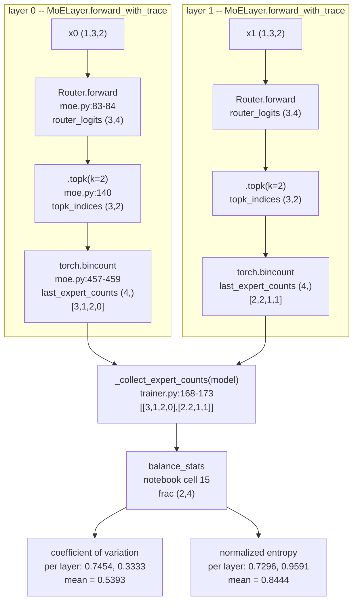
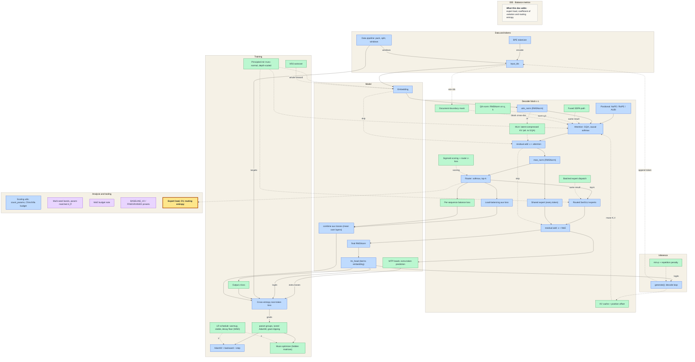

# 035 — Expert load, coefficient of variation, and routing entropy: the balance metrics solved by hand

**Companion to:** [`journey_of_a_model/035-modernized-presets-training-run.md`](../../journey_of_a_model/035-modernized-presets-training-run.md)
· **Code:** [`qwenmoe/model/moe.py`](../../qwenmoe/model/moe.py) —
`Router.forward` ([`moe.py:83-84`](../../qwenmoe/model/moe.py#L83)),
`score_and_select` ([`moe.py:87-122`](../../qwenmoe/model/moe.py#L87)),
`select_top_k` ([`moe.py:125-143`](../../qwenmoe/model/moe.py#L125)), and
`MoELayer.forward` / `forward_with_trace`'s `last_expert_counts`
([`moe.py:457-459`](../../qwenmoe/model/moe.py#L457),
[`moe.py:542-544`](../../qwenmoe/model/moe.py#L542)) · plus
[`qwenmoe/train/trainer.py`](../../qwenmoe/train/trainer.py)'s
`_collect_expert_counts` ([`trainer.py:168-173`](../../qwenmoe/train/trainer.py#L168))
and [`notebooks/07_modernized_presets.ipynb`](../../notebooks/07_modernized_presets.ipynb)'s
`balance_stats` (cell 15) — the analysis code entry 035's "Expert
utilization" section and its §"Term: expert load, coefficient of
variation, routing entropy" are built on
· **Every number here is reproduced by:**
[`verify_035_modernized_presets_training_run.py`](verify_035_modernized_presets_training_run.py)
(`uv run python docs/math/verify_035_modernized_presets_training_run.py`)

---

## How to read this

Journal 035 trains three MoE presets and, among other things, reports one
number per variant for "how balanced is the routing": a **coefficient of
variation (CV)** of `0.145`/`0.133`/`0.095` and a **normalized routing
entropy** of `0.994`/`0.995`/`0.999`. The journal defines both in one
short paragraph and moves on to using them. This document is the
opposite trade-off: it derives both formulas from nothing but "count how
many tokens each expert got," proves the two exact identities the journal
paragraph asserts without proof (`mean(load) == 1/n_experts` always, and
entropy's `[0, 1]` range), and traces the real code that produces the
numbers those formulas are applied to.

You do **not** need a statistics or information-theory background. Every
term — mean, variance, standard deviation, coefficient of variation,
Shannon entropy, KL divergence — is defined at first use. This document
assumes you've read (or are willing to glance at)
[`docs/math/005-moe-layer.md`](005-moe-layer.md) for the router / softmax
/ top-*k* mechanics — those are identical here, just re-run on new
numbers, and we point there rather than re-deriving them.

> **Scope.** `MoELayer.forward`/`forward_with_trace` also computes
> routed- and shared-expert *outputs* (the actual `(batch, seq_len,
> d_model)` layer output, via `dispatch_batched` — doc
> [027](027-batched-expert-computation.md)) and the differentiable
> auxiliary loss (doc [005](005-moe-layer.md) §9, doc
> [025](025-moe-routing-sigmoid-and-router-z-loss.md)). None of that is
> re-derived here. This document traces only the sub-path that produces
> `last_expert_counts` — `Router.forward` → `score_and_select` →
> `select_top_k`'s `.topk()` → `torch.bincount` — and then everything
> built *on top of* that count vector: the trainer's per-layer collection
> and the load/CV/entropy statistics journal 035 reports.

---

## Part 0 — What problem is this solving?

A Mixture-of-Experts router picks, per token, `top_k` of `n_routed_experts`
experts to run (background: [doc 005](005-moe-layer.md)). Left
untrained, a router has no reason to spread tokens evenly; left training
without counter-pressure, it tends to collapse onto a few favorite
experts (the well-known MoE "rich-get-richer" failure mode — Fedus, Zoph
& Shazeer 2021, §2.1). This project fights that collapse two ways
(`AuxLossBalancer`'s gradient-based loss, `LossFreeBalancer`'s bias
nudge — both already fully derived in doc 005 and journal entry 015), but
neither mechanism *reports a number*. To know whether the counter-pressure
is actually working — and to compare it across architectural choices, the
way journal 035 compares softmax-vs-sigmoid routing (8 experts) against
fine-grained routing (32 experts) — you need a **read-only diagnostic**:
given the counts of tokens each expert actually received this step, how
balanced was that, in one number?

That's what this document derives: not a new loss, not a new parameter —
a pure function of `last_expert_counts` that turns a length-`n_experts`
vector of integers into two summary numbers, computed once per layer and
then averaged across layers.



---

<!-- notation:start (generated by build_architecture_footer.py) -->
> **Notation note.** The series uses one symbol set ([canonical notation](README.md#canonical-notation)). In this doc, $N_r$ stands for $N$ (`n_routed_experts`); $T$ stands for $S$, the tokens per sequence. Nothing below is changed; this only states the correspondence.
<!-- notation:end -->

## Part 1 — The running example

### 1.1 New terms this document needs

(Vector, dot product, matrix, matrix multiplication, softmax, and top-*k*
selection are all defined in [doc 005](005-moe-layer.md) and reused
unchanged.) Beyond those:

- **`torch.bincount`** — given a 1-D tensor of non-negative integers,
  returns, for each possible value $v$ from $0$ up to the largest value
  present (or up to `minlength - 1` if you ask for more), *how many times
  $v$ occurs in the input*. It is nothing but counting.
- **Arithmetic mean** of $n$ numbers $x_1,\dots,x_n$: $\bar x =
  \frac1n\sum_i x_i$ — the value that balances the deviations
  $(x_i-\bar x)$ to sum to exactly zero (this is *why* it's called the
  "balance point": $\sum_i(x_i-\bar x) = \sum_i x_i - n\bar x = n\bar
  x - n\bar x = 0$).
- **Population variance and standard deviation**: $\text{Var}(x) =
  \frac1n\sum_i(x_i-\bar x)^2$, $\text{std}(x)=\sqrt{\text{Var}(x)}$ — the
  average squared distance from the mean, and its square root (back in
  the original units, since variance is in *squared* units). "Population"
  means every one of the $n$ items is treated as the entire set of
  interest — contrast with the **sample** standard deviation
  (`statistics.stdev`, Bessel's correction, $\frac1{n-1}$ instead of
  $\frac1n$) that doc [032](032-multi-seed-and-param-matched-ablations.md)
  derives for *estimating* a larger population's variance from a handful
  of samples. §3.2 below says which one this document's numbers use, and
  why.
- **Coefficient of variation (CV)**: $\text{CV}(x) =
  \text{std}(x)/\bar x$ — the standard deviation *relative to* the mean,
  a dimensionless number.
- **Shannon entropy** of a probability distribution $p=(p_1,\dots,p_n)$
  (non-negative, $\sum_i p_i=1$): $H(p) = -\sum_i p_i\ln p_i$ — derived
  from scratch in §3.4.
- **KL divergence** $D_{\mathrm{KL}}(p\Vert q) = \sum_i p_i\ln(p_i/q_i)$
  — a measure of how different one distribution $p$ is from another $q$
  over the same outcomes; used in §3.5 only as a proof tool.

### 1.2 The model configuration

| symbol | field | value | why |
|---|---|---|---|
| $d$ | `d_model` | $2$ | smallest width a 2-D router weight can use |
| $N_r$ | `n_routed_experts` | $4$ | matches docs 005/025/027's own convention; $>k$ so an expert can go unpicked |
| $k$ | `top_k` | $2$ | matches docs 005/025/027 |
| $L$ | number of `MoELayer`s | $2$ | smallest count $>1$ that makes "mean over layers" a real operation, not a no-op |
| $T$ | tokens per layer (`seq_len`) | $3$ | matches docs 005/025/027 |
| — | `n_shared_experts` | $0$ | shared-expert outputs never touch `topk_indices` — structurally irrelevant here (same reasoning as doc 026 §1.2) |
| — | `router_scoring` | `"softmax"` | irrelevant to this document's metric — Step 2b shows why |
| — | `moe_balancing` | `"aux_loss"` | `AuxLossBalancer`'s `selection_scores` is the identity on the raw logits (doc 025), the simplest case |

### 1.3 The input

**Layer 0** reuses [doc 005](005-moe-layer.md)'s and
[doc 027](027-batched-expert-computation.md)'s exact canonical example
verbatim — same router weight, same three tokens — because its unequal
group sizes (3/1/2 tokens across 3 active experts) and one **idle**
expert already force the "what if an expert gets exactly zero tokens"
edge case this document's entropy formula has to survive:

$$X^{(0)} = \begin{bmatrix} x_0 \\ x_1 \\ x_2\end{bmatrix} = \begin{bmatrix}1&0\\0&1\\1&1\end{bmatrix}$$

**Layer 1** is a fresh example (a real model's layer-1 router is an
independently-initialized `nn.Linear`, never literally identical to
layer 0's) chosen so *every* expert gets at least one token — the
contrasting case, all-active but still uneven:

$$X^{(1)} = \begin{bmatrix} y_0\\y_1\\y_2\end{bmatrix} = \begin{bmatrix}1&0.5\\1&-0.5\\-1&0.5\end{bmatrix}$$

Both layers see $T=3$ tokens, batch size $1$ — so both inputs have shape
$(1,3,2)$, matching a real 2-layer stack where the same three tokens flow
through layer 0, then (after being transformed) through layer 1.

### 1.4 The router weights

`Router` is one `nn.Linear(d_model, n_routed_experts, bias=False)`
([`moe.py:79-81`](../../qwenmoe/model/moe.py#L79)). PyTorch stores its
weight as `(out_features, in_features) = (N_r, d) = (4, 2)`; row $e$ is
expert $e$'s scoring vector (doc 005 §1.5 derives *why*: `nn.Linear`
computes $y = uW^\top$, so output coordinate $j$ is the dot product of
the input with row $j$ of $W$):

$$W^{(0)}_{\text{router}} = \begin{bmatrix}2&1\\1&-1\\-1&2\\0&0\end{bmatrix}
\qquad
W^{(1)}_{\text{router}} = \begin{bmatrix}3&1\\3&-1\\-3&1\\-3&-1\end{bmatrix}
\qquad\text{(rows: expert 0, 1, 2, 3)}$$

Both are hand-picked integers/half-integers so every dot product below is
exact and every top-2 comparison is unambiguous (no ties).

---

## Part 2 — The forward pass, one layer at a time

**Shape ledger — start:** `x0 (1,3,2)`, `x1 (1,3,2)`.

### Step 1 — Flatten batch and sequence

[`moe.py:449`](../../qwenmoe/model/moe.py#L449) /
[`moe.py:536`](../../qwenmoe/model/moe.py#L536): `x_flat =
x.reshape(-1, d_model)`. A **reshape** relabels how the same underlying
numbers are grouped into axes without moving or changing any of them —
here it merges the `(batch=1, seq_len=3)` axes into one axis of length
$3$, since every downstream operation (the router, top-*k*, `bincount`)
treats every token independently and doesn't care which sequence a token
came from.

**Shape ledger:** `x0 (1,3,2)` → `x0_flat (3,2)`; `x1 (1,3,2)` → `x1_flat (3,2)`.

### Step 2 — Router logits

[`moe.py:83-84`](../../qwenmoe/model/moe.py#L83): `return self.gate(x)`,
i.e. $\text{logits} = X\,W_{\text{router}}^\top$. Doc 005 §1.5 derives
why this is "row $t$, column $e$ = dot product of token $t$ with expert
$e$'s weight row"; we only need the arithmetic here.

**Layer 0** ($W^{(0)}$'s rows are $[2,1],[1,-1],[-1,2],[0,0]$):

$$
\begin{aligned}
x_0=[1,0]:&\ \ [1{\cdot}2+0{\cdot}1,\ 1{\cdot}1+0{\cdot}(-1),\ 1{\cdot}(-1)+0{\cdot}2,\ 1{\cdot}0+0{\cdot}0] = [2,\ 1,\ -1,\ 0]\\
x_1=[0,1]:&\ \ [0{\cdot}2+1{\cdot}1,\ 0{\cdot}1+1{\cdot}(-1),\ 0{\cdot}(-1)+1{\cdot}2,\ 0{\cdot}0+1{\cdot}0] = [1,\ -1,\ 2,\ 0]\\
x_2=[1,1]:&\ \ [1{\cdot}2+1{\cdot}1,\ 1{\cdot}1+1{\cdot}(-1),\ 1{\cdot}(-1)+1{\cdot}2,\ 1{\cdot}0+1{\cdot}0] = [3,\ 0,\ 1,\ 0]
\end{aligned}
$$

**Layer 1** ($W^{(1)}$'s rows are $[3,1],[3,-1],[-3,1],[-3,-1]$):

$$
\begin{aligned}
y_0=[1,0.5]:&\ \ [1{\cdot}3+0.5{\cdot}1,\ 1{\cdot}3+0.5{\cdot}(-1),\ 1{\cdot}(-3)+0.5{\cdot}1,\ 1{\cdot}(-3)+0.5{\cdot}(-1)] = [3.5,\ 2.5,\ -2.5,\ -3.5]\\
y_1=[1,-0.5]:&\ \ [3-0.5,\ 3+0.5,\ -3-0.5,\ -3+0.5] = [2.5,\ 3.5,\ -3.5,\ -2.5]\\
y_2=[-1,0.5]:&\ \ [-3+0.5,\ -3-0.5,\ 3+0.5,\ 3-0.5] = [-2.5,\ -3.5,\ 3.5,\ 2.5]
\end{aligned}
$$

Confirmed by the script:

```
layer0 router_logits:
 tensor([[ 2.,  1., -1.,  0.],
        [ 1., -1.,  2.,  0.],
        [ 3.,  0.,  1.,  0.]])
layer1 router_logits:
 tensor([[ 3.5000,  2.5000, -2.5000, -3.5000],
        [ 2.5000,  3.5000, -3.5000, -2.5000],
        [-2.5000, -3.5000,  3.5000,  2.5000]])
```

**Shape ledger:** `x_flat (3,2)` → `router_logits (3,4)`, both layers.

### Step 2b — Selection scores and routing probabilities (brief; not new)

[`moe.py:87-122`](../../qwenmoe/model/moe.py#L87) computes two things
from `router_logits`: `routing_probs = softmax(router_logits)`
(`router_scoring="softmax"`, [`moe.py:110-111`](../../qwenmoe/model/moe.py#L110)
— the general softmax-vs-sigmoid derivation is doc
[025](025-moe-routing-sigmoid-and-router-z-loss.md)'s job) and
`selection_scores`, which for `AuxLossBalancer`
([`moe.py:162-173`](../../qwenmoe/model/moe.py#L162)) is *just the raw
logits* — softmax doesn't change which experts rank highest for a given
token (it's a strictly increasing function applied identically to every
entry of one token's logit row), so ranking by softmax probability or by
raw logit gives the same order. **This is why our choice of
`router_scoring="softmax"` doesn't matter to anything in this
document**: `last_expert_counts` depends only on which experts are
*selected*, and doc 025 proves that selection is scoring-independent
here. (`sigmoid` scoring would change the *combination weights* — out of
scope, see Step 4.)

### Step 3 — Top-*k* selection

[`moe.py:140`](../../qwenmoe/model/moe.py#L140):
`_, topk_indices = selection_scores.topk(top_k, dim=-1)`. **Top-$k$**
of a list of numbers means: sort them, keep the $k$ largest, and return
*which positions* (here: which expert ids) they came from, in descending
order of value. This is an **order statistic** — a function of the
*relative ranking* of the values, not their exact magnitudes (scaling or
shifting every value in a row by the same amount never changes its
top-$k$ set — a fact doc 025 uses to prove the softmax/sigmoid selection
equivalence above).

**Layer 0**, ranking each row of $[2,1,-1,0]$, $[1,-1,2,0]$, $[3,0,1,0]$:

- token 0: $2 > 1 > 0 > -1$ → top-2 = experts $\{0, 1\}$, in that order: `[0, 1]`
- token 1: $2 > 1 > 0 > -1$ → top-2 = experts $\{2, 0\}$, in that order: `[2, 0]`
- token 2: $3 > 1 > 0 = 0$ → top-2 = experts $\{0, 2\}$, in that order: `[0, 2]`
  (experts 1 and 3 tie at $0$, but that tie is *below* the cutoff — it
  never affects which two are kept)

**Layer 1**, ranking $[3.5,2.5,-2.5,-3.5]$, $[2.5,3.5,-3.5,-2.5]$,
$[-2.5,-3.5,3.5,2.5]$:

- token 0: top-2 = `[0, 1]`
- token 1: top-2 = `[1, 0]`
- token 2: top-2 = `[2, 3]`

Confirmed by the script:

```
layer0 topk_indices:
 tensor([[0, 1], [2, 0], [0, 2]])
layer1 topk_indices:
 tensor([[0, 1], [1, 0], [2, 3]])
```

**Shape ledger:** `router_logits (3,4)` → `topk_indices (3,2)`, both layers.

### Step 4 — `topk_weights` (out of scope past this one worked example)

[`moe.py:141-142`](../../qwenmoe/model/moe.py#L141): `topk_weights =
router_probs.gather(-1, topk_indices)`, then divided by its own row-sum
to renormalize to $1$. `gather` reads out, for each token, exactly the
two `routing_probs` entries its own `topk_indices` selected. For layer 0,
token 0 ($\text{logits}=[2,1,-1,0]$): $\text{softmax}$'s denominator is
$Z=e^2+e^1+e^{-1}+e^0 = 7.389056+2.718282+0.367879+1=11.475217$, giving
`router_probs[0] = [0.643914, 0.236883, 0.032059, 0.087144]` (script:
`[0.6439142823219299, 0.23688283562660217, 0.032058604061603546,
0.08714432269334793]`). Gathering indices $[0,1]$ picks
$[0.643914, 0.236883]$, summing to $0.880797$; dividing each by that sum
renormalizes to `[0.731059, 0.268941]` (script:
`[0.7310585379600525, 0.2689414322376251]`).

*Aside (exact, not needed below):* because softmax's shared denominator
$Z$ cancels in any ratio of two of its outputs
($\text{softmax}_i/\text{softmax}_j = e^{l_i}/e^{l_j} = e^{l_i-l_j}$, for
*any* $Z$), the renormalized weight of the higher-ranked of two selected
experts depends **only on the gap between their own two logits**, never
on the other (unselected) logits: $\text{weight}_0 =
1/(1+e^{-(l_0-l_1)}) = \sigma(l_0-l_1)$, the logistic sigmoid. Here
$l_0-l_1 = 2-1=1$ and $\sigma(1) = 1/(1+e^{-1}) = 0.7310586$ — matching
the renormalized value above (up to float32 rounding, $\approx4{\times}10^{-8}$).

`topk_weights`/`routing_probs` never feed `last_expert_counts` or the
balance statistics below, so we stop here — doc
[025](025-moe-routing-sigmoid-and-router-z-loss.md) is the full
derivation if you want every token's combination weight.

**Shape ledger:** `router_probs (3,4)`, `topk_indices (3,2)` → `topk_weights (3,2)` (not used further).

### Step 5 — `torch.bincount`: from selections to a count vector

[`moe.py:457-459`](../../qwenmoe/model/moe.py#L457) (`forward`) and
[`moe.py:542-544`](../../qwenmoe/model/moe.py#L542) (`forward_with_trace`,
identical code, run independently):

```python
self.last_expert_counts = torch.bincount(
    topk_indices.detach().flatten(), minlength=self.n_routed_experts
)
```

**`.flatten()`** collapses `topk_indices`' `(n_tokens, top_k)` shape into
one 1-D list of every *(token, expert)* pick, discarding which token each
pick came from (row-major order: token 0's picks first, then token 1's,
...) — we don't need that information any more, only "how many times did
expert $e$ get picked, across every token and every one of its $k$
picks." **`torch.bincount`** then counts occurrences of each integer
value $0,\dots,N_r-1$ (§1.1); `minlength=n_routed_experts` guarantees the
output has exactly $N_r$ entries even if some expert id never appears
(the idle-expert case) — without it, `bincount`'s output length would
silently shrink to (highest id seen) + 1, one entry short whenever the
*last* expert is idle.

**Layer 0**: `topk_indices = [[0,1],[2,0],[0,2]]` → flatten →
$[0,1,2,0,0,2]$. Counting: $0$ appears at positions $0,3,4$ → $3$ times;
$1$ appears at position $1$ → $1$ time; $2$ appears at positions $2,5$ →
$2$ times; $3$ appears $0$ times.

$$\texttt{last\_expert\_counts}^{(0)} = [3,\ 1,\ 2,\ 0]$$

**Layer 1**: `topk_indices = [[0,1],[1,0],[2,3]]` → flatten →
$[0,1,1,0,2,3]$. Counting: $0\to2$, $1\to2$, $2\to1$, $3\to1$.

$$\texttt{last\_expert\_counts}^{(1)} = [2,\ 2,\ 1,\ 1]$$

Both sum to $T\cdot k = 3\cdot2=6$ — every token contributes exactly $k$
picks, so the total pick count is fixed regardless of how balanced the
routing is; this fact is the seed of §3.1's exact mean identity.

Confirmed by the script:

```
layer0 last_expert_counts (forward):            [3, 1, 2, 0]
layer0 last_expert_counts (forward_with_trace): [3, 1, 2, 0]
layer1 last_expert_counts:                      [2, 2, 1, 1]
```

**Shape ledger:** `topk_indices (3,2)` → `last_expert_counts (4,)`.

### Step 6 — `forward` vs. `forward_with_trace`: fused-vs-explicit agreement

`forward` ([`moe.py:447`](../../qwenmoe/model/moe.py#L447)) runs every
routed expert as a handful of batched matrix multiplies via
`dispatch_batched` (doc [027](027-batched-expert-computation.md));
`forward_with_trace` ([`moe.py:528`](../../qwenmoe/model/moe.py#L528))
loops over experts explicitly, for the visualizer's benefit. Both paths
recompute `last_expert_counts` from the *same* `topk_indices`
independently (lines 457-459 vs. 542-544), so they should agree
bit-for-bit — and the layer *output* (which does depend on which
dispatch code ran) should agree to floating-point rounding:

```
max|forward_output - forward_with_trace_output| = 9.313e-10
```

well under doc 027's own $10^{-5}$ tolerance, and
`torch.equal(counts_fwd0, counts_trace0)` holds exactly (both are
`[3, 1, 2, 0]`).

### Step 7 — Collecting counts across layers

[`trainer.py:168-173`](../../qwenmoe/train/trainer.py#L168):

```python
def _collect_expert_counts(model: QwenMoEModel) -> list[list[int]]:
    return [block.moe.last_expert_counts.tolist() for block in model.blocks]
```

A **list comprehension**: for each `block` (one per transformer layer,
in order) in `model.blocks`, read that block's MoE sublayer's
`last_expert_counts` (populated by whichever forward call ran most
recently — Step 5) and convert the tensor to a plain Python list. The
result is a `list[list[int]]`: outer index = layer, inner index = expert.

This document builds two bare `MoELayer`s directly rather than a full
`QwenMoEModel` (attention/RMSNorm/embeddings are irrelevant to
`last_expert_counts` — see the Scope note), so we duck-type two trivial
namespaces (`_FakeBlock`, exposing only `.moe`; `_FakeModel`, exposing
only `.blocks`) and hand them to the **real, unmodified**
`_collect_expert_counts`. Python doesn't check `model`'s declared type
hint at runtime, so the real function body executes exactly as it would
inside `Trainer.fit`:

```
_collect_expert_counts(model) (trainer.py:168-173)
[[3, 1, 2, 0], [2, 2, 1, 1]]
```

**Shape ledger:** two `(4,)` tensors → one `[[4 ints], [4 ints]]` Python
list — this is exactly the `"expert_token_counts"` field journal 035's
`train.jsonl` log lines carry
([`trainer.py:664`](../../qwenmoe/train/trainer.py#L664)) and the
notebook's `balance_stats` (next) consumes.

---

## Part 3 — Expert load, coefficient of variation, and routing entropy: derived from zero

Everything below is `notebooks/07_modernized_presets.ipynb` cell 15's
`balance_stats` function, reproduced verbatim in the verify script
(it lives in the notebook, not in `qwenmoe/`, so there is no
`file.py:line` to cite for it — it *is* the real analysis code entry 035
runs, copied byte-for-byte, not a re-derivation):

```python
def balance_stats(counts):
    counts = np.asarray(counts, dtype=float)          # (n_layers, n_experts)
    frac = counts / counts.sum(1, keepdims=True)
    n_exp = frac.shape[1]
    cv = (frac.std(1) / (1.0 / n_exp)).mean()
    ent = -(frac * np.log(np.clip(frac, 1e-12, None))).sum(1) / math.log(n_exp)
    return frac, cv, ent.mean()
```

### 3.1 Expert load, and why its mean is *exactly* $1/N_r$

**Expert load** for expert $e$ at one layer is `frac[e] = counts[e] /
counts.sum()` — the fraction of that layer's dispatch decisions that
landed on expert $e$. "Dispatch decisions," not "tokens": every token
contributes exactly $k$ decisions (Step 5), so the denominator is
$T\cdot k$, not $T$.

**Layer 0**: $\text{counts}=[3,1,2,0]$, sum $=6$ →
$\text{frac}^{(0)} = [3/6,\ 1/6,\ 2/6,\ 0/6] = [0.5,\ 0.1\overline{6},\ 0.\overline{3},\ 0]$.

**Layer 1**: $\text{counts}=[2,2,1,1]$, sum $=6$ →
$\text{frac}^{(1)} = [2/6,\ 2/6,\ 1/6,\ 1/6] = [0.\overline{3},\ 0.\overline{3},\ 0.1\overline{6},\ 0.1\overline{6}]$.

```
frac (per layer, per expert):
 [[0.5        0.16666667 0.33333333 0.        ]
  [0.33333333 0.33333333 0.16666667 0.16666667]]
```

**Exact claim (provable, not empirical): $\text{mean}_e(\text{frac}[e]) =
1/N_r$, for *any* routing, balanced or not.** Proof: every token
contributes exactly $k$ picks (Step 5's observation), so
$\sum_e\text{counts}[e] = T\cdot k$ regardless of *which* experts those
picks land on. Therefore $\sum_e\text{frac}[e] =
\sum_e\text{counts}[e]/(Tk) = (Tk)/(Tk) = 1$ — always, by construction,
not by luck. Averaging $N_r$ numbers that sum to exactly $1$ gives a mean
of exactly $1/N_r$. Checked on both layers: $\text{mean}(\text{frac}^{(0)})
= (0.5+0.1\overline6+0.\overline3+0)/4 = 1/4$ and
$\text{mean}(\text{frac}^{(1)}) = 1/4$ — confirmed to float precision by
`np.allclose(frac.mean(1), 0.25)` in the script. This is *why* the CV
formula below can divide by the literal constant `1.0 / n_exp` instead of
recomputing `frac.mean(1)` — they are the same number, always.

### 3.2 Population variance and standard deviation (and why *not* Bessel's correction)

$\text{Var}(x) = \frac1n\sum_i(x_i-\bar x)^2$ (§1.1). Deriving the
useful algebraic identity $\text{Var}(x) = \overline{x^2} -
\bar x^2$ (used implicitly by NumPy's fast implementation): expand the
square, $(x_i-\bar x)^2 = x_i^2 - 2\bar x x_i + \bar x^2$; sum over $i$
and divide by $n$: $\overline{x^2} - 2\bar x\cdot\bar x + \bar x^2 =
\overline{x^2}-\bar x^2$.

**Population vs. sample.** `numpy`'s `.std()` defaults to `ddof=0` —
dividing by $n$, the **population** formula. Doc
[032](032-multi-seed-and-param-matched-ablations.md) instead used
`statistics.stdev`'s `ddof=1` (dividing by $n-1$, **Bessel's
correction**), because there the two per-seed validation losses were a
*sample* — two draws out of infinitely many possible random seeds, used
to *estimate* the variance of that larger, unobserved population.
Here there is no such larger population: the $N_r=4$ load fractions
*are* every routed expert this layer has, in full — nothing was sampled,
so nothing needs correcting for sampling bias. Population variance
(`ddof=0`) is the exact, correct choice, not an oversight.

**Layer 0** ($\bar x = 0.25$): deviations $[0.25, -0.08\overline3,
0.08\overline3, -0.25]$; squares $[0.0625, 0.006944, 0.006944, 0.0625]$;
sum $=0.138\overline8$; $\text{Var}=0.138\overline8/4=0.034\overline{72}$;
$\text{std}=\sqrt{0.034\overline{72}} = \sqrt5/12 = 0.186339$.

**Layer 1** ($\bar x=0.25$): every deviation has the same magnitude
$1/12=0.08\overline3$ (two at $+1/12$, two at $-1/12$), so
$\text{Var}=(1/12)^2=1/144=0.006944$ directly, and
$\text{std}=1/12=0.08\overline3$.

```
per-layer std: [0.186339   0.08333333]
```

### 3.3 Coefficient of variation

$\text{CV} = \text{std}/\bar x$. **Why divide by the mean at all?** Two
presets under comparison can have a different `n_routed_experts`
(journal 035's `BASELINE` has $8$, `FINEGRAINED` has $32$) — and §3.1
just showed the mean is *forced* to $1/N_r$, purely as a structural
consequence of $N_r$, carrying zero information about how balanced
routing actually is. A raw standard deviation over more experts is
squeezed toward a smaller mean regardless of balance; dividing by that
same (structural) mean cancels the dependence on $N_r$ and leaves a
dimensionless number that reflects *proportional* imbalance — the thing
actually worth comparing across different $N_r$.

Since §3.1 proved $\bar x=1/N_r$ exactly, `(1.0 / n_exp)` in the code
*is* `frac.mean(1)`, just without recomputing it:

$$\text{CV}^{(0)} = \frac{0.186339}{0.25} = 0.745356 = \frac{\sqrt5}{3}
\qquad
\text{CV}^{(1)} = \frac{0.08\overline3}{0.25} = 0.333333 = \frac13$$

```
per-layer CV: [0.74535599 0.33333333]
```

**Range, derived exactly (not empirical).** For load fractions
$0\le p_i\le1$ summing to $1$: since $0\le p_i\le1$, multiplying both
sides of $p_i\le1$ by the non-negative $p_i$ preserves the inequality,
$p_i^2\le p_i$; summing over $i$, $\sum_ip_i^2\le\sum_ip_i=1$, with
equality exactly when every $p_i\in\{0,1\}$ — combined with
$\sum p_i=1$, that means one expert has *all* the load and the rest have
none. Using $\text{Var}=\overline{p^2}-\bar p^2 =
\frac1{N_r}\sum p_i^2 - \frac1{N_r^2}$, the maximum $\sum p_i^2=1$ gives
$\text{Var}_{\max} = \frac1{N_r}-\frac1{N_r^2} = \frac{N_r-1}{N_r^2}$, so
$\text{std}_{\max} = \sqrt{N_r-1}/N_r$ and
$\text{CV}_{\max} = \text{std}_{\max}\cdot N_r = \sqrt{N_r-1}$. For
$N_r=4$: $\text{CV}_{\max}=\sqrt3=1.732051$ — checked directly (not from
this document's running example, a pure property of the formula) against
the all-on-one-expert case $\text{frac}=[1,0,0,0]$:

```
degenerate all-one-expert check: CV=1.732051 (expect sqrt(3)=1.732051), entropy=0.000000 (expect 0)
```

### 3.4 Shannon entropy, derived from "surprise"

An outcome with probability $p$ carries **surprisal** $-\ln p$: certain
outcomes ($p=1$) carry zero surprise ($-\ln1=0$), and increasingly rare
outcomes carry increasingly large surprise ($-\ln p\to\infty$ as
$p\to0$) — $-\ln$ is the (unique, up to a positive constant) function
that is $0$ at $p=1$, decreasing in $p$, and turns independent-event
probability multiplication into surprisal *addition*
($-\ln(p_1p_2)=-\ln p_1-\ln p_2$, matching the intuition that the
surprise of two independent rare events is the sum of each one's
surprise). **Shannon entropy** $H(p) = \sum_i p_i\cdot(-\ln p_i)$ is the
*expected* surprisal, averaged over the distribution itself — a single
number describing how spread out $p$ is: concentrated on one outcome
($p_i\approx1$ for one $i$) gives $H\approx0$ (no surprise, on average);
spread evenly gives the largest possible $H$ (proved next).

**The `1e-12` clip.** Mathematically $\lim_{p\to0}p\ln p = 0$ (the
$p\to0$ factor beats the $\ln p\to-\infty$ factor). But IEEE 754
floating point computes $0\cdot(-\infty)$ as `NaN`, not $0$ — there is no
"take the limit" step in raw arithmetic. `np.clip(frac, 1e-12, None)`
patches only the *argument to* `np.log`, so `log(0)`'s `-inf` never
appears; the clip is invisible in the final product because it's still
multiplied by the *true*, unclipped `frac` value of exactly $0$, and
$0\times(\text{any finite number})=0$ exactly. It's a numerical-safety
patch, not an approximation of the true value.

**Layer 0** ($\text{frac}=[0.5, 1/6, 1/3, 0]$, natural log $\ln$):

$$
\begin{aligned}
-0.5\ln(0.5) &= 0.5\ln2 = 0.346574\\
-\tfrac16\ln(\tfrac16) &= \tfrac16\ln6 = 0.298627\\
-\tfrac13\ln(\tfrac13) &= \tfrac13\ln3 = 0.366204\\
-0\cdot\ln(\text{clip}(0)) &= 0
\end{aligned}
\qquad H^{(0)} = 1.011405,\quad H^{(0)}_{\text{norm}} = \frac{1.011405}{\ln4} = 0.729574
$$

**Layer 1** ($\text{frac}=[1/3,1/3,1/6,1/6]$):

$$
2\times\Big(\tfrac13\ln3\Big) + 2\times\Big(\tfrac16\ln6\Big) = 0.732408+0.597253 = 1.329661,
\quad H^{(1)}_{\text{norm}} = \frac{1.329661}{\ln4} = 0.959148
$$

**Why divide by $\ln(N_r)$?** Exactly the same cross-$N_r$-comparability
motivation as CV's division by the mean — §3.5 proves the *maximum*
possible entropy is $\ln(N_r)$, which itself depends on $N_r$; dividing
by that maximum rescales $H$ into a fixed $[0,1]$ range regardless of how
many experts the layer has, so an entropy of $0.995$ means "close to
perfectly spread across however many experts there are," comparably for
$N_r=8$ and $N_r=32$.

```
per-layer entropy (normalized): [0.72957396 0.95914792]
```

### 3.5 The exact bound $0\le H_{\text{norm}}\le1$

**Claim:** for any distribution $p$ over $N_r$ outcomes,
$H(p)\le\ln(N_r)$, with equality iff $p$ is exactly uniform
($p_i=1/N_r$ for every $i$).

**Proof**, via the KL divergence $D_{\mathrm{KL}}(p\Vert q) =
\sum_ip_i\ln(p_i/q_i)$ (§1.1) between $p$ and the uniform distribution
$q_i=1/N_r$. First, $D_{\mathrm{KL}}\ge0$ always (**Gibbs' inequality**),
proved from **Jensen's inequality** for the natural logarithm: $\ln$ is
*strictly concave* (its second derivative $-1/x^2$ is negative for
$x>0$), so for any concave function $f$ and any probability weights
$p_i$ (summing to $1$, non-negative) and any positive numbers $y_i$,
$\sum_ip_if(y_i)\le f\big(\sum_ip_iy_i\big)$ — "the average of a concave
function is at most the function of the average," with equality iff
every $y_i$ actually receiving weight is the same value. Take
$y_i=q_i/p_i$ (for $p_i>0$; terms with $p_i=0$ contribute $0$ to every
sum below and can be dropped):

$$\sum_ip_i\ln\!\Big(\frac{q_i}{p_i}\Big) \le \ln\!\Big(\sum_ip_i\cdot\frac{q_i}{p_i}\Big) = \ln\!\Big(\sum_iq_i\Big) = \ln(1) = 0$$

The left side is $-\sum_ip_i\ln(p_i/q_i) = -D_{\mathrm{KL}}(p\Vert q)$, so
$-D_{\mathrm{KL}}(p\Vert q)\le0$, i.e. $D_{\mathrm{KL}}(p\Vert q)\ge0$,
with equality iff every weighted $y_i=q_i/p_i$ is constant — combined
with both distributions summing to $1$, that forces $p_i=q_i$ for every
$i$.

Now substitute $q_i=1/N_r$: $D_{\mathrm{KL}}(p\Vert\text{uniform}) =
\sum_ip_i\ln(N_rp_i) = \ln(N_r)\sum_ip_i + \sum_ip_i\ln p_i = \ln(N_r) -
H(p)$ (using $\sum p_i=1$ and $H(p)=-\sum p_i\ln p_i$). Combined with
$D_{\mathrm{KL}}\ge0$: $\ln(N_r)-H(p)\ge0$, i.e. $H(p)\le\ln(N_r)$,
equality iff $p$ is uniform. $\blacksquare$

Checked directly on both layers' real `frac` (the identity
$\ln(N_r)-H(p) = D_{\mathrm{KL}}(p\Vert\text{uniform})$, not just the
inequality):

```
layer0: ln(4)-H = 0.374890   D_KL(p||uniform) = 0.374890
layer1: ln(4)-H = 0.056633   D_KL(p||uniform) = 0.056633
```

and the equality case, checked directly on the uniform distribution
itself (a boundary-case property check, not this document's running
example, exactly like §3.3's degenerate CV check):

```
uniform row: ln(4)-H = 0.0000000000  (boundary-case check, not from the example)
```

— confirming both endpoints entry 035 asserts without proof: $\text{CV}=0$
and $H_{\text{norm}}=1$ are exactly the same event (perfectly uniform
load), and $H_{\text{norm}}=1$ really is the ceiling, never exceeded.

### 3.6 Mean over layers — connecting back to journal 035's real numbers

`.mean()` on the length-$L$ array of per-layer CVs (and separately, of
per-layer normalized entropies) is a plain arithmetic mean over layers —
*not* a recomputation from pooled/stacked counts. With $L=2$:

$$
\overline{\text{CV}} = \frac{0.745356+0.333333}{2} = 0.539345
\qquad
\overline{H_{\text{norm}}} = \frac{0.729574+0.959148}{2} = 0.844361
$$

```
mean CV over layers:      0.539345
mean routing entropy:     0.844361
```

These are the same two formulas behind journal 035's reported
`0.145`/`0.133`/`0.095` (CV) and `0.994`/`0.995`/`0.999` (entropy) for
`BASELINE`/`BASELINE_V2`/`FINEGRAINED` — just applied there to $6$
layers, $8$ or $32$ experts, and thousands of real tokens from a
*trained* model whose aux loss has spent $305$ steps actively pushing
load toward uniform. This document's two layers are untrained,
hand-picked to be **deliberately** uneven (one idle expert in layer 0) so
every formula's edge case gets exercised; that's why our mean CV
($0.54$) sits far from $0$ and our mean entropy ($0.84$) sits well below
$1$; entry 035's trained models sit close to the ideal because balancing
pressure — not the measurement — is what pulls them there.

---

## Part 4 — Cost, and why built this way

**Zero new parameters, zero new losses.** Everything in Part 3 is a
read-only function of `last_expert_counts`, which `MoELayer.forward`
already computes for the (pre-existing) balancer update
([`moe.py:460-465`](../../qwenmoe/model/moe.py#L460)) — the balance
statistics add no gradient path and cost nothing at training time; they
run once, after the fact, over whatever the trainer already logged.

**Compute cost on this example**: `torch.bincount` over $P=T\cdot k=6$
values is $O(P)$; `balance_stats` over `(2, 4)` counts is a handful of
elementwise array operations, $O(L\cdot N_r)$. At journal 035's real
scale ($6$ layers, up to $32$ experts, thousands of tokens per step) this
is still negligible next to a single forward pass — the entire point of
a *diagnostic* metric is that it must be cheap enough to compute on every
evaluation without perturbing what's being measured.

**Why two metrics, not one.** Journal 035 states this directly and this
derivation makes it precise: **CV** is driven by $\sum p_i^2$ (§3.3's
range proof), which is dominated by whichever single expert has the
*most* load — CV is the more sensitive alarm for "one hot expert is
soaking up traffic." **Entropy** is driven by $\sum p_i\ln p_i$, a
smoother function that responds to the *whole shape* of the distribution
at once — a broad but uneven tilt across many experts (no single
standout, but no uniformity either) moves entropy more than it moves CV.
Reporting both, as journal 035 does, catches both failure shapes.

**Why population (not sample) statistics.** §3.2's answer, worth
restating here: Bessel's correction (doc 032) exists to *estimate* a
population you didn't fully observe from a sample you did. The
$N_r$ experts in one layer are not a sample of anything larger — they
are the complete, exhaustive list of routed experts that layer has.
Population variance is not an approximation choice here; it's the
literally correct formula for "the variance of the finite set of numbers
in front of me."

**Why normalize by the mean / by $\ln(N_r)$ at all**, restated compactly:
both $\bar x=1/N_r$ (exact, §3.1) and $H_{\max}=\ln(N_r)$ (exact, §3.5)
are *structural* consequences of $N_r$ alone, carrying zero balance
information — dividing them out is what turns "a number that mixes how
many experts there are with how evenly they're used" into "a number that
measures only the second thing," which is the only thing worth comparing
between `BASELINE` (8 experts) and `FINEGRAINED` (32 experts).

---

## Questions that might come to mind

- **Is the "routing entropy" in the Expert Utilization table the same
  computation as the "mean normalized router entropy" in journal 035's
  routing-decision trace section?** No — two different quantities that
  happen to share the same entropy *formula*. The load entropy derived
  here (§3.4) is computed once per layer, over the **aggregate** count
  fractions across every token in the batch (`frac` has shape
  `(n_layers, n_experts)`). The trace section's number is computed **per
  token**, over that token's own full `router_probs` distribution
  (`(n_tokens, n_experts)`), then averaged over tokens. Checked directly
  on layer 0's real numbers: the load entropy is $0.729574$; the mean
  per-token `router_probs` entropy on the same layer's same tokens is
  $0.617270$ — genuinely different numbers (`assert not
  math.isclose(...)` in the script), because one asks "how evenly did
  tokens, in aggregate, spread across experts" and the other asks "how
  undecided was each individual token's own routing distribution,"
  averaged.

- **Why is layer 0 reused verbatim from docs 005/027 instead of a fresh
  example?** Continuity — its router weight and tokens are already
  established, already verified elsewhere in this docs corpus, and
  already contain the one edge case (an idle expert) this document's
  entropy formula most needs to survive, so reusing it costs nothing and
  buys a real cross-check: `[3, 1, 2, 0]` here is the identical count
  vector doc 027 derives from the identical `topk_indices`.

- **Does `router_scoring="sigmoid"` (doc 025) change any load, CV, or
  entropy number in this document?** No. `last_expert_counts` depends
  only on `topk_indices`, and doc 025 proves `AuxLossBalancer`'s
  selection is scoring-independent (Step 2b above) — softmax and sigmoid
  scoring select the *same* top-$k$ set here, so every count/frac/CV/
  entropy number is unaffected by that choice. (Sigmoid *would* change
  `topk_weights`, which never enters this document's metrics.)

- **What if `moe_balancing="loss_free"` instead of `"aux_loss"`?**
  `LossFreeBalancer.selection_scores` ([`moe.py:219-234`](../../qwenmoe/model/moe.py#L219))
  adds a per-expert bias before ranking — at initialization the bias is
  all zeros (`register_buffer("bias", torch.zeros(...))`,
  [`moe.py:217`](../../qwenmoe/model/moe.py#L217)), so this document's
  numbers would be identical on step 1; after training, a non-zero bias
  *would* shift which experts are selected, and `last_expert_counts`
  would change accordingly — but the CV/entropy formulas themselves
  don't care where the counts came from, only what they are.

- **Can CV exceed $1$?** Yes — §3.3 derives the exact ceiling
  $\sqrt{N_r-1}$ ($\sqrt3\approx1.73$ at $N_r=4$; $\sqrt7\approx2.65$ at
  $N_r=8$), reached only when every dispatch collapses onto one expert.
  Journal 035's trained CVs ($0.095$–$0.145$) sit nowhere near that
  ceiling, which is exactly what "the aux loss is doing its job" looks
  like numerically.

- **Do CV and entropy tell you *which* expert is overloaded?** No —
  both collapse a length-$N_r$ vector to one number by design, trading
  away *which* expert for a single comparable summary. Journal 035's
  companion bar chart (`figures/035/expert_utilization.png`) is what
  answers "which expert," plotting `frac` itself rather than a
  summary of it.

- **Why does the mean-over-layers step matter — isn't it just an
  average?** It is just an average, but it's an average of an already
  cross-$N_r$-comparable quantity (§3.3/§3.4's normalization), so
  averaging six (or two, here) layers' CVs is meaningful in a way that
  averaging six layers' *raw standard deviations* would not be — a
  narrower layer with fewer experts would otherwise drag a naive average
  toward whatever its structurally-smaller raw std happens to be.

---

## Symbol reference

| symbol | meaning |
|---|---|
| $d$, `d_model` | width of a token vector ($2$ here) |
| $N_r$, `n_routed_experts` | number of routed experts ($4$) |
| $k$, `top_k` | experts selected per token ($2$) |
| $T$, `seq_len` | tokens per layer in this example ($3$) |
| $L$ | number of `MoELayer`s (`2` here) |
| `router_logits` | raw per-expert scores, one `nn.Linear` row-dot-product per token |
| `routing_probs` | `softmax(router_logits)`, sums to $1$ per token |
| `topk_indices` | the $k$ expert ids each token selected, highest score first |
| `topk_weights` | renormalized combination weights for the selected experts (out of scope here) |
| `last_expert_counts` | `torch.bincount(topk_indices.flatten())`, length $N_r$ |
| `frac`, load | `counts / counts.sum()` — per-expert share of this layer's dispatch decisions |
| $\bar x$ | arithmetic mean; here always exactly $1/N_r$ for `frac` |
| $\text{Var}(x)$ | population variance, $\frac1n\sum(x_i-\bar x)^2 = \overline{x^2}-\bar x^2$ |
| $\text{std}(x)$ | $\sqrt{\text{Var}(x)}$ |
| CV | coefficient of variation, $\text{std}(x)/\bar x$; range $[0,\sqrt{N_r-1}]$ |
| $H(p)$ | Shannon entropy, $-\sum_ip_i\ln p_i$; range $[0,\ln N_r]$ |
| $H_{\text{norm}}(p)$ | $H(p)/\ln(N_r)$; range $[0,1]$ |
| $D_{\mathrm{KL}}(p\Vert q)$ | $\sum_ip_i\ln(p_i/q_i)$; $\ge0$ always (Gibbs' inequality), $=0$ iff $p=q$ |
| $\sigma(z)$ | logistic sigmoid $1/(1+e^{-z})$ |

---

## Citations

Links already used by journal entry 035 (Switch Transformer, DeepSeek-V3)
are reused verbatim; the Shannon citation is new to this document and was
confirmed by web search on 2026-09-13.

- Fedus, Zoph & Shazeer, *Switch Transformers: Scaling to Trillion
  Parameter Models with Simple and Efficient Sparsity*, 2021 —
  [arXiv:2101.03961](https://arxiv.org/abs/2101.03961). The
  load-imbalance failure mode (Part 0) this document's diagnostic metrics are
  built to detect, and the aux-loss counter-pressure (doc 005) whose
  effectiveness they measure.
- DeepSeek-AI, *DeepSeek-V3 Technical Report*, 2024 —
  [arXiv:2412.19437](https://arxiv.org/abs/2412.19437). The
  normalized-sigmoid router (doc 025) whose selection this document shows
  is scoring-independent for `AuxLossBalancer` (Step 2b).
- Shannon, *A Mathematical Theory of Communication*, Bell System
  Technical Journal 27(3), 1948 —
  [DOI:10.1002/j.1538-7305.1948.tb01338.x](https://onlinelibrary.wiley.com/doi/abs/10.1002/j.1538-7305.1948.tb01338.x).
  The original definition of entropy as expected surprisal (§3.4), the
  basis for journal 035's "routing entropy."

---

## Verification

Full output of
[`verify_035_modernized_presets_training_run.py`](verify_035_modernized_presets_training_run.py)
(`uv run python docs/math/verify_035_modernized_presets_training_run.py`):

```
=== Router logits (Router.forward, moe.py:83-84) ===
layer0 router_logits:
 tensor([[ 2.,  1., -1.,  0.],
        [ 1., -1.,  2.,  0.],
        [ 3.,  0.,  1.,  0.]])
layer1 router_logits:
 tensor([[ 3.5000,  2.5000, -2.5000, -3.5000],
        [ 2.5000,  3.5000, -3.5000, -2.5000],
        [-2.5000, -3.5000,  3.5000,  2.5000]])

=== forward() vs forward_with_trace(): last_expert_counts agreement ===
layer0 last_expert_counts (forward):            [3, 1, 2, 0]
layer0 last_expert_counts (forward_with_trace): [3, 1, 2, 0]
max|forward_output - forward_with_trace_output| = 9.313e-10
layer1 last_expert_counts:                      [2, 2, 1, 1]

=== topk_indices (select_top_k's .topk(), moe.py:140) ===
layer0 topk_indices:
 tensor([[0, 1],
        [2, 0],
        [0, 2]])
layer1 topk_indices:
 tensor([[0, 1],
        [1, 0],
        [2, 3]])

=== topk_weights / router_probs, token 0 of layer 0 (moe.py:110-118, 141-142) ===
layer0 router_probs (token 0): [0.6439142823219299, 0.23688283562660217, 0.032058604061603546, 0.08714432269334793]
layer0 topk_weights (token 0): [0.7310585379600525, 0.2689414322376251]

=== _collect_expert_counts(model) (trainer.py:168-173) ===
[[3, 1, 2, 0], [2, 2, 1, 1]]

=== balance_stats ===
frac (per layer, per expert):
 [[0.5        0.16666667 0.33333333 0.        ]
 [0.33333333 0.33333333 0.16666667 0.16666667]]
per-layer std: [0.186339   0.08333333]
per-layer CV: [0.74535599 0.33333333]
per-layer entropy (normalized): [0.72957396 0.95914792]
mean CV over layers:      0.539345
mean routing entropy:     0.844361

=== ln(n) - H(frac) == D_KL(frac || uniform) ===
layer0: ln(4)-H = 0.374890   D_KL(p||uniform) = 0.374890
layer1: ln(4)-H = 0.056633   D_KL(p||uniform) = 0.056633
uniform row: ln(4)-H = 0.0000000000  (boundary-case check, not from the example)

degenerate all-one-expert check: CV=1.732051 (expect sqrt(3)=1.732051), entropy=0.000000 (expect 0)

layer0 mean per-token router-probs entropy: 0.617270  (vs. load entropy 0.729574 -- a different quantity)

All assertions passed.
```

<!-- arch-evolution:start (generated by build_architecture_footer.py; do not edit by hand) -->

---

## Where this fits in the architecture (the growing view)

← previous: [034 Modernized presets](034-modernized-presets.md) · next: [036 Attention-logit spread](036-attention-logit-spread.md) →

**This doc adds to the architecture:** expert load, coefficient of variation and routing entropy. (Code: `scripts/export_trace.py, qwenmoe/model/moe.py`.)

**Components introduced here (highlighted in the diagram), with where each one lives:**

| component | math doc (section) | journal | code |
|---|---|---|---|
| Expert load, CV, routing entropy | [035 · Part 3 — Expert load, coefficient of variation, a...](035-modernized-presets-training-run.md#part-3--expert-load-coefficient-of-variation-and-routing-entropy-derived-from-zero) | [journal 035](../../journey_of_a_model/035-modernized-presets-training-run.md) | [`scripts/export_trace.py:198`](../../scripts/export_trace.py#L198) |

**Verified by:** [`verify_035_modernized_presets_training_run.py`](verify_035_modernized_presets_training_run.py) (`uv run python docs/math/verify_035_modernized_presets_training_run.py`); latest results in [verify-status.md](verify-status.md).

**Example continuity:** Keeps family C's sizes (`d=2`, `N=4`, `k=2`, `T=3`) for a fresh run; layer 0 follows 005/027. See the [example-family map](README.md#which-example-does-each-doc-use).

The diagram is cumulative: every box derived by this doc or an earlier one is shown, and components from later docs are not drawn yet, so reading the docs in order replays how the architecture grew. The top box is this doc's title and what it adds. The [full final architecture](architecture-evolution.md) has everything.

**Colour key:** 🟨 **introduced by this doc** · 🟦 Foundation (004-011) · 🟩 Modernization (016-031) · 🟪 Evaluation and scale (032-038). Dotted lines are optional or alternative paths.



**How we got here (every doc up to and including this one):**

| | math doc | journal | what it added |
|---|---|---|---|
|  | [004 Attention (GQA)](004-attention-gqa.md) | [journal](../../journey_of_a_model/004-attention-gqa.md) | scaled dot-product attention with grouped K/V heads, the positional transform and the causal mask |
|  | [005 MoE layer](005-moe-layer.md) | [journal](../../journey_of_a_model/005-moe-layer.md) | the router, top-k selection, routed SwiGLU experts, the shared expert and the load-balancing aux loss |
|  | [006 Full model](006-full-model-assembly.md) | [journal](../../journey_of_a_model/006-full-model-assembly.md) | token embedding, pre-norm residual wiring, the final norm, the tied head and the cross-layer aux-loss combine; attention and MoE appear here as black boxes |
|  | [007 Tokenizers](007-tokenizers.md) | [journal](../../journey_of_a_model/007-tokenizers.md) | text to `input_ids`: byte-level BPE and the char tokenizer |
|  | [008 Data pipeline](008-data-pipeline.md) | [journal](../../journey_of_a_model/008-data-pipeline.md) | packing documents, train/val split, fixed slices and the shifted `(x, y)` windows |
|  | [009 Scaling utilities](009-scaling-law-utilities.md) | [journal](../../journey_of_a_model/009-scaling-law-utilities.md) | parameter counting (total vs active), the compute-optimal budget and throughput calibration |
|  | [010 Training loop](010-training-loop.md) | [journal](../../journey_of_a_model/010-training-loop.md) | the next-token cross-entropy loss, backward pass and AdamW step, carried through a real `Trainer.fit` |
|  | [011 Inference and generation](011-inference-generation.md) | [journal](../../journey_of_a_model/011-inference-generation.md) | the autoregressive decode loop (greedy, temperature, top-k, top-p) |
|  | [016 MLA attention](016-mla-attention.md) | [journal](../../journey_of_a_model/016-mla-attention.md) | Multi-Head Latent Attention: K/V compressed to a small latent, an alternative to GQA |
|  | [018 Optimizer hardening](018-optimizer-hardening.md) | [journal](../../journey_of_a_model/018-optimizer-hardening.md) | param groups (decay vs no-decay), tuned AdamW and gradient clipping |
|  | [019 LR schedule (WSD)](019-lr-schedule-wsd.md) | [journal](../../journey_of_a_model/019-lr-schedule-wsd.md) | warmup, stable and decay phases with a non-zero floor |
|  | [020 Muon optimizer](020-muon-optimizer.md) | [journal](../../journey_of_a_model/020-muon-optimizer.md) | orthogonalized momentum for the hidden weight matrices, AdamW for the rest |
|  | [021 Fused attention (SDPA)](021-fused-attention-sdpa.md) | [journal](../../journey_of_a_model/021-fused-attention-sdpa.md) | `F.scaled_dot_product_attention` as a drop-in for the explicit path |
|  | [022 QK-norm](022-qk-norm.md) | [journal](../../journey_of_a_model/022-qk-norm.md) | RMSNorm on each head's q and k before the scores, bounding the attention logits |
|  | [023 Principled init](023-principled-initialization.md) | [journal](../../journey_of_a_model/023-principled-initialization.md) | truncated-normal init and depth-aware scaling of the residual-writing projections |
|  | [024 Mixed precision and z-loss](024-mixed-precision-and-z-loss.md) | [journal](../../journey_of_a_model/024-mixed-precision-and-z-loss.md) | bf16 autocast for the forward pass and the output z-loss regularizer |
|  | [025 Sigmoid routing and router z-loss](025-moe-routing-sigmoid-and-router-z-loss.md) | [journal](../../journey_of_a_model/025-moe-routing-sigmoid-and-router-z-loss.md) | sigmoid expert scoring, the router z-loss and the config-driven aux weight |
|  | [026 Per-sequence balance loss](026-per-sequence-balance-loss.md) | [journal](../../journey_of_a_model/026-per-sequence-balance-loss.md) | DeepSeek-V3's complementary balance loss computed per sequence |
|  | [027 Batched expert dispatch](027-batched-expert-computation.md) | [journal](../../journey_of_a_model/027-batched-expert-computation.md) | run all experts in one batched op instead of a Python loop |
|  | [028 Multi-Token Prediction](028-multi-token-prediction.md) | [journal](../../journey_of_a_model/028-multi-token-prediction.md) | extra heads predicting tokens further ahead, chained causally |
|  | [029 KV cache](029-kv-cache.md) | [journal](../../journey_of_a_model/029-kv-cache.md) | append-and-reuse of K/V, the position offset and the mask that makes cached decoding exact |
|  | [030 Sampling controls](030-min-p-and-repetition-penalty.md) | [journal](../../journey_of_a_model/030-min-p-and-repetition-penalty.md) | min-p sampling and the repetition penalty |
|  | [031 Document-boundary masking](031-document-boundaries.md) | [journal](../../journey_of_a_model/031-document-boundaries.md) | stop attention crossing `<eos>` boundaries inside a packed sequence |
|  | [032 Multi-seed and param-matched ablations](032-multi-seed-and-param-matched-ablations.md) | [journal](../../journey_of_a_model/032-multi-seed-and-param-matched-ablations.md) | noise bands over seeds and bisecting `d_ff` to match parameter counts |
|  | [033 MoE budget note](033-ablation-menu-and-moe-budget-note.md) | [journal](../../journey_of_a_model/033-ablation-menu-and-moe-budget-note.md) | the sparse-MoE compute-budget bound between 20x active and 20x total |
|  | [034 Modernized presets](034-modernized-presets.md) | [journal](../../journey_of_a_model/034-modernized-presets.md) | the parameter-budget algebra behind `BASELINE_V2` and `FINEGRAINED` |
| **▶** | [035 Balance metrics](035-modernized-presets-training-run.md) | [journal](../../journey_of_a_model/035-modernized-presets-training-run.md) | expert load, coefficient of variation and routing entropy |

<!-- arch-evolution:end -->
