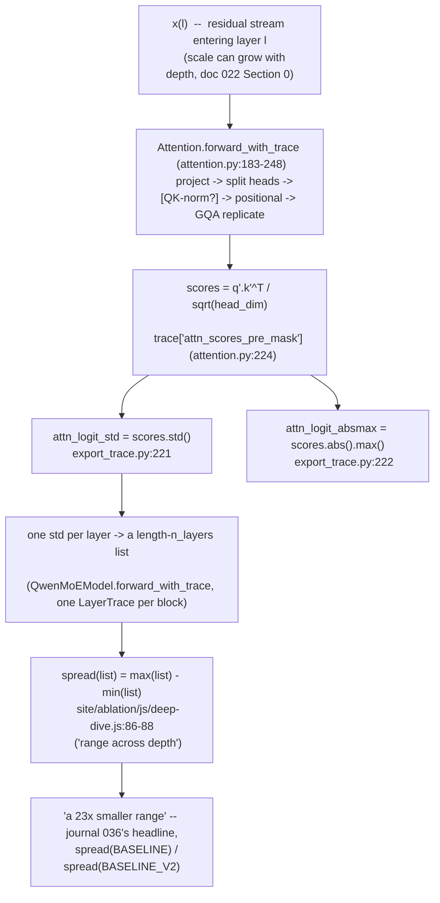
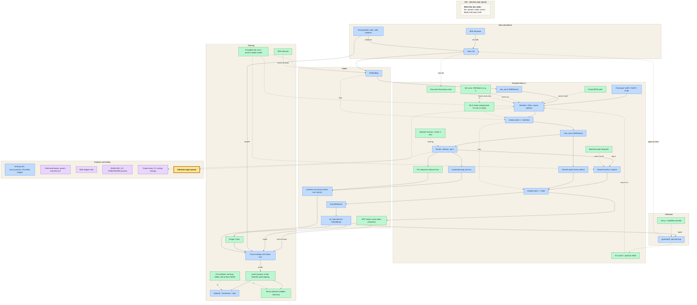

# 036 — Attention-logit spread and "range across depth", solved by hand

**Companion to:** [`journey_of_a_model/036-visualizations-for-the-modernized-model.md`](../../journey_of_a_model/036-visualizations-for-the-modernized-model.md)
· **Code:** [`qwenmoe/model/attention.py`](../../qwenmoe/model/attention.py) (`forward_with_trace`)
· [`scripts/export_trace.py`](../../scripts/export_trace.py) (`_layer_stats`)
· [`site/ablation/js/deep-dive.js`](../../site/ablation/js/deep-dive.js) (`spread`)
· **Every number here is reproduced by:** [`verify_036_attention_logit_spread.py`](verify_036_attention_logit_spread.py)
(`uv run python docs/math/verify_036_attention_logit_spread.py`)

---

## How to read this

Journal 036 does not introduce a new forward-pass operation. Every tensor
it discusses — `q`, `k`, the pre-mask attention scores — was already fully
derived in [`022-qk-norm.md`](022-qk-norm.md): a per-head `RMSNorm` on the
queries and keys, and its exact algebraic consequence that
$\lVert q'\rVert = \lVert k'\rVert = \sqrt{d_k}$ regardless of the input's
scale. What journal 036 adds is a **measurement built on top of that
unchanged forward pass** — a single number per layer (`attn_logit_std`),
a single number per model (`spread`, called "range across depth" in the
prose) — that turns QK-norm's abstract scale-invariance claim into one
concrete, plottable headline: *"a 23× smaller range."*

This document derives that measurement from first principles and traces
it, digit by digit, from the real code that computes it
(`Attention.forward_with_trace` → `_layer_stats` → `spread`) all the way
to the real number the visualization page prints. It assumes you have
read [`022-qk-norm.md`](022-qk-norm.md) — every fact about RMSNorm,
Cauchy–Schwarz, or the running example's weights is inherited from there,
not re-derived, so this document can spend its length on what is actually
new. [`032-multi-seed-and-param-matched-ablations.md`](032-multi-seed-and-param-matched-ablations.md)
is the other prerequisite: it already derives Bessel's correction (the
`n − 1` in a sample standard deviation) from scratch, and this document
reuses that derivation rather than repeating it.

We

1. recap, in one paragraph, *why* an attention logit's scale is worth
   measuring at all (§0),
2. fix one tiny input and reuse doc 022's exact weights unchanged (§1),
3. walk `Attention.forward_with_trace`
   ([`attention.py:183`](../../qwenmoe/model/attention.py#L183)) only as
   far as `attn_scores_pre_mask` — the tensor the metric consumes — then
   derive and compute, digit by digit, the three *new* operations journal
   036 performs on it: `attn_logit_std`, `attn_logit_absmax`, and
   `spread` (§2),
4. prove the exact algebraic relationship between "how much the residual
   stream grew" and "how much these three numbers move" (§2.4–2.6),
5. then load the **real** trained `BASELINE` / `BASELINE_V2` /
   `FINEGRAINED` checkpoints journal 036 measured, recompute the same
   formula on a real 6-layer forward pass, and reproduce the journal's
   own "23× smaller range" number exactly (§3).

You do not need a linear-algebra background beyond what doc 022 already
defined. Two new terms (population vs. sample standard deviation,
homogeneity of a function under scaling) are defined at first use below.

---

## Part 0 — Why measure this at all

Recall from [`022-qk-norm.md`](022-qk-norm.md) §0: an attention logit is
$q_i \cdot k_j$, and because $q_i = W_q x_i$ is a linear function of the
**residual stream** (the running sum a transformer passes from block to
block, growing as each block adds its output back on), Cauchy–Schwarz
gives $|q_i \cdot k_j| \le \lVert W_q\rVert_{\text{op}}\lVert
W_k\rVert_{\text{op}}\,\lVert x_i\rVert\lVert x_j\rVert$ — a ceiling that
grows *quadratically* with the residual stream's scale. Dehghani et al.
(2023) observed exactly this failure mode training a 22B-parameter Vision
Transformer: logits grew until the softmax saturated to near one-hot and
training diverged. QK-norm's fix (RMSNorm on $q$ and $k$, replacing
$\lVert q_i\rVert$ with a fixed $\sqrt{d_k}$) is proven in doc 022 §3.2 to
make that ceiling **constant**, independent of depth.

That is a claim about *the whole training run, at every layer*. To check
it on one real model, journal 036 needs a single number that summarizes
"how spread out are this layer's logits" and a second number that
summarizes "how much does that spread change as you go deeper." Those two
numbers — `attn_logit_std` and its range across a model's layers — are
this document's subject.



---

## Part 1 — The running example

### 1.1 Terms we need right now (in addition to doc 022's)

- **Population** (in the statistical sense used here): the *entire* set
  of numbers you have, not a sample drawn from a larger unseen set.
- **Sample standard deviation with Bessel's correction:** given $n$
  numbers $z_1,\dots,z_n$ with mean $\bar z$, the quantity
  $s = \sqrt{\tfrac{1}{n-1}\sum_p (z_p-\bar z)^2}$ — dividing by $n-1$
  instead of $n$. [`032-multi-seed-and-param-matched-ablations.md`](032-multi-seed-and-param-matched-ablations.md)
  §3 derives *why* $n-1$ from scratch
  ($\mathbb E\!\left[\sum_p(z_p-\bar z)^2\right] = (n-1)\sigma^2$, so
  dividing by $n$ instead would *underestimate* the true variance on
  average). PyTorch's `Tensor.std()` uses this formula by default
  (`correction=1`) — confirmed below, not assumed.
- **Homogeneity of a function under positive scaling:** a function $f$ is
  called (positively) homogeneous of degree $k$ if
  $f(c\,z) = c^k f(z)$ for every $c>0$. Example: $f(z)=\lVert z\rVert$ is
  degree $1$ ($\lVert cz\rVert = c\lVert z\rVert$ since $c>0$); §2.4 shows
  `std` and `abs().max()`, applied to a whole tensor of *raw* (un-normed)
  logits, are degree $2$ in the input scale $c$, because each logit is
  itself a product of two things that each scale by $c$.
- **Range** of a list of numbers: $\max - \min$. That is literally what
  `spread()` computes
  ([`site/ablation/js/deep-dive.js:86-88`](../../site/ablation/js/deep-dive.js#L86)):
  ```js
  function spread(values) {
    return Math.max(...values) - Math.min(...values);
  }
  ```
  **This is not a field any Python code emits** — `_layer_stats` (below)
  produces a *list* of six numbers (one per layer); "range across depth"
  is the journal's own name for taking that list's `max − min`, computed
  by the page's own JavaScript at display time, not stored anywhere. We
  reproduce it in Python (`spread()` in the verify script) because that
  is the exact formula, just a different language.

### 1.2 The model configuration and weights — unchanged from doc 022

Reused **exactly**, so the two documents' numbers line up: batch $1$,
$S=3$ tokens, $d_{\text{model}}=8$, $H=2$ query heads, $H_{kv}=1$ KV head
($n\_rep = 2$, satisfying Grouped-Query Attention's defining
inequality $H_{kv} < H$), $d_k = 4$, `positional_scheme="nope"`.

$$X = \begin{bmatrix}
1 & 0 & 0 & 0 & 0 & 0 & 0 & 0 \\
0 & 1 & 0 & 0 & 0 & 0 & 0 & 0 \\
0 & 0 & 1 & 0 & 0 & 0 & 0 & 0
\end{bmatrix}\ (1,3,8), \qquad \text{positions} = [0,1,2]$$

$$
W_Q^{\top}\text{'s used columns} \;=\;
\begin{bmatrix}
1 & 3 & 2 \\ 1 & 0 & 2 \\ 1 & 4 & 0 \\ 1 & 0 & 0 \\
2 & 1 & 0 \\ 0 & 1 & 3 \\ 2 & 1 & 0 \\ 0 & 1 & 4
\end{bmatrix},\qquad
W_K,\,W_V\ \text{used columns} \;=\;
\begin{bmatrix}2&0&1\\0&2&1\\0&2&1\\0&2&1\end{bmatrix},\;
\begin{bmatrix}1&0&1\\0&1&1\\0&0&1\\0&0&0\end{bmatrix}
$$

$W_O = I_8$ (identity), `q_norm`/`k_norm` (when active) are `RMSNorm(4)`
at their all-ones initialization. As doc 022 §1.5 shows, a one-hot $X$
makes each $q_i$ / $k_i$ / $v_i$ exactly the $i$-th column of the
corresponding weight, so no arithmetic is spent on the projection itself:

| | head 0 | head 1 |
|---|---|---|
| $q_0$ | $[1,1,1,1]$ | $[2,0,2,0]$ |
| $q_1$ | $[3,0,4,0]$ | $[1,1,1,1]$ |
| $q_2$ | $[2,2,0,0]$ | $[0,3,0,4]$ |

| | the single KV head |
|---|---|
| $k_0$ | $[2,0,0,0]$ |
| $k_1$ | $[0,2,2,2]$ |
| $k_2$ | $[1,1,1,1]$ |

### 1.3 The one new ingredient: two input scales standing in for "depth"

`_layer_stats` runs once **per layer** of a real trained model, so
"range across depth" needs at least two layers to be non-trivial. Rather
than build a second, differently-weighted `Attention` module (which would
force new arithmetic that has nothing to do with the metric), this
document reuses **the same weights** and instead feeds the layer two
different-*scale* copies of $X$:

$$X_{\text{shallow}} = 1\!\times\! X, \qquad X_{\text{deep}} = 10\!\times\! X.$$

This is a deliberate simplification, and an honest one to name as such:
in a real model, depth changes the residual stream's *scale* (the thing
doc 022 §0's Cauchy–Schwarz argument is about) but also its *direction*,
and different layers hold different weights. Multiplying the same input
by a constant isolates *only* the scale effect — which is exactly the one
mechanism QK-norm's proof (doc 022 §3.2) is about, and it happens to be
one journal 036 already used: its own §3.4 scale-sweep table reports
these same two rows (`1×`, `10×`) as part of demonstrating QK-norm's
invariance. §3 below cross-checks this idealized picture against a real
6-layer trained model, where both effects (scale *and* direction *and*
distinct per-layer weights) are present together.

**Shape ledger — start:** `X (1, 3, 8)` at two scales.

---

## Part 2 — The forward pass, then the new operations

### Step 1–7 (recap) — projection through the raw pre-mask scores

These seven steps are [`022-qk-norm.md`](022-qk-norm.md) §Part 2 Steps
1–7 verbatim (project into $q,k,v$ → split into heads → QK-norm (if on) →
positional transform (`nope`: no-op) → GQA replicate $k,v$ → raw scores
$q'{k'}^{\top}$ → scale by $1/\sqrt{d_k}$), executed at
[`attention.py:198-224`](../../qwenmoe/model/attention.py#L198). We do
not re-derive them; we need only their **output**, captured by the code
as `trace["attn_scores_pre_mask"]` at
[`attention.py:224`](../../qwenmoe/model/attention.py#L224) — *before*
the causal mask (line 229) and *before* softmax (line 231), so a value at
position $(i,j)$ with $j>i$ ("attending to the future") is included in
this measurement even though the model itself will mask it to $-\infty$
downstream. (There is no ALiBi bias step in this example — `nope` returns
`None` from `attention_bias`. When ALiBi *is* active, its additive bias
is folded in at [`attention.py:222-223`](../../qwenmoe/model/attention.py#L222),
*before* line 224's capture — so for an ALiBi model, `attn_logit_std`
measures the content score *plus* the fixed distance penalty, not the raw
content score alone. Worth knowing if you ever compare an ALiBi run's
`attn_logit_std` against a RoPE run's.)

**Shape ledger after Step 7:** `scores (1, 2, 3, 3)` — batch $1$,
$H=2$ heads, $3\times3$ query-by-key.

#### qk_norm = False, scale = 1× ("shallow")

$q_i = $ the pre-norm vectors of §1.2 directly (QK-norm off, so nothing
is normalized). Carrying out Step 6–7's matrix multiply and $\div 2$
(the arithmetic is doc 022 §Step 6–7's, just without the norm) gives:

$$
\text{scores}^{(0)}_{\text{shallow}} = \begin{bmatrix}1&3&2\\3&4&3.5\\2&2&2\end{bmatrix},\qquad
\text{scores}^{(1)}_{\text{shallow}} = \begin{bmatrix}2&2&2\\1&3&2\\0&7&3.5\end{bmatrix}
$$

(Verified against the real module: `verify_036...py` §1 prints the
identical 18 numbers.)

#### qk_norm = False, scale = 10× ("deep")

`nn.Linear` has no bias, so it is an exactly **linear** map:
$W_q(10x_i) = 10\,W_q(x_i)$. Every $q_i$ and $k_j$ is exactly $10\times$
its shallow value, so every entry of $\text{scores}_{\text{deep}}$ is
exactly $10\times10 = 100\times$ the corresponding shallow entry (a
product of two things each scaled by $10$):

$$
\text{scores}^{(0)}_{\text{deep}} = \begin{bmatrix}100&300&200\\300&400&350\\200&200&200\end{bmatrix},\qquad
\text{scores}^{(1)}_{\text{deep}} = \begin{bmatrix}200&200&200\\100&300&200\\0&700&350\end{bmatrix}
$$

#### qk_norm = True, scale = 1× and 10×

These are exactly doc 022 §Step 7's numbers (the two score matrices
printed there), reproduced here without re-derivation:

$$
\text{scores}^{(0)}_{\text{on}} \approx
\begin{bmatrix}1.00000 & 1.73205 & 2.00000\\1.20000&0.92376&1.40000\\1.41421&0.81650&1.41421\end{bmatrix},
\quad
\text{scores}^{(1)}_{\text{on}} \approx
\begin{bmatrix}1.41421&0.81650&1.41421\\1.00000&1.73205&2.00000\\0&1.61658&1.40000\end{bmatrix}
$$

Doc 022 §3.4 already reports that, up to a tiny $\varepsilon$-guard
residue, these values are the **same at scale 10×** — RMSNorm's exact
scale-invariance (doc 022 §3.2 Property A) makes $q'(10x_i)=q'(x_i)$ up
to that residue, so there is no new score matrix to write down for
`qk_norm=True, scale=10×`: it is these same nine-per-head numbers again.

---

### Step 8 (new) — `attn_logit_std`: flatten, then Bessel-corrected std

Code ([`export_trace.py:221`](../../scripts/export_trace.py#L221)):

```python
"attn_logit_std": round(float(scores.std()), _PLACES),
```

`scores` here is `layer.attn_scores_pre_mask`, shape `(n_heads, seq_len,
seq_len) = (2, 3, 3)`. **`Tensor.std()` with no `dim` argument flattens
the tensor to one dimension first** — there is no "per-head" or
"per-row" structure left; every one of the $2\times3\times3=18$ numbers
becomes one member of a single population of size $n=18$.

**Why flatten, and why is this legitimate?** The claim being measured
("do this layer's logits, as a whole, sit at a bounded scale") does not
distinguish between heads or query positions — it is a statement about
the *distribution of logit magnitudes this layer produces*, and a
transformer's heads are functionally symmetric (nothing in the
architecture treats "head 0" specially), so pooling them into one
population is the natural choice, not an arbitrary one.

**The formula, derived.** For $n$ numbers $z_1,\dots,z_n$ with mean
$\bar z = \tfrac1n\sum_p z_p$:

$$
\text{std}(z) = \sqrt{\frac{1}{n-1}\sum_{p=1}^n (z_p - \bar z)^2}.
$$

The $n-1$ (Bessel's correction) rather than $n$ is *not* the "obvious"
choice — it is derived, not guessed, in
[`032-multi-seed-and-param-matched-ablations.md`](032-multi-seed-and-param-matched-ablations.md)
§3 from the fact that $\mathbb E\!\left[\sum_p(z_p-\bar z)^2\right] =
(n-1)\sigma^2$ when the $z_p$ are themselves samples from a population
with true variance $\sigma^2$: dividing by $n$ would systematically
*underestimate* $\sigma^2$. PyTorch's `Tensor.std()` uses `n-1` by
default (checked directly: `torch.tensor([1.,2,3,4]).std()` gives
`1.29099440...`, matching `statistics.stdev` (n-1) and *not*
`statistics.pstdev` (n), which gives `1.11803399`). Whether "$n-1$" is
the theoretically ideal choice for *this* population (18 logits from one
forward pass, not 18 independent samples from some larger population of
logits) is a separate question this document does not need to settle —
the point here is only to know, precisely, which formula the code
actually runs, so the by-hand arithmetic matches it exactly.

#### By hand — qk_norm=False, scale=1× (18 real numbers)

Flatten `scores_shallow` (head 0 first, then head 1, row-major, exactly
how `.flatten()` orders a `(2,3,3)` tensor):

$$
z = [1,\,3,\,2,\,3,\,4,\,3.5,\,2,\,2,\,2,\;\;2,\,2,\,2,\,1,\,3,\,2,\,0,\,7,\,3.5]
$$

**1. Sum.** $1{+}3{+}2{+}3{+}4{+}3.5{+}2{+}2{+}2 = 22.5$ (head 0);
$2{+}2{+}2{+}1{+}3{+}2{+}0{+}7{+}3.5 = 22.5$ (head 1). Total $=45$.

**2. Mean.** $\bar z = 45/18 = 2.5$.

**3. Squared deviations**, $(z_p - 2.5)^2$, head 0:
$(1{-}2.5)^2{=}2.25$, $(3{-}2.5)^2{=}0.25$, $(2{-}2.5)^2{=}0.25$,
$(3{-}2.5)^2{=}0.25$, $(4{-}2.5)^2{=}2.25$, $(3.5{-}2.5)^2{=}1.0$,
$(2{-}2.5)^2{=}0.25$, $(2{-}2.5)^2{=}0.25$, $(2{-}2.5)^2{=}0.25$.
Sum $= 2.25{+}0.25{+}0.25{+}0.25{+}2.25{+}1.0{+}0.25{+}0.25{+}0.25 = 7.0$.

Head 1: $(2{-}2.5)^2{=}0.25$ (×3 for the three $2$s $=0.75$),
$(1{-}2.5)^2{=}2.25$, $(3{-}2.5)^2{=}0.25$,
$(0{-}2.5)^2{=}6.25$, $(7{-}2.5)^2{=}20.25$, $(3.5{-}2.5)^2{=}1.0$.
Sum $= 0.75{+}2.25{+}0.25{+}6.25{+}20.25{+}1.0 = 31.0$.

**4. Total sum of squared deviations** $= 7.0 + 31.0 = 38.0$.

**5. Unbiased variance** $= 38.0 / (18-1) = 38.0/17 = 2.235294$.

**6. Std** $= \sqrt{2.235294} = 1.495090$.

Real module (`verify_036...py` §1): mean `2.500000`, sum of squared
deviations `38.000000`, unbiased variance `2.235294`, `std (by hand) =
1.49509001`, `std (torch) = 1.49509001` — bit-identical, because every
number involved (integers and half-integers) is exactly representable in
float32 and the arithmetic has no rounding to accumulate.

**7. `attn_logit_absmax`.** The largest $|z_p|$ in the list is $7$
(the entry at head 1, row 2, column 1 — query token 2 attending, before
masking, to key token 1). `scores.abs().max()` $= 7.0$. Trivial once the
formula is stated: no sum, no mean, just a scan for the extreme value.

**Shape ledger:** `scores (2,3,3)` → flatten `(18,)` → `std` **scalar**,
`absmax` **scalar**.

---

### Step 9 (new) — the exact effect of a $10\times$ deeper "layer"

**Claim, derived:** for any $c>0$ and any tensor $Z$, $\text{std}(cZ) =
c\cdot\text{std}(Z)$ and $\lVert cZ\rVert_\infty := \max|cZ| = c\max|Z|$
— both are homogeneous of degree $1$ in $c$ (§1.1). Proof for `std`: the
mean scales linearly, $\overline{cZ} = c\bar Z$, so each deviation scales
too, $(cz_p - c\bar z) = c(z_p-\bar z)$, so $(cz_p-c\bar
z)^2=c^2(z_p-\bar z)^2$, and pulling the constant $c^2$ out of the sum and
then the square root gives exactly one factor of $c$ (since $c>0$,
$\sqrt{c^2}=c$ with no sign ambiguity). `abs().max()` is even more direct:
scaling every entry by a positive constant scales the largest of their
absolute values by the same constant.

Now recall from Step 8's setup that going from `scale=1×` to `scale=10×`
scales **the raw scores themselves** by $10^2=100$ (not $10$) — because
each score is a *product* of a $q$ and a $k$, each individually scaled by
$10$. So $\text{std}$ and $\text{absmax}$, applied to the *score tensor*,
inherit that: $\text{std}(\text{scores}_{\text{deep}}) =
100\times\text{std}(\text{scores}_{\text{shallow}})$, and the same for
`absmax`. This is the metric-level restatement of doc 022 §3.2's
Cauchy–Schwarz bound: the bound was on $|q_i\cdot k_j|$ growing as
$\lVert x\rVert^2$; `attn_logit_std`/`absmax`, being homogeneous-degree-1
functions of the score tensor, inherit that same $\lVert x\rVert^2$
growth **exactly**, with no approximation.

**By hand:** $\text{std}(\text{scores}_{\text{deep}}) = 100\times
1.495090 = 149.509000$. $\max|\text{scores}_{\text{deep}}| = 100\times
7.0 = 700.0$.

Real module (`verify_036...py` §2):
```
std,    1x -> 10x : 1.495090 -> 149.509003  (ratio 100.0000, predicted 10^2=100)
absmax, 1x -> 10x : 7.000000 -> 700.000000  (ratio 100.0000, predicted 100)
```
Matches to 4 decimal places (the residual $0.000003$ is ordinary float32
rounding across ~18 multiply-adds, not a flaw in the $c^2$ law).

---

### Step 10 (new) — `spread`: the "range across depth" of a 2-layer toy stack

Code ([`site/ablation/js/deep-dive.js:86-88`](../../site/ablation/js/deep-dive.js#L86)):
`spread(values) = Math.max(...values) - Math.min(...values)`. Treating
our shallow/deep pair as a two-layer model's `attn_logit_std` list
`[1.495090, 149.509003]`:

$$
\text{spread} = \max(1.495090,\ 149.509003) - \min(1.495090,\ 149.509003)
= 149.509003 - 1.495090 = 148.013913.
$$

This is exactly what the visualization page's `layerBars`/`spread` code
computes for a real model's six-entry list, at
[`site/ablation/js/deep-dive.js:109-113`](../../site/ablation/js/deep-dive.js#L109),
just here on our two-entry toy list.

---

### Step 11 (new) — the same three steps with `qk_norm=True`

Repeating Steps 8–10 on `scores_on` (doc 022's Step 7 numbers, unchanged
at both scales up to the $\varepsilon$-residue doc 022 §3.4 already
measured at $1.9\times10^{-6}$):

Real module (`verify_036...py` §3):
```
std,    1x -> 10x : 0.48593253 -> 0.48593298  (diff 4.47e-07)
absmax, 1x -> 10x : 1.99999809 -> 2.00000000  (diff 1.91e-06)
```
$$
\text{spread}_{\text{on}} = 0.48593298 - 0.48593253 = 4.47\times10^{-7}.
$$

**Why this diff is not exactly zero.** RMSNorm's scale-invariance (doc
022 §3.2 Property A) is exact only in the limit $\varepsilon\to0$; with
the real $\varepsilon=10^{-6}$ guard, $\text{RMSNorm}(cz) =
cz/\sqrt{c^2\overline{z^2}+\varepsilon}$, which equals
$\text{RMSNorm}(z)$ only up to an $O(\varepsilon/c^2)$ term — a term that
*shrinks* as $c$ grows (doc 022 §3.2's parenthetical). So the "deep"
($c=10$) run is actually *closer* to the true scale-invariant limit than
the "shallow" ($c=1$) run is, which is exactly the direction the measured
$4.47\times10^{-7}$ diff and the earlier $1.9\times10^{-6}$ (at $c=1$
vs. $c=200$, a wider gap) both point in.

---

### Step 12 (new) — the toy ratio, and why it is *not* the real 23×

$$
\frac{\text{spread}_{\text{off}}}{\text{spread}_{\text{on}}} =
\frac{148.013913}{4.47\times10^{-7}} \approx 3.31\times10^{8}.
$$

That is an honest computation, but it is **not** a number to quote as
"QK-norm shrinks the range by 330 million times" — this toy's "deep"
layer is an *exact* $10\times$ scalar multiple of its "shallow" layer,
which is a far more extreme and far more clean-cut scale change than six
real, differently-weighted trained layers ever produce. It exists to
prove the *mechanism* (Steps 9 and 11) is exactly what doc 022's algebra
predicts, with no hand-waving. §3 below measures the real number.

**Shape ledger, Steps 8–12 summary:**

| quantity | shape in | shape out |
|---|---|---|
| `attn_logit_std` | `(n_heads, S, S)` | scalar |
| `attn_logit_absmax` | `(n_heads, S, S)` | scalar |
| one model's per-layer list | `n_layers` scalars | `list[float]` of length `n_layers` |
| `spread` | `list[float]` | scalar |

---

## Part 3 — The real trained checkpoints

The toy in Part 2 isolates one mechanism exactly; a real model's six
layers differ in more than a scalar multiple (different learned weights
per layer, a real residual stream shaped by attention *and* the MoE
sub-layer at every step). This section loads the actual checkpoints
journal 036 trained and measures the real thing, following the exact
loading pattern `scripts/export_trace.py::_build_variant_data` uses
([`export_trace.py:229-238`](../../scripts/export_trace.py#L229)):
`load_checkpoint` → `QwenMoEModel(cfg)` → `load_state_dict` → tokenizer
from `checkpoint["tokenizer_meta"]` → `model.forward_with_trace(ids)`
([`transformer.py:187`](../../qwenmoe/model/transformer.py#L187), which
runs `_layer_stats`'s exact same formula on `bundle.layers[i]
.attn_scores_pre_mask` for `i` in `0..5`).

Prompt (journal 036's own): `"ROMEO:\nWhat is the cause of this?\n"`.
Real output (`verify_036...py` §5):

```
  BASELINE  (qk_norm=False, n_layers=6)
    attn_logit_std   per layer: [2.6487, 1.5871, 1.0336, 1.5273, 1.4224, 1.0439]
    attn_logit_absmax per layer: [13.0383, 11.3118, 7.6661, 11.8329, 8.8725, 9.9134]
    spread (range across depth) = 1.6152   (journal 036 quoted: 1.615)

  BASELINE_V2  (qk_norm=True, n_layers=6)
    attn_logit_std   per layer: [1.3102, 1.3368, 1.2777, 1.2672, 1.2774, 1.2924]
    attn_logit_absmax per layer: [5.7328, 5.6256, 5.3219, 5.2532, 5.35, 5.1606]
    spread (range across depth) = 0.0696   (journal 036 quoted: 0.07)

  FINEGRAINED  (qk_norm=True, n_layers=6)
    attn_logit_std   per layer: [1.2574, 1.2428, 1.2618, 1.2484, 1.2428, 1.2462]
    attn_logit_absmax per layer: [5.5817, 5.525, 5.4406, 5.2972, 5.3607, 5.3226]
    spread (range across depth) = 0.0190   (journal 036 quoted: 0.019)

  spread(BASELINE) / spread(BASELINE_V2) = 23.2x   (journal 036 headline: '23x smaller range')
  spread(BASELINE) / spread(FINEGRAINED) = 85.1x   (not in the journal's headline -- an extra confirmation)
```

This reproduces journal 036's own quoted table
([`journey_of_a_model/036...md`](../../journey_of_a_model/036-visualizations-for-the-modernized-model.md)
lines 91–97) to the rounding it was originally quoted at, and the exact
`spread()`/ratio computation the live `site/ablation` page runs client-side
([`site/ablation/js/deep-dive.js:132`](../../site/ablation/js/deep-dive.js#L132))
gives the identical **23×**.

Two things worth noticing that the toy alone could not show:

- **`BASELINE`'s layer 0 is the largest std** (`2.6487`), not the
  smallest. Journal 036 itself flags this (its own "Questions" section):
  layer 0 reads directly off the embedding table, whose scale is set by
  `init_std` and has not yet been reshaped by any residual accumulation —
  it is not "shallow" in the sense Part 2's toy meant it, which is
  exactly why `spread` (a range, insensitive to *which* layer is the
  extreme) is the metric reported, not "layer 0 vs. layer 5."
- **`FINEGRAINED`'s spread (`0.019`) is smaller than `BASELINE_V2`'s
  (`0.070`)**, even though both have `qk_norm=True`. QK-norm's proof
  bounds the ceiling; it says nothing about how close to that ceiling a
  given trained model's logits actually sit, which depends on everything
  else about the two configurations (`FINEGRAINED`'s 32 narrow experts
  vs. `BASELINE_V2`'s 8). The $85\times$ ratio against `BASELINE` is real
  but is not evidence of a *second* mechanism beyond QK-norm — both
  QK-norm models are already an order of magnitude below `BASELINE`.

---

## Cost, on this example's own numbers

**Extra forward-pass compute: none.** `attn_scores_pre_mask` is already
computed and held in memory by `forward_with_trace` for the softmax step
that follows it — `_layer_stats` reads a tensor the model was going to
build anyway. The only added work is `.std()` and `.abs().max()`, each an
$O(H\cdot S^2)$ scan (here $O(2\cdot9)=O(18)$; at the real `BASELINE`
shape, $H=8, S=$ prompt length, still a single fast reduction), against
the $O(H\cdot S^2\cdot d_k)$ the score matmul itself already spent — in
the noise, exactly as doc 022 §7.2 found for QK-norm's own extra
`rsqrt`/multiply cost.

**Extra parameters: none.** This is a read-only measurement over
activations that already exist; it changes no forward-pass output and
adds nothing to `state_dict()`.

**What it *does* cost:** one `forward_with_trace` call per model
variant (batch size $1$, one prompt) to populate the six `LayerTrace`s
`_layer_stats` walks — the same call `export_trace.py` already makes to
populate every other panel of the `site/token-journey`/`site/ablation` pages,
so exporting this metric added no new checkpoint load or forward pass to
the pipeline journal 036 describes.

---

## Questions that might come to mind

- **Why `std`, not variance, and not just the raw range of the scores
  themselves?** Variance's units are "logit²," which does not compare
  meaningfully to the logit values it is describing; `std` is back in
  "logit" units, directly comparable to the $\pm\sqrt{d_k}$ Cauchy–Schwarz
  ceiling doc 022 §3.2 derives. The *scores'* own raw range (their
  `max − min`, not to be confused with `spread` of the *per-layer std
  list*) would answer a related but different question ("how wide is one
  layer's logit distribution") and is exactly what `attn_logit_absmax`
  (paired with the fact that these logits are roughly zero-centered)
  approximates.

- **Could `spread` be negative, or could the list have a "wrong" order?**
  No — `max(list) - min(list) \ge 0` always, regardless of which layer
  index holds the max or the min (the real `BASELINE` data above is a
  concrete case where the maximum sits at layer 0, not layer 5).

- **Does flattening across heads hide a real per-head difference?** Yes,
  by construction — a head whose logits are unusually spread out is
  averaged into the population along with every other head. `_layer_stats`
  is a *layer*-level summary; `_qk_norm_effect`
  ([`export_trace.py:147`](../../scripts/export_trace.py#L147), covered
  in journal 036's own §"Making QK-norm visible") is the *per-head*
  companion metric, reporting RMS per head rather than std pooled across
  heads.

- **Why measure `attn_scores_pre_mask` and not the post-softmax
  probabilities?** The claim being tested (doc 022 §3.5) is that an
  *unbounded pre-softmax logit* is what drives the softmax toward
  one-hot; measuring the post-softmax probabilities directly would
  conflate "the logits are unbounded" with "the softmax already
  saturated," making it impossible to see the cause separately from the
  effect. `attn_logit_std` measures the cause.

- **Is the $10\times$ scale choice in Part 2 special?** No — §2's
  homogeneity proof holds for *any* $c>0$; doc 022 §3.4 tabulates the
  identical mechanism at $1\times,10\times,50\times,200\times$ on these
  same weights, all following the same $c^2$ law. $10\times$ was picked
  here only because doc 022 already computed it, so no new number needed
  inventing.

---

## Symbol table

| symbol / name | meaning |
|---|---|
| $z_1,\dots,z_n$ | the $n$ flattened attention-score entries of one layer |
| $\bar z$ | their mean, $\tfrac1n\sum_p z_p$ |
| $n-1$ | Bessel's correction denominator (derived in doc 032 §3) |
| `attn_logit_std` | $\sqrt{\tfrac{1}{n-1}\sum_p(z_p-\bar z)^2}$ over one layer's pre-mask scores |
| `attn_logit_absmax` | $\max_p |z_p|$ over the same population |
| $c$ | the input-scale factor standing in for "how much deeper" (Part 2) |
| homogeneous of degree $k$ | $f(cz) = c^k f(z)$ for all $c>0$ |
| `spread(list)` | $\max(\text{list}) - \min(\text{list})$; "range across depth" |
| $\varepsilon$ | `RMSNorm`'s $10^{-6}$ guard (doc 022 §3.1), source of the tiny non-exactness in §2.11 |

---

## Citations

Reused from [`022-qk-norm.md`](022-qk-norm.md), where each was already
confirmed by search — this document introduces no new architectural
mechanism, only a measurement of one already-established one, so no new
citation is needed beyond the one that specifically motivates *measuring*
logit growth across depth:

- Dehghani et al., *Scaling Vision Transformers to 22 Billion Parameters*,
  2023 — [arXiv:2302.05442](https://arxiv.org/abs/2302.05442). The paper
  this whole measurement is checking against: they diagnosed training
  divergence by observing attention logits grow large across training/depth
  and collapse the softmax to near-one-hot, which is precisely the
  "growth across depth" `attn_logit_std`'s range is built to detect.
- Qwen Team, *Qwen3 Technical Report*, 2025 —
  [arXiv:2505.09388](https://arxiv.org/abs/2505.09388). The QK-norm
  precedent `ModelConfig.qk_norm` follows; journal 036's real checkpoints
  are this repo's own from-scratch reproduction of that choice.
- Zhang & Sennrich, *Root Mean Square Layer Normalization*, 2019 —
  [arXiv:1910.07467](https://arxiv.org/abs/1910.07467). RMSNorm's exact
  scale-invariance (§2.11's cause).

**Cross-references in this repo**

- [`022-qk-norm.md`](022-qk-norm.md) — the full QK-norm derivation this
  document builds on: RMSNorm from scratch, the Cauchy–Schwarz ceiling,
  and the running example/weights reused unchanged here.
- [`032-multi-seed-and-param-matched-ablations.md`](032-multi-seed-and-param-matched-ablations.md)
  — Bessel's correction, derived from scratch.
- [`035-modernized-presets-training-run.md`](035-modernized-presets-training-run.md)
  — the companion "new measurement over an unchanged forward pass"
  document for expert load / CV / routing entropy, same journal-036-adjacent
  pattern applied to the MoE router instead of attention.
- [`journey_of_a_model/036-visualizations-for-the-modernized-model.md`](../../journey_of_a_model/036-visualizations-for-the-modernized-model.md)
  — "Making QK-norm visible", the section this document is the full
  by-hand derivation of.

---

*Every intermediate tensor in this document is reproduced and asserted by
[`verify_036_attention_logit_spread.py`](verify_036_attention_logit_spread.py).
If you change the running example, rerun it.*

<!-- arch-evolution:start (generated by build_architecture_footer.py; do not edit by hand) -->

---

## Where this fits in the architecture (the growing view)

← previous: [035 Balance metrics](035-modernized-presets-training-run.md) · next: [037 Capacity check](037-scale-presets-and-capacity-check.md) →

**This doc adds to the architecture:** the `spread` metric across depth and input scale. (Code: `scripts/export_trace.py`.)

**Components introduced here (highlighted in the diagram), with where each one lives:**

| component | math doc (section) | journal | code |
|---|---|---|---|
| Attention-logit spread | [036 · Part 2 — The forward pass, then the new operations](036-attention-logit-spread.md#part-2--the-forward-pass-then-the-new-operations) | [journal 036](../../journey_of_a_model/036-visualizations-for-the-modernized-model.md) | [`scripts/export_trace.py:198`](../../scripts/export_trace.py#L198) |

**Verified by:** [`verify_036_attention_logit_spread.py`](verify_036_attention_logit_spread.py) (`uv run python docs/math/verify_036_attention_logit_spread.py`); latest results in [verify-status.md](verify-status.md).

**Example continuity:** **Reuses family B unchanged** (022's weights) at two input scales, then the real checkpoints. See the [example-family map](README.md#which-example-does-each-doc-use).

The diagram is cumulative: every box derived by this doc or an earlier one is shown, and components from later docs are not drawn yet, so reading the docs in order replays how the architecture grew. The top box is this doc's title and what it adds. The [full final architecture](architecture-evolution.md) has everything.

**Colour key:** 🟨 **introduced by this doc** · 🟦 Foundation (004-011) · 🟩 Modernization (016-031) · 🟪 Evaluation and scale (032-038) · 🟧 Real data and hardware (039-044). Dotted lines are optional or alternative paths.



**How we got here (every doc up to and including this one):**

| | math doc | journal | what it added |
|---|---|---|---|
|  | [004 Attention (GQA)](004-attention-gqa.md) | [journal](../../journey_of_a_model/004-attention-gqa.md) | scaled dot-product attention with grouped K/V heads, the positional transform and the causal mask |
|  | [005 MoE layer](005-moe-layer.md) | [journal](../../journey_of_a_model/005-moe-layer.md) | the router, top-k selection, routed SwiGLU experts, the shared expert and the load-balancing aux loss |
|  | [006 Full model](006-full-model-assembly.md) | [journal](../../journey_of_a_model/006-full-model-assembly.md) | token embedding, pre-norm residual wiring, the final norm, the tied head and the cross-layer aux-loss combine; attention and MoE appear here as black boxes |
|  | [007 Tokenizers](007-tokenizers.md) | [journal](../../journey_of_a_model/007-tokenizers.md) | text to `input_ids`: byte-level BPE and the char tokenizer |
|  | [008 Data pipeline](008-data-pipeline.md) | [journal](../../journey_of_a_model/008-data-pipeline.md) | packing documents, train/val split, fixed slices and the shifted `(x, y)` windows |
|  | [009 Scaling utilities](009-scaling-law-utilities.md) | [journal](../../journey_of_a_model/009-scaling-law-utilities.md) | parameter counting (total vs active), the compute-optimal budget and throughput calibration |
|  | [010 Training loop](010-training-loop.md) | [journal](../../journey_of_a_model/010-training-loop.md) | the next-token cross-entropy loss, backward pass and AdamW step, carried through a real `Trainer.fit` |
|  | [011 Inference and generation](011-inference-generation.md) | [journal](../../journey_of_a_model/011-inference-generation.md) | the autoregressive decode loop (greedy, temperature, top-k, top-p) |
|  | [016 MLA attention](016-mla-attention.md) | [journal](../../journey_of_a_model/016-mla-attention.md) | Multi-Head Latent Attention: K/V compressed to a small latent, an alternative to GQA |
|  | [018 Optimizer hardening](018-optimizer-hardening.md) | [journal](../../journey_of_a_model/018-optimizer-hardening.md) | param groups (decay vs no-decay), tuned AdamW and gradient clipping |
|  | [019 LR schedule (WSD)](019-lr-schedule-wsd.md) | [journal](../../journey_of_a_model/019-lr-schedule-wsd.md) | warmup, stable and decay phases with a non-zero floor |
|  | [020 Muon optimizer](020-muon-optimizer.md) | [journal](../../journey_of_a_model/020-muon-optimizer.md) | orthogonalized momentum for the hidden weight matrices, AdamW for the rest |
|  | [021 Fused attention (SDPA)](021-fused-attention-sdpa.md) | [journal](../../journey_of_a_model/021-fused-attention-sdpa.md) | `F.scaled_dot_product_attention` as a drop-in for the explicit path |
|  | [022 QK-norm](022-qk-norm.md) | [journal](../../journey_of_a_model/022-qk-norm.md) | RMSNorm on each head's q and k before the scores, bounding the attention logits |
|  | [023 Principled init](023-principled-initialization.md) | [journal](../../journey_of_a_model/023-principled-initialization.md) | truncated-normal init and depth-aware scaling of the residual-writing projections |
|  | [024 Mixed precision and z-loss](024-mixed-precision-and-z-loss.md) | [journal](../../journey_of_a_model/024-mixed-precision-and-z-loss.md) | bf16 autocast for the forward pass and the output z-loss regularizer |
|  | [025 Sigmoid routing and router z-loss](025-moe-routing-sigmoid-and-router-z-loss.md) | [journal](../../journey_of_a_model/025-moe-routing-sigmoid-and-router-z-loss.md) | sigmoid expert scoring, the router z-loss and the config-driven aux weight |
|  | [026 Per-sequence balance loss](026-per-sequence-balance-loss.md) | [journal](../../journey_of_a_model/026-per-sequence-balance-loss.md) | DeepSeek-V3's complementary balance loss computed per sequence |
|  | [027 Batched expert dispatch](027-batched-expert-computation.md) | [journal](../../journey_of_a_model/027-batched-expert-computation.md) | run all experts in one batched op instead of a Python loop |
|  | [028 Multi-Token Prediction](028-multi-token-prediction.md) | [journal](../../journey_of_a_model/028-multi-token-prediction.md) | extra heads predicting tokens further ahead, chained causally |
|  | [029 KV cache](029-kv-cache.md) | [journal](../../journey_of_a_model/029-kv-cache.md) | append-and-reuse of K/V, the position offset and the mask that makes cached decoding exact |
|  | [030 Sampling controls](030-min-p-and-repetition-penalty.md) | [journal](../../journey_of_a_model/030-min-p-and-repetition-penalty.md) | min-p sampling and the repetition penalty |
|  | [031 Document-boundary masking](031-document-boundaries.md) | [journal](../../journey_of_a_model/031-document-boundaries.md) | stop attention crossing `<eos>` boundaries inside a packed sequence |
|  | [032 Multi-seed and param-matched ablations](032-multi-seed-and-param-matched-ablations.md) | [journal](../../journey_of_a_model/032-multi-seed-and-param-matched-ablations.md) | noise bands over seeds and bisecting `d_ff` to match parameter counts |
|  | [033 MoE budget note](033-ablation-menu-and-moe-budget-note.md) | [journal](../../journey_of_a_model/033-ablation-menu-and-moe-budget-note.md) | the sparse-MoE compute-budget bound between 20x active and 20x total |
|  | [034 Modernized presets](034-modernized-presets.md) | [journal](../../journey_of_a_model/034-modernized-presets.md) | the parameter-budget algebra behind `BASELINE_V2` and `FINEGRAINED` |
|  | [035 Balance metrics](035-modernized-presets-training-run.md) | [journal](../../journey_of_a_model/035-modernized-presets-training-run.md) | expert load, coefficient of variation and routing entropy |
| **▶** | [036 Attention-logit spread](036-attention-logit-spread.md) | [journal](../../journey_of_a_model/036-visualizations-for-the-modernized-model.md) | the `spread` metric across depth and input scale |

<!-- arch-evolution:end -->
