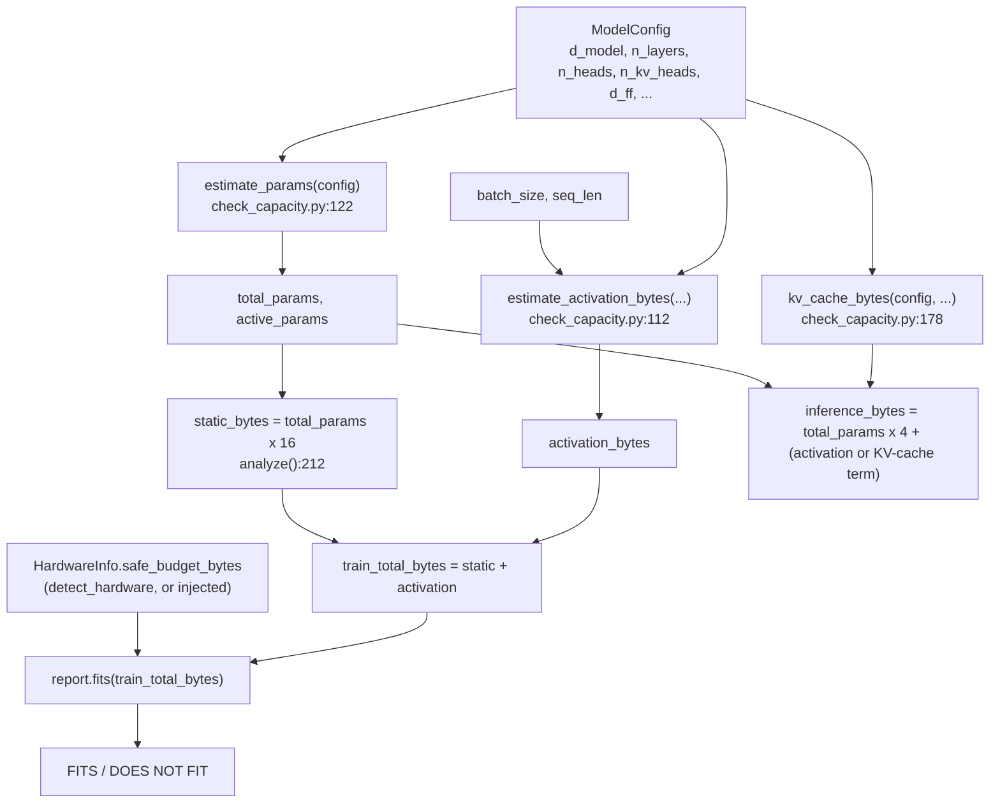
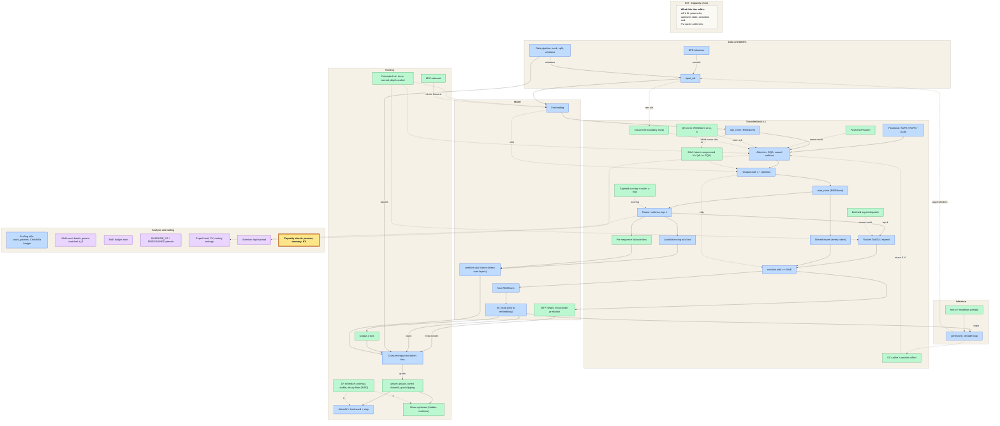

# 037 — Will it fit? `check_capacity.py`'s parameter, memory, and KV-cache arithmetic, solved by hand

**Companion to:** [`journey_of_a_model/037-scale-presets-and-capacity-check.md`](../../journey_of_a_model/037-scale-presets-and-capacity-check.md)
· **Code:** [`scripts/check_capacity.py`](../../scripts/check_capacity.py)
(reusing shapes from [`qwenmoe/config.py`](../../qwenmoe/config.py),
[`qwenmoe/model/kv_cache.py`](../../qwenmoe/model/kv_cache.py), and
[`qwenmoe/train/optim.py`](../../qwenmoe/train/optim.py))
· **Every number here is reproduced by:** [`verify_037_scale_presets_and_capacity_check.py`](verify_037_scale_presets_and_capacity_check.py)
(`uv run python docs/math/verify_037_scale_presets_and_capacity_check.py`)

> **Status note (added after journal 044).** Parts 0-9 derive `check_capacity.py` as it stood when journal 037 was
> written. Journal 044 then recalibrated the activation estimator against a real H100 (a $\times 2.2$ factor, a new
> logits term, and a 10% CUDA reserve), so the *current* code returns different activation numbers than Parts 4-6
> quote. [`verify_037_scale_presets_and_capacity_check.py`](verify_037_scale_presets_and_capacity_check.py) pins those
> two knobs to their pre-044 values so Parts 0-9 stay exactly reproducible, and [Part 10](#part-10--what-journal-044-changed-added-later)
> derives the changes. Part 7's remark that `TrainConfig.device` has no `cuda` support is also out of date (CUDA support
> arrived in journal 042).

---

## How to read this

`scripts/check_capacity.py` answers one question before you commit twenty
minutes of wall-clock time to a training run: **will this config fit in
memory on this machine?** It does that with pure arithmetic — no tensor is
allocated for the default estimate path — built from two ingredients this
folder has *already* derived and one that's new here:

- **Parameter counting** (`estimate_params`, `check_capacity.py:122-175`)
  mirrors `qwenmoe/train/scaling.py`'s `count_params`, which
  [`009-scaling-law-utilities.md`](009-scaling-law-utilities.md) already
  derived from first principles — the SwiGLU expert's $3 d_\text{model}
  d_\text{ff}$, GQA's $H_\text{kv}<H$ split, RMSNorm's single length-$d$
  gain vector. We **restate** those results compactly (with a fresh, much
  smaller worked example) rather than re-derive them, and point back to
  009/005 for the "why this shape" argument behind each matrix.
- **KV-cache sizing** (`kv_cache_bytes`, `check_capacity.py:178-187`)
  reuses the exact per-token-per-layer accounting
  [`029-kv-cache.md`](029-kv-cache.md) already derived for the real
  `LayerKVCache`/`LatentKVCache` objects. We restate the two formulas and
  verify this module's copy of them against the real cache classes again,
  on our own numbers.
- **The genuinely new arithmetic** — everything this document spends its
  depth on — is memory-*budgeting*: turning a parameter count into a byte
  count (`BYTES_PER_PARAM_TRAIN_FP32`), turning a `(batch, seq_len, ...)`
  shape into an activation-memory estimate
  (`estimate_activation_bytes`), assembling those into a fits/doesn't-fit
  verdict (`analyze`), and **inverting** that same inequality to answer
  the opposite question — "what's the biggest model this budget allows?"
  (`recommend_max_total_params`). None of that has been derived anywhere
  else in this folder.

You do not need a linear-algebra background beyond "a matrix of shape
$(a,b)$ has $a \times b$ learnable numbers in it" — defined the moment it's
used below.

---

## Part 0 — What this module actually computes, end to end



Two directions through the same arithmetic: **forward** (a config is
given; will it fit?) is `analyze()`. **Inverted** (a budget is given; how
big a config fits?) is `recommend_max_total_params()`, worked out in
Part 6.

---

<!-- notation:start (generated by build_architecture_footer.py) -->
> **Notation note.** The series uses one symbol set ([canonical notation](README.md#canonical-notation)). In this doc, $E$ stands for $N$ (`n_routed_experts`). Nothing below is changed; this only states the correspondence.
<!-- notation:end -->

## Part 1 — The running example: `TOY`

One config, carried through every section below without changing a
field. Chosen to be the smallest shape that still exercises: GQA with
$H_\text{kv} < H$, the `qk_norm` extra parameters, MoE sparsity
($k < E$, so `total_params ≠ active_params`), and tied embeddings.

```python
TOY = ModelConfig(
    vocab_size=7,
    d_model=4,
    n_layers=2,
    n_heads=2,
    n_kv_heads=1,      # GQA: 1 KV head shared by 2 query heads
    d_ff=3,
    n_shared_experts=1,
    n_routed_experts=3,
    top_k=2,           # < n_routed_experts=3, so total != active
    qk_norm=True,
    tie_word_embeddings=True,
    # activation="swiglu" (default), attention_variant="gqa" (default)
)
```

**Derived quantity, used everywhere below:**
$$\text{head\_dim} = \frac{d_\text{model}}{n_\text{heads}} = \frac{4}{2} = 2$$

For memory arithmetic (Parts 4–6) we additionally fix a batch and
sequence length: `batch_size = 2`, `seq_len = 3`.

### Shape ledger (filled in as we go)

| quantity | value | first computed in |
|---|---:|---|
| `head_dim` | 2 | Part 1 |
| `total_params` | 464 | Part 2 |
| `active_params` | 392 | Part 2 |
| sparsity `total/active` | 1.1837 | Part 2 |
| `train_static_bytes` | 7,424 | Part 4 |
| `train_activation_bytes` | 7,488 | Part 4 |
| `train_total_bytes` | 14,912 | Part 5 |
| `inference_bytes` (no cache) | 3,104 | Part 5 |
| `inference_with_kv_cache_bytes` | 1,952 | Part 5 |
| `recommend_max_total_params` at budget 20,000 | 407 | Part 6 |

---

## Part 2 — `estimate_params`: parameter counting without building a model

A **parameter** is one learnable number stored in a weight tensor. A
`nn.Linear(d_in, d_out, bias=False)` layer's weight is a matrix of shape
$(d_\text{out}, d_\text{in})$ — $d_\text{out} \times d_\text{in}$ separate
learnable numbers — so its parameter count is exactly that product; no
bias vector, since every linear layer in this project is built with
`bias=False`.

### 2.1 Why this function exists at all — and why it never builds a real model

The obvious way to count a config's parameters is to construct the real
`QwenMoEModel` and sum `p.numel()` over its parameters — exactly what
`qwenmoe/train/scaling.py`'s `count_params` does
([009 §2](009-scaling-law-utilities.md)). `check_capacity.py` cannot
reuse that path directly: constructing the model means allocating real
memory for every weight tensor, and this tool's entire purpose is a
**pre-check**, run *before* you know whether a config is safe to
allocate. Journal 037 hit this directly during development — testing the
tool against a deliberately absurd hypothetical (`d_model=4096`, 40
layers, 64 experts) OOM-killed the process (exit code 137) *before the
safety check could even report its verdict*, because the first version
built a real model just to count it. `estimate_params` (line 122) is the
fix: it computes total/active parameters as pure arithmetic straight
from `ModelConfig`'s integer fields — `O(1)` work, zero tensors — and is
verified below to reproduce the real model's count to the digit anyway.

### 2.2 The attention weights (GQA branch, `check_capacity.py:147-155`)

```python
qk_norm_params = 2 * head_dim if config.qk_norm else 0
attn_params = (
    config.d_model * config.d_model                       # w_q
    + config.d_model * (config.n_kv_heads * head_dim)      # w_k
    + config.d_model * (config.n_kv_heads * head_dim)      # w_v
    + config.d_model * config.d_model                      # w_o
    + qk_norm_params
)
```

This mirrors the real weight shapes in `Attention.__init__`
([`attention.py:101-104`](../../qwenmoe/model/attention.py)):
`w_q: nn.Linear(d_model, n_heads*head_dim)` — and since
`n_heads*head_dim == d_model` by construction, that's $d_\text{model}^2$.
`w_k`/`w_v` project to `n_kv_heads*head_dim` instead of
`n_heads*head_dim` — the one place GQA's smaller key/value space
(Ainslie et al., 2023 — see Citations) shows up as *fewer* parameters,
not just less cache. `w_o` maps `n_heads*head_dim` back to `d_model`, so
it's $d_\text{model}^2$ again. `qk_norm`, when on, adds two
`RMSNorm(head_dim)` modules (`attention.py:116-117`) — one weight vector
of length `head_dim` each
([`rmsnorm.py:11`](../../qwenmoe/model/rmsnorm.py)) — hence `2 *
head_dim`.

**On `TOY`** ($d_\text{model}=4$, $n_\text{kv\_heads}=1$,
$\text{head\_dim}=2$):

$$
\begin{aligned}
w_q &= 4 \times 4 = 16 \\
w_k &= 4 \times (1 \times 2) = 8 \\
w_v &= 4 \times (1 \times 2) = 8 \\
w_o &= 4 \times 4 = 16 \\
\text{qk\_norm} &= 2 \times 2 = 4 \\
\hline
\text{attn\_params} &= 16+8+8+16+4 = 52
\end{aligned}
$$

Add the pre-attention `RMSNorm(d_model)` gain vector
(`attn_norm`, `d_model = 4` params, `block.py:27`) — line 156's
`attention_total_per_layer = config.d_model + attn_params`:

$$\text{attention\_total\_per\_layer} = 4 + 52 = 56$$

*(Aside, not part of the main example: the `attention_variant == "mla"`
branch, `check_capacity.py:137-146`, computes a different sum —
$W^{DKV}$, $W^{UK}$, $W^{UV}$, the decoupled-RoPE $W^{QR}/W^{KR}$, and
$W^O$ — already derived in full in
[`016-mla-attention.md`](016-mla-attention.md); we don't recompute it
here since `TOY` never takes that branch.)*

### 2.3 The MoE weights (`check_capacity.py:133-135, 158-167`)

```python
expert_params = 2*d_model*d_ff if activation == "gelu" else 3*d_model*d_ff
router_params = d_model * n_routed_experts
moe_total_per_layer  = d_model + router_params + n_shared*expert_params + n_routed*expert_params
moe_active_per_layer = d_model + router_params + n_shared*expert_params + top_k*expert_params
```

`expert_params` counts one `SwiGLUExpert`: three `nn.Linear(d_model,
d_ff)`-or-`(d_ff,d_model)` matrices with no shared weights —
`w_gate`, `w_up` (each $d_\text{model} \times d_\text{ff}$), `w_down`
($d_\text{ff} \times d_\text{model}$) — [`moe.py:25-27`](../../qwenmoe/model/moe.py),
hence $3\,d_\text{model}\,d_\text{ff}$ (Shazeer, 2020's gated-linear-unit
construction; full derivation of *why* the gate exists: 005/009).
`router_params` is one `nn.Linear(d_model, n_routed_experts)`
([`moe.py:88`](../../qwenmoe/model/moe.py)) — one routing logit per
expert, no bias.

**`total` vs `active`, and why they differ.** Every token passes through
*every* shared expert and the router (dense — `n_shared*expert_params`,
`router_params`, and the `d_model` MoE-norm gain appear in both sums
unchanged), but only its **top-$k$** routed experts out of
$n_\text{routed}$ actually run for that token
([`moe.py:439-444`](../../qwenmoe/model/moe.py) constructs all
$n_\text{routed}$; `score_and_select`/`select_top_k` pick $k$ of them per
token at *forward* time). `moe_total` counts every routed expert's
weights (what's stored); `moe_active` counts only $k$ of them (what one
token's forward pass actually multiplies against) — this is precisely
what "sparse" means for a Mixture-of-Experts model (Shazeer et al., 2017;
Jiang et al., 2024's "47B total … 13B active" convention, both already
cited in 009).

**On `TOY`** ($d_\text{ff}=3$, `activation="swiglu"`, so the `else`
branch: $3\,d_\text{model}\,d_\text{ff}$):

$$\text{expert\_params} = 3 \times 4 \times 3 = 36$$
$$\text{router\_params} = 4 \times 3 = 12$$

$$
\text{moe\_total\_per\_layer} = \underbrace{4}_{\text{moe\_norm}} + \underbrace{12}_{\text{router}} + \underbrace{1{\times}36}_{\text{shared}} + \underbrace{3{\times}36}_{\text{routed (all 3)}} = 4+12+36+108 = 160
$$
$$
\text{moe\_active\_per\_layer} = \underbrace{4}_{\text{moe\_norm}} + \underbrace{12}_{\text{router}} + \underbrace{1{\times}36}_{\text{shared}} + \underbrace{2{\times}36}_{\text{routed (top-2 of 3)}} = 4+12+36+72 = 124
$$

### 2.4 The once-per-model pieces, and the sum over layers (`check_capacity.py:169-175`)

```python
embedding = vocab_size*d_model + d_model            # table + final_norm
if not tie_word_embeddings:
    embedding += vocab_size*d_model                  # untied LM head
total  = embedding + n_layers*(attention_total_per_layer + moe_total_per_layer)
active = embedding + n_layers*(attention_total_per_layer + moe_active_per_layer)
```

`vocab_size * d_model` is the token-embedding lookup table
([`transformer.py:55`](../../qwenmoe/model/transformer.py), one
$d_\text{model}$-length row per vocabulary entry); `+ d_model` is
`final_norm`'s gain vector (`transformer.py:57`). When
`tie_word_embeddings` is `True` (`TOY`'s case), the LM head's weight
*is* the embedding table — the same tensor object
(`transformer.py:59-60`), zero extra parameters. When it's `False`, a
second independent $\text{vocab\_size} \times d_\text{model}$ matrix is
allocated for `lm_head` — the `if` branch above adds it.

**On `TOY`** ($\text{vocab\_size}=7$, tied):

$$\text{embedding} = 7 \times 4 + 4 = 28+4 = 32$$

$$
\text{total} = 32 + 2\times(56+160) = 32 + 2\times216 = 32+432 = \mathbf{464}
$$
$$
\text{active} = 32 + 2\times(56+124) = 32 + 2\times180 = 32+360 = \mathbf{392}
$$
$$
\text{sparsity} = \frac{464}{392} = 1.1837
$$

`verify_037...py` Part 1 confirms both numbers, then goes one step
further: it constructs the **real** `QwenMoEModel(TOY)` and calls the
**real** `count_params` (the construction-heavy reference path
`estimate_params` exists to avoid) and checks the two agree exactly —
this is this module's version of "does the fast/optimized path agree
with the slow/reference path":

```
estimate_params(TOY) -> total=464, active=392
count_params(real model) -> total=464, active=392
max |estimate - real| = 0
```

Two cheap asides, also verified: swapping `activation="gelu"` drops
`expert_params` from `2*d_model*d_ff=... ` — no, from $3d_\text{model}d_\text{ff}=36$
(gate+up+down) to $2d_\text{model}d_\text{ff}=24$ (`GELUExpert` has only
`w_1`, `w_2` — [`moe.py:51-53`](../../qwenmoe/model/moe.py), no gate
branch), dropping `total` to 368; setting `tie_word_embeddings=False`
adds exactly $\text{vocab\_size}\times d_\text{model} = 28$, raising
`total` to 492. Both match a real reconstructed model exactly.

---

## Part 3 — Bytes per parameter: exact, not estimated

```python
BYTES_PER_PARAM_TRAIN_FP32 = 16   # 4 (param) + 4 (grad) + 8 (AdamW exp_avg + exp_avg_sq)
BYTES_PER_PARAM_INFERENCE_FP32 = 4
```
(`check_capacity.py:44-45`)

This is the one constant in the whole module that's **exact algebra**,
not a calibrated guess — it follows from IEEE-754 `float32` being 4
bytes, and from exactly which tensors AdamW keeps around per parameter:

- **1 param, fp32 → 4 bytes.** The weight itself.
- **1 gradient, fp32 → 4 bytes.** `loss.backward()` populates
  `.grad`, same shape and dtype as the parameter, for every trainable
  tensor.
- **2 AdamW moment buffers, fp32 → 8 bytes.** Adam (Kingma & Ba, 2015)
  keeps a running first moment $m_t$ (`exp_avg`, an exponential moving
  average of the gradient) and second moment $v_t$ (`exp_avg_sq`, an
  EMA of the squared gradient) — one full-size buffer *each*, matching
  the parameter's own shape, used every step to compute the update
  $\hat m_t/(\sqrt{\hat v_t}+\epsilon)$. AdamW (Loshchilov & Hutter,
  2019) doesn't change this footprint — its only difference from Adam
  is applying weight decay directly to the weight instead of folding it
  into the gradient, which needs no extra storage. Both buffers are the
  same shape as the parameter, so 2× the 4-byte param size = 8 bytes.

$$4 + 4 + 8 = 16 \text{ bytes / trained parameter (fp32 AdamW)}$$

Inference needs none of that — no gradient, no optimizer state, just the
weight itself: $4$ bytes/parameter. (This project's `bf16` precision
setting doesn't change either constant: journal 037 notes it was
separately measured to only autocast the *forward* pass, leaving
params/grads/optimizer state in fp32 — so this fixed `16`/`4` is correct
regardless of `TrainConfig.precision`.)

**Static training memory, on `TOY`:**
$$\text{static\_bytes} = 464 \times 16 = \mathbf{7{,}424 \text{ bytes}}$$

---

## Part 4 — Activation memory and KV-cache size: the two per-token-per-layer formulas

### 4.1 `estimate_activation_bytes` — one exact term, one empirical term

```python
def estimate_activation_bytes(batch_size, seq_len, n_layers, d_model, n_heads):
    tokens = batch_size * seq_len
    linear_term = tokens * n_layers * d_model * _ACTIVATION_BYTES_PER_TOKEN_LAYER_DMODEL
    attn_term = batch_size * n_heads * seq_len * seq_len * n_layers * 4
    return linear_term + attn_term
```
(`check_capacity.py:112-119`)

**Why this can't be exact the way parameter counting is exact.** A
parameter count is fixed by the architecture alone. *Activation* memory
— the intermediate tensors PyTorch's autograd retains during the forward
pass so the backward pass can use them — depends on exactly which
tensors a specific kernel graph happens to keep alive: whether SDPA is
fused or not, how MoE's batched-dispatch `bmm`s materialize their
inputs, and so on. That's not something you can write down in one closed
form without re-deriving it for every architecture change — so this
function has **two very different kinds of term**.

**`attn_term` — exact algebra.** One piece of the forward pass *does*
have a fixed, known shape regardless of kernel details: the attention
score matrix, $(batch, n_\text{heads}, \text{seq\_len}, \text{seq\_len})$
in fp32, one per layer. Its element count is
$batch \times n_\text{heads} \times \text{seq\_len}^2$, times $n_\text{layers}$
layers, times 4 bytes/fp32-element:
$$\text{attn\_term} = batch \times n_\text{heads} \times \text{seq\_len}^2 \times n_\text{layers} \times 4$$
This is marked **exact** because it's the same closed-form shape argument
Part 2 used for parameter counts — no calibration involved.

**`linear_term` — empirical, and marked as such in the source
(`check_capacity.py:47-57`).** Every *other* activation (the residual
stream, MoE dispatch buffers, expert intermediates, …) is approximated
as a flat rate: `_ACTIVATION_BYTES_PER_TOKEN_LAYER_DMODEL = 150` bytes
per `(token, layer, d_model-unit)`. That constant comes from two real
`torch.mps.current_allocated_memory()` measurements on this project's
own models (both quoted in the source comment and in journal 037's
`check_capacity.py`):

$$
\text{implied bytes/token/layer/}d_\text{model} = \frac{\text{measured activation GB} \times 10^9}{\text{tokens} \times n_\text{layers} \times d_\text{model}}
$$

| shape | tokens ($batch \times seq$) | measured activation | implied constant |
|---|---:|---:|---:|
| `SCALE_100M` ($d_\text{model}=512$, $n_\text{layers}=7$, batch=16, seq=256) | 4,096 | ~2.09 GB | ~142 bytes |
| `SCALE_300M` ($d_\text{model}=768$, $n_\text{layers}=10$, batch=16, seq=256) | 4,096 | ~1.91 GB | ~61 bytes |

The two measurements **don't imply one consistent constant** — MoE
routing/dispatch overhead doesn't scale as simply as a dense
transformer's activations would — so the code picks `150`, the larger
(safer, more conservative) of the two, rounded up slightly further. This
is an *order-of-magnitude guide*, not a precision claim; `--verify`
(Part 8) exists specifically to replace it with a real number when it
matters.

**On `TOY`** (`batch_size=2`, `seq_len=3`, $n_\text{layers}=2$,
$d_\text{model}=4$, $n_\text{heads}=2$; $\text{tokens}=2\times3=6$):

$$
\text{linear\_term} = 6 \times 2 \times 4 \times 150 = 7{,}200
$$
$$
\text{attn\_term} = 2 \times 2 \times 3 \times 3 \times 2 \times 4 = 288
$$
$$
\text{activation\_bytes} = 7{,}200 + 288 = \mathbf{7{,}488 \text{ bytes}}
$$

### 4.2 `kv_cache_bytes` — reusing 029's exact per-token accounting

```python
def kv_cache_bytes(config, batch_size, seq_len):
    head_dim = config.d_model // config.n_heads
    if config.attention_variant == "mla":
        elements_per_token_per_layer = config.mla_latent_dim + head_dim // 2
    else:
        elements_per_token_per_layer = 2 * config.n_kv_heads * head_dim
    return elements_per_token_per_layer * config.n_layers * batch_size * seq_len * 4
```
(`check_capacity.py:178-187`)

This is **exact**, unlike `estimate_activation_bytes`: a KV cache is
*defined* by its own tensor shape — nothing about it depends on kernel
fusion or graph details. [`029-kv-cache.md` §2.3, §6](029-kv-cache.md)
already derived why the GQA cache holds $2 \times n_\text{kv\_heads}
\times \text{head\_dim}$ elements per token per layer (one $k$ vector
and one $v$ vector, each `n_kv_heads*head_dim` wide — note **not**
`n_heads`, since GQA's whole memory point is caching only the shared
key/value heads, not one copy per query head) and why MLA's cache holds
only $\text{latent\_dim} + \text{head\_dim}/2$ (the compressed latent
$c_{kv}$ plus the *one* shared decoupled-RoPE key slice — `head_dim/2`
because MLA's RoPE half is deliberately narrower than a full head,
[016 §3](016-mla-attention.md)) — never the full `n_heads`-wide
decompressed K/V, which is MLA's entire memory-saving idea.

**On `TOY`** (GQA, $n_\text{kv\_heads}=1$, $\text{head\_dim}=2$,
$batch=1$, $\text{seq\_len}=3$ — inference convention, one sequence at a
time):

$$\text{elements/token/layer} = 2 \times 1 \times 2 = 4$$
$$\text{kv\_cache\_bytes} = 4 \times 2 \times 1 \times 3 \times 4 = \mathbf{96 \text{ bytes}}$$

`verify_037...py` Part 2 cross-checks this against **real**
`LayerKVCache` objects: it builds `TOY`'s real model, calls the real
`build_kv_cache`, appends a real zero tensor of shape `(1, n_kv_heads,
seq_len, head_dim)` to each layer's cache, and sums `.nbytes` — 96,
matching the formula exactly, `max diff = 0`.

**Aside — MLA vs. GQA, same `head_dim`.** `TOY`'s `head_dim=2` is too
narrow for a real `MLAAttention` module (it requires `head_dim %
4 == 0` for its decoupled-RoPE split —
[`attention.py:279`](../../qwenmoe/model/attention.py) raises otherwise),
so this comparison uses a second tiny config with `head_dim=4`
(`d_model=8, n_heads=2`) — not a substitute for `TOY`, just a
minimal shape that can legally build both variants:

$$\text{GQA: } 2 \times 1 \times 4 \times 2 \times 1 \times 3 \times 4 = 192 \text{ bytes}$$
$$\text{MLA (latent\_dim=2): } (2 + \tfrac{4}{2}) \times 2 \times 1 \times 3 \times 4 = 4 \times 2 \times 1 \times 3 \times 4 = 96 \text{ bytes}$$

Half the cache, at equal `head_dim` — reproducing entry 016/029's real
finding (MLA's cache is smaller than GQA's *even against an
already-aggressive* $n_\text{kv\_heads}=1$ GQA config) on fresh numbers.
Verified against a real `LatentKVCache` the same way: exact match.

---

## Part 5 — `analyze()`: assembling one verdict

```python
static_bytes = total_params * BYTES_PER_PARAM_TRAIN_FP32
activation_bytes = estimate_activation_bytes(batch_size, seq_len, n_layers, d_model, n_heads)
inference_activation = estimate_activation_bytes(1, seq_len, n_layers, d_model, n_heads) // 3
inference_bytes = total_params * BYTES_PER_PARAM_INFERENCE_FP32 + inference_activation
inference_kv_bytes = total_params * BYTES_PER_PARAM_INFERENCE_FP32 + kv_cache_bytes(config, batch_size=1, seq_len=seq_len)
```
(`check_capacity.py:212-220`)

`train_total_bytes = static_bytes + activation_bytes` is just Parts 3+4
added together — nothing new. Two more quantities appear here for the
first time:

**`inference_activation`** — an **empirical discount**, not a new
formula: it's `estimate_activation_bytes` at `batch_size=1` (inference
processes one sequence, not a training batch), **divided by 3**. The
`// 3` is a rough correction for the fact that a forward-only pass never
retains the backward-pass buffers a training step does — the same
per-token linear heuristic from Part 4.1, just discounted, not
re-derived from a different closed form. This is why it's built from
the *training* activation formula rather than getting its own constant.

**`inference_kv_bytes`** — total weight bytes (fp32, no gradient/optimizer)
plus the **exact** `kv_cache_bytes` from Part 4.2, matching this
project's `generate(use_kv_cache=True)` path; `inference_bytes` (no
`_kv_`) matches `generate(use_kv_cache=False)`, the project's default —
full-context recompute every step, no cache at all.

**On `TOY`**, with an **injected** `HardwareInfo(device="cpu",
total_system_memory=None, safe_budget_bytes=20_000)`. (`analyze` takes
`hardware: HardwareInfo | None = None` precisely so this doc's numbers
don't depend on whatever machine happens to run the verify script — see
Part 7.)

$$\text{static\_bytes} = 464 \times 16 = 7{,}424$$
$$\text{activation\_bytes (batch=2)} = 7{,}488 \quad \text{(Part 4.1)}$$
$$\text{train\_total\_bytes} = 7{,}424 + 7{,}488 = \mathbf{14{,}912}$$

$$\text{inference\_activation} = \left\lfloor \frac{\text{estimate\_activation\_bytes(batch=1,...)}}{3} \right\rfloor$$

At `batch_size=1`: $\text{tokens}=1\times3=3$;
$\text{linear\_term}=3\times2\times4\times150=3{,}600$;
$\text{attn\_term}=1\times2\times3\times3\times2\times4=144$;
sum $=3{,}744$; $\lfloor 3{,}744/3 \rfloor = 1{,}248$ (divides evenly — no
rounding to worry about here).

$$\text{inference\_bytes} = 464 \times 4 + 1{,}248 = 1{,}856+1{,}248 = \mathbf{3{,}104}$$
$$\text{inference\_with\_kv\_cache\_bytes} = 1{,}856 + 96 = \mathbf{1{,}952} \quad \text{(kv\_cache\_bytes from Part 4.2)}$$

$$\text{fits}(14{,}912) \;=\; 14{,}912 \le 20{,}000 \;=\; \texttt{True}$$

Every one of these six numbers is asserted against the real
`CapacityReport` in `verify_037...py` Part 3:

```
CapacityReport: total_params=464, active_params=392
  train_static_bytes=7424
  train_activation_bytes=7488
  train_total_bytes=14912
  inference_bytes=3104
  inference_with_kv_cache_bytes=1952
  fits(train_total_bytes) = True
```

---

## Part 6 — `recommend_max_total_params`: solving the same inequality backwards

```python
def recommend_max_total_params(hardware, batch_size, seq_len, d_model_hint=768, n_layers_hint=10, n_heads_hint=12):
    activation = estimate_activation_bytes(batch_size, seq_len, n_layers_hint, d_model_hint, n_heads_hint)
    remaining = int(hardware.safe_budget_bytes * 0.7) - activation
    return max(0, remaining // BYTES_PER_PARAM_TRAIN_FP32)
```
(`check_capacity.py:233-249`)

`analyze()` asks: *given* a total-param count, does it fit? This asks
the inverse: *given* a budget, what's the largest total-param count that
would fit? Start from the same inequality Part 5 evaluated,
$$
\underbrace{N \times 16}_{\text{static}} + \underbrace{A}_{\text{activation}} \;\le\; \text{budget},
$$
where $N$ is `total_params` and $A$ is the activation estimate — and
solve for $N$:
$$
N \;\le\; \frac{\text{budget} - A}{16}.
$$

Two things change on top of that pure algebra, both deliberate:

1. **Activation depends on architecture *shape*, not on $N$ itself**
   (Part 4.1's formula never references `total_params` — MoE's routed
   experts barely move it, since routed weights are static-memory-only,
   not part of the per-token activation term). So $A$ can't be solved
   for simultaneously with $N$; the function instead holds shape fixed
   at a **hint** (`d_model_hint`, `n_layers_hint`, `n_heads_hint` —
   defaulting to `SCALE_300M`-like numbers, but overridable, as we do
   here to keep the arithmetic tied to `TOY`) and only inverts for $N$.
2. **An extra $\times 0.7$ safety margin on the budget itself** — *on
   top of* whatever margin `hardware.safe_budget_bytes` already carries
   (Part 7). This is **empirical**, not derivable from the static/
   activation accounting: journal 037's real finding was that this
   machine's *actually*-available headroom fluctuated by multiple GB
   within a single session depending on ordinary background load (IDE,
   idle notebook kernels, a browser) — a number `torch.mps.
   recommended_max_memory()` alone doesn't capture. `recommend_max_
   total_params` bakes that observed volatility in as an extra
   conservative factor; `analyze().fits()` does not apply it (Part 5's
   `fits()` checks strictly `≤ safe_budget_bytes`, no `0.7`).

**On `TOY`'s own shape** (`d_model_hint=4, n_layers_hint=2,
n_heads_hint=2`, same `batch_size=2, seq_len=3, budget=20,000` as Part
5 — reusing `activation=7,488` computed there, since the hint shape here
*is* `TOY`'s shape):

$$
\text{remaining} = \lfloor 20{,}000 \times 0.7 \rfloor - 7{,}488 = 14{,}000 - 7{,}488 = 6{,}512
$$
$$
N_\max = \left\lfloor \frac{6{,}512}{16} \right\rfloor = \mathbf{407}
$$

**A real, honest wrinkle, not a bug:** `TOY` itself has 464 total
params, and Part 5 showed 464 params *already fits* the 20,000-byte
budget (`14,912 ≤ 20,000`) — yet the recommended maximum here is
**407, smaller than 464**. That's the $\times 0.7$ margin doing exactly
what it's for: `recommend_max_total_params` is a deliberately more
conservative *planning* number than a strict `fits()` check, precisely
because journal 037 found strict-but-tight configs (`SCALE_300M` at
batch=16, measured "safe" in an isolated probe) went on to hang in the
*real* training pipeline once ordinary background memory pressure was
present. `verify_037...py` Part 3 confirms `407` exactly and asserts
`407 < 464`, calling this out explicitly rather than treating it as a
rounding artifact.

---

## Part 7 — `detect_hardware`: three branches, deliberately not part of the numeric ledger

```python
def detect_hardware() -> HardwareInfo:
    total = total_system_memory_bytes()
    if torch.cuda.is_available():
        free_bytes, _ = torch.cuda.mem_get_info()
        return HardwareInfo(device="cuda", total_system_memory=total, safe_budget_bytes=free_bytes)
    if torch.backends.mps.is_available():
        return HardwareInfo(device="mps", total_system_memory=total,
                             safe_budget_bytes=int(torch.mps.recommended_max_memory()))
    safe_budget = int(total * 0.7) if total else 8 * 1024**3
    return HardwareInfo(device="cpu", total_system_memory=total, safe_budget_bytes=safe_budget)
```
(`check_capacity.py:92-109`)

```mermaid
flowchart TD
    START["detect_hardware()"] --> CUDA{"torch.cuda.is_available()?"}
    CUDA -->|yes| CB["safe_budget = torch.cuda.mem_get_info()<br/>currently-free bytes"]
    CUDA -->|no| MPS{"torch.backends.mps.is_available()?"}
    MPS -->|yes| MB["safe_budget = torch.mps.recommended_max_memory()<br/>Metal's own reported ceiling"]
    MPS -->|no| CPUB["safe_budget = 0.7 x total system RAM<br/>(empirical fallback margin),<br/>or 8GB if RAM can't be read"]
```



This function is deliberately **excluded** from this document's numeric
ledger: its output depends on which physical machine runs it — the whole
point of `torch.cuda.mem_get_info()` / `torch.mps.recommended_max_
memory()` is that they read real, live, non-reproducible hardware state.
Reporting a "hand-computed" number for it here would either be
unfalsifiable (this machine's number, unverifiable by a reader on a
different machine) or fabricated (invented to look plausible). Instead,
Parts 5–6 above use exactly the mechanism the real code provides for
this: `analyze()` and `recommend_max_total_params()` both accept an
**injected** `HardwareInfo` in place of calling `detect_hardware()` —
the same dependency-injection pattern journal 037's own test suite uses
("deterministic `analyze()` verdicts via an injected `HardwareInfo`").

Two things about this function *are* exact, worth calling out
separately from the empirical `0.7` CPU-fallback margin:

- `total_system_memory_bytes()` (`check_capacity.py:60-82`) reads
  `os.sysconf("SC_PAGE_SIZE") * os.sysconf("SC_PHYS_PAGES")` — an exact
  syscall-level product (page size × page count = total physical bytes),
  with `sysctl`/`/proc/meminfo` fallbacks for platforms where `sysconf`
  doesn't expose it. Not an estimate; it's asking the OS directly.
- The **branch order itself** (`cuda > mps > cpu`) is a deliberate,
  documented choice, not a default fallthrough: it's informational only,
  since this project's own `TrainConfig.device` doesn't support `cuda`
  yet (`config.py:114`) — the detection exists so the tool reports a
  sensible number on someone else's CUDA machine too, even though this
  project itself only ever trains on `mps`/`cpu`.

---

## Part 8 — `verify_empirically`: what "real" means, and an honest mismatch

```python
def verify_empirically(config, batch_size, seq_len, device):
    model = QwenMoEModel(config).to(device)
    ...
    # cuda: torch.cuda.max_memory_allocated() after 2 real steps
    # mps:  torch.mps.current_allocated_memory() delta after 2 real steps
    # cpu:  resource.getrusage(RUSAGE_SELF).ru_maxrss  (whole-process RSS)
```
(`check_capacity.py:252-297`, condensed)

Everything above this point is an *estimate*. This function is the
authoritative alternative: construct the real model, run 2 real training
steps (the second step's peak is the one measured — by then the
optimizer's own state is already allocated, matching the "steady-state"
peak journal 037's manual investigation cared about), and read back
whatever peak-memory API the device actually offers. Three different
APIs, because CUDA and MPS expose an allocator-level peak/delta tracker
and CPU does not — `verify_empirically`'s CPU branch falls back to
`ru_maxrss`, the OS's own peak **resident set size for the whole
process**, not an incremental "how much did *this* model add" delta.

Running it for real on `TOY` (`device="cpu"`, since this doc's own
example must be reproducible on any machine, not just one with an
Apple GPU):

```
verify_empirically(TOY, cpu) -> 290,144,256 bytes (290.1 MB)
  (estimate said train_total_bytes = 14,912 bytes)
```

(Re-running `verify_037...py` gives a slightly different number each
time — 289–290 MB across runs quoted while writing this document — for
exactly the reason below: it's reading whole-process RSS, not a
`TOY`-specific delta, so ordinary interpreter/allocator variation
between runs shows up directly in the number.)

These numbers are **not expected to agree**, and that's the honest
point worth stating plainly rather than glossing over: `ru_maxrss` on
this path reports the peak size of the *entire Python process* —
interpreter, PyTorch's own C++ runtime, every imported library — which
for a 464-parameter toy model is dominated entirely by that fixed
overhead, not by anything `TOY`-specific. This is exactly why journal
037's own `--verify` numbers were only meaningful at realistic scale
(`SCALE_100M`: 3.55 GB measured via the MPS *delta* API, which
subtracts a `base` reading taken before the model existed — `check_
capacity.py:281-289` — precisely to avoid this same interpreter-overhead
contamination). The CPU fallback trades that precision for portability
(no CUDA/MPS dependency to run the check at all) — worth knowing before
trusting an absolute `--verify` number on CPU for a small model; the
*relative* ranking (bigger config → bigger `ru_maxrss`) still holds, the
absolute byte count does not isolate the model.

---

## Part 9 — The safety guard: why the estimate exists *between* the config and a real run

The OOM crash from Part 2.1 was one failure mode (absurd config → real
`nn.Module` construction → out of memory, immediately). Journal 037
found a second, more dangerous one during the real capacity
investigation: an oversized config that's merely "too big," not
absurdly so, doesn't error at all — it **hangs**, consuming real
swap/memory-compression thrashing, killed only after 60+ seconds of zero
progress. `main()`'s `--verify` handling
(`check_capacity.py:380-386`) exists to stop that from happening
silently:

```python
if not report.fits(report.train_total_bytes * 1.2):
    logger.warning("estimate is already at/over budget -- skipping --verify ...")
    return
```

A `1.2×` margin *on top of* the estimate — a config the (already
conservative) estimate flags as over budget is never handed to
`verify_empirically`'s real model construction + real training step, the
operation that hung rather than crashed. On `TOY`, injecting a
deliberately tiny synthetic budget (100 bytes, `HardwareInfo(device="cpu",
safe_budget_bytes=100)`) reproduces the guard condition directly:

```
synthetic tiny budget: 100 bytes; train_total_bytes=14912
  fits(train_total_bytes)              = False
  fits(train_total_bytes * 1.2)         = False
```

Both `False` — this is the exact boolean `main()` checks before ever
calling `verify_empirically`. `verify_037...py` Part 5 asserts both.

---

## Part 10 — What journal 044 changed (added later)

Parts 0-9 describe the estimator before a real H100 session showed it under-reporting. Three changes, each checked in
the Addendum block of the verify script on the same `TOY` config (`batch=2`, `seq=3`, so $6$ tokens).

**1. A measured $\times 2.2$ backward factor** (empirical, not derived).
`_ACTIVATION_BACKWARD_FACTOR = 2.2` multiplies Part 4's `linear_term + attn_term`. It comes from four measured
estimate-versus-real pairs quoted in the code comment (quoted from journal 044, not re-measured here):

| config | estimated | real | real / estimated |
|---|---|---|---|
| B=8, S=1024 | 13.41 GB | 27.86 GB | $2.078$ |
| B=16, S=1024 | 26.88 GB | 59.48 GB | $2.213$ |
| B=32, S=512 | 22.85 GB | 52.87 GB | $2.314$ |
| B=64, S=256 | 20.84 GB | 45.69 GB | $2.192$ |

Their mean is $2.1991$, which rounds to $2.2$. On `TOY`, Part 4's $7488$ bytes becomes
$\lfloor 7488 \times 2.2 \rfloor = \lfloor 16473.6 \rfloor = 16473$.

**2. A logits term** (exact in form, with an empirical copy count). Logits are `tokens x vocab_size` and exist several
times: the bf16 forward output, `logits.float()`'s fp32 copy, and what cross-entropy saves for backward.
`_LOGIT_COPIES = 3` and each copy is fp32 (4 bytes), added *after* the factor:

$$\text{logit\_term} = \text{tokens} \times V \times 4 \times 3 = 6 \times 7 \times 4 \times 3 = 504 .$$

So with `vocab_size` passed (as `analyze()` now does), `TOY`'s estimate is $16473 + 504 = 16977$ bytes, against $7488$ in
Part 4. At a real vocabulary of $16384$ the logits are several GB, which is why omitting them could give a confident
FITS on a configuration that OOMs.

**3. A CUDA reserve** (empirical). `detect_hardware` on CUDA now plans against $0.90 \times$ the currently-free bytes
(`_CUDA_USABLE_FRACTION`), not all of it, because the caching allocator fragments (an estimated $97\%$ of free OOMed
on an H100). This changes only Part 7's CUDA branch (`safe_budget = int(free_bytes * 0.90)`), not any `TOY` number.

Because the factor and the logits term both raise the activation estimate, every downstream quantity in Parts 5-6
that includes it (`train_total_bytes`, the `fits` verdict, `recommend_max_total_params`'s inversion) moves in the same
direction, so the recommended maximum parameter count is now *lower* for the same hardware.

## Cost, and why it's built this way (on `TOY`'s own numbers)

- **`estimate_params`: $O(1)$ arithmetic, zero tensors.** On `TOY` it's
  a handful of integer multiplications producing `464`/`392` instantly.
  The alternative — constructing a real `QwenMoEModel` just to count
  it — allocates $O(N)$ memory proportional to the *hypothetical*
  model's own size, which is precisely backwards for a pre-flight safety
  check: journal 037's absurd-config test would have allocated real
  memory for a 4,320 GB model just to report "this doesn't fit."
- **The two-term activation heuristic vs. one exact term.** `TOY`'s
  `attn_term` (288 bytes, exact) is a small fraction of `linear_term`
  (7,200 bytes, empirical) at this shape — and that ratio only grows
  with `seq_len` for the exact term (`attn_term ∝ seq_len²`) vs. linear
  growth for the empirical term, meaning the *exact* piece dominates at
  long context even though it's the smaller piece here. Neither term
  alone would be trustworthy; the module keeps both.
- **Why bother with `recommend_max_total_params`'s inversion at all,
  instead of just trying `analyze()` on bigger and bigger configs?**
  Binary-searching `analyze()` by hand across candidate configs is
  exactly the workflow this function replaces with one closed-form
  division — on `TOY`'s numbers, the answer (`407`) falls straight out
  of $\lfloor (14{,}000-7{,}488)/16 \rfloor$, no search loop needed.
- **The real stakes, in the journal's own numbers, not `TOY`'s.** This
  whole module's reason to exist is the gap between "fits" and "trains
  cleanly" journal 037 found the hard way: `SCALE_300M` at batch=16 was
  measured *safe* in an isolated 2-step probe (7.26 GB peak) but hung
  the real `Trainer.fit` pipeline; dropping to batch=4 fixed it, at the
  direct cost of $4\times$ more optimizer steps for the same token
  budget. `check_capacity.py`'s conservative-by-design estimate (Part
  4.1's `150`-byte constant, Part 6's `0.7` margin) is explicitly tuned
  to have caught that batch=16 case as "risky" *before* a real multi-
  minute hang — better a rough number that's honest about its own
  uncertainty than a precise one measuring the wrong (idle, uncontested)
  machine.

---

## Questions that might come to mind

**Why does `recommend_max_total_params` sometimes recommend *fewer*
params than a config that `analyze()` already says fits?**
Answered in full in Part 6: `recommend_max_total_params` applies its own
extra `×0.7` safety margin to the budget on top of whatever margin
`hardware.safe_budget_bytes` already carries; `analyze().fits()` checks
the raw inequality with no such multiplier. They're deliberately
different levels of conservatism for different jobs — `fits()` answers
"would this specific config technically fit," `recommend_max_
total_params` answers "what should I actually plan to build," and the
second question is the one journal 037's real-world hang taught this
project to answer more cautiously.

**Why is `train_static_bytes` exact but `train_activation_bytes` a
rough heuristic, when both are "just" arithmetic?** Static memory is
determined entirely by the parameter count and the fixed per-parameter
byte cost (Part 3) — nothing about *how* PyTorch executes the forward
pass changes how many bytes a weight, its gradient, or its two AdamW
moments occupy. Activation memory depends on which intermediate tensors
autograd happens to retain, which is a property of the specific compiled
operation graph (fused kernels, MoE's batched dispatch, …) — not
something derivable from the config alone without re-deriving it for
every architectural change (Part 4.1).

**Why does `kv_cache_bytes` get to be exact when `estimate_activation_
bytes` doesn't, if both are about "memory during generation"?** A KV
cache is *defined* by its tensor shape — `(batch, n_kv_heads, length,
head_dim)` for GQA, nothing more, nothing hidden (Part 4.2). Training
activation memory is whatever autograd happens to keep alive across an
entire forward+backward graph, which isn't a single named tensor with a
fixed shape the way a cache buffer is.

**Is the CPU-fallback `verify_empirically` number on `TOY` (289 MB, vs.
a 14,912-byte estimate) evidence the estimate is wrong?** No — Part 8
covers this directly: `ru_maxrss` on the CPU path measures the whole
process's resident memory (Python + PyTorch + every loaded library), not
an incremental delta attributable to `TOY` specifically. The MPS/CUDA
branches measure a real delta (`current_allocated_memory() - base`, or
`max_memory_allocated()`) precisely to avoid this contamination; the CPU
fallback trades that precision for running anywhere.

**Why `16` bytes/param for training, not something else — say the `18`
you'd get from also counting a `bf16` master-weight copy?** This
project's mixed-precision setting only autocasts the *forward* pass
(journal 037); params, gradients, and optimizer state stay fp32
regardless of `TrainConfig.precision`, so there's no separate bf16
weight copy to add. `16 = 4(param) + 4(grad) + 8(2 fp32 AdamW moments)`
is the complete, exact accounting for this project's actual training
loop — not a generic number borrowed from elsewhere.

**Why does `estimate_params` bother supporting the `mla`/`gelu`/untied
branches at all, if `TOY`'s main example never takes them?** Because
`check_capacity.py` has to work for *every* config this project can
construct — including `SCALE_100M`/`SCALE_300M` (GQA, tied, swiglu, as
it happens) but also any future preset that changes one of those knobs.
Part 2.4's asides (gelu, untied) and Part 4.2's MLA-vs-GQA aside exist
to verify those branches are correct too, on the smallest shapes that
can legally exercise them, without abandoning `TOY` as the one example
carried through the arithmetic-heavy sections (Parts 2–6).

---

## Symbol table

| symbol | meaning | first used |
|---|---|---|
| $d_\text{model}$ | width of the residual stream / hidden size | Part 1 |
| $n_\text{heads}$, $n_\text{kv\_heads}$ | query attention heads; key/value heads (GQA: $n_\text{kv\_heads} \le n_\text{heads}$) | Part 1 |
| $\text{head\_dim}$ | $d_\text{model}/n_\text{heads}$, width of one attention head | Part 1 |
| $d_\text{ff}$ | hidden width inside one expert's feed-forward | Part 1 |
| $E$ (`n_routed_experts`), $k$ (`top_k`) | number of routed experts; number selected per token | Part 2.3 |
| $N$ | `total_params` — every stored weight | Part 2.4 |
| "active params" | weights one token's forward pass actually multiplies against (dense pieces + $k$ of $E$ routed experts) | Part 2.3 |
| parameter | one learnable scalar number inside a weight tensor | Part 2 |
| fp32 | IEEE-754 32-bit (4-byte) floating point | Part 3 |
| $m_t$, $v_t$ | AdamW's first/second moment (mean, uncentered variance) buffers, one per parameter | Part 3 |
| activation | an intermediate tensor produced during the forward pass and (if needed for backward) retained in memory | Part 4.1 |
| $\text{tokens}$ | $batch\_size \times seq\_len$ | Part 4.1 |
| `safe_budget_bytes` | the memory ceiling `analyze()`/`recommend_max_total_params` plan against | Part 5 |
| `fits(x)` | $x \le \text{safe\_budget\_bytes}$ | Part 5 |
| $c_{kv}$ | MLA's shared, compressed low-rank key/value latent | Part 4.2 |
| RSS | resident set size — an OS-reported measure of a process's real physical memory in use | Part 8 |

---

## Citations

All links reused from where this project already confirmed them by web
search (009, 016, 018, 029 — dates on those pages); no new external
claim is made in this document that wasn't already sourced there.

**Architecture pieces the parameter shapes come from** *(reused from
[009](009-scaling-law-utilities.md))*
- Ainslie et al., *GQA: Training Generalized Multi-Query Transformer
  Models from Multi-Head Checkpoints*, 2023 —
  [arXiv:2305.13245](https://arxiv.org/abs/2305.13245). The
  $H_\text{kv}<H$ split that makes `w_k`/`w_v` — and this module's
  `attn_params` and `kv_cache_bytes` — smaller than plain MHA's.
- Shazeer, *GLU Variants Improve Transformer*, 2020 —
  [arXiv:2002.05202](https://arxiv.org/abs/2002.05202). SwiGLU's three
  matrices, $3\,d_\text{model}\,d_\text{ff}$ parameters — `expert_params`.
- Zhang & Sennrich, *Root Mean Square Layer Normalization*, 2019 —
  [arXiv:1910.07467](https://arxiv.org/abs/1910.07467). RMSNorm: one
  learned length-$d$ gain vector, no bias — every `+ d_model` term in
  Part 2.

**Mixture-of-Experts sparsity (the total ≠ active split)** *(reused from
[009](009-scaling-law-utilities.md))*
- Shazeer et al., *Outrageously Large Neural Networks: The Sparsely-Gated
  Mixture-of-Experts Layer*, 2017 —
  [arXiv:1701.06538](https://arxiv.org/abs/1701.06538). Origin of routed
  sparsity — why `moe_active` uses `top_k`, not `n_routed_experts`.
- Jiang et al., *Mixtral of Experts*, 2024 —
  [arXiv:2401.04088](https://arxiv.org/abs/2401.04088). The "total …
  active per token" reporting convention `estimate_params` reproduces.

**AdamW's per-parameter memory footprint** *(reused from
[018](018-optimizer-hardening.md))*
- Kingma & Ba, *Adam: A Method for Stochastic Optimization*, 2015 —
  [arXiv:1412.6980](https://arxiv.org/abs/1412.6980). The two moment
  buffers `exp_avg`/`exp_avg_sq` — the `8` in `BYTES_PER_PARAM_TRAIN_FP32
  = 4+4+8`.
- Loshchilov & Hutter, *Decoupled Weight Decay Regularization* ("AdamW"),
  2019 — [arXiv:1711.05101](https://arxiv.org/abs/1711.05101). Confirms
  AdamW adds no extra per-parameter storage beyond Adam's two moments —
  only *where* weight decay is applied changes.

**MLA's cache shape** *(reused from
[016](016-mla-attention.md)/[029](029-kv-cache.md))*
- Liu et al. (DeepSeek-AI), *DeepSeek-V2: A Strong, Economical, and
  Efficient Mixture-of-Experts Language Model*, 2024 —
  [arXiv:2405.04434](https://arxiv.org/abs/2405.04434). §2.1.2's
  low-rank KV joint compression — why MLA's cache is
  $\text{latent\_dim}+\text{head\_dim}/2$ elements/token/layer, not
  $n_\text{heads}$-wide.
- DeepSeek-AI, *DeepSeek-V3 Technical Report*, 2024 —
  [arXiv:2412.19437](https://arxiv.org/abs/2412.19437). Reuses MLA
  unchanged from V2.

**Companion / reused derivations**
- [`009-scaling-law-utilities.md`](009-scaling-law-utilities.md) — the
  full first-principles parameter-shape derivation `estimate_params`
  mirrors.
- [`029-kv-cache.md`](029-kv-cache.md) — the full KV-cache-size
  derivation `kv_cache_bytes` mirrors, and the real `LayerKVCache`/
  `LatentKVCache` classes this document's verify script cross-checks
  against.
- [`016-mla-attention.md`](016-mla-attention.md) — the MLA weight-shape
  and decoupled-RoPE derivation referenced in Part 2.2's aside.

---

*Every intermediate value in this document is produced and asserted by
[`verify_037_scale_presets_and_capacity_check.py`](verify_037_scale_presets_and_capacity_check.py).
If you change `TOY`, rerun it.*

<!-- arch-evolution:start (generated by build_architecture_footer.py; do not edit by hand) -->

---

## Where this fits in the architecture (the growing view)

← previous: [036 Attention-logit spread](036-attention-logit-spread.md) · next: [038 Gradient accumulation](038-gradient-accumulation-fair-rematch.md) →

**This doc adds to the architecture:** will it fit: parameter, optimizer-state, activation and KV-cache arithmetic. (Code: `scripts/check_capacity.py`.)

**Components introduced here (highlighted in the diagram), with where each one lives:**

| component | math doc (section) | journal | code |
|---|---|---|---|
| Capacity check: params, memory, KV | [037 · Part 2 — estimate_params: parameter counting with...](037-scale-presets-and-capacity-check.md#part-2--estimate_params-parameter-counting-without-building-a-model) | [journal 037](../../journey_of_a_model/037-scale-presets-and-capacity-check.md) | [`scripts/check_capacity.py:172`](../../scripts/check_capacity.py#L172) |

**Verified by:** [`verify_037_scale_presets_and_capacity_check.py`](verify_037_scale_presets_and_capacity_check.py) (`uv run python docs/math/verify_037_scale_presets_and_capacity_check.py`); latest results in [verify-status.md](verify-status.md).

**Example continuity:** Fresh `TOY` config (`V=7`, `d=4`), checked against a real built model. See the [example-family map](README.md#which-example-does-each-doc-use).

The diagram is cumulative: every box derived by this doc or an earlier one is shown, and components from later docs are not drawn yet, so reading the docs in order replays how the architecture grew. The top box is this doc's title and what it adds. The [full final architecture](architecture-evolution.md) has everything.

**Colour key:** 🟨 **introduced by this doc** · 🟦 Foundation (004-011) · 🟩 Modernization (016-031) · 🟪 Evaluation and scale (032-038) · 🟧 Real data and hardware (039-044). Dotted lines are optional or alternative paths.



**How we got here (every doc up to and including this one):**

| | math doc | journal | what it added |
|---|---|---|---|
|  | [004 Attention (GQA)](004-attention-gqa.md) | [journal](../../journey_of_a_model/004-attention-gqa.md) | scaled dot-product attention with grouped K/V heads, the positional transform and the causal mask |
|  | [005 MoE layer](005-moe-layer.md) | [journal](../../journey_of_a_model/005-moe-layer.md) | the router, top-k selection, routed SwiGLU experts, the shared expert and the load-balancing aux loss |
|  | [006 Full model](006-full-model-assembly.md) | [journal](../../journey_of_a_model/006-full-model-assembly.md) | token embedding, pre-norm residual wiring, the final norm, the tied head and the cross-layer aux-loss combine; attention and MoE appear here as black boxes |
|  | [007 Tokenizers](007-tokenizers.md) | [journal](../../journey_of_a_model/007-tokenizers.md) | text to `input_ids`: byte-level BPE and the char tokenizer |
|  | [008 Data pipeline](008-data-pipeline.md) | [journal](../../journey_of_a_model/008-data-pipeline.md) | packing documents, train/val split, fixed slices and the shifted `(x, y)` windows |
|  | [009 Scaling utilities](009-scaling-law-utilities.md) | [journal](../../journey_of_a_model/009-scaling-law-utilities.md) | parameter counting (total vs active), the compute-optimal budget and throughput calibration |
|  | [010 Training loop](010-training-loop.md) | [journal](../../journey_of_a_model/010-training-loop.md) | the next-token cross-entropy loss, backward pass and AdamW step, carried through a real `Trainer.fit` |
|  | [011 Inference and generation](011-inference-generation.md) | [journal](../../journey_of_a_model/011-inference-generation.md) | the autoregressive decode loop (greedy, temperature, top-k, top-p) |
|  | [016 MLA attention](016-mla-attention.md) | [journal](../../journey_of_a_model/016-mla-attention.md) | Multi-Head Latent Attention: K/V compressed to a small latent, an alternative to GQA |
|  | [018 Optimizer hardening](018-optimizer-hardening.md) | [journal](../../journey_of_a_model/018-optimizer-hardening.md) | param groups (decay vs no-decay), tuned AdamW and gradient clipping |
|  | [019 LR schedule (WSD)](019-lr-schedule-wsd.md) | [journal](../../journey_of_a_model/019-lr-schedule-wsd.md) | warmup, stable and decay phases with a non-zero floor |
|  | [020 Muon optimizer](020-muon-optimizer.md) | [journal](../../journey_of_a_model/020-muon-optimizer.md) | orthogonalized momentum for the hidden weight matrices, AdamW for the rest |
|  | [021 Fused attention (SDPA)](021-fused-attention-sdpa.md) | [journal](../../journey_of_a_model/021-fused-attention-sdpa.md) | `F.scaled_dot_product_attention` as a drop-in for the explicit path |
|  | [022 QK-norm](022-qk-norm.md) | [journal](../../journey_of_a_model/022-qk-norm.md) | RMSNorm on each head's q and k before the scores, bounding the attention logits |
|  | [023 Principled init](023-principled-initialization.md) | [journal](../../journey_of_a_model/023-principled-initialization.md) | truncated-normal init and depth-aware scaling of the residual-writing projections |
|  | [024 Mixed precision and z-loss](024-mixed-precision-and-z-loss.md) | [journal](../../journey_of_a_model/024-mixed-precision-and-z-loss.md) | bf16 autocast for the forward pass and the output z-loss regularizer |
|  | [025 Sigmoid routing and router z-loss](025-moe-routing-sigmoid-and-router-z-loss.md) | [journal](../../journey_of_a_model/025-moe-routing-sigmoid-and-router-z-loss.md) | sigmoid expert scoring, the router z-loss and the config-driven aux weight |
|  | [026 Per-sequence balance loss](026-per-sequence-balance-loss.md) | [journal](../../journey_of_a_model/026-per-sequence-balance-loss.md) | DeepSeek-V3's complementary balance loss computed per sequence |
|  | [027 Batched expert dispatch](027-batched-expert-computation.md) | [journal](../../journey_of_a_model/027-batched-expert-computation.md) | run all experts in one batched op instead of a Python loop |
|  | [028 Multi-Token Prediction](028-multi-token-prediction.md) | [journal](../../journey_of_a_model/028-multi-token-prediction.md) | extra heads predicting tokens further ahead, chained causally |
|  | [029 KV cache](029-kv-cache.md) | [journal](../../journey_of_a_model/029-kv-cache.md) | append-and-reuse of K/V, the position offset and the mask that makes cached decoding exact |
|  | [030 Sampling controls](030-min-p-and-repetition-penalty.md) | [journal](../../journey_of_a_model/030-min-p-and-repetition-penalty.md) | min-p sampling and the repetition penalty |
|  | [031 Document-boundary masking](031-document-boundaries.md) | [journal](../../journey_of_a_model/031-document-boundaries.md) | stop attention crossing `<eos>` boundaries inside a packed sequence |
|  | [032 Multi-seed and param-matched ablations](032-multi-seed-and-param-matched-ablations.md) | [journal](../../journey_of_a_model/032-multi-seed-and-param-matched-ablations.md) | noise bands over seeds and bisecting `d_ff` to match parameter counts |
|  | [033 MoE budget note](033-ablation-menu-and-moe-budget-note.md) | [journal](../../journey_of_a_model/033-ablation-menu-and-moe-budget-note.md) | the sparse-MoE compute-budget bound between 20x active and 20x total |
|  | [034 Modernized presets](034-modernized-presets.md) | [journal](../../journey_of_a_model/034-modernized-presets.md) | the parameter-budget algebra behind `BASELINE_V2` and `FINEGRAINED` |
|  | [035 Balance metrics](035-modernized-presets-training-run.md) | [journal](../../journey_of_a_model/035-modernized-presets-training-run.md) | expert load, coefficient of variation and routing entropy |
|  | [036 Attention-logit spread](036-attention-logit-spread.md) | [journal](../../journey_of_a_model/036-visualizations-for-the-modernized-model.md) | the `spread` metric across depth and input scale |
| **▶** | [037 Capacity check](037-scale-presets-and-capacity-check.md) | [journal](../../journey_of_a_model/037-scale-presets-and-capacity-check.md) | will it fit: parameter, optimizer-state, activation and KV-cache arithmetic |

<!-- arch-evolution:end -->
