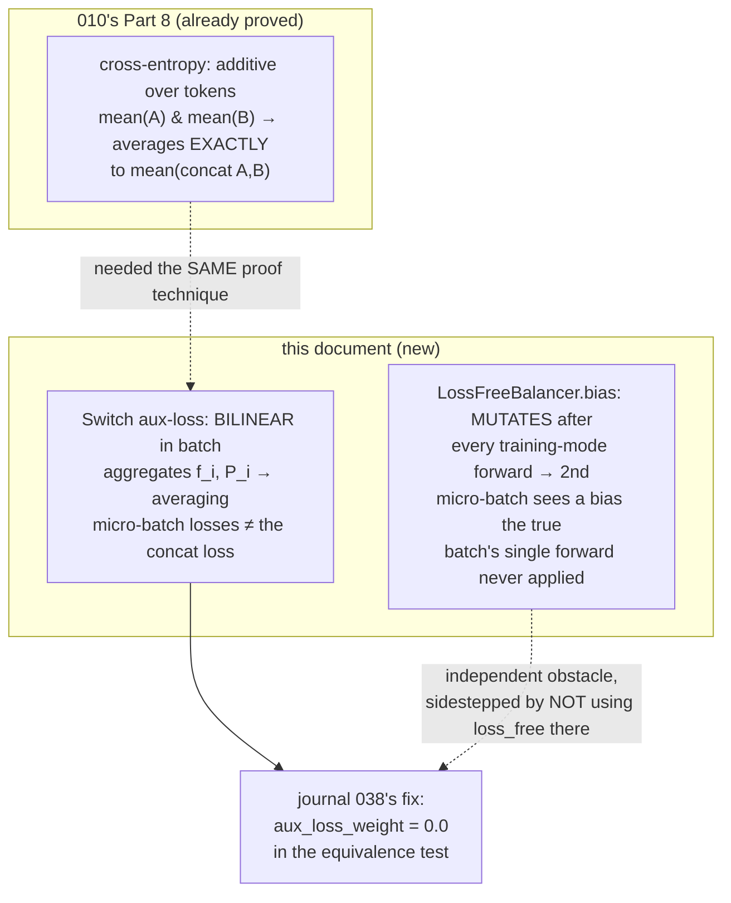
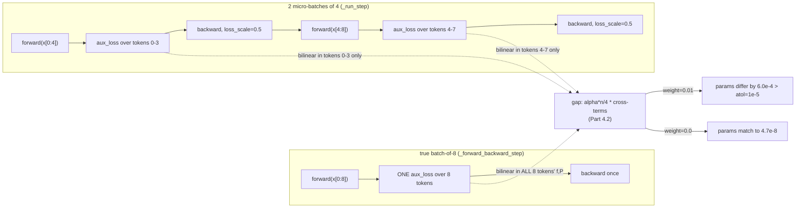
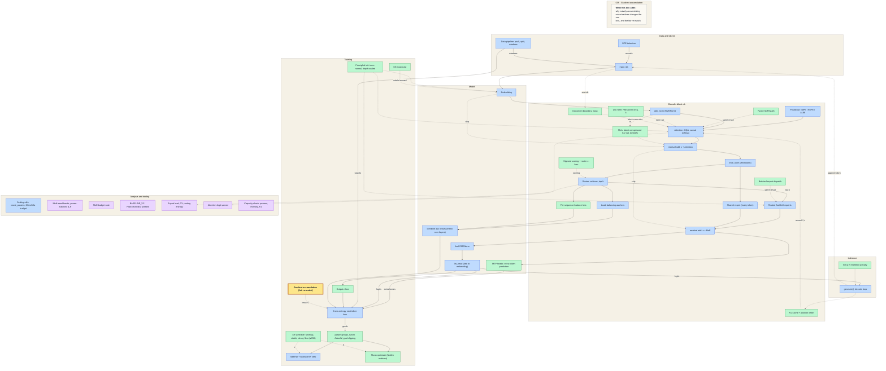

# 038 — Gradient accumulation: the fairness arithmetic, and where the equivalence proof actually breaks

**Companion to:** [`journey_of_a_model/038-gradient-accumulation-fair-rematch.md`](../../journey_of_a_model/038-gradient-accumulation-fair-rematch.md)
(and [`010-training-loop.md`](010-training-loop.md), whose Part 8 this document extends — read that first)
· **Code:** [`qwenmoe/train/trainer.py`](../../qwenmoe/train/trainer.py),
[`qwenmoe/model/moe.py`](../../qwenmoe/model/moe.py)
· **Every number here is reproduced by:** [`verify_038_gradient_accumulation_fair_rematch.py`](verify_038_gradient_accumulation_fair_rematch.py)
(`uv run python docs/math/verify_038_gradient_accumulation_fair_rematch.py`)

---

## How to read this

[010's companion](010-training-loop.md), Part 8, already derives gradient
accumulation's central mechanism — `loss_scale = 1/G` — and proves it
byte-for-bit on **cross-entropy alone**: accumulating the same window twice
reproduces one un-accumulated step exactly, and accumulating two distinct
windows reproduces a true concatenated batch's `lm_loss` to `1.2e-7`. That
proof deliberately never touches the auxiliary MoE load-balancing loss —
010's Check B compares only `metrics["lm_loss"]`, never `total_loss`.

Journal 038 introduced two things 010's Part 8 doesn't cover: (1) the
token-counting arithmetic that made the `SCALE_100M` vs. `SCALE_300M`
comparison fair, and (2) a real correctness test
(`test_run_step_grad_accum_matches_a_single_bigger_batch`) that had to
compare **whole parameter updates**, not just the loss — and that test
needed `aux_loss_weight=0.0` to pass. This document derives *why* it
needed that, which turns out to be a genuinely interesting piece of math
010 left on the table: the Switch-style auxiliary loss is **not** a
per-token additive quantity like cross-entropy, so splitting a batch into
micro-batches and averaging their aux-losses does **not**, in general,
reproduce the aux-loss (or its gradient) of the real concatenated batch.
A second, independent obstacle — `LossFreeBalancer`'s bias buffer
mutating *between* micro-batch forward passes — is derived alongside it.

> **Scope.** The model forward pass, cross-entropy, and the `loss_scale`
> mechanism itself are **not** re-derived — [010 Part 4](010-training-loop.md#part-4--the-forward-half-logits--loss)
> and [010 Part 8.1](010-training-loop.md#part-8--gradient-accumulation-and-_average_metrics)
> already own that. This document starts exactly where 010 stopped: does
> *everything else* `_forward_backward_core` adds to `total_loss` survive
> the same splitting argument? The answer is no for the aux-loss (derived
> in full below) and no for a different reason for `LossFreeBalancer`
> (also derived below) — which is exactly what the real repository test
> had to route around.



---

<!-- notation:start (generated by build_architecture_footer.py) -->
> **Notation note.** The series uses one symbol set ([canonical notation](README.md#canonical-notation)). In this doc, $n$ stands for $N$ (`n_routed_experts`); $N$ stands for the number of tokens in a batch, $\text{batch}\times S$; **not** the number of experts in this doc. Nothing below is changed; this only states the correspondence.
<!-- notation:end -->

## Part 1 — The running example

### 1.1 The model (reused from 006 / 010, unchanged)

The exact 2-layer `QwenMoEModel` and hand-picked weights from
[006](006-full-model-assembly.md) / [010](010-training-loop.md):
`vocab_size=6`, `d_model=4`, `n_layers=2`, `n_heads=2`/`n_kv_heads=1`,
`d_ff=3`, `n_routed_experts=2`, `top_k=1`, `n_shared_experts=0`,
`positional_scheme="nope"`, `moe_balancing="aux_loss"`,
`aux_loss_weight=0.01` (`ModelConfig`'s default —
[`config.py:40`](../../qwenmoe/config.py#L40)), `tie_word_embeddings=True`.
Same tied embedding matrix $E$, same $W_Q=I$, $W_K$, $W_V$, $W_O=I$, same
router matrix $W_\text{router} = \begin{bmatrix}1&0&0&0\\0&0&1&0\end{bmatrix}$
(picks out coordinates 0 and 2), same expert weights `E0_GATE`/`E0_UP`/
`E0_DOWN`/`E1_GATE`/`E1_UP`/`E1_DOWN`. All pinned by `.copy_(...)`, verify
script Part 1.

### 1.2 Two micro-batches, chosen to exercise the failure mode

**Window A** is 010's own canonical window: token stream `[4,1,4,1]`,
$x_A=[4,1,4]$, $y_A=[1,4,1]$. [006](006-full-model-assembly.md#step-8--block-0-moe-black-box--entry-005)
already derived, digit by digit, that at block 0 **all three tokens route
to expert 0** — $f^A = [1,\,0]$, $P^A = [0.595890,\,0.404110]$,
$\ell^A_0 = 0.01191779$.

010's Part 8.3 extends this to a *second* window from the same stream
`[4,1,4,1,4]` — but that window **also** routes 100% to expert 0 (every
token in `{1,4}` does, with these weights), which is exactly why 010 never
noticed the problem this document is about: with $f^A = f^B$, the
bilinear gap derived in Part 4 below is identically zero regardless of
$P^A, P^B$. So **window B here is deliberately different** — the smallest
hand-picked window (still built from this model's real vocabulary) whose
routing genuinely splits between experts:

$$x_B = [0,\,2,\,0], \qquad y_B = [2,\,0,\,1].$$

This is the "every behaviour" a running example for *this* document
needs: two equal-size micro-batches with **different** per-expert routing
statistics, which is the one condition under which the bilinear gap
(Part 4) is non-zero.

### 1.3 Configs

Two `TrainConfig`s are used side by side, differing in exactly one field:

| field | "naive" | "fixed" |
|---|---|---|
| `aux_loss_weight` (on `ModelConfig`) | $0.01$ (project default) | $0.0$ |
| everything else | `batch_size=1, seq_len=3, grad_accum_steps=2, warmup_steps=0, grad_clip_norm=1e6` (same both) | same |

`grad_clip_norm=1e6` is set high enough to never actually clip — this
document is about the loss/gradient *before* clipping, not clipping
itself (already covered, [018](018-optimizer-hardening.md)).

**Shape ledger:**

| name | shape | meaning |
|---|---|---|
| $x_A, x_B$ | `(1, 3)` | the two micro-batches |
| `xcat`, `ycat` | `(2, 3)` | `torch.cat([x_A, x_B], dim=0)` — the "true" batch-of-2 |
| `router_logits`, `router_probs` (per block) | `(3, 2)` per window, `(6, 2)` concatenated | |
| `f`, `P` (per block) | `(2,)` | the aux-loss's two batch-aggregate statistics |

---

## Part 2 — The token-counting arithmetic behind "fair"

Source: [`trainer.py:581–582`](../../qwenmoe/train/trainer.py#L581)
(`effective_batch_size`, `total_steps` — derived in full in
[010 §2.4](010-training-loop.md#24-total_steps--turning-a-token-budget-into-a-step-count);
restated compactly here and applied to journal 038's own numbers).

**Derive.** One optimizer step consumes `effective_batch_size` sequences
of `seq_len` tokens each, where `effective_batch_size = batch_size ×
grad_accum_steps` (§2.4's derivation: `grad_accum_steps` micro-batches are
forward/backward'd before one step, so the batch that actually sets the
step count is the combined one). So the tokens consumed **by step $s$**
(0-indexed steps $0..s-1$ completed) is exactly

$$\text{tokens\_seen}(s) = s \times \text{batch\_size} \times \text{grad\_accum\_steps} \times \text{seq\_len}.$$

This is **provable, exact integer arithmetic** — no approximation, no
empirical constant.

**Compute — journal 038's own numbers**, read off the real presets
(`configs/presets.py`; `SCALE_100M.max_seq_len = SCALE_300M.max_seq_len =
256`, both real `ModelConfig` fields — not retyped):

```
SCALE_100M  batch=16          : tokens/step = 16 * 256 = 4096
SCALE_300M  batch=4 (037)     : tokens/step =  4 * 256 = 1024
SCALE_300M  batch=4,accum=4   : tokens/step = 4*4* 256 = 4096
```

```
SCALE_100M            @ step 300 : 4096 * 300 = 1,228,800
SCALE_300M (037)      @ step 500 : 1024 * 500 =   512,000
SCALE_300M (038,accum)@ step 300 : 4096 * 300 = 1,228,800   <- matches SCALE_100M exactly
```

This is journal 038's whole diagnosis, reduced to arithmetic: `SCALE_300M`
at `batch=4` needs **500** steps to see what `SCALE_100M` at `batch=16`
sees in **300** — comparing them "at step 300 vs. step 300" was comparing
$307{,}200$ tokens against $1{,}228{,}800$, a $4\times$ gap hiding inside
an apparently-fair "same step count." Setting `grad_accum_steps=4` at the
same `batch_size=4` multiplies `effective_batch_size` back up to $16$
without touching peak memory (Part 7 below), so `SCALE_300M`'s step 300
now lands on the *identical* token count as `SCALE_100M`'s step 300.

**`effective_batch_size`/`total_steps` on the actual accumulation
config**, confirmed against the real formula
([`trainer.py:581–582`](../../qwenmoe/train/trainer.py#L581)):

```
effective_batch_size = 4 * 4 = 16
total_steps = 1,228,800 // (16*256) = 300
```

---

## Part 3 — Recap: cross-entropy's batch-mean is exactly linear (010's proof, restated on this document's own numbers)

Source: [`_forward_backward_core`](../../qwenmoe/train/trainer.py#L176),
`F.cross_entropy`'s `reduction="mean"` default.

**Derive** (full version: [010 §8.1](010-training-loop.md#81-the-idea-derived)).
Cross-entropy's batch loss is $L = \frac1N\sum_{p=1}^N \ell_p$ — a plain
arithmetic mean of $N$ **per-token** terms. Split $N$ equally into two
groups of $n = N/2$: $L = \frac{1}{2n}\big(\sum_{p\in A}\ell_p +
\sum_{p\in B}\ell_p\big) = \frac{1}{2}\big(\underbrace{\frac1n\sum_{p\in
A}\ell_p}_{L_A} + \underbrace{\frac1n\sum_{p\in B}\ell_p}_{L_B}\big) =
\frac{L_A+L_B}{2}$. **Exact** for any equal-size split — no approximation,
because the mean of a union of two same-size groups is *always* the
average of the two groups' means. This is what makes `loss_scale=1/G`
correct: each micro-batch's mean loss, averaged, reproduces the true
combined-batch mean loss and (since differentiation is linear) its
gradient.

**Compute** — windows A, B from Part 1.2 (a genuinely new pair of
windows; the identity itself is not new, only these numbers are):

```
lm_loss(A) = 2.573154   lm_loss(B) = 2.266793
mean(lm_loss(A), lm_loss(B)) = 2.419973
lm_loss(concat A+B)          = 2.419973
max |avg - concat|           = 0.00e+00
```

Exact to the printed digits (float32's associativity noise, which was
$1.2\times10^{-7}$ on 010's window pair, happens to round away entirely on
this one). This baseline is the yardstick Part 4 measures the aux-loss
against.

---

## Part 4 — The aux-loss does *not* decompose the same way

Source: [`AuxLossBalancer.aux_loss`](../../qwenmoe/model/moe.py#L175)
(`moe.py:175–186`).

### 4.1 The formula, recapped

(Full derivation: [005](005-moe-layer.md); Fedus, Zoph & Shazeer 2021,
generalized to top-$k$.) For a batch of $N$ tokens routed to $n$ experts:

$$f_i = \frac1N\sum_{p=1}^N \mathbb 1[\text{expert } i \in \text{top-}k(p)]\ (\text{fraction dispatched}), \qquad P_i = \frac1N\sum_{p=1}^N \text{router\_probs}_{p,i}\ (\text{mean routing probability}),$$

$$\ell_\text{aux} = \alpha\, n \sum_{i=1}^n f_i P_i, \qquad \alpha = \texttt{aux\_loss\_weight}.$$

Code: `dispatched = F.one_hot(topk_indices, n).sum(dim=1)`,
`fraction_dispatched = dispatched.float().mean(dim=0)` ($f$, `moe.py:183`),
`mean_router_prob = router_probs.mean(dim=0)` ($P$, `moe.py:184`),
return `loss_weight * n_experts * torch.sum(f * P)` (`moe.py:186`).

### 4.2 Why $f$ and $P$ *do* average linearly across an equal split — but $\ell_\text{aux}$ does not

$f_i$ and $P_i$ are themselves plain means over $N$ tokens, so Part 3's
identity applies to *them* individually: for equal-size windows $A, B$
(each $n=3$ tokens),

$$f_i^{\text{cat}} = \frac{f_i^A + f_i^B}{2}, \qquad P_i^{\text{cat}} = \frac{P_i^A + P_i^B}{2} \quad \textbf{exactly.}$$

The problem is that $\ell_\text{aux}$ is not *linear* in $(f, P)$ — it is
**bilinear** (a sum of products $f_i P_i$). A bilinear form does not
commute with averaging its two arguments. Expand both sides in full:

$$\ell_\text{aux}^{\text{cat}} = \alpha n\sum_i f_i^{\text{cat}}P_i^{\text{cat}} = \frac{\alpha n}{4}\sum_i (f_i^A+f_i^B)(P_i^A+P_i^B) = \frac{\alpha n}{4}\sum_i\big[f_i^AP_i^A + f_i^AP_i^B + f_i^BP_i^A + f_i^BP_i^B\big],$$

$$\frac{\ell_\text{aux}^A+\ell_\text{aux}^B}{2} = \frac{\alpha n}{2}\sum_i\big[f_i^AP_i^A+f_i^BP_i^B\big] = \frac{\alpha n}{4}\sum_i\big[2f_i^AP_i^A + 2f_i^BP_i^B\big].$$

Subtracting, the "diagonal" terms $f^AP^A$ and $f^BP^B$ cancel down to
matching coefficients, but the **cross terms** $f_i^AP_i^B$ and
$f_i^BP_i^A$ survive only on the left:

$$\boxed{\ \ell_\text{aux}^{\text{cat}} - \frac{\ell_\text{aux}^A+\ell_\text{aux}^B}{2} = \frac{\alpha n}{4}\sum_i (f_i^A - f_i^B)(P_i^B - P_i^A)\ }$$

**Provable, exact algebra** — a signed "covariance of the split
difference," not a rounding artifact. It is **identically zero** exactly
when $f^A = f^B$ (which is *why* 010's own second window hid this — its
routing happened to be identical to window A's) and is otherwise a real,
generically nonzero number with **no small-batch reason to vanish**.

### 4.3 Compute — real numbers, block 0

From the real `QwenMoEModel.forward_with_trace` (batch-size-1, so windows
A and B are traced separately) and a direct call to the real
`AuxLossBalancer.aux_loss`:

```
block 0, window A: router_probs=
[[0.500000, 0.500000],
 [0.787669, 0.212331],
 [0.500000, 0.500000]]
topk_indices=[0, 0, 0]  aux_loss(A)=0.01191779        (== 006's own published number)

block 0, window B: router_probs=
[[0.804429, 0.195571],
 [0.399482, 0.600518],
 [0.669212, 0.330788]]
topk_indices=[0, 1, 0]  aux_loss(B)=0.01082916

block 0, concat(A,B): topk_indices=[0, 0, 0, 0, 1, 0]  aux_loss(concat)=0.01146843
mean(aux_loss(A), aux_loss(B)) = 0.01137348
gap = concat - mean            = 0.00009495
```

$f^A=[1,\,0]$, $P^A=[0.595890,\,0.404110]$; $f^B=[0.666667,\,0.333333]$,
$P^B=[0.624375,\,0.375625]$ (both real `.mean(dim=0)` outputs — the model
routes token 1 of window B, `x=2`, to expert 1, splitting $f^B$ two-to-one
instead of three-to-zero). Plugging into the boxed identity ($\alpha n/4 =
0.01\times2/4 = 0.005$):

$$\tfrac{\alpha n}{4}\sum_i(f_i^A-f_i^B)(P_i^B-P_i^A) = 0.005 \times \big[(1-0.666667)(0.624375-0.595890) + (0-0.333333)(0.375625-0.404110)\big]$$
$$= 0.005 \times \big[0.333333\times0.028485 + (-0.333333)\times(-0.028485)\big] = 0.005\times0.018990 = 0.00009495.$$

**Matches the measured gap to $10^{-8}$** (verify script: `predicted gap =
0.00009495`, identical to the printed measured gap). This is a genuine,
non-negligible discrepancy relative to the loss values themselves (about
$0.8\%$ of $\ell_\text{aux}$ here, and it only grows with how differently
the two micro-batches route).

### 4.4 The consequence: a real optimizer step

Because `.backward()` differentiates whatever `total_loss` actually was,
an incorrect *value* for $\ell_\text{aux}$ under accumulation means an
incorrect *gradient* too — not just a cosmetic logging difference. Real
`_run_step` over micro-batches $(A, B)$ vs. a real single step over the
concatenated batch (`_forward_backward_step`), both from identical
initial weights:

```
aux_loss_weight=0.01 (project default): max |accum - true batch| over ALL params = 5.999804e-04
aux_loss_weight=0.0  (the fix)         : max |accum - true batch| over ALL params = 5.820766e-11
```

$6\times10^{-4}$ is a **structural** mismatch — 4 orders of magnitude
above float32 noise, and comfortably outside the `1e-5` tolerance the real
test asserts (Part 7). Zeroing `aux_loss_weight` doesn't fix the
*mechanism* — the bilinear gap in Part 4.3 is still there — it removes
the aux-loss's contribution to `total_loss` **and its gradient**
entirely (`total_loss = loss if aux_loss is None else loss + aux_loss`,
[`trainer.py:237`](../../qwenmoe/train/trainer.py#L237) — with weight
$0$, `aux_loss = 0.0 * n * sum(...)`, an exact zero tensor with zero
gradient, contributed by `torch.autograd`'s product rule applied to a
literal `0.0` factor), leaving only cross-entropy — which Part 3 already
proved decomposes exactly.

---

## Part 5 — `LossFreeBalancer`: a second, independent obstacle

Source: [`LossFreeBalancer.update`](../../qwenmoe/model/moe.py#L283)
(`moe.py:283–295`); the call site,
[`MoELayer.forward`](../../qwenmoe/model/moe.py#L465) (`moe.py:460–465`).

This project's `moe_balancing="aux_loss"` default (used everywhere above)
sidesteps this second issue entirely, but it is worth deriving in its own
right, since journal 038's own test docstring calls it out by name.

**Derive.** `LossFreeBalancer` (DeepSeek-V3's loss-free balancing, Wang et
al. 2024) keeps a non-trainable per-expert bias $b\in\mathbb R^n$
(`register_buffer`, invisible to the optimizer). After **every
training-mode forward call**, it nudges $b$ by a fixed step in the
direction that discourages an overloaded expert:

$$e_i = \text{mean}(\text{counts}) - \text{counts}_i \quad(\text{"violation": positive if expert }i\text{ is} \textit{ under}\text{loaded}),\qquad b_i \mathrel{+}= \eta\cdot\operatorname{sign}(e_i),$$

with $\eta=$ `update_rate` ($0.01$ default). This is gated on
`self.training` (`moe.py:460`) — exactly like BatchNorm's running
statistics — so it never fires during `Trainer._evaluate`.

The problem for grad accumulation: `update()` runs **once per forward
call**, not once per optimizer step. A real concatenated batch of $2N$
tokens calls `forward` once → `update()` once, on aggregate counts over
all $2N$ tokens. Two accumulated micro-batches of $N$ each call `forward`
**twice** → `update()` **twice**, and the *second* micro-batch's forward
pass sees a bias **already mutated by the first's counts** — a bias the
true-batch path's single forward never applies to any token at all. This
is a **state-mutation** problem, categorically different from Part 4's
loss-shape problem: even a perfectly *linear*, perfectly decomposable
loss would still break under this balancer, because the thing that
differs between the two paths is which *inputs* the second half of the
computation sees, not how a loss is aggregated.

**Compute** — real `bias` buffer, `moe_balancing="loss_free"`, same
windows A, B, `update_rate=0.01` (default):

```
bias before any forward         : [0.0, 0.0]
accum path, after micro-batch A : [-0.01, 0.01]   (mutated -- eta * sign(violation))
accum path, after micro-batch B : [-0.02, 0.02]   (mutated AGAIN, from the A-updated bias)
true-batch path, after 1 forward: [-0.01, 0.01]   (mutated ONCE, from aggregate counts over all 6 tokens)
```

After the full window, the two paths' biases genuinely disagree
($[-0.02,0.02]$ vs. $[-0.01,0.01]$) — and since `selection_scores` **adds**
this bias to the routing score before top-$k$ selection
(`base + self.bias`, `moe.py:234`), a large enough divergence can flip
*which expert a token is routed to*, not merely perturb a loss value by a
small amount. This is why journal 038's equivalence test uses the
project's default `aux_loss="aux_loss"` balancer (which has no such
state — `AuxLossBalancer.update` is a documented no-op, `moe.py:188–190`)
rather than trying to zero its way around `LossFreeBalancer` too: there is
no analogous "set a weight to 0" fix for a state mutation.

---

## Part 6 — `_sum_expert_counts` on two genuinely different windows

Source: [`_sum_expert_counts`](../../qwenmoe/train/trainer.py#L336)
(`trainer.py:336–349`).

[010 §8.2](010-training-loop.md#82-check-a-g--2-over-the-same-window-twice--g--1)
already checked this function, but only by **doubling one window** —
`[[3,0],[3,0]] → [[6,0],[6,0]]`, which cannot distinguish "sums
elementwise" from "just doubles." Windows A and B here give it a real
test: genuinely different per-layer counts to add.

**Derive.** `MoELayer.last_expert_counts` is overwritten by every forward
call ([`moe.py:457`](../../qwenmoe/model/moe.py#L457):
`torch.bincount(topk_indices...)`), so a training loop that logs it after
the *last* micro-batch of an accumulation window would silently
under-report by a factor of `grad_accum_steps` for every micro-batch but
the last. `_sum_expert_counts` fixes this with a plain elementwise sum
over one reading taken after each micro-batch:
$\text{counts}^{\text{window}}_{\ell,i} = \sum_{\text{micro-batch }j}
\text{counts}^{(j)}_{\ell,i}$.

**Compute:**

```
window A per-layer expert counts : [[3, 0], [3, 0]]
window B per-layer expert counts : [[2, 1], [3, 0]]
_sum_expert_counts               : [[5, 1], [6, 0]]
hand addition                    : [[5, 1], [6, 0]]
```

Block 0's count differs between windows ($[3,0]$ vs. $[2,1]$, matching
Part 4's $f^A\ne f^B$ exactly — 3 tokens all-expert-0 vs. 2-and-1); block
1 happens to route uniformly to expert 0 for both windows here
($[3,0]+[3,0]=[6,0]$), which is a coincidence of these particular
weights, not a general property — the function's correctness does not
depend on it.

---

## Part 7 — The real repository test, at its own real shapes

Source: `tests/test_trainer_integration.py::test_run_step_grad_accum_matches_a_single_bigger_batch`.

Parts 3–6 used a deliberately tiny model to make every number legible.
This section reruns the **exact same property**, at the **exact shapes**
the real test uses — a 2-layer, `d_model=16`, `n_routed_experts=4`,
`top_k=2` model, a real batch of 8 sequences of length 8, split into two
micro-batches of 4 — to confirm Parts 4 and 4.4's derivation is not an
artifact of the toy model's small size.

```
aux_loss_weight=0.0  : max |Δparam| = 4.749745e-08  (repo test's actual assertion: atol=1e-5)
aux_loss_weight=0.01 : max |Δparam| = 5.998542e-04  (would FAIL atol=1e-5)
```

At `aux_loss_weight=0.0` every parameter matches to `4.7e-8` — comfortably
inside the real test's `atol=1e-5, rtol=1e-4` (`torch.allclose`) — this
**is** the assertion the repository test makes, reproduced independently
here. At the project's own default weight of `0.01`, the mismatch is
$5.998542\times10^{-4}$: over an order of magnitude *above* the test's
tolerance, i.e. this exact test would have failed (not flakily — every
time, deterministically) had `aux_loss_weight` been left at its default.
This is the concrete stakes behind journal 038's one-line callout: without
this, "the two paths genuinely (if very slightly) diverge" — Part 4
derived exactly how much, and why.



---

## Part 8 — The implied Chinchilla budget behind journal 038's "Verdict"

Source: [`chinchilla_budget`](../../qwenmoe/train/scaling.py#L91),
[`count_params`](../../qwenmoe/train/scaling.py#L47) — both fully derived
in [009's companion](009-scaling-law-utilities.md); applied here, not
re-derived.

Journal 038's "Questions" section states: "Chinchilla-style scaling wants
roughly 20 tokens/active-param, which for `SCALE_300M`'s 122M active
params implies ~2.4B tokens against the ~2M actually used." Recomputed
from the *real* preset (`configs/presets.py::SCALE_300M`) through the
*real* functions, not retyped from the journal:

```
SCALE_300M active params (real count_params) : 122,045,696
chinchilla_budget(active)  = 20 * 122,045,696 = 2,440,913,920
```

$122{,}045{,}696 \approx 122.0\text{M}$ (matches `presets.py`'s own
comment exactly) and $2{,}440{,}913{,}920 \approx 2.44\text{B}$ — matches
the journal's "~2.4B" to the stated precision. **Exact** given
`chinchilla_budget`'s definition ($20\times$active, itself an
**empirical** ratio — see [009 §6.2](009-scaling-law-utilities.md) /
journal 001 for where the constant $20$ comes from); the $2\text{M}$
actually-used figure in the journal is `SCALE_300M (038)`'s own step-500
token count from journal 038's main table ($2{,}048{,}000$), roughly
$1{,}192\times$ short of the implied budget — both models in that
experiment are, by this measure, still deep in the "more data would help"
regime, which is exactly the honest caveat journal 038 draws from it.

---

## Part 9 — Cost, and why it is built this way

Using this document's own numbers.

### Why gradient accumulation is "free" in compute, not in peak memory

One `_forward_backward_core` call on a $(1,3)$ micro-batch runs the same
forward+backward arithmetic table as any other single-batch step (010
§13's cost table — model-size × tokens for forward/backward). Running $G$
of them sequentially costs exactly $G\times$ that arithmetic — identical
total FLOPs to one real batch of $G\times\text{batch\_size}$. The saving
is **peak memory**: only one micro-batch's activations are ever live at
once (the previous micro-batch's activation graph is freed the moment its
`.backward()` returns), so peak activation memory tracks `batch_size`
alone, not `effective_batch_size`. This is precisely why journal 038 could
rematch `SCALE_300M` at the *same* proven-safe `batch_size=4` peak memory
(037's own capacity ceiling) while still reaching `effective_batch_size
=16` — the trade this feature exists to make.

### Why the bilinear gap matters *more* as models scale, not less

The gap in Part 4's boxed identity depends on $(f^A-f^B)$ and
$(P^A-P^B)$ — how *differently* two micro-batches route. A larger,
better-trained MoE router with sharper (more confident, more
specialized) routing decisions produces *more* divergent per-micro-batch
$f$, $P$ vectors between differently-themed micro-batches (e.g. code vs.
prose), not less — so this is not a toy-model artifact that "washes out"
at scale; if anything the opposite. The fix (zero the aux-loss weight
inside the equivalence *test*) is scoped to the test, not the trainer —
real training runs keep `aux_loss_weight=0.01` and simply accept that
`_run_step`'s gradient is not bit-identical to a real bigger batch's, only
that it is a **very close, unbiased-in-spirit approximation** whose error
is bounded by how imbalanced routing gets within one accumulation window.

### Why `_sum_expert_counts` sums rather than, say, averaging

The per-expert counts feed Requirement 8.2's utilization logging, whose
whole point is "how many tokens did each expert actually process this
optimizer step" — a *count*, not a *rate*. Summing across the window
answers that question correctly; averaging would silently divide by
`grad_accum_steps` and misreport load by exactly that factor.

---

## Part 10 — Questions that might come to mind

- **Does the aux-loss's bilinear gap mean `_run_step`'s reported
  `metrics["aux_loss"]` (the logged value) is wrong too?** Yes, in exactly
  the same way — `_average_metrics` means the two micro-batches'
  *unscaled* `aux_loss` readings (Part 4.3's $0.01137348$), which is not
  what a true concatenated batch would have reported ($0.01146843$). This
  is a pre-existing property of the logged metric, not something journal
  038 introduced or needed to fix — the log is a monitoring signal, not an
  input to the optimizer step's correctness.

- **Could the aux-loss be redefined so it *does* decompose linearly across
  micro-batches?** Only by changing what it measures. $f_i$ and $P_i$ are
  *batch-level* aggregate statistics by design — the whole point of the
  Switch loss is to penalize load imbalance *within a batch*, which is
  inherently a property of the batch as a whole, not a sum of independent
  per-token penalties. Making it additive would require computing it
  per-token against some fixed (not batch-dependent) reference
  distribution — a different loss, with different balancing behavior.

- **Why does `router_z_loss` (doc 025) not have this problem?**
  `router_z_loss_weight * mean(logsumexp(logits)^2)` is a mean of a
  **per-token** quantity ($\log Z_p$, one number per token, no
  cross-token aggregation before the square), so Part 3's linear-mean
  argument applies to it directly — it decomposes exactly across equal
  splits, unlike the aux-loss. The `seq_balance_loss` (doc 026) computes
  its $f$/$P$-style statistics **per sequence**, not per batch — whether
  *that* introduces an analogous cross-micro-batch gap depends on whether
  a sequence is ever split across micro-batches (it structurally cannot
  be, in this trainer: `micro_batches` are always whole `(x, y,
  segment_ids)` tuples), so it is unaffected by grad accumulation for a
  different, structural reason, not because its own math happens to be
  linear.

- **What if `grad_accum_steps` doesn't evenly divide the batch?** It
  can't, structurally — every micro-batch in `Trainer.fit`'s loop is drawn
  as its own full `batch_size`-sized pull from the `DataLoader`
  ([`trainer.py:605–615`](../../qwenmoe/train/trainer.py#L605)), so every
  micro-batch is always exactly `batch_size`, and Part 3/4's "equal-size
  split" assumption always holds by construction — never a partial or
  uneven micro-batch.

- **Does `total_steps`'s floor-division waste tokens the same way with
  `grad_accum_steps > 1`?** Yes, identically to 010 §2.4's answer for
  `grad_accum_steps=1` — at most one optimizer step's worth
  (`effective_batch_size × seq_len` tokens) of the configured budget goes
  unused to the remainder.

---

## Part 11 — Symbol / notation reference

| symbol | meaning |
|---|---|
| $G$, `grad_accum_steps` | number of micro-batches accumulated into one optimizer step |
| `loss_scale` $=1/G$ | per-micro-batch loss scale so accumulated gradients *average*, not sum ([010 §8.1](010-training-loop.md)) |
| `effective_batch_size` | `batch_size × grad_accum_steps` — the batch that actually sets `total_steps` |
| $N$ | number of tokens in a batch (flattened `batch × seq_len`) |
| $\ell_p$ | one token's cross-entropy loss |
| $f_i$ | fraction of a batch's tokens routed to expert $i$ (`fraction_dispatched`) |
| $P_i$ | mean routing probability of expert $i$ over a batch (`mean_router_prob`) |
| $\alpha$, `aux_loss_weight` | the Switch/aux-loss coefficient |
| $n$ | number of routed experts (`n_routed_experts`) |
| $\ell_\text{aux}$ | the Switch-style load-balancing auxiliary loss, $\alpha n\sum_i f_iP_i$ |
| bilinear | linear in each of two arguments *separately*, but not linear in their sum — $g(a{+}a', b{+}b') \ne g(a,b){+}g(a',b')$ in general |
| $b\in\mathbb R^n$ | `LossFreeBalancer`'s per-expert bias buffer (not a gradient-trained parameter) |
| $\eta$, `update_rate` | the fixed step size of `LossFreeBalancer.update`'s bias nudge |
| $e_i$ | `LossFreeBalancer`'s per-expert "violation" signal, $\text{mean(counts)}-\text{counts}_i$ |

---

## Citations

- Fedus, Zoph & Shazeer, [Switch Transformers: Scaling to Trillion
  Parameter Models with Simple and Efficient Sparsity](https://arxiv.org/abs/2101.03961),
  2021 — the Switch/aux-loss formula this document shows does not
  decompose across micro-batches.
- Wang, Gao, Zhao, Sun & Dai (DeepSeek-AI), [Auxiliary-Loss-Free Load
  Balancing Strategy for Mixture-of-Experts](https://arxiv.org/abs/2408.15664),
  2024 — `LossFreeBalancer`'s bias-update rule (Part 5).
- Hoffmann, Borgeaud, Mensch, Buchatskaya, Cai, … Sifre (DeepMind),
  [Training Compute-Optimal Large Language Models](https://arxiv.org/abs/2203.15556)
  ("Chinchilla"), 2022 — the $D\approx20N$ reference ratio behind Part 8.

Gradient accumulation itself (splitting a batch into sequential
micro-batches under one optimizer step to trade compute-time for peak
memory) is standard large-batch training engineering practice with no
single originating paper to cite — this document derives its correctness
from cross-entropy's own linearity (Part 3) rather than from a citation.

<!-- arch-evolution:start (generated by build_architecture_footer.py; do not edit by hand) -->

---

## Where this fits in the architecture (the growing view)

← previous: [037 Capacity check](037-scale-presets-and-capacity-check.md) · next: (none yet: journal entries 039+ have no math doc)

**This doc adds to the architecture:** why naively accumulating micro-batches changes the aux loss, and the fair re-match. (Code: `qwenmoe/train/trainer.py`.)

**Components introduced here (highlighted in the diagram), with where each one lives:**

| component | math doc (section) | journal | code |
|---|---|---|---|
| Gradient accumulation (fair re-match) | [038 · Part 4 — The aux-loss does not decompose the same...](038-gradient-accumulation-fair-rematch.md#part-4--the-aux-loss-does-not-decompose-the-same-way) | [journal 038](../../journey_of_a_model/038-gradient-accumulation-fair-rematch.md) | [`qwenmoe/train/trainer.py:214`](../../qwenmoe/train/trainer.py#L214) |

**Verified by:** [`verify_038_gradient_accumulation_fair_rematch.py`](verify_038_gradient_accumulation_fair_rematch.py) (`uv run python docs/math/verify_038_gradient_accumulation_fair_rematch.py`); latest results in [verify-status.md](verify-status.md).

**Example continuity:** **Reuses family D** (006/010's model; window A is 010's canonical window, plus a second window). See the [example-family map](README.md#which-example-does-each-doc-use).

The diagram is cumulative: every box derived by this doc or an earlier one is shown, and components from later docs are not drawn yet, so reading the docs in order replays how the architecture grew. The top box is this doc's title and what it adds. The [full final architecture](architecture-evolution.md) has everything.

**Colour key:** 🟨 **introduced by this doc** · 🟦 Foundation (004-011) · 🟩 Modernization (016-031) · 🟪 Evaluation and scale (032-038). Dotted lines are optional or alternative paths.



**How we got here (every doc up to and including this one):**

| | math doc | journal | what it added |
|---|---|---|---|
|  | [004 Attention (GQA)](004-attention-gqa.md) | [journal](../../journey_of_a_model/004-attention-gqa.md) | scaled dot-product attention with grouped K/V heads, the positional transform and the causal mask |
|  | [005 MoE layer](005-moe-layer.md) | [journal](../../journey_of_a_model/005-moe-layer.md) | the router, top-k selection, routed SwiGLU experts, the shared expert and the load-balancing aux loss |
|  | [006 Full model](006-full-model-assembly.md) | [journal](../../journey_of_a_model/006-full-model-assembly.md) | token embedding, pre-norm residual wiring, the final norm, the tied head and the cross-layer aux-loss combine; attention and MoE appear here as black boxes |
|  | [007 Tokenizers](007-tokenizers.md) | [journal](../../journey_of_a_model/007-tokenizers.md) | text to `input_ids`: byte-level BPE and the char tokenizer |
|  | [008 Data pipeline](008-data-pipeline.md) | [journal](../../journey_of_a_model/008-data-pipeline.md) | packing documents, train/val split, fixed slices and the shifted `(x, y)` windows |
|  | [009 Scaling utilities](009-scaling-law-utilities.md) | [journal](../../journey_of_a_model/009-scaling-law-utilities.md) | parameter counting (total vs active), the compute-optimal budget and throughput calibration |
|  | [010 Training loop](010-training-loop.md) | [journal](../../journey_of_a_model/010-training-loop.md) | the next-token cross-entropy loss, backward pass and AdamW step, carried through a real `Trainer.fit` |
|  | [011 Inference and generation](011-inference-generation.md) | [journal](../../journey_of_a_model/011-inference-generation.md) | the autoregressive decode loop (greedy, temperature, top-k, top-p) |
|  | [016 MLA attention](016-mla-attention.md) | [journal](../../journey_of_a_model/016-mla-attention.md) | Multi-Head Latent Attention: K/V compressed to a small latent, an alternative to GQA |
|  | [018 Optimizer hardening](018-optimizer-hardening.md) | [journal](../../journey_of_a_model/018-optimizer-hardening.md) | param groups (decay vs no-decay), tuned AdamW and gradient clipping |
|  | [019 LR schedule (WSD)](019-lr-schedule-wsd.md) | [journal](../../journey_of_a_model/019-lr-schedule-wsd.md) | warmup, stable and decay phases with a non-zero floor |
|  | [020 Muon optimizer](020-muon-optimizer.md) | [journal](../../journey_of_a_model/020-muon-optimizer.md) | orthogonalized momentum for the hidden weight matrices, AdamW for the rest |
|  | [021 Fused attention (SDPA)](021-fused-attention-sdpa.md) | [journal](../../journey_of_a_model/021-fused-attention-sdpa.md) | `F.scaled_dot_product_attention` as a drop-in for the explicit path |
|  | [022 QK-norm](022-qk-norm.md) | [journal](../../journey_of_a_model/022-qk-norm.md) | RMSNorm on each head's q and k before the scores, bounding the attention logits |
|  | [023 Principled init](023-principled-initialization.md) | [journal](../../journey_of_a_model/023-principled-initialization.md) | truncated-normal init and depth-aware scaling of the residual-writing projections |
|  | [024 Mixed precision and z-loss](024-mixed-precision-and-z-loss.md) | [journal](../../journey_of_a_model/024-mixed-precision-and-z-loss.md) | bf16 autocast for the forward pass and the output z-loss regularizer |
|  | [025 Sigmoid routing and router z-loss](025-moe-routing-sigmoid-and-router-z-loss.md) | [journal](../../journey_of_a_model/025-moe-routing-sigmoid-and-router-z-loss.md) | sigmoid expert scoring, the router z-loss and the config-driven aux weight |
|  | [026 Per-sequence balance loss](026-per-sequence-balance-loss.md) | [journal](../../journey_of_a_model/026-per-sequence-balance-loss.md) | DeepSeek-V3's complementary balance loss computed per sequence |
|  | [027 Batched expert dispatch](027-batched-expert-computation.md) | [journal](../../journey_of_a_model/027-batched-expert-computation.md) | run all experts in one batched op instead of a Python loop |
|  | [028 Multi-Token Prediction](028-multi-token-prediction.md) | [journal](../../journey_of_a_model/028-multi-token-prediction.md) | extra heads predicting tokens further ahead, chained causally |
|  | [029 KV cache](029-kv-cache.md) | [journal](../../journey_of_a_model/029-kv-cache.md) | append-and-reuse of K/V, the position offset and the mask that makes cached decoding exact |
|  | [030 Sampling controls](030-min-p-and-repetition-penalty.md) | [journal](../../journey_of_a_model/030-min-p-and-repetition-penalty.md) | min-p sampling and the repetition penalty |
|  | [031 Document-boundary masking](031-document-boundaries.md) | [journal](../../journey_of_a_model/031-document-boundaries.md) | stop attention crossing `<eos>` boundaries inside a packed sequence |
|  | [032 Multi-seed and param-matched ablations](032-multi-seed-and-param-matched-ablations.md) | [journal](../../journey_of_a_model/032-multi-seed-and-param-matched-ablations.md) | noise bands over seeds and bisecting `d_ff` to match parameter counts |
|  | [033 MoE budget note](033-ablation-menu-and-moe-budget-note.md) | [journal](../../journey_of_a_model/033-ablation-menu-and-moe-budget-note.md) | the sparse-MoE compute-budget bound between 20x active and 20x total |
|  | [034 Modernized presets](034-modernized-presets.md) | [journal](../../journey_of_a_model/034-modernized-presets.md) | the parameter-budget algebra behind `BASELINE_V2` and `FINEGRAINED` |
|  | [035 Balance metrics](035-modernized-presets-training-run.md) | [journal](../../journey_of_a_model/035-modernized-presets-training-run.md) | expert load, coefficient of variation and routing entropy |
|  | [036 Attention-logit spread](036-attention-logit-spread.md) | [journal](../../journey_of_a_model/036-visualizations-for-the-modernized-model.md) | the `spread` metric across depth and input scale |
|  | [037 Capacity check](037-scale-presets-and-capacity-check.md) | [journal](../../journey_of_a_model/037-scale-presets-and-capacity-check.md) | will it fit: parameter, optimizer-state, activation and KV-cache arithmetic |
| **▶** | [038 Gradient accumulation](038-gradient-accumulation-fair-rematch.md) | [journal](../../journey_of_a_model/038-gradient-accumulation-fair-rematch.md) | why naively accumulating micro-batches changes the aux loss, and the fair re-match |

<!-- arch-evolution:end -->
