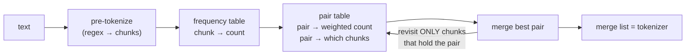

# 039 — BPE with incremental pair counts, and block-wise streaming: why it is fast, and where "exactly identical" stops being true

**Companion to:** [`journey_of_a_model/039-real-pretraining-data-and-a-usable-bpe.md`](../../journey_of_a_model/039-real-pretraining-data-and-a-usable-bpe.md)
and [`journey_of_a_model/040-streaming-the-corpus.md`](../../journey_of_a_model/040-streaming-the-corpus.md)
(one doc for both: 040 is 039's trainer fed from a block iterator, and the proof obligation is the same)
· **Builds on:** [`007-tokenizers.md`](007-tokenizers.md), which walks the *textbook* BPE loop by hand — read that first
· **Code:** [`qwenmoe/tokenizer/bpe.py`](../../qwenmoe/tokenizer/bpe.py),
[`scripts/prepare_data.py`](../../scripts/prepare_data.py)
· **Every number here is reproduced by:** [`verify_039_bpe_incremental_counts_and_streaming.py`](verify_039_bpe_incremental_counts_and_streaming.py)
(`uv run python docs/math/verify_039_bpe_incremental_counts_and_streaming.py`)

---

## How to read this

[007](007-tokenizers.md) derives what BPE *does*: count every adjacent pair, merge the most frequent, repeat. This
document is about what journal 039 changed so that loop could run on a 400-million-character corpus, and what
journal 040 then assumed in order to stream it. There are exactly three claims to check:

1. **The rewritten trainer computes the same thing as the textbook loop.** It keeps a running pair table and updates
   it instead of recounting. That is only legitimate if the running table equals a fresh recount after *every* merge.
   Part 3 states that invariant and checks it at every step.
2. **It is much cheaper.** Part 4 counts the work, on the example and on real text, rather than quoting a speed-up.
3. **Cutting the corpus into blocks changes nothing.** Journal 040 says block-wise encoding is "exactly identical" to
   whole-corpus encoding. Part 5 shows it is true *under a condition* on the cut, gives the exact condition, shows a
   counterexample, and checks the real corpus against it (all 207 real cuts are safe). This is the one place the doc
   qualifies the journal's wording, so it is stated plainly.

> **Scope.** Why BPE merges most-frequent pairs, the byte-level base vocabulary, and decoding are in 007 and are not
> repeated. The streaming *memory* arithmetic is Part 6.



---

<!-- notation:start (generated by build_architecture_footer.py) -->
> **Notation note.** The series uses one symbol set ([canonical notation](README.md#canonical-notation)). In this doc, $N$ stands for the total number of tokens in the encoded corpus; **not** the number of experts $N$ (`n_routed_experts`). Nothing below is changed; this only states the correspondence.
<!-- notation:end -->

## Part 1 — The running example and pre-tokenization

One text, carried through the whole document:

```
low low low low low lower lower newest newest newest widest_ widest_
```

**Pre-tokenization** cuts text into word-sized *chunks* before any merging, and merges are only ever learned *inside*
a chunk. The real pattern, `_PRE_TOKEN_PATTERN` ([`bpe.py:63`](../../qwenmoe/tokenizer/bpe.py#L63)), is GPT-2's
translated to the stdlib `re` module. Applied to the example it produces 14 chunks:

```
['low', ' low', ' low', ' low', ' low', ' lower', ' lower',
 ' newest', ' newest', ' newest', ' widest', '_', ' widest', '_']
```

A chunk keeps its one leading space (`' low'`, not `'low'`), so "word with its space" is a single unit the tokenizer can
learn. The first `low` has no leading space because it starts the text.

**The `_` is its own chunk, and that is the bug journal 039 caught.** GPT-2's pattern counts `_` as a *symbol*
(`[^\s\p{L}\p{N}]`). Python's `\w` *includes* `_`, so the direct translation `[^\s\w]` matches `_` with no
alternative, and `re.finditer` does not complain about text it cannot match — it **skips** it. The verify script runs
the naive pattern on the example and gets back text 2 characters shorter, with `_` gone. The real pattern spells the
symbol class `(?:[^\s\w]|_)`, and the script asserts the chunks reassemble the exact input
(`"".join(chunks) == text`).

*Exact vs. empirical:* pre-tokenization is a **design choice** (GPT-2's), not derived mathematics. The coverage
property (every character lands in exactly one chunk) is exact and tested.

---

## Part 2 — The frequency table

Identical chunks are collapsed to one entry with a count. UTF-8 bytes (so `l`=108, `o`=111, `w`=119, `e`=101,
`r`=114, `n`=110, `s`=115, `t`=116, `i`=105, `d`=100, space=32, `_`=95):

| chunk | count | length (bytes) |
|---|---:|---:|
| `low` | 1 | 3 |
| ` low` | 4 | 4 |
| ` lower` | 2 | 6 |
| ` newest` | 3 | 7 |
| ` widest` | 2 | 7 |
| `_` | 2 | 1 |

The stream has **68** symbol positions (one per byte of the text); the table has **28** (the sum of the lengths
above). That ratio is the whole point at scale: natural text repeats words constantly, so the table is bounded by the
number of *distinct* chunks, not by corpus size. On the real repo text used in Part 4, 732,554 positions collapse to
79,852 — 11,833 distinct chunks.

---

## Part 3 — The pair table, and why updating it equals recounting it

### 3.1 Weighted pair counts

A pair's count is the **sum over chunks that contain it of (occurrences in the chunk × the chunk's frequency)**. For the
example, before any merge:

| pair | where | count |
|---|---|---:|
| `(108,111)` `lo` | low 1 + ` low` 4 + ` lower` 2 | **7** |
| `(111,119)` `ow` | same three chunks | **7** |
| `(32,108)` ` l` | ` low` 4 + ` lower` 2 | 6 |
| `(119,101)` `we` | ` lower` 2 + ` newest` 3 | 5 |
| `(101,115)` `es` | ` newest` 3 + ` widest` 2 | 5 |
| `(115,116)` `st` | same | 5 |
| `(32,110)` ` n`, `(110,101)` `ne`, `(101,119)` `ew` | ` newest` | 3 each |

`(108,111)` and `(111,119)` tie at 7. `train` picks `max(pair_counts, key=pair_counts.get)`, and Python's `max`
returns the **first** maximal key in dict order — here `(108,111)`, inserted while scanning the very first chunk. That
tie-break is an implementation detail, not mathematics, and it matters in 3.3.

### 3.2 The update rule

To merge pair `p → id`, for every chunk `c` (frequency `f`) that contains `p`:

1. **subtract** `f` from the count of every adjacent pair currently in `c`;
2. replace each (non-overlapping, left-to-right) occurrence of `p` in `c` by `id`;
3. **add** `f` to the count of every adjacent pair in the *new* `c`.

A chunk that does not contain `p` is untouched — its pairs are the same before and after. `pair_chunks` (pair → set of
chunk indices) is the index that finds the affected chunks without scanning all of them.

### 3.3 The invariant, checked

The claim the rewrite needs is

$$\text{pair\_counts after merge } i \;=\; \text{recount}(\text{chunks after merge } i)$$

as dictionaries (same keys, same counts). The reasoning is plain bookkeeping: a pair's total is a sum over chunks, and
only the chunks containing `p` changed, so removing those chunks' old contribution and adding their new one leaves
every other chunk's contribution — and therefore the sum — exactly right. It is exact algebra, not an approximation.

The verify script does not stop at the argument. It runs a line-for-line mirror of the real loop and, after **every**
merge, `assert`s `pair_counts == recount(chunks)`. It also asserts the mirror's merge list equals the real
`ByteBPETokenizer`'s `_merges`. On the example, eight merges:

| id | merge | bytes | chunks touched |
|---:|---|---|---:|
| 256 | `(108,111)` | `lo` | 3 |
| 257 | `(256,119)` | `low` | 3 |
| 258 | `(32,257)` | ` low` | 2 |
| 259 | `(101,115)` | `es` | 2 |
| 260 | `(259,116)` | `est` | 2 |
| 261 | `(32,110)` | ` n` | 1 |
| 262 | `(261,101)` | ` ne` | 1 |
| 263 | `(262,119)` | ` new` | 1 |

Note what the tie-break did: `(108,111)` won the 7–7 tie, and then `ow` stopped existing as a pair (the `o` was
consumed), so `low` was built as `lo`+`w`, not `l`+`ow`. A different tie-break would have learned a different — equally
frequent — vocabulary.

> **A subtlety worth knowing.** The incremental table and a fresh recount are equal *as dictionaries* but not in
> *iteration order*: pairs removed and re-added land at the end of the incremental dict, while a recount orders pairs by
> first appearance. Since `max` breaks ties by dict order, an incremental trainer and a recount trainer can disagree on
> *which* of two equally-frequent pairs to merge first. Both are correct BPE; they are not guaranteed to produce the
> same merge list on corpora with ties. The verify script's merge-list equality is therefore against a *mirror of the
> incremental loop*, which shares the tie-break, not against a recount trainer.

---

## Part 4 — The cost, counted

"Faster" needs a unit. The cheapest honest one is **symbol positions scanned**.

| trainer | scans per merge | example, 8 merges |
|---|---|---:|
| recount the whole stream (pre-039) | every position still in the stream | **340** |
| recount the frequency table | every position in the table | 143 |
| incremental (`train`) | only chunks holding the merged pair | **67** |

The stream shrinks as merges fuse symbols, so the first row is not simply 68 × 8; the script tracks it exactly.

On real text — the journal itself, 727,518 characters, 600 merges — the same count is:

| trainer | positions scanned |
|---|---:|
| whole-stream recount | 250,649,780 |
| incremental | 250,290 |

**1,001x fewer.** This is a *work* ratio, not a stopwatch ratio, and it **grows with corpus size**: the naive cost is
(corpus length × merges) while the incremental cost depends on how many chunks hold each merged pair. Journal 039's
quoted ~3000x was a wall-clock measurement on a far larger corpus (22.5M characters at vocab 4096 in 2.3 s against ~35 h
extrapolated for 400M). This script reproduces the *mechanism* on 0.7M characters; it does not, and cannot cheaply,
reproduce the 400M-character timing.

*Exact vs. empirical:* the counts are exact for the stated text and merge count. The generalisation to "grows with
corpus size" is argued from the formulas, and the script's two corpora (68 and 732,554 positions) are consistent with it.

---

## Part 5 — Block-wise equals whole-corpus? Conditionally, and here is the condition

Journal 040 streams the corpus in 16 MB blocks cut at newlines (`iter_text_blocks`), arguing "no pre-token, and
therefore no merge, is ever split across a block", and reports that re-preparing the old 400M corpus gave an **exactly
identical** 115,936,101 tokens.

**What is provable.** The tokenizer never merges across chunk boundaries, so encoding is chunk-by-chunk. Block-wise
encoding therefore equals whole-corpus encoding *iff* cutting the text into blocks leaves the **list of chunks
unchanged**. "Cut at a newline" does not by itself guarantee that, because of how the pattern treats whitespace.

**Why.** The last two alternatives of the pattern are `\s+(?!\S)` and `\s+`. A whitespace run followed by a non-space
is taken whole *except its final character* (which is left to attach to the next word as `' word'`); only if that
final character is not a space does it become a chunk of its own. A cut inside such a run makes the two sides disagree
about where "the last character" is. The verify script prints six cuts, each made just after the *last* newline —
exactly where `iter_text_blocks` cuts:

| text | whole corpus | block-wise | |
|---|---|---|---|
| `a\nb` | `a`, `\n`, `b` | same | safe |
| `a\n b` | `a`, `\n`, ` b` | same | safe |
| `a\n  b` | `a`, **`\n `**, ` b` | `a`, **`\n`**, **` `**, ` b` | **different** |
| `a\n\nb` | `a`, **`\n`**, **`\n`**, `b` | `a`, **`\n\n`**, `b` | **different** |
| `a  \nb` | `a`, **`  `**, **`\n`**, `b` | `a`, **`  \n`**, `b` | **different** |
| `x\n\t y` | `x`, **`\n\t`**, ` y` | `x`, **`\n`**, **`\t`**, ` y` | **different** |

**The exact rule.** Let $a$ be the length of the whitespace run that *ends* at the cut (it includes the cut's own
newline) and $b$ the length of the run that *starts* at the cut. The chunk list is unchanged

$$\text{iff}\quad b \le 1 \ \text{ and } \ (b = 1 \ \text{ or } \ a = 1).$$

In words: a cut after a lone newline (`a = 1`) is safe if at most one whitespace character follows; a cut after a longer
run (`a ≥ 2`, e.g. a blank line or trailing spaces) is safe only if exactly one whitespace character follows. I did not
derive this from the regex by hand: the verify script **brute-forces it** — every string of up to 8 characters from
`{a, space, \n, \t}`, anchored by letters, every cut after a `\n` — and asserts the rule matches the real pattern on
all **167,481** cases, with no exceptions. That makes it an exhaustively-checked fact about the real regex over short
strings; the extrapolation to arbitrarily long runs is an inference from the same pattern, not a proof.

**Measured on real text.** First the repo's own markdown (blank lines and indentation everywhere — a pessimistic corpus,
written to a file and read back through the real `iter_text_blocks`):

| `block_chars` | cuts | unsafe cuts | chunk-count disagreements |
|---:|---:|---:|---:|
| 2,048 | 355 | 212 | 464 |
| 8,192 | 88 | 45 | 95 |
| 65,536 | 11 | 5 | 11 |

The script asserts that with **no** unsafe cut there is no disagreement, and that each unsafe cut costs **at most 3**
chunk-count differences (one whole-corpus chunk becomes two; `Counter` subtraction counts both directions).

Then the corpus that actually matters. Where `.cache/data/fineweb_edu_3500Mchars.txt` is present the script streams the
real 3.46 GB file at the real 16 MiB block size and classifies every cut:

| corpus | cuts | unsafe | $(a,b)$ histogram |
|---|---:|---:|---|
| FineWeb-Edu, 3.46 GB | 207 | **0** | (1,0) × 204, (1,1) × 3 |

(The 400M-character corpus journal 040 compared against has 24 cuts, all `(1,0)`.) Every real cut is a lone newline
followed by a non-space, or by one space — both in the safe set. FineWeb-Edu's text is single-newline-separated lines,
so the unsafe case simply does not arise in practice.

**Verdict on journal 040's claim.** It stands for the data this project trained on: the token-for-token equality is a
real measurement, and this part explains *why* it held — all 24 cuts it exercised were safe. What it does **not**
license is the general sentence "block-wise encoding is proven equivalent to whole-corpus encoding". That is true only
under the condition above, and a corpus with blank lines, indentation or trailing spaces at a cut would be encoded
slightly differently — a handful of tokens per unsafe cut, immaterial for training, but not bit-exact. A fix that makes
the equivalence unconditional is small (cut only at a newline preceded and followed by a non-whitespace character); this
document records the condition and does not change the code.

---

## Part 6 — The streaming memory ledger and the epoch count

All figures below are exact arithmetic on journal 040's measured token count, **N = 999,329,599** tokens, and its
measured corpus size, ~3.46 GB (the corpus is ASCII-folded, so one byte per character). The corpus size itself is a
quoted measurement, not recomputed here.

**Before streaming** — three structures alive at once:

| structure | bytes | GB |
|---|---:|---:|
| the corpus as one Python string | ≈ 3.46e9 | 3.46 |
| `list[int]` of token ids: one 8-byte pointer per token | 999,329,599 × 8 | 7.99 |
| `torch.long` tensor built from it: 8 bytes per token | 999,329,599 × 8 | 7.99 |
| **peak** | | **19.45** |

(The 8-byte pointers are the list only; each distinct token id object is shared, so this is a *lower* bound on the
list's cost.) 19.45 GB of 24 GB leaves no room for Python, the tokenizer and the OS.

**After**: one preallocated `int32` array — 999,329,599 × 4 B = **4.00 GB**, exactly half the int64 tensor
(asserted), wrapped by `torch.from_numpy` without a copy. The resident corpus drops from the whole 3.46 GB to one
16 MB block. Journal 040 measured the real peak at 3.75 GB RSS and 11 min 14 s; those are runtime measurements this
script does not re-run (that needs the 3.5 GB download).

**The epoch count.** `SCALE_300M` at vocabulary 4,097 has **125,122,304** active parameters (real `count_params`). The
Chinchilla reference budget is `20 × active` = **2,502,446,080** tokens, and over one shard that is

$$\frac{2{,}502{,}446{,}080}{999{,}329{,}599} = 2.504 \text{ epochs}$$

— below the 4-epoch repetition threshold `epochs_for_budget` warns at, which is why journal 040 calls the full shard
"enough". Both numbers come from the real preset and the real function, not from the journal's prose.

---

## Questions that might come to mind

**Is the incremental trainer a different algorithm from the one in 007?** No — it learns the same merges on a
tie-free corpus; Part 3 proves its table is always the table 007 would recount. It is the same algorithm with a
smarter data structure.

**Why does pre-tokenization also speed training up, not just change quality?** Because it is what makes the
frequency table possible: once merges cannot span chunks, identical chunks are interchangeable and can be counted once.
The older trainer merged across word boundaries and therefore could not collapse anything.

**Does the Part 5 caveat change any trained model?** No: every cut in the real corpus is safe, so the token stream is
identical to a whole-corpus encode. The caveat is about the *claim*, and about future corpora.

**Why is the 3000x not reproduced here?** It is a wall-clock figure on a corpus ~550x larger than the one this script
uses; reproducing it needs a multi-hour naive baseline. Part 4 counts the same mechanism on text small enough to run in
seconds and says so.

---

## Symbols

| symbol | meaning |
|---|---|
| chunk | one pre-token: a regex-delimited piece of text, with its one leading space |
| $f$ | the frequency of a chunk in the corpus |
| pair $p=(a,b)$ | two adjacent symbol ids inside one chunk |
| `pair_counts[p]` | $\sum_{\text{chunks } c} f_c \times (\text{occurrences of } p \text{ in } c)$ |
| `pair_chunks[p]` | the set of chunk indices containing $p$ |
| $N$ | total tokens in the encoded corpus (999,329,599 for the full shard) |

## References

- Sennrich, Haddow & Birch (2016), *Neural Machine Translation of Rare Words with Subword Units*,
  [arXiv:1508.07909](https://arxiv.org/abs/1508.07909) — BPE for NLP, and the frequency-table + incremental-update
  formulation `bpe.py` follows.
- Radford et al. (2019), *Language Models are Unsupervised Multitask Learners* (GPT-2),
  [PDF](https://cdn.openai.com/better-language-models/language_models_are_unsupervised_multitask_learners.pdf) — byte-level
  BPE and the pre-tokenization regex.
- Muennighoff et al. (2023), *Scaling Data-Constrained Language Models*,
  [arXiv:2305.16264](https://arxiv.org/abs/2305.16264) — the 4-epoch repetition threshold used in Part 6.

<!-- arch-evolution:start (generated by build_architecture_footer.py; do not edit by hand) -->

---

## Where this fits in the architecture (the growing view)

← previous: [038 Gradient accumulation](038-gradient-accumulation-fair-rematch.md) · next: [041 Step-offset sampler, long-run arithmetic](041-step-offset-sampler-and-long-run-arithmetic.md) →

**This doc adds to the architecture:** the pair table updated instead of recounted, and why block-wise encoding equals whole-corpus encoding (conditionally). (Code: `qwenmoe/tokenizer/bpe.py, scripts/prepare_data.py`.)

**Components introduced here (highlighted in the diagram), with where each one lives:**

| component | math doc (section) | journal | code |
|---|---|---|---|
| Incremental BPE trainer + streamed corpus prep | [039 · Part 3 — The pair table, and why updating it equa...](039-bpe-incremental-counts-and-streaming.md#part-3--the-pair-table-and-why-updating-it-equals-recounting-it) | [journal 039](../../journey_of_a_model/039-real-pretraining-data-and-a-usable-bpe.md) | [`qwenmoe/tokenizer/bpe.py:104`](../../qwenmoe/tokenizer/bpe.py#L104) |

**Verified by:** [`verify_039_bpe_incremental_counts_and_streaming.py`](verify_039_bpe_incremental_counts_and_streaming.py) (`uv run python docs/math/verify_039_bpe_incremental_counts_and_streaming.py`); latest results in [verify-status.md](verify-status.md).

**Example continuity:** Fresh text (`low low … widest_`); also covers journal 040. Builds on 007's textbook BPE. See the [example-family map](README.md#which-example-does-each-doc-use).

The diagram is cumulative: every box derived by this doc or an earlier one is shown, and components from later docs are not drawn yet, so reading the docs in order replays how the architecture grew. The top box is this doc's title and what it adds. The [full final architecture](architecture-evolution.md) has everything.

**Colour key:** 🟨 **introduced by this doc** · 🟦 Foundation (004-011) · 🟩 Modernization (016-031) · 🟪 Evaluation and scale (032-038) · 🟧 Real data and hardware (039-044). Dotted lines are optional or alternative paths.

```mermaid
%%{init: {"theme": "base", "themeVariables": {"background": "#F5F1E6", "clusterBkg": "#F5F1E6", "clusterBorder": "#a8a29e", "edgeLabelBackground": "#F5F1E6", "primaryTextColor": "#1f2937", "lineColor": "#57534e"}}}%%
flowchart TB
  subgraph G_doc["039 · Incremental BPE and streaming prep"]
    DESC["<b>What this doc adds:</b><br/>the pair table updated instead of recounted, and why<br/>block-wise encoding equals whole-corpus encoding<br/>(conditionally)"]
  end
  subgraph G_data["Data and tokens"]
    TOK["BPE tokenizer"]
    DATA["Data pipeline: pack, split, windows"]
    IDS["input_ids"]
    STREAM["Incremental BPE trainer + streamed corpus prep"]
  end
  subgraph G_model["Model"]
    EMB["Embedding"]
    FNORM["final RMSNorm"]
    HEAD["lm_head (tied to embedding)"]
    AUXC["combine aux losses (mean over layers)"]
    MTP["MTP heads: extra-token prediction"]
  end
  subgraph G_block["Decoder block x L"]
    N1["attn_norm (RMSNorm)"]
    POS["Positional: NoPE / RoPE / ALiBi"]
    ATTN["Attention: GQA, causal softmax"]
    MLA["MLA: latent-compressed KV (alt. to GQA)"]
    SDPA["Fused SDPA path"]
    QKN["QK-norm: RMSNorm on q, k"]
    DOCM["Document-boundary mask"]
    KVC["KV cache + position offset"]
    R1["residual add: x + attention"]
    N2["moe_norm (RMSNorm)"]
    ROUTER["Router: softmax, top-k"]
    EXPERTS["Routed SwiGLU experts"]
    SHARED["Shared expert (every token)"]
    AUXLOSS["Load-balancing aux loss"]
    SIG["Sigmoid scoring + router z-loss"]
    SEQBAL["Per-sequence balance loss"]
    BATCH["Batched expert dispatch"]
    R2["residual add: x + MoE"]
  end
  subgraph G_train["Training"]
    LOSS["Cross-entropy next-token loss"]
    OPT["AdamW + backward + step"]
    CLIP["param groups, tuned AdamW, grad clipping"]
    LR["LR schedule: warmup, stable, decay floor (WSD)"]
    MUON["Muon optimizer (hidden matrices)"]
    INIT["Principled init: trunc-normal, depth-scaled"]
    AUTOCAST["bf16 autocast"]
    ZLOSS["Output z-loss"]
    GACC["Gradient accumulation (fair re-match)"]
  end
  subgraph G_infer["Inference"]
    GEN["generate(): decode loop"]
    SAMP["min-p + repetition penalty"]
  end
  subgraph G_tool["Analysis and tooling"]
    SCALE["Scaling utils: count_params, Chinchilla budget"]
    ABL["Multi-seed bands, param-matched d_ff"]
    BUDG["MoE budget note"]
    PRES["BASELINE_V2 / FINEGRAINED presets"]
    BAL["Expert load, CV, routing entropy"]
    SPREAD["Attention-logit spread"]
    CAP["Capacity check: params, memory, KV"]
  end
  POS --> ATTN
  TOK -->|encode| IDS
  DATA -->|windows| IDS
  IDS --> EMB
  EMB --> N1
  N1 --> ATTN
  ATTN --> R1
  EMB -.->|skip| R1
  N1 -.->|or| MLA
  MLA -.-> R1
  SDPA -.->|same result| ATTN
  QKN -.->|norm q,k| ATTN
  DOCM -.->|block cross-doc| ATTN
  IDS -.->|eos ids| DOCM
  KVC -.->|reuse K,V| ATTN
  R1 --> N2
  N2 --> ROUTER
  N2 --> SHARED
  ROUTER -->|top-k| EXPERTS
  EXPERTS --> R2
  SHARED --> R2
  R1 -.->|skip| R2
  SIG -.->|scoring| ROUTER
  BATCH -.->|same result| EXPERTS
  ROUTER --> AUXLOSS
  AUXLOSS --> AUXC
  ROUTER --> SEQBAL
  SEQBAL --> AUXC
  R2 --> FNORM
  FNORM --> HEAD
  R2 --> MTP
  MTP -->|extra losses| LOSS
  HEAD -->|logits| LOSS
  DATA -->|targets| LOSS
  HEAD --> ZLOSS
  ZLOSS --> LOSS
  AUXC --> LOSS
  LOSS -->|grads| CLIP
  CLIP --> OPT
  CLIP --> MUON
  LR -.->|lr| OPT
  LR -.->|lr| MUON
  GACC -.->|loss / G| LOSS
  INIT -.-> EMB
  INIT -.-> ATTN
  INIT -.-> EXPERTS
  AUTOCAST -.->|whole forward| EMB
  HEAD -->|logits| GEN
  GEN -.->|append token| IDS
  SAMP -.-> GEN
  GEN -.-> KVC
  ROUTER -.-> BAL
  ATTN -.-> SPREAD
  STREAM -.->|merges, faster| TOK
  STREAM -.->|int32 tokens| DATA
  DESC ~~~ TOK
  classDef foundation fill:#bfdbfe,stroke:#1d4ed8,color:#1f2937
  classDef modern fill:#bbf7d0,stroke:#15803d,color:#1f2937
  classDef evaluation fill:#e9d5ff,stroke:#7e22ce,color:#1f2937
  classDef hardware fill:#fed7aa,stroke:#c2410c,color:#1f2937
  classDef cur fill:#fde68a,stroke:#b45309,stroke-width:4px,color:#111827,font-weight:bold
  classDef desc fill:#FBF9F3,stroke:#9ca3af,color:#111827,text-align:left
  class TOK,DATA,IDS,EMB,FNORM,HEAD,AUXC,N1,POS,ATTN,R1,N2,ROUTER,EXPERTS,SHARED,AUXLOSS,R2,LOSS,OPT,GEN,SCALE foundation
  class MTP,MLA,SDPA,QKN,DOCM,KVC,SIG,SEQBAL,BATCH,CLIP,LR,MUON,INIT,AUTOCAST,ZLOSS,SAMP modern
  class GACC,ABL,BUDG,PRES,BAL,SPREAD,CAP evaluation
  class STREAM cur
  class DESC desc
```



**How we got here (every doc up to and including this one):**

| | math doc | journal | what it added |
|---|---|---|---|
|  | [004 Attention (GQA)](004-attention-gqa.md) | [journal](../../journey_of_a_model/004-attention-gqa.md) | scaled dot-product attention with grouped K/V heads, the positional transform and the causal mask |
|  | [005 MoE layer](005-moe-layer.md) | [journal](../../journey_of_a_model/005-moe-layer.md) | the router, top-k selection, routed SwiGLU experts, the shared expert and the load-balancing aux loss |
|  | [006 Full model](006-full-model-assembly.md) | [journal](../../journey_of_a_model/006-full-model-assembly.md) | token embedding, pre-norm residual wiring, the final norm, the tied head and the cross-layer aux-loss combine; attention and MoE appear here as black boxes |
|  | [007 Tokenizers](007-tokenizers.md) | [journal](../../journey_of_a_model/007-tokenizers.md) | text to `input_ids`: byte-level BPE and the char tokenizer |
|  | [008 Data pipeline](008-data-pipeline.md) | [journal](../../journey_of_a_model/008-data-pipeline.md) | packing documents, train/val split, fixed slices and the shifted `(x, y)` windows |
|  | [009 Scaling utilities](009-scaling-law-utilities.md) | [journal](../../journey_of_a_model/009-scaling-law-utilities.md) | parameter counting (total vs active), the compute-optimal budget and throughput calibration |
|  | [010 Training loop](010-training-loop.md) | [journal](../../journey_of_a_model/010-training-loop.md) | the next-token cross-entropy loss, backward pass and AdamW step, carried through a real `Trainer.fit` |
|  | [011 Inference and generation](011-inference-generation.md) | [journal](../../journey_of_a_model/011-inference-generation.md) | the autoregressive decode loop (greedy, temperature, top-k, top-p) |
|  | [016 MLA attention](016-mla-attention.md) | [journal](../../journey_of_a_model/016-mla-attention.md) | Multi-Head Latent Attention: K/V compressed to a small latent, an alternative to GQA |
|  | [018 Optimizer hardening](018-optimizer-hardening.md) | [journal](../../journey_of_a_model/018-optimizer-hardening.md) | param groups (decay vs no-decay), tuned AdamW and gradient clipping |
|  | [019 LR schedule (WSD)](019-lr-schedule-wsd.md) | [journal](../../journey_of_a_model/019-lr-schedule-wsd.md) | warmup, stable and decay phases with a non-zero floor |
|  | [020 Muon optimizer](020-muon-optimizer.md) | [journal](../../journey_of_a_model/020-muon-optimizer.md) | orthogonalized momentum for the hidden weight matrices, AdamW for the rest |
|  | [021 Fused attention (SDPA)](021-fused-attention-sdpa.md) | [journal](../../journey_of_a_model/021-fused-attention-sdpa.md) | `F.scaled_dot_product_attention` as a drop-in for the explicit path |
|  | [022 QK-norm](022-qk-norm.md) | [journal](../../journey_of_a_model/022-qk-norm.md) | RMSNorm on each head's q and k before the scores, bounding the attention logits |
|  | [023 Principled init](023-principled-initialization.md) | [journal](../../journey_of_a_model/023-principled-initialization.md) | truncated-normal init and depth-aware scaling of the residual-writing projections |
|  | [024 Mixed precision and z-loss](024-mixed-precision-and-z-loss.md) | [journal](../../journey_of_a_model/024-mixed-precision-and-z-loss.md) | bf16 autocast for the forward pass and the output z-loss regularizer |
|  | [025 Sigmoid routing and router z-loss](025-moe-routing-sigmoid-and-router-z-loss.md) | [journal](../../journey_of_a_model/025-moe-routing-sigmoid-and-router-z-loss.md) | sigmoid expert scoring, the router z-loss and the config-driven aux weight |
|  | [026 Per-sequence balance loss](026-per-sequence-balance-loss.md) | [journal](../../journey_of_a_model/026-per-sequence-balance-loss.md) | DeepSeek-V3's complementary balance loss computed per sequence |
|  | [027 Batched expert dispatch](027-batched-expert-computation.md) | [journal](../../journey_of_a_model/027-batched-expert-computation.md) | run all experts in one batched op instead of a Python loop |
|  | [028 Multi-Token Prediction](028-multi-token-prediction.md) | [journal](../../journey_of_a_model/028-multi-token-prediction.md) | extra heads predicting tokens further ahead, chained causally |
|  | [029 KV cache](029-kv-cache.md) | [journal](../../journey_of_a_model/029-kv-cache.md) | append-and-reuse of K/V, the position offset and the mask that makes cached decoding exact |
|  | [030 Sampling controls](030-min-p-and-repetition-penalty.md) | [journal](../../journey_of_a_model/030-min-p-and-repetition-penalty.md) | min-p sampling and the repetition penalty |
|  | [031 Document-boundary masking](031-document-boundaries.md) | [journal](../../journey_of_a_model/031-document-boundaries.md) | stop attention crossing `<eos>` boundaries inside a packed sequence |
|  | [032 Multi-seed and param-matched ablations](032-multi-seed-and-param-matched-ablations.md) | [journal](../../journey_of_a_model/032-multi-seed-and-param-matched-ablations.md) | noise bands over seeds and bisecting `d_ff` to match parameter counts |
|  | [033 MoE budget note](033-ablation-menu-and-moe-budget-note.md) | [journal](../../journey_of_a_model/033-ablation-menu-and-moe-budget-note.md) | the sparse-MoE compute-budget bound between 20x active and 20x total |
|  | [034 Modernized presets](034-modernized-presets.md) | [journal](../../journey_of_a_model/034-modernized-presets.md) | the parameter-budget algebra behind `BASELINE_V2` and `FINEGRAINED` |
|  | [035 Balance metrics](035-modernized-presets-training-run.md) | [journal](../../journey_of_a_model/035-modernized-presets-training-run.md) | expert load, coefficient of variation and routing entropy |
|  | [036 Attention-logit spread](036-attention-logit-spread.md) | [journal](../../journey_of_a_model/036-visualizations-for-the-modernized-model.md) | the `spread` metric across depth and input scale |
|  | [037 Capacity check](037-scale-presets-and-capacity-check.md) | [journal](../../journey_of_a_model/037-scale-presets-and-capacity-check.md) | will it fit: parameter, optimizer-state, activation and KV-cache arithmetic |
|  | [038 Gradient accumulation](038-gradient-accumulation-fair-rematch.md) | [journal](../../journey_of_a_model/038-gradient-accumulation-fair-rematch.md) | why naively accumulating micro-batches changes the aux loss, and the fair re-match |
| **▶** | [039 Incremental BPE and streaming prep](039-bpe-incremental-counts-and-streaming.md) | [journal](../../journey_of_a_model/039-real-pretraining-data-and-a-usable-bpe.md) | the pair table updated instead of recounted, and why block-wise encoding equals whole-corpus encoding (conditionally) |

<!-- arch-evolution:end -->
