# 041 — The step-offset sampler and the arithmetic of a run that survives the night

**Companion to:** [`journey_of_a_model/041-a-run-that-survives-the-night.md`](../../journey_of_a_model/041-a-run-that-survives-the-night.md)
· **Builds on:** [`010-training-loop.md`](010-training-loop.md) (the loop these samplers feed) and
[`008-data-pipeline.md`](008-data-pipeline.md) (`TokenDataset`, the stride-1 windows)
· **Code:** [`qwenmoe/data/sampler.py`](../../qwenmoe/data/sampler.py),
[`qwenmoe/train/trainer.py`](../../qwenmoe/train/trainer.py) (`prune_checkpoints`, `estimate_checkpoint_bytes`)
· **Every number here is reproduced by:** [`verify_041_step_offset_sampler_and_long_run_arithmetic.py`](verify_041_step_offset_sampler_and_long_run_arithmetic.py)
(`uv run python docs/math/verify_041_step_offset_sampler_and_long_run_arithmetic.py`)

---

## How to read this

Journal 041 is mostly engineering, and most of its claims are measurements on one machine that no script can re-run
(an 8-minute stall, a driver-memory climb on MPS). This document covers only the parts that are **arithmetic or
probability** — the parts that can be derived, then checked against the real code:

1. a seed mixer, `fold_seed`, and the resume property it buys (Parts 1–2);
2. what sampling *with replacement* does to duplicates and coverage — including one number the journal does not state,
   the fraction of tokens a run never sees (Part 3);
3. why the old shuffled loader cost ~48 bytes per window (Part 4);
4. the validation-coverage fix (Part 5);
5. checkpoint sizes and the retention arithmetic (Part 6).

> **What is *not* here.** The MPS `driver_allocated_memory` climb (2.8 s → 177 s per step), the atomic-write protocol,
> SIGINT handling and `mmap` loading (4.11 GB → 0.20 GB) are runtime behaviours on specific hardware or operating-system
> semantics. They have no derivation, so they get no verify script; the journal's measurements stand as measurements.

---

<!-- notation:start (generated by build_architecture_footer.py) -->
> **Notation note.** The series uses one symbol set ([canonical notation](README.md#canonical-notation)). In this doc, $L$ stands for $S$ (`seq_len`); **not** the number of layers $L$ (`n_layers`). Nothing below is changed; this only states the correspondence.
<!-- notation:end -->

## Part 1 — `fold_seed`: turning a counter into a seed

The sampler needs, for optimizer step $t$, a random generator that depends **only on** $(\text{seed}, t)$. The obvious
choice, `manual_seed(seed + t)`, is a trap: consecutive integers are close in *every* bit but the lowest, and many PRNGs
turn nearby seeds into correlated early outputs, so adjacent steps would draw similar-looking offsets. `fold_seed` runs
the integer through **splitmix64**'s finalizer, which is built so that changing any input bit changes about half the
output bits.

The function ([`sampler.py:36`](../../qwenmoe/data/sampler.py#L36)) is four lines of 64-bit arithmetic (all products mod
$2^{64}$; $\gg$ is a logical right shift; $\oplus$ is XOR):

$$
z_0 = \text{seed} + t\cdot\gamma,\quad
z_1 = (z_0 \oplus z_0{\gg}30)\cdot A,\quad
z_2 = (z_1 \oplus z_1{\gg}27)\cdot B,\quad
z_3 = z_2 \oplus z_2{\gg}31,
$$

with $\gamma = \text{0x9E3779B97F4A7C15}$, $A = \text{0xBF58476D1CE4E5B9}$, $B = \text{0x94D049BB133111EB}$, and the
result masked to 63 bits (`torch.Generator.manual_seed` takes an `int64`, so the sign bit is unavailable).

**Worked by hand** for seed 0 (every line is printed by the verify script, which also asserts the hand-written mixer
equals the real function):

| step $t$ | $z_0$ | $z_1$ | $z_2$ | $z_3$ → 63 bits |
|---:|---|---|---|---|
| 0 | `0x0000…0000` | `0x0000…0000` | `0x0000…0000` | `0` |
| 1 | `0x9e3779b97f4a7c15` | `0x6f68261b57e7a770` | `0xe220a838bf5c9dde` | `0x6220a8397b1dcdaf` |
| 2 | `0x3c6ef372fe94f82a` | `0x2a94fcbfccb43499` | `0x6e789e6a7d485920` | `0x6e789e6aa1b965f4` |

Two honest observations. **First**, `fold_seed(0, 0) == 0`: the all-zero input is a fixed point of the finalizer
(every stage multiplies or XORs zero). That is harmless — `manual_seed(0)` is a perfectly good seed for PyTorch's
generator — but it is the one input that is *not* well mixed, and it is why the standard splitmix generator adds $\gamma$
*before* mixing, whereas `fold_seed` adds $t\gamma$ and so skips that for $t=0$. **Second**, from $t=1$ the outputs share
no visible structure with their inputs.

**Measured avalanche.** For 10,000 adjacent step pairs, the mean number of the 63 output bits that differ:

| seed for step $t$ | bits that differ between $t$ and $t+1$ | ideal for a good mixer |
|---|---:|---:|
| naive `seed + t` | **2.00** | 31.5 |
| `fold_seed(seed, t)` | **31.45** | 31.5 |

(For `seed + t` the figure is just the number of bits that change when you add one, averaging 2.) *Exact vs.
empirical:* the mixer constants are published choices, not derived here; the avalanche figure is a measurement, and it
is enough to show the property the sampler relies on, not a proof of statistical quality.

---

## Part 2 — Resume is a pure function

`StepOffsetSampler.offsets_for_step(t)` seeds a fresh `torch.Generator` with `fold_seed(seed, t)` and draws
`batch_size × grad_accum_steps` offsets with `torch.randint(0, n_windows, …)`. Nothing is carried from one step to the
next, so

$$\text{offsets}(t) = F(\text{seed},\,t) \quad\text{only.}$$

Two consequences, both asserted on the real class:

- **Resume is `start_step = global_step`.** A sampler started at step 6 yields exactly steps 6–9 of the uninterrupted
  stream (checked over 4 steps of 12 offsets each). There is no RNG state to put in a checkpoint and nothing to
  mismatch after an upgrade.
- **The unit is the optimizer step, not the micro-batch.** With `batch_size=4`, `grad_accum_steps=3` one step consumes
  **12** offsets. Chunking the stream by *optimizer step* is what makes `start_step` line up with `global_step`
  exactly; chunking by micro-batch would be off by a factor of `grad_accum_steps` the moment accumulation is on.

A different seed gives a different set of offsets for the same step, and `len(sampler)` raises `TypeError`: the sampler
is infinite and deliberately has no length, rather than reporting a wrong one.

---

## Part 3 — Sampling with replacement: what it costs, in numbers

`TokenDataset` is stride-1: window $i$ starts at token $i$, so a corpus split with $W$ windows has $W$ possible offsets,
heavily overlapping. The real train split has **$W = 899{,}396{,}383$** windows (journal 041's figure); a 2.7 B-token
budget at `seq_len` $L = 512$ draws

$$m = \frac{2.7\times10^9}{512} = 5{,}273{,}438 \text{ windows.}$$

### 3.1 Windows seen, and duplicates

Each draw lands on a uniformly random one of $W$ windows. The chance a given window is *never* drawn is
$(1-\tfrac1W)^m \approx e^{-m/W}$, so the expected number of **distinct** windows is $W\,(1-e^{-m/W})$ and the expected
number of **duplicate draws** is

$$m - W\,(1-e^{-m/W}) \;\approx\; \frac{m^2}{2W}\quad(\text{when } m\ll W).$$

| quantity | value |
|---|---:|
| fraction of windows drawn, $m/W$ | **0.586 %** (journal: 0.59 %) |
| expected distinct windows | 5,258,008 |
| expected duplicate draws | **15,430** (closed form $m^2/2W$: 15,460) |
| duplicates as a share of draws | **0.293 %** (journal: "near 0.3 %") |

A Monte-Carlo check at small scale ($W=10^6$, $m=20{,}000$, 40 trials) gives a mean of 199.5 duplicate draws against
the formula's 198.7. The journal's two figures are reproduced.

### 3.2 What the journal's argument leaves unsaid: overlap, and tokens never seen

The journal's strongest argument for with-replacement sampling is that `randperm` prevents drawing the *identical*
window twice while freely serving windows offset by one that share 511 of 512 tokens. The arithmetic puts a number on
that. Two windows of length $L$ at offsets $i,j$ share at least one token iff $|i-j| < L$, an event of probability
$(2L-1)/W$ for a uniform pair, so the expected number of *other* drawn windows overlapping a given drawn window is

$$m\cdot\frac{2L-1}{W} = 5{,}273{,}438\times\frac{1023}{899{,}396{,}383} = \mathbf{6.00}.$$

**Every drawn window overlaps about six others by at least one token.** Exact duplicates (15 k of 5.3 M draws) are a
rounding error next to that, which is the journal's point made concrete: it paid ~43 GB (Part 4) to prevent the rare
event while ignoring the common one.

The same reasoning gives the quantity the journal never states. A token at position $p$ lies inside exactly $L$ windows
(those starting in $[p-L+1,\,p]$), each drawn with probability $\approx m/W$ in a Poisson sense, so the number of times
a token is seen is approximately Poisson with mean

$$\lambda = \frac{m\,L}{W} = \frac{2.7\times10^9}{899{,}396{,}383} = \mathbf{3.002}$$

— which is just *budget ÷ unique tokens*, i.e. about **three epochs'** worth of exposure. The chance a token is seen
**zero** times is $e^{-\lambda}$:

$$e^{-3.002} = \mathbf{4.97\%}\ \text{of training tokens are never seen}.$$

The verify script checks the formula by simulation (window length 16, $\lambda = 3.00$, 20 trials): **4.99 % unseen
measured vs 4.98 % predicted**.

*How to read that number.* It is not a defect of this sampler specifically; any scheme that draws random-offset windows
at three epochs' budget has the same Poisson tail, and the journal's rejected alternative (non-overlapping stride-$L$
windows under `randperm`) trades it for seeing every window with the *same boundaries* each pass — a different cost. The
point of stating it is that "0.59 % of windows" (the journal's coverage figure) and "95 % of tokens" are different
quantities, and which one matters depends on whether you think of the data as windows or as text.

*Exact vs. empirical:* the duplicate and overlap expectations are exact under uniform with-replacement draws; the
$e^{-\lambda}$ coverage is the standard Poisson approximation (exact as $W\to\infty$ with $\lambda$ fixed), checked by
simulation at small scale; edge effects within $L$ tokens of the split boundary are ignored.

---

## Part 4 — What `DataLoader(shuffle=True)` cost

PyTorch's `RandomSampler` (no replacement) does `yield from torch.randperm(n).tolist()`, so it holds **both** an
`int64` tensor and a Python list of boxed integers. Per window:

| piece | bytes |
|---|---:|
| the `int64` tensor | 8 |
| the list's pointer to each element | 8 |
| each boxed `int` (28 bytes for values below $2^{30}$, rounded up to a 32-byte allocator size class) | 32 |
| **total** | **48** |

The 28-byte size is checked against `sys.getsizeof(899_396_383) == 28`. The size-class rounding to 32 is how CPython's
allocator behaves; the script does not measure it directly, but a **measured** run does: for $n = 10^7$ the peak RSS of
the `randperm` + `.tolist()` pair grows by 0.48 GB, i.e. **48.2 bytes per element** (journal: 48.0 at the same $n$).
Extrapolated linearly to the real $W$:

$$899{,}396{,}383 \times 48.2 \approx 43.4\ \text{GB}.$$

That is an *extrapolation*, as the journal says: running it at full size would swap the machine for no new information.
The replacement design holds `batch_size × grad_accum_steps` offsets — **12 int64 = 96 bytes** in Part 2's example —
independent of $W$.

---

## Part 5 — The validation slice

The old validation loader was `shuffle=False` with `islice(..., 50)`, i.e. the first 50 batches. At batch 4 and
`seq_len` 512 that is windows $0..199$, which touch token positions $[0, 711]$ — **712 distinct tokens**. It computed
$200 \times 512 = 102{,}400$ predictions, but only 711 distinct *targets*:

$$1 - \frac{711}{102{,}400} = 99.3\%\ \text{of predictions re-predicted tokens already scored.}$$

`strided_eval_offsets(n_windows, n_eval)` returns $\lfloor i\,n_\text{windows}/n_\text{eval}\rfloor$ for
$i = 0..n_\text{eval}-1$: evenly spaced, no generator. On the real validation split (99,932,447 windows) the spacing is
**499,662 windows**, far more than $L = 512$, so no two windows overlap and the slice covers
$200 \times 512 = 102{,}400$ **distinct** targets:

$$\frac{102{,}400}{711} = 144\times\ \text{more distinct targets, for identical compute.}$$

Both figures — 99.3 % and 144× — are reproduced by the script from the real function. Asking for more evaluation
windows than exist clamps to all of them (`strided_eval_offsets(10, 20) == [0..9]`).

---

## Part 6 — Checkpoint arithmetic

A checkpoint stores fp32 weights (4 bytes per parameter) and, if it carries optimizer state, AdamW's two moments
(`exp_avg`, `exp_avg_sq`, 4 bytes each per parameter): **12 bytes per parameter** with optimizer state, **4** without.
`estimate_checkpoint_bytes` is exactly this. At `SCALE_300M` with vocabulary 16,385 (the configuration journal 041
quotes) the real `estimate_params` gives **346,896,128** parameters:

| | formula | size |
|---|---|---:|
| full (resumable) checkpoint | $12 \times 346{,}896{,}128$ | **4.16 GB** |
| weights-only milestone | $4 \times 346{,}896{,}128$ | **1.39 GB** |

A 164,000-step run at `--checkpoint-interval-steps 2000` writes $164{,}000/2{,}000 = 82$ full checkpoints:
$82 \times 4.16 = \mathbf{341\ GB}$, against the 48 GB free the journal reports.

**Tiered retention** keeps the two kinds of checkpoint for the reasons they exist — rolling ones only to *resume*
(worthless once a newer one lands), milestones to *evaluate and generate from* across the run's history, and only the
first kind needs optimizer state. With `--keep-last 2 --keep-every 20000`:

$$2\times4.16 + \tfrac{164{,}000}{20{,}000}\times1.39 = 8.32 + 8\times1.39 = \mathbf{19.4\ GB}\quad(\text{journal: }{\sim}19\text{ GB}),$$

an **18× reduction** against keeping everything. The real `prune_checkpoints`, run on empty files named
`step_2000.pt … step_164000.pt` with `keep_last=2`, removes 80 and keeps exactly `[162000, 164000]`.

*Exact vs. empirical:* the 12/4 bytes-per-parameter rule is exact for fp32 weights and AdamW (journal 041 validated it
against a real file: 4,013,033,885 B on disk vs 4,012,588,032 B predicted, the 445 KB difference being pickle framing —
a measurement quoted from the journal, not re-run, since the file is under the git-ignored `runs/`). Which steps a run
writes, and the free-disk pre-check, are policy, not mathematics.

---

## Questions that might come to mind

**Why not `RandomSampler(replacement=True)`?** It also fixes the memory (its with-replacement branch draws
`torch.randint` in blocks of 32). The reason to write `StepOffsetSampler` is resume: its offsets are a pure function of
$(\text{seed}, t)$, so there is nothing to checkpoint. That is a property of the *design*, not of sampling quality.

**Does 4.97 % of tokens unseen matter?** At three epochs' exposure it is the price of random offsets; the rejected
alternative has its own cost (same boundaries every pass). Neither the journal nor any model result depends on this
number — it is here because "coverage" can mean windows or tokens, and they differ by two orders of magnitude.

**Why does `fold_seed(0, 0)` returning 0 not matter?** Because 0 is a valid generator seed and step 1 onward is well
mixed; it would matter only if you needed step 0's *stream* to be unrelated to step 1's, and the avalanche measurement
shows adjacent steps differ in 31.45 of 63 bits.

---

## Symbols

| symbol | meaning |
|---|---|
| $W$ | number of training windows (899,396,383 for the real train split) |
| $L$ | `seq_len` (512 in the examples) |
| $m$ | number of windows drawn in a run, budget ÷ $L$ |
| $\lambda$ | expected number of times a given token is drawn, $mL/W$ |
| $\gamma, A, B$ | the three splitmix64 constants |

## References

- Steele, Lea & Flood (2014), *Fast Splittable Pseudorandom Number Generators*, OOPSLA 2014 — splitmix64; cited as
  `sampler.py` cites it. (No URL given in the source; none is asserted here.)
- JAX's `fold_in`, the same idea of deriving child keys from a counter, is the analogy `sampler.py` draws.

<!-- arch-evolution:start (generated by build_architecture_footer.py; do not edit by hand) -->

---

## Where this fits in the architecture (the growing view)

← previous: [039 Incremental BPE and streaming prep](039-bpe-incremental-counts-and-streaming.md) · next: [044 MFU and the roofline](044-mfu-and-the-roofline.md) →

**This doc adds to the architecture:** a seed mixer, with-replacement coverage and duplicates, validation coverage, checkpoint bytes and retention. (Code: `qwenmoe/data/sampler.py, qwenmoe/train/trainer.py`.)

**Components introduced here (highlighted in the diagram), with where each one lives:**

| component | math doc (section) | journal | code |
|---|---|---|---|
| StepOffsetSampler + checkpoint retention | [041 · Part 2 — Resume is a pure function](041-step-offset-sampler-and-long-run-arithmetic.md#part-2--resume-is-a-pure-function) | [journal 041](../../journey_of_a_model/041-a-run-that-survives-the-night.md) | [`qwenmoe/data/sampler.py:56`](../../qwenmoe/data/sampler.py#L56) |

**Verified by:** [`verify_041_step_offset_sampler_and_long_run_arithmetic.py`](verify_041_step_offset_sampler_and_long_run_arithmetic.py) (`uv run python docs/math/verify_041_step_offset_sampler_and_long_run_arithmetic.py`); latest results in [verify-status.md](verify-status.md).

**Example continuity:** No model needed: window-count arithmetic on the real 899,396,383-window split, the real sampler and the real pruner. See the [example-family map](README.md#which-example-does-each-doc-use).

The diagram is cumulative: every box derived by this doc or an earlier one is shown, and components from later docs are not drawn yet, so reading the docs in order replays how the architecture grew. The top box is this doc's title and what it adds. The [full final architecture](architecture-evolution.md) has everything.

**Colour key:** 🟨 **introduced by this doc** · 🟦 Foundation (004-011) · 🟩 Modernization (016-031) · 🟪 Evaluation and scale (032-038) · 🟧 Real data and hardware (039-044). Dotted lines are optional or alternative paths.

```mermaid
%%{init: {"theme": "base", "themeVariables": {"background": "#F5F1E6", "clusterBkg": "#F5F1E6", "clusterBorder": "#a8a29e", "edgeLabelBackground": "#F5F1E6", "primaryTextColor": "#1f2937", "lineColor": "#57534e"}}}%%
flowchart TB
  subgraph G_doc["041 · Step-offset sampler, long-run arithmetic"]
    DESC["<b>What this doc adds:</b><br/>a seed mixer, with-replacement coverage and duplicates,<br/>validation coverage, checkpoint bytes and retention"]
  end
  subgraph G_data["Data and tokens"]
    TOK["BPE tokenizer"]
    DATA["Data pipeline: pack, split, windows"]
    IDS["input_ids"]
    STREAM["Incremental BPE trainer + streamed corpus prep"]
  end
  subgraph G_model["Model"]
    EMB["Embedding"]
    FNORM["final RMSNorm"]
    HEAD["lm_head (tied to embedding)"]
    AUXC["combine aux losses (mean over layers)"]
    MTP["MTP heads: extra-token prediction"]
  end
  subgraph G_block["Decoder block x L"]
    N1["attn_norm (RMSNorm)"]
    POS["Positional: NoPE / RoPE / ALiBi"]
    ATTN["Attention: GQA, causal softmax"]
    MLA["MLA: latent-compressed KV (alt. to GQA)"]
    SDPA["Fused SDPA path"]
    QKN["QK-norm: RMSNorm on q, k"]
    DOCM["Document-boundary mask"]
    KVC["KV cache + position offset"]
    R1["residual add: x + attention"]
    N2["moe_norm (RMSNorm)"]
    ROUTER["Router: softmax, top-k"]
    EXPERTS["Routed SwiGLU experts"]
    SHARED["Shared expert (every token)"]
    AUXLOSS["Load-balancing aux loss"]
    SIG["Sigmoid scoring + router z-loss"]
    SEQBAL["Per-sequence balance loss"]
    BATCH["Batched expert dispatch"]
    R2["residual add: x + MoE"]
  end
  subgraph G_train["Training"]
    LOSS["Cross-entropy next-token loss"]
    OPT["AdamW + backward + step"]
    CLIP["param groups, tuned AdamW, grad clipping"]
    LR["LR schedule: warmup, stable, decay floor (WSD)"]
    MUON["Muon optimizer (hidden matrices)"]
    INIT["Principled init: trunc-normal, depth-scaled"]
    AUTOCAST["bf16 autocast"]
    ZLOSS["Output z-loss"]
    GACC["Gradient accumulation (fair re-match)"]
    SAMPLER["StepOffsetSampler + checkpoint retention"]
  end
  subgraph G_infer["Inference"]
    GEN["generate(): decode loop"]
    SAMP["min-p + repetition penalty"]
  end
  subgraph G_tool["Analysis and tooling"]
    SCALE["Scaling utils: count_params, Chinchilla budget"]
    ABL["Multi-seed bands, param-matched d_ff"]
    BUDG["MoE budget note"]
    PRES["BASELINE_V2 / FINEGRAINED presets"]
    BAL["Expert load, CV, routing entropy"]
    SPREAD["Attention-logit spread"]
    CAP["Capacity check: params, memory, KV"]
  end
  POS --> ATTN
  TOK -->|encode| IDS
  DATA -->|windows| IDS
  IDS --> EMB
  EMB --> N1
  N1 --> ATTN
  ATTN --> R1
  EMB -.->|skip| R1
  N1 -.->|or| MLA
  MLA -.-> R1
  SDPA -.->|same result| ATTN
  QKN -.->|norm q,k| ATTN
  DOCM -.->|block cross-doc| ATTN
  IDS -.->|eos ids| DOCM
  KVC -.->|reuse K,V| ATTN
  R1 --> N2
  N2 --> ROUTER
  N2 --> SHARED
  ROUTER -->|top-k| EXPERTS
  EXPERTS --> R2
  SHARED --> R2
  R1 -.->|skip| R2
  SIG -.->|scoring| ROUTER
  BATCH -.->|same result| EXPERTS
  ROUTER --> AUXLOSS
  AUXLOSS --> AUXC
  ROUTER --> SEQBAL
  SEQBAL --> AUXC
  R2 --> FNORM
  FNORM --> HEAD
  R2 --> MTP
  MTP -->|extra losses| LOSS
  HEAD -->|logits| LOSS
  DATA -->|targets| LOSS
  HEAD --> ZLOSS
  ZLOSS --> LOSS
  AUXC --> LOSS
  LOSS -->|grads| CLIP
  CLIP --> OPT
  CLIP --> MUON
  LR -.->|lr| OPT
  LR -.->|lr| MUON
  GACC -.->|loss / G| LOSS
  INIT -.-> EMB
  INIT -.-> ATTN
  INIT -.-> EXPERTS
  AUTOCAST -.->|whole forward| EMB
  HEAD -->|logits| GEN
  GEN -.->|append token| IDS
  SAMP -.-> GEN
  GEN -.-> KVC
  ROUTER -.-> BAL
  ATTN -.-> SPREAD
  STREAM -.->|merges, faster| TOK
  STREAM -.->|int32 tokens| DATA
  SAMPLER -.->|window offsets| DATA
  DESC ~~~ TOK
  classDef foundation fill:#bfdbfe,stroke:#1d4ed8,color:#1f2937
  classDef modern fill:#bbf7d0,stroke:#15803d,color:#1f2937
  classDef evaluation fill:#e9d5ff,stroke:#7e22ce,color:#1f2937
  classDef hardware fill:#fed7aa,stroke:#c2410c,color:#1f2937
  classDef cur fill:#fde68a,stroke:#b45309,stroke-width:4px,color:#111827,font-weight:bold
  classDef desc fill:#FBF9F3,stroke:#9ca3af,color:#111827,text-align:left
  class TOK,DATA,IDS,EMB,FNORM,HEAD,AUXC,N1,POS,ATTN,R1,N2,ROUTER,EXPERTS,SHARED,AUXLOSS,R2,LOSS,OPT,GEN,SCALE foundation
  class MTP,MLA,SDPA,QKN,DOCM,KVC,SIG,SEQBAL,BATCH,CLIP,LR,MUON,INIT,AUTOCAST,ZLOSS,SAMP modern
  class GACC,ABL,BUDG,PRES,BAL,SPREAD,CAP evaluation
  class STREAM hardware
  class SAMPLER cur
  class DESC desc
```

**How we got here (every doc up to and including this one):**

| | math doc | journal | what it added |
|---|---|---|---|
|  | [004 Attention (GQA)](004-attention-gqa.md) | [journal](../../journey_of_a_model/004-attention-gqa.md) | scaled dot-product attention with grouped K/V heads, the positional transform and the causal mask |
|  | [005 MoE layer](005-moe-layer.md) | [journal](../../journey_of_a_model/005-moe-layer.md) | the router, top-k selection, routed SwiGLU experts, the shared expert and the load-balancing aux loss |
|  | [006 Full model](006-full-model-assembly.md) | [journal](../../journey_of_a_model/006-full-model-assembly.md) | token embedding, pre-norm residual wiring, the final norm, the tied head and the cross-layer aux-loss combine; attention and MoE appear here as black boxes |
|  | [007 Tokenizers](007-tokenizers.md) | [journal](../../journey_of_a_model/007-tokenizers.md) | text to `input_ids`: byte-level BPE and the char tokenizer |
|  | [008 Data pipeline](008-data-pipeline.md) | [journal](../../journey_of_a_model/008-data-pipeline.md) | packing documents, train/val split, fixed slices and the shifted `(x, y)` windows |
|  | [009 Scaling utilities](009-scaling-law-utilities.md) | [journal](../../journey_of_a_model/009-scaling-law-utilities.md) | parameter counting (total vs active), the compute-optimal budget and throughput calibration |
|  | [010 Training loop](010-training-loop.md) | [journal](../../journey_of_a_model/010-training-loop.md) | the next-token cross-entropy loss, backward pass and AdamW step, carried through a real `Trainer.fit` |
|  | [011 Inference and generation](011-inference-generation.md) | [journal](../../journey_of_a_model/011-inference-generation.md) | the autoregressive decode loop (greedy, temperature, top-k, top-p) |
|  | [016 MLA attention](016-mla-attention.md) | [journal](../../journey_of_a_model/016-mla-attention.md) | Multi-Head Latent Attention: K/V compressed to a small latent, an alternative to GQA |
|  | [018 Optimizer hardening](018-optimizer-hardening.md) | [journal](../../journey_of_a_model/018-optimizer-hardening.md) | param groups (decay vs no-decay), tuned AdamW and gradient clipping |
|  | [019 LR schedule (WSD)](019-lr-schedule-wsd.md) | [journal](../../journey_of_a_model/019-lr-schedule-wsd.md) | warmup, stable and decay phases with a non-zero floor |
|  | [020 Muon optimizer](020-muon-optimizer.md) | [journal](../../journey_of_a_model/020-muon-optimizer.md) | orthogonalized momentum for the hidden weight matrices, AdamW for the rest |
|  | [021 Fused attention (SDPA)](021-fused-attention-sdpa.md) | [journal](../../journey_of_a_model/021-fused-attention-sdpa.md) | `F.scaled_dot_product_attention` as a drop-in for the explicit path |
|  | [022 QK-norm](022-qk-norm.md) | [journal](../../journey_of_a_model/022-qk-norm.md) | RMSNorm on each head's q and k before the scores, bounding the attention logits |
|  | [023 Principled init](023-principled-initialization.md) | [journal](../../journey_of_a_model/023-principled-initialization.md) | truncated-normal init and depth-aware scaling of the residual-writing projections |
|  | [024 Mixed precision and z-loss](024-mixed-precision-and-z-loss.md) | [journal](../../journey_of_a_model/024-mixed-precision-and-z-loss.md) | bf16 autocast for the forward pass and the output z-loss regularizer |
|  | [025 Sigmoid routing and router z-loss](025-moe-routing-sigmoid-and-router-z-loss.md) | [journal](../../journey_of_a_model/025-moe-routing-sigmoid-and-router-z-loss.md) | sigmoid expert scoring, the router z-loss and the config-driven aux weight |
|  | [026 Per-sequence balance loss](026-per-sequence-balance-loss.md) | [journal](../../journey_of_a_model/026-per-sequence-balance-loss.md) | DeepSeek-V3's complementary balance loss computed per sequence |
|  | [027 Batched expert dispatch](027-batched-expert-computation.md) | [journal](../../journey_of_a_model/027-batched-expert-computation.md) | run all experts in one batched op instead of a Python loop |
|  | [028 Multi-Token Prediction](028-multi-token-prediction.md) | [journal](../../journey_of_a_model/028-multi-token-prediction.md) | extra heads predicting tokens further ahead, chained causally |
|  | [029 KV cache](029-kv-cache.md) | [journal](../../journey_of_a_model/029-kv-cache.md) | append-and-reuse of K/V, the position offset and the mask that makes cached decoding exact |
|  | [030 Sampling controls](030-min-p-and-repetition-penalty.md) | [journal](../../journey_of_a_model/030-min-p-and-repetition-penalty.md) | min-p sampling and the repetition penalty |
|  | [031 Document-boundary masking](031-document-boundaries.md) | [journal](../../journey_of_a_model/031-document-boundaries.md) | stop attention crossing `<eos>` boundaries inside a packed sequence |
|  | [032 Multi-seed and param-matched ablations](032-multi-seed-and-param-matched-ablations.md) | [journal](../../journey_of_a_model/032-multi-seed-and-param-matched-ablations.md) | noise bands over seeds and bisecting `d_ff` to match parameter counts |
|  | [033 MoE budget note](033-ablation-menu-and-moe-budget-note.md) | [journal](../../journey_of_a_model/033-ablation-menu-and-moe-budget-note.md) | the sparse-MoE compute-budget bound between 20x active and 20x total |
|  | [034 Modernized presets](034-modernized-presets.md) | [journal](../../journey_of_a_model/034-modernized-presets.md) | the parameter-budget algebra behind `BASELINE_V2` and `FINEGRAINED` |
|  | [035 Balance metrics](035-modernized-presets-training-run.md) | [journal](../../journey_of_a_model/035-modernized-presets-training-run.md) | expert load, coefficient of variation and routing entropy |
|  | [036 Attention-logit spread](036-attention-logit-spread.md) | [journal](../../journey_of_a_model/036-visualizations-for-the-modernized-model.md) | the `spread` metric across depth and input scale |
|  | [037 Capacity check](037-scale-presets-and-capacity-check.md) | [journal](../../journey_of_a_model/037-scale-presets-and-capacity-check.md) | will it fit: parameter, optimizer-state, activation and KV-cache arithmetic |
|  | [038 Gradient accumulation](038-gradient-accumulation-fair-rematch.md) | [journal](../../journey_of_a_model/038-gradient-accumulation-fair-rematch.md) | why naively accumulating micro-batches changes the aux loss, and the fair re-match |
|  | [039 Incremental BPE and streaming prep](039-bpe-incremental-counts-and-streaming.md) | [journal](../../journey_of_a_model/039-real-pretraining-data-and-a-usable-bpe.md) | the pair table updated instead of recounted, and why block-wise encoding equals whole-corpus encoding (conditionally) |
| **▶** | [041 Step-offset sampler, long-run arithmetic](041-step-offset-sampler-and-long-run-arithmetic.md) | [journal](../../journey_of_a_model/041-a-run-that-survives-the-night.md) | a seed mixer, with-replacement coverage and duplicates, validation coverage, checkpoint bytes and retention |

<!-- arch-evolution:end -->
