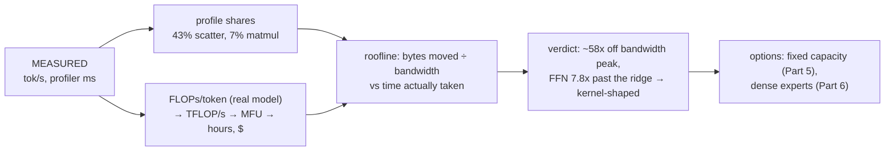

# 044 — MFU, the profile, and the roofline: the arithmetic behind "6.6% is a kernel problem, not a size problem"

**Companion to:** [`journey_of_a_model/044-forty-five-minutes-on-a-real-h100.md`](../../journey_of_a_model/044-forty-five-minutes-on-a-real-h100.md)
and [`journey_of_a_model/045-what-to-optimize-next.md`](../../journey_of_a_model/045-what-to-optimize-next.md)
(one doc for both: 044 supplies the measurements, 045 does the arithmetic on them)
· **Builds on:** [`037-scale-presets-and-capacity-check.md`](037-scale-presets-and-capacity-check.md), whose
[Part 10](037-scale-presets-and-capacity-check.md#part-10--what-journal-044-changed-added-later) already derives
044's capacity-estimator recalibration — **not repeated here**
· **Code:** [`qwenmoe/model/moe.py`](../../qwenmoe/model/moe.py) (`dispatch_batched`),
[`qwenmoe/train/scaling.py`](../../qwenmoe/train/scaling.py) (`count_params`)
· **Every derived number here is reproduced by:** [`verify_044_mfu_and_the_roofline.py`](verify_044_mfu_and_the_roofline.py)
(`uv run python docs/math/verify_044_mfu_and_the_roofline.py`)

---

## How to read this

Journals 044 and 045 mix two kinds of number, and this document keeps them apart:

- **MEASURED on the H100** — tokens per second for each configuration, the profiler's milliseconds, the compile A/B. No
  script in this repository can re-run them (they need a rented GPU), so they enter the verify script as **labelled
  inputs**.
- **DERIVED** — FLOPs per token, MFU, hours, dollars, profile shares, the memory-traffic and arithmetic-intensity
  figures, the capacity-factor tail, the dense-expert trade. These are recomputed from the **real model** (`count_params`
  on the real `SCALE_300M` preset) and the real `dispatch_batched`, then compared with the journal.

The comparison finds the journal right on its conclusions and slightly off in four small places, listed in
[Part 7](#part-7--what-the-recomputation-found). Nothing there changes a recommendation.

> **Scope.** The estimator recalibration (the ×2.2 backward factor, the logits term, the 10 % reserve) is
> [037's Part 10](037-scale-presets-and-capacity-check.md#part-10--what-journal-044-changed-added-later). The kernel
> rewrites 045 ranks (fused expert weights, fixed-capacity dispatch, cheaper permutation kernels) are *plans*, not
> shipped code, so only their arithmetic is checked, not their effect.

---

<!-- notation:start (generated by build_architecture_footer.py) -->
> **Notation note.** The series uses one symbol set ([canonical notation](README.md#canonical-notation)). In this doc, $E$ stands for $N$ (`n_routed_experts`); $T$ stands for the number of tokens in a micro-batch, $\text{batch}\times S$; **not** the per-sequence length of docs 005/026/027/035. Nothing below is changed; this only states the correspondence.
<!-- notation:end -->

## Part 1 — FLOPs per token

**MFU** (*model FLOPs utilisation*) is achieved useful FLOP/s divided by the hardware's peak. The only model-dependent
input is **FLOPs per token**. The standard accounting: each parameter touched in a forward pass costs one
multiply-add = 2 FLOPs, and the backward pass costs about twice the forward, so training is $2 + 4 = \mathbf{6}$ FLOPs
per parameter per token. The attention-score matmuls ($QK^\top$ and the weighted sum of values) have no parameters and
are added separately.

The journal's expression, for sequence length $S$, layers $L$, width $d$:

$$\text{FLOPs/token} = 6\,N_{\text{non-emb}} + 6\,N_{\text{head}} + 6\,L\,S\,d .$$

From the real preset at vocabulary 4,097 (`count_params`):

| term | value |
|---|---:|
| active parameters | 125,122,304 |
| − embedding table ($4097\times768$) | 3,146,496 |
| **active non-embedding** $N_\text{non-emb}$ | **121,975,808** |
| $6\,N_\text{non-emb}$ | 731,854,848 |
| $6\,N_\text{head}$ (the *tied* head: the table is also the output projection) | 18,878,976 |
| $6\,L\,S\,d = 6\times10\times1024\times768$ | 47,185,920 |
| **FLOPs per token at $S=1024$** | **797,919,744** |

— the journal's figure to the digit, now produced by the real code rather than quoted. *Exact vs. convention:* "6 per
parameter" is the standard forward-plus-backward count; the attention term $6LSd$ is the causal-halved form of the full
$12LSd$ (a causal mask means a token attends to about half the sequence on average). That halving is a **convention**,
and MFU numbers using the un-halved form would differ by ~6 %.

Only the attention term depends on $S$, so FLOPs/token is **797.9 M at $S=1024$, 774.3 M at 512, 762.5 M at 256**.

---

## Part 2 — From tokens per second to MFU, hours and dollars

With measured throughput $\tau$ (tok/s): achieved FLOP/s $= \tau \times \text{FLOPs/token}$, MFU $= $ achieved $/\,989$
TFLOP/s (the H100 SXM dense-bf16 peak, a vendor figure), hours $= 2.69\times10^9/\tau/3600$, cost $=$ hours $\times
\$3.49$.

| config (MEASURED $\tau$) | $\tau$ | MFLOP/tok | TFLOP/s | **MFU** | hours | $ |
|---|---:|---:|---:|---:|---:|---:|
| B=8 × 1024 bf16 | 73,313 | 797.9 | 58.5 | 5.9 % | 10.19 | 35.57 |
| **B=16 × 1024 bf16** | **82,323** | 797.9 | **65.7** | **6.6 %** | 9.08 | 31.68 |
| B=32 × 512 bf16 | 91,625 | 774.3 | 70.9 | 7.2 % | 8.16 | 28.46 |
| B=64 × 256 bf16 | 100,504 | 762.5 | **76.6** | **7.7 %** | 7.43 | 25.95 |
| B=16 × 1024 fp32 | 57,721 | 797.9 | 46.1 | 4.7 % | 12.95 | 45.18 |

Rows 1, 2, 3 and 5 reproduce the journal's TFLOP/s and MFU exactly. **Row 4 does not** — see Part 7. Hours and dollars
agree to within 0.3 %; the journal's figures imply a budget of ~2.691–2.692 B tokens per row where its text says "2.69B",
which accounts for every 0.01-hour difference.

Three derived ratios, all from the table above and the compile A/B ($\tau$ = 77,770 eager, 192,832 compiled):

| ratio | value | journal |
|---|---:|---:|
| bf16 ÷ fp32 at B=16 × 1024 | 82,323 / 57,721 = **1.43×** | 1.43× |
| compiled ÷ eager | 192,832 / 77,770 = **2.48×** | 2.48× |
| compiled MFU | 192,832 × 797.9 M / 989 T = **15.6 %** | 15.6 % |
| compiled run | 3.88 h, **$13.5** vs 9.08 h, $31.7 eager | $13.53 vs $31.69 |

**The "6.6 % instead of 30 %" claim.** At an *assumed* 30 % on these inputs the run would take **2.01 h / $7.01**.
Journal 042 quoted 2.15 h for its plan; that corresponds to 854.2 MFLOP/token (347,345 tok/s at 30 %), a *different*
FLOPs-per-token convention from 044's 797.9 M. So the "four to five times longer" is measured against 042's number;
the gap would be ~4.5× against the 2.01 h computed here. The direction and size of the shortfall are real either way.

---

## Part 3 — Reading the profile

The profiler's per-kernel milliseconds (three steps at B=16 × 1024, 1,115.2 ms of GPU time total) are MEASURED. Their
**shares** are arithmetic:

| kernel | ms | share | class |
|---|---:|---:|---|
| `_index_put_impl_` (the `index_add_` scatter) | 241.46 | 21.7 % | scatter/gather |
| `indexing_backward_kernel` (backward of the gather) | 212.62 | 19.1 % | scatter/gather |
| `indexing_backward_kernel` (2) | 26.31 | 2.4 % | scatter/gather |
| `bmm` + `mm` + tensor-core GEMM | 81.69 | 7.3 % | **matmul** |
| `mul`, `copy_` | 129.88 | 11.6 % | other |

Scatter/gather totals **480.39 ms = 43.1 %**; matmul **81.69 ms = 7.3 %** — the journal's "~43 %" and "~7 %". Since
only 7.3 % of GPU time is matrix multiplication, the tensor cores are idle about **93 %** of the time.

**An assumption the journal makes silently.** The profiled run's GPU time per step is $1115.2/3 = 371.7$ ms, but the
unprofiled eager step is **210.7 ms** — the profiler makes the run 1.76× slower. Journal 045 applies the profile's
*shares* to the unprofiled 210.7 ms. That is reasonable (profiler overhead is plausibly spread across kernels) but it
is an **inference**, not something the data proves: if the overhead hit scatter kernels harder than the rest, the true
share of wall time would be lower than 43 %. The verdict in Part 4 survives a considerable error here (the gap is
~58×), which is the only reason it is safe to act on.

---

## Part 4 — The roofline

> **Terms.** *Arithmetic intensity* is FLOPs performed per byte moved to or from memory. The *ridge point* is the
> intensity at which a machine stops being limited by memory bandwidth and becomes limited by compute:
> peak FLOP/s ÷ bandwidth. A kernel below the ridge cannot reach peak FLOP/s however good its arithmetic is.

### 4.1 How much data should the permutation move?

Let $T$ = tokens per micro-batch, $k$ = `top_k`, $d$ = `d_model`, $b$ = bytes per element, $P = Tk$ dispatch pairs.
Per MoE layer, forward, `dispatch_batched` does two memory-bound steps:

1. **gather** `xg = x_flat[token_grid]`: reads $Pd$ elements, writes $Pd$ — $2Pd\,b$ bytes;
2. **scatter** `out.index_add_`: reads $Pd$, accumulates into $Td$ — $(P+T)\,d\,b$ bytes.

$$B_\text{fwd} = (3P + T)\,d\,b \text{ per layer};\qquad B_\text{step} = 3\,L\,(3P+T)\,d\,b,$$

where the factor 3 covers backward (each forward op has a counterpart). With the measured configuration
($T=16{,}384$, $k=2$, $d=768$, $L=10$, $b=2$):

| | value |
|---|---:|
| $P = Tk$ | 32,768 |
| $3P + T$ | 114,688 |
| $\times d$ → elements per layer, forward | 88,080,384 |
| $\times b$ → bytes (176.2 MB) | 176,160,768 |
| $\times L \times 3$ → per step | **5.285 GB** |
| at 3.35 TB/s HBM bandwidth | **1.578 ms** |

### 4.2 How long does it actually take?

43.2 % of the 210.7 ms eager step (the journal's rounded share) is **91.0 ms**; the exact 43.08 % gives 90.8 ms. Either
way

$$\frac{91.0\ \text{ms}}{1.578\ \text{ms}} = 57.7\times\quad(57.5\times \text{ with the exact share}),$$

i.e. the permutation runs at **~1.7 % of the memory bandwidth** the hardware offers.

**Sensitivity.** The backward multiplier "3" is an *empirical* constant (the true value lies between 2 and 4), the same
class of estimate as 037's ×2.2. Varying it:

| backward multiplier | GB / step | roofline ms | how far off |
|---:|---:|---:|---:|
| 2 | 3.52 | 1.05 | **86.5×** |
| **3** | 5.28 | 1.58 | **57.7×** |
| 4 | 7.05 | 2.10 | **43.3×** |

The journal's 43–87× range reproduces, and no value of the multiplier brings the permutation near the roofline.

**A check on the formula's own assumption.** The formula counts $P\,d$ gathered elements, but the real
`dispatch_batched` gathers a **padded** $(K, G, d)$ grid ($K$ active experts, $G$ the largest group). On a real call
with uniform top-2-of-8 routing at $T=4096$: $K\!\cdot\!G = 8\times1053 = 8{,}424$ slots against $P = 8{,}192$ pairs — the
padded grid is **1.028×** the unpadded figure. Negligible at balanced routing, and the reason capacity-bounding
(Part 5) also bounds memory under a collapsed router, where $G$ grows toward $P$.

### 4.3 Should the expert FFN be memory-bound at all?

One dispatch pair moves $2\,d\,b$ bytes (in and out) and earns three $d \times d_\text{ff}$ matrix multiplies (SwiGLU's
gate, up and down), $3 \times 2\,d\,d_\text{ff}$ FLOPs:

$$I = \frac{6\,d\,d_\text{ff}}{2\,d\,b} = \frac{3\,d_\text{ff}}{b} = \frac{3\times1536}{2} = \mathbf{2{,}304}\ \text{FLOP/byte}.$$

The ridge is $989\ \text{TFLOP/s} \div 3.35\ \text{TB/s} = 295.2$ FLOP/byte, so the expert FFN sits
$2304/295.2 = \mathbf{7.8\times}$ **past the ridge**: in theory solidly compute-bound. In practice 43 % of the step is
memory-bound indexing at 1/58 of memory peak. That gap — a compute-bound workload running memory-bound — is the whole
argument that the fix is *kernel-shaped*. (Weight traffic is ignored: an expert's weights are read once and reused
across all its pairs, which only raises $I$.)

*Exact vs. empirical:* $I$ and the ridge are exact arithmetic on vendor peaks; the backward multiplier is empirical; the
profile share is a measurement with the caveat in Part 3.

---

## Part 5 — Fixed capacity: how far out is the capacity?

Fixed-capacity dispatch gives each expert $C = \lceil c_f\,\mu\rceil$ slots, where $\mu$ is its fair share; a token
beyond the $C$-th is **dropped**. Journal 045 models per-expert load as $\text{Binomial}(P, 1/E)$ — each of $P$ pairs
independently picks one of $E$ experts:

$$\mu = P/E = 4{,}096,\qquad \sigma = \sqrt{P\cdot\tfrac1E(1-\tfrac1E)} = 59.9 .$$

| capacity factor | capacity | distance | exact $P[X \ge C]$ |
|---:|---:|---:|---:|
| 1.25 | 5,120 | **17.1 σ** | $8.4\times10^{-62}$ |
| 1.05 | 4,301 | **3.4 σ** | $3.4\times10^{-4}$ |

(The journal's 17σ and 3.4σ reproduce. The exact tails are summed from the binomial pmf in log space; they are not the
Gaussian approximation, which is unreliable that far out.)

**A refinement the journal does not make.** Top-$k$ selects $k$ **distinct** experts per token, so a given expert is in a
token's set with probability exactly $k/E$, independently across tokens. Its load is therefore
$\text{Binomial}(T, k/E)$ — same mean $\mu = 4{,}096$, but

$$\sigma = \sqrt{T\cdot\tfrac kE(1-\tfrac kE)} = \sqrt{16{,}384\times0.25\times0.75} = \mathbf{55.4},$$

smaller than 59.9 because the top-2 constraint removes the variance a token could add by picking the same expert twice.
A simulation of 2,000 uniform top-2 batches gives a per-expert sd of **55.9** (mean 4,095.2), matching 55.4. The same
capacities are therefore further out: **18.5 σ** at $c_f=1.25$ (tail $7.4\times10^{-73}$) and **3.7 σ** at 1.05 (tail
$1.2\times10^{-4}$). The journal's conclusion is, if anything, understated.

**What both models assume — and what they leave out.** Balanced, independent routing. That is exactly what a trained
router does *not* guarantee, and the journal is explicit that drops are "effectively zero unless routing genuinely
collapses — which is something you want surfaced anyway." The arithmetic only shows the capacity is far from *noise*; it
says nothing about a router that has learned to prefer some experts.

---

## Part 6 — The dense-expert option, and why MFU is the wrong objective

With $E=8$, $k=2$ the sparsity factor is only $E/k = 4$, so one could run **every** expert on **every** token and mask the
result — more FLOPs, but no permutation. The routed FFN's FLOPs per token per layer (forward + backward) are
$6 \cdot k \cdot 3 \cdot d \cdot d_\text{ff} = 6\times2\times3\times768\times1536 = 42{,}467{,}328$:

| | TFLOP / step |
|---|---:|
| routed (×$T$×$L$) | 6.96 |
| dense (×4) | 27.83 |
| **extra** | **20.87** |

The time to run the extra FLOPs depends on a **GEMM rate the journal assumes** (~850 TFLOP/s "observed", and half that
as a pessimistic row); this document does not derive those rates, so the rows below are conditional on them. Deleting
the 91 ms of permutation and adding the extra FLOPs:

| assumed GEMM rate | added ms | new step ms | speed-up | useful-FLOP MFU | **hardware** MFU |
|---:|---:|---:|---:|---:|---:|
| 850 TFLOP/s | 24.6 | 144.2 | **1.46×** | **9.2 %** | 23.8 % |
| 425 TFLOP/s | 49.1 | 168.8 | **1.25×** | 7.8 % | 20.3 % |

(Eager: 13.07 useful TFLOP over 210.7 ms = **6.27 %** useful-FLOP MFU, the journal's 6.3 %.) Both rows are a **net win**,
which is the journal's point: even the pessimistic 49.1 ms of tensor-core work replaces 91 ms of indexing.

**The sharpest point is in the last two columns.** "Useful" counts only the FLOPs the model needs (13.07 TFLOP);
"hardware" counts every FLOP executed, wasted ones included. The dense path raises *useful* MFU only 6.3 % → 9.2 %
while *hardware* MFU jumps to 23.8 % — a number that would look like a triumph on a dashboard and is mostly work thrown
away. A metric that rewards executing wasted FLOPs efficiently cannot be the objective; **tokens per dollar** can.

**Costs the arithmetic cannot show.** The $(T, E, d_\text{ff})$ intermediate is 4× today's, and memory is already the
binding constraint at ~16,384 tokens per micro-batch. And the trade only exists at small $E$: at 64 experts it would be
16× the FLOPs. The journal correctly marks this "a hypothesis, not a result" — Part 6 only shows it is worth one
measurement.

---

## Part 7 — What the recomputation found

Rebuilding the journal's derived figures from the real model turned up four small discrepancies. None changes a
recommendation; all are worth correcting if the journal is revised.

1. **Journal 044's MFU table, row B=64 × 256.** It prints **80.2 TFLOP/s and 8.1 %**; recomputed at $S=256$ it is
   **76.6 TFLOP/s and 7.7 %**. The journal's figure equals tok/s × the *$S=1024$* FLOPs/token (the verify script shows
   this is exactly where 80.2 / 8.1 come from), while the table's own 512 row correctly uses the 512 figure. The
   headline (B=16 × 1024, 6.6 %) is unaffected, as are all hours and dollars.
2. **Eager MFU in 044's compile A/B.** It prints 6.5 %; from its own 77,770 tok/s it is 6.27 %, which is the 6.3 % that
   journal 045 uses.
3. **The dense-option MFU.** 045 states 9.1 %; recomputed with the same inputs it is 9.2 % — a rounding gap, with the
   1.45×/1.46× speed-up in agreement.
4. **Hours and dollars** use a budget of ~2.6917 B tokens while the text says "2.69B" — a 0.01-hour effect, cosmetic.

And two *assumptions* worth knowing about, neither wrong: the profile shares are applied to the unprofiled step
(Part 3), and the dense option's GEMM rates are assumed (Part 6).

---

## Questions that might come to mind

**Why is the verdict "kernel-shaped, not size-shaped"?** Because the profile says the matmuls are not the problem
(7.3 % of GPU time) and the roofline says the dominant cost runs ~58× off a bandwidth ceiling a *bigger* model would not
move. A larger model makes the matmuls larger; it does not make `index_put` use fewer atomics.

**Could 6.6 % MFU be fine for an MoE?** Part 6's last point is that MFU can mislead in both directions. The reason 6.6 %
is a problem is not the percentage — it is that 43 % of the step is moving data the roofline says should take 1.6 ms.

**Why is 4.1's gather formula allowed to ignore weights traffic?** An expert's weights are read once per layer and used
for every token routed to it; per pair that cost is amortised across thousands of pairs ($\mu = 4{,}096$). Including it
raises the intensity in 4.3, which only strengthens the "past the ridge" conclusion.

---

## Symbols

| symbol | meaning |
|---|---|
| $T$ | tokens per micro-batch (16,384 = 16 × 1024) |
| $k$, $E$ | `top_k` (2) and routed experts (8) |
| $P = Tk$ | token–expert dispatch pairs (32,768) |
| $d$, $d_\text{ff}$, $L$, $S$ | `d_model` (768), expert width (1,536), layers (10), sequence length |
| $b$ | bytes per element (2 for bf16) |
| $I$ | arithmetic intensity, FLOP/byte |
| $c_f$, $C$ | capacity factor and capacity (slots per expert) |
| $\mu$, $\sigma$ | mean and standard deviation of per-expert load |

## References

- Williams, Waterman & Patterson (2009), *Roofline: an insightful visual performance model for multicore architectures*,
  Communications of the ACM, [doi:10.1145/1498765.1498785](https://dl.acm.org/doi/abs/10.1145/1498765.1498785) — the
  roofline model, as linked from journal 045.
- Lepikhin et al. (2020), *GShard*, [arXiv:2006.16668](https://arxiv.org/abs/2006.16668) and Fedus, Zoph & Shazeer
  (2021), *Switch Transformers*, [arXiv:2101.03961](https://arxiv.org/abs/2101.03961) — capacity factor.
- Gale et al. (2022), *MegaBlocks*, [arXiv:2211.15841](https://arxiv.org/abs/2211.15841) — the dropless dispatch the
  project currently implements.
- NVIDIA H100 SXM peak bf16 (989 TFLOP/s, dense) and HBM3 bandwidth (3.35 TB/s) are vendor datasheet figures, used as
  journal 045 uses them; no URL is asserted here.

<!-- arch-evolution:start (generated by build_architecture_footer.py; do not edit by hand) -->

---

## Where this fits in the architecture (the growing view)

← previous: [041 Step-offset sampler, long-run arithmetic](041-step-offset-sampler-and-long-run-arithmetic.md) · next: (none yet: journal entries 039+ have no math doc)

**This doc adds to the architecture:** FLOPs per token, MFU from measured throughput, the profile shares, bytes-moved vs bandwidth, and the capacity-factor tail. (Code: `qwenmoe/model/moe.py, qwenmoe/train/scaling.py`.)

**Components introduced here (highlighted in the diagram), with where each one lives:**

| component | math doc (section) | journal | code |
|---|---|---|---|
| MFU + roofline: why the MoE dispatch is slow | [044 · Part 4 — The roofline](044-mfu-and-the-roofline.md#part-4--the-roofline) | [journal 044](../../journey_of_a_model/044-forty-five-minutes-on-a-real-h100.md) | [`qwenmoe/model/moe.py:322`](../../qwenmoe/model/moe.py#L322) |

**Verified by:** [`verify_044_mfu_and_the_roofline.py`](verify_044_mfu_and_the_roofline.py) (`uv run python docs/math/verify_044_mfu_and_the_roofline.py`); latest results in [verify-status.md](verify-status.md).

**Example continuity:** **Reuses the real `SCALE_300M` preset** (not a toy); measured H100 figures enter as labelled inputs. Also covers journal 045. See the [example-family map](README.md#which-example-does-each-doc-use).

The diagram is cumulative: every box derived by this doc or an earlier one is shown, and components from later docs are not drawn yet, so reading the docs in order replays how the architecture grew. The top box is this doc's title and what it adds. The [full final architecture](architecture-evolution.md) has everything.

**Colour key:** 🟨 **introduced by this doc** · 🟦 Foundation (004-011) · 🟩 Modernization (016-031) · 🟪 Evaluation and scale (032-038) · 🟧 Real data and hardware (039-044). Dotted lines are optional or alternative paths.

```mermaid
%%{init: {"theme": "base", "themeVariables": {"background": "#F5F1E6", "clusterBkg": "#F5F1E6", "clusterBorder": "#a8a29e", "edgeLabelBackground": "#F5F1E6", "primaryTextColor": "#1f2937", "lineColor": "#57534e"}}}%%
flowchart TB
  subgraph G_doc["044 · MFU and the roofline"]
    DESC["<b>What this doc adds:</b><br/>FLOPs per token, MFU from measured throughput, the profile<br/>shares, bytes-moved vs bandwidth, and the capacity-factor<br/>tail"]
  end
  subgraph G_data["Data and tokens"]
    TOK["BPE tokenizer"]
    DATA["Data pipeline: pack, split, windows"]
    IDS["input_ids"]
    STREAM["Incremental BPE trainer + streamed corpus prep"]
  end
  subgraph G_model["Model"]
    EMB["Embedding"]
    FNORM["final RMSNorm"]
    HEAD["lm_head (tied to embedding)"]
    AUXC["combine aux losses (mean over layers)"]
    MTP["MTP heads: extra-token prediction"]
  end
  subgraph G_block["Decoder block x L"]
    N1["attn_norm (RMSNorm)"]
    POS["Positional: NoPE / RoPE / ALiBi"]
    ATTN["Attention: GQA, causal softmax"]
    MLA["MLA: latent-compressed KV (alt. to GQA)"]
    SDPA["Fused SDPA path"]
    QKN["QK-norm: RMSNorm on q, k"]
    DOCM["Document-boundary mask"]
    KVC["KV cache + position offset"]
    R1["residual add: x + attention"]
    N2["moe_norm (RMSNorm)"]
    ROUTER["Router: softmax, top-k"]
    EXPERTS["Routed SwiGLU experts"]
    SHARED["Shared expert (every token)"]
    AUXLOSS["Load-balancing aux loss"]
    SIG["Sigmoid scoring + router z-loss"]
    SEQBAL["Per-sequence balance loss"]
    BATCH["Batched expert dispatch"]
    R2["residual add: x + MoE"]
  end
  subgraph G_train["Training"]
    LOSS["Cross-entropy next-token loss"]
    OPT["AdamW + backward + step"]
    CLIP["param groups, tuned AdamW, grad clipping"]
    LR["LR schedule: warmup, stable, decay floor (WSD)"]
    MUON["Muon optimizer (hidden matrices)"]
    INIT["Principled init: trunc-normal, depth-scaled"]
    AUTOCAST["bf16 autocast"]
    ZLOSS["Output z-loss"]
    GACC["Gradient accumulation (fair re-match)"]
    SAMPLER["StepOffsetSampler + checkpoint retention"]
  end
  subgraph G_infer["Inference"]
    GEN["generate(): decode loop"]
    SAMP["min-p + repetition penalty"]
  end
  subgraph G_tool["Analysis and tooling"]
    SCALE["Scaling utils: count_params, Chinchilla budget"]
    ABL["Multi-seed bands, param-matched d_ff"]
    BUDG["MoE budget note"]
    PRES["BASELINE_V2 / FINEGRAINED presets"]
    BAL["Expert load, CV, routing entropy"]
    SPREAD["Attention-logit spread"]
    CAP["Capacity check: params, memory, KV"]
    ROOF["MFU + roofline: why the MoE dispatch is slow"]
  end
  POS --> ATTN
  TOK -->|encode| IDS
  DATA -->|windows| IDS
  IDS --> EMB
  EMB --> N1
  N1 --> ATTN
  ATTN --> R1
  EMB -.->|skip| R1
  N1 -.->|or| MLA
  MLA -.-> R1
  SDPA -.->|same result| ATTN
  QKN -.->|norm q,k| ATTN
  DOCM -.->|block cross-doc| ATTN
  IDS -.->|eos ids| DOCM
  KVC -.->|reuse K,V| ATTN
  R1 --> N2
  N2 --> ROUTER
  N2 --> SHARED
  ROUTER -->|top-k| EXPERTS
  EXPERTS --> R2
  SHARED --> R2
  R1 -.->|skip| R2
  SIG -.->|scoring| ROUTER
  BATCH -.->|same result| EXPERTS
  ROUTER --> AUXLOSS
  AUXLOSS --> AUXC
  ROUTER --> SEQBAL
  SEQBAL --> AUXC
  R2 --> FNORM
  FNORM --> HEAD
  R2 --> MTP
  MTP -->|extra losses| LOSS
  HEAD -->|logits| LOSS
  DATA -->|targets| LOSS
  HEAD --> ZLOSS
  ZLOSS --> LOSS
  AUXC --> LOSS
  LOSS -->|grads| CLIP
  CLIP --> OPT
  CLIP --> MUON
  LR -.->|lr| OPT
  LR -.->|lr| MUON
  GACC -.->|loss / G| LOSS
  INIT -.-> EMB
  INIT -.-> ATTN
  INIT -.-> EXPERTS
  AUTOCAST -.->|whole forward| EMB
  HEAD -->|logits| GEN
  GEN -.->|append token| IDS
  SAMP -.-> GEN
  GEN -.-> KVC
  ROUTER -.-> BAL
  ATTN -.-> SPREAD
  STREAM -.->|merges, faster| TOK
  STREAM -.->|int32 tokens| DATA
  SAMPLER -.->|window offsets| DATA
  ROOF -.->|explains its cost| BATCH
  DESC ~~~ TOK
  classDef foundation fill:#bfdbfe,stroke:#1d4ed8,color:#1f2937
  classDef modern fill:#bbf7d0,stroke:#15803d,color:#1f2937
  classDef evaluation fill:#e9d5ff,stroke:#7e22ce,color:#1f2937
  classDef hardware fill:#fed7aa,stroke:#c2410c,color:#1f2937
  classDef cur fill:#fde68a,stroke:#b45309,stroke-width:4px,color:#111827,font-weight:bold
  classDef desc fill:#FBF9F3,stroke:#9ca3af,color:#111827,text-align:left
  class TOK,DATA,IDS,EMB,FNORM,HEAD,AUXC,N1,POS,ATTN,R1,N2,ROUTER,EXPERTS,SHARED,AUXLOSS,R2,LOSS,OPT,GEN,SCALE foundation
  class MTP,MLA,SDPA,QKN,DOCM,KVC,SIG,SEQBAL,BATCH,CLIP,LR,MUON,INIT,AUTOCAST,ZLOSS,SAMP modern
  class GACC,ABL,BUDG,PRES,BAL,SPREAD,CAP evaluation
  class STREAM,SAMPLER hardware
  class ROOF cur
  class DESC desc
```

**How we got here (every doc up to and including this one):**

| | math doc | journal | what it added |
|---|---|---|---|
|  | [004 Attention (GQA)](004-attention-gqa.md) | [journal](../../journey_of_a_model/004-attention-gqa.md) | scaled dot-product attention with grouped K/V heads, the positional transform and the causal mask |
|  | [005 MoE layer](005-moe-layer.md) | [journal](../../journey_of_a_model/005-moe-layer.md) | the router, top-k selection, routed SwiGLU experts, the shared expert and the load-balancing aux loss |
|  | [006 Full model](006-full-model-assembly.md) | [journal](../../journey_of_a_model/006-full-model-assembly.md) | token embedding, pre-norm residual wiring, the final norm, the tied head and the cross-layer aux-loss combine; attention and MoE appear here as black boxes |
|  | [007 Tokenizers](007-tokenizers.md) | [journal](../../journey_of_a_model/007-tokenizers.md) | text to `input_ids`: byte-level BPE and the char tokenizer |
|  | [008 Data pipeline](008-data-pipeline.md) | [journal](../../journey_of_a_model/008-data-pipeline.md) | packing documents, train/val split, fixed slices and the shifted `(x, y)` windows |
|  | [009 Scaling utilities](009-scaling-law-utilities.md) | [journal](../../journey_of_a_model/009-scaling-law-utilities.md) | parameter counting (total vs active), the compute-optimal budget and throughput calibration |
|  | [010 Training loop](010-training-loop.md) | [journal](../../journey_of_a_model/010-training-loop.md) | the next-token cross-entropy loss, backward pass and AdamW step, carried through a real `Trainer.fit` |
|  | [011 Inference and generation](011-inference-generation.md) | [journal](../../journey_of_a_model/011-inference-generation.md) | the autoregressive decode loop (greedy, temperature, top-k, top-p) |
|  | [016 MLA attention](016-mla-attention.md) | [journal](../../journey_of_a_model/016-mla-attention.md) | Multi-Head Latent Attention: K/V compressed to a small latent, an alternative to GQA |
|  | [018 Optimizer hardening](018-optimizer-hardening.md) | [journal](../../journey_of_a_model/018-optimizer-hardening.md) | param groups (decay vs no-decay), tuned AdamW and gradient clipping |
|  | [019 LR schedule (WSD)](019-lr-schedule-wsd.md) | [journal](../../journey_of_a_model/019-lr-schedule-wsd.md) | warmup, stable and decay phases with a non-zero floor |
|  | [020 Muon optimizer](020-muon-optimizer.md) | [journal](../../journey_of_a_model/020-muon-optimizer.md) | orthogonalized momentum for the hidden weight matrices, AdamW for the rest |
|  | [021 Fused attention (SDPA)](021-fused-attention-sdpa.md) | [journal](../../journey_of_a_model/021-fused-attention-sdpa.md) | `F.scaled_dot_product_attention` as a drop-in for the explicit path |
|  | [022 QK-norm](022-qk-norm.md) | [journal](../../journey_of_a_model/022-qk-norm.md) | RMSNorm on each head's q and k before the scores, bounding the attention logits |
|  | [023 Principled init](023-principled-initialization.md) | [journal](../../journey_of_a_model/023-principled-initialization.md) | truncated-normal init and depth-aware scaling of the residual-writing projections |
|  | [024 Mixed precision and z-loss](024-mixed-precision-and-z-loss.md) | [journal](../../journey_of_a_model/024-mixed-precision-and-z-loss.md) | bf16 autocast for the forward pass and the output z-loss regularizer |
|  | [025 Sigmoid routing and router z-loss](025-moe-routing-sigmoid-and-router-z-loss.md) | [journal](../../journey_of_a_model/025-moe-routing-sigmoid-and-router-z-loss.md) | sigmoid expert scoring, the router z-loss and the config-driven aux weight |
|  | [026 Per-sequence balance loss](026-per-sequence-balance-loss.md) | [journal](../../journey_of_a_model/026-per-sequence-balance-loss.md) | DeepSeek-V3's complementary balance loss computed per sequence |
|  | [027 Batched expert dispatch](027-batched-expert-computation.md) | [journal](../../journey_of_a_model/027-batched-expert-computation.md) | run all experts in one batched op instead of a Python loop |
|  | [028 Multi-Token Prediction](028-multi-token-prediction.md) | [journal](../../journey_of_a_model/028-multi-token-prediction.md) | extra heads predicting tokens further ahead, chained causally |
|  | [029 KV cache](029-kv-cache.md) | [journal](../../journey_of_a_model/029-kv-cache.md) | append-and-reuse of K/V, the position offset and the mask that makes cached decoding exact |
|  | [030 Sampling controls](030-min-p-and-repetition-penalty.md) | [journal](../../journey_of_a_model/030-min-p-and-repetition-penalty.md) | min-p sampling and the repetition penalty |
|  | [031 Document-boundary masking](031-document-boundaries.md) | [journal](../../journey_of_a_model/031-document-boundaries.md) | stop attention crossing `<eos>` boundaries inside a packed sequence |
|  | [032 Multi-seed and param-matched ablations](032-multi-seed-and-param-matched-ablations.md) | [journal](../../journey_of_a_model/032-multi-seed-and-param-matched-ablations.md) | noise bands over seeds and bisecting `d_ff` to match parameter counts |
|  | [033 MoE budget note](033-ablation-menu-and-moe-budget-note.md) | [journal](../../journey_of_a_model/033-ablation-menu-and-moe-budget-note.md) | the sparse-MoE compute-budget bound between 20x active and 20x total |
|  | [034 Modernized presets](034-modernized-presets.md) | [journal](../../journey_of_a_model/034-modernized-presets.md) | the parameter-budget algebra behind `BASELINE_V2` and `FINEGRAINED` |
|  | [035 Balance metrics](035-modernized-presets-training-run.md) | [journal](../../journey_of_a_model/035-modernized-presets-training-run.md) | expert load, coefficient of variation and routing entropy |
|  | [036 Attention-logit spread](036-attention-logit-spread.md) | [journal](../../journey_of_a_model/036-visualizations-for-the-modernized-model.md) | the `spread` metric across depth and input scale |
|  | [037 Capacity check](037-scale-presets-and-capacity-check.md) | [journal](../../journey_of_a_model/037-scale-presets-and-capacity-check.md) | will it fit: parameter, optimizer-state, activation and KV-cache arithmetic |
|  | [038 Gradient accumulation](038-gradient-accumulation-fair-rematch.md) | [journal](../../journey_of_a_model/038-gradient-accumulation-fair-rematch.md) | why naively accumulating micro-batches changes the aux loss, and the fair re-match |
|  | [039 Incremental BPE and streaming prep](039-bpe-incremental-counts-and-streaming.md) | [journal](../../journey_of_a_model/039-real-pretraining-data-and-a-usable-bpe.md) | the pair table updated instead of recounted, and why block-wise encoding equals whole-corpus encoding (conditionally) |
|  | [041 Step-offset sampler, long-run arithmetic](041-step-offset-sampler-and-long-run-arithmetic.md) | [journal](../../journey_of_a_model/041-a-run-that-survives-the-night.md) | a seed mixer, with-replacement coverage and duplicates, validation coverage, checkpoint bytes and retention |
| **▶** | [044 MFU and the roofline](044-mfu-and-the-roofline.md) | [journal](../../journey_of_a_model/044-forty-five-minutes-on-a-real-h100.md) | FLOPs per token, MFU from measured throughput, the profile shares, bytes-moved vs bandwidth, and the capacity-factor tail |

<!-- arch-evolution:end -->
