# The architecture, and how it grew across the math docs

*Generated by [`build_architecture_footer.py`](build_architecture_footer.py); every math doc ends with the same diagram cut off at its own number. This page is the full picture.*

Read each doc's own footer to see only what existed at that point. Colours show the era each box was introduced in; boxes are grouped by where they live in the code (`qwenmoe/data`, `model`, `train`, and so on).

**Colour key:** 🟦 Foundation (004-011) · 🟩 Modernization (016-031) · 🟪 Evaluation and scale (032-038). Dotted lines are optional or alternative paths.

```mermaid
%%{init: {"theme": "base", "themeVariables": {"background": "#F5F1E6", "clusterBkg": "#F5F1E6", "clusterBorder": "#a8a29e", "edgeLabelBackground": "#F5F1E6", "primaryTextColor": "#1f2937", "lineColor": "#57534e"}}}%%
flowchart TB
  subgraph G_data["Data and tokens"]
    TOK["BPE tokenizer"]
    DATA["Data pipeline: pack, split, windows"]
    IDS["input_ids"]
  end
  subgraph G_model["Model"]
    EMB["Embedding"]
    FNORM["final RMSNorm"]
    HEAD["lm_head (tied to embedding)"]
    AUXC["combine aux losses (mean over layers)"]
    MTP["MTP heads: extra-token prediction"]
  end
  subgraph G_block["Decoder block x L"]
    N1["attn_norm (RMSNorm)"]
    POS["Positional: NoPE / RoPE / ALiBi"]
    ATTN["Attention: GQA, causal softmax"]
    MLA["MLA: latent-compressed KV (alt. to GQA)"]
    SDPA["Fused SDPA path"]
    QKN["QK-norm: RMSNorm on q, k"]
    DOCM["Document-boundary mask"]
    KVC["KV cache + position offset"]
    R1["residual add: x + attention"]
    N2["moe_norm (RMSNorm)"]
    ROUTER["Router: softmax, top-k"]
    EXPERTS["Routed SwiGLU experts"]
    SHARED["Shared expert (every token)"]
    AUXLOSS["Load-balancing aux loss"]
    SIG["Sigmoid scoring + router z-loss"]
    SEQBAL["Per-sequence balance loss"]
    BATCH["Batched expert dispatch"]
    R2["residual add: x + MoE"]
  end
  subgraph G_train["Training"]
    LOSS["Cross-entropy next-token loss"]
    OPT["AdamW + backward + step"]
    CLIP["param groups, tuned AdamW, grad clipping"]
    LR["LR schedule: warmup, stable, decay floor (WSD)"]
    MUON["Muon optimizer (hidden matrices)"]
    INIT["Principled init: trunc-normal, depth-scaled"]
    AUTOCAST["bf16 autocast"]
    ZLOSS["Output z-loss"]
    GACC["Gradient accumulation (fair re-match)"]
  end
  subgraph G_infer["Inference"]
    GEN["generate(): decode loop"]
    SAMP["min-p + repetition penalty"]
  end
  subgraph G_tool["Analysis and tooling"]
    SCALE["Scaling utils: count_params, Chinchilla budget"]
    ABL["Multi-seed bands, param-matched d_ff"]
    BUDG["MoE budget note"]
    PRES["BASELINE_V2 / FINEGRAINED presets"]
    BAL["Expert load, CV, routing entropy"]
    SPREAD["Attention-logit spread"]
    CAP["Capacity check: params, memory, KV"]
  end
  POS --> ATTN
  TOK -->|encode| IDS
  DATA -->|windows| IDS
  IDS --> EMB
  EMB --> N1
  N1 --> ATTN
  ATTN --> R1
  EMB -.->|skip| R1
  N1 -.->|or| MLA
  MLA -.-> R1
  SDPA -.->|same result| ATTN
  QKN -.->|norm q,k| ATTN
  DOCM -.->|block cross-doc| ATTN
  IDS -.->|eos ids| DOCM
  KVC -.->|reuse K,V| ATTN
  R1 --> N2
  N2 --> ROUTER
  N2 --> SHARED
  ROUTER -->|top-k| EXPERTS
  EXPERTS --> R2
  SHARED --> R2
  R1 -.->|skip| R2
  SIG -.->|scoring| ROUTER
  BATCH -.->|same result| EXPERTS
  ROUTER --> AUXLOSS
  AUXLOSS --> AUXC
  ROUTER --> SEQBAL
  SEQBAL --> AUXC
  R2 --> FNORM
  FNORM --> HEAD
  R2 --> MTP
  MTP -->|extra losses| LOSS
  HEAD -->|logits| LOSS
  DATA -->|targets| LOSS
  HEAD --> ZLOSS
  ZLOSS --> LOSS
  AUXC --> LOSS
  LOSS -->|grads| CLIP
  CLIP --> OPT
  CLIP --> MUON
  LR -.->|lr| OPT
  LR -.->|lr| MUON
  GACC -.->|loss / G| LOSS
  INIT -.-> EMB
  INIT -.-> ATTN
  INIT -.-> EXPERTS
  AUTOCAST -.->|whole forward| EMB
  HEAD -->|logits| GEN
  GEN -.->|append token| IDS
  SAMP -.-> GEN
  GEN -.-> KVC
  ROUTER -.-> BAL
  ATTN -.-> SPREAD
  classDef foundation fill:#bfdbfe,stroke:#1d4ed8,color:#1f2937
  classDef modern fill:#bbf7d0,stroke:#15803d,color:#1f2937
  classDef evaluation fill:#e9d5ff,stroke:#7e22ce,color:#1f2937
  classDef cur fill:#fde68a,stroke:#b45309,stroke-width:4px,color:#111827,font-weight:bold
  classDef desc fill:#FBF9F3,stroke:#9ca3af,color:#111827,text-align:left
  class TOK,DATA,IDS,EMB,FNORM,HEAD,AUXC,N1,POS,ATTN,R1,N2,ROUTER,EXPERTS,SHARED,AUXLOSS,R2,LOSS,OPT,GEN,SCALE foundation
  class MTP,MLA,SDPA,QKN,DOCM,KVC,SIG,SEQBAL,BATCH,CLIP,LR,MUON,INIT,AUTOCAST,ZLOSS,SAMP modern
  class GACC,ABL,BUDG,PRES,BAL,SPREAD,CAP evaluation
```

**Interactive version:** [`site/architecture-map/`](../../site/architecture-map/index.html) (click any box to get its math doc, journal entry and code line; needs a browser and internet for the Mermaid library).

## Component map: where each box is documented and implemented

| component | math doc (section) | journal | code |
|---|---|---|---|
| BPE tokenizer | [007 · Part 2 — train(): learning the merges, one line a...](007-tokenizers.md#part-2--train-learning-the-merges-one-line-at-a-time) | [journal 007](../../journey_of_a_model/007-tokenizers.md) | [`qwenmoe/tokenizer/bpe.py:104`](../../qwenmoe/tokenizer/bpe.py#L104) |
| Data pipeline: pack, split, windows | [008 · Part 7 — TokenDataset](008-data-pipeline.md#part-7--tokendataset) | [journal 008](../../journey_of_a_model/008-data-pipeline.md) | [`qwenmoe/data/dataset.py:41`](../../qwenmoe/data/dataset.py#L41) |
| input_ids | [006 · 1.3 The input](006-full-model-assembly.md#13-the-input) | [journal 006](../../journey_of_a_model/006-full-model-assembly.md) | [`qwenmoe/model/transformer.py:91`](../../qwenmoe/model/transformer.py#L91) |
| Embedding | [006 · Step 1 — Embedding lookup](006-full-model-assembly.md#step-1--embedding-lookup) | [journal 006](../../journey_of_a_model/006-full-model-assembly.md) | [`qwenmoe/model/transformer.py:54`](../../qwenmoe/model/transformer.py#L54) |
| final RMSNorm | [006 · Step 16 — final_norm(x)](006-full-model-assembly.md#step-16--final_normx) | [journal 006](../../journey_of_a_model/006-full-model-assembly.md) | [`qwenmoe/model/transformer.py:56`](../../qwenmoe/model/transformer.py#L56) |
| lm_head (tied to embedding) | [006 · Step 17 — lm_head(normed): the tied output head](006-full-model-assembly.md#step-17--lm_headnormed-the-tied-output-head) | [journal 006](../../journey_of_a_model/006-full-model-assembly.md) | [`qwenmoe/model/transformer.py:57`](../../qwenmoe/model/transformer.py#L57) |
| combine aux losses (mean over layers) | [006 · Step 18 — Combine the per-block auxiliary losses ...](006-full-model-assembly.md#step-18--combine-the-per-block-auxiliary-losses-mean-not-sum) | [journal 006](../../journey_of_a_model/006-full-model-assembly.md) | [`qwenmoe/model/transformer.py:120`](../../qwenmoe/model/transformer.py#L120) |
| MTP heads: extra-token prediction | [028 · Part 2 — MTP head, depth 1: MTPHead.forward, one ...](028-multi-token-prediction.md#part-2--mtp-head-depth-1-mtpheadforward-one-operation-at-a-time) | [journal 028](../../journey_of_a_model/028-multi-token-prediction.md) | [`qwenmoe/model/mtp.py:28`](../../qwenmoe/model/mtp.py#L28) |
| attn_norm (RMSNorm) | [006 · Step 4 — Block 0: attn_norm(x) (RMSNorm, pre-norm...](006-full-model-assembly.md#step-4--block-0-attn_normx-rmsnorm-pre-norm-position) | [journal 006](../../journey_of_a_model/006-full-model-assembly.md) | [`qwenmoe/model/rmsnorm.py:8`](../../qwenmoe/model/rmsnorm.py#L8) |
| Positional: NoPE / RoPE / ALiBi | [004 · Step 4 — Positional transform](004-attention-gqa.md#step-4--positional-transform) | [journal 004](../../journey_of_a_model/004-attention-gqa.md) | [`qwenmoe/model/positional.py:23`](../../qwenmoe/model/positional.py#L23) |
| Attention: GQA, causal softmax | [004 · Part 2 — The forward pass, one operation at a time](004-attention-gqa.md#part-2--the-forward-pass-one-operation-at-a-time) | [journal 004](../../journey_of_a_model/004-attention-gqa.md) | [`qwenmoe/model/attention.py:85`](../../qwenmoe/model/attention.py#L85) |
| MLA: latent-compressed KV (alt. to GQA) | [016 · Step 1 — Compress once: the latent c^{KV}](016-mla-attention.md#step-1--compress-once-the-latent-ckv) | [journal 016](../../journey_of_a_model/016-mla-attention.md) | [`qwenmoe/model/attention.py:251`](../../qwenmoe/model/attention.py#L251) |
| Fused SDPA path | [021 · Part 2 — The line where the paths part](021-fused-attention-sdpa.md#part-2--the-line-where-the-paths-part) | [journal 021](../../journey_of_a_model/021-fused-attention-sdpa.md) | [`qwenmoe/model/attention.py:169`](../../qwenmoe/model/attention.py#L169) |
| QK-norm: RMSNorm on q, k | [022 · Part 3 — Why bound the logit: Cauchy–Schwarz, on ...](022-qk-norm.md#part-3--why-bound-the-logit-cauchyschwarz-on-this-examples-numbers) | [journal 022](../../journey_of_a_model/022-qk-norm.md) | [`qwenmoe/model/attention.py:116`](../../qwenmoe/model/attention.py#L116) |
| Document-boundary mask | [031 · Part 2 — build_document_mask, line by line](031-document-boundaries.md#part-2--build_document_mask-line-by-line) | [journal 031](../../journey_of_a_model/031-document-boundaries.md) | [`qwenmoe/model/attention.py:48`](../../qwenmoe/model/attention.py#L48) |
| KV cache + position offset | [029 · Part 2 — kv_cache.py, walked line by line](029-kv-cache.md#part-2--kv_cachepy-walked-line-by-line) | [journal 029](../../journey_of_a_model/029-kv-cache.md) | [`qwenmoe/model/kv_cache.py:37`](../../qwenmoe/model/kv_cache.py#L37) |
| residual add: x + attention | [006 · Step 6 — Block 0: residual add around attention](006-full-model-assembly.md#step-6--block-0-residual-add-around-attention) | [journal 006](../../journey_of_a_model/006-full-model-assembly.md) | [`qwenmoe/model/block.py:34`](../../qwenmoe/model/block.py#L34) |
| moe_norm (RMSNorm) | [006 · Step 7 — Block 0: moe_norm(x) (RMSNorm again, bef...](006-full-model-assembly.md#step-7--block-0-moe_normx-rmsnorm-again-before-the-moe) | [journal 006](../../journey_of_a_model/006-full-model-assembly.md) | [`qwenmoe/model/block.py:28`](../../qwenmoe/model/block.py#L28) |
| Router: softmax, top-k | [005 · Step 2 — Router logits](005-moe-layer.md#step-2--router-logits) | [journal 005](../../journey_of_a_model/005-moe-layer.md) | [`qwenmoe/model/moe.py:72`](../../qwenmoe/model/moe.py#L72) |
| Routed SwiGLU experts | [005 · 6c. What one SwiGLU expert computes — deriving th...](005-moe-layer.md#6c-what-one-swiglu-expert-computes--deriving-the-formula) | [journal 005](../../journey_of_a_model/005-moe-layer.md) | [`qwenmoe/model/moe.py:18`](../../qwenmoe/model/moe.py#L18) |
| Shared expert (every token) | [005 · Step 7 — The shared expert, on every token](005-moe-layer.md#step-7--the-shared-expert-on-every-token) | [journal 005](../../journey_of_a_model/005-moe-layer.md) | [`qwenmoe/model/moe.py:442`](../../qwenmoe/model/moe.py#L442) |
| Load-balancing aux loss | [005 · Step 9 — The load-balancing auxiliary loss](005-moe-layer.md#step-9--the-load-balancing-auxiliary-loss) | [journal 005](../../journey_of_a_model/005-moe-layer.md) | [`qwenmoe/model/moe.py:146`](../../qwenmoe/model/moe.py#L146) |
| Sigmoid scoring + router z-loss | [025 · Part 2 — score_and_select's sigmoid branch, deriv...](025-moe-routing-sigmoid-and-router-z-loss.md#part-2--score_and_selects-sigmoid-branch-derived-and-computed) | [journal 025](../../journey_of_a_model/025-moe-routing-sigmoid-and-router-z-loss.md) | [`qwenmoe/model/moe.py:113`](../../qwenmoe/model/moe.py#L113) |
| Per-sequence balance loss | [026 · Part 2 — The forward pass, one operation at a time](026-per-sequence-balance-loss.md#part-2--the-forward-pass-one-operation-at-a-time) | [journal 026](../../journey_of_a_model/026-per-sequence-balance-loss.md) | [`qwenmoe/model/moe.py:241`](../../qwenmoe/model/moe.py#L241) |
| Batched expert dispatch | [027 · Part 2 — dispatch_batched, one operation at a time](027-batched-expert-computation.md#part-2--dispatch_batched-one-operation-at-a-time) | [journal 027](../../journey_of_a_model/027-batched-expert-computation.md) | [`qwenmoe/model/moe.py:322`](../../qwenmoe/model/moe.py#L322) |
| residual add: x + MoE | [006 · Step 9 — Block 0: residual add around the MoE](006-full-model-assembly.md#step-9--block-0-residual-add-around-the-moe) | [journal 006](../../journey_of_a_model/006-full-model-assembly.md) | [`qwenmoe/model/block.py:38`](../../qwenmoe/model/block.py#L38) |
| Cross-entropy next-token loss | [010 · 4.3 F.cross_entropy — derived from scratch](010-training-loop.md#43-fcross_entropy--derived-from-scratch) | [journal 010](../../journey_of_a_model/010-training-loop.md) | [`qwenmoe/train/trainer.py:273`](../../qwenmoe/train/trainer.py#L273) |
| AdamW + backward + step | [010 · Part 6 — AdamW: the update, derived from zero](010-training-loop.md#part-6--adamw-the-update-derived-from-zero) | [journal 010](../../journey_of_a_model/010-training-loop.md) | [`qwenmoe/train/optim.py:291`](../../qwenmoe/train/optim.py#L291) |
| param groups, tuned AdamW, grad clipping | [018 · Part 2 — split_param_groups: the decay/no-decay s...](018-optimizer-hardening.md#part-2--split_param_groups-the-decayno-decay-split-line-by-line) | [journal 018](../../journey_of_a_model/018-optimizer-hardening.md) | [`qwenmoe/train/optim.py:43`](../../qwenmoe/train/optim.py#L43) |
| LR schedule: warmup, stable, decay floor (WSD) | [019 · Part 3 — lr_multiplier, one branch at a time](019-lr-schedule-wsd.md#part-3--lr_multiplier-one-branch-at-a-time) | [journal 019](../../journey_of_a_model/019-lr-schedule-wsd.md) | [`qwenmoe/train/trainer.py:97`](../../qwenmoe/train/trainer.py#L97) |
| Muon optimizer (hidden matrices) | [020 · Part 4 — Muon.step, step 1, one operation at a time](020-muon-optimizer.md#part-4--muonstep-step-1-one-operation-at-a-time) | [journal 020](../../journey_of_a_model/020-muon-optimizer.md) | [`qwenmoe/train/optim.py:158`](../../qwenmoe/train/optim.py#L158) |
| Principled init: trunc-normal, depth-scaled | [023 · Part 3 — Why 1 / sqrt(2 · n_layers)? The full der...](023-principled-initialization.md#part-3--why-1--sqrt2--n_layers-the-full-derivation) | [journal 023](../../journey_of_a_model/023-principled-initialization.md) | [`qwenmoe/model/transformer.py:28`](../../qwenmoe/model/transformer.py#L28) |
| bf16 autocast | [024 · Part 3 — torch.autocast: derive the policy, then ...](024-mixed-precision-and-z-loss.md#part-3--torchautocast-derive-the-policy-then-measure-it-on-the-real-model) | [journal 024](../../journey_of_a_model/024-mixed-precision-and-z-loss.md) | [`qwenmoe/train/trainer.py:264`](../../qwenmoe/train/trainer.py#L264) |
| Output z-loss | [024 · Part 5 — Cross-entropy's shift-invariance (the pr...](024-mixed-precision-and-z-loss.md#part-5--cross-entropys-shift-invariance-the-proof-and-the-z-loss-on-real-numbers) | [journal 024](../../journey_of_a_model/024-mixed-precision-and-z-loss.md) | [`qwenmoe/train/trainer.py:220`](../../qwenmoe/train/trainer.py#L220) |
| Gradient accumulation (fair re-match) | [038 · Part 4 — The aux-loss does not decompose the same...](038-gradient-accumulation-fair-rematch.md#part-4--the-aux-loss-does-not-decompose-the-same-way) | [journal 038](../../journey_of_a_model/038-gradient-accumulation-fair-rematch.md) | [`qwenmoe/train/trainer.py:214`](../../qwenmoe/train/trainer.py#L214) |
| generate(): decode loop | [011 · Part 2 — generate, one line at a time](011-inference-generation.md#part-2--generate-one-line-at-a-time) | [journal 011](../../journey_of_a_model/011-inference-generation.md) | [`qwenmoe/model/generate.py:135`](../../qwenmoe/model/generate.py#L135) |
| min-p + repetition penalty | [030 · Part 3 — filter_min_p, line by line, adaptivity d...](030-min-p-and-repetition-penalty.md#part-3--filter_min_p-line-by-line-adaptivity-derived-exactly) | [journal 030](../../journey_of_a_model/030-min-p-and-repetition-penalty.md) | [`qwenmoe/model/generate.py:53`](../../qwenmoe/model/generate.py#L53) |
| Scaling utils: count_params, Chinchilla budget | [009 · Part 4 — count_params: the walk](009-scaling-law-utilities.md#part-4--count_params-the-walk) | [journal 009](../../journey_of_a_model/009-scaling-law-utilities.md) | [`qwenmoe/train/scaling.py:47`](../../qwenmoe/train/scaling.py#L47) |
| Multi-seed bands, param-matched d_ff | [032 · Part 3 — The code, line by line](032-multi-seed-and-param-matched-ablations.md#part-3--the-code-line-by-line) | [journal 032](../../journey_of_a_model/032-multi-seed-and-param-matched-ablations.md) | [`qwenmoe/train/compare.py:160`](../../qwenmoe/train/compare.py#L160) |
| MoE budget note | [033 · Part 4 — moe_budget_note, line by line](033-ablation-menu-and-moe-budget-note.md#part-4--moe_budget_note-line-by-line) | [journal 033](../../journey_of_a_model/033-ablation-menu-and-moe-budget-note.md) | [`qwenmoe/train/scaling.py:103`](../../qwenmoe/train/scaling.py#L103) |
| BASELINE_V2 / FINEGRAINED presets | [034 · Part 2 — The segmentation-invariance algebra](034-modernized-presets.md#part-2--the-segmentation-invariance-algebra) | [journal 034](../../journey_of_a_model/034-modernized-presets.md) | [`configs/presets.py:107`](../../configs/presets.py#L107) |
| Expert load, CV, routing entropy | [035 · Part 3 — Expert load, coefficient of variation, a...](035-modernized-presets-training-run.md#part-3--expert-load-coefficient-of-variation-and-routing-entropy-derived-from-zero) | [journal 035](../../journey_of_a_model/035-modernized-presets-training-run.md) | [`scripts/export_trace.py:198`](../../scripts/export_trace.py#L198) |
| Attention-logit spread | [036 · Part 2 — The forward pass, then the new operations](036-attention-logit-spread.md#part-2--the-forward-pass-then-the-new-operations) | [journal 036](../../journey_of_a_model/036-visualizations-for-the-modernized-model.md) | [`scripts/export_trace.py:198`](../../scripts/export_trace.py#L198) |
| Capacity check: params, memory, KV | [037 · Part 2 — estimate_params: parameter counting with...](037-scale-presets-and-capacity-check.md#part-2--estimate_params-parameter-counting-without-building-a-model) | [journal 037](../../journey_of_a_model/037-scale-presets-and-capacity-check.md) | [`scripts/check_capacity.py:172`](../../scripts/check_capacity.py#L172) |

## Timeline

### Foundation: the base model and its loop

| doc | adds | code | example |
|---|---|---|---|
| [004 Attention (GQA)](004-attention-gqa.md) | scaled dot-product attention with grouped K/V heads, the positional transform and the causal mask | `qwenmoe/model/attention.py, positional.py` | **Defines example family A** (`d=4`, 3 tokens, `H=2`, `H_kv=1`). First doc in the series, so there is no earlier example to match. |
| [005 MoE layer](005-moe-layer.md) | the router, top-k selection, routed SwiGLU experts, the shared expert and the load-balancing aux loss | `qwenmoe/model/moe.py` | **Defines example family C** (`d=2`, `N=4`, `k=2`). *Cut from 004:* different width and tensors, so 004's output cannot be fed into this input. |
| [006 Full model](006-full-model-assembly.md) | token embedding, pre-norm residual wiring, the final norm, the tied head and the cross-layer aux-loss combine; attention and MoE appear here as black boxes | `qwenmoe/model/transformer.py, block.py, rmsnorm.py` | **Defines example family D** (`V=6`, `d=4`, `L=2`, `ids=[4,1,4]`) and is the series' end-to-end spine. *Cut from 004/005:* its attention and MoE use their own weights, checked against the real modules by the verify script rather than re-derived. |
| [007 Tokenizers](007-tokenizers.md) | text to `input_ids`: byte-level BPE and the char tokenizer | `qwenmoe/tokenizer/` | Standalone corpus. Produces the ids that 006's model consumes, but 006's six-token vocabulary is hand-picked, not this tokenizer's output. |
| [008 Data pipeline](008-data-pipeline.md) | packing documents, train/val split, fixed slices and the shifted `(x, y)` windows | `qwenmoe/data/` | Standalone toy corpus; its windows are the `(x, y)` pairs that doc 010's trainer then consumes. |
| [009 Scaling utilities](009-scaling-law-utilities.md) | parameter counting (total vs active), the compute-optimal budget and throughput calibration | `qwenmoe/train/scaling.py` | Standalone (`V=50`, `d=16`): a bigger model than the spine, because it counts parameters rather than tracing tensors. |
| [010 Training loop](010-training-loop.md) | the next-token cross-entropy loss, backward pass and AdamW step, carried through a real `Trainer.fit` | `qwenmoe/train/trainer.py` | **Reuses family D unchanged** (006's model, window `x=[4,1,4]`, `y=[1,4,1]`). First training step on the spine. |
| [011 Inference and generation](011-inference-generation.md) | the autoregressive decode loop (greedy, temperature, top-k, top-p) | `qwenmoe/model/generate.py` | **Reuses family D unchanged** (006's weights, prompt `DAD` = `[4,1,4]`). |

### Modernization: attention, optimizer, init, routing, decoding

| doc | adds | code | example |
|---|---|---|---|
| [016 MLA attention](016-mla-attention.md) | Multi-Head Latent Attention: K/V compressed to a small latent, an alternative to GQA | `qwenmoe/model/attention.py` | Own example (`d_c`, decoupled RoPE slice), standalone from A. Compared against 004's GQA but on its own tensors. |
| [018 Optimizer hardening](018-optimizer-hardening.md) | param groups (decay vs no-decay), tuned AdamW and gradient clipping | `qwenmoe/train/optim.py, trainer.py` | **Reuses family D** (the same training window as 010), so the 010 numbers carry straight in. |
| [019 LR schedule (WSD)](019-lr-schedule-wsd.md) | warmup, stable and decay phases with a non-zero floor | `qwenmoe/train/trainer.py` | Standalone: the input is the step counter, not a tensor (`r=0.25`, `f=0.28`, 20 steps). |
| [020 Muon optimizer](020-muon-optimizer.md) | orthogonalized momentum for the hidden weight matrices, AdamW for the rest | `qwenmoe/train/optim.py` | Standalone tiny model (`vocab=5`, `d=2`), chosen so the Newton-Schulz iteration is small enough to do by hand. |
| [021 Fused attention (SDPA)](021-fused-attention-sdpa.md) | `F.scaled_dot_product_attention` as a drop-in for the explicit path | `qwenmoe/model/attention.py` | **Reuses family A unchanged** (004's `X` and weights) and shows the fused and explicit paths agree. |
| [022 QK-norm](022-qk-norm.md) | RMSNorm on each head's q and k before the scores, bounding the attention logits | `qwenmoe/model/attention.py` | **Defines family B** (`d=8`, one-hot `X`, `head_dim=4`) so the per-head RMS is a real average. Not 004's tensors. |
| [023 Principled init](023-principled-initialization.md) | truncated-normal init and depth-aware scaling of the residual-writing projections | `qwenmoe/model/transformer.py, config.py` | Uses 006's shape (`V=6`, `d=4`, `L=2`) but only counts and samples weights, so it is a different example from 006's pinned ones. |
| [024 Mixed precision and z-loss](024-mixed-precision-and-z-loss.md) | bf16 autocast for the forward pass and the output z-loss regularizer | `qwenmoe/train/trainer.py` | **Reuses family D** (006's model, 010's window) with the two new knobs switched on. |
| [025 Sigmoid routing and router z-loss](025-moe-routing-sigmoid-and-router-z-loss.md) | sigmoid expert scoring, the router z-loss and the config-driven aux weight | `qwenmoe/model/moe.py` | **Reuses family C unchanged** (005's `X` and weights); only the scoring function changes. |
| [026 Per-sequence balance loss](026-per-sequence-balance-loss.md) | DeepSeek-V3's complementary balance loss computed per sequence | `qwenmoe/model/moe.py` | Own example (`batch=2`, `d=2`, `N=2`, `k=1`): needs two sequences, which 005's single sequence cannot show. |
| [027 Batched expert dispatch](027-batched-expert-computation.md) | run all experts in one batched op instead of a Python loop | `qwenmoe/model/moe.py` | **Reuses family C unchanged** (005) and shows the batched and looped paths agree. |
| [028 Multi-Token Prediction](028-multi-token-prediction.md) | extra heads predicting tokens further ahead, chained causally | `qwenmoe/model/mtp.py` | Own example (`V=4`, `d=4`, `d_ff=3`): MTP needs a vocabulary of next tokens to chain. |
| [029 KV cache](029-kv-cache.md) | append-and-reuse of K/V, the position offset and the mask that makes cached decoding exact | `qwenmoe/model/kv_cache.py, attention.py` | **Extends family A and MLA's example by one token** each, so cached and uncached results can be compared to 004/016. |
| [030 Sampling controls](030-min-p-and-repetition-penalty.md) | min-p sampling and the repetition penalty | `qwenmoe/model/generate.py` | Own logits vector, plus the real `DADDDD` degeneration from 006/011 as a motivating case. |
| [031 Document-boundary masking](031-document-boundaries.md) | stop attention crossing `<eos>` boundaries inside a packed sequence | `qwenmoe/model/attention.py, data/` | **Reuses family A unchanged** (004) plus an eos pattern. |

### Evaluation and scale: ablations, presets, capacity, fair accumulation

| doc | adds | code | example |
|---|---|---|---|
| [032 Multi-seed and param-matched ablations](032-multi-seed-and-param-matched-ablations.md) | noise bands over seeds and bisecting `d_ff` to match parameter counts | `scripts/, qwenmoe/train/compare.py` | Own bookkeeping example (`V=2`, `d=4`, `L=1`); no tensor is carried. |
| [033 MoE budget note](033-ablation-menu-and-moe-budget-note.md) | the sparse-MoE compute-budget bound between 20x active and 20x total | `qwenmoe/train/scaling.py` | Reuses 009's parameter counts for its model and otherwise pure arithmetic. |
| [034 Modernized presets](034-modernized-presets.md) | the parameter-budget algebra behind `BASELINE_V2` and `FINEGRAINED` | `configs/presets.py` | Own `E=2 -> 8` toy at two granularities, plus the real presets. |
| [035 Balance metrics](035-modernized-presets-training-run.md) | expert load, coefficient of variation and routing entropy | `scripts/export_trace.py, qwenmoe/model/moe.py` | Keeps family C's sizes (`d=2`, `N=4`, `k=2`, `T=3`) for a fresh run; layer 0 follows 005/027. |
| [036 Attention-logit spread](036-attention-logit-spread.md) | the `spread` metric across depth and input scale | `scripts/export_trace.py` | **Reuses family B unchanged** (022's weights) at two input scales, then the real checkpoints. |
| [037 Capacity check](037-scale-presets-and-capacity-check.md) | will it fit: parameter, optimizer-state, activation and KV-cache arithmetic | `scripts/check_capacity.py` | Fresh `TOY` config (`V=7`, `d=4`), checked against a real built model. |
| [038 Gradient accumulation](038-gradient-accumulation-fair-rematch.md) | why naively accumulating micro-batches changes the aux loss, and the fair re-match | `qwenmoe/train/trainer.py` | **Reuses family D** (006/010's model; window A is 010's canonical window, plus a second window). |

## What is not covered yet

Journal entries 039 onwards (real-data BPE, streaming corpus prep, the survivable long run, the GPU/CUDA path, host-device sync counting, the first H100 session, what to optimize next) have no math doc, so they are not in the diagram. Doc 003 (RMSNorm and positional encoding) also has no standalone math doc; RMSNorm is derived inside 006 and 022, and the positional transforms inside 004.

To extend: add the doc's row to `DOCS`, its boxes to `NODES`/`EDGES`, then run the script.
