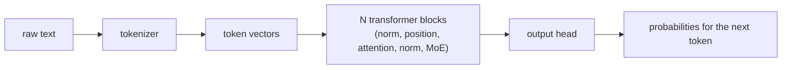
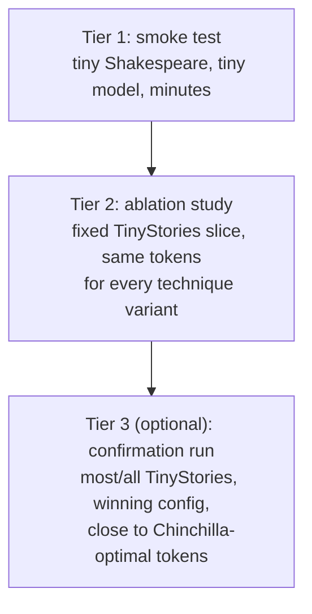

# 001 — Spec approved, starting implementation

**Type:** decision · **Date:** 2026-08-31 · **Related:** all of
`requirements.md`, `design.md`, `tasks.md`; Requirements 11, 12, 13.6-13.8

## What this project is
A Qwen-style decoder-only transformer with a Mixture-of-Experts (MoE)
feed-forward layer, implemented from scratch in PyTorch, trained on this
laptop (Apple M4 Pro, 24GB RAM), then used for inference — with (originally) Manim
animations of the real math at every architectural step (later removed), and a research-style
comparison study across alternative techniques (positional embedding,
activation, MoE load-balancing, and stretch-goal attention/adapter variants).

## Concepts explained for a complete beginner

### Large Language Model (LLM)
- **What it means:** A large neural network trained to predict the next
  piece of text given everything before it, repeated across so much text
  that it becomes useful for writing, answering, and summarizing.
- **Why it exists:** If you can predict "what word comes next" extremely
  well, it turns out you've implicitly learned grammar, facts, and
  reasoning patterns — a simple training objective with surprisingly rich
  results.
- **Analogy:** Like an extremely well-read friend who's read so much they
  can usually guess how any sentence you start is likely to continue —
  except this "friend" is a mathematical function, not a person.
- **Simple technical explanation:** A stack of transformer layers
  (Requirement 1) that take a sequence of tokens in and produce a
  probability distribution over "what token comes next" out.
- **How it relates here:** This whole project builds one of these, at a
  small enough scale to train on a laptop, so every step of that
  "predict the next token" machinery stays visible and inspectable.

### Parameter (and "active" vs. "total" parameters)
- **What it means:** One adjustable number inside the model — a single
  entry in a weight matrix — that training nudges up or down to make
  predictions better.
- **Why it exists:** A model with more parameters generally *can*
  represent more complex patterns; that's the lever "bigger model" pulls.
- **Analogy:** Like the number of knobs on a mixing desk — more knobs mean
  more control over the final sound, but also more knobs to learn to set.
- **Simple technical explanation:** For a normal ("dense") model, every
  parameter is used for every token. For an MoE model (below), most
  parameters sit in "expert" sub-networks that only *some* tokens get
  routed to — so "total parameters" (every knob that exists) and "active
  parameters" (the knobs actually used for one specific token) differ.
- **How it relates here:** The ~23.5M total / ~9.3M active split in
  requirements.md *is* exactly total vs. active — most of the model's
  capacity exists as experts any single token only partially uses.

### Mixture-of-Experts (MoE)
- **What it means:** Instead of one big feed-forward network every token
  passes through, an MoE layer has several smaller networks ("experts"),
  and a small "router" network decides which few experts each token visits.
- **Why it exists:** It grows a model's total capacity (more experts =
  more stored "knowledge") without proportionally growing the compute cost
  per token (each token still only visits a handful of experts).
- **Analogy:** Like a hospital: instead of one doctor who must know
  everything, patients (tokens) get triaged to specialists (experts) by a
  triage nurse (the router) — many doctors on staff, but each patient only
  actually needs a few of them.
- **Simple technical explanation:** router logits → softmax → top-k
  experts selected → their outputs combined, weighted by the router's
  confidence.
- **How it relates here:** Requirement 2/task 5 implements exactly this;
  task 3 doesn't touch MoE directly but builds the normalization and
  positional pieces that sit right next to the MoE layer in every block.
- **Paper:** [DeepSeek-V2: A Strong, Economical, and Efficient Mixture-of-Experts Language Model](https://arxiv.org/abs/2405.04434) (the MoE + attention combo this project's stretch goals draw from)

### Epoch, and where the scaling-law numbers below come from
- **What it means:** One epoch = one full pass through the entire training
  dataset.
- **Why it exists:** Datasets are finite; "how many times do we show the
  model the same data" is a separate knob from "how big is the model," and
  showing it the same data too many times has diminishing (eventually
  harmful) returns.
- **Analogy:** Like re-reading the same textbook chapter — the first few
  re-reads teach a lot, but by the fiftieth you're not learning anything
  new, just memorizing the exact wording.
- **Simple technical explanation:** if a dataset has $U$ unique tokens and
  a training run processes $D$ total tokens, $\text{epochs} = D / U$.
  Muennighoff et al. (2023) found ~4 epochs of repetition costs almost
  nothing versus fresh data, but returns fall off sharply beyond ~16.
- **How it relates here:** Requirement 11 computes exactly this ratio and
  warns past 4 epochs — a direct application of that paper's finding
  rather than an arbitrary number.
- **Paper:** [Scaling Data-Constrained Language Models (Muennighoff et al., 2023)](https://arxiv.org/abs/2305.16264)

### Scaling law (Chinchilla)
- **What it means:** An empirical rule, found by training many models of
  different sizes on different amounts of data, for how many training
  tokens best "match" a given model size.
- **Why it exists:** Before this paper, most large models were trained on
  far too little data for their size ("undertrained"); Hoffmann et al.
  (2022) showed a better balance exists and gave a concrete formula.
- **Analogy:** Like a recipe ratio — "for every extra cup of flour, add
  roughly this many more eggs" — Chinchilla is that ratio, but for "model
  size" and "training data."
- **Simple technical explanation:** $D \approx 20N$ tokens for $N$
  parameters is the "compute-optimal" reference point used here as a
  planning heuristic (Requirement 11.2), not a hard requirement.
- **How it relates here:** with ~9.3M active parameters, that formula
  suggests ~186M reference tokens — a number requirements.md uses to
  decide how ambitious a "real" training run should be. MoE-specific
  compute-optimal ratios can differ from this dense-model constant — see
  [Unified Scaling Laws for Routed Language Models (Clark et al., 2022)](https://arxiv.org/abs/2202.01169).
- **Paper:** [Training Compute-Optimal Large Language Models (Hoffmann et al., 2022)](https://arxiv.org/abs/2203.15556)
- **Mathematical derivation:** the paper fits a parametric loss curve to
  many real training runs,
  $$L(N, D) = E + \frac{A}{N^{\alpha}} + \frac{B}{D^{\beta}}$$
  ($E$ = irreducible loss, $N$ = parameters, $D$ = training tokens, and
  $A,B,\alpha,\beta$ fitted constants). Training compute is approximately
  $C \approx 6ND$ FLOPs (roughly 2 FLOPs/parameter/token forward, ~2x that
  again for backward — a widely-used rule of thumb, not re-derived here).
  For a *fixed* compute budget $C$, substitute $D = C/(6N)$ and minimize
  over $N$:
  $$L(N) = E + AN^{-\alpha} + B\left(\frac{6N}{C}\right)^{\beta} = E + AN^{-\alpha} + B\,6^{\beta}C^{-\beta}N^{\beta}$$
  Setting $\frac{dL}{dN}=0$:
  $$-\alpha A N^{-\alpha - 1} + \beta B\,6^{\beta}C^{-\beta}N^{\beta - 1} = 0 \;\;\Longrightarrow\;\; N^{\alpha+\beta} = \frac{\alpha A}{\beta B}\left(\frac{C}{6}\right)^{\beta}$$
  $$N^{*} \propto C^{\,\beta/(\alpha+\beta)}, \qquad D^{*} = \frac{C}{6N^{*}} \propto C^{\,\alpha/(\alpha+\beta)}$$
  Hoffmann et al.'s fitted exponents came out close to $\alpha\approx\beta$,
  which makes $N^*\propto C^{0.5}$ and $D^*\propto C^{0.5}$ — both scale
  with the *square root* of compute, so their ratio $D^*/N^*$ is a
  **constant, independent of the compute budget**. The derivation above
  (algebra + calculus, exact) explains *why* a single fixed ratio exists at
  all; the specific value ≈20 is where the empirical part takes over —
  it's whatever $A,B,\alpha,\beta,E$ came out to when fitted to real
  experiments, not a number derivable from theory alone.
- **Worked example (dummy numbers):**
  - *Practical formula, real numbers:* this project's baseline has
    $N_{\text{active}} \approx 9{,}300{,}000$. $D_{\text{ref}} = 20 \times
    9{,}300{,}000 = 186{,}000{,}000$ — the 186M-token reference figure
    quoted throughout this project, just one multiplication.
  - *Toy numbers for the optimization mechanism* (not real fitted
    constants — chosen only to make the calculus concrete): let
    $\alpha=\beta=0.5$, $A=B=1$. At compute budget $C=6$:
    $$N^{*} = \left(\frac{\alpha A}{\beta B}\right)^{1/(\alpha+\beta)}\left(\frac{C}{6}\right)^{\beta/(\alpha+\beta)} = (1)^{1}\times(1)^{0.5} = 1, \qquad D^{*}=\frac{C}{6N^{*}}=\frac{6}{6\times1}=1$$
    Now quadruple the compute budget to $C=24$:
    $$N^{*} = (1)^{1}\times(4)^{0.5} = 2, \qquad D^{*} = \frac{24}{6\times 2} = 2$$
  - **Check:** $C$ went up 4×, and *both* $N^*$ and $D^*$ doubled
    ($\sqrt{4}=2$) — so the ratio $D^*/N^*$ stayed at exactly $1$ in both
    cases. That's the mechanism the symbolic derivation predicted: with
    $\alpha=\beta$, the ratio is constant regardless of $C$. (The real
    Chinchilla paper's fitted $A,B,\alpha,\beta,E$ produce a ratio of ≈20
    instead of this toy example's 1 — the *shape* of the result is real,
    the specific numbers here are illustrative.)

### Fine-tuning and adapters (LoRA) — brief, since these are stretch goals not yet built
- **What it means:** Fine-tuning takes an already-trained model and keeps
  training it (often on a smaller, specific dataset) so it specializes
  further. An "adapter" like LoRA fine-tunes by adding a small number of
  *new*, trainable parameters alongside the original (frozen) ones,
  instead of updating every original parameter.
- **Why it exists:** Fully fine-tuning means storing and updating every
  parameter, which is expensive; adapters get most of the benefit while
  touching far fewer numbers.
- **Analogy:** Like adding sticky notes with corrections to a printed book
  instead of reprinting the whole book — the original pages (frozen
  weights) stay untouched, and the sticky notes (the small adapter) carry
  the new information.
- **Simple technical explanation:** LoRA freezes an existing weight matrix
  and adds a trainable low-rank "detour" (two small matrices multiplied
  together) alongside it; only the detour gets updated by gradient descent.
- **How it relates here:** task 17's stretch goal — comparing a full
  fine-tune against a LoRA fine-tune on the same small new dataset.

## Diagrams

Bird's-eye view of how a token flows through the planned architecture:

The three-tier dataset/compute-budget plan:

## Assumptions & Defaults (flag anything wrong here at the approval gate)
- **Hardware detected:** Apple M4 Pro, 14 cores, 24GB unified memory, arm64
  macOS. PyTorch will use the `mps` backend when available, falling back to
  `cpu`.
- **Env/tooling:** `uv`-managed project, Python 3.12, PyTorch already
  declared in `pyproject.toml`. Manim (Community Edition) added later, and removed again entirely afterwards.
- **Default training corpus:** tiny Shakespeare for the smoke test,
  TinyStories ([Eldan & Li, 2023](https://arxiv.org/abs/2305.07759)) for
  the comparison study.
- **Model scale target:** under 100M total parameters / under 30M active
  parameters per token by default.

## Key decisions made during planning
- **Idea considered — single vs. tiered dataset:** training on one dataset
  at one scale would be simpler, but wouldn't support both "prove the
  pipeline works in minutes" and "run a real comparison study" well.
  **Decision:** three tiers (see diagram above) — tiny Shakespeare
  (char-level smoke test), a fixed TinyStories token slice (ablation
  study, compute-matched across variants), and an optional longer
  TinyStories confirmation run on the winning ablation config.
- **Idea considered — theoretical FLOPs-based wall-clock estimates.**
  **Decision:** rejected in favor of empirical throughput calibration
  (measure real tokens/sec on this machine's `mps` backend for a few dozen
  steps), since a theoretical Apple-Silicon MPS throughput number isn't
  something that can be honestly asserted in advance.
- **Decision — comparison-study technique menu:** positional embedding
  (RoPE baseline vs. NoPE vs. ALiBi), activation (SwiGLU baseline vs. GEGLU
  vs. GELU), and MoE balancing (auxiliary-loss baseline vs. DeepSeek-V3-style
  auxiliary-loss-free bias balancing) were chosen as the initial axes because
  they're each swappable independently and cheap enough to run several times
  on a laptop. Multi-Head Latent Attention (MLA) and a LoRA adapter demo were
  kept as explicit stretch goals (tasks 16-17) rather than baseline
  requirements, since both are substantially more involved to implement
  correctly.
- **Decision — dependency minimalism:** no `transformers`, `datasets`,
  YAML config library, or CLI framework. Config is plain dataclasses
  (`qwenmoe/config.py` + `configs/presets.py`); TinyStories is fetched via
  `huggingface_hub.hf_hub_download` of a plain-text release file rather than
  pulling in `datasets`/`pyarrow` for parquet.
- **Decision — packaging:** `qwenmoe/` is a real installable package
  (`[build-system]` + `[tool.hatch.build.targets.wheel] packages =
  ["qwenmoe"]` added to `pyproject.toml`) so `uv sync` makes it importable
  from any script/cwd inside the project, rather than relying on ad-hoc
  `sys.path` tricks.

## Questions that might come to mind
- **Why not just train the biggest model possible?** Bigger models need
  proportionally more data (per the scaling law above) and more
  compute/time to train well; on a laptop with no dedicated training GPU,
  going bigger than ~23.5M total / ~9.3M active parameters would make even
  one training run impractically slow, let alone the many runs the
  comparison study needs.
- **Why does "active" parameters matter more than "total" here?** Active
  parameters determine how much compute (and wall-clock time) processing
  one token costs — total parameters mostly affect how much the model
  *could* know, not how slow the laptop feels while training.
- **What happens if I ignore the epoch-repetition warning and train for 50
  epochs on tiny Shakespeare anyway?** Per Muennighoff et al.'s findings,
  it wouldn't hurt much up to ~4 epochs, but well past ~16 the extra
  training time buys almost nothing — better spent on more/fresh data
  (TinyStories) than grinding the same 1MB file for hours.

## Outcome
All three spec documents approved as written (no revision rounds needed
beyond the original scope-expansion during requirements). Proceeding to
execute `tasks.md` one task at a time, starting with Task 1 (project
scaffolding), each task getting its own journal entry per the convention
this entry establishes.
