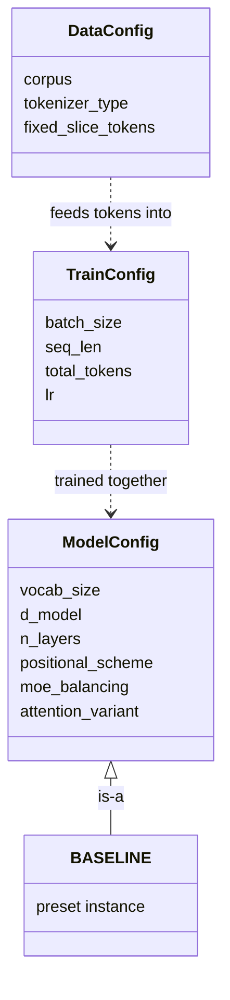

# 002 — Config layer (Task 2)

**Type:** task · **Date:** 2026-08-31 · **Related:** Requirements 3.1, 3.3,
12.1-12.3, 13.6-13.8; design.md `config.py` component

## What was implemented
- `qwenmoe/config.py`: `ModelConfig`, `TrainConfig`, `DataConfig` dataclasses
  exactly matching design.md's schema, each with a `__post_init__` that
  raises `ValueError` eagerly on invalid combinations rather than letting
  bad configs fail confusingly mid-training.
- `configs/presets.py::BASELINE` — the illustrative sizing from
  requirements.md (d_model=256, 6 layers, 8 heads/4 kv-heads, 1 shared + 8
  routed experts, top-2, vocab_size=4096).
- `tests/test_config.py` — 28 cases covering valid defaults for all three
  configs and every invalid combination named in tasks.md, plus a couple
  I added because they're the same *kind* of bug the named ones catch:
  `d_model % n_heads != 0` (needed for integer head_dim, not explicitly
  listed in design.md's validation examples but the same "catch it eagerly"
  principle applies) and basic positivity checks on `TrainConfig`/
  `DataConfig` fields.

## Concepts explained for a complete beginner

### Dataclass
- **What it means:** A Python shortcut for defining a simple class whose
  whole job is to hold a bundle of named values together — a labeled box
  of settings.
- **Why it exists:** Writing a class by hand just to hold values (with an
  `__init__`, comparisons, printing, etc.) is repetitive boilerplate; the
  `@dataclass` decorator generates all of that automatically from a short
  field list.
- **Analogy:** Like a printed form with blank fields (name, size, color) —
  you fill in the blanks instead of designing a new form from scratch
  every time you need one.
- **Simple technical explanation:**
  `@dataclass class ModelConfig: vocab_size: int; d_model: int = 256`
  auto-generates a constructor accepting those fields as arguments, with
  `d_model` defaulting to 256 if not given.
- **How it relates here:** `ModelConfig`, `TrainConfig`, and `DataConfig`
  are all dataclasses — every number the model/training/data pipeline
  needs comes from one of these three objects, never a hard-coded literal
  buried in some function (Requirement 3.1).
- **Docs:** [Python `dataclasses` module](https://docs.python.org/3/library/dataclasses.html)

### Validation / fail fast (`__post_init__` raising `ValueError`)
- **What it means:** Checking that a set of settings actually makes sense
  *immediately* when they're created, rather than letting a bad setting
  silently cause confusing failures much later.
- **Why it exists:** Some combinations are simply nonsensical (asking the
  router to pick the "top 9" experts when only 8 exist) — catching that
  the instant the config is built gives a clear, immediate error instead
  of a cryptic crash halfway through a training run that already ate 20
  minutes.
- **Analogy:** Like a smoke detector going off the moment there's smoke,
  instead of only warning you once the whole house is already on fire.
- **Simple technical explanation:** `__post_init__` is a method Python's
  dataclasses automatically call right after construction; raising
  `ValueError` there stops a bad object from ever existing at all.
- **How it relates here:** every one of the 28 tests in
  `tests/test_config.py` either confirms a *valid* config builds cleanly,
  or confirms an *invalid* one is rejected immediately — a direct
  requirement (Requirement 3.1), not a nice-to-have.

### Editable install / installed package
- **What it means:** Making Python treat a folder of code sitting in this
  project (like `qwenmoe/`) as if it were a properly "installed" library,
  so any other file can `import` it, from anywhere.
- **Why it exists:** Without this, a script like `scripts/train.py` might
  not find `qwenmoe` or `configs` at all, depending on which folder it's
  run from — a classic, confusing source of "ModuleNotFoundError" bugs.
- **Analogy:** Like registering a home address with the post office so
  mail addressed to you arrives correctly no matter which door of the
  house someone tries first.
- **Simple technical explanation:** declaring
  `packages = ["qwenmoe", "configs"]` under
  `[tool.hatch.build.targets.wheel]` in `pyproject.toml`, then running
  `uv sync`, links those folders into the project's virtual environment so
  `import qwenmoe` / `import configs` works everywhere inside it.
- **How it relates here:** this is exactly the gotcha this task's original
  notes flagged — `configs/presets.py` wouldn't have reliably imported
  from `tests/` (or later `scripts/`) without this.
- **Docs:** [Hatchling build backend](https://hatch.pypa.io/latest/) ·
  [uv package manager](https://docs.astral.sh/uv/)

## Diagram: how the three configs relate

## Decision: made `configs` a real installed package too
**Idea considered:** leave `configs/` as a plain (uninstalled) directory and
rely on pytest/script invocation quirks to put the project root on
`sys.path`. **Problem found:** pytest only auto-inserts a test file's own
directory (or nearest `__init__.py`-free ancestor) onto `sys.path`, not the
project root — so `from configs.presets import BASELINE` in
`tests/test_config.py` would only work by accident, and `scripts/*.py`
(added from task 10 onward) would have the exact same problem when run
directly. **Decision:** declare `configs` alongside `qwenmoe` in
`[tool.hatch.build.targets.wheel] packages = [...]`, so both are on
`sys.path` via the editable install regardless of cwd or invocation style.
Re-ran `uv sync` to pick it up.

## Questions that might come to mind
- **Why not just use a plain dictionary (`{"d_model": 256, ...}`) instead
  of a dataclass?** A dictionary won't catch a typo'd key (`"d_modle"`) or
  a missing required field until something crashes deep inside model code;
  a dataclass catches both immediately, with a clear Python-level error
  pointing at the actual problem.
- **Why validate in `__post_init__` instead of, say, when the model is
  built?** The config might be constructed long before it's used (printed,
  logged, compared to another config) — waiting until model-build time to
  discover it was invalid all along would be a much later, more confusing
  failure point.
- **Does needing `uv sync` again after editing `pyproject.toml` mean the
  environment was broken?** No — `pyproject.toml` describes *how* the
  project should be installed; changing it just means the already-installed
  copy is stale and needs re-installing, which `uv sync` does in under a
  second here.

## Outcome
`uv run pytest tests/test_config.py -v` — 28 passed. Task 2 checked off.
