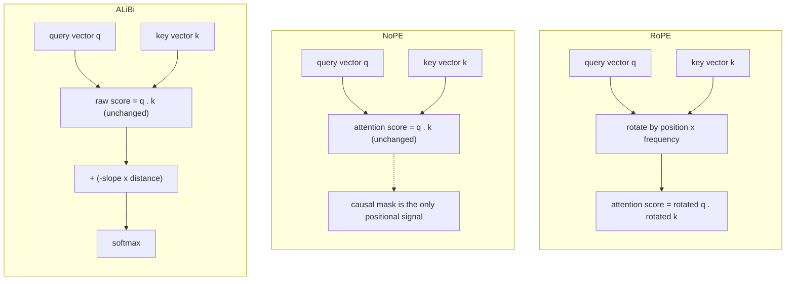
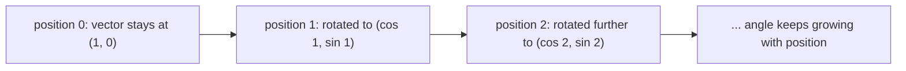

# 003 — Normalization and positional schemes (Task 3)

**Type:** task · **Date:** 2026-08-31 · **Related:** Requirements 1.3, 1.4,
9.1, 9.2, 12.1, 13.6-13.8; design.md `model/rmsnorm.py` and
`model/positional.py` components

## What was implemented
- `qwenmoe/model/rmsnorm.py::RMSNorm` — standard pre-norm RMSNorm
  (`x * rsqrt(mean(x^2) + eps) * weight`).
- `qwenmoe/model/positional.py`: `RotaryEmbedding` (RoPE, "rotate-half"
  formulation used by Llama/Qwen), `NoPositional`, and `AlibiBias`, all
  sharing the same `apply(q, k, positions) -> (q, k)` +
  `attention_bias(seq_len) -> Tensor | None` interface design.md specified,
  so `Attention` (task 4) can hold any of the three without caring which.
- 11 tests across `test_rmsnorm.py`, `test_rope.py`, `test_positional_alt.py`.

## Concepts explained for a complete beginner
Every technical word below is defined the moment it's used, in the same
five-part format throughout, so nothing is assumed and nothing is defined
using another unexplained term.

### Token
- **What it means:** One small chunk of text — often a whole word, part of
  a word, or a single character — that the model treats as one unit.
- **Why it exists:** Computers can't do math on letters directly; text has
  to be chopped into pieces and each piece turned into a number first.
- **Analogy:** Like cutting a sentence into Scrabble tiles — each tile is
  one token, and the model only ever "sees" a bag of numbered tiles, never
  the raw sentence.
- **Simple technical explanation:** A tokenizer maps each chunk of text to
  an integer ID from a fixed vocabulary (e.g. "cat" → 401); the model's
  actual input is a list of these integers.
- **How it relates here:** Task 3's `positions` tensor is literally "which
  tile number is this, in order" — 0 for the first token, 1 for the
  second, and so on.

### Vector (a token's "meaning" as a list of numbers)
- **What it means:** A vector is just a list of numbers, e.g.
  `[0.2, -1.4, 0.9, ...]`.
- **Why it exists:** A single number can't capture something as rich as a
  word's meaning; a list of numbers (often hundreds long) gives the model
  enough "dimensions" to represent nuance.
- **Analogy:** Like describing a color with three numbers (red, green,
  blue) instead of one — three numbers capture far more than one ever
  could. A token's vector is the same idea with hundreds of numbers.
- **Simple technical explanation:** Every token ID is looked up in an
  "embedding table" (one row of numbers per possible token) to produce its
  vector. All the math in this project operates on these vectors.
- **How it relates here:** RMSNorm, RoPE, and ALiBi all take a token's
  vector (or a piece of it, called `q`/`k` in the code) and transform it.

### Normalization (the general problem, before RMSNorm)
- **What it means:** Rescaling a list of numbers so they stay in a
  predictable, well-behaved range.
- **Why it exists:** A transformer stacks many layers of math on top of
  each other. Without rescaling, numbers can silently grow huge or shrink
  toward zero with each layer, until training becomes unstable — like a
  photocopy of a photocopy of a photocopy getting worse each generation.
- **Analogy:** Like a sound engineer normalizing volume levels across an
  album so no track is jarringly louder or quieter than the others.
- **Simple technical explanation:** Compute some measure of a vector's
  "size," then divide every number in it by that size, so the result
  always has a consistent scale.
- **How it relates here:** `qwenmoe/model/rmsnorm.py` is exactly this
  rescaling step, applied before a token's vector enters the attention and
  MoE math (Requirement 1.4).

### RMSNorm (Root Mean Square Layer Normalization)
- **What it means:** A simplified way to normalize: measure a vector's
  size using its "root mean square" (square every number, average the
  squares, take the square root), then divide by that.
- **Why it exists:** An older technique, LayerNorm, also re-centers the
  numbers (subtracts their average) before rescaling. Zhang & Sennrich
  (2019) found the re-centering step wasn't earning its keep — dropping it
  makes the computation simpler and faster without hurting quality.
- **Analogy:** LayerNorm is like adjusting both the brightness and
  contrast of a photo; RMSNorm only adjusts the contrast (scale) and skips
  brightness (centering), and the photo looks fine either way.
- **Simple technical explanation:**
  $$\text{RMSNorm}(x) = \frac{x}{\sqrt{\text{mean}(x^2) + \epsilon}} \cdot w$$
  where $w$ is a learned per-dimension weight and $\epsilon$ is a tiny
  constant that prevents dividing by zero.
- **How it relates here:** `RMSNorm.forward()` is a direct implementation
  of that formula, verified in `tests/test_rmsnorm.py` by checking the
  output's root-mean-square really does come out to ~1 before the learned
  weight is applied.
- **Paper:** [Root Mean Square Layer Normalization (Zhang & Sennrich, 2019)](https://arxiv.org/abs/1910.07467)
- **Mathematical derivation:** start from LayerNorm,
  $$\text{LayerNorm}(x)_i = \gamma_i\,\frac{x_i - \mu}{\sqrt{\sigma^2+\epsilon}} + \beta_i, \quad \mu=\frac{1}{d}\sum_j x_j,\ \sigma^2=\frac{1}{d}\sum_j (x_j-\mu)^2$$
  This has two invariances: shifting the input ($x \to x + c$) leaves the
  output unchanged because $\mu$ absorbs the shift ("re-centering
  invariance"), and scaling it ($x \to kx$, $k>0$) also leaves it
  unchanged because both $\mu$ and $\sigma$ scale by $k$ and cancel
  ("re-scaling invariance"). Zhang & Sennrich's premise: only the second
  invariance is doing useful work for training stability. Dropping
  re-centering means not subtracting $\mu$ at all, and measuring scale with
  the root mean square instead of the standard deviation:
  $$\text{RMS}(x) = \sqrt{\frac{1}{d}\sum_{j=1}^{d} x_j^2}, \qquad \text{RMSNorm}(x)_i = \frac{x_i}{\text{RMS}(x)}\cdot w_i$$
  Re-scaling invariance still holds: $\text{RMS}(kx) = k\cdot\text{RMS}(x)$,
  so $\frac{kx_i}{\text{RMS}(kx)} = \frac{kx_i}{k\cdot\text{RMS}(x)} =
  \frac{x_i}{\text{RMS}(x)}$ — the $k$ cancels exactly, same as in
  LayerNorm — while re-centering invariance is gone on purpose (there's no
  $\mu$ left to absorb a shift). That's the whole derivation: keep the
  invariance that matters, drop the computation that doesn't. Every step
  above is exact algebra, not an empirical fit.
- **Worked example (dummy numbers):** take $x = [3, 4, 0, 0]$ ($d=4$),
  weight $w=[1,1,1,1]$ (the untrained default).
  1. Square each element: $[9, 16, 0, 0]$.
  2. Mean of squares: $(9+16+0+0)/4 = 25/4 = 6.25$.
  3. RMS $= \sqrt{6.25} = 2.5$.
  4. Divide each element by RMS: $[3/2.5,\ 4/2.5,\ 0/2.5,\ 0/2.5] = [1.2,\ 1.6,\ 0,\ 0]$.
  5. Multiply by weight ($w=1$ everywhere): output $= [1.2,\ 1.6,\ 0,\ 0]$.
  6. **Check:** mean of output² $= (1.44+2.56+0+0)/4 = 4/4 = 1$, so
     $\text{RMS(output)} = 1$ exactly — confirming the formula did what it
     claims, by hand, no approximation.

### Why a transformer needs *positional* information at all
- **What it means:** The attention mechanism a transformer uses to relate
  tokens to each other treats the input as an unordered *set*, not a
  *sequence* — on its own it has no idea "cat" came before "sat."
- **Why it exists (why this is a problem worth solving):** Word order
  changes meaning ("dog bites man" vs. "man bites dog"), so a model blind
  to order can't tell those apart unless something injects "which position
  is this" into the math.
- **Analogy:** Attention on its own is like being handed a shuffled stack
  of photos from a trip — you can see everything that happened, but not
  the order, unless someone timestamps each photo.
- **Simple technical explanation:** Attention scores every pair of token
  vectors using only their content (a dot product); shuffle the input
  tokens and the un-modified math wouldn't notice.
- **How it relates here:** RoPE, NoPE, and ALiBi are three different
  answers to "how do we timestamp the photos?" — and the reason this
  project makes all three swappable (Requirement 12.1) is to let you see
  how much this choice actually matters, on real training runs.

### RoPE (Rotary Position Embedding)
- **What it means:** Instead of adding a "position number" onto a token's
  vector, RoPE *rotates* pairs of numbers within the vector by an angle
  that depends on the token's position.
- **Why it exists:** Su et al. (2021) wanted position information that
  behaves *relatively* — so attention naturally knows "how far apart" two
  tokens are, not just their absolute positions — while staying efficient.
- **Analogy:** Picture each token's vector as a clock hand. RoPE turns the
  hand by an amount proportional to the token's position — token 0 doesn't
  move it, token 5 turns it further, token 10 further still. Comparing two
  tokens becomes comparing the angle *between* their hands, which
  automatically encodes their distance.
- **Simple technical explanation:** Split a vector into 2-number pairs;
  treat each pair as a 2D point and rotate it by `position × frequency`
  radians (different pairs rotate at different frequencies, so the model
  gets both fine and coarse position signal). Implemented as
  `_rotate_half` + `cos`/`sin` multiplication.
- **How it relates here:** `test_rope_known_rotation_angle` proves this by
  construction: with `head_dim=2` there's exactly one frequency, fixed at
  1.0, so a vector starting at `(1, 0)` at position $p$ ends up at exactly
  $(\cos p, \sin p)$ — an ordinary rotation by $p$ radians, checkable by
  hand with no approximation.
- **Paper:** [RoFormer: Enhanced Transformer with Rotary Position Embedding (Su et al., 2021)](https://arxiv.org/abs/2104.09864)
- **Blog:** [Rotary Embeddings: A Relative Revolution — EleutherAI](https://blog.eleuther.ai/rotary-embeddings/)
- **Mathematical derivation:** the design goal, stated precisely: find a
  way to inject a position $m$ into a vector $q$ (producing some
  $f(q, m)$) such that the score between a query at position $m$ and a key
  at position $n$ depends only on the *relative* distance $m-n$, never on
  $m$ and $n$ individually. Working in 2 dimensions, represent the vector
  as a complex number $q = q_1 + iq_2$ and try
  $$f(q, m) = q\,e^{im\theta}$$
  i.e. rotate $q$ by angle $m\theta$ ($\theta$ a fixed base frequency times
  the position). The attention score is the query dotted with the key,
  which for complex numbers is $f(q,m)\cdot\overline{f(k,n)}$:
  $$f(q,m)\cdot\overline{f(k,n)} = \left(q\,e^{im\theta}\right)\overline{\left(k\,e^{in\theta}\right)} = q\bar{k}\,e^{im\theta}e^{-in\theta} = q\bar{k}\,e^{i(m-n)\theta}$$
  $m$ and $n$ only ever appear together, as $(m-n)$ — exactly the wanted
  property, and an exact algebraic identity, not an approximation.
  Multiplying a complex number by $e^{im\theta}$ is the same operation as
  the 2D rotation matrix
  $$R(m\theta)=\begin{pmatrix}\cos m\theta & -\sin m\theta\\ \sin m\theta & \cos m\theta\end{pmatrix}$$
  applied to $(q_1, q_2)$ — exactly what `_rotate_half` plus `cos`/`sin`
  multiplication computes. For a full head with $d>2$ dimensions, the
  vector splits into $d/2$ independent 2D planes, each with its own
  frequency $\theta_i = \text{base}^{-2i/d}$ (pair 0 rotates fastest, the
  last pair rotates slowest) — the same multi-frequency idea the original
  2017 Transformer's sinusoidal encodings used, applied as a rotation
  instead of an addition.
- **Worked example (dummy numbers):** take `head_dim=4`, `theta=10000`,
  position $m=2$, and $q=[1,1,1,0]$ (two 2D pairs: pair 0 $=(q_0,q_2)=(1,1)$,
  pair 1 $=(q_1,q_3)=(1,0)$).
  1. Frequencies: $\text{inv\_freq}_0 = \theta^{-0/4}=1$,
     $\text{inv\_freq}_1=\theta^{-2/4}=\theta^{-0.5}=1/\sqrt{10000}=1/100=0.01$.
  2. Angles at $m=2$: pair 0 rotates by $2\times 1 = 2$ radians; pair 1
     rotates by $2\times 0.01 = 0.02$ radians — much slower, the
     "different pairs, different speeds" idea made concrete.
  3. $\cos(2)=-0.4161,\ \sin(2)=0.9093,\ \cos(0.02)=0.9998,\ \sin(0.02)=0.0200$.
  4. `rotate_half(q)` swaps-and-negates the halves: $[-q_2,-q_3,q_0,q_1] = [-1, 0, 1, 1]$.
  5. Combine index by index, $q_{\text{rot}} = q\cdot\cos(\text{emb}) + \text{rotate\_half}(q)\cdot\sin(\text{emb})$:
     $$[1,1,1,0]\cdot[-0.4161,0.9998,-0.4161,0.9998] + [-1,0,1,1]\cdot[0.9093,0.0200,0.9093,0.0200]$$
     $$= [-0.4161,\ 0.9998,\ -0.4161,\ 0] + [-0.9093,\ 0,\ 0.9093,\ 0.0200] = [-1.3254,\ 0.9998,\ 0.4932,\ 0.0200]$$
  6. **Check:** pair 0 alone, $(1,1)$ rotated by $2$ radians via the plain
     2D rotation matrix gives $(\cos2-\sin2,\ \sin2+\cos2) = (-1.3254,\
     0.4932)$ — matches indices 0 and 2 of $q_{\text{rot}}$ exactly. Pair 1,
     $(1,0)$ rotated by $0.02$ radians gives $(\cos0.02,\sin0.02) =
     (0.9998, 0.0200)$ — matches indices 1 and 3. Norm is preserved for
     both pairs, as the derivation promised.

### NoPE (No Positional Embedding)
- **What it means:** Literally do nothing extra — no rotation, no bias, no
  injected position signal at all.
- **Why it exists:** It sounds like it shouldn't work, but Kazemnejad et
  al. (2023) showed a *causally-masked* transformer (see below) can still
  implicitly infer position from the pattern of what it's allowed to see,
  and in their tests this generalized to unseen sequence lengths *better*
  than RoPE or ALiBi.
- **Analogy:** Like guessing your position in a queue just from "how many
  people I can see ahead of me" — nobody handed you a numbered ticket, but
  the shape of what's visible from where you stand already tells you a lot.
- **Simple technical explanation:** `NoPositional.apply()` returns `q, k`
  unchanged; `attention_bias()` returns `None`. There's nothing to compute.
- **How it relates here:** It's the cheapest possible baseline in the
  comparison study (Requirement 12.1) — if it performs close to RoPE/ALiBi
  despite doing *zero* extra work, that's a genuinely surprising result to
  watch for once training starts.
- **Paper:** [The Impact of Positional Encoding on Length Generalization in Transformers (Kazemnejad et al., 2023)](https://arxiv.org/abs/2305.19466)
- **Blog:** [No Positional Embeddings (NoPE) — Sebastian Raschka](https://sebastianraschka.com/llm-architecture-gallery/nope)

### ALiBi (Attention with Linear Biases)
- **What it means:** Instead of touching the token vectors, ALiBi adds a
  penalty directly to the attention *scores* — the further back in the
  past a key token is, the more negative penalty it gets.
- **Why it exists:** Press et al. (2021) targeted a specific problem:
  models trained on short sequences tend to fall apart when tested on
  longer ones. ALiBi's penalty is so simple (linear, fixed, no learned
  parameters) that it extrapolates gracefully to lengths never seen in
  training.
- **Analogy:** Like a hearing aid that quietly turns down sounds the
  further away they are — nearby speech stays clear, distant noise fades,
  following one simple, predictable rule rather than something learned.
- **Simple technical explanation:** For query position $i$ and key
  position $j \le i$, add $-\text{slope}_h \times (i - j)$ to that
  attention score before the softmax, where each attention head $h$ gets
  its own fixed slope (a geometric sequence of slopes, one per head).
- **How it relates here:** `AlibiBias.attention_bias()` builds exactly
  this $(i-j)$ penalty matrix; `tests/test_positional_alt.py` checks the
  property that actually matters — the bias gets monotonically more
  negative the further back a key token is, not just "increasing" in some
  vague sense.
- **Paper:** [Train Short, Test Long: Attention with Linear Biases Enables Input Length Extrapolation (Press, Smith & Lewis, 2021)](https://arxiv.org/abs/2108.12409)
- **Blog:** [Positional Embeddings in Transformer Models — ICLR Blogposts 2025](https://iclr-blogposts.github.io/2025/blog/positional-embedding) (covers RoPE and ALiBi together)
- **Mathematical derivation:** the design goal here is different from
  RoPE's — not a relative-position identity to preserve, but a bias simple
  enough to extrapolate reliably past training-time sequence lengths.
  Requirements for the bias $b(i,j)$ at query $i$, key $j\le i$: (1) no
  learned parameters, so nothing can go "out of distribution" at longer
  lengths, (2) monotonic in distance, so a further-back token never scores
  *higher* just for being further away, (3) cheap for any sequence length.
  The simplest function meeting all three is linear in distance:
  $$b(i, j) = -m\cdot(i - j)$$
  for a per-head slope $m>0$. To give heads complementary "reach" (some
  very local, some nearly global), the paper sets the slopes as a
  geometric sequence across $H$ heads:
  $$m_h = 2^{-8h/H}, \quad h = 1, \dots, H$$
  so $m_1 = 2^{-8/H}$ (the largest slope — steepest drop-off, most local)
  down to $m_H = 2^{-8}$ (the smallest slope — gentlest drop-off, closest
  to attending broadly) — implemented in `_alibi_slopes` as
  `start ** (i + 1)` with `start = 2 ** (-8 / n)`, which expands to exactly
  this sequence. Unlike RoPE's identity above, the *choice* of linear decay
  and this specific slope spacing are design decisions validated by the
  paper's experiments, not derived from a provable identity — the algebra
  of the geometric sequence itself is exact, but "linear decay is the right
  shape" is an empirical finding.
- **Worked example (dummy numbers):** take 2 heads, `seq_len=4`.
  1. Slopes: $\text{start}=2^{-8/2}=2^{-4}=0.0625$; slopes
     $=[\text{start}^1, \text{start}^2] = [0.0625,\ 0.00390625]$ — head 0
     decays 16× faster than head 1.
  2. Head 0's bias for the last query position ($i=3$, attending back to
     $j=0,1,2,3$): $b(3,j) = -0.0625\times(3-j)$, giving
     $[-0.1875,\ -0.125,\ -0.0625,\ 0]$ for $j=0,1,2,3$ — the most distant
     key ($j=0$) gets the most negative bias, the current token ($j=3$)
     gets exactly $0$.
  3. Head 1's bias for the same row: $b(3,j)=-0.00390625\times(3-j)$, giving
     $[-0.01172,\ -0.00781,\ -0.00391,\ 0]$ — same shape, much gentler,
     since head 1's slope is 16× smaller.
  4. **Check:** both rows are monotonically non-decreasing left-to-right
     (as $j$ increases toward $i$), exactly the property
     `tests/test_positional_alt.py` checks — confirmed here by hand for
     one concrete row instead of only by the test's loop.

### Causal mask (referenced above, defined properly here)
- **What it means:** A rule that stops a token at position $i$ from
  "seeing" any token at a position after it ($j > i$).
- **Why it exists:** When the model predicts the *next* word, letting it
  peek at that same word (or later ones) during training would be
  cheating — it must predict using only what came before, like a real
  reader would.
- **Analogy:** Like covering the rest of a page with a sheet of paper
  while reading, so only the words up to where you are are visible.
- **Simple technical explanation:** Before the softmax in attention, every
  score for $j > i$ is set to $-\infty$, so after the softmax those
  positions get ~0 probability.
- **How it relates here:** This is what makes ALiBi's "$j \le i$"
  restriction meaningful, and what NoPE leans on entirely to imply
  position (task 4 implements the actual masking; this task assumes it
  exists).

## Diagrams

How the three schemes each answer "where does position information enter
the math?":

RoPE's rotation, as an actual picture (the `head_dim=2` test case from
`tests/test_rope.py`):

## Questions that might come to mind
- **Why not just pick the "best" positional scheme instead of building
  three?** Because "best" depends on what's being optimized (short-sequence
  quality vs. generalizing to longer sequences vs. raw simplicity) — this
  project's whole point (Requirement 12) is to let you *see* that
  trade-off on real training runs rather than take someone else's word for
  it.
- **What happens with no positional scheme *and* no causal mask?** The
  model would be completely blind to word order — "the dog bit the man"
  and "the man bit the dog" would look identical to it.
- **Where does `positions` actually come from in real use?** In task 4's
  `Attention` module it'll just be `torch.arange(seq_len)` — 0, 1, 2, ...
  in order. This task's tests pass in hand-picked values instead,
  specifically so the rotation math can be checked against an exact
  expected answer.
- **Can I see a concrete example of the numbers involved?** Yes —
  `test_rope_known_rotation_angle` does exactly that: a vector `(1, 0)` at
  position $\pi/2 \approx 1.5708$ comes out as `(0, 1)`, a clean 90° turn,
  checked to 5 decimal places.
- **Do any of these have learned (trainable) numbers?** RMSNorm does —
  its `weight` vector is learned during training. RoPE/NoPE/ALiBi's
  angles and slopes are all *fixed*, computed once from a formula, never
  updated by gradient descent — part of why they're cheap to swap in the
  comparison study.

## Idea considered: interleaved-pairs RoPE vs. rotate-half RoPE
The original RoFormer paper interleaves adjacent dimension pairs
`(x0,x1), (x2,x3), ...`; Llama/Qwen instead split the vector into two
halves and rotate `(x[:d/2], x[d/2:])` as one pair per frequency ("rotate
half"). **Decision:** used rotate-half, since that's what Qwen itself uses
and it's what design.md's `_rotate_half`-style interface implied — keeps
this implementation comparable to the real architecture it's modeling.

## Outcome
`uv run pytest tests/test_rmsnorm.py tests/test_rope.py
tests/test_positional_alt.py -v` — 11 passed. Task 3 (and subtasks
3.1-3.3) checked off.
