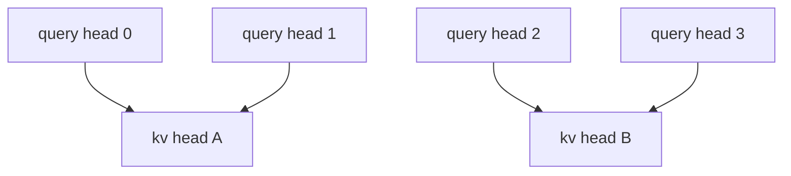
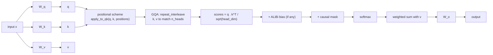

# 004 — Attention (GQA baseline) (Task 4)

**Type:** task · **Date:** 2026-08-31 · **Related:** Requirements 1.5, 1.6,
9.3, 12.1; design.md `model/attention.py` component

## What was implemented
- `qwenmoe/model/attention.py::build_positional_scheme(config, head_dim)` —
  the factory deferred from task 3, constructing whichever positional
  scheme `ModelConfig.positional_scheme` names.
- `qwenmoe/model/attention.py::Attention` — scaled dot-product self-attention
  with Grouped-Query Attention (`n_kv_heads <= n_heads`), a causal mask, and
  the configured positional scheme's hooks (RoPE rotates q/k; ALiBi adds a
  score bias; NoPE does nothing extra).
- 6 tests in `tests/test_attention.py`: output shape + finiteness for both
  standard MHA (`n_kv_heads == n_heads`) and GQA (`n_kv_heads < n_heads`);
  all three positional schemes running end-to-end through real `Attention`
  for the first time; and the causal-masking correctness test (perturbing
  only the last token leaves every earlier position's output unchanged).

## Bug found and fixed: `apply` collides with `nn.Module.apply`
While wiring `Attention` to call `self.positional.apply(q, k, positions)`,
noticed that `apply` is **already** a real PyTorch `nn.Module` method —
`some_module.apply(fn)` recursively runs `fn` on every submodule, a common
pattern for custom weight initialization (`model.apply(init_weights)`).
`RotaryEmbedding`/`NoPositional`/`AlibiBias` (task 3) had overridden it with
an incompatible 3-argument signature. This wasn't caught by task 3's own
tests (they call the method directly, so Python just resolves to the
override), but it would silently break the instant anything called the
*real* recursive `.apply(fn)` on a model containing one of these as a
submodule — exactly the kind of latent bug that only surfaces when a
different part of the codebase exercises the interface for real, which is
what happened here. **Fix:** renamed the method to `apply_to_qk` everywhere
(the class itself, its three call sites in `tests/test_rope.py` /
`tests/test_positional_alt.py`, and design.md's prose). Confirmed the whole
suite (45 tests) still passes after the rename.

## Concepts explained for a complete beginner

### Softmax
- **What it means:** A function that turns a list of arbitrary numbers
  ("scores") into a list of positive numbers that add up to exactly 1 — a
  probability distribution.
- **Why it exists:** Attention needs to turn raw similarity scores into
  "how much weight should each token get," and weights that sum to 1 are
  what makes a weighted average meaningful.
- **Analogy:** Like converting raw vote counts into percentages of the
  total vote — whatever the raw numbers were, the percentages always sum
  to 100%.
- **Simple technical explanation:**
  $$\text{softmax}(z)_i = \frac{e^{z_i}}{\sum_j e^{z_j}}$$
  exponentiating first makes every value positive, and dividing by the sum
  normalizes them to add up to 1. A score of $-\infty$ maps to $e^{-\infty}=0$
  exactly — this is *why* the causal mask (below) works.
- **How it relates here:** `F.softmax(scores, dim=-1)` is the last step
  before combining values in `Attention.forward`.

### Scaled dot-product attention (the core formula)
- **What it means:** For each token (the "query"), compare it against every
  other token (the "keys") to get a similarity score per pair, turn those
  scores into weights with softmax, then take a weighted average of all
  the other tokens' "values" using those weights.
- **Why it exists:** This is how a transformer decides "which earlier words
  actually matter for understanding/predicting this word" — instead of
  treating all previous words equally, or only looking at a fixed nearby
  window.
- **Analogy:** Like highlighting a textbook: for a sentence you're trying
  to understand, some earlier sentences matter a lot (highlight them
  brightly) and some barely matter (leave them unhighlighted) — attention
  computes exactly how bright each highlight should be, then reads a
  brightness-weighted summary.
- **Simple technical explanation:**
  $$\text{Attention}(Q,K,V) = \text{softmax}\!\left(\frac{QK^{\top}}{\sqrt{d_k}}\right)V$$
- **How it relates here:** `Attention.forward` computes exactly these four
  steps in order: `q @ k.transpose(-2,-1)` (raw scores), divide by
  `sqrt(head_dim)` (scaling), add the causal mask and any positional bias,
  `softmax`, then `probs @ v`.
- **Paper:** [Attention Is All You Need (Vaswani et al., 2017)](https://arxiv.org/abs/1706.03762)
- **Mathematical derivation (why divide by $\sqrt{d_k}$ specifically):**
  assume each component of $q$ and $k$ is an independent random value with
  mean 0 and variance 1. The raw dot product is
  $q\cdot k=\sum_{i=1}^{d_k} q_ik_i$. Each term $q_ik_i$ has mean
  $E[q_i]E[k_i]=0$ and variance $E[(q_ik_i)^2]=E[q_i^2]E[k_i^2]=1\cdot1=1$
  (independence again). Summing $d_k$ independent zero-mean terms adds
  their variances: $\text{Var}(q\cdot k)=\sum_i \text{Var}(q_ik_i)=d_k$. So
  the *standard deviation* of the raw score grows as $\sqrt{d_k}$ — bigger
  heads produce bigger raw scores purely from having more terms to sum,
  not because the tokens are more related. Dividing by $\sqrt{d_k}$
  restores unit variance regardless of head size, keeping scores in a
  range where softmax has healthy (non-vanishing) gradients. This is exact
  reasoning about variance under the stated independence assumption — real
  $q,k$ aren't literally random and independent, but the assumption is
  reasonable at initialization and the paper's own experiments confirmed
  the fix works in practice.
- **Worked example (dummy numbers):** 2 tokens, `head_dim=2`. Suppose
  (already-projected) $q_0=[1,0],\ q_1=[0,1]$, $k_0=[1,0],\ k_1=[0,1]$,
  $v_0=[1,2],\ v_1=[3,4]$.
  1. Raw scores $q_i\cdot k_j$: $\begin{pmatrix}1 & 0\\ 0 & 1\end{pmatrix}$.
  2. Scale by $1/\sqrt{2}\approx0.7071$: $\begin{pmatrix}0.7071 & 0\\ 0 & 0.7071\end{pmatrix}$.
  3. Causal mask (query $i=0$ can't see key $j=1$): row 0 becomes
     $[0.7071,\ -\infty]$; row 1 is unmasked, $[0,\ 0.7071]$.
  4. Softmax each row: row 0 → $[1,\ 0]$ (the $-\infty$ vanishes exactly);
     row 1 → $[e^{0},e^{0.7071}]/(e^0+e^{0.7071}) = [1,\ 2.0281]/3.0281
     \approx [0.3302,\ 0.6698]$.
  5. Weighted sum of $V$: output$_0 = 1{\times}[1,2] + 0{\times}[3,4] =
     [1,2]$ (token 0 can only see itself, so it just copies its own
     value). output$_1 = 0.3302{\times}[1,2] + 0.6698{\times}[3,4] =
     [0.3302,0.6604]+[2.0094,2.6792] = [2.3396,\ 3.3396]$.
  6. **Check:** token 0's output exactly equals $v_0$ (forced, since it's
     the only thing token 0 is allowed to attend to) — matching what the
     causal-mask test in this task verifies for real tensors.

### Multi-head attention
- **What it means:** Instead of doing the attention computation once,
  split the vector into several smaller chunks ("heads") and do the whole
  attention computation independently on each chunk, then concatenate.
- **Why it exists:** One attention computation can only learn one "kind" of
  relationship at a time (e.g. only nearby-word relationships, or only
  subject-verb relationships); several smaller, independent heads can each
  specialize in a different kind of relationship simultaneously.
- **Analogy:** Like assigning several editors to proofread the same essay,
  each looking for a different thing (grammar, tone, factual accuracy) —
  each catches something the others would miss, and combining their notes
  beats using one editor to check everything at once.
- **Simple technical explanation:** split `d_model` into `n_heads` chunks
  of `head_dim = d_model // n_heads` each, run the same attention formula
  on every chunk in parallel, concatenate the results, then one more
  linear projection (`w_o`) mixes the heads back together.
- **How it relates here:** `q`/`k`/`v` are reshaped to expose an
  `n_heads` dimension right after projection, and the final `.view(...)`
  + `w_o` at the end of `Attention.forward` is the "concatenate + mix"
  step.

### Grouped-Query Attention (GQA)
- **What it means:** A middle ground between "every query head gets its
  own key/value head" (standard multi-head attention) and "all query heads
  share one single key/value head" (multi-query attention) — a small
  number of key/value heads, each shared by a *group* of query heads.
- **Why it exists:** Ainslie et al. (2023) were solving an inference-speed
  problem: during text generation, a model has to keep every past token's
  key/value vectors in memory (the "KV cache"), and it has to move all of
  that memory around for every new token generated. Fewer key/value heads
  means a much smaller KV cache and less data to move, at a small quality
  cost that turns out to be much smaller than naively using just one
  shared head (multi-query attention).
- **Analogy:** Like a newsroom where every reporter (query head) used to
  have their own personal fact-checker (key/value head) — expensive. GQA
  is like grouping reporters into small teams that share one
  fact-checker each: much cheaper than one-checker-per-reporter, and far
  more accurate than the whole newsroom sharing a single fact-checker.
- **Simple technical explanation:** with `n_heads` query heads and
  `n_kv_heads` key/value heads (`n_heads` divisible by `n_kv_heads`), each
  key/value head is reused by `n_rep = n_heads // n_kv_heads` query heads.
  `n_kv_heads == n_heads` (n_rep=1) is standard MHA; `n_kv_heads == 1` would
  be multi-query attention (not used by default here).
- **How it relates here:** `k.repeat_interleave(n_rep, dim=1)` /
  `v.repeat_interleave(n_rep, dim=1)` is the entire GQA mechanism — it
  duplicates each kv head's tensor `n_rep` times consecutively so kv head
  `i` lines up with query heads `[i*n_rep, (i+1)*n_rep)`.
- **Paper:** [GQA: Training Generalized Multi-Query Transformer Models from Multi-Head Checkpoints (Ainslie et al., 2023)](https://arxiv.org/abs/2305.13245)
- **Blog:** [Grouped-Query Attention (GQA) — Sebastian Raschka](https://sebastianraschka.com/llm-architecture-gallery/gqa)
- **Worked example (dummy numbers):** `n_heads=4`, `n_kv_heads=2`, so
  `n_rep=2`. If the 2 kv heads' data is `[A, B]` (indices 0, 1), then
  `repeat_interleave(2)` produces `[A, A, B, B]` — query heads 0 and 1 both
  read key/value head `A`; query heads 2 and 3 both read key/value head
  `B`. Compare to standard MHA (`n_kv_heads=4`), which would need `[A, B,
  C, D]` — a distinct key/value head per query head, twice as much KV data
  to store and move for this example.

## Diagrams

How GQA groups query heads onto fewer key/value heads:

The full per-head data flow `Attention.forward` computes:

## Questions that might come to mind
- **Why scale by $\sqrt{\text{head\_dim}}$ and not, say, `head_dim` itself
  or a fixed constant?** Because the derivation above shows the raw
  score's *standard deviation* — not its variance, not some arbitrary
  amount — grows exactly as $\sqrt{d_k}$; dividing by anything else would
  either over-correct or under-correct as head size changes.
- **What happens if `n_kv_heads` doesn't evenly divide `n_heads`?**
  `ModelConfig.__post_init__` (task 2) already rejects that combination
  before an `Attention` module can even be constructed — `Attention`
  itself doesn't re-check it, trusting the config was validated at the
  system boundary where it was created.
- **Does GQA change *what* the model can represent, or just make it
  cheaper?** Both, to some degree — sharing key/value heads *does* reduce
  representational flexibility slightly (measurably lower quality than
  full MHA in the GQA paper's own experiments), but the paper's central
  finding is that with the right number of groups, the quality loss is
  small while the KV-cache/memory-bandwidth savings are large.
- **Where does the `positions` argument actually come from when this gets
  wired into a full model (task 6)?** `torch.arange(seq_len)`, computed
  once per forward pass and passed down to every layer's `Attention` —
  this task's tests construct it the same way.
- **Can I see what happens to a token that's masked out?** Yes — in the
  worked example above, row 0's raw score for key 1 becomes $-\infty$
  after masking, and `softmax` maps $e^{-\infty}$ to exactly `0`, so that
  key contributes literally nothing to the weighted sum, regardless of
  what its value vector `v_1` was.

## Outcome
`uv run pytest tests/ -v` — 45 passed (39 from tasks 1-3 plus 6 new).
Task 4 checked off.
