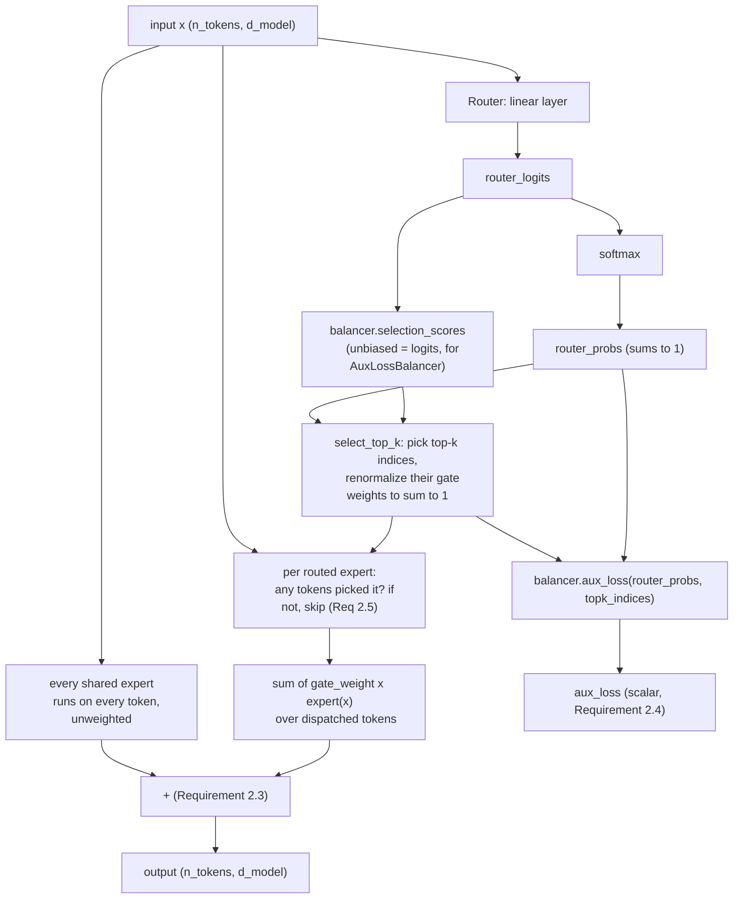
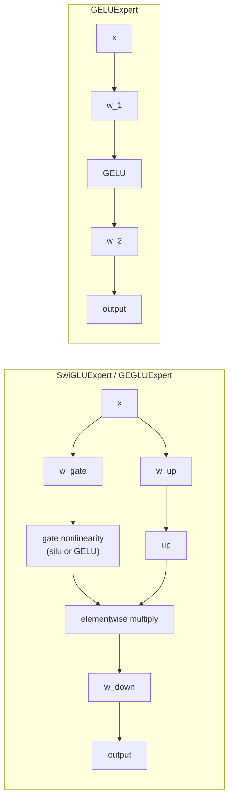
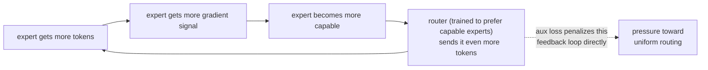

# 005 — Mixture-of-Experts Feed-Forward Layer (Task 5)

**Type:** task · **Date:** 2026-08-31 · **Related:** Requirements 2.1-2.5,
9.4, 12.2, 12.3; design.md `model/moe.py` component

> **Full by-hand derivation:** [`docs/math/005-moe-layer.md`](../docs/math/005-moe-layer.md)
> carries one concrete 3-token, 4-expert (top-2), 1-shared-expert example
> through *every* line of `MoELayer.forward_with_trace` — the router
> logits, softmax, top-k selection, weight renormalisation, each SwiGLU
> expert, the zero-token expert skip, the scatter-add, the shared expert,
> and the load-balancing auxiliary loss — solved digit by digit and checked
> against the real module by [`docs/math/verify_005_moe_layer.py`](../docs/math/verify_005_moe_layer.py).

## What was implemented
- `qwenmoe/model/moe.py::SwiGLUExpert` / `GEGLUExpert` / `GELUExpert` — the
  three expert activation variants, plus `build_expert(config)` selecting
  among them by `ModelConfig.activation` (Requirement 2.1, 12.2).
- `qwenmoe/model/moe.py::Router` — the learned linear layer producing
  per-expert routing logits (Requirement 2.2).
- `qwenmoe/model/moe.py::select_top_k` — a standalone function picking the
  top-`k` experts per token and renormalizing their gate weights to sum to
  1 (Requirement 2.2, 2.3).
- `qwenmoe/model/moe.py::AuxLossBalancer` — the differentiable
  load-balancing auxiliary loss, plus `build_balancer(config)` (Requirement
  2.4, 12.3).
- `qwenmoe/model/moe.py::MoELayer` — ties all of the above together:
  routes each token to its top-`k` routed experts + every shared expert,
  combines outputs, skips any routed expert that gets zero tokens this
  batch (Requirement 2.5).
- 18 new tests: 9 in `tests/test_experts.py` (output shape per variant,
  the 2-vs-3-weight-matrix architecture difference, `build_expert`
  selection), 9 in `tests/test_moe.py` (router shape, top-k selection
  correctness + weight renormalization, aux-loss finiteness and response
  to imbalance, full `MoELayer` shape/gradient checks, the zero-token
  expert not erroring, `loss_free` failing clearly for now).

## Design decisions worth calling out

**`select_top_k` is a standalone function, not a `MoELayer` method.** It
takes plain tensors (`selection_scores`, `router_probs`, `top_k`) in and
returns plain tensors out, with no dependency on `nn.Module` state. That
makes Requirement 9.4 ("router always selects exactly `k` experts and
weights sum to 1") testable directly with hand-built tensors, instead of
needing to reach into a full model's forward pass. It also means the exact
same routing math is available to reuse later (task 12's
`forward_with_trace`) without duplicating it.

**Ranking by raw router logits instead of softmax probabilities is
deliberate, not a shortcut.** Requirement 2.2 describes "compute logits,
apply softmax, select top-k," but softmax is *order-preserving*: for two
experts $i,j$ scored on the same token, $z_i > z_j \iff e^{z_i} > e^{z_j}
\iff e^{z_i}/Z > e^{z_j}/Z$ for the same positive normalizer $Z$. So the
top-`k` experts by raw logit are always identical to the top-`k` by
softmax probability — computing softmax before ranking would be extra
work for the same answer. `AuxLossBalancer.selection_scores` returns the
logits unchanged for exactly this reason. This also isn't just a
convenience: DeepSeek-V3-style loss-free balancing (task 15.1) adds a bias
**to the logits** before ranking, so standardizing the whole
`selection_scores` interface on logits (rather than probabilities) is what
lets both balancing strategies share one interface.

**`moe_balancing="loss_free"` raises `NotImplementedError` for now.**
`ModelConfig` (task 2) already accepts `"loss_free"` as a valid value, but
`LossFreeBalancer` doesn't exist until task 15.1. `build_balancer` fails
loudly and immediately at `MoELayer` construction rather than silently
falling back to `aux_loss` behavior — mirroring how `attention_variant=
"mla"` is already a valid config value with no real `MLAAttention` behind
it until task 16. A test locks this in so task 15.1 has a clear "now make
this pass differently" signal instead of a silent behavior change.

**`d_ff` is the same for every activation variant.** The GLU-variants
paper itself shrinks `d_ff` by $\tfrac23$ for the gated variants (which use
3 weight matrices) to keep the *parameter count* matched against a plain
2-matrix FFN. This project deliberately does not do that: Requirement
12.2 asks for activation to be "selectable independently of other
components," and comparing variants under one unchanged `d_ff` (same
config, one field flipped) is simpler ablation hygiene than re-deriving a
matched `d_ff` per variant — at the cost of the gated variants
(`SwiGLUExpert`/`GEGLUExpert`) having 1.5x the parameters of `GELUExpert`
for the same `d_ff`, which `test_gelu_expert_has_no_gating_fewer_params_
than_swiglu` checks explicitly so this stays a documented, intentional
tradeoff rather than a surprise.

**Dispatch uses a scatter-add (`index_add_`) onto a zeros tensor**, the
same pattern production MoE implementations (e.g. Hugging Face's
Mixtral/Qwen2MoE) use: start `routed_output` as `zeros_like(x_flat)`
(no grad yet), then `index_add_` each dispatched expert's weighted output
into just the token rows it covers. An expert that's skipped (zero tokens)
never enters the computation graph at all, so its parameters simply never
receive a gradient that step — confirmed directly by
`test_moe_layer_gradients_flow_to_dispatched_experts_only`, which checks
`.grad is not None` per expert after `.backward()`, not just that the
forward pass ran without erroring.

## Concepts explained for a complete beginner

### Mixture of Experts (MoE)
- **What it means:** instead of one feed-forward network processing every
  token identically, keep many separate "expert" feed-forward networks
  and, per token, use only a small number of them — chosen by a small
  learned "router" — then combine their outputs.
- **Why it exists:** it decouples a model's total capacity (how much it
  can "know," roughly proportional to total parameter count) from its
  per-token compute cost (roughly proportional to *active* parameters).
  Adding more experts grows capacity without growing the cost of
  processing any single token, since each token still only visits `k` of
  them.
- **Analogy:** a hospital with dozens of specialist doctors. A patient
  (token) doesn't see every specialist — a triage nurse (the router) sends
  them to the 2 most relevant ones. The hospital as a whole holds far more
  total expertise than any single doctor, while any one patient's visit
  still only costs 2 consultations.
- **Simple technical explanation:** replace one feed-forward block with
  $N$ parallel feed-forward "expert" blocks plus a small router; per
  token, the router selects $k \ll N$ experts, only those run, and their
  outputs are combined.
- **How it relates here:** `MoELayer` is exactly this — it's the
  feed-forward sublayer a plain Transformer block would otherwise use
  (wired into the full model in task 6).
- **Paper:** [Outrageously Large Neural Networks: The Sparsely-Gated Mixture-of-Experts Layer (Shazeer et al., 2017)](https://arxiv.org/abs/1701.06538)
- **Blog:** [Mixture of Experts Explained (Hugging Face, Sanseviero et al., 2023)](https://huggingface.co/blog/moe)

### Gated Linear Units — SwiGLU and GEGLU
- **What it means:** a "gate" is a second linear projection of the same
  input, passed through a nonlinearity, that multiplies elementwise with a
  "value" projection — the gate decides how much of each value component
  actually passes through.
- **Why it exists:** a single fixed nonlinearity (like plain GELU/ReLU)
  reacts to a neuron's own pre-activation value only; a gate lets the
  network learn, per-input, how much of a *separately computed* value
  signal to let through — one more degree of freedom that empirically
  improves Transformer quality (Shazeer 2020's own ablations).
- **Analogy:** a dimmer switch wired in series with a lamp. The "value"
  wire carries the signal, but a second control wire (the "gate," itself
  computed from current conditions) decides how much of it gets through —
  anywhere from fully blocked to fully passed, continuously, not just
  on/off.
- **Simple technical explanation:**
  $$\text{FFN}_{\text{gated}}(x) = \big(\sigma_{\text{gate}}(xW_{\text{gate}}) \odot xW_{\text{up}}\big)W_{\text{down}}$$
  SwiGLU uses $\sigma_{\text{gate}} = \text{silu}(z) = z\cdot\text{sigmoid}(z)$;
  GEGLU uses $\sigma_{\text{gate}} = \text{GELU}$ (derived below). Both use
  **3** weight matrices (`w_gate`, `w_up`, `w_down`) versus a plain FFN's
  **2** (`w_1`, `w_2`) — `GELUExpert` here is that plain, non-gated,
  2-matrix case.
- **How it relates here:** `SwiGLUExpert.forward` /
  `GEGLUExpert.forward` compute exactly this formula;
  `GELUExpert.forward` computes the plain, non-gated
  `w_2(gelu(w_1(x)))` for comparison (Requirement 12.2).
- **Paper:** [GLU Variants Improve Transformer (Shazeer, 2020)](https://arxiv.org/abs/2002.05202)
- **Worked example (dummy numbers):** `d_model=2`, `d_ff=2`,
  $x=[1,2]$, $W_{\text{gate}}=\begin{pmatrix}1&0\\0&1\end{pmatrix}$,
  $W_{\text{up}}=\begin{pmatrix}0&1\\1&0\end{pmatrix}$,
  $W_{\text{down}}=\begin{pmatrix}1&1\\1&1\end{pmatrix}$ (chosen by hand,
  not random, so every step is checkable). Then
  $xW_{\text{gate}}=[1,2]$ and $xW_{\text{up}}=[2,1]$ for all three
  variants (same input projections; only the gate nonlinearity and the
  gating itself differ):

  | step | SwiGLU (gate = silu) | GEGLU (gate = GELU) | GELU (plain, no gate, uses `w_1=W_gate` directly) |
  |---|---|---|---|
  | gate nonlinearity applied to $[1,2]$ | $\text{silu}([1,2])=[0.731059,\ 1.761594]$ | $\text{GELU}([1,2])=[0.841345,\ 1.954500]$ | $\text{GELU}([1,2])=[0.841345,\ 1.954500]$ |
  | elementwise × up $[2,1]$ | $[1.462117,\ 1.761594]$ | $[1.682690,\ 1.954500]$ | *(no up-projection; this **is** the hidden vector)* |
  | × $W_{\text{down}}$ (sums both components into each output dim) | $[3.223711,\ 3.223711]$ | $[3.637190,\ 3.637190]$ | $[2.795845,\ 2.795845]$ |

  All three outputs came out equal across their two output dims purely
  because $W_{\text{down}}$ here is the all-ones matrix — a convenient
  sanity check, not a general property. Values cross-checked against
  `torch.nn.functional.silu`/`gelu` directly.

### GELU (Gaussian Error Linear Unit)
- **What it means:** an activation that scales its input by "the
  probability that a standard-normal random draw is less than this
  input," instead of ReLU's hard 0/1 cutoff at zero.
- **Why it exists:** Hendrycks & Gimpel wanted a smooth (everywhere
  differentiable), probabilistically-motivated alternative to ReLU's hard
  cutoff — ReLU kills 100% of any negative input and has a sharp kink at
  0, while GELU transitions continuously and even lets a slightly negative
  input through a little.
- **Analogy:** ReLU is a rigid on/off light switch — negative input is
  fully off, positive is fully (and linearly) on. GELU is a smooth dimmer
  that's mostly off for very negative inputs and mostly on for very
  positive ones, but fades continuously through the middle instead of
  snapping.
- **Simple technical explanation:**
  $$\text{GELU}(x) = x\cdot\Phi(x)$$
  where $\Phi$ is the standard normal cumulative distribution function
  (CDF) — literally "the probability a standard-normal random variable
  falls at or below $x$."
- **Full derivation (why the erf form is exact, not an approximation):**
  by definition $\Phi(x) = \int_{-\infty}^{x} \frac{1}{\sqrt{2\pi}}e^{-t^2/2}\,dt$.
  Substituting $t = \sqrt{2}\,u$ (so $dt = \sqrt2\,du$):
  $$\Phi(x) = \int_{-\infty}^{x/\sqrt2} \frac{1}{\sqrt{2\pi}}e^{-u^2}\sqrt2\,du = \frac{1}{\sqrt\pi}\int_{-\infty}^{x/\sqrt2} e^{-u^2}\,du$$
  Splitting the integral at 0 and using the error function's definition
  $\text{erf}(z) = \frac{2}{\sqrt\pi}\int_0^z e^{-u^2}du$ (an odd function)
  gives exactly $\Phi(x) = \frac12\left(1+\text{erf}(x/\sqrt2)\right)$ —
  this is exact algebra/calculus, not a curve-fit. PyTorch's default
  `F.gelu(..., approximate="none")` (used throughout this task) computes
  this exact form; a separate `approximate="tanh"` mode trades a small
  accuracy loss for speed and isn't used here.
- **Worked example:** $\text{GELU}(1) = 1\times\Phi(1) \approx
  1\times0.841345 = 0.841345$; $\text{GELU}(2) = 2\times\Phi(2) \approx
  2\times0.977250 = 1.954500$ — the same two values used in the SwiGLU/
  GEGLU table above.
- **Paper:** [Gaussian Error Linear Units (GELUs) (Hendrycks & Gimpel, 2016)](https://arxiv.org/abs/1606.08415)

### Router, softmax gating, top-k selection, and renormalization
- **What it means:** a small learned linear layer scores every expert for
  a given token; softmax turns those scores into a probability
  distribution over all experts (summing to 1); only the top `k`
  highest-probability experts are actually used, and their probabilities
  are rescaled so just those `k` sum to 1.
- **Why it exists:** this *is* the mechanism that makes an MoE layer
  sparse — without picking only `k` of the `N` experts, every expert would
  run for every token and there'd be no compute saving at all.
- **Analogy:** a talent scout (router) scores 8 candidate specialists
  (`n_routed_experts`) for a job, but the budget only covers hiring the
  top 2 (`top_k`). Whatever fraction of "suitability" was originally
  spread across all 8 candidates now gets entirely redistributed between
  just the 2 who were actually hired, in proportion to their original
  scores.
- **Simple technical explanation and derivation of renormalization:**
  softmax probabilities $p_1,\dots,p_N$ sum to exactly 1. For a selected
  set $S$ of size $k$, the raw selected probabilities generally sum to
  some $s=\sum_{i\in S}p_i < 1$ (some nonnegative mass belongs to the
  $N-k$ *un*selected experts). Renormalizing sets $w_i = p_i/s$ for each
  $i\in S$, so $\sum_{i\in S}w_i = \frac{1}{s}\sum_{i\in S}p_i = s/s = 1$
  exactly — a valid (sums-to-1) weighted combination restricted to only
  the chosen experts (Requirement 2.3).
- **How it relates here:** `Router.forward` computes the raw logits;
  `MoELayer.forward` applies softmax; `select_top_k` does the selection
  and renormalization step above.
- **Worked example (dummy numbers):** one token, 4 experts, `top_k=2`,
  router logits $z=[2.0,\ 0.5,\ -1.0,\ 1.0]$.
  1. Softmax: $p=[0.609460,\ 0.135989,\ 0.030343,\ 0.224208]$ (sums to 1).
  2. Top-2 by logit: experts 0 ($z=2.0$) and 3 ($z=1.0$); raw probabilities
     $\{0.609460,\ 0.224208\}$, summing to $s=0.833668$.
  3. Renormalize: $w_0 = 0.609460/0.833668 = 0.731059$,
     $w_3 = 0.224208/0.833668 = 0.268941$ — sums to exactly 1. Experts 1
     and 2 get weight 0 (not dispatched to at all this token).

### Shared experts
- **What it means:** besides the `n_routed_experts` "only a few get
  chosen" experts, keep a small number of separate experts that process
  **every** token unconditionally — no routing, no gate weight, just
  straight addition to the routed output.
- **Why it exists:** DeepSeekMoE's authors observed that routed experts
  tend to redundantly re-learn the same general-purpose "common knowledge"
  (every expert must be able to handle whatever the router happens to send
  it). Dedicating a couple of always-on experts to that shared knowledge
  frees the routed experts to specialize more narrowly instead of each
  independently relearning the basics.
- **Analogy:** a firm where every specialist consultant still has to
  independently know general business basics (email etiquette, basic
  billing) purely because any client might ask — wasteful duplication.
  Better: one generalist joins every meeting to handle the common-
  knowledge questions, freeing the specialists to focus only on their
  specialty.
- **Simple technical explanation:**
  $$\text{MoELayer}(x) = \sum_{i\in\text{top-}k(x)} w_i\,E_i(x) \;+\; \sum_{j=1}^{n_{\text{shared}}} E^{\text{shared}}_j(x)$$
  the first sum uses the renormalized gate weights from the previous
  section; the second sum has no weighting at all (Requirement 2.3).
- **How it relates here:** `MoELayer.forward`'s `shared_output` loop —
  `n_shared_experts=0` is valid too (an empty `nn.ModuleList`, contributing
  exactly zero), checked by
  `test_moe_layer_zero_shared_experts_does_not_error`.
- **Paper:** [DeepSeekMoE: Towards Ultimate Expert Specialization in Mixture-of-Experts Language Models (Dai et al., 2024)](https://arxiv.org/abs/2401.06066)

### Load-balancing auxiliary loss
- **What it means:** an extra loss term, added to the main next-token-
  prediction loss, whose only job is to punish the router for routing too
  many tokens to the same few experts.
- **Why it exists:** with no counter-pressure, a router very commonly
  collapses onto favoring a handful of experts early in training — a
  "rich get richer" feedback loop: an expert that receives more tokens
  gets more gradient signal, becomes more capable, so the router (which is
  *trained* to prefer capable experts) sends it even more tokens next.
  Left unchecked, this can leave most experts almost never used, defeating
  the entire purpose of having many of them.
- **Analogy:** a manager who always hands new tasks to their single most
  experienced employee, never giving newer team members a chance to build
  experience — eventually only 1 of 8 team members can do anything
  useful. A fairness requirement on task distribution forces the manager
  to spread work around so the whole team actually develops.
- **Simple technical explanation:**
  $$\mathcal{L}_{\text{aux}} = \alpha \cdot N \cdot \sum_{i=1}^{N} f_i \cdot P_i$$
  $f_i$ is the (hard, non-differentiable) fraction of tokens dispatched to
  expert $i$; $P_i$ is the (soft, differentiable) average router
  probability mass on expert $i$ across the batch.
- **Full derivation:**
  - *Why $f_i \cdot P_i$ and not just one of them:* $f_i$ alone carries no
    gradient — it comes from an argmax/top-k selection, a discrete
    operation. Multiplying by $P_i$ (a genuine softmax output) gives the
    product a gradient: to shrink a large $f_i\cdot P_i$ term (an
    overloaded expert), training is pushed to lower $P_i$ for that expert
    — and since softmax probabilities are zero-sum-constrained, that mass
    necessarily flows toward experts with lower $f_i$. Minimizing
    $\mathcal{L}_{\text{aux}}$ therefore pressures the router toward
    equalizing load, even though $f$ itself never receives a gradient
    directly.
  - *Why multiply by $N$ (exact):* under perfectly uniform routing,
    $f_i=P_i=1/N$ for every expert, so
    $\sum_i f_iP_i = N\cdot(1/N)^2 = 1/N$ — this shrinks as $N$ grows, so
    without the $N$ factor, a fixed $\alpha$ would silently mean something
    different for every expert count. Multiplying by $N$ cancels this
    exactly ($N \cdot \frac1N = 1$), so $\mathcal{L}_{\text{aux}} = \alpha$
    under perfect balance *regardless of $N$* — $\alpha$ becomes a stable,
    reusable hyperparameter independent of how many experts are
    configured.
  - $\alpha=10^{-2}$ is Switch Transformer's own empirically-swept choice
    (tried $10^{-1}$ through $10^{-5}$, found $10^{-2}$ balanced quickly
    without hurting the main training loss) — an empirically-fitted
    constant, not a derived one, used unchanged as `AuxLossBalancer`'s
    default `loss_weight`.
  - *Top-k generalization (this project's own extension — the paper
    itself defines $f_i$ only for top-1 routing):*
    $f_i := \frac1T\sum_{x\in\mathcal B}\mathbb{1}\{i\in\text{top-}k(x)\}$
    — "the fraction of tokens for which expert $i$ is among the selected
    top-$k$" — which reduces exactly to the paper's own top-1 definition
    when $k=1$.
- **Worked example (dummy numbers, top-1 routing for the cleanest by-hand
  check — the code itself runs this at `top_k=2` by default):** 4 experts,
  4 tokens, router probabilities per token:

  | token | $p_0$ | $p_1$ | $p_2$ | $p_3$ | argmax |
  |---|---|---|---|---|---|
  | 0 | 0.7 | 0.1 | 0.1 | 0.1 | 0 |
  | 1 | 0.6 | 0.2 | 0.1 | 0.1 | 0 |
  | 2 | 0.1 | 0.6 | 0.2 | 0.1 | 1 |
  | 3 | 0.2 | 0.1 | 0.6 | 0.1 | 2 |

  $f = [\tfrac24, \tfrac14, \tfrac14, 0] = [0.5,\ 0.25,\ 0.25,\ 0.0]$
  (column-wise argmax counts ÷ 4 tokens). $P$ = column means =
  $[0.4,\ 0.25,\ 0.25,\ 0.1]$ (each sums to 1 individually, as they must).
  $$\mathcal{L}_{\text{aux}} = 0.01 \times 4 \times \big[(0.5{\times}0.4)+(0.25{\times}0.25)+(0.25{\times}0.25)+(0{\times}0.1)\big] = 0.04\times0.325 = 0.013$$
  Compare to perfectly uniform routing ($f=P=[0.25,0.25,0.25,0.25]$):
  $0.01\times4\times(4\times0.0625) = 0.01$ exactly $=\alpha$, confirming
  the derivation above. This example's $0.013 > 0.01$ shows the mild
  imbalance already pushes the loss above the perfect-balance floor —
  the same relationship (imbalanced > balanced) that
  `test_aux_loss_is_finite_and_responds_to_imbalance` checks, using a
  more extreme (fully collapsed) imbalance for a larger, unambiguous gap.
- **Paper:** [Switch Transformers: Scaling to Trillion Parameter Models with Simple and Efficient Sparsity (Fedus, Zoph & Shazeer, 2021)](https://arxiv.org/abs/2101.03961)

## Diagrams

The overall `MoELayer.forward` data flow:

Gated (3-matrix) vs. plain (2-matrix) expert architectures:

The "rich get richer" imbalance problem the auxiliary loss counteracts:

## Questions that might come to mind
- **Could an expert ever be picked twice for the same token (e.g. both
  top-k slots pointing at expert 3)?** No — `torch.topk` selects distinct
  indices without replacement, so each of the `k` slots per token names a
  *different* expert. That's exactly why, in `MoELayer.forward`, matching
  `topk_indices == expert_id` per expert can only ever produce 0 or 1
  match per token, never 2+.
- **Why does an expert with zero dispatched tokens not just run on an
  empty batch instead of being explicitly skipped?** Running an expert on
  a zero-row tensor would work shape-wise, but the `continue` is what
  guarantees Requirement 2.5's actual promise — that expert's parameters
  get *no gradient at all* that step, which only holds if the expert never
  enters the computation graph in the first place.
- **The `MoELayer.forward` type hint says `Tensor | None` for the aux
  loss — when is it actually `None`?** Not yet — right now
  `build_balancer` only ever constructs `AuxLossBalancer`, which always
  returns a real scalar. The `None` case is reserved for
  `LossFreeBalancer` (task 15.1), whose entire premise (Requirement 12.3)
  is balancing load *without* a gradient-based auxiliary loss.
- **Why did the zero-token test use exactly 1 token with `top_k=1` and 4
  experts, instead of a bigger, more "realistic" batch?** It makes the
  zero-token case for 3 of the 4 experts *guaranteed*, not just
  statistically likely — with only 1 possible dispatch to hand out among
  4 experts, the other 3 provably get none, so the test doesn't depend on
  a lucky random seed.
- **Do the gated experts (SwiGLU/GEGLU) really always cost 1.5x a plain
  GELU expert's parameters for the same `d_ff`?** Yes, exactly: 3 matrices
  of size `d_model x d_ff` (or `d_ff x d_model`) versus 2, so
  $3/2=1.5\times$ — checked directly by
  `test_gelu_expert_has_no_gating_fewer_params_than_swiglu`.

## Outcome
`uv run pytest tests/ -v` — 63 passed (45 from tasks 1-4 plus 18 new).
Tasks 5, 5.1, and 5.2 checked off.
