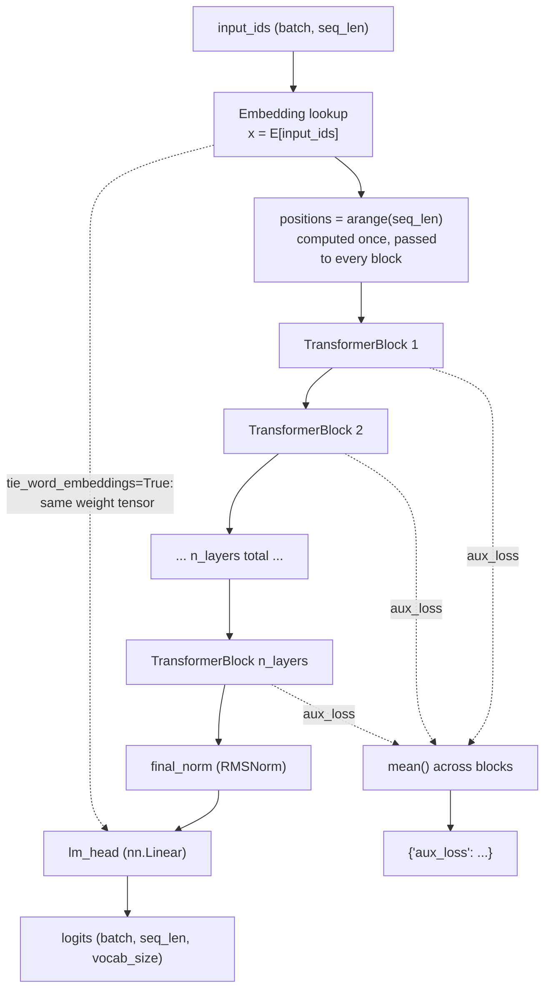
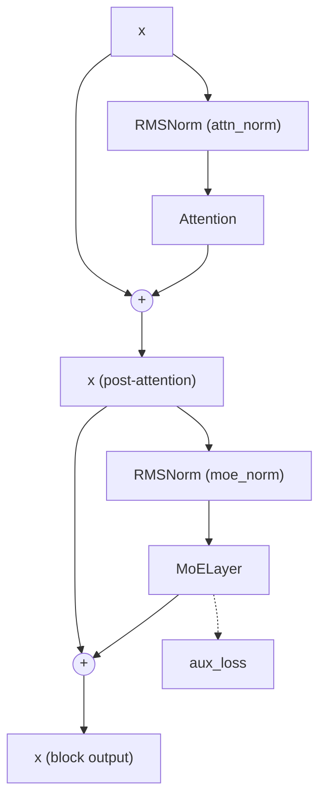
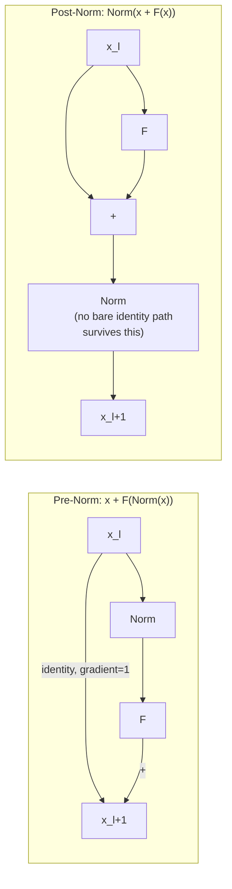

# 006 — Full Model Assembly (Task 6)

**Type:** task · **Date:** 2026-08-31 · **Related:** Requirements 1.1, 1.2,
1.7, 9.5; design.md `model/block.py` / `model/transformer.py` components

## What was implemented
- `qwenmoe/model/attention.py::build_attention(config)` — a factory
  selecting the attention variant named by `config.attention_variant`,
  mirroring the `build_positional_scheme`/`build_expert`/`build_balancer`
  pattern from tasks 3-5. `"gqa"` returns the existing `Attention`;
  `"mla"` raises `NotImplementedError` until task 16.
- `qwenmoe/model/block.py::TransformerBlock` — one decoder layer:
  `x + Attn(RMSNorm(x))`, then `x + MoE(RMSNorm(x))` — pre-norm residual
  wiring around both sublayers (Requirement 1.4), returning `(x,
  aux_loss)`.
- `qwenmoe/model/transformer.py::QwenMoEModel` — embedding lookup,
  `n_layers` stacked `TransformerBlock`s, a final `RMSNorm`, and an
  `lm_head` that's either its own matrix or (when `tie_word_embeddings=
  True`, the default) the literal same tensor as the embedding matrix
  (Requirement 1.7). `forward(input_ids) -> (logits, {"aux_loss":
  ...})` (Requirement 1.1, 1.2), where `aux_loss` is the mean of every
  block's MoE auxiliary loss.
- 7 new tests in `tests/test_model.py`: `TransformerBlock` shape/finite-
  aux-loss check; the `attention_variant="mla"` not-yet-implemented
  guard; `QwenMoEModel` output shape for 2 different batch/seq-len
  combinations (Requirement 9.5); tied-vs-untied embedding weight-tensor
  identity checks (Requirement 1.7); an end-to-end gradient-flow check
  through the embedding and every block's attention.

## Design decisions worth calling out

**`build_attention` mirrors the existing `build_expert`/`build_balancer`
factory pattern, and stubs `"mla"` the same way `moe_balancing=
"loss_free"` was stubbed in task 5.** `ModelConfig` already accepts
`attention_variant="mla"` as a valid value (task 2), but no
`MLAAttention` class exists until task 16 (stretch goal). Rather than let
`TransformerBlock` quietly fall back to GQA for that value,
`build_attention` raises `NotImplementedError` immediately at
construction — `test_transformer_block_mla_not_yet_implemented` locks
this in, mirroring task 5's `test_moe_layer_loss_free_balancing_not_yet_
implemented`.

**`positions` is computed exactly once per forward pass, in
`QwenMoEModel`, not once per block.** This answers a question this
journal itself raised at the end of entry 004 ("Where does the
`positions` argument actually come from when this gets wired into a full
model (task 6)?") — the answer is `torch.arange(seq_len)`, built once in
`QwenMoEModel.forward` and threaded down through every block's
`TransformerBlock.forward(x, positions)` call to its `Attention`.
Computing it once rather than separately per block also guarantees every
layer agrees on the same token-position labeling for a given input,
which matters for RoPE/ALiBi correctness.

**Combining per-block aux losses: mean, not sum.** `MoELayer.forward`
(task 5) returns one aux-loss scalar per block; with `n_layers` blocks
each contributing one, `QwenMoEModel.forward` needs a single number for
its `{"aux_loss": ...}` contract. Averaging keeps the combined value's
scale independent of `n_layers`, so the same `loss_weight`/`aux_loss`
magnitude means roughly the same thing whether the model has 2 layers or
20 — relevant later when comparing configs of different depth
(Requirement 12).

**Weight tying is a literal object-identity assignment, not a copied
value.** `self.lm_head.weight = self.embedding.weight` reassigns
`lm_head`'s parameter to be the *same* `nn.Parameter` object the
embedding already owns (`nn.Module.__setattr__` re-registers it), rather
than copying its current values into a separate tensor that could later
drift apart during training. `test_tied_embeddings_share_weight_tensor`
checks this with `is` (object identity), not `torch.equal` (value
equality) — only the former actually proves tying rather than a
coincidence.

## Concepts explained for a complete beginner

### Residual (skip) connections
- **What it means:** instead of a layer's output *replacing* its input, the
  layer's output is *added* to its own input — so the layer only has to
  learn the adjustment on top of what it already received, not
  reconstruct the whole thing from scratch.
- **Why it exists:** He et al. (2015) found that plain stacked layers got
  *harder* to train as networks got deeper, even though a deeper network
  can always represent everything a shallower one could (worst case, the
  extra layers could just learn the identity function). In practice,
  learning "do nothing" via ordinary gradient descent turned out to be
  surprisingly hard for a plain stacked layer. Making identity the
  default, free path (via addition) means a layer's own weights only
  need to learn the small deviation from identity — much easier for
  optimization to discover from a near-zero starting point.
- **Analogy:** editing a document with "track changes" instead of
  retyping the whole page from memory each time. A reviewer (layer) only
  inserts their proposed edit (the residual); the base document (input)
  stays intact underneath, and the final page is base + every
  accumulated edit. Retyping the whole page from scratch each time risks
  losing content that should have just passed through unchanged.
- **Simple technical explanation:** $y = x + F(x)$, where $F$ is whatever
  the sublayer itself computes and $x$ is that sublayer's own input.
- **How it relates here:** `TransformerBlock.forward`'s two lines,
  `x = x + self.attn(...)` and `x = x + moe_out`, are literally this
  formula, applied once around attention and once around MoE.
- **Paper:** [Deep Residual Learning for Image Recognition (He, Zhang, Ren & Sun, 2015)](https://arxiv.org/abs/1512.03385)

### Pre-norm vs. post-norm placement
- **What it means:** where exactly a normalization layer sits relative to
  the residual addition. **Pre-norm** normalizes only the input *going
  into* a sublayer's own computation: $x_{l+1} = x_l + F_l(\text{Norm}(x_l))$.
  **Post-norm** normalizes the *result of* the addition itself:
  $x_{l+1} = \text{Norm}(x_l + F_l(x_l))$.
- **Why it exists:** the original Transformer (Vaswani et al., 2017) used
  post-norm, but deep post-norm Transformers need careful learning-rate
  warmup to train stably at all. Xiong et al. (2020) showed mathematically
  why pre-norm doesn't have this problem.
- **Analogy:** pre-norm is like measuring your ingredients freshly
  (normalizing) before cooking each dish (sublayer), then always adding
  the cooked dish onto the same growing plate (the residual stream)
  without ever touching what's already there. Post-norm is like
  re-plating the *entire* meal from scratch after every single dish is
  added — fine once, but doing it after every one of many courses means
  each earlier course's presentation keeps getting reshuffled by every
  later re-plating.
- **Full derivation (what's exact vs. what's a derived asymptotic
  result):** unrolling the pre-norm recursion across all $L$ layers is
  exact algebra — no approximation:
  $$x_L = x_0 + \sum_{l=0}^{L-1} F_l(\text{Norm}(x_l))$$
  Differentiating w.r.t. an early $x_l$:
  $$\frac{\partial x_L}{\partial x_l} = I + \sum_{j=l}^{L-1}\frac{\partial F_j(\text{Norm}(x_j))}{\partial x_l}$$
  The identity term $I$ is *always* present, completely independent of how
  small $\partial F_j/\partial x_l$ happens to be — a "gradient highway"
  back to any earlier layer, regardless of depth. Post-norm has no such
  exact identity term: every addition is immediately passed back through
  a further normalization, whose own Jacobian multiplies into the chain
  at every layer. Xiong et al. (2020) show — *under a stated
  random-Gaussian-initialization assumption*, i.e. a derived asymptotic
  result conditioned on an idealized setup, not exact algebra like the
  telescoping sum above — that this compounds geometrically with depth:
  their bound on the gradient norm at layer $l$ shrinks like
  $O\big((2/3)^{(L-l)/2}\big)$ for post-norm (vanishing exponentially for
  early layers), versus $O\big(d\sqrt{\ln d / L}\big)$ for pre-norm at
  every layer uniformly (shrinking only polynomially via $1/\sqrt L$, not
  exponentially concentrated at the earliest layers).
- **Worked numeric example (toy scalars, not the paper's own constants):**
  compare final-to-first-layer sensitivity across $L=3$ toy layers, using
  a small per-sublayer local gradient $g=0.1$ at every layer (simulating a
  poorly-conditioned sublayer computation) for both cases:
  - **Pre-norm:** local Jacobian $\frac{\partial x_{l+1}}{\partial x_l}=1+g_l$
    (the $1$ is the identity term derived above). Over 3 layers:
    $(1+0.1)^3 = 1.1^3 = 1.331$.
  - **Post-norm:** local Jacobian $\frac{\partial x_{l+1}}{\partial x_l}=
    n_l\,(1+g_l)$, with an *extra* outer normalization factor $n_l$ (no
    bare identity path survives it). Using an illustrative mild
    $n=0.9$ (chosen only to keep the arithmetic simple by hand — not a
    value taken from the paper) at every layer: $(0.9\times1.1)^3 =
    0.99^3 \approx 0.970$.
  - For identical per-layer sublayer gradients, pre-norm's sensitivity
    ($1.331$) versus post-norm's ($\approx0.970$) already diverge after
    just 3 layers purely because of *where the norm sits* — the same
    $n<1$ factor compounding $L$ times is exactly the exponential
    shrinkage the paper derives formally (with $n\approx\sqrt{2/3}$ under
    their specific assumptions, giving the $(2/3)^{(L-l)/2}$ term above).
    Real models are much deeper than 3 layers, so this effect compounds
    much further.
- **How it relates here:** `TransformerBlock.forward` implements exactly
  the pre-norm recursion — `attn_norm`/`moe_norm` always normalize `x`
  *before* it enters `attn`/`moe`, while the raw, un-normalized `x` is
  what actually accumulates via the residual `+`. `QwenMoEModel.final_norm`
  is the *only* normalization applied to the fully-accumulated residual
  stream, right before `lm_head` — pre-norm architectures always need
  this one extra final norm, since (unlike post-norm) no sublayer along
  the way already ends with one.
- **Paper:** [On Layer Normalization in the Transformer Architecture (Xiong et al., 2020)](https://arxiv.org/abs/2002.04745)
- **Blog:** [About LayerNorm Variants in the Original Transformer Paper (Sebastian Raschka)](https://magazine.sebastianraschka.com/p/why-the-original-transformer-figure)

### Weight tying (tied embeddings)
- **What it means:** use the exact same weight matrix both (a) to look up
  a token's input embedding vector, and (b) to project the final hidden
  state into per-vocabulary-word output logits — instead of learning two
  separate matrices for these two jobs.
- **Why it exists:** Press & Wolf (2017) (and, independently, Inan,
  Khosravi & Socher, 2016) observed that the *output* projection matrix
  is itself a valid word-embedding space on its own, and found that
  forcing it to literally equal the input embedding improves language-
  model perplexity — while also removing an entire separate $V\times d$
  parameter matrix from the model.
- **Analogy:** a single bilingual dictionary used in both directions —
  look a word up to find its vector (input embedding), and use that very
  same dictionary "in reverse" to find which word a vector is most
  similar to (output projection) — rather than keeping two separately
  maintained dictionaries that could drift out of sync with each other.
- **Simple technical explanation:** `nn.Embedding(vocab_size,
  d_model)`'s weight matrix $E$ has shape $(V, d)$ — row $E_j$ is token
  $j$'s embedding, looked up via `embedding(token_id) = E[token_id]`.
  `nn.Linear(d_model, vocab_size, bias=False)`'s weight matrix $W$ also
  has shape $(V, d)$ (PyTorch's `nn.Linear` convention is
  `(out_features, in_features)`) and computes $\text{logits}=xW^\top$,
  i.e. $\text{logits}_j = x\cdot W_j$. Because $E$ and $W$ have the exact
  same shape, setting $W:=E$ needs no reshaping or transposing, and gives
  $\text{logits}_j = x\cdot E_j$ — "how similar is the current hidden
  state to word $j$'s own embedding vector" — using one shared vector
  space for both reading tokens in and scoring them out.
- **How it relates here:** `self.lm_head.weight = self.embedding.weight`
  in `QwenMoEModel.__init__`.
- **Worked numeric example:** vocab of 3 words, `d_model=2`, embedding
  rows cat=$[1,0]$, dog=$[0,1]$, run=$[1,1]$. Suppose the model's final
  hidden state (post `final_norm`) for some context is $x=[0.5, 0.5]$.
  1. $\text{logit}(\text{cat}) = 1(0.5)+0(0.5) = 0.5$;
     $\text{logit}(\text{dog}) = 0(0.5)+1(0.5) = 0.5$;
     $\text{logit}(\text{run}) = 1(0.5)+1(0.5) = 1.0$.
  2. Softmax: $e^{0.5}\approx1.64872$ (twice, for cat/dog),
     $e^{1.0}\approx2.71828$; sum $\approx6.01572$; probabilities
     $\approx[0.27408,\ 0.27408,\ 0.45184]$ for cat/dog/run.
  3. **Check:** "run" — whose own embedding $[1,1]$ is literally what $x$
     looks most like — is predicted most likely, purely as a consequence
     of the shared vector space, with no separate output matrix involved.
  - *Aside, grounded in this project's real numbers:* for the default BPE
    vocab (`bpe_vocab_size=4096`) and baseline `d_model=256`, tying saves
    an entire $4096\times256=1{,}048{,}576$-parameter matrix that an
    untied model would need in addition to the (equally large) input
    embedding.
- **Paper:** [Using the Output Embedding to Improve Language Models (Press & Wolf, 2017)](https://arxiv.org/abs/1608.05859); see also [Tying Word Vectors and Word Classifiers: A Loss Framework for Language Modeling (Inan, Khosravi & Socher, 2016)](https://arxiv.org/abs/1611.01462), an independent, concurrent paper making the same argument from an information-theoretic framing.

## Diagrams

The full model's forward pass:

Inside one `TransformerBlock` (pre-norm residual wiring):

Pre-norm vs. post-norm gradient paths (why pre-norm always has a bare
identity shortcut and post-norm doesn't):

## Questions that might come to mind
- **Why does `QwenMoEModel` need its own `final_norm` if every block
  already normalizes its own inputs?** Pre-norm blocks only ever
  normalize *before* a sublayer runs, never the accumulated residual
  stream itself — after the last block, `x` is still the raw accumulated
  sum. Left unnormalized, its scale would grow with `n_layers` (per the
  pre-norm hidden-state-norm result mentioned above), so one last norm
  right before `lm_head` keeps its input at a consistent scale regardless
  of depth.
- **Why average the per-block aux losses instead of summing them?**
  Summing would make the combined aux loss scale with `n_layers`,
  changing what a fixed `loss_weight` effectively means for models of
  different depth; averaging keeps it comparable (see the design
  decision above).
- **Does weight tying force any relationship between `d_model` and
  `vocab_size`?** No — tying only requires the embedding-dimension axis
  to match, which is automatic since both matrices are built from the
  same `config.d_model`. `vocab_size` can be anything; both matrices
  simply have that many rows.
- **What happens to `positions` for a sequence longer than
  `max_seq_len`?** Nothing in `QwenMoEModel`/`TransformerBlock`/
  `Attention` enforces `max_seq_len` directly — RoPE/ALiBi angles are
  computed on the fly for whatever `seq_len` is actually passed in.
  `max_seq_len` is a data-pipeline/training convention (task 8), not an
  assertion baked into the model itself.
- **Where does `attention_variant="mla"` actually get exercised right
  now?** Nowhere beyond confirming it fails loudly —
  `test_transformer_block_mla_not_yet_implemented` only proves
  `TransformerBlock` refuses to silently substitute GQA. Task 16 is what
  will make it actually work.

## Outcome
`uv run pytest tests/ -v` — 70 passed (63 from tasks 1-5 plus 7 new).
Task 6 checked off.
