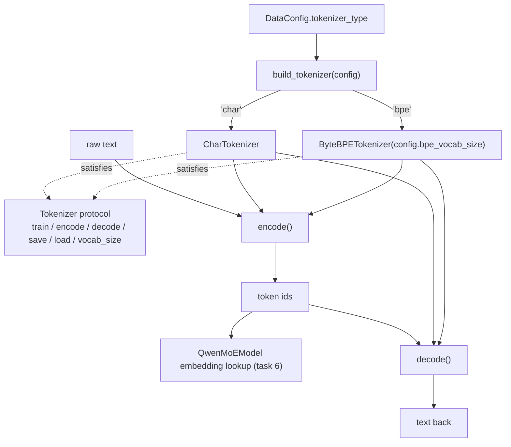
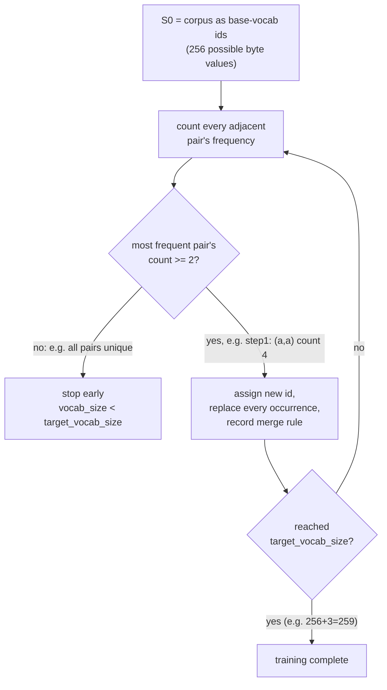
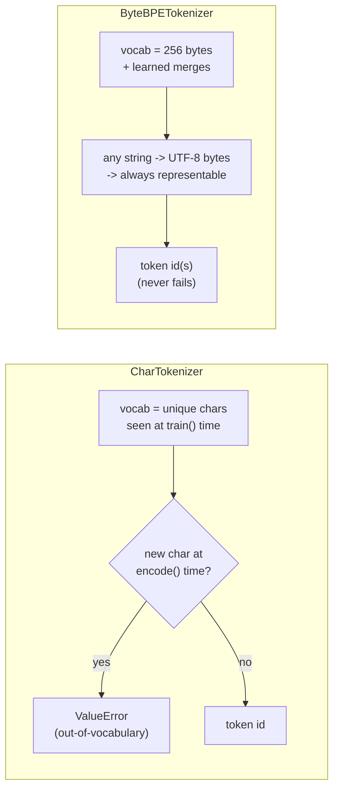

# 007 — Tokenizers (Task 7)

**Type:** task · **Date:** 2026-08-31 · **Related:** Requirements 4.2, 4.3;
design.md `tokenizer/` component

## What was implemented
- `qwenmoe/tokenizer/char.py::CharTokenizer` — vocab = every unique
  character seen during `train()`, sorted for a deterministic id
  assignment. `encode`/`decode` raise `ValueError` (not a raw `KeyError`)
  for an unknown character or an out-of-range token id, respectively.
  `save`/`load` persist the sorted character list as JSON.
- `qwenmoe/tokenizer/bpe.py::ByteBPETokenizer` — byte-level Byte-Pair
  Encoding (BPE), merge-pair learning loop implemented in this project (no
  `tokenizers`/`tiktoken` dependency). Base vocabulary is the 256 possible
  byte values; `train()` learns merges up to a `target_vocab_size` fixed at
  construction, greedily merging the most frequent adjacent pair each
  round (stopping early if the corpus runs out of pairs occurring more
  than once). `encode`/`decode` mirror `CharTokenizer`'s error-handling
  contract; `save`/`load` persist the learned merge list as JSON.
- `qwenmoe/tokenizer/base.py::Tokenizer` — a `typing.Protocol` formalizing
  the shared `train`/`encode`/`decode`/`save`/`load`/`vocab_size`
  interface design.md already described in prose, plus
  `build_tokenizer(config: DataConfig) -> Tokenizer`, a factory selecting
  between the two by `config.tokenizer_type` — mirroring the
  `build_expert`/`build_attention`/`build_balancer`/
  `build_positional_scheme` factories from tasks 3-6.
- 16 new tests across `tests/test_char_tokenizer.py` (7) and
  `tests/test_bpe_tokenizer.py` (9): lossless round-trips (including a
  substring of the trained corpus, and — BPE only — text containing
  Unicode characters never seen during training), unknown-character/
  out-of-range-id error handling, save/load round-trips, trained
  `vocab_size` reaching its configured target, `build_tokenizer` selecting
  the right class for each `tokenizer_type`.

## Design decisions worth calling out

**Added a `Tokenizer` Protocol + `build_tokenizer` factory, even though
tasks.md only asked for the two classes.** design.md already says both
tokenizers "implement a common `Tokenizer` protocol" in prose; every other
config-selectable component in this codebase (`build_expert`/
`build_attention`/`build_balancer`/`build_positional_scheme`) already
formalizes that exact pattern — a `typing.Protocol` plus a
`build_*(config) -> Protocol` factory raising `ValueError` on an
unrecognized value. Task 8 (data pipeline) will need exactly this to turn
a `DataConfig.tokenizer_type` into a live tokenizer, so adding it now
completes an already-established pattern rather than speculating ahead of
need.

**`ByteBPETokenizer`'s target vocab size is a constructor argument
(`target_vocab_size`), not a `train()` argument.** The shared `Tokenizer`
protocol's `train(text: str) -> None` signature (design.md) has no room
for a size parameter, and `DataConfig.bpe_vocab_size` is a config value
known before any text is seen — so it belongs at construction, mirroring
how `AlibiBias(n_heads)`/`RotaryEmbedding(head_dim, theta=...)` take their
config-derived shape at construction (tasks 3-4), not at `forward()` time.
This also makes the "target vs. achieved" distinction explicit:
`vocab_size` (the property) always reports what's *actually* in the
vocabulary right now — 256 immediately after construction (no merges
learned yet), and up to `target_vocab_size` after `train()`.

**`CharTokenizer` has no equivalent "target size" concept at all — its
vocab size is emergent, not configured.** Whatever unique characters
happen to appear in the training corpus become the entire vocabulary;
there's no way to ask for a *specific* character vocab size the way
`ByteBPETokenizer` lets you ask for a byte-vocab size. This asymmetry is
the main practical reason the project uses `CharTokenizer` only for the
(small, fixed-alphabet) tiny-Shakespeare smoke test and
`ByteBPETokenizer` for the TinyStories comparison study, where a
controlled, comparable vocab size across ablation runs matters
(Requirement 12.6).

**No GPT-2-style regex pre-tokenization.** Real byte-level BPE tokenizers
(GPT-2 onward) first split text into chunks with a regex (so a merge can
never span, say, the end of one word and the start of the next) before
running the merge loop within each chunk. This implementation runs the
merge loop over the *entire* raw byte stream with no such splitting —
simpler to implement and explain from scratch (this mirrors Karpathy's
`minbpe` `BasicTokenizer`, which makes the same simplification explicitly
for teaching purposes), at the cost of some vocab efficiency a production
tokenizer wouldn't accept. Nothing about correctness (round-trip
losslessness) depends on this choice — only how the merges happen to be
spent.

**A merge requires frequency >= 2, and training stops early rather than
erroring if the corpus runs out of such pairs before reaching
`target_vocab_size`.** Merging a pair that occurs exactly once cannot
help the model generalize (there's nothing else in the corpus for it to
generalize *to*), so it would just be spending a vocab slot arbitrarily.
This means `vocab_size` after `train()` is only *guaranteed* to equal
`target_vocab_size` when the corpus has enough internal repetition to
support that many merges — true for `tests/test_bpe_tokenizer.py`'s
repeated-sentence corpus, but worth remembering for smaller/
less-repetitive real corpora later.

**Tie-breaking during merge selection is left-to-right scan order, not
any semantic rule.** `max(pair_counts, key=pair_counts.get)` returns the
*first* pair (in the dict's insertion order, which follows a single
left-to-right pass over the sequence) that reaches the maximum count —
Python's `max` only replaces its running answer on a strictly greater
value, never on a tie. Traced by hand against the classic
`"aaabdaaabac"` toy example below, this turned out to matter: two pairs
are exactly tied 2-to-2 at one point, and which one wins is entirely this
scan-order artifact, not a "smarter" choice. It's still fully
deterministic (same corpus always trains to the same result — needed for
the save/load round-trip test to be meaningful at all), just not a
meaningful ranking beyond "frequency, then whichever was seen first."

**`decode` uses `errors="replace"`, not strict UTF-8 decoding.** For any
text that was actually produced by this tokenizer's own `encode`, the
reassembled bytes are guaranteed valid UTF-8 (round-trip losslessness
holds exactly). `errors="replace"` only matters for ids that didn't come
from a real `encode` call — e.g. arbitrary ids a not-yet-trained model
might sample during early generation (task 11) that don't happen to align
on a valid multi-byte character boundary. Matches the standard real-world
convention (GPT-2/tiktoken do the same) rather than crashing generation on
a decode of a nonsense sequence.

## Concepts explained for a complete beginner

### Tokenization
- **What it means:** turning raw text (a string of characters) into a
  sequence of integers a neural network can actually consume — and
  turning the network's output integers back into text. Neural networks
  only operate on numbers, never on text directly.
- **Why it exists:** an `nn.Embedding` layer (already used by
  `QwenMoEModel`, task 6) is fundamentally a lookup table indexed by
  integers — row `i` is token `i`'s vector. Something has to decide, once
  and for all, what the complete list of possible "row indices" (the
  **vocabulary**) is, and how to map any input string onto that fixed
  list of indices. That decision is exactly what a tokenizer makes.
- **Analogy:** a coat-check counter at a theater. You hand over your coat
  (a string); the attendant gives you back a numbered ticket (a token id)
  that stands in for it. Later, handing back the same ticket retrieves
  the exact same coat (decoding). The vocabulary is the fixed set of
  ticket numbers the counter is prepared to issue — if the counter only
  has 50 hooks, it can only issue 50 distinct tickets.
- **Simple technical explanation:** `encode: str -> list[int]`,
  `decode: list[int] -> str`, where the specific mapping is learned from
  a corpus during `train(text)` rather than fixed in advance
  (Requirement 4.2).
- **How it relates here:** every token id `CharTokenizer`/
  `ByteBPETokenizer` produces becomes a row index into `QwenMoEModel`'s
  embedding table (task 6); `ModelConfig.vocab_size` must equal whichever
  tokenizer's `vocab_size` a given run actually uses.

### The out-of-vocabulary (OOV) problem
- **What it means:** what should happen when `encode` sees a character/
  word that was never present in the training corpus, so it has no
  assigned token id?
- **Why it exists:** any tokenizer whose vocabulary is a *fixed, finite*
  list built from one corpus will eventually meet text from *outside*
  that corpus (a different language, an emoji, a typo). Something must
  happen — silently guessing is dangerous because it corrupts the input
  the model actually sees.
- **Analogy:** back at the coat check — someone shows up with a bicycle,
  not a coat. There's no hook for it. The honest answer is "sorry, I
  can't check that here," not silently handing them a random ticket for
  someone else's coat.
- **How it relates here:** `CharTokenizer.encode` raises `ValueError`
  immediately on an unseen character (Requirement 4.3's decode-
  losslessness is scoped to "all characters in the corpus", not the
  entire Unicode standard) — this is *exactly* the problem byte-level BPE
  sidesteps entirely (see below), which is why `ByteBPETokenizer`, not
  `CharTokenizer`, is used for the more open-ended TinyStories comparison
  study.

### Byte-level: why bytes, not Unicode characters
- **What it means:** `ByteBPETokenizer`'s base vocabulary (before any
  merges) is the 256 possible **byte** values (0-255), not the (much
  larger, unbounded-in-practice) set of Unicode characters. Every string
  is first converted via `text.encode("utf-8")` into a sequence of these
  bytes; some Unicode characters take 1 byte (plain ASCII English
  letters), others take 2-4 bytes (accented letters, CJK characters,
  emoji).
- **Why it exists:** Unicode has over 149,000 assigned characters — an
  "OOV-free" character-level vocabulary would need an entry for every
  single one, most never seen in any one training corpus. Radford et al.
  (2019, the GPT-2 paper) observed that operating on the 256 raw bytes
  instead means the base vocabulary is small *and* every possible string
  — any language, emoji included — is representable with zero
  unknown-token cases, because literally any string is *some* sequence of
  bytes 0-255.
- **Analogy:** instead of stocking a coat hook for every conceivable
  garment type in the world (impossible), the coat check only ever deals
  in a fixed shipping-crate size (a byte) — any item, no matter how
  strange, can always be broken down into some number of same-size
  crates. Odd items just take more crates (more bytes) than a simple one
  would.
- **How it relates here:** `test_round_trip_lossless_for_unseen_unicode_text`
  encodes/decodes `"héllo wörld 你好 🎉"` — text containing characters that
  never appeared anywhere in `ByteBPETokenizer`'s training corpus — and it
  still round-trips perfectly, which would be structurally impossible for
  `CharTokenizer` on the same input.

### Byte-Pair Encoding (BPE): the merge algorithm
- **What it means:** starting from the base vocabulary (256 bytes),
  repeatedly find whichever *pair* of adjacent tokens occurs most often
  across the whole (converted-to-ids) corpus, and permanently merge every
  occurrence of that exact pair into one brand-new token — building up a
  vocabulary of increasingly long, increasingly common byte sequences
  (eventually whole common words, for a large enough corpus).
- **Why it exists:** Sennrich, Haddow & Birch (2015) originally proposed
  BPE (a decades-old data-compression algorithm) for machine translation
  as a middle ground between word-level tokenization (huge vocab, still
  hits unknown words) and character-level tokenization (tiny vocab, but
  every word becomes a long sequence of tokens, hard for a model to model
  long-range structure with). Repeatedly merging the most-frequent pair
  spends the fixed vocabulary budget on whatever substrings are *actually
  common* in this specific corpus.
- **Full derivation:** let $S_0$ be the corpus as a sequence of
  base-vocabulary ids (256 possible values), and let $\text{pairs}(S)$
  count, for every $i$, how often each ordered pair $(S[i], S[i+1])$
  occurs across the whole sequence. For merge round $t = 1, \dots, T$
  (where $T = \texttt{target\_vocab\_size} - 256$):
  1. Compute $\text{pairs}(S_{t-1})$.
  2. Let $(a^*, b^*) = \arg\max_{(a,b)} \text{pairs}(S_{t-1})[(a,b)]$
     (ties broken by whichever pair's dict entry was created first, i.e.
     leftmost first-occurrence in the corpus — see the design-decision
     note above).
  3. If $\text{pairs}(S_{t-1})[(a^*,b^*)] < 2$ (or no pairs remain at
     all), **stop early** — every remaining pair is unique, so no merge
     would help generalization.
  4. Assign new id $v_t = 255 + t$; replace every non-overlapping
     left-to-right occurrence of $(a^*, b^*)$ in $S_{t-1}$ with $v_t$ to
     get $S_t$; record the merge rule $(a^*, b^*) \to v_t$.
  5. `vocab_size` after training is
     $256 + (\text{number of rounds actually completed}) \le
     \texttt{target\_vocab\_size}$.

  `encode(text)` on new text replays the *same* learned rules, in the
  *same* priority order (lowest $v_t$ first — i.e. earliest-learned
  merges apply first, since a later merge's pair may not even exist until
  an earlier merge produces it), repeating until no known rule's pair
  remains adjacent anywhere in the sequence.
- **Worked numeric example** *(the classic textbook toy corpus, traced
  through this project's actual code, not just asserted)*: train on
  `"aaabdaaabac"` (11 bytes: `a=97, b=98, c=99, d=100`) with
  `target_vocab_size = 256 + 3` (3 merge rounds):

  | Step | Sequence (tokens) | Pair counts | argmax (count) | New token |
  |------|---|---|---|---|
  | 1 | `a-a-a-b-d-a-a-a-b-a-c` (11 tokens) | (a,a)=4, (a,b)=2, (b,d)=1, (d,a)=1, (b,a)=1, (a,c)=1 | (a,a), count 4 | id `256` = `"aa"` |
  | 2 | `aa-a-b-d-aa-a-b-a-c` (9 tokens) | (aa,a)=2, (a,b)=2 *(tie!)*, (b,d)=1, (d,aa)=1, (b,a)=1, (a,c)=1 | (aa,a), count 2 *(wins the tie — its dict entry was created first, at position 0)* | id `257` = `"aaa"` |
  | 3 | `aaa-b-d-aaa-b-a-c` (7 tokens) | (aaa,b)=2, (b,d)=1, (d,aaa)=1, (b,a)=1, (a,c)=1 | (aaa,b), count 2 | id `258` = `"aaab"` |

  Final sequence: `aaab-d-aaab-a-c` — **5 tokens**, down from the original
  11 bytes, using a 259-entry vocabulary (256 base + 3 learned merges).
  Encoding `"aaabdaaabac"` again from scratch with the trained tokenizer
  replays these exact 3 rules and produces `[258, 100, 258, 97, 99]` —
  `258`("aaab"), `100`("d"), `258`("aaab"), `97`("a"), `99`("c") — which
  decodes byte-for-byte back to the original string.
- **How it relates here:** `qwenmoe/tokenizer/bpe.py::_count_pairs`/
  `_merge_pair`/`ByteBPETokenizer.train` implement exactly these five
  steps; `ByteBPETokenizer.encode` implements the priority-ordered replay
  described above.
- **Paper:** [Neural Machine Translation of Rare Words with Subword Units (Sennrich, Haddow & Birch, 2015)](https://arxiv.org/abs/1508.07909)
  (introduces BPE for NLP); byte-level extension:
  [Language Models are Unsupervised Multitask Learners (Radford et al., 2019 — the GPT-2 paper)](https://d4mucfpksywv.cloudfront.net/better-language-models/language-models.pdf).
- **Blog:** [Byte-Pair Encoding tokenization (Hugging Face LLM Course)](https://huggingface.co/learn/llm-course/en/chapter6/5);
  reference implementation used as a design touchstone for this
  from-scratch version: [karpathy/minbpe](https://github.com/karpathy/minbpe).

## Diagrams

Where each tokenizer fits, and how `build_tokenizer` selects one:

The BPE training loop (values from the worked example above):

Byte-level coverage vs. `CharTokenizer`'s fixed character vocab:

## Questions that might come to mind
- **Why does `ByteBPETokenizer` work at all before `train()` is called?**
  Its base vocabulary (all 256 byte values) is populated in `__init__`,
  not `train()` — so `encode`/`decode` always work in degenerate
  "every byte is its own token" mode even with zero learned merges;
  `train()` only ever adds *additional* multi-byte tokens on top of that
  always-present base.
- **Could `vocab_size` end up bigger than `target_vocab_size`?** No —
  training performs at most `target_vocab_size - 256` merge rounds and
  each round adds exactly one id, so `vocab_size` is always
  `<= target_vocab_size`, and `< target_vocab_size` only if the corpus ran
  out of repeated pairs first.
- **Does merge order matter for `encode`, or just which merges exist?**
  Order matters. `encode` must try the *earliest-learned* applicable
  merge first at every step, because a later merge's pair (e.g.
  `(aaa, b)` above) can't even appear in the sequence until the earlier
  merge that produces `aaa` has already been applied.
- **Does token `256` ("aa") ever actually appear in an encoded output, or
  is it just a stepping stone?** It's a real, directly usable vocabulary
  entry, not just an intermediate — it just doesn't survive to the final
  encoding of `"aaabdaaabac"` specifically, because every `"aa"` there
  happens to be followed by more mergeable content. Verified directly:
  encoding a *different* string, `"aad"`, with this same trained
  tokenizer gives `[256, 100]` — token `256` ("aa") used directly,
  followed by `100` ("d").
- **What would change if this project pre-tokenized with a regex like
  real GPT-2 does?** Merges would never be learned or applied across a
  whitespace/word boundary, generally improving vocab efficiency (fewer
  vocab slots "wasted" on boundary-crossing substrings) — but it's a pure
  quality-of-training-data concern, not a correctness one; the
  round-trip-losslessness guarantee this task tests is unaffected either
  way.

## Outcome
`uv run pytest tests/ -q` — 86 passed (70 from tasks 1-6 plus 16 new).
Task 7 checked off.
