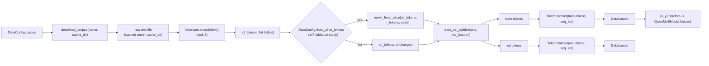
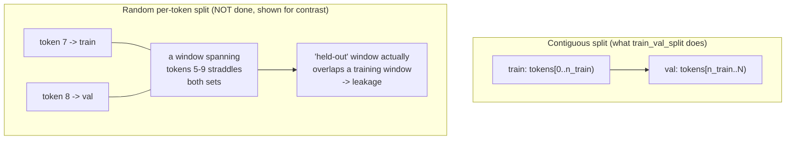
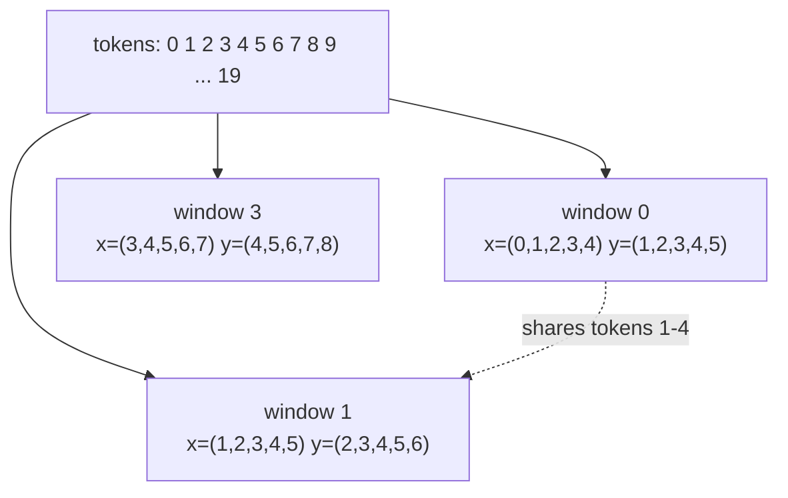
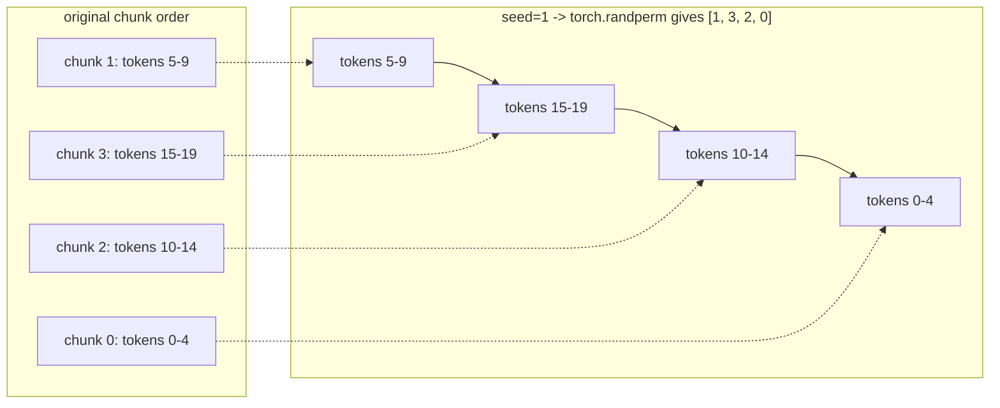
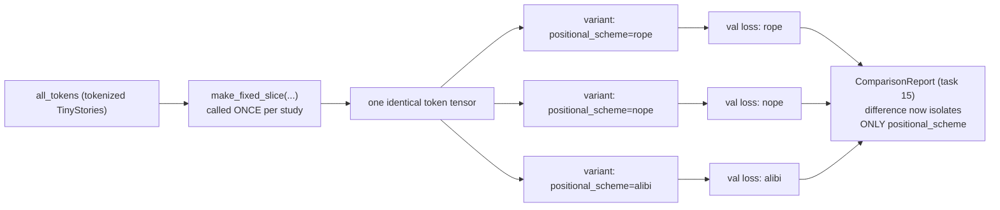

# 008 — Data Pipeline (Task 8)

**Type:** task · **Date:** 2026-08-31 · **Related:** Requirements 4.1, 4.4,
11.5, 12.6; design.md `data/` component

> **Full by-hand derivation:** [`docs/math/008-data-pipeline.md`](../docs/math/008-data-pipeline.md)
> carries one concrete 24-token, four-document stream through *every* line
> of `qwenmoe/data/dataset.py` — `train_val_split` (contiguous `tail`
> flooring and whole-document `documents` mode), `_document_ids` as a
> prefix sum, `_split_into_documents`, `TokenDataset`'s `N − seq_len`
> window count and shift-by-one `(x, y)`, and `make_fixed_slice`'s
> chunk-size formula, seeded Fisher–Yates `randperm`, and concat/truncate
> — solved digit by digit to the first `(2, 4)` batch and checked against
> the real module by [`docs/math/verify_008_data_pipeline.py`](../docs/math/verify_008_data_pipeline.py).

## What was implemented
- `qwenmoe/data/download.py::download_corpus(name, cache_dir) -> Path` —
  the project's only network-touching function. `"tiny_shakespeare"` fetches
  a direct ~1.1MB HTTPS text file (Karpathy's char-rnn release); the file is
  cached at `cache_dir/tiny_shakespeare.txt` and re-downloaded only if that
  path doesn't already exist. `"tiny_stories"` uses
  `huggingface_hub.hf_hub_download` to fetch one plain-text release file
  (`TinyStoriesV2-GPT4-valid.txt`, ~22.5MB) from the TinyStories dataset
  (Eldan & Li, 2023), passing `cache_dir` straight through so
  `huggingface_hub`'s own on-disk cache lives under `DataConfig.cache_dir`
  too. Both branches verified manually end-to-end (real downloads, not
  mocked) — see Outcome.
- `qwenmoe/data/dataset.py::TokenDataset(Dataset)` — yields fixed-length
  `(x, y)` windows for next-token prediction from a flat token stream
  (Requirement 4.4).
- `qwenmoe/data/dataset.py::train_val_split(tokens, val_fraction=0.1) ->
  (train, val)` — the "train/val split helper" from task 8.1, a contiguous,
  order-preserving split (last `val_fraction` of tokens held out).
- `qwenmoe/data/dataset.py::make_fixed_slice(all_tokens, n_tokens, seed) ->
  Tensor` — reproducibly selects `n_tokens` from `all_tokens` by splitting
  into fixed-size chunks, shuffling chunk order once with `seed`, then
  concatenating and truncating (Requirements 11.5, 12.6).
- 18 new tests: `tests/test_dataset.py` (12, task 8.1 — window shapes/
  content, dtype, invalid-argument errors, real `DataLoader` batching,
  split proportions/contiguity/invalid-fraction errors) and
  `tests/test_fixed_slice.py` (6, task 8.2 — same-seed determinism,
  different-seed divergence verified concretely for the chosen fixture,
  requested-length, within-chunk order preservation, invalid-argument
  errors).
- Added `.cache/` to `.gitignore` (downloaded/cached corpora are
  regeneratable via `download_corpus`, same rationale as the existing
  `media/` entry for Manim render output).

## Design decisions worth calling out

**TinyStories corpus file: `TinyStoriesV2-GPT4-valid.txt`, not
`TinyStories-train.txt`.** The dataset's own README says the paper's actual
models were trained on the full `TinyStories-train.txt` — but that file is
1.92GB. Downloading almost 2GB just to (per Requirement 11.5/12.6) take a
*fixed slice* out of it would be wasted bandwidth, and this project's
from-scratch `ByteBPETokenizer` (task 7) — a pure-Python merge-replay loop
with no C/Rust acceleration — would take an impractically long time to
train over hundreds of millions of raw characters. The 22.5MB
`TinyStoriesV2-GPT4-valid.txt` is a real, standalone released file (not a
manual truncation of the big one, so nothing about the text itself is
altered), small enough to download and BPE-tokenize quickly on a laptop,
and "V2" specifically means every story was generated by GPT-4 alone — the
original/V1 file mixes in lower-quality GPT-3.5 generations, which the
dataset's own README flags as the reason V2 exists at all. Whether this
much raw text is *enough* unique tokens for a specific comparison run's
token budget is a downstream, per-run concern (task 9.2's epoch-repetition
warning), not something `download_corpus` itself needs to guarantee.

**`make_fixed_slice`'s "documents" are fixed-size chunks of the already-
tokenized stream, not real story boundaries.** design.md describes the
function as shuffling "document boundaries" — and real document boundaries
do exist in the raw TinyStories text (each story is separated by a literal
`<|endoftext|>` marker, confirmed by inspecting the downloaded file
directly). But `make_fixed_slice(all_tokens, n_tokens, seed)`'s only input
is `all_tokens` — a flat list/tensor of ids produced *after* `encode()` has
already run over the whole corpus, with no story-boundary metadata
preserved alongside it. Recovering the real boundaries would mean either
teaching every tokenizer to also emit boundary offsets (a bigger, more
invasive change touching task 7's already-finished, already-tested
interface) or re-scanning decoded text for a magic marker string (fragile,
and specific to one corpus's convention). Fixed-size chunking is a
pragmatic, corpus-agnostic approximation of the same underlying goal —
reorder coarse spans so **within**-span local structure survives intact,
and only the order spans appear in is randomized. The alternative this
avoids is a *literal per-token* shuffle, which would destroy local word
order entirely (every token's neighbors become random) and produce
training data no next-token predictor could learn anything real from.

**Chunk size scales with input length (`max(1, min(1024, numel // 4))`),
rather than a fixed constant.** A hard-coded constant like 1024 would
silently degenerate to a single "chunk" for any `all_tokens` shorter than
that (correctness-critical: with exactly one chunk, shuffling is a no-op
for *every* seed, since there's only one possible order) — which would
have made the very determinism/seed-divergence tests this task requires
either impossible to write meaningfully or accidentally vacuous for a
small in-memory test fixture. Dividing by 4 guarantees at least ~4 chunks
whenever there are at least 4 tokens, while still capping at a sensible
1024-token ceiling for real multi-million-token corpora.

**`train_val_split` takes the *last* fraction as validation, via a
contiguous split — not a random per-token split.** `TokenDataset`'s windows
overlap (window $i$ and window $i{+}1$ share `seq_len - 1` tokens). If
individual tokens were assigned to train/val at random, many "validation"
windows would straddle the boundary and overlap tokens the model already
saw as part of a training window it directly optimized on — leaking
information and making the validation loss look better than true
generalization. A single contiguous cut only ever puts a handful of
boundary-straddling windows in an ambiguous position, not the entire
dataset. See the diagram below.

**No automated test for `download_corpus` itself.** Both branches are real
network calls; task 8.1 only asks for `tests/test_dataset.py` "using a
small in-memory token list" — deliberately scoped away from network I/O.
Mocking `urllib`/`hf_hub_download` was considered and rejected: it would
mostly test that the mocks were wired correctly, not that the real URLs
still resolve to the right content. Instead, both branches were run for
real during this task (see Outcome) — the same "manually verify, don't
mock" convention already used for task 10.2's training CLI and task
13.6's Manim rendering CLI.

## Concepts explained for a complete beginner

### The data pipeline (raw text → model-ready batches)
- **What it means:** the fixed sequence of steps that turns a downloaded
  pile of raw text into the exact integer tensors
  `QwenMoEModel.forward(input_ids)` (task 6) expects, grouped into
  same-shape batches.
- **Why it exists:** a trained model only ever sees fixed-shape integer
  tensors — never raw strings. Something has to bridge "a text file on
  disk" and "a `(batch, seq_len)` tensor of token ids," exactly once, in
  one well-tested place, so every later piece of code (training loop,
  comparison runner) can just ask for batches without re-solving this.
- **Analogy:** a restaurant prep station. Whole ingredients (raw corpus)
  arrive, get washed and cut into uniform pieces (tokenized, then windowed
  into fixed-length chunks), and go out on standardized trays (batches)
  that any cook (the training loop) can pick up without ever needing to
  know which farm the ingredients came from.
- **Simple technical explanation:** `download_corpus` → `tokenizer.encode`
  (task 7) → optionally `make_fixed_slice` → `train_val_split` →
  `TokenDataset` → PyTorch `DataLoader` → `(x, y)` batches.
- **How it relates here:** this is exactly the `data/` box design.md's
  module-layout diagram already drew, now with real functions behind it,
  sitting between `tokenizer/` (task 7, upstream) and `train/trainer.py`
  (task 10, downstream, not yet built).

### Train/validation split
- **What it means:** dividing available tokens into two disjoint parts —
  one the model actually trains on, one used *only* to measure how well it
  performs on data it provably never trained on.
- **Why it exists:** a model's loss on data it has already trained on
  keeps improving even once it starts merely memorizing specific examples
  rather than learning a generalizable pattern. The only way to tell those
  two apart is to check performance on examples that were never available
  during training at all.
- **Analogy:** studying from a textbook's worked examples (train) versus
  sitting a final exam with different questions testing the same concepts
  (validation) — reciting the practice problems from memory verbatim
  proves nothing about whether the underlying material was understood.
- **Full derivation:** given `N` tokens and a fraction `val_fraction`
  $\in (0,1)$: $n_{val} = \lfloor N \times \text{val\_fraction} \rfloor$,
  $n_{train} = N - n_{val}$, $\text{train} = \text{tokens}[0 : n_{train}]$,
  $\text{val} = \text{tokens}[n_{train} : N]$.
  **Worked numeric example:** $N=100$, `val_fraction=0.1` ⇒
  $n_{val} = \lfloor 10.0 \rfloor = 10$, $n_{train}=90$ ⇒
  `train = tokens[0:90]`, `val = tokens[90:100]` (exactly what
  `test_train_val_split_is_order_preserving_and_contiguous` asserts).
- **Why contiguous, not random per-token:** see the design-decision note
  above — a random per-token split would let overlapping windows leak
  training tokens into "held-out" validation windows.
- **How it relates here:** `train_val_split`'s entire implementation.
- **Further reading:** this is standard ML methodology rather than one
  paper's original contribution; scikit-learn's
  [Cross-validation: evaluating estimator performance](https://scikit-learn.org/stable/modules/cross_validation.html)
  is a solid modern reference for the general idea this specializes for
  sequential, windowed data.

### Sliding-window next-token-prediction datasets
- **What it means:** turning one long, flat sequence of token ids into many
  small `(x, y)` training pairs, where `x` is `seq_len` consecutive tokens
  and `y` is that *same* span shifted one position later — "given these
  tokens, what comes immediately after each one?"
- **Why it exists:** `QwenMoEModel` is autoregressive — at every position it
  predicts the next token from everything before it — but it must operate
  on fixed-shape batches, not one arbitrarily long stream. Something must
  chop a (arbitrarily long) tokenized corpus into fixed-length,
  batchable pieces while still attaching the correct "next token" label to
  every single position.
- **Analogy:** flashcards cut from a book with a sliding template: card 1
  shows words 1-5 and asks "what's word 6?", card 2 shows words 2-6 and
  asks "what's word 7?" — each card reuses almost all the same text as its
  neighbor, just shifted by one word.
- **Full derivation:** for a flat token stream $t_0, t_1, \dots, t_{N-1}$
  and window length $L$ (`seq_len`), window $i$ for
  $i = 0, \dots, N-L-1$ is
  $x^{(i)} = (t_i, \dots, t_{i+L-1})$,
  $y^{(i)} = (t_{i+1}, \dots, t_{i+L})$ — i.e. $y^{(i)}_j = x^{(i)}_{j+1}$
  for $j < L-1$, and $y^{(i)}_{L-1} = t_{i+L}$. So `len(dataset) = N - L`.
  **Worked numeric example:** $N=20$ tokens $0,1,\dots,19$, $L=5$: window
  $i=3$ is $x^{(3)}=(3,4,5,6,7)$, $y^{(3)}=(4,5,6,7,8)$ — exactly what
  `test_token_dataset_windows_are_shifted_by_one` asserts.
- **How it relates here:** `TokenDataset.__getitem__`; `len(dataset) ==
  N - seq_len` is `TokenDataset.__len__`.
- **Paper:** [A Neural Probabilistic Language Model (Bengio et al., 2003)](https://www.jmlr.org/papers/volume3/bengio03a/bengio03a.pdf)
  (the original "predict the next token from a fixed preceding window with
  a neural net" formulation); the specific "one giant flat token stream,
  chopped into fixed-length training windows" convention this
  implementation follows directly traces to modern GPT-style pretraining,
  e.g. [Improving Language Understanding by Generative Pre-Training (Radford et al., 2018 — GPT-1)](https://cdn.openai.com/research-covers/language-unsupervised/language_understanding_paper.pdf).

### Compute-matched ablation comparisons (the fixed-slice trick)
- **What it means:** guaranteeing that every architecture variant being
  compared later (task 12/15 — RoPE vs. NoPE vs. ALiBi, SwiGLU vs. GEGLU
  vs. GELU, etc.) trains on the **exact same tokens, in the exact same
  order** — not just "the same dataset" in some loose sense, but a
  byte-for-byte identical training stream.
- **Why it exists:** if one variant happened to train on a luckier or
  harder subset of data purely by chance, any difference in its final
  validation loss could be explained by *that* random data difference
  rather than by the architectural change actually being studied —
  confounding the whole comparison. Requirements 11.5/12.6 exist
  specifically to remove this confound, so a comparison genuinely isolates
  one axis of change at a time — the essence of a controlled experiment.
- **Analogy:** an A/B test comparing two tomato fertilizers only proves
  anything if both groups get identical soil, water, and sunlight — if
  group A also happens to get more sunlight, no one can say whether it grew
  taller because of the fertilizer or the extra sun. `make_fixed_slice` is
  what guarantees "the same sunlight" for every architecture variant.
- **Simple technical explanation:** `make_fixed_slice(all_tokens, n_tokens,
  seed)` is called **once** per comparison study (not once per variant),
  with one fixed `n_tokens`/`seed` pair; the identical resulting tensor is
  then handed to every variant's own `Trainer` (task 10/15).
- **How it relates here:** this is Requirement 12.6's "identical fixed
  slice of tokens" and Requirement 11.5's "same configured token budget,"
  both satisfied by one function, called once, upstream of every variant.
- **Paper:** [Training Compute-Optimal Large Language Models (Hoffmann et al., 2022 — "Chinchilla")](https://arxiv.org/abs/2203.15556)
  (token-budget-matching is meaningful precisely because token budget
  itself is derived from scaling-law reasoning, entry 001); see also
  [Unified Scaling Laws for Routed Language Models (Clark et al., 2022)](https://arxiv.org/abs/2202.01169)
  for how this reasoning shifts specifically for MoE models.

## Diagrams

The full pipeline, from a `DataConfig` to model-ready batches:

Why the train/val split must be contiguous, not a random per-token split
(overlapping windows would otherwise leak):

Sliding windows over a 20-token stream (`seq_len = 5`) — each window shares
4 of 5 tokens with its neighbor:

`make_fixed_slice`'s chunk-shuffle, traced through the actual code
(`torch.Generator().manual_seed(1)`, 20 tokens, `chunk_size=5` ⇒ 4 chunks):

Why a fixed slice makes an architecture comparison actually fair — every
variant sees the identical data, so any loss difference must come from the
one thing that changed:

## Questions that might come to mind
- **Why does `make_fixed_slice` refuse `n_tokens` greater than the
  available token count instead of just repeating/wrapping around?**
  Repetition-over-budget is a distinct, already-planned concern (task
  9.2's `epochs_for_budget` and its >4-epochs warning). `make_fixed_slice`
  has exactly one job — fixing *which* underlying tokens are eligible for
  a comparison study — and keeping that job separate from "how many times
  does the trainer loop back over them" keeps both pieces simple and
  independently testable.
- **Does `TokenDataset` know anything about `make_fixed_slice` or
  `DataConfig.fixed_slice_tokens`?** No — `TokenDataset` only ever windows
  whatever token tensor it's handed, whether that's an entire corpus or an
  already-restricted fixed slice. Wiring `DataConfig`'s fields together
  into an actual call sequence happens in task 10.2's `prepare_data.py`/
  `train.py`, not here; keeping `TokenDataset` agnostic means it needs no
  changes at all once that wiring exists.
- **What stops `download_corpus` from silently reusing a half-downloaded,
  corrupted `tiny_shakespeare.txt`?** Nothing does, currently — the check
  is a plain `dest.exists()`. A partial download from an interrupted run
  would be treated as "already cached" on the next call. Worth remembering
  if a future run ever sees mysteriously truncated training text; the fix
  would be deleting the cached file and re-running (`hf_hub_download`'s
  own branch doesn't have this problem — it does its own integrity
  checking internally).
- **Why is TinyStories' 22.5MB file okay when Requirement 4.1 caps the
  corpus at "under 10MB"?** That cap is scoped explicitly to the
  *default*, smoke-test corpus (tiny Shakespeare, 1.1MB, comfortably under
  it) — TinyStories is the separate, explicitly-larger comparison-study
  tier described in the Assumptions section, not bound by the same number.
- **Could two different seeds ever produce the same slice by
  coincidence?** Yes, in principle — `make_fixed_slice` only guarantees
  *determinism* (same inputs ⇒ same output every time), not that every
  pair of distinct seeds differs. With only 4 chunks (as in the 20-token
  worked example above), there are just $4! = 24$ possible orderings, so
  collisions across arbitrary seed pairs are quite possible — confirmed
  directly: seed 0 and seed 2 happen to land on the identical ordering for
  the 200-token fixture used elsewhere. `test_make_fixed_slice_differs_
  across_seeds` uses seeds 0 and 1 specifically because that pair was
  checked to actually differ for its fixture, not asserted on faith.

## Outcome
Manually verified both `download_corpus` branches for real: tiny
Shakespeare downloaded 1,115,394 bytes matching the expected opening line
("First Citizen:..."); TinyStories downloaded and reconstructed
`TinyStoriesV2-GPT4-valid.txt` (22,502,601 bytes) via `huggingface_hub`,
confirming real story text separated by `<|endoftext|>` markers.

`uv run pytest tests/ -q` — 104 passed (86 from tasks 1-7 plus 18 new).
Task 8 checked off.
