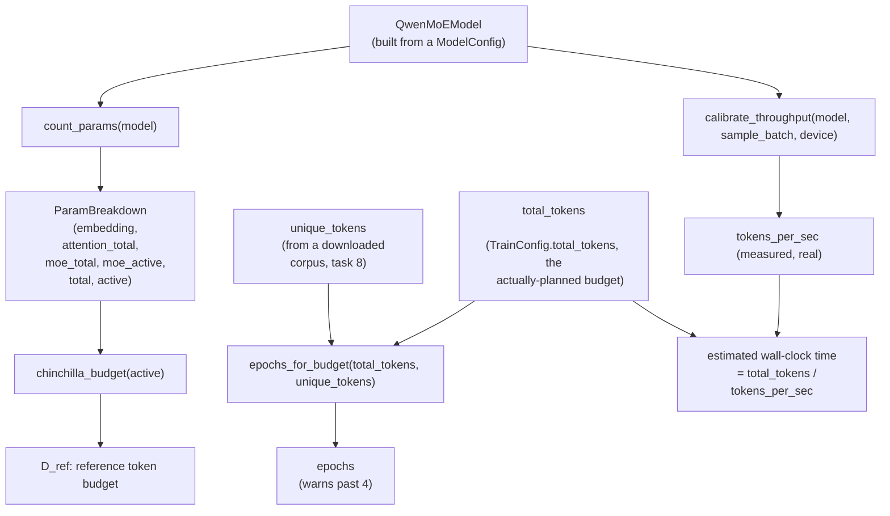
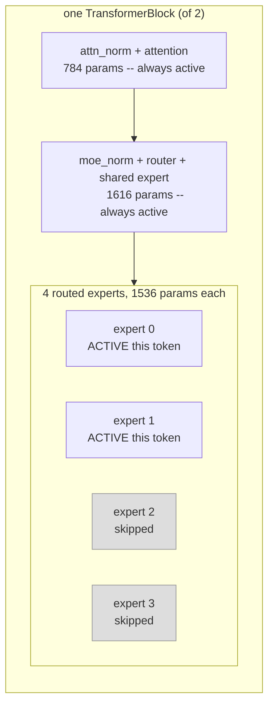
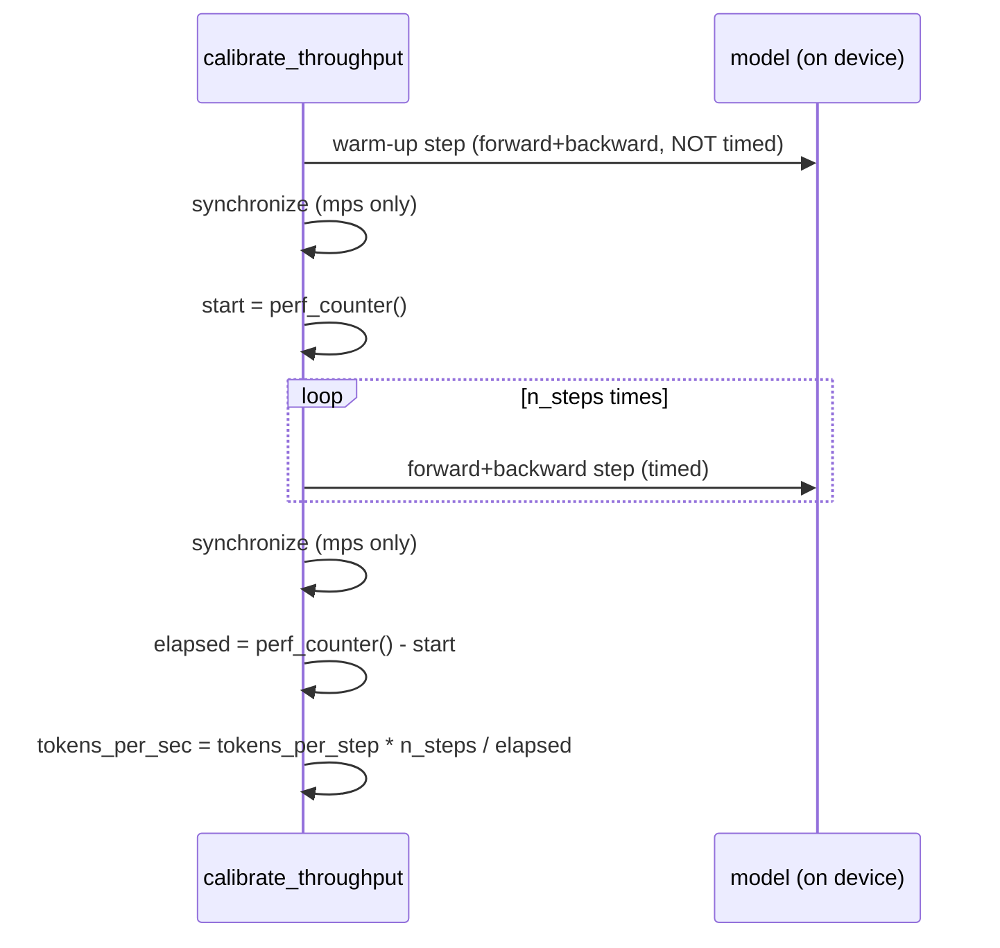

# 009 — Scaling-Law Utilities (Task 9)

**Type:** task · **Date:** 2026-08-31 · **Related:** Requirements 11.1-11.4;
design.md `train/scaling.py` component

> **Full by-hand derivation:** [`docs/math/009-scaling-law-utilities.md`](../docs/math/009-scaling-law-utilities.md)
> carries one 46-tensor toy MoE model through every line of
> `qwenmoe/train/scaling.py` — `count_params`' per-bucket walk (with the
> `total − active = L(E−k)·P_expert` identity and an independent
> raw-dedup'd cross-check), `chinchilla_budget`'s constant-ratio algebra
> vs. the empirical 20, `moe_budget_note`, `epochs_for_budget`'s strict
> `> 4` warning, and `calibrate_throughput`'s `batch·seq·n_steps / elapsed`
> (verified exactly with a monkeypatched clock) — to an end-to-end
> `active → D_ref → epochs` and wall-clock estimate, every number checked
> against the real module by [`docs/math/verify_009_scaling_law_utilities.py`](../docs/math/verify_009_scaling_law_utilities.py).

## What was implemented
- `qwenmoe/train/scaling.py::ParamBreakdown` — a dataclass with
  `embedding`, `attention_total`, `moe_total`, `moe_active`, `total`,
  `active` fields (Requirement 11.1), per design.md's Data Models section.
- `qwenmoe/train/scaling.py::count_params(model) -> ParamBreakdown` —
  walks a real `QwenMoEModel`'s submodules and buckets every parameter
  tensor into the fields above, correctly handling tied embeddings (not
  double-counted) and MoE's total-vs-active split (Requirement 11.1).
- `qwenmoe/train/scaling.py::chinchilla_budget(active_params) -> int` —
  `20 * active_params` (Requirement 11.2); the derivation for *why* 20 is
  the right kind of number was already done in full in entry 001, so this
  task is just that formula's first real call site.
- `qwenmoe/train/scaling.py::calibrate_throughput(model, sample_batch,
  device, n_steps=20) -> float` — runs real forward+backward training
  steps and times them with `time.perf_counter()`, returning measured
  tokens/sec (Requirement 11.4).
- `qwenmoe/train/scaling.py::epochs_for_budget(total_tokens, unique_tokens)
  -> float` — `total_tokens / unique_tokens`, logging a warning past 4
  epochs via a module-level `logging.getLogger(__name__)` (Requirement
  11.3; entry 001 already derived the epoch formula and the Muennighoff et
  al. threshold in full).
- 12 new tests in `tests/test_scaling.py`: `count_params` against a fully
  hand-computed value for a tiny config (plus a cross-check against a raw,
  dedup'd sum of `model.parameters()`), `chinchilla_budget`'s arithmetic
  and a non-positive-input guard, `epochs_for_budget`'s arithmetic and its
  warning firing past 4 but not at/below it (via `caplog`), and
  `calibrate_throughput` returning a positive finite number on `cpu` plus
  rejecting `n_steps < 1`.

## Design decisions worth calling out

**No separate `router` field in `ParamBreakdown`, despite Requirement
11.1 listing "router" as its own breakdown category.** design.md's actual
`ParamBreakdown` dataclass (the finalized artifact) only has `embedding`/
`attention_total`/`moe_total`/`moe_active`/`total`/`active` — no `router`
field. Rather than silently disagreeing with either document, the router
is folded into `moe_total`/`moe_active` (it's always fully active — every
token uses 100% of the router's weight matrix to produce its logits, even
though only the top-k *output* values end up mattering downstream) since
that's the more precise, code-level source of truth this task actually
builds against. This is called out explicitly here rather than left as a
silent discrepancy.

**Where do RMSNorm weights and the final norm go?** Neither
Requirement 11.1 nor design.md's dataclass mentions normalization layers
at all, but every `RMSNorm` has a real, if small, learnable weight vector
(task 3) that has to end up *somewhere* for `total`/`active` to be
genuinely exhaustive. The rule adopted: a norm folds into whichever
sublayer it immediately precedes — `attn_norm` into `attention_total`,
`moe_norm` into `moe_total`/`moe_active` — since pre-norm wiring
(task 6) makes each norm structurally part of the sublayer it feeds. The
one norm with no sublayer to attach to, `final_norm` (applied once, after
the last block, before the LM head), is bundled into `embedding` instead,
alongside the token embedding table and (only when
`tie_word_embeddings=False`) the separate output-head weight — together
these are exactly "the once-per-model input/output machinery that sits
outside every repeated `TransformerBlock`," a clean partition with zero
leftover: `total == embedding + attention_total + moe_total` holds
exactly, with no unaccounted-for parameter anywhere (verified directly —
see Outcome).

**"Active" experts are counted as `top_k` whole experts, not a
`top_k / n_routed_experts` *fraction* of expert parameters.** These give
the same total only when every expert is identically sized (true here,
since `build_expert` always constructs uniform experts for a given
config) — but conceptually they're different claims. "A fraction of the
parameters" would imply each expert is partially used; what actually
happens is `top_k` *entire* experts run and `n_routed_experts - top_k`
don't run *at all* for a given token (task 5's `MoELayer.forward` calls
`expert(x_flat[token_idx])` per whole expert, never partially). The
implementation reflects the real mechanism: `routed_total // len(...)`
recovers one expert's exact parameter count, then multiplies by `top_k`
directly, rather than taking `routed_total * top_k / n_routed_experts`
(same arithmetic result here, different — and less accurate — story if
experts were ever allowed to differ in size).

**`calibrate_throughput` runs a full forward+backward step, not just a
forward pass, and includes one untimed warm-up step.** Requirement 11.4 is
about estimating *training* wall-clock time, and a training step's cost is
dominated by both passes, not just the forward one — timing only the
forward pass would systematically underestimate real per-step cost,
defeating the entire point of measuring empirically instead of guessing.
The warm-up step exists because the very first call into a given backend
often pays a one-time cost unrelated to steady-state throughput (MPS's
first Metal shader compilation being the concrete case on this project's
actual hardware); without discarding it, a small `n_steps` would have that
fixed cost smear across very few timed iterations and bias the estimate
low. `torch.mps.synchronize()` is also called before/after timing (only
when `device == "mps"`) since MPS dispatches work asynchronously — without
it, `time.perf_counter()` would mostly measure how fast commands get
*queued*, not how long the GPU actually took to finish them, silently
inflating the reported tokens/sec.
- **Idea considered and rejected:** accepting an already-built
  `torch.optim.Optimizer` and calling `.step()` too, for even closer
  parity with a real training loop. Rejected because design.md's own
  signature is `calibrate_throughput(model, sample_batch, device,
  n_steps=20)` — no optimizer argument — and because AdamW's per-step cost
  is a small, roughly constant overhead independent of model
  architecture, so omitting it doesn't meaningfully change the measured
  *architecture-dependent* throughput this function exists to estimate.

**`epochs_for_budget` uses a named logger
(`logging.getLogger(__name__)`), not a bare `logging.warning(...)` call.**
Requirement 11.3's literal wording says "logging a `logging.warning`" —
read as "log at WARNING level," which a named per-module logger still
does; it's the standard library's own recommended pattern for anything
other than one-off scripts, since it lets a caller (like the future
`Trainer`) filter or redirect `qwenmoe.train.scaling`'s messages
independently of the root logger. `pytest`'s `caplog` fixture captures
both forms identically, so nothing about testability was traded away.

## Concepts explained for a complete beginner

### Total vs. active parameters, and how `count_params` actually counts them
- **What it means:** *total* parameters is every learnable number that
  exists anywhere in the model, whether or not a specific token's forward
  pass ever touches it; *active* parameters is only the numbers that a
  single token's forward pass actually multiplies against.
- **Why it exists:** for a normal ("dense") network these two numbers are
  identical — every parameter is used for every token, so there's nothing
  to distinguish. A Mixture-of-Experts layer (task 5) breaks that equality
  on purpose: it deliberately keeps far more capacity *installed* (many
  experts) than any single token *uses* (only `top_k` of them), so a model
  can be simultaneously "large" (lots of stored knowledge, `total`) and
  "cheap to run" (small per-token compute, `active`). Reporting only one
  number would hide half of that trade-off.
- **Analogy:** a hospital's total headcount (every doctor on staff, all
  specialties) versus how many doctors any one patient actually sees
  during a single visit (a handful, chosen by triage) — the hospital's
  *capability* scales with total staff, but any one visit's *cost* scales
  with who was actually consulted.
- **Simple technical explanation:** walk every submodule once, add its
  parameter count to the right bucket; for the routed-expert bucket, add
  every expert to `moe_total` but only `top_k` experts' worth of
  parameters to `moe_active`, since the other `n_routed_experts - top_k`
  never ran for that token at all.
- **How it relates here:** `count_params(model) -> ParamBreakdown`,
  used to compute the `active_params` that `chinchilla_budget` needs, and
  (later, task 10) to log a run's actual size before training starts.
- **Paper:** [Mixtral of Experts (Jiang et al., 2024)](https://arxiv.org/abs/2401.04088)
  — reports exactly this split for a real, shipped model ("47B total
  parameters, but only uses 13B active parameters per token"), the modern
  standard way MoE model cards are reported; see also
  [Outrageously Large Neural Networks: The Sparsely-Gated Mixture-of-Experts Layer (Shazeer et al., 2017)](https://arxiv.org/abs/1701.06538)
  for where the underlying routed-sparsity idea originates.
- **Full derivation** (using $L$ layers, $E$ routed experts/layer, $k$ =
  `top_k`, and $P_{\text{expert}}$ = parameters in one routed expert,
  assumed uniform — guaranteed by `build_expert` building every expert
  from the same config):
  $$P_{\text{total}} = P_{\text{emb}} + \sum_{\ell=1}^{L}\Big(P_{\text{attn}}^{(\ell)} + P_{\text{moe,dense}}^{(\ell)} + E \cdot P_{\text{expert}}^{(\ell)}\Big)$$
  $$P_{\text{active}} = P_{\text{emb}} + \sum_{\ell=1}^{L}\Big(P_{\text{attn}}^{(\ell)} + P_{\text{moe,dense}}^{(\ell)} + k \cdot P_{\text{expert}}^{(\ell)}\Big)$$
  where $P_{\text{moe,dense}}^{(\ell)}$ = that layer's `moe_norm` + router
  + shared-experts parameters (always fully active — Requirement 2.1's
  shared experts, unlike routed ones, run for every token). Subtracting:
  $$P_{\text{total}} - P_{\text{active}} = \sum_{\ell=1}^{L}(E - k)\cdot P_{\text{expert}}^{(\ell)}$$
  — exactly the routed-expert weight that exists but is *never* touched by
  any single token's forward pass, the whole point of the split.
  **Worked numeric example** (this project's actual
  `tests/test_scaling.py` fixture: `d_model=16`, `n_heads=4`,
  `n_kv_heads=2`, `d_ff=32`, `n_layers=2`, `n_routed_experts=4`,
  `n_shared_experts=1`, `top_k=2`, `vocab_size=50`, tied embeddings,
  SwiGLU activation, `head_dim = 16/4 = 4`):
  - Embedding bucket: table $50\times16=800$ + final norm $16$ = **816**.
  - Per-layer attention: norm $16$ + $w_q$ $(16\times16=256)$ + $w_k$
    $(16\times8=128)$ + $w_v$ $(128)$ + $w_o$ $(16\times16=256)$ = $784$;
    over 2 layers = **1568**.
  - One SwiGLU expert: gate $(16\times32=512)$ + up $(512)$ + down
    $(32\times16=512)$ = $1536$ parameters.
  - Per-layer MoE dense part: norm $16$ + router $(16\times4=64)$ + 1
    shared expert $(1536)$ = $1616$.
  - `moe_total` per layer = $1616 + 4\times1536 = 7760$; over 2 layers =
    **15520**. `moe_active` per layer = $1616 + 2\times1536 = 4688$; over
    2 layers = **9376**.
  - `total` = $816+1568+15520=$ **17904**. `active` =
    $816+1568+9376=$ **11760**.
  Every one of these numbers is asserted directly in
  `test_count_params_matches_hand_computed_value_for_tiny_config`, and
  cross-checked a second, independent way against a raw dedup'd sum of
  `model.parameters()` in the following test — both agree exactly.
  **Real (non-toy) numbers**, this project's actual `BASELINE` preset,
  computed live in a terminal for this entry (see Outcome): `total =
  23,477,504` and `active = 9,321,728` — matching requirements.md's
  "≈23.5M total / ≈9.3M active" estimate almost exactly, now backed by an
  exact, tested computation rather than a rough estimate.

### Chinchilla reference budget and the epoch/repetition warning (brief — already derived in entry 001)
Both concepts — *why* $D_{\text{ref}} \approx 20 \times$ active
parameters, and *why* repeating a dataset past ~4 epochs has sharply
diminishing returns — were derived in full in entry 001 (the compute-optimal
calculus, the fitted-vs-exact distinction, and worked toy numbers), before
either function existed. This task is where both formulas get a real,
callable, tested home: `chinchilla_budget(active_params) = 20 *
active_params`, and `epochs_for_budget(total_tokens, unique_tokens) =
total_tokens / unique_tokens` (warning past 4). Concretely, for this
project's `BASELINE` preset (see Outcome): `chinchilla_budget(9_321_728) =
186_434_560` — and running that same reference budget against just the
1.1M-token tiny-Shakespeare smoke-test corpus gives `epochs_for_budget(...)
= 169.49`, which correctly fires the warning by a huge margin. That's not
a bug — it's exactly *why* requirements.md's three-tier corpus plan
(entry 001) exists: the smoke-test corpus was never meant to absorb a
full Chinchilla-sized budget, only to prove the pipeline runs; the
TinyStories fixed slice (task 8) is the tier actually sized for this.

### Empirical throughput calibration (measured tokens/sec, not a FLOPs estimate)
- **What it means:** actually running the model for a handful of real
  training steps on the real device and timing them with a wall clock,
  instead of computing a theoretical "should be this fast" number from
  FLOPs counts and a hardware spec sheet.
- **Why it exists:** a theoretical estimate assumes hardware runs at its
  advertised peak speed, which real workloads essentially never achieve —
  memory movement, kernel-launch overhead, and (for a brand-new backend
  like Apple's MPS) immature/still-evolving kernel implementations all eat
  into that theoretical ceiling by amounts that are only knowable by
  actually measuring, not by calculation alone (Requirement 11.4).
- **Analogy:** a car's spec sheet lists a theoretical top speed, but the
  only way to know how fast it *actually* drives your specific commute —
  with real traffic, real stop lights, a real driver — is to drive it and
  check the clock, not to trust the brochure number.
- **Simple technical explanation:** run one throwaway warm-up step (not
  timed), then time `n_steps` real forward+backward steps back to back
  with `time.perf_counter()`, then
  `tokens_per_sec = (batch_size * seq_len * n_steps) / elapsed_seconds`.
- **How it relates here:** `calibrate_throughput(model, sample_batch,
  device, n_steps=20)`; the future `Trainer` (task 10) will use its
  returned number to estimate a planned run's wall-clock time up front.
- **Paper/further reading:** the general principle this embodies — measure
  *achieved* throughput against real hardware rather than trusting a
  theoretical peak — is exactly what "Model FLOPs Utilization" (MFU)
  formalizes as a ratio in
  [PaLM: Scaling Language Modeling with Pathways (Chowdhery et al., 2022)](https://arxiv.org/abs/2204.02311),
  which reports real achieved MFU figures (46.2% for their 540B model)
  precisely because the theoretical peak was never actually reachable in
  practice. This project doesn't need the full FLOPs-vs-peak ratio MFU
  computes (there's no fixed "peak MPS FLOPs" spec to divide by) — just
  its first half, the real measured throughput — but the underlying
  "measure, don't assume" motivation is the same.
- **Full derivation:** for a batch of shape `(batch_size, seq_len)`, one
  training step processes `tokens_per_step = batch_size * seq_len` tokens
  (every position gets one next-token prediction). Over `n_steps` timed
  iterations processing the same batch repeatedly, total tokens processed
  is `tokens_per_step * n_steps`, and
  $$\text{tokens/sec} = \frac{\text{batch\_size} \times \text{seq\_len} \times n_{\text{steps}}}{\text{elapsed\_seconds}}$$
  **Worked numeric example** (real numbers, measured live on this
  project's actual laptop for this entry — see Outcome): `BASELINE`
  preset, `batch_size=16`, `seq_len=128` ⇒ `tokens_per_step = 2048`;
  `n_steps=20` ⇒ `40960` total tokens timed. Measured elapsed time on
  `cpu` gave `10055.9` tokens/sec (so elapsed ≈ `40960 / 10055.9 ≈ 4.07`
  seconds); on `mps`, `12556.0` tokens/sec (elapsed ≈ `3.26` seconds) —
  MPS meaningfully faster than CPU for this model size on this hardware,
  which is itself exactly the kind of fact Requirement 11.4 says can only
  be known by measuring, never assumed in advance.

## Diagrams

Where each new function's output feeds the next (a training run's full
"how big, how long, how fast" planning chain — `Trainer`, task 10, is the
future caller that ties all four together):



Total vs. active parameters for the tiny worked-example config — the
gray routed experts exist but are skipped for any single token:



`calibrate_throughput`'s timed loop, warm-up excluded:



## Questions that might come to mind
- **Why does `count_params` need the *model*, not just the `ModelConfig`?**
  A config alone has all the dimensions needed to compute every number
  here in principle — but reading real submodules directly means
  `count_params` can never silently drift out of sync with how the model
  is actually built (e.g. if a future change added a bias term somewhere,
  a config-only calculation would need a matching manual update, whereas
  walking the real modules picks it up automatically).
- **Does `calibrate_throughput` actually update the model's weights?**
  Each step calls `.backward()` (so gradients populate, matching a real
  training step's cost), but nothing ever calls an optimizer's `.step()`
  — there's no optimizer in scope at all (see the rejected idea above) —
  so the weights themselves never change. It's safe to calibrate using a
  model you're about to actually train from scratch, or even a
  partially-trained checkpoint, without corrupting it.
- **Why is `n_steps` a parameter instead of a fixed constant?** A very
  small model on a fast device might finish 20 steps in well under a
  second, where timer resolution and one-off scheduling noise matter more
  proportionally; a much larger model benefits less from extra steps
  since each one is already slow enough to average out noise on its own.
  Making it configurable lets a caller trade calibration accuracy against
  how long they're willing to wait before training even starts.
- **What happens if `unique_tokens` in `epochs_for_budget` is bigger than
  `total_tokens`?** `epochs` comes out less than 1 (e.g. 0.5) — a
  perfectly valid, unremarkable case (training stops partway through a
  single pass over the corpus); the warning simply doesn't fire, since
  0.5 is nowhere near the >4 threshold.
- **Could `count_params`'s "one norm folds into its neighboring sublayer"
  rule ever silently miss a parameter if the architecture changes later?**
  Yes, in principle, if a future task added a new kind of top-level (not
  per-block) learnable component. The `total == embedding +
  attention_total + moe_total` exactness check in this task's tests would
  start failing loudly in that case (rather than silently under-counting)
  as long as that same cross-check test keeps being run — which is
  exactly why that specific test was written as an independent
  ground-truth comparison, not just another hand-computed assertion.

## Outcome
`uv run pytest tests/ -q` — 116 passed (104 from tasks 1-8 plus 12 new).

Real measurements on this project's actual `BASELINE` preset, run live for
this entry:
```
ParamBreakdown(embedding=1048832, attention_total=1181184,
               moe_total=21247488, moe_active=7091712,
               total=23477504, active=9321728)
chinchilla_budget(active) = 186434560
cpu: 10055.9 tokens/sec
mps: 12556.0 tokens/sec
epochs_for_budget(186434560, 1_100_000) = 169.49  -> warning fired (as expected)
```
`total`/`active` match requirements.md's "≈23.5M total / ≈9.3M active"
estimate almost exactly, now backed by an exact, tested computation. Task
9 checked off.
