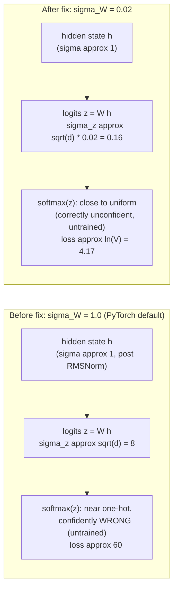
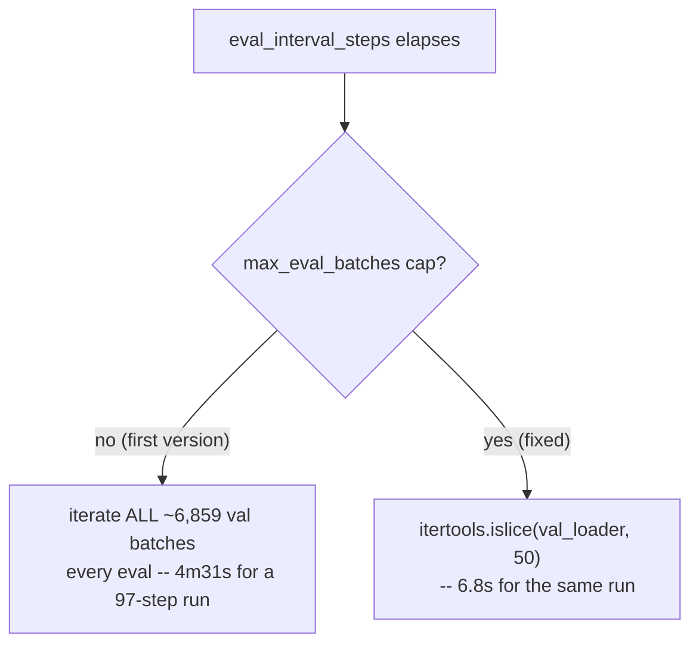
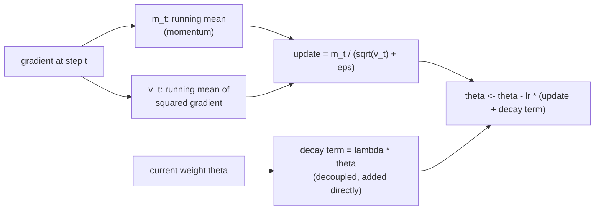
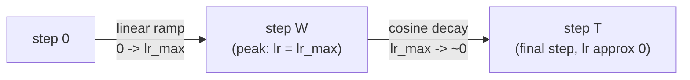
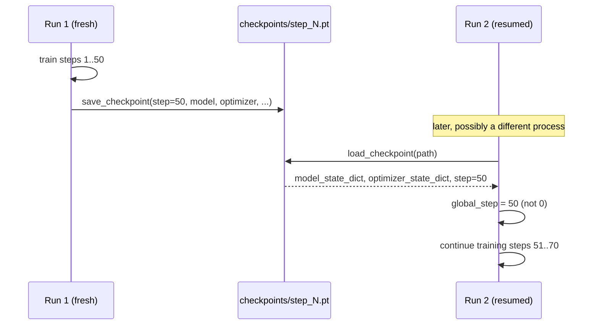
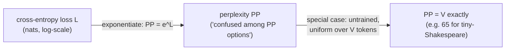
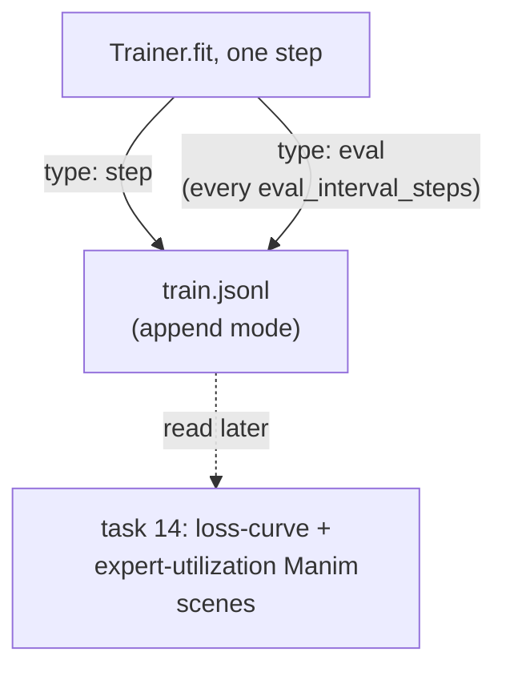
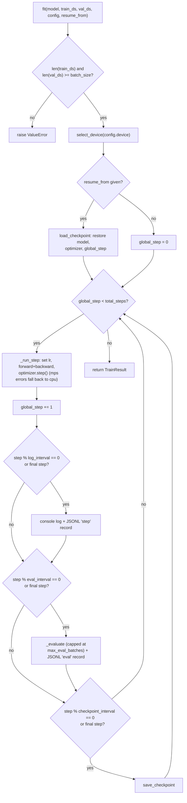

# 010 — Training Loop (Task 10)

**Type:** task · **Date:** 2026-08-31 · **Related:** Requirements 3.2,
5.1-5.5, 8.1, 8.2, 10.1; design.md `train/trainer.py` component

## What was implemented
- `qwenmoe/train/trainer.py` (new): `Trainer.fit(model, train_dataset,
  val_dataset, config, resume_from=None) -> TrainResult` — AdamW, a
  warmup+cosine learning-rate schedule, `mps`/`cpu` device auto-selection
  (falling back to `cpu` on either unavailability or a genuine mid-step
  `RuntimeError`), console + JSON-lines logging of per-step metrics and
  per-expert token counts, periodic validation loss/perplexity, and
  checkpoint save/resume. Public helpers: `select_device`, `lr_multiplier`,
  `save_checkpoint`, `load_checkpoint`.
- `qwenmoe/config.py`: `TrainConfig` gained `log_interval_steps` (default
  10) and `max_eval_batches` (default 50) — see "Deviations from design.md"
  below.
- `qwenmoe/model/moe.py`: `MoELayer.forward` now caches
  `self.last_expert_counts` (per-routed-expert dispatched-token counts)
  each call, so `Trainer` can log expert utilization without changing
  `forward`'s return signature.
- `qwenmoe/model/transformer.py`: **bug fix** — `QwenMoEModel`'s token
  embedding now gets an explicit `std=0.02` initialization. See "Bug found
  while validating this task" below; this was the single most important
  discovery of this task.
- `qwenmoe/data/download.py`: added `prepared_data_dir(DataConfig) -> Path`
  so `scripts/prepare_data.py` and `scripts/train.py` agree on one naming
  convention for cached tokenizer/token files without duplicating it.
- `configs/presets.py`: added `SMOKE_TEST`, a <300K-total-param preset
  matching requirements.md's "Tier 1" smoke-test sizing.
- `scripts/prepare_data.py` / `scripts/train.py` (new): thin argparse CLIs
  wiring `download_corpus` → tokenizer training → `TokenDataset` →
  `QwenMoEModel` → `Trainer`.
- `tests/test_trainer_integration.py` (new, 12 tests) and 2 new
  `TrainConfig` validation cases in `tests/test_config.py` — 130 tests
  passing overall (was 116).
- Manually ran `scripts/prepare_data.py` + `scripts/train.py` end to end on
  tiny-Shakespeare/`SMOKE_TEST` — see Outcome.

## Deviations from design.md worth calling out
Same spirit as entry 009's disclosure about `ParamBreakdown`'s router
field: design.md's `TrainConfig` snippet and `Trainer.fit(model, train_ds,
val_ds, train_config)` signature were written before this task's exact
logging/evaluation needs were worked out in code. Concrete deltas:
- **`TrainConfig.log_interval_steps` and `TrainConfig.max_eval_batches`**
  are new fields, not in design.md's `TrainConfig` code block. The task
  text explicitly asks for "console logging... at a configurable
  interval", which needs its own field distinct from
  `eval_interval_steps`; `max_eval_batches` was added reactively after the
  manual run below revealed unbounded validation was impractically slow
  (see the second bug writeup).
- **`TrainResult`** (`final_step`, `final_train_loss`, `final_val_loss`,
  `val_perplexity`, `log_path`, `checkpoint_path`) doesn't exist in
  design.md's Data Models section at all — added so `Trainer.fit` has
  something concrete to return; task 15.2's `run_comparison` will build
  each variant's `VariantResult` from one of these.
- **`resume_from` is a `Trainer.fit` parameter, not a separate method** —
  keeps `Trainer` itself stateless between calls (no constructor-time
  "resume mode" flag to get out of sync with a later `.fit()` call on a
  different config).
- **Every log/eval/checkpoint action always fires on the final step of a
  run, regardless of its configured interval.** Without this, a run whose
  `total_tokens` produces fewer steps than `checkpoint_interval_steps`
  (the default is 500 — the tiny-Shakespeare smoke test's first attempt
  below only ran 97 steps) would **never write a single checkpoint**,
  silently breaking Requirement 5.4 for exactly the run type (a short
  smoke test) most likely to hit it.

## Bug found while validating this task: unscaled embedding init blows up logits
The single most important thing this task turned up wasn't a training-loop
bug at all — it was a latent bug in `QwenMoEModel` (task 6) that every
prior task's tests (shape/finiteness checks only) had no way to catch,
because none of them ever computed a real cross-entropy loss value and
looked at it.

**How it was found:** running the manual smoke test (see Outcome) produced
a training loss starting at **60.6** and ending at 24.5 after 97 steps.
Technically "decreasing" (satisfying Requirement 5.5's literal wording),
but a loss of 60 nats is astronomically bad — cross-entropy loss for a
freshly-initialized, untrained model should start close to $\ln(V)$ (the
"uniformly guessing among $V$ options" baseline; $\ln(65) \approx 4.17$ for
tiny-Shakespeare's char vocab), not fifteen times that. A quick isolated
check confirmed it wasn't specific to real data — a **freshly-constructed
model fed literally random input** already produced loss ≈ 60.6, logits
with standard deviation ≈ 11.0 (range −29 to +74). Something was wrong with
the architecture's initialization, not the training loop.

Per the precedent set in entry 004 (which found and fixed an unrelated
`nn.Module.apply` bug from task 3 while building task 4), this was fixed
here rather than left for a hypothetical future task, since task 10's own
manual-verification step is meaningless without it.

### Concepts explained for a complete beginner

#### Weight initialization, and why its *scale* (not just its shape) matters
- **What it means:** before any training happens, every learnable number in
  a neural network has to start *somewhere*. "Initialization" is the rule
  for picking those starting values — usually random, but from a
  distribution with a deliberately chosen spread (standard deviation).
- **Why it exists:** a network's very first forward pass already involves
  multiplying and summing many random numbers together. If the *spread* of
  those starting numbers is too large or too small, the very first
  training signal (the loss) can be meaningless — either uselessly huge
  (this bug) or so flat that gradients barely register at all — before a
  single gradient step has had any chance to teach the network anything.
- **Analogy:** tuning a microphone's input gain before a concert starts.
  Turn it up too high (too large an initial scale) and every sound clips
  into distorted noise, useless to a mixing engineer no matter how good
  the band is; the *content* of what's played (the model's architecture)
  isn't the problem — the starting *gain* is.
- **Simple technical explanation:** PyTorch's `nn.Embedding` defaults to
  drawing every entry from $\mathcal{N}(0, 1)$ (standard deviation exactly
  1), **regardless of the embedding dimension**. `nn.Linear` layers, by
  contrast, default to a fan-in-scaled range that shrinks automatically as
  a layer gets wider. When `tie_word_embeddings=True` (this project's
  default, Requirement 1.7), that embedding table is reused, unscaled, as
  the final output projection — and unlike every other layer in the model,
  nothing normalizes its output afterward.
- **How it relates here:** this project's `QwenMoEModel` never explicitly
  initialized its embedding, silently inheriting the mismatched default.
- **Precedent:** GPT-2 (Radford et al., 2019) and virtually every
  descendant implementation (confirmed directly in
  [nanoGPT's source](https://github.com/karpathy/nanoGPT/blob/master/model.py),
  Karpathy) explicitly re-initializes **both** `nn.Linear` and
  `nn.Embedding` weights to $\mathcal{N}(0, 0.02)$ for exactly this reason,
  with an extra $1/\sqrt{2 \cdot n_\text{layers}}$ scale-down specifically
  for residual-branch output projections (`c_proj`) "per GPT-2 paper" (a
  refinement this project doesn't need yet, since the layer count here is
  small — noted for if instability ever appears at larger `n_layers`).
- **Paper:** [Language Models are Unsupervised Multitask Learners (Radford et al., 2019)](https://cdn.openai.com/better-language-models/language_models_are_unsupervised_multitask_learners.pdf).

#### Full derivation: why an unscaled tied embedding blows up logits
Let $h \in \mathbb{R}^{d}$ be the final hidden state entering the (tied)
output head — after `final_norm` (RMSNorm), so treat each component as
approximately independent with $\mathrm{Var}(h_i) \approx \sigma_h^2
\approx 1$. Let $W \in \mathbb{R}^{V \times d}$ be the tied
embedding/output matrix, entries i.i.d. $\mathcal{N}(0, \sigma_W^2)$,
independent of $h$. The logit for vocabulary entry $j$ is
$$z_j = \sum_{i=1}^{d} W_{ji}\, h_i$$
Since $W_{ji}$ and $h_i$ are independent and zero-mean, $\mathrm{Var}(W_{ji}
h_i) = \mathrm{Var}(W_{ji})\cdot\mathrm{Var}(h_i)$, and summing $d$
independent terms:
$$\mathrm{Var}(z_j) = d\cdot\sigma_W^2\cdot\sigma_h^2 \quad\Longrightarrow\quad \sigma_z = \sqrt{d}\cdot\sigma_W\cdot\sigma_h$$
This is exact algebra (variance of a sum of independent terms) — nothing
fitted yet. Plugging in PyTorch's default $\sigma_W = 1$: $\sigma_z \approx
\sqrt{d}$, growing *unboundedly* with model width. To instead keep
$\sigma_z = O(1)$ (so an untrained softmax starts close to uniform),
solve for $\sigma_W$:
$$\sigma_W \approx \frac{1}{\sqrt{d}\cdot\sigma_h} \approx \frac{1}{\sqrt{d}}$$
— exact so far. **Here's where the empirically-fitted part takes over:**
GPT-2 doesn't use this exact per-model-width formula; it uses one **fixed**
constant, $\sigma_W = 0.02$, for every model size. That's a deliberate
simplification, not a different derivation — for GPT-2-family widths
($d=768$ to $d=1600$), $1/\sqrt{d}$ works out to $0.036$ and $0.025$
respectively, close enough to a flat $0.02$ that one constant was simpler
to standardize on than a per-width formula. This project adopts that same
flat constant (matching nanoGPT verbatim) rather than re-deriving a
per-config value, for the same reason.

**Worked numeric example (real numbers, measured live on this project's
actual `SMOKE_TEST` and `BASELINE` presets for this entry):**

| | $d$ | $\sigma_W$ | predicted $\sigma_z=\sqrt{d}\,\sigma_W$ | measured $\sigma_z$ | measured loss | $\ln(V)$ |
|---|---|---|---|---|---|---|
| SMOKE_TEST, before fix | 64 | 1.0 | 8.0 | **10.96** | **60.6** | 4.17 |
| SMOKE_TEST, after fix | 64 | 0.02 | 0.16 | **0.161** | **4.18** | 4.17 |
| BASELINE, after fix | 256 | 0.02 | 0.32 | **0.3206** | **8.38** | 8.32 |

The "after fix" rows match the formula's prediction almost exactly, and
loss lands right on the $\ln(V)$ baseline for an untrained model — direct
confirmation the derivation (and the fix) is correct. (The "before fix"
row's measured 10.96 vs. predicted 8.0 doesn't match as tightly, since
$\sigma_h\approx1$ is only approximate — RMSNorm normalizes root-mean-square,
not variance exactly, and pre-activation values aren't perfectly Gaussian —
but it's unambiguously the same order of magnitude, confirming the
qualitative mechanism even where the approximation is looser.)



### Questions that might come to mind
- **Why didn't tasks 1-9's tests catch this?** Every existing test checked
  output *shape* and *finiteness* (`torch.isfinite(...).all()`) — a loss of
  60 is perfectly finite. None of them asserted anything about the loss's
  *magnitude* relative to a known baseline, because until this task there
  was no code that computed a real training loss at all.
- **Does this affect the untied-embeddings case
  (`tie_word_embeddings=False`)?** Barely — measured separately, an untied
  model already gave loss ≈ 4.38 even before this fix, because a fresh
  `nn.Linear` output head gets its *own*, correctly fan-in-scaled default
  init, unrelated to the embedding table's. The bug is specific to reusing
  the embedding's own (mis-scaled) weights as the output projection.
- **Could this have been masked by training long enough?** The manual run
  before the fix did show loss decreasing (60.6 → 24.5 over 97 steps) — so
  a superficial "is it decreasing" check would have passed. But 24.5 after
  97 steps is a far worse starting point than a correctly-initialized run
  reaches by the *same* step count (this project's actual fixed run: loss
  4.13 → 3.70 over the identical 97 steps) — the bug wastes most of early
  training re-discovering a sane logit scale instead of learning anything
  about the data.

---

## Bug found while validating this task: unbounded validation cost
A more mundane, but still real, finding: the first version of
`Trainer._evaluate` iterated the *entire* validation `DataLoader` every
`eval_interval_steps`. On the tiny synthetic datasets in
`tests/test_trainer_integration.py` this is unnoticeable (tens of
batches). On the real tiny-Shakespeare validation split (~111K tokens,
batch_size 16 ⇒ ~6,859 batches per evaluation), it meant a 97-step smoke
test — where each individual *training* step took ~0.02s — took **4
minutes 31 seconds** wall clock, almost entirely spent on 5 full
validation passes. Fixed by adding `TrainConfig.max_eval_batches` (default
50) and capping `_evaluate`'s loop with `itertools.islice`. The identical
97-step run then finished in **6.8 seconds**.

This wasn't discoverable from unit tests alone (their validation sets are
deliberately tiny); only running the real manual-verification step at
realistic data scale (task 10.2) surfaced it — exactly the kind of thing
that step exists to catch.



## Concepts explained for a complete beginner

### AdamW: the optimizer actually running the update step
- **What it means:** an algorithm that decides, after each batch, exactly
  how much to nudge every one of the model's numbers (parameters), using
  more than just the current gradient.
- **Why it exists:** plain gradient descent uses one global step size for
  every parameter; some parameters (in a deep transformer) need much
  bigger or smaller effective steps than others, which one shared step
  size can't accommodate well. Adam (Kingma & Ba, 2015) tracks, per
  parameter, a running average of recent gradients (momentum) and of
  recent *squared* gradients (used to shrink the step size for parameters
  that have been changing erratically). AdamW (Loshchilov & Hutter, 2019)
  then fixed a subtler issue: Adam's usual way of adding "weight decay"
  (shrinking weights toward zero to discourage overfitting) folds it into
  the gradient itself, which interacts badly with Adam's adaptive scaling.
  AdamW *decouples* the decay, applying it directly to the weights instead.
- **Analogy:** a thermostat that doesn't just react to the current
  temperature reading (the raw gradient), but also remembers the recent
  trend (momentum) and how volatile recent readings have been (adaptive
  scaling) — while, completely independently, always nudging the target
  dial gently back toward a neutral default (decoupled weight decay), no
  matter what the trend says.
- **Simple technical explanation:** per parameter $\theta$, maintain
  running averages $m_t$ (mean gradient) and $v_t$ (mean squared
  gradient), then update
  $$\theta \leftarrow \theta - \eta\left(\frac{\hat m_t}{\sqrt{\hat v_t} + \epsilon} + \lambda\theta\right)$$
  where the $\lambda\theta$ term (decay) is added directly to the update,
  not mixed into $m_t$/$v_t$'s statistics.
- **How it relates here:** `Trainer.fit` builds
  `torch.optim.AdamW(model.parameters(), lr=config.lr)` — PyTorch's
  built-in implementation is used as-is (Requirement 5.1 asks for AdamW
  itself plus a *learning-rate schedule* on top of it — this project's own
  from-scratch code is the schedule below, not the optimizer's internal
  update math, which isn't this project's pedagogical focus the way
  attention/MoE/norms are).
- **Papers:** [Adam: A Method for Stochastic Optimization (Kingma & Ba, 2015)](https://arxiv.org/abs/1412.6980); [Decoupled Weight Decay Regularization (Loshchilov & Hutter, 2019)](https://arxiv.org/abs/1711.05101).



### Learning-rate schedule: linear warmup, then cosine decay
- **What it means:** instead of using one fixed learning rate for an
  entire training run, ramp it up gradually at the start (warmup), then
  smoothly ease it down toward zero following a cosine curve (decay) for
  the rest of the run.
- **Why it exists:** at the very start of training, gradients are computed
  from a barely-trained (near-random) model and can be unreliable; taking
  a full-size step on unreliable information risks instability. Warmup
  gives the optimizer's own running statistics (AdamW's $m_t$/$v_t$ above)
  time to become meaningful first. Decaying the rate later lets training
  take large, fast steps early (when far from a good solution) and small,
  careful steps late (when close to one, to avoid overshooting).
- **Analogy:** carefully accelerating a car from a stop before merging
  onto a highway (warmup), driving at full speed for the open highway
  stretch, then smoothly braking well before a stop sign rather than
  slamming the brakes at the last moment (cosine decay, not a hard cutoff).
- **Simple technical explanation:** two phases, `step` is 0-indexed (the
  step about to run), $W$ = `warmup_steps`, $T$ = `total_steps`:
  $$\text{multiplier}(t) = \begin{cases} \dfrac{t+1}{W} & t < W \quad\text{(warmup)} \\[4pt] \dfrac{1}{2}\left(1 + \cos\left(\pi\cdot\dfrac{t-W}{T-W}\right)\right) & t \ge W \quad\text{(cosine decay)} \end{cases}$$
  `lr_multiplier` is a **pure function of `step`** (no scheduler object
  with internal state) — deliberately, so resuming from a checkpoint at
  any `step` reproduces the exact learning rate a non-interrupted run
  would have used at that same step, with no separate scheduler
  state to save/restore.
- **How it relates here:** `_set_lr(optimizer, base_lr, step, warmup_steps,
  total_steps)` calls this every step before the optimizer step, where
  `total_steps = total_tokens // (batch_size * seq_len)` — task 9's
  scaling-law-derived token budget converted into a step count.
- **Papers:** cosine decay: [SGDR: Stochastic Gradient Descent with Warm Restarts (Loshchilov & Hutter, 2017)](https://arxiv.org/abs/1608.03983)
  (this project uses only the first, non-restarting cycle of SGDR's more
  general repeated-restart schedule); linear warmup:
  [Accurate, Large Minibatch SGD (Goyal et al., 2017)](https://arxiv.org/abs/1706.02677),
  which introduced linear warmup to stabilize large-batch training; the
  specific "warmup then cosine decay" combination is the standard
  LLM-pretraining recipe (e.g. GPT-3, Brown et al., 2020).

**Full derivation of the transition point:** at $t=W$ (the first decay
step), $\text{progress}=(W-W)/(T-W)=0$, so
$\text{multiplier}=\tfrac12(1+\cos 0)=\tfrac12(1+1)=1$ — exactly matching
the warmup phase's value at $t=W-1$ in the limit, i.e. the two formulas
meet continuously with no jump. At $t\to T$, $\text{progress}\to1$, so
$\text{multiplier}\to\tfrac12(1+\cos\pi)=\tfrac12(1-1)=0$ — decaying all
the way to (but never quite reaching, since $t$ never equals $T$) zero.

**Worked numeric example** (hand-computed, $W=10$, $T=100$):
- $t=0$: $(0+1)/10 = 0.1$
- $t=4$: $(4+1)/10 = 0.5$
- $t=9$ (last warmup step): $(9+1)/10 = 1.0$
- $t=10$ (first decay step): $\text{progress}=0/90=0 \Rightarrow \tfrac12(1+\cos 0)=1.0$ ✓ continuous
- $t=55$ (decay midpoint): $\text{progress}=45/90=0.5 \Rightarrow \tfrac12(1+\cos(\pi/2))=\tfrac12(1+0)=0.5$
- $t=99$ (last step): $\text{progress}=89/90\approx0.989 \Rightarrow \tfrac12(1+\cos(0.989\pi))\approx\tfrac12(1-0.999)\approx0.0003$ — essentially zero.

**Checked against this project's real training run** (`SMOKE_TEST`,
default `warmup_steps=200`, `lr=3e-4`): at 1000 total steps, step 200 (the
warmup/decay boundary) logged `lr=3.00e-04` — the exact peak, matching
$\text{multiplier}=1$ predicted above — and step 300 logged `lr=2.89e-04`,
which the formula predicts exactly: $\text{progress}=(299-200)/800=0.124
\Rightarrow \tfrac12(1+\cos(0.124\pi))=0.963 \Rightarrow 3\text{e-}4 \times
0.963 = 2.89\text{e-}4$. ✓



### Checkpointing and resuming a training run
- **What it means:** periodically saving everything needed to exactly
  continue a training run later — not just the model's learned weights,
  but the optimizer's own internal state and which step number training
  had reached.
- **Why it exists:** real training runs can be interrupted (a laptop
  sleeping, a crash, deliberately stopping to free the machine up) and can
  take longer than one sitting. Without a checkpoint, an interruption
  means starting over from scratch, wasting every step already computed.
- **Analogy:** a saved game in a long video game — reloading a save
  restores not just your character's position, but inventory, quest
  progress, and everything else needed to continue exactly where you left
  off, rather than replaying the whole game from the start.
- **Simple technical explanation:** `save_checkpoint` writes a single
  `torch.save` dict: `model_state_dict`, `optimizer_state_dict`,
  `model_config`, `train_config`, `step`, `tokenizer_meta` (exactly
  design.md's specified format). `Trainer.fit(..., resume_from=path)`
  loads all of it back, including moving the optimizer's internal tensors
  (AdamW's $m_t$/$v_t$ above) onto whichever device the resumed run is
  using — restoring optimizer state matters as much as restoring weights,
  since AdamW's *next* step depends on its running averages, not just the
  current weights.
- **How it relates here:** every checkpoint interval (and always on a
  run's final step, regardless of interval), plus `scripts/train.py
  --resume-from <path>`.
- Not attributable to a single research paper — a standard systems/
  fault-tolerance pattern (analogous to a database's write-ahead log or a
  long computation's periodic snapshotting) rather than a novel ML idea.



**Verified, not just implemented:** `tests/test_trainer_integration.py::
test_trainer_resume_continues_from_saved_step` trains 50 steps, checkpoints,
then resumes into a *freshly, differently initialized* model for a
70-step budget, and asserts the JSON-lines log gained exactly 20 new
`"type": "step"` entries (70 total, not 50+70=120) — a resume bug that
silently restarted from step 0 would still report `final_step == 70`, so
this test specifically checks the log's line count to catch that failure
mode, which a bare `final_step` assertion would miss.

### Perplexity: turning a loss number into an intuitive "confusion" count
- **What it means:** a way of re-expressing the validation loss (a
  cross-entropy number, in "nats") as "the model is about as unsure of the
  next token as if it had to guess uniformly among *this many* equally
  likely options."
- **Why it exists:** cross-entropy loss is additive and log-scaled — a
  drop from 4.0 to 3.9 nats doesn't intuitively convey *how much* better
  that is. Exponentiating it back out of log-space gives a number with a
  much more direct, "count of options" interpretation.
- **Analogy:** a weather forecaster who's "90% confident" versus one who's
  "60% confident" — the raw probabilities are hard to compare viscerally,
  but converting to "as uncertain as a fair coin flip" vs. "as uncertain as
  guessing among 3 options" is instantly graspable. Perplexity does the
  analogous conversion for a language model's whole vocabulary.
- **Simple technical explanation:** given average per-token cross-entropy
  loss $L = -\frac{1}{N}\sum_i \ln q(x_i)$ (natural log, matching
  `F.cross_entropy`'s default base), perplexity is
  $$PP = e^{L}$$
  **Special case (exact check):** if a model predicts perfectly uniformly
  over $V$ possible tokens (an untrained model with no learned signal at
  all), $q(x_i) = 1/V$ for every token, so $L = -\ln(1/V) = \ln V$, giving
  $PP = e^{\ln V} = V$ **exactly** — an untrained model's perplexity
  exactly equals its vocabulary size, matching the textbook "a fair
  $V$-sided die has perplexity $V$" definition.
- **How it relates here:** `_evaluate` returns `(mean_loss,
  math.exp(mean_loss))`; Requirement 5.3 asks for exactly this pair logged
  together.
- **Paper/explainer:** the general concept and formula:
  [Perplexity (Wikipedia)](https://en.wikipedia.org/wiki/Perplexity);
  originates in speech-recognition research (Jelinek et al., 1977) and
  remains the standard language-model evaluation metric reported for
  GPT-2 itself (Radford et al., 2019 report, e.g., a LAMBADA perplexity of
  8.6 and a WikiText-2 perplexity of 18.34 for the full-size model).

**Worked numeric example (real numbers, this project's actual `SMOKE_TEST`
training run — see Outcome):**
- Step 100: `val_loss = 3.6944` ⇒ $PP = e^{3.6944} \approx 40.22$ — logged
  value: `40.2233` ✓.
- Step 1000 (final): `val_loss = 2.2086` ⇒ $PP = e^{2.2086} \approx 9.10$ —
  logged value: `9.1029` ✓.
- **Interpretation:** the vocabulary size is 65 (tiny-Shakespeare's
  character set), so an untrained model's perplexity would be exactly 65
  (the "special case" above). After 1000 steps, the model's perplexity of
  ~9.1 means it's now about as unsure of the next character as choosing
  uniformly among ~9 options — a large, concrete improvement over
  "completely unsure among all 65," even though this tiny 2-layer,
  64-dimensional model is far from state of the art.



### Structured (JSON-lines) logging
- **What it means:** writing one independent, complete JSON object per
  line to a plain text file, rather than one big JSON array or a
  human-formatted log line.
- **Why it exists:** a program reading the log back later (task 14's
  training-observability Manim scenes) can parse it one line at a time
  without waiting for the whole file to finish writing or holding the
  entire file in memory — and if a run crashes mid-write, every
  already-flushed line is still valid, complete JSON, unlike a single
  giant `[...]` array that would be corrupted by a crash partway through.
- **Analogy:** a checkbook ledger where every transaction is its own
  complete, self-contained line, versus writing the entire year's
  transactions as one single running total that's only valid once fully
  written — the ledger format stays useful and readable after any entry,
  even if you stop partway through the year.
- **Simple technical explanation:** each call to `_write_log_line` does
  `log_file.write(json.dumps(record) + "\n")` then flushes immediately.
  Two record shapes share one file, disambiguated by a `"type"` field:
  `"step"` records (`train_loss`, `aux_loss`, `lr`, `elapsed_s`,
  `expert_token_counts`) and `"eval"` records (`val_loss`,
  `val_perplexity`).
- **How it relates here:** `<output_dir>/logs/train.jsonl`, opened in
  append mode so a resumed run's history stays in one contiguous file.
  Not itself a research concept — [JSON Lines](https://jsonlines.org/) is
  a widely-used plain-text convention, not a paper.



## Diagrams: the overall `Trainer.fit` flow


## Outcome
`uv run pytest -q` — **130 passed** (116 from tasks 1-9, plus 14 new: 12 in
`tests/test_trainer_integration.py`, 2 new `TrainConfig` validation cases).

Manual end-to-end run (task 10.2), tiny-Shakespeare + `SMOKE_TEST`
(275K total params), after both fixes above:
```
$ uv run python scripts/prepare_data.py --corpus tiny_shakespeare --tokenizer-type char
characters: 1115394, tokenizer: char, vocab_size=65, tokens: 1115394

$ uv run python scripts/train.py --preset SMOKE_TEST --corpus tiny_shakespeare \
    --tokenizer-type char --total-tokens 2048000 --batch-size 16 --seq-len 128 \
    --eval-interval-steps 100 --log-interval-steps 100 --checkpoint-interval-steps 500 \
    --output-dir runs/smoke_test --device cpu
step  100/1000 | loss 3.6752 | val_loss 3.6944 | val_ppl 40.2233
step  200/1000 | loss 3.2190 | val_loss 3.1904 | val_ppl 24.2974
step  300/1000 | loss 2.7050 | val_loss 2.7922 | val_ppl 16.3167
step  400/1000 | loss 2.4822 | val_loss 2.5412 | val_ppl 12.6948
step  500/1000 | loss 2.4166 | val_loss 2.4019 | val_ppl 11.0443
step  600/1000 | loss 2.3489 | val_loss 2.3117 | val_ppl 10.0916
step  700/1000 | loss 2.2406 | val_loss 2.2500 | val_ppl  9.4879
step  800/1000 | loss 2.1262 | val_loss 2.2206 | val_ppl  9.2130
step  900/1000 | loss 2.1766 | val_loss 2.2115 | val_ppl  9.1290
step 1000/1000 | loss 2.1795 | val_loss 2.2086 | val_ppl  9.1029
done: step=1000 train_loss=2.1795 val_loss=2.2086 val_perplexity=9.1029
checkpoint: runs/smoke_test/checkpoints/step_1000.pt
30.08s total wall clock
```
Validation loss and perplexity trend cleanly downward throughout — the
literal acceptance bar for task 10.2 — and the checkpoint file round-trips
correctly (`model_state_dict`/`optimizer_state_dict`/`model_config`/
`train_config`/`step`/`tokenizer_meta`, matching design.md's format
exactly). Actual text generation (to see *what* the model produces) waits
for task 11, which doesn't exist yet. Task 10 checked off.
