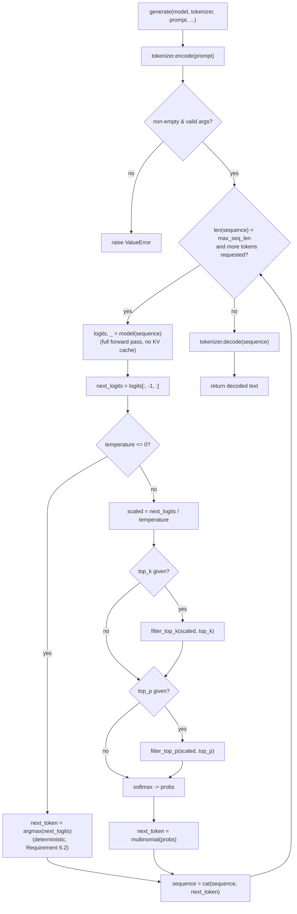
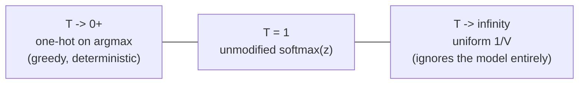
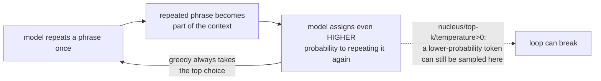

# 011 — Inference / Generation (Task 11)

**Type:** task · **Date:** 2026-08-31 · **Related:** Requirements 6.1-6.4;
design.md `generate.py`/`scripts/generate.py` components (tasks 11.1, 11.2)

## What was implemented
- `qwenmoe/model/generate.py::generate(model, tokenizer, prompt,
  max_new_tokens, temperature, top_k, top_p, device) -> str` —
  autoregressive decoding: encode the prompt, repeatedly run the full model
  forward pass on the sequence generated so far, pick/sample the next
  token, append it, and stop at `max_new_tokens` or the model's
  `max_seq_len`, whichever comes first (Requirement 6.1-6.3).
- `qwenmoe/model/generate.py::filter_top_k` / `filter_top_p` — standalone
  logit-filtering functions for top-k (Fan, Lewis & Dauphin 2018) and
  nucleus/top-p (Holtzman et al. 2019) sampling, directly testable with
  hand-built logits tensors (Requirement 6.2).
- `scripts/generate.py` (new): argparse CLI — loads a checkpoint, rebuilds
  its exact model + tokenizer, generates from a prompt, and prints the
  decoded text (Requirement 6.1).
- `tests/test_generate.py` (new, 22 tests): filter correctness (including
  two worked numeric examples run as real assertions), input validation,
  greedy-decoding determinism, length limits (`max_new_tokens` and
  `max_seq_len`), and CPU execution (Requirement 6.4).
- Manually ran `scripts/generate.py` against the real
  `runs/smoke_test/checkpoints/step_1000.pt` checkpoint from task 10 — see
  Outcome, including a genuine (not staged) example of the exact
  degenerate-repetition failure mode nucleus sampling's own paper was
  written to fix.

## Design decisions worth calling out

**No KV cache — every new token re-runs the full forward pass.** A "KV
cache" (storing each layer's already-computed key/value projections so a
new token only computes attention against them once, instead of
recomputing every previous token's K/V from scratch) is the standard
optimization real inference servers use. This project skips it: `generate`
just calls `model(sequence)` again each iteration with the whole
sequence-so-far, exactly like every other place in this codebase calls
`QwenMoEModel.forward`. That makes generation's per-token cost $O(n)$
instead of $O(1)$ (quadratic instead of linear total cost across a whole
generation), but for this project's tiny models and short generations, the
difference is invisible (the manual run below generated 300 tokens in
about a second) while the code stays exactly as simple as the rest of the
project. A KV cache would be a reasonable follow-up if generation ever
became a bottleneck, but isn't needed now.

**`temperature <= 0` is an explicit greedy branch, not "divide by a tiny
number."** Naively computing `logits / 0.0001` risks overflowing to `inf`
and producing `NaN` after softmax on real hardware. Since the mathematical
limit as temperature → 0⁺ is *exactly* "pick the highest logit" (derived
below), the code computes that limit directly with `torch.argmax` instead
of approximating it numerically — exact and unconditionally safe, with the
added benefit that it gives the test suite a decoding mode with zero
randomness to assert determinism against (Requirement 6.2's own wording,
"greedy (temperature→0-like) decoding is deterministic").

**`filter_top_k`/`filter_top_p` are standalone module-level functions, not
inlined into `generate`'s loop.** Same reasoning as task 5's
`select_top_k`: it makes each filtering rule directly unit-testable with
small hand-built logits tensors (no need to construct a full model or
prompt just to check "does top-p keep the right tokens?"), and keeps
`generate`'s own loop reading as a short, readable pipeline
(`temperature → top_k → top_p → softmax → sample`).

**When both `top_k` and `top_p` are given, `top_k` is applied first.**
This matches the common convention in other implementations (e.g. Hugging
Face's `generate` default warper ordering) — `top_k` first narrows the
candidate set to a fixed size, then `top_p` further trims that
fixed-size set adaptively based on how the probability mass happens to be
distributed that step.

**`scripts/generate.py` reconstructs the tokenizer from the checkpoint's
own `tokenizer_meta`, not from a fresh `DataConfig`.** `tokenizer_meta`
(written by `Trainer.save_checkpoint`, sourced from `scripts/train.py`'s
`_load_prepared_data`) already has everything needed —
`tokenizer_type` and `tokenizer_path` — so the CLI script just dispatches
on `tokenizer_type` directly (`CharTokenizer()` or `ByteBPETokenizer()`)
and calls `.load(tokenizer_path)`. Building a throwaway `DataConfig` just
to reuse `qwenmoe.tokenizer.base.build_tokenizer` would need a fake
`corpus` value (`DataConfig.corpus` is required but unused by
`build_tokenizer`) purely to satisfy the dataclass — more indirection for
no real benefit here. `select_device` and `load_checkpoint` *are* reused
from `qwenmoe.train.trainer`, since those need no such workaround.

## Concepts explained for a complete beginner

### Autoregressive generation (the decode loop)
- **What it means:** producing a sequence one token at a time, where each
  new token is chosen by feeding *everything generated so far* back into
  the model as input, then repeating.
- **Why it exists:** `QwenMoEModel.forward` (task 6) was only ever trained
  to answer one question — "given these tokens, what's the probability
  distribution over the *next* one?" — for every position in a training
  window at once. It was never trained to emit a whole new passage in a
  single call. Generating $N$ new tokens therefore means asking that same
  trained question $N$ times, once per new token, feeding each answer back
  in before asking again.
- **Analogy:** writing a story one word at a time, re-reading the entire
  story-so-far before deciding each next word, rather than planning the
  whole thing in advance and writing it all at once.
- **Simple technical explanation:** given prompt tokens $x_1,\dots,x_n$, at
  each step compute $P(x_{n+1}\mid x_1,\dots,x_n)$ from the model's logits
  at the last position, choose or sample $x_{n+1}$ from that distribution,
  append it, set $n \mathrel{+}= 1$, and repeat until a stop condition
  (Requirement 6.3) is hit.
- **How it relates here:** `generate`'s `for _ in range(max_new_tokens)`
  loop — `model(sequence)` recomputes logits for the whole sequence every
  time (see "no KV cache" above), and only `logits[:, -1, :]` (the very
  last position's prediction) is ever used to pick the next token.
- **Paper:** the general idea of a neural network directly modeling
  $P(\text{next word}\mid\text{previous words})$ traces back to
  [A Neural Probabilistic Language Model (Bengio, Ducharme, Vincent & Jauvin, 2003)](https://www.jmlr.org/papers/v3/bengio03a.html),
  long before Transformers existed — this project's decode loop is the
  same underlying idea, just with a Transformer computing the
  distribution instead of Bengio et al.'s original feedforward network.

### Temperature scaling of a probability distribution
- **What it means:** dividing every logit by a positive number $T$ (the
  "temperature") before applying softmax, to make the resulting
  probability distribution sharper (more confident/deterministic) or
  flatter (more random/uniform) without changing *which* token has the
  highest probability.
- **Why it exists:** a model's raw softmax output ($T=1$) is one fixed
  distribution — but a raw language model's confidence at $T=1$ doesn't
  always match what produces good text: sometimes always picking the very
  top choice under-explores plausible alternatives and produces bland or
  repetitive text (see "neural text degeneration" below), while an
  unmodified distribution can occasionally place too much weight on
  low-probability, incoherent options. Temperature is a single dial to
  trade off between those extremes *after* training, with no retraining
  needed.
- **Analogy:** a thermostat for how "adventurous" a decision-maker is.
  Turn the temperature down and they always pick their single favorite
  option, every time (cold and rigid); turn it up and they'll happily pick
  almost anything, close to a coin flip between all the options (hot and
  chaotic); leave it at a middle setting and they mostly favor good
  options but occasionally take a chance on a plausible alternative.
- **Full derivation (where the formula actually comes from):** softmax
  with temperature did not originate in language modeling — it's a direct
  import of the **Boltzmann distribution** from statistical mechanics
  (used in early neural-network research by
  [Ackley, Hinton & Sejnowski, 1985](https://www.semanticscholar.org/paper/A-Learning-Algorithm-for-Boltzmann-Machines-Ackley-Hinton/a0d16f0e99f7ce5e6fb70b1a68c685e9ad610657),
  "A Learning Algorithm for Boltzmann Machines"). In statistical mechanics,
  a physical system in thermal equilibrium at temperature $\Theta$ occupies
  state $i$ (with energy $E_i$) with probability
  $P(i) \propto e^{-E_i/(k_B\Theta)}$ — lower-energy states are
  exponentially more likely, and that preference weakens as temperature
  rises. Treating a token's logit $z_i$ as a "negative energy" ($E_i =
  -z_i$) and folding the Boltzmann constant $k_B$ into the definition of
  $T$ (so $T$ is just "temperature" in the same units as the logits, not a
  literal physical temperature) gives
  $$P(i) \propto e^{z_i/T}$$
  Normalizing by the sum over all tokens (the "partition function" $Z$ in
  physics, exactly what softmax's denominator is) gives the full formula:
  $$P(i) = \frac{e^{z_i/T}}{\sum_j e^{z_j/T}} = \text{softmax}(z/T)_i$$
  This is exact algebra given the Boltzmann-distribution assumption — the
  only judgment call is treating logits as negative energies at all, which
  is the analogy's whole premise, not a fitted constant.
- **Two exact limiting cases (both provable, not just typical behavior):**
  - **$T \to 1$:** recovers plain softmax — no effect, the model's raw
    trained distribution.
  - **$T \to 0^+$ (greedy):** for any token $i$ that isn't the argmax,
    $\frac{P(i)}{P(\text{argmax})} = e^{(z_i - z_{\text{argmax}})/T} \to 0$
    as $T\to0^+$, since the exponent is a fixed negative number divided by
    a shrinking positive $T$. So every non-argmax probability vanishes
    relative to the argmax's, i.e. the distribution converges to a
    one-hot on the single highest logit — exactly greedy decoding, and
    exactly why this project's `generate` treats `temperature <= 0` as
    "call `torch.argmax` directly" rather than a numerically risky
    approximation.
  - **$T \to \infty$:** every $z_i/T \to 0$, so every $e^{z_i/T} \to 1$,
    giving $P(i) \to 1/V$ for all $V$ tokens — a uniform distribution,
    completely ignoring the model's learned preferences.
- **Worked numeric example** (logits $z=[2.0, 1.0, 0.0]$, computed with
  `torch.softmax(z / T, dim=-1)` and cross-checked by hand):

  | $T$ | $P(z_0{=}2.0)$ | $P(z_1{=}1.0)$ | $P(z_2{=}0.0)$ |
  |---|---|---|---|
  | 0.01 (≈ greedy limit) | 1.000000 | 0.000000 | 0.000000 |
  | 0.5 | 0.8668 | 0.1173 | 0.0159 |
  | 1.0 (no scaling) | 0.6652 | 0.2447 | 0.0900 |
  | 2.0 | 0.5065 | 0.3072 | 0.1863 |
  | 100 (≈ uniform limit) | 0.336672 | 0.333322 | 0.330006 |

  Reading down the table: the top logit's probability climbs from ~34%
  (nearly uniform, $T=100$) to effectively 100% ($T=0.01$) purely from
  changing $T$ — the logits themselves never change. This is the "sharpen
  vs. flatten" behavior described above, made concrete.
- **How it relates here:** `generate`'s `scaled_logits = next_logits /
  temperature` line, guarded by the `temperature <= 0` greedy special case
  above.
- **Paper:** temperature-scaled softmax's statistical-mechanics origin:
  [Ackley, Hinton & Sejnowski, 1985](https://www.semanticscholar.org/paper/A-Learning-Algorithm-for-Boltzmann-Machines-Ackley-Hinton/a0d16f0e99f7ce5e6fb70b1a68c685e9ad610657).

### Top-k sampling
- **What it means:** before sampling the next token, discard every token
  except the `k` with the highest probability (or logit — ranking is
  identical either way, per entry 005's order-preservation argument for
  `select_top_k`), then sample only among those `k`.
- **Why it exists:** an untruncated distribution over a large vocabulary
  still assigns *some* tiny probability to thousands of implausible
  tokens; sampling directly from the full distribution occasionally draws
  one of them, producing an obviously wrong token. Top-k caps how many
  candidates are even eligible, cutting off that long, unreliable tail.
- **Analogy:** a hiring shortlist. Instead of picking randomly from every
  applicant (including hopelessly unqualified ones who technically
  applied), a recruiter first narrows the pool to the top `k` candidates
  by score, then makes a final (possibly still somewhat randomized) choice
  only among those `k`.
- **Simple technical explanation:** find the `k`-th highest logit
  (the "threshold"); set every logit strictly below it to $-\infty$
  (which softmax then maps to exactly $0$ probability — entry 004's
  softmax property, reused directly, not re-derived). `filter_top_k`
  implements this with `torch.where(logits < threshold, -inf, logits)`,
  the same pattern used in
  [nanoGPT's own `generate` method](https://github.com/karpathy/nanoGPT/blob/master/model.py)
  (`logits[logits < v[:, [-1]]] = -float('Inf')`) — this project's version
  is functionally identical, just written with `torch.where` instead of
  in-place boolean indexing.
- **Worked example** (from `test_filter_top_k_keeps_only_k_highest_logits`):
  logits $=[2.0,\ 0.5,\ 3.0,\ -1.0]$, $k=2$. The 2nd-highest value is
  $2.0$ (the threshold), so every logit strictly below $2.0$ (i.e. $0.5$
  and $-1.0$) is set to $-\infty$, leaving $[2.0,\ -\infty,\ 3.0,\
  -\infty]$ — exactly positions 0 and 2, the two largest values.
- **Paper:** [Hierarchical Neural Story Generation (Fan, Lewis & Dauphin, 2018)](https://arxiv.org/abs/1805.04833),
  which introduced top-k as a decoding strategy (in the context of
  generating stories from writing prompts).

### Nucleus (top-p) sampling
- **What it means:** instead of a *fixed count* of candidates like top-k,
  keep the smallest possible set of highest-probability tokens whose
  probabilities *add up* to at least `top_p`, and sample only among those.
  The size of that set changes dynamically every step, depending on how
  concentrated or spread out the model's confidence happens to be.
- **Why it exists:** top-k's fixed `k` is either too generous when the
  model is very confident (a small `k` is already way more than needed —
  the top 1-2 tokens might hold 99% of the mass) or too strict when the
  model is genuinely unsure (a small fixed `k` wrongly excludes plausible
  options that just didn't make the fixed cutoff). Nucleus sampling's
  threshold is on *cumulative probability*, so it automatically keeps a
  large set when the model is uncertain and a small one when it's
  confident.
- **Analogy:** instead of "always shortlist exactly the top 5 candidates"
  (top-k), a hiring rule of "keep shortlisting candidates, best first,
  until the shortlisted group represents at least 90% of total combined
  qualification score" — some job postings might need just the single top
  candidate to hit 90%; others, with many similarly-qualified applicants,
  might need fifteen.
- **Simple technical explanation (the paper's own definition):** sort
  tokens by probability, descending. The nucleus $V^{(p)}$ is the smallest
  set such that
  $$\sum_{x \in V^{(p)}} P(x) \ge p$$
  Every token outside $V^{(p)}$ is excluded (set to $-\infty$ before
  sampling).
- **Full derivation of `filter_top_p`'s implementation:** let
  $p_1 \ge p_2 \ge \dots$ be the sorted probabilities and define
  $\text{mass\_before}(i) = \sum_{j<i} p_j$ (everything strictly more
  probable than token $i$). Token $i$ belongs in the smallest sufficient
  prefix if and only if that prefix wasn't *already* complete before
  reaching it — i.e. iff $\text{mass\_before}(i) < p$. Equivalently, token
  $i$ is **excluded** iff $\text{mass\_before}(i) \ge p$. This is exactly
  what `filter_top_p` computes (`mass_before >= top_p` marks a token for
  exclusion) — an exact restatement of the paper's definition, not an
  approximation of it. Since $\text{mass\_before}(0)=0$ always (nothing is
  more probable than the single most probable token) and `top_p > 0` is
  enforced, the top token is *never* excluded — guaranteeing at least one
  finite logit survives for softmax/sampling to work with.
- **Worked example** (from
  `test_filter_top_p_keeps_smallest_prefix_summing_past_threshold` /
  `test_filter_top_p_includes_the_token_that_crosses_the_threshold`):
  probabilities $[0.5,\ 0.2,\ 0.15,\ 0.1,\ 0.05]$ (already sorted,
  summing to 1 — built via `logits = ln(p)`, since softmax is
  shift-invariant and $\text{softmax}(\ln p)_i = p_i/\sum_j p_j = p_i$
  exactly when $p$ already sums to 1). `mass_before` $=[0,\ 0.5,\ 0.7,\
  0.85,\ 0.95]$.
  - $p=0.7$: excluded where $\text{mass\_before} \ge 0.7$ → indices 2,3,4
    excluded; kept = $\{0.5, 0.2\}$, summing to exactly $0.7 \ge 0.7$. ✓
  - $p=0.71$: index 2's $\text{mass\_before}=0.7 < 0.71$, so it survives
    too; kept = $\{0.5, 0.2, 0.15\}$, summing to $0.85 \ge 0.71$ — the
    smallest prefix that actually clears $0.71$, since $\{0.5,0.2\}$ alone
    only reaches $0.7 < 0.71$.
- **How it relates here:** `generate`'s `if top_p is not None:
  scaled_logits = filter_top_p(scaled_logits, top_p)`, applied *after*
  `filter_top_k` when both are given (see Design decisions above).
- **Paper:** [The Curious Case of Neural Text Degeneration (Holtzman, Buys, Du, Forbes & Choi, 2019)](https://arxiv.org/abs/1904.09751), ICLR 2020.

### Greedy decoding and "neural text degeneration"
- **What it means:** greedy decoding (always picking the single highest-
  probability token, i.e. `temperature=0` here) is deterministic and
  simple, but Holtzman et al. (2019) — the same paper that introduced
  nucleus sampling — showed it (and beam search, a related technique)
  reliably produces **degenerate text**: bland, and specifically prone to
  getting stuck in short repeating loops.
- **Why it happens:** once a model repeats a phrase, that repeated phrase
  becomes part of the context for predicting the *next* token — and a
  model often assigns *even higher* probability to repeating it again than
  it did the first time, since "the text so far strongly suggests this
  pattern continues" is itself a learned, reasonable-looking signal. Under
  pure greedy selection there's no mechanism to ever break out of this
  once it starts.
- **How this showed up concretely in this project (not staged — the first
  real greedy run against task 10's actual checkpoint):**
  ```
  $ uv run python scripts/generate.py --checkpoint runs/smoke_test/checkpoints/step_1000.pt \
      --prompt "ROMEO:" --max-new-tokens 80 --temperature 0.0
  ROMEO:
  The the the the the the the the the the the the the the the the the the the the
  ```
  This is a textbook, unmodified example of exactly the failure mode the
  nucleus-sampling paper exists to fix — not a contrived worst case. See
  Outcome for the same prompt and checkpoint under nucleus sampling
  instead, which does not get stuck this way.
- **How it relates here:** this is *why* Requirement 6.2 asks for
  temperature/top-k/top-p sampling at all, rather than only ever running
  greedy — greedy is useful for this project specifically because it's
  *deterministic* (Requirement 6.2's own test bar), not because it
  produces the best text.
- **Paper:** same as nucleus sampling above —
  [Holtzman et al., 2019](https://arxiv.org/abs/1904.09751).

## Diagrams

The overall `generate` decode loop:


Temperature's two exact limits, either side of the unmodified ($T=1$) distribution:


Why greedy decoding gets stuck (the loop nucleus sampling was designed to break):


## Questions that might come to mind
- **Doesn't recomputing the whole sequence every single token make long
  generations very slow?** Yes, asymptotically ($O(n)$ per token instead
  of $O(1)$ with a KV cache) — but for this project's tiny models and
  short (hundreds of tokens) generations the absolute wall-clock cost is
  still small (see Outcome: 300 tokens in about a second). See "Design
  decisions" above for why this project accepts that trade rather than
  building a cache.
- **Why does `generate` call `model.to(device)` itself instead of
  expecting an already-moved model?** So callers (tests, the CLI script)
  don't need to remember to move the model themselves — matches
  `Trainer.fit`'s own `model = model.to(device)` pattern, just applied to
  inference instead of training.
- **Can `top_k` and `top_p` be combined, and does the order matter?**
  Yes to both — `generate` applies `top_k` first, then `top_p` on
  whatever survived (see Design decisions above). Using just one of the
  two (or neither, which reduces to plain temperature sampling) is equally
  valid; combining them simply means the final candidate set is whichever
  is smaller.
- **The model's `forward` also returns an `aux_loss` — does that matter
  during generation?** No — `generate` unpacks it as `logits, _ =
  model(sequence)` and ignores it entirely. The auxiliary load-balancing
  loss (task 5) only matters for computing a training *gradient*; running
  under `@torch.no_grad()` here means no gradients are computed from
  anything, `aux_loss` included.
- **Why did the zero-`max_new_tokens` test assert the output equals the
  prompt exactly, rather than just checking it doesn't crash?** Because
  `for _ in range(0):` never executes, `sequence` never changes, so
  `tokenizer.decode(tokenizer.encode(prompt))` must round-trip back to
  the literal original string — a real correctness check (relying on
  `CharTokenizer`'s lossless round-trip from task 7), not just a
  smoke test.

## Outcome
`uv run pytest -q` — **152 passed** (130 from tasks 1-10, plus 22 new in
`tests/test_generate.py`).

Manual run against the real checkpoint from task 10's smoke test
(tiny-Shakespeare, char tokenizer, `SMOKE_TEST` preset, 1000 training
steps, val loss 2.2086 / perplexity 9.10):

**Nucleus (top-p) sampling — recognizably non-random text, the Requirement
5.5/6.1 bar this project has been building toward since task 10:**
```
$ uv run python scripts/generate.py --checkpoint runs/smoke_test/checkpoints/step_1000.pt \
    --prompt "ROMEO:" --max-new-tokens 300 --temperature 0.8 --top-k 20
ROMEO:
Ty
TEBIST, S:
E IND:
Alry my buning dicet marm beath chaly thing anl yend is and I foust and
Whould all hand dto the cant
```
Not coherent English (unsurprising for a 275K-param, 2-layer, 64-dim model
after 1000 steps on ~1.1M training characters) but unmistakably *not*
random noise: real English letter/word-length statistics, plausible
Shakespeare-play formatting (all-caps character names followed by a
colon), and space-separated word-like tokens throughout.

**Greedy decoding — deterministic, and a genuine, unstaged example of
"neural text degeneration" (see Concepts above):**
```
$ uv run python scripts/generate.py --checkpoint runs/smoke_test/checkpoints/step_1000.pt \
    --prompt "ROMEO:" --max-new-tokens 80 --temperature 0.0
ROMEO:
The the the the the the the the the the the the the the the the the the the the
```
Re-run with a different `--seed` (42 instead of the default 1337):
byte-for-byte identical output both times — confirming
`temperature<=0`'s determinism carries no dependency on the RNG seed in
effect, exactly as `test_greedy_generation_is_deterministic_regardless_of_
random_seed` checks with a tiny synthetic model.

**Nucleus sampling on the same prompt does not get stuck this way:**
```
$ uv run python scripts/generate.py --checkpoint runs/smoke_test/checkpoints/step_1000.pt \
    --prompt "ROMEO:" --max-new-tokens 200 --temperature 1.0 --top-p 0.9 --seed 7
ROMEO:
O ald
Thats t Wereas sonomord usley endaet:
As for I hoor.

GLANANS:
So oy pear hamess i my bent gonthiponce!

LTAYG:
Whi
```
Multiple distinct "characters" (`GLANANS:`, `LTAYG:`) and varied words
appear, with no repetition loop — a direct, real demonstration of why
Requirement 6.2 asks for more than just greedy decoding. Task 11 checked
off.
