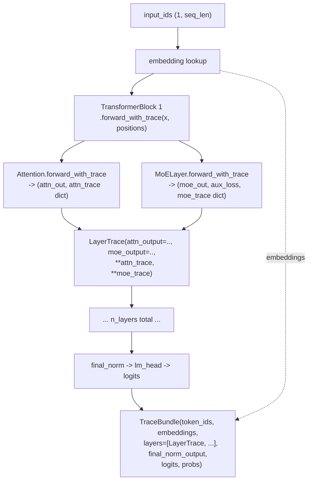
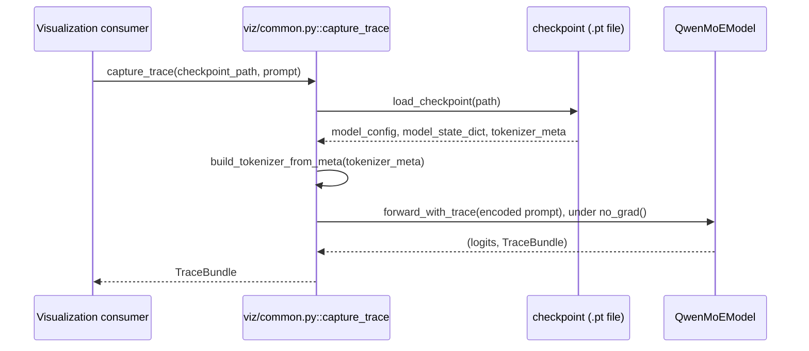

# 012 — Visualization Foundation (Task 12)

**Type:** task · **Date:** 2026-08-31 · **Related:** Requirement 7.1;
design.md `TraceBundle`/`LayerTrace` Data Models,
`model/transformer.py::forward_with_trace`, `viz/common.py::capture_trace`

## What was implemented
- `qwenmoe/model/trace.py` — new `LayerTrace` and `TraceBundle`
  dataclasses, exactly as specified in design.md's Data Models section.
  No batch dimension anywhere: tracing always covers exactly one prompt.
- `positional_trace(positions) -> Tensor | None` — a new hook added to
  `RotaryEmbedding`, `NoPositional`, and `AlibiBias` (mirrors the existing
  `apply_to_qk`/`attention_bias` hook pair from task 3), so `Attention`
  can read "the RoPE angles, the ALiBi bias, or `None`" uniformly without
  caring which scheme it holds. `RotaryEmbedding` was refactored to share
  one `_angles(positions)` helper between `apply_to_qk` and
  `positional_trace`, so there's exactly one computation of the rotation
  angles to keep correct, not two.
- `Attention.forward_with_trace`, `MoELayer.forward_with_trace`,
  `TransformerBlock.forward_with_trace`, and
  `QwenMoEModel.forward_with_trace(input_ids) -> (logits, TraceBundle)` —
  one parallel method per level of the module stack, each performing the
  *exact same* computation as its sibling `forward`, additionally
  capturing the intermediate tensors `LayerTrace`/`TraceBundle` need
  (Requirement 7.1).
- `qwenmoe/viz/common.py::capture_trace(checkpoint_path, prompt) ->
  TraceBundle` — loads a checkpoint, rebuilds its exact tokenizer, and
  calls `forward_with_trace` under `torch.no_grad()`.
- `qwenmoe/tokenizer/base.py::build_tokenizer_from_meta(tokenizer_meta)` —
  factored out of `scripts/generate.py`'s previously-private
  `_load_tokenizer`, now shared by both `scripts/generate.py` and
  `capture_trace` (see decision below).
- 8 new tests in `tests/test_trace.py`, plus a manual run of
  `capture_trace` against the real `runs/smoke_test/checkpoints/
  step_1000.pt` checkpoint and a re-run of `scripts/generate.py` to
  confirm the tokenizer-loading refactor didn't change its behavior.

## Design decisions worth calling out

**`forward_with_trace` is a parallel method per module, not a
`return_trace=True` flag on `forward`.** design.md's own snippet already
shows `QwenMoEModel` with two separate methods, and the same shape
repeats at every level here (`Attention`, `MoELayer`, `TransformerBlock`).
The alternative — one method with a branch — would touch `forward`'s
existing, already-tested signature and control flow for every caller
(the training loop, `generate()`, every existing test), for a feature only
the visualization code needs. Requirement 7.1's actual concern ("source
the numbers ... from a real forward pass ... not illustrative/fabricated
numbers") is satisfied as long as `forward_with_trace` executes the
identical sequence of real tensor operations `forward` does — which it
does, line for line, just with extra capture points spliced in. Each
`forward_with_trace` carries a one-line comment saying so, as a flag for
future edits: if `forward` ever changes, its `forward_with_trace` sibling
needs the matching change. `test_forward_with_trace_matches_forward_
exactly` locks this in with a bit-for-bit `torch.equal` check on logits,
so any future drift between the two fails loudly in CI rather than
silently producing a slightly-wrong animation later.

**`forward_with_trace` only accepts `batch == 1`, and raises `ValueError`
otherwise.** Every shape in design.md's `TraceBundle`/`LayerTrace` is
documented *without* a batch dimension (`embeddings: Tensor  # (seq,
d_model)`, not `(batch, seq, d_model)`) — tracing is always "one real
example prompt", matching `capture_trace(checkpoint_path, prompt)`'s own
single-string signature. Rather than silently accepting a batch and
returning confusing shapes, or silently tracing only the first row of a
larger batch, an explicit upfront check fails clearly. Batch squeezing
itself (`.squeeze(0)`) happens right where each tensor is captured, in
`Attention.forward_with_trace` and `TransformerBlock.forward_with_trace`
— co-located with the computation that produces it, rather than one
big generic "de-batch everything" pass afterward that would need to know
which fields do or don't already lack a batch dimension. (`MoELayer`'s
own trace fields never had a batch dimension to begin with — `x_flat =
x.reshape(-1, d_model)` already flattens `batch * seq_len` into one axis,
which is just `seq_len` when `batch == 1`.)

**`q`/`k`/`v` in `LayerTrace` are captured *before* RoPE rotation, right
after the `w_q`/`w_k`/`w_v` projections.** Requirement 7.2 needs the
embedding/positional-encoding scene (task 13.1) to animate "the RoPE
rotation applied to a query/key vector" — that requires the *pre*-rotation
vector as a starting point, plus the angle to rotate it by
(`rope_angles_or_alibi_bias`), so the scene can animate the transformation
step itself rather than only ever showing the already-rotated result.
`v` is captured at the same point purely for symmetry (it's never
rotated either way). This also means `k`/`v`'s captured shape uses
`n_kv_heads`, not `n_heads` — visibly showing GQA's head-sharing in the
raw data, before the `repeat_interleave` that duplicates them for the
actual score computation.

**`attn_scores_pre_mask` is captured after any ALiBi bias but before the
causal mask.** The "mask" in the field's name refers specifically to the
causal (future-blocking) mask — the one actual masking operation.
ALiBi's additive distance bias isn't a mask (nothing gets set to
`-inf`), and it's already captured separately via
`rope_angles_or_alibi_bias`, so folding it into "pre_mask" too would
double up the same information under two names rather than losing it.

**`expert_outputs` mirrors `MoELayer`'s own zero-token skip exactly.**
Task 5's `MoELayer.forward` already skips a routed expert that received
zero tokens in a batch, with no error and no gradient for it that step
(Requirement 2.5). `forward_with_trace`'s per-expert loop only inserts a
`dict` entry inside the same `if token_idx.numel() == 0: continue` guard
that already exists in `forward` — so `expert_outputs` never claims an
expert "ran" when it didn't, matching design.md's own comment
(`# only populated for dispatched experts`) precisely.
`test_expert_outputs_only_populated_for_dispatched_experts` forces a
1-token, `top_k=1` batch to prove exactly one entry appears.

**`build_tokenizer_from_meta` moved from a private script helper into
`qwenmoe/tokenizer/base.py`.** `scripts/generate.py` already had this
exact "reconstruct a tokenizer from a checkpoint's `tokenizer_meta` dict"
logic as a private `_load_tokenizer` function (task 11). `capture_trace`
needs the identical logic — a checkpoint is a checkpoint regardless of
whether the caller is a generation CLI or a visualization helper. Rather
than pasting a second private copy into `viz/common.py`, the function
moved into the package (next to the existing `build_tokenizer(config:
DataConfig)` factory, as `build_tokenizer_from_meta(tokenizer_meta:
dict)` — kept as a separate function rather than merged into
`build_tokenizer`, since a checkpoint's `tokenizer_meta` dict and a full
`DataConfig` carry different information and neither can build the
other). `scripts/generate.py` now imports the shared version; a manual
CLI re-run against the real smoke-test checkpoint reproduced its exact
prior output (including the previously-documented "The the the the..."
repetition-loop finding), confirming the refactor changed nothing.

## Concepts explained for a complete beginner

### Tracing (instrumenting) a forward pass

- **What it means:** running a model's real computation exactly as
  normal, but additionally recording a copy of every intermediate value
  it computes along the way — not just the final output — so something
  else (here, a visualization) can inspect and display them afterward.
- **Why it exists:** a trained neural network's forward pass normally
  only exposes its final output (logits); everything computed on the way
  there (attention scores, router probabilities, which expert handled
  which token) is thrown away the moment the next line of code runs.
  Requirement 7.1 needs those intermediate numbers to be *real* — sourced
  from an actual forward pass on an actual input — rather than
  hand-typed illustrative numbers a diagram-maker made up, so an
  animation can be trusted to represent what the model truly does.
  Tracing is the general technique for keeping those otherwise-discarded
  intermediate values around.
- **Analogy:** the difference between a chef who only hands you the
  finished plate (a normal forward pass — you only ever see the logits),
  and a chef who also sets aside a small sample of the dish at every
  stage of cooking — the raw ingredients, the halfway-reduced sauce, the
  plated-but-ungarnished result — so a documentary crew can film each
  step afterward without having to re-cook the entire
  dish from a recipe card (fabricated numbers) and hope it happens to
  match what actually came out of the kitchen.
- **Simple technical explanation:** every `forward_with_trace` method in
  this codebase runs the identical arithmetic its `forward` sibling does,
  line by line, and simply also assigns selected intermediate tensors
  into a plain dataclass (`LayerTrace`, then `TraceBundle`) instead of
  letting them go out of scope unused.
- **How it relates here:** `QwenMoEModel.forward_with_trace` is the one
  entry point every visualization in `qwenmoe/viz/` (and later
  `token_journey/`'s web walkthrough) depends on
  (Requirement 7.1); `capture_trace(checkpoint_path, prompt)` is the
  thin wrapper that loads a real checkpoint and calls it under
  `torch.no_grad()` (no need to track gradients — nothing here gets
  trained).
- **Paper:** [A Multiscale Visualization of Attention in the Transformer Model (Vig, 2019)](https://arxiv.org/abs/1906.05714)
  — the tool (BertViz) this paper introduces is built on exactly this
  idea: capturing real attention weights from a real forward pass (rather
  than a fabricated illustration) so they can be rendered interactively.
- **Blog:** [The Illustrated Transformer (Alammar, 2018)](https://jalammar.github.io/illustrated-transformer/)
  — the broader inspiration for "animate the real math instead of just
  describing it in prose" that Requirement 7 as a whole is built around;
  none of its diagrams are backed by a live model the way this project's
  `TraceBundle` is, which is exactly the gap task 12 exists to close.

## Diagrams

How one call to `forward_with_trace` assembles a `TraceBundle`:

The real pipeline a visualization (originally tasks 13-14's Manim scenes,
later removed; now `token_journey/`'s web walkthrough) uses to get real numbers:

## Questions that might come to mind

**Why not just add a `return_trace=True` argument to the existing
`forward` method instead of a whole new method per module?** That would
force every existing caller of `forward` (the training loop, `generate()`,
every test in `tests/test_model.py`/`test_attention.py`/`test_moe.py`) to
tolerate a code path they never asked for, and would make `forward`
itself branchier and harder to read. A parallel method keeps the change
fully additive — nothing that already worked had to be touched — which
also matches exactly how design.md itself sketches `QwenMoEModel` with
two separate methods.

**If `q`/`k` in `LayerTrace` are captured *before* RoPE rotation, how
would a scene show the *rotated* vectors?** It recomputes the rotation
itself, using the captured `rope_angles_or_alibi_bias` angle tensor and
the same rotate-half formula from `positional.py` — the point of
capturing the *pre*-rotation vector plus the *angle* separately (rather
than only the final rotated result) is so a scene can animate the
transformation step by step, not just flash the end state.

**Does tracing slow down or change a real training run?**  No —
`forward_with_trace` is never called by `Trainer.fit` or `generate()`;
it's an entirely separate method only `capture_trace` and its
visualization callers use, always under `torch.no_grad()`. Training keeps using the
original `forward` exactly as before.

**Why is `expert_outputs` a `dict[int, Tensor]` instead of a list or a
single stacked tensor?** Because not every expert necessarily receives a
token in a given forward pass (Requirement 2.5) — a `dict` naturally
represents "this expert ran, here's its output" vs. "this expert didn't
run" without needing a sentinel value (like an all-zeros tensor) to mean
"skipped", which could be confused with a real, legitimately-all-zero
output.

**Why does a visualization task also touch `scripts/generate.py`?**
Because `capture_trace` needs the exact same "rebuild a tokenizer from a
checkpoint's `tokenizer_meta`" logic `scripts/generate.py` already had,
and that logic was previously private to that one script. Sharing it
(rather than pasting a second copy) means there's only one place that
logic can go wrong, and a manual re-run of `scripts/generate.py` after
the move confirmed its behavior is unchanged.

## Tests

`tests/test_trace.py` (8 tests): every `TraceBundle`/`LayerTrace` field
populated with the expected shape, parametrized over all three
positional schemes (`rope`/`nope`/`alibi`) since they disagree on what
`rope_angles_or_alibi_bias` looks like; `forward_with_trace`'s logits
exactly match `forward`'s (`torch.equal`, not just close); the
`batch != 1` rejection; `expert_outputs` only containing dispatched
experts; and `capture_trace` end to end against a real saved checkpoint,
including its own empty-prompt rejection. Full suite: 160 passed.
