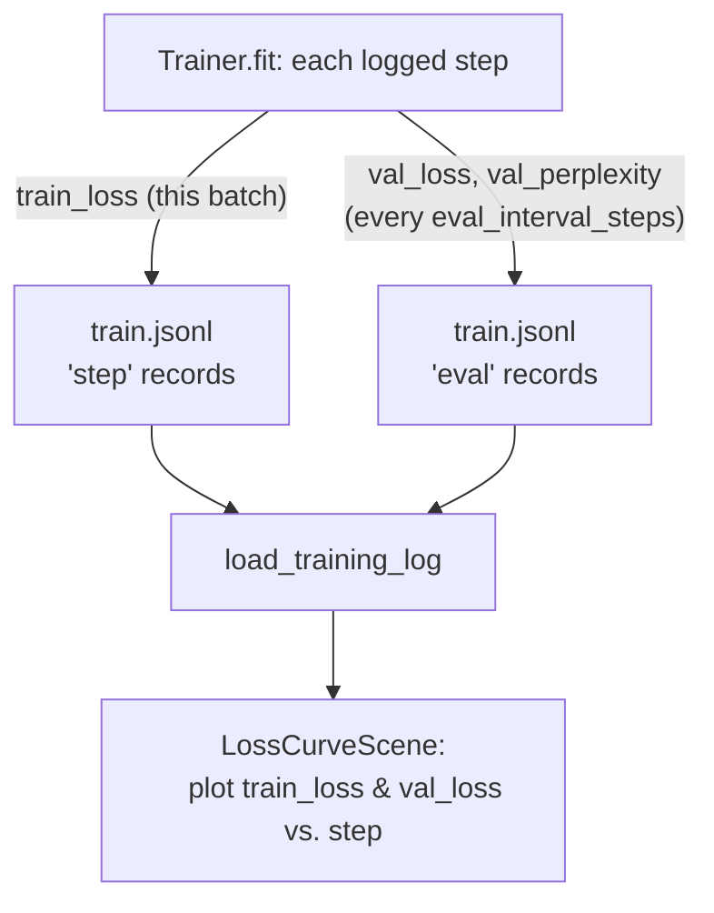
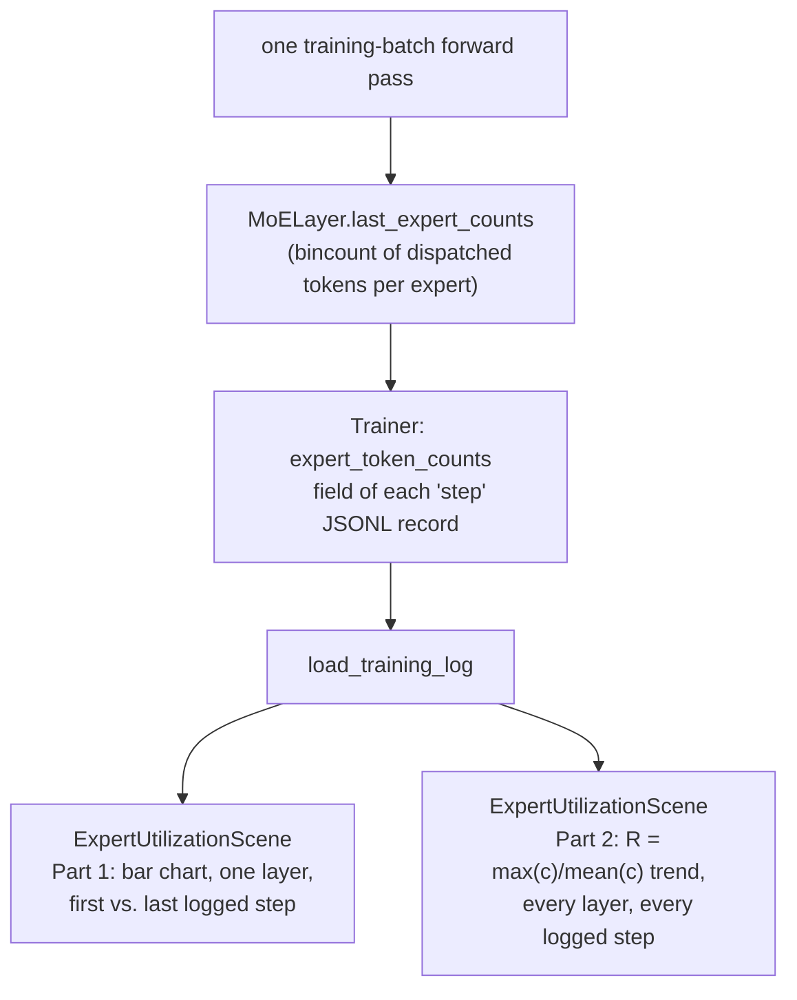

# 014 — Training/Run Observability Scenes (Task 14)

**Type:** task · **Date:** 2026-08-31 · **Related:** Requirements 8.1-8.3;
design.md `viz/` Components and Interfaces; `qwenmoe/viz/scenes_training.py`,
`tests/test_scenes_training_errors.py`, `scripts/render_viz.py`

## What was implemented

- **`qwenmoe/viz/scenes_training.py::load_training_log(log_path) ->
  TrainingLog`** — parses a real `Trainer`-written `train.jsonl` (task
  10.1) into a small dataclass (`steps`/`train_loss`, `eval_steps`/
  `val_loss`/`val_perplexity`, `expert_steps`/`expert_token_counts`).
  Raises a clear, actionable `FileNotFoundError` if the file doesn't
  exist yet, and a clear `ValueError` for a present-but-unusable file
  (empty, or a malformed JSON line) — both **before** either scene below
  creates a single Manim mobject (Requirement 8.3).
- **`LossCurveScene`** (Requirement 8.1) — animates real `train_loss` and
  `val_loss` over every logged step of the real
  `runs/smoke_test/logs/train.jsonl`, via a new hand-built line-chart
  helper (`_line_chart`).
- **`ExpertUtilizationScene`** (Requirement 8.2) — animates real
  per-expert token-count distributions (bar chart, one layer, first vs.
  last logged step) and a real max/mean imbalance-ratio trend for
  *every* layer across the whole run (line chart) — directly answering
  "does load-balancing actually change over time?" with real numbers.
- **`tests/test_scenes_training_errors.py`** — 10 tests: `FileNotFoundError`/
  `ValueError` cases for `load_training_log`, correct parsing of a
  hand-built log, and both `Scene` subclasses raising before touching
  any Manim primitive (verified via `scene.mobjects == []`).
- **`scripts/render_viz.py`** extended with two more entries
  (`loss_curve`, `expert_utilization`) so every Manim scene in this
  project — tasks 13 and 14 alike — stays documented through one CLI.

## Concepts explained for a complete beginner

### Loss curve: plotting train vs. validation loss over training steps

- **What it means:** a "loss curve" is just a line chart with training
  step (or epoch) on the x-axis and the loss value (already explained as
  cross-entropy loss in `journey_of_a_model/010-training-loop.md`) on
  the y-axis — one line for the loss measured on the data the model is
  actually being updated from (`train_loss`), and a second line for loss
  measured on data it never trains on (`val_loss`).
- **Why it exists:** a single loss number tells you "how wrong is the
  model right now", but says nothing about *trajectory* — is it still
  improving, stuck, or actively getting worse on data it hasn't
  memorized? Plotting many loss numbers side by side over time turns a
  long column of numbers no human can track into a shape a human can
  read at a glance.
- **Real-world analogy:** a fever chart on a hospital patient's bedside
  chart. A single temperature reading tells you "feverish or not right
  now"; the chart of readings over the whole stay tells you whether the
  fever is trending down (recovering), plateaued (not responding to
  treatment), or — the concerning pattern — down then back up again.
  Train loss is like the patient's own reported symptoms; validation
  loss is like an independent, harder-to-fool blood test on a sample the
  "treatment" (training) was never shown.
- **Simple technical explanation:** `Trainer.fit` already writes
  `train_loss` in every `"step"` JSON-lines record and `val_loss`/
  `val_perplexity` in every `"eval"` record (task 10.1). `load_training_log`
  just collects these into two `(step, value)` series; `LossCurveScene`
  draws both as connected polylines sharing one pair of axes.
- **How it relates to this project:** the standard *diagnostic* reading
  of a loss curve — train keeps falling while validation bottoms out and
  then rises — is the textbook signature of overfitting. This project's
  real `runs/smoke_test` run shows no such divergence: both curves fall
  together and flatten together by step 1000 (see Outcome below), i.e.
  no overfitting signal yet in this short smoke-test run.

- **Paper/blog links:** the practice of plotting an optimization
  objective against iteration count traces back to stochastic iterative
  optimization itself — [Robbins & Monro, "A Stochastic Approximation
  Method" (1951)](https://doi.org/10.1214/aoms/1177729586), the paper
  that first formalized updating an estimate step by step from noisy
  (mini-batch-like) observations, which SGD and its descendants
  (including this project's AdamW) are modern instances of. For reading
  the *shape* of a loss curve in a deep-learning context specifically,
  Google's [Machine Learning Crash Course: Interpreting Loss
  Curves](https://developers.google.com/machine-learning/crash-course/overfitting/interpreting-loss-curves)
  is a clear, example-driven supplementary explainer (ideal/overfit/
  underfit/oscillating patterns side by side).

### Expert-utilization distribution, and a max/mean imbalance ratio

- **What it means:** for one MoE layer, "expert-utilization
  distribution" is simply how many tokens (out of one batch) were
  dispatched to each of its `n_routed_experts` experts — the same
  `expert_token_counts` already logged for Requirement 8.2. The **max/mean
  imbalance ratio** introduced in this scene (not a term from any paper
  — a small project-specific summary number, called out explicitly as
  such) compresses that whole distribution into one number describing
  *how* balanced it is.
- **Why it exists:** a bar chart of 4 (or 8) numbers is easy to read once,
  but comparing "was step 100 more or less balanced than step 1000?"
  from two side-by-side bar charts requires the viewer to do the ratio
  math themselves. A single trend line over every logged step answers
  "is the load-balancing aux loss (`journey_of_a_model/005-moe-layer.md`)
  actually doing its job over the course of training?" directly.
- **Real-world analogy:** think of `n_routed_experts` cashier lines at a
  supermarket and `c_e` shoppers currently in line `e`. If one line has
  way more people than the store's average line length, that's a bad
  (imbalanced) queuing outcome even if you don't know the exact count in
  every single line — "the busiest line has 1.7x the average line's
  length" is instantly meaningful in a way that reading out 4 raw counts
  usually isn't.
- **Full derivation:** let $c_1, \ldots, c_E$ be the token counts
  dispatched to each of $E = $ `n_routed_experts` experts in one batch
  (`MoELayer.last_expert_counts`, entry 010). Define the mean load
  $$\bar{c} = \frac{1}{E}\sum_{e=1}^{E} c_e$$
  Under **perfectly even** routing, every expert would receive exactly
  the average, i.e. $c_e = \bar{c}$ for every $e$. Define the imbalance
  ratio
  $$R = \frac{\max_e(c_e)}{\bar{c}}$$
  Two bounds fall out immediately from the definition of "max": since
  the maximum of any set of numbers is never smaller than their mean,
  $\max_e(c_e) \ge \bar{c}$ always, so $R \ge 1$ always, with equality
  **exactly** when every expert's count equals the mean (perfect
  balance — the floor of this metric, never a negative or sub-1 value).
  At the opposite extreme, if every token in the batch collapsed onto a
  single expert, that expert's count would be the whole batch
  ($\sum_e c_e = E\bar c$), giving $R = E$ — the worst possible value,
  bounded by the number of experts itself: $1 \le R \le E$.
- **Worked numeric example (real numbers, not fabricated dummy values):**
  this project's own real `runs/smoke_test/logs/train.jsonl`, layer 1, at
  step 100: $c = [1719, 673, 962, 742]$.
  $$\bar{c} = \frac{1719+673+962+742}{4} = \frac{4096}{4} = 1024$$
  $$R = \frac{\max(1719,673,962,742)}{1024} = \frac{1719}{1024} \approx 1.679$$
  The same layer at step 1000: $c = [1157, 1007, 940, 992]$,
  $\bar c = 4096/4 = 1024$ again (the batch size and top-k are fixed, so
  the total dispatched-slot count $E\bar c$ is constant across steps),
  and
  $$R = \frac{1157}{1024} \approx 1.130$$
  — a real, measured drop from 1.679 to 1.130 over the course of this
  training run (rounded to 1.68 -> 1.13 on screen).
- **How it relates to this project:** $R$ is a **read-only diagnostic**
  computed after the fact from hard dispatch counts, purely for this
  visualization. It is not the same thing as the differentiable
  load-balancing auxiliary loss `AuxLossBalancer` actually optimizes
  during training (`journey_of_a_model/005-moe-layer.md`), which is
  computed from *soft* router probabilities so gradients can flow
  through it. $R$ can't be used as a training signal (it's not
  differentiable, being built from `argmax`-derived hard counts), but it
  is far easier to explain and animate for a "did balancing actually
  work?" visual answer.

- **Paper/blog links:** the underlying motivation — why uneven expert
  load is a problem worth measuring at all — is the same
  Shazeer et al. (2017) and Fedus, Zoph & Shazeer (2021, Switch
  Transformers) motivation already cited and derived in full in
  `journey_of_a_model/005-moe-layer.md`; this entry only adds a
  visualization-only summary statistic on top, not a new training
  mechanism.

## Design decisions worth calling out

**A new hand-built line-chart helper, `_line_chart`.** Every prior Manim
scene in this project only ever needed bar charts (`_manual_bars`,
copied verbatim again here for the same reason: no LaTeX on this
machine, and `Axes`/`BarChart` both default to LaTeX-rendered tick
labels). A loss curve and an over-time trend are fundamentally *line*
charts, so `_line_chart` hand-computes axis scaling from the real data's
own min/max (with padding), draws plain `Line` axes and `Text` tick
labels, and plots each series as a `VMobject.set_points_as_corners`
polyline plus a `Dot` per real logged point — the same
LaTeX-avoidance technique this project has used since the very first
Manim preview, just applied to a new chart shape.

**Both `Scene` subclasses accept a `log_path` constructor override.**
`LossCurveScene(log_path=...)`/`ExpertUtilizationScene(log_path=...)`
default to the same `runs/smoke_test/logs/train.jsonl` convention every
other scene hardcodes for its checkpoint, but accepting an override
(stored before calling `super().__init__()`, since Manim's own `Scene.__init__`
doesn't accept arbitrary kwargs) is what makes Requirement 8.3 testable
at all: `tests/test_scenes_training_errors.py` constructs a scene
pointed at a nonexistent path and calls `.construct()` **directly**,
without ever invoking `manim`'s CLI or render pipeline. This relies on a
fact confirmed by hand before writing the tests: instantiating a bare
`manim.Scene()` and calling `.construct()` does no rendering, opens no
ffmpeg process, and needs no display — it only costs the one-time
`manim` import (~1.3s); a `Scene`'s `.mobjects` list starts (and, if
`construct()` raises immediately, stays) empty, giving a clean
"nothing was ever drawn" assertion for free.

**Real finding: this run's two MoE layers balance at very different
rates.** The max/mean ratio trend (Part 2) surfaced a genuine asymmetry
neither part of this task set out to look for: layer 1's ratio falls
from 1.68 (step 100) to ~1.05-1.13 by step 400 and stays there, while
layer 0's ratio stays essentially flat around 1.25-1.30 for the entire
run. Both layers share an identical `MoELayer` architecture and the same
aux-loss coefficient, so this is a real, currently-unexplained property
of *this* run, not a bug in the visualization code (double-checked by
recomputing every ratio by hand from the raw log outside of Manim before
trusting what got animated) — recorded here rather than glossed over,
matching this project's real-numbers-only ethos.

**`scripts/render_viz.py` extended, not left task-13-only.** Task 14's
checklist doesn't explicitly ask for this, but leaving two real,
runnable scenes out of the one CLI that documents "every Manim scene in
this project" would make that CLI quietly incomplete; the change was two
dictionary entries plus an epilog note, not a new mechanism.

## Questions that might come to mind

- **Why plot train *and* validation loss instead of just one?** Train
  loss alone can't reveal overfitting — it can keep falling even as the
  model starts memorizing training-set noise. Validation loss, measured
  on held-out data, is the independent check; the textbook overfitting
  signature is train still falling while validation bottoms out and
  rises (Google's Interpreting Loss Curves guide, linked above). This
  project's real run shows both curves still falling together at step
  1000 — no overfitting signal yet, just a short smoke test.
- **Why summarize imbalance with max/mean instead of the aux loss value
  itself?** `aux_loss` (already logged) is the actual differentiable
  training signal, computed from soft router probabilities. $R$ here is
  a simple, non-differentiable, purely descriptive number computed from
  hard dispatch counts after the fact — easier to explain and animate,
  but never used for training.
- **Why does layer 1 balance so much better than layer 0 in this real
  run?** Genuinely not fully explained yet — both layers are
  architecturally identical. A plausible hypothesis is that layer 0
  routes on hidden states much closer to the raw embedding (less
  differentiated / task-specific representation to route on), making
  confident, spread-out routing decisions harder to learn — but this is
  a hypothesis, not a verified conclusion, and is flagged as such rather
  than stated as fact.
- **Why max/mean and not, say, a coefficient of variation (std/mean)?**
  Max/mean only needs concepts (maximum, mean) already used elsewhere in
  this project, at the cost of ignoring the shape of the rest of the
  distribution — two very different-looking distributions could share
  the same $R$ if they happen to share the same busiest expert's share.
  A worthwhile alternative for a future pass, not implemented here to
  keep this task's scope to what Requirement 8.2 actually asks for.
- **What happens if I point these scenes at a run with more than 2
  layers, or a different `n_routed_experts`?** Both scenes read `E` and
  `n_layers` from the real log's own array shapes (`len(...)`) rather
  than hardcoding SMOKE_TEST's `n_layers=2`/`n_routed_experts=4`, so a
  `BASELINE`-scale run's log would render with 6 bars and up to 6 layer
  curves without any code change — only `_LAYER_COLORS` caps the number
  of distinctly-colored trend lines at 6.

## Outcome

- 170 tests pass (160 before this task + 10 new dense tests in
  `tests/test_scenes_training_errors.py`).
- Both scenes rendered manually at `-ql` (480p15) against the real
  `runs/smoke_test/logs/train.jsonl`, verified via the established
  coarse-contact-sheet-then-settled-frame process: axis tick values
  (e.g. `1.97`/`2.91`/`3.85` on the loss chart, `0.99`/`1.36`/`1.74` on
  the ratio chart) were independently recomputed in a plain Python
  script from the raw log and matched the rendered frames exactly. The
  known, already-accepted title/setup-text overlap cosmetic quirk
  (documented since task 9's preview) is present here too, deliberately
  left as-is for consistency with the rest of the series rather than
  fixed in isolation.
- `scripts/render_viz.py --help` now documents all 7 Manim scenes in
  this project (5 from task 13, 2 from this task) through one CLI.
