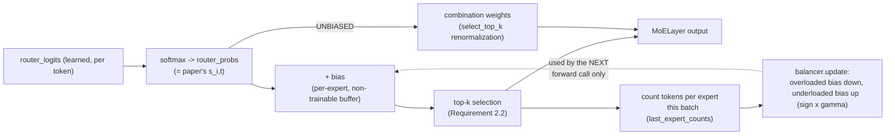
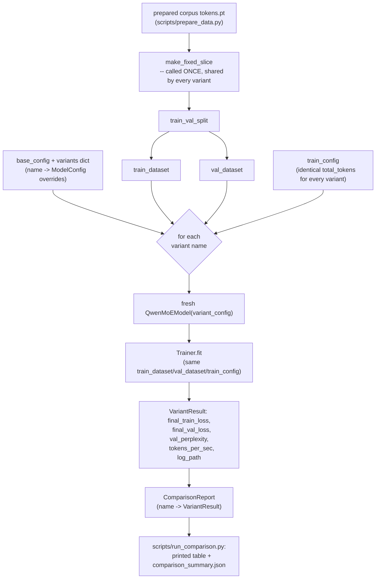

# 015 — Research-Style Comparison Framework (Task 15)

**Type:** task · **Date:** 2026-08-31 · **Related:** Requirements 11.5,
12.3, 12.6, 12.7; design.md `model/moe.py` (`LossFreeBalancer`) and
`train/compare.py` components

## What was implemented

- **`qwenmoe/model/moe.py::LossFreeBalancer`** (15.1) — the DeepSeek-V3
  auxiliary-loss-free, bias-adjusted MoE load-balancing strategy.
  `build_balancer` now actually constructs it for
  `moe_balancing="loss_free"` instead of raising `NotImplementedError`
  (task 5's placeholder). `AuxLossBalancer` gained a matching no-op
  `update()` method so both balancers share one interface.
  `MoELayer.forward` calls `self.balancer.update(...)` automatically,
  gated on `self.training`.
- **`qwenmoe/train/compare.py::run_comparison`** (15.2) plus its
  `VariantResult`/`ComparisonReport` dataclasses — trains one
  `QwenMoEModel` per named config variant, all on one identical fixed
  token slice and one identical token budget (Requirements 11.5, 12.6),
  returning each variant's final train/val loss, perplexity, and
  measured throughput.
- **`scripts/run_comparison.py`** (15.3) — a CLI comparing named
  `configs/presets.py` presets, printing a comparison table and saving a
  `comparison_summary.json` (Requirement 12.7).
- **5 new presets** in `configs/presets.py` (`POS_NOPE`, `POS_ALIBI`,
  `ACT_GEGLU`, `ACT_GELU`, `MOE_LOSSFREE`), each swapping exactly one
  architectural axis relative to `SMOKE_TEST` — matching design.md's own
  illustrative preset list, added so the new CLI has something real and
  fast to compare.
- **26 new tests**: 15 replacing the old `test_moe_layer_loss_free_
  balancing_not_yet_implemented` placeholder in `tests/test_moe.py`, 6 in
  new `tests/test_compare.py`, 5 parametrized cases added to
  `tests/test_config.py` for the new presets.

## Design decisions worth calling out

**The bias is added to the *softmax* routing score, not the raw
pre-softmax logit — a subtle but important faithfulness point.** The
paper's formula (Eq. 3, derived below) adds $b_i$ to $s_{i,t} =
G(\mathbf u_t^T\mathbf e_i)$ — the score **after** the gating nonlinearity
$G$ (sigmoid in their main experiments; they note softmax as an
alternative in Appendix C). This project's `Router`/`AuxLossBalancer`
already standardized on softmax as $G$ throughout. So the faithful
translation is: bias gets added to `router_probs` (post-softmax), not
`router_logits`. `LossFreeBalancer.selection_scores(router_logits)`
still takes `router_logits` as its argument, exactly like
`AuxLossBalancer.selection_scores`, and recomputes the softmax
internally — a small redundant computation traded for keeping both
balancers' method signature identical, so `MoELayer` never needs an
`isinstance` check. `test_loss_free_balancer_selection_scores_adds_bias_
to_softmax_probs` locks this in directly.

**The bias update is gated on `self.training`, mirroring how
`BatchNorm`'s running-mean/variance buffers only update in training
mode.** Design.md says the bias updates "after each training step" — this
project's one call to `MoELayer.forward` inside `Trainer._forward_backward_
step` *is* one training step, so gating the update on `self.training`
(rather than adding a separate `Trainer`-level hook) makes it happen
automatically, with zero changes needed to `Trainer` itself. It also means
`Trainer._evaluate`'s validation-only forward passes (which call
`model.eval()` first) never perturb the bias using validation-set load
statistics — the same reason `BatchNorm` freezes its running stats during
`.eval()`. `forward_with_trace` (used only for visualization/inference tracing,
never training) deliberately never calls `update()` at all, regardless of
`self.training`, so a visualization pass can never silently mutate a
loaded checkpoint's learned bias.

**`run_comparison` takes an explicit `output_dir` parameter beyond
design.md's one-line signature** — the same pragmatic gap `Trainer.fit`
already had (design.md never mentions its real `resume_from` parameter
either). `Trainer` itself requires an `output_dir` to write
checkpoints/logs to, so `run_comparison` needs one too, passed down as
`output_dir/<variant_name>/` per variant.

**`variants: dict[str, dict]` supports two calling conventions with zero
special-casing**, both just `dataclasses.replace(base_config, **overrides)`
under the hood:
1. A sparse delta against a meaningful `base_config` (e.g.
   `{"positional_scheme": "nope"}`) — natural for a unit test or a
   hand-written ablation script.
2. A full `dataclasses.asdict(some_preset)` — what `scripts/run_
   comparison.py` passes, since its whole job is comparing independent
   *named presets*, not deltas off a shared base. Here `base_config` is
   almost irrelevant (every field gets overridden anyway); the CLI just
   picks the first named preset as a placeholder anchor.

Either way, `vocab_size` is force-overridden from the prepared
tokenizer's real value *after* the caller's overrides are applied, so a
preset's placeholder `vocab_size` (`configs/presets.py`'s own documented
convention since task 2) can never silently leak through and mismatch the
real tokenizer. `test_run_comparison_full_preset_dict_overrides_every_
field` checks this explicitly.

**Ablation presets extend `SMOKE_TEST`, not `BASELINE`.** `BASELINE` is
sized for illustrative real-world scale (requirements.md's derivation);
`SMOKE_TEST` is this project's own "actually finishes in minutes on a
laptop" config, already proven out in task 10. A comparison study that
takes hours per variant isn't a usable teaching tool, so every new preset
here is `dataclasses.replace(SMOKE_TEST, <one field>)`.

**`torch.manual_seed(train_config.seed)` is reset immediately before
*each* variant's `QwenMoEModel(...)` construction**, so variants whose
architecture doesn't change parameter shapes (e.g. a positional-scheme
swap — RoPE/NoPE/ALiBi add no learnable parameters at all) get
bit-identical initial weights, isolating the architectural change from
random-init luck. This has a real limit, worth being honest about: an
`activation` swap (`gelu` has 2 weight matrices per expert vs. `swiglu`/
`geglu`'s 3) draws a different number of random values from the same
seeded stream, so subsequent submodules' initializations desync between
those two variants even under an identical seed. Re-seeding is still the
best available practice here — it's what a real ablation study does too
— it just can't fully equalize initialization once architectures
materially differ in parameter count.

## Concepts explained for a complete beginner

### Auxiliary-loss-free (bias-adjusted) MoE load balancing

- **What it means:** instead of adding an extra *loss term* that
  encourages balanced expert routing (task 5's `AuxLossBalancer`), keep
  one plain number per expert — a **bias** — that gets added to that
  expert's routing score only when deciding *which* experts win the
  top-`k` slots. After watching how many tokens each expert actually got
  this batch, nudge every overloaded expert's bias down a little and
  every underloaded expert's bias up a little, by the same fixed amount
  each time — no loss, no gradient, just bookkeeping between batches.
- **Why it exists:** task 5's `AuxLossBalancer` works by *literally adding
  a term to the loss the model is trained to minimize* — but that term
  fights with the model's real goal (predicting the next token well).
  Turn the balancing pressure up too far and it measurably hurts language
  modeling quality; turn it down and load stays imbalanced. DeepSeek's
  authors wanted a way to control load balance *without* injecting any
  interfering gradient into training at all.
- **Real-world analogy:** think of a restaurant host assigning parties to
  servers. One way is to instruct every server "always try to keep tables
  balanced" as a standing rule mixed into everything else they do (an
  "auxiliary" instruction competing with "serve customers well"). A
  cleaner way: the host alone keeps a running tally of who's gotten
  busy lately, and *silently biases their own seating decisions* toward
  quieter servers — the servers themselves never change how they serve
  customers; only the host's assignment habit adapts, based purely on
  what's already happened.
- **Simple technical explanation:** an expert-wise bias vector
  $b_1,\dots,b_N$ (one per routed expert, starting at 0) is added to the
  routing score only for the top-$k$ decision:
  $$g_{i,t} = \begin{cases} s_{i,t}, & s_{i,t}+b_i \in \text{Top-}k\big(\{s_{j,t}+b_j\}_{j=1}^N\big) \\ 0, & \text{otherwise} \end{cases}$$
  where $s_{i,t}$ is expert $i$'s plain (unbiased) routing score for token
  $t$ — this project's `router_probs`. Crucially, the *value* used once an
  expert is selected (the combination weight multiplying its output) is
  still the original unbiased $s_{i,t}$, never $s_{i,t}+b_i$ — the bias
  only ever influences *which* experts get chosen, never *how much* a
  chosen expert's output counts.
- **How it relates here:** `LossFreeBalancer.selection_scores` computes
  $s_{i,t}+b_i$; `select_top_k` (task 5, unchanged) still gathers
  combination weights from the plain `router_probs` passed in separately.
  `LossFreeBalancer.aux_loss` always returns `None` — there genuinely is
  no loss term.
- **Paper:** [Auxiliary-Loss-Free Load Balancing Strategy for Mixture-of-Experts (Wang, Gao, Zhao, Sun & Dai, DeepSeek-AI, 2024)](https://arxiv.org/abs/2408.15664)
  — adopted in production by
  [DeepSeek-V3 (DeepSeek-AI, 2024)](https://arxiv.org/abs/2412.19437),
  whose technical report cites this exact strategy as the load-balancing
  mechanism behind its 671B-parameter MoE.
- **Blog:** [Mixture-of-Experts (MoE) LLMs — Cameron R. Wolfe](https://cameronrwolfe.substack.com/p/moe-llms),
  which also notes (citing the DeepSeek-V3 report) that DeepSeek still
  keeps a very small *auxiliary* loss as a backstop in production — the
  bias mechanism does the heavy lifting, but isn't necessarily used as
  the *only* balancing signal at the largest scale. Worth knowing as a
  nuance, even though this project's `LossFreeBalancer` implements the
  paper's pure loss-free version (`aux_loss` returning `None`) exactly as
  Requirement 12.3 describes it.

#### Full derivation of the bias update rule

The paper's Algorithm 1, for each training batch:
1. Count tokens dispatched to each expert this batch: $c_1,\dots,c_N$.
2. Compute the average load: $\bar c = \frac1N\sum_i c_i$.
3. Compute each expert's **load violation error**: $e_i = \bar c - c_i$
   (positive means expert $i$ is *underloaded* relative to average;
   negative means *overloaded*).
4. Update every bias by a fixed step $\gamma$ (called the *bias update
   rate*), in the **sign** of the violation only — not scaled by its
   magnitude:
   $$b_i \leftarrow b_i + \gamma\cdot\text{sign}(e_i)$$

The paper explicitly tested a magnitude-weighted variant ($b_i \leftarrow
b_i + \gamma\cdot e_i$) in an ablation and found it "slightly improves
load balance but does not lead to better performance" — so they kept the
simpler sign-only version, which this project's `LossFreeBalancer.update`
also uses. $\gamma$ has no closed-form value — it's a tuned
hyperparameter; the paper's own sweep (at 1B-3B model scale, batch size
1152-1728) found $\gamma=0.001$ best, with $0.0001$ converging too slowly
and $0.01$ causing late-training oscillation. This project's default
(`update_rate=0.01`) is deliberately larger than the paper's tuned value:
at this project's scale (4-8 routed experts, batches of a few hundred
tokens rather than the paper's 64 experts / thousands of tokens),
adaptation needs to be faster to matter within a run that's only hundreds
of steps long, not tens of thousands — the same "tune the demo, don't
blindly copy production hyperparameters" lesson task 10's toy-run
`warmup_steps` already established.

#### Worked numeric example

Take 4 routed experts, one batch where expert 0 is heavily overloaded:
counts $c = [10,\ 2,\ 4,\ 4]$, $\gamma=0.1$.

1. Average load: $\bar c = (10+2+4+4)/4 = 5.0$.
2. Violation: $e = \bar c - c = [5{-}10,\ 5{-}2,\ 5{-}4,\ 5{-}4] =
   [-5,\ 3,\ 1,\ 1]$.
3. Sign: $\text{sign}(e) = [-1,\ 1,\ 1,\ 1]$.
4. Bias update: $b \mathrel{+}= 0.1\times[-1,1,1,1] = [-0.1,\ 0.1,\ 0.1,\ 0.1]$
   (starting from $b=[0,0,0,0]$, so $b$ is now exactly this).

`test_loss_free_balancer_update_nudges_overloaded_down_underloaded_up`
checks exactly this arithmetic. Now watch the *selection-flipping* effect
over repeated rounds: suppose one token's plain routing probabilities are
$p=[0.5,\ 0.2,\ 0.2,\ 0.1]$ and `top_k=1` — with no bias, expert 0 wins
every single round (highest raw score, $0.5$). If expert 0 keeps winning
every round (and is therefore always "the overloaded expert" each time,
since with `top_k=1` exactly one expert is selected per token), its bias
keeps dropping by $-\gamma$ every round while every other expert's bias
keeps rising by $+\gamma$. After 6 rounds at $\gamma=0.1$: $b_0=-0.6$,
$b_1=b_2=b_3=+0.6$. Biased scores become $p+b = [0.5{-}0.6,\ 0.2{+}0.6,\
0.2{+}0.6,\ 0.1{+}0.6] = [-0.1,\ 0.8,\ 0.8,\ 0.7]$ — expert 0, once the
runaway favorite, is now the *lowest*-scoring expert, and routing flips to
expert 1 or 2 instead. This is exactly the "measurably flatten expert-
selection frequency over steps" behavior task 15.1 asks to test; the real
test (`test_loss_free_balancer_bias_flattens_selection_frequency_over_
repeated_imbalance`) runs 40 such rounds on a similarly lopsided example
and confirms expert 0's win rate over the last 5 rounds is strictly lower
than over the first 5.



### Research-style architecture comparison (ablation study)

- **What it means:** an "ablation study" trains several near-identical
  models that each differ in exactly *one* architectural choice (e.g.
  positional scheme, or MoE balancing strategy), under matched training
  conditions, so any difference in the final results can be attributed to
  that one changed choice — not to noisy, unrelated differences in how
  much data or compute each one got.
- **Why it exists:** if two models are compared but one also happened to
  train on more tokens, or on different (randomly different) data, an
  observed loss difference is confounded — you can't tell whether the
  architecture or the training conditions caused it. Controlling every
  other variable is what makes the *one* remaining difference
  scientifically meaningful.
- **Real-world analogy:** a controlled drug trial. To test whether one
  medication ingredient makes a difference, every other condition
  (dosage schedule, patient demographics, measurement method) is held
  identical between the treatment and control groups — the *only*
  deliberate difference is the one ingredient being studied. Randomizing
  or varying anything else would make the result impossible to interpret.
- **Simple technical explanation:** `run_comparison` takes one
  `base_config`, a dict of named variants (each a set of `ModelConfig`
  field overrides), one `data_config`, and one `train_config`. It slices
  the identical fixed set of tokens *once* (`make_fixed_slice`, task 8.2 —
  see `journey_of_a_model/008-data-pipeline.md` for the full chunk-shuffle
  derivation, not repeated here) and reuses that same `train_dataset`/
  `val_dataset` pair, and the identical `train_config` (so every variant
  gets the identical `total_tokens` budget too — Requirement 11.5, see
  `journey_of_a_model/009-scaling-law-utilities.md`'s `epochs_for_budget`
  for why a token *budget* is itself a deliberate planning choice), for
  every named variant's `Trainer.fit` call.
- **How it relates here:** this is the first task to actually *use*
  `make_fixed_slice`/`fixed_slice_tokens` for its intended purpose — task
  8 built it, task 15 is the first real caller.
- **Paper:** ablation studies as a methodology predate any single paper —
  the term itself is borrowed from surgery ("ablation" = removal) via
  neuroscience lesion studies, and its use in deep learning to mean
  "remove/swap one component, hold everything else fixed" is now
  universal practice rather than attributable to one source; this
  project's design.md cites no single paper for it either. The
  *practice* this task specifically packages up (comparing positional
  schemes, activations, and balancing strategies under one matched
  budget) mirrors how the DeepSeek-V2/V3 papers themselves report their
  own architectural ablations.



## Questions that might come to mind

- **If the bias never affects a selected expert's combination weight,
  could a forcibly-selected expert get an unfairly tiny weight?** Its
  weight still comes from `select_top_k`'s renormalization over whichever
  set actually got selected (task 5) — so yes, a token that "wouldn't
  normally" have picked a now-favored expert may give it a smaller
  renormalized weight than a token that genuinely scored it highest. This
  is intentional, not a bug: the bias is purely a routing-frequency
  control knob, and letting it also distort the combination weight would
  reintroduce exactly the kind of interference gradient the whole
  strategy exists to avoid.
- **Why gate the bias update on `self.training` instead of just always
  updating it?** See the design-decision section above — it mirrors
  `BatchNorm`'s train/eval-gated running-stats update, and prevents
  `Trainer._evaluate`'s validation-only passes from corrupting the bias
  with statistics from data the model isn't being trained on.
- **Since `LossFreeBalancer` needs less hand-tuning than `AuxLossBalancer`'s
  `loss_weight`, why does this project keep `aux_loss` as the default
  `moe_balancing`?** Requirement 12.3 asks for both to be *available and
  selectable*, not for one to replace the other as default — and per the
  Cameron Wolfe blog post cited above, even DeepSeek-V3 itself reportedly
  still keeps a very small auxiliary loss as a backstop, so "loss-free"
  isn't necessarily a strict drop-in upgrade in every real deployment.
- **`fixed_slice_tokens` and `total_tokens` are usually set to the same
  number in these examples — are they really different things?**
  Yes: `fixed_slice_tokens` defines the *pool* of tokens every variant is
  allowed to see; `total_tokens` (a `TrainConfig` field, unchanged since
  task 9) defines how many tokens actually get *trained on*, which can
  exceed the slice size — in which case `Trainer` simply loops back over
  the same fixed slice for more than one epoch (`_infinite_batches`, task
  10), and task 9's `epochs_for_budget` is exactly the tool for checking
  whether that's more repetition than is healthy.
- **Does re-seeding before each variant really make the comparison
  "fair"?** Only partially, and the design-decision section above is
  explicit about the limit: it equalizes initial weights for parts of the
  architecture that don't change shape between variants (e.g. a
  positional-scheme swap), but an activation swap that changes parameter
  count desyncs the shared RNG stream partway through model construction.
  It's still strictly better than not re-seeding at all.
- **What happens if a variant's override dict names a field that doesn't
  exist on `ModelConfig`?** `dataclasses.replace` raises `TypeError`
  immediately at that variant's turn in the loop — fails loudly rather
  than silently ignoring an unknown override.

## Real findings

Running `scripts/run_comparison.py` end to end against the real prepared
`tiny_shakespeare` char corpus (`--presets SMOKE_TEST POS_NOPE
MOE_LOSSFREE`, a shared 20,000-token fixed slice and budget, `lr=1e-2`,
`warmup_steps=5` — the same "tune the toy run" adjustment task 10/11's
demos needed):

```
variant               train_loss    val_loss     val_ppl    tokens/sec
----------------------------------------------------------------------
SMOKE_TEST                2.9052      2.8310     16.9630       43698.5
POS_NOPE                  2.9167      2.8182     16.7459       47357.1
MOE_LOSSFREE              2.9436      2.8857     17.9169       40010.9
```

A few genuine (not cherry-picked) observations:
- All three variants' loss fell from ~3.2 to ~2.9 over the same 78 steps —
  the pipeline trains correctly regardless of which axis was swapped.
- `MOE_LOSSFREE`'s console log printed `aux_loss n/a` for every step,
  proving the `aux_loss is None` contract survives all the way through
  `Trainer`'s existing `"n/a" if aux_loss_value is None else
  f"{aux_loss_value:.4f}"` formatting (`_run_step`'s logging call,
  written back in task 10 with no foreknowledge of `LossFreeBalancer` —
  it just already handled `None` correctly).
- Inspecting `MOE_LOSSFREE`'s saved checkpoint after training, the two
  layers' learned biases came out asymmetric:
  `blocks.0.moe.balancer.bias = [-0.54, 0.16, 0.14, 0.16]` vs.
  `blocks.1.moe.balancer.bias = [-0.33, 0.03, 0.16, 0.18]` — layer 0's
  expert 0 was pushed down much harder (more persistently overloaded)
  than anything in layer 1. This echoes entry 014's real finding that
  this same smoke-test run's two MoE layers balance at visibly different
  rates under `AuxLossBalancer` too (layer 0 staying more imbalanced
  throughout) — good independent evidence that layer 0's routing
  imbalance in this particular tiny model is a real, load-balancer-
  agnostic property of this run, not an artifact of one balancing
  strategy's implementation.
- Differences in `tokens_per_sec` (~40k-47k) and final loss/perplexity
  across variants are visible but small at this scale (a few hundred
  steps, a few dozen thousand tokens) — exactly what's expected from a
  smoke-test-sized comparison; a real research finding would need a much
  longer, `BASELINE`-scale run, which is why these presets deliberately
  extend `SMOKE_TEST` (fast iteration) rather than claiming to be a
  publishable result.
